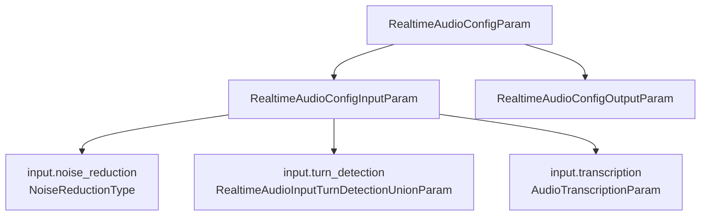

<!-- source: DeepWiki mcp.deepwiki.com · repo openai/openai-go · page 12.2 Audio Buffers and Voice Activity · fetched 2026-10-26 -->

# Audio Buffers and Voice Activity

Relevant source files

The following files were used as context for generating this wiki page:

- [audiospeech.go](audiospeech.go)
- [conversations/aliases.go](conversations/aliases.go)
- [realtime/aliases.go](realtime/aliases.go)
- [realtime/clientsecret.go](realtime/clientsecret.go)
- [realtime/realtime.go](realtime/realtime.go)
- [webhooks/aliases.go](webhooks/aliases.go)

## Purpose and Scope

This document covers audio configuration, format handling, buffer management, and voice activity detection (VAD) in the Realtime API. It details the audio pipeline from input capture through turn detection to output generation. For session initialization and authentication, see [12.1 Realtime Sessions and Authentication]().

## Audio Pipeline Architecture

The audio pipeline manages the flow of raw audio data between the client and the server, applying preprocessing like noise reduction and VAD before the model processes the input.

```mermaid
graph TB
    subgraph "Input Pipeline"
        AudioInput["Audio Input<br/>(PCM16/G711)"]
        InputBuffer["Input Audio Buffer"]
        NoiseReduction["Noise Reduction<br/>NoiseReductionType"]
        TurnDetection["Turn Detection<br/>RealtimeAudioInputTurnDetectionUnion"]
        VAD["Voice Activity Detection<br/>speech_started/speech_stopped"]
        Transcription["Audio Transcription<br/>AudioTranscription"]
    end
    
    subgraph "Configuration Types"
        SessionConfig["RealtimeSessionCreateRequestParam"]
        AudioConfig["RealtimeAudioConfigParam"]
        InputConfig["RealtimeAudioConfigInputParam"]
        OutputConfig["RealtimeAudioConfigOutputParam"]
        TurnDetectionConfig["RealtimeAudioInputTurnDetectionUnionParam"]
        TranscriptionConfig["AudioTranscriptionParam"]
    end
    
    subgraph "Output Pipeline"
        ModelResponse["Model Response"]
        OutputBuffer["Output Audio Buffer"]
        AudioOutput["Audio Output<br/>(PCM16/G711)"]
    end
    
    AudioInput --> InputBuffer
    InputBuffer --> NoiseReduction
    NoiseReduction --> TurnDetection
    TurnDetection --> VAD
    TurnDetection --> Transcription
    
    SessionConfig --> AudioConfig
    AudioConfig --> InputConfig
    AudioConfig --> OutputConfig
    InputConfig --> TurnDetectionConfig
    InputConfig --> TranscriptionConfig
    
    ModelResponse --> OutputBuffer
    OutputBuffer --> AudioOutput
```

**Sources:** [realtime/realtime.go:131-160](), [realtime/clientsecret.go:92-118]()

## Audio Format Configuration

The Realtime API supports high-fidelity and telephony-optimized audio formats for both input and output streams.

### Supported Audio Formats

| Format | Description |
|--------|-------------|
| `pcm16` | 16-bit PCM audio, typically at 24kHz. |
| `g711_ulaw` | G.711 mu-law encoding, standard for North American telephony. |
| `g711_alaw` | G.711 A-law encoding, standard for international telephony. |

### Audio Configuration Structure

The `RealtimeAudioConfigParam` encapsulates both input and output audio settings, allowing independent configuration of each stream direction.

**Sources:** [realtime/realtime.go:131-144](), [realtime/realtime.go:146-175]()

## Input Buffer Management

Audio input flows through a configurable buffer system. The `RealtimeAudioConfigInputParam` type controls all aspects of audio input processing.

- **noise_reduction**: Controls the preprocessing of audio to filter background noise [realtime/realtime.go:171-171]().
- **turn_detection**: Configures how the server identifies the end of a user's speech [realtime/realtime.go:147-159]().
- **transcription**: Enables real-time speech-to-text conversion of the input audio [realtime/realtime.go:173-173]().

### Noise Reduction

The `NoiseReductionType` parameter determines the algorithm used for audio cleanup.

| Type | Description |
|------|-------------|
| `near_field` | Optimized for close-talking microphones like headphones [realtime/realtime.go:121-122](). |
| `far_field` | Optimized for distant microphones like laptops or conference room hardware [realtime/realtime.go:122-123](). |

**Sources:** [realtime/realtime.go:121-129]()

## Turn Detection and Voice Activity Detection (VAD)

Turn detection is a critical component for natural voice interaction, determining when the model should start generating a response.

### Turn Detection Modes

The `RealtimeAudioInputTurnDetectionUnionParam` allows switching between different detection strategies:

1.  **Server VAD**: The model detects speech based on audio volume and characteristics. It responds automatically at the end of user speech [realtime/realtime.go:151-152]().
2.  **Semantic VAD**: An advanced mode that uses a turn-detection model to estimate if a user has actually finished speaking. For example, it can distinguish between a natural pause and a trailing "uhhm" [realtime/realtime.go:154-159]().
3.  **Manual (null)**: Turn detection can be disabled, requiring the client to manually trigger model responses [realtime/realtime.go:148-149]().

### VAD Parameters

When using `server_vad`, developers can tune the following:
- **threshold**: Sensitivity of the detection.
- **prefix_padding_ms**: Amount of audio to include before the detected start of speech.
- **silence_duration_ms**: Duration of silence required to trigger a turn end.

**Sources:** [realtime/realtime.go:146-160]()

## Audio Transcription

The `AudioTranscription` system provides a text representation of the audio input as it is received.

### Transcription Configuration

The `AudioTranscriptionParam` allows configuring:
- **model**: Choice of model (e.g., `whisper-1`, `gpt-4o-transcribe`) [realtime/realtime.go:105-109]().
- **language**: Input language in ISO-639-1 format to improve accuracy [realtime/realtime.go:95-98]().
- **prompt**: Keywords or style guidance for the transcription engine [realtime/realtime.go:99-104]().

### Diarization
Using the `gpt-4o-transcribe-diarize` model enables speaker labels in the transcription output [realtime/realtime.go:82-83]().

**Sources:** [realtime/realtime.go:39-63](), [realtime/realtime.go:94-111]()

## Output Buffer Management

The server manages an output audio buffer that streams generated speech back to the client.

### Modality Control
The session configuration determines if the model responds with audio, text, or both. By default, sessions use `["audio"]`, which produces both audio and a transcript [realtime/clientsecret.go:119-122]().

### Max Output Tokens
To prevent runaway costs or long response times, the `MaxOutputTokens` parameter can limit the length of a single assistant response [realtime/clientsecret.go:113-116]().

**Sources:** [realtime/clientsecret.go:113-125]()

---

