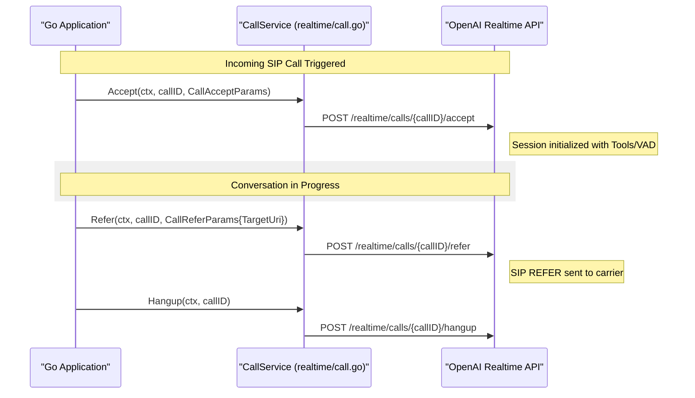

<!-- source: DeepWiki mcp.deepwiki.com · repo openai/openai-go · page 12.3 Realtime Tools and Telephony · fetched 2026-10-26 -->

# Realtime Tools and Telephony

<details>
<summary>Relevant source files</summary>

The following files were used as context for generating this wiki page:

- [audiospeech.go](audiospeech.go)
- [container.go](container.go)
- [container_test.go](container_test.go)
- [containerfile.go](containerfile.go)
- [containerfilecontent.go](containerfilecontent.go)
- [containerfilecontent_test.go](containerfilecontent_test.go)
- [realtime/call.go](realtime/call.go)
- [realtime/clientsecret.go](realtime/clientsecret.go)
- [realtime/realtime.go](realtime/realtime.go)

</details>


This page documents the tool integration capabilities and telephony call management operations available in the Realtime API. It covers how to configure function tools and MCP (Model Context Protocol) integration for real-time sessions, as well as the HTTP endpoints for managing inbound telephony calls.

## Realtime Tool Configuration

The Realtime API supports tool integration within real-time sessions, allowing the model to invoke functions and interact with external systems during voice conversations. Tools are configured when creating a realtime session or creating a client secret.

### Tool Types and Configuration

The SDK defines tools using union types to support multiple formats. In a `RealtimeSessionCreateResponse`, tools are represented by `RealtimeSessionCreateResponseToolUnion` [realtime/clientsecret.go:133]().

**Function Tools**
Function tools enable the model to call custom functions during a realtime session. They are defined within the session configuration. The model's choice of tools is controlled by the `ToolChoice` field, which uses `RealtimeSessionCreateResponseToolChoiceUnion` [realtime/clientsecret.go:131]().

**Tool Choice Modes**
The `tool_choice` parameter controls how the model selects and invokes tools. This can be set to string modes (like `auto`, `none`, or `required`) or forced to a specific function or MCP tool [realtime/clientsecret.go:129-131]().

**Sources:** [realtime/clientsecret.go:87-133]()

### MCP (Model Context Protocol) Integration

The Realtime API supports Model Context Protocol integration, enabling sessions to connect with MCP servers that provide dynamic tool catalogs. MCP tools are referenced by server labels and can be discovered and invoked during the session.

While the primary realtime interaction happens over WebSocket, the SDK provides structured types for MCP-specific lifecycle events in the Responses API, which shares architectural components with the Realtime system. These include:

| Event Type | Purpose |
|-----------|---------|
| `ResponseMcpCallInProgressEvent` | Tool execution has started |
| `ResponseMcpCallCompletedEvent` | Tool execution finished successfully |
| `ResponseMcpCallFailedEvent` | Tool execution encountered an error |
| `ResponseMcpListToolsInProgressEvent` | Server is fetching the tool catalog |

**Sources:** [realtime/clientsecret.go:131-133]()

---

**Diagram: Realtime Session Tool Configuration Structure**

```mermaid
graph TB
    subgraph "Session Configuration"
        ["RealtimeSessionCreateResponse"] -- "contains" --> ["tools: []RealtimeSessionCreateResponseToolUnion"]
        ["RealtimeSessionCreateResponse"] -- "controls" --> ["tool_choice: RealtimeSessionCreateResponseToolChoiceUnion"]
    end
    
    subgraph "Tool Entities"
        ["RealtimeSessionCreateResponseToolUnion"] -- "Variant" --> ["FunctionTool"]
        ["RealtimeSessionCreateResponseToolUnion"] -- "Variant" --> ["MCPTool"]
    end
    
    subgraph "Call Service Integration"
        ["CallAcceptParams"] -- "embeds" --> ["RealtimeSessionCreateRequestParam"]
        ["RealtimeSessionCreateRequestParam"] -- "defines" --> ["Tools"]
    end

    ["RealtimeService"] -- "provides" --> ["CallService"]
    ["CallService"] -- "executes" --> ["Accept"]
```

**Sources:** [realtime/clientsecret.go:87-133](), [realtime/call.go:40-50](), [realtime/call.go:91-95]()

## Telephony Call Operations

The Realtime API provides specialized endpoints for managing telephony calls through the `CallService`. This service handles SIP-based interactions and WebRTC call lifecycles.

### Call Service Endpoints

The call management operations are accessed via `RealtimeService.Calls` [realtime/realtime.go:25]() and include four primary methods defined in `realtime/call.go`:

| Method | Endpoint | Purpose |
|--------|----------|---------|
| `Accept` | `POST /realtime/calls/{call_id}/accept` | Accept an incoming SIP call and configure the session [realtime/call.go:40-50]() |
| `Reject` | `POST /realtime/calls/{call_id}/reject` | Decline an incoming SIP call with a status code [realtime/call.go:79-89]() |
| `Hangup` | `POST /realtime/calls/{call_id}/hangup` | End an active SIP or WebRTC call [realtime/call.go:53-63]() |
| `Refer` | `POST /realtime/calls/{call_id}/refer` | Transfer an active SIP call using the REFER verb [realtime/call.go:66-76]() |

### Call Operation Details

#### Accept Call
The `Accept` method takes a `callID` and `CallAcceptParams` [realtime/call.go:40](). The parameters include a `RealtimeSessionCreateRequest` which allows the developer to configure the instructions, voice, and tools that the model will use once the call is connected [realtime/call.go:91-95]().

#### Reject Call
The `Reject` method allows declining a call before it is answered. Developers can specify a `StatusCode` (e.g., `603` for Decline) via `CallRejectParams` [realtime/call.go:119-123]().

#### Refer (Transfer) Call
The `Refer` method is used for call transfers. It requires a `TargetUri` (such as `tel:+14155550123` or `sip:agent@example.com`) in the `CallReferParams` [realtime/call.go:104-108]().

**Sources:** [realtime/call.go:1-133]()

---

**Diagram: Telephony Call Lifecycle and SDK Entities**



**Sources:** [realtime/call.go:40-89](), [realtime/call.go:104-108]()

## Implementation Details

### Request Execution
Telephony operations utilize `requestconfig.ExecuteNewRequest` to dispatch HTTP POST requests to the Realtime API [realtime/call.go:48](). These methods are designed to be used server-side, typically in response to a webhook or a signaling event from a telephony provider.

### Session Configuration in Calls
The `CallAcceptParams` structure is unique because its `MarshalJSON` method directly shims the `RealtimeSessionCreateRequest` [realtime/call.go:97-99](). This ensures that the configuration for the telephony session matches the schema required for standard Realtime sessions while being wrapped in the call acceptance context.

### Transcription and Audio
Realtime sessions (including those initiated via telephony) can be configured with specific transcription models like `gpt-4o-transcribe` or `gpt-4o-transcribe-diarize` [realtime/realtime.go:90-91](). This is defined via the `AudioTranscription` struct [realtime/realtime.go:39]().

**Sources:** [realtime/call.go:91-102](), [realtime/realtime.go:39-92]()

---

