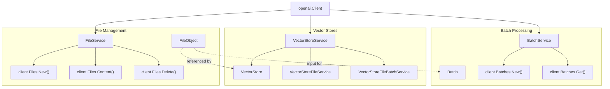
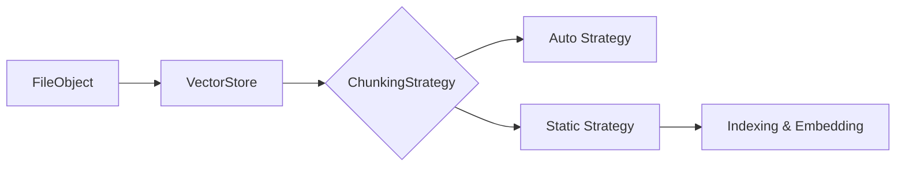
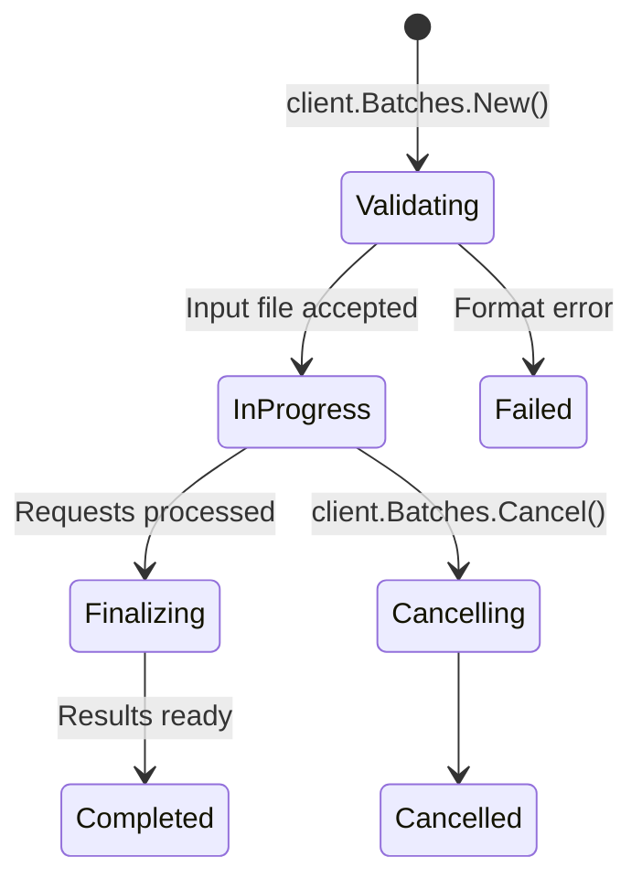

<!-- source: DeepWiki mcp.deepwiki.com · repo openai/openai-go · page 13 Data Management · fetched 2026-10-26 -->

# Data Management

Relevant source files

The following files were used as context for generating this wiki page:

- [batch.go](batch.go)
- [completion.go](completion.go)
- [file.go](file.go)
- [finetuningjob.go](finetuningjob.go)
- [finetuningjob_test.go](finetuningjob_test.go)
- [polling.go](polling.go)
- [upload.go](upload.go)
- [vectorstorefile.go](vectorstorefile.go)
- [vectorstorefilebatch.go](vectorstorefilebatch.go)

This document covers the SDK's data management capabilities: file upload and storage, vector stores for semantic search with retrieval-augmented generation (RAG), and batch processing of API requests. These services provide the infrastructure for managing documents, creating searchable knowledge bases, and processing large-scale asynchronous workloads.

For fine-tuning data preparation, see [Fine-Tuning API](#14). For file attachments in chat and responses, see [Chat Completions API](#3) and [Responses API](#4).

---

## Overview of Data Management Services

The SDK provides three primary data management services that handle different aspects of persistent data storage and processing:

**Sources:** [file.go:36-38](), [vectorstore.go:25-46](), [batch.go:32-34]()

---

## Files API

The `FileService` manages file uploads and provides CRUD operations for stored files. Files are used across various features including Assistants, Fine-tuning, and the Batch API.

### File Purposes and Limits

Files are uploaded with a specific `purpose`, which determines their routing and storage policies. For example, the Assistants API supports specific file types for `file_search`, while the Fine-tuning and Batch APIs primarily support `.jsonl` files.

| Purpose | Description | Size Limit |
|---------|-------------|------------|
| `assistants` | Used for Assistants and Vector Stores | 512 MB per file |
| `batch` | Input for asynchronous Batch API | 200 MB per file |
| `fine-tune` | Training data for model customization | 512 MB per file |

**Project Limits:** Each project can store up to 2.5 TB of files in total.

For details, see [Files API](#13.1).

**Sources:** [file.go:49-75](), [file.go:175-180]()

### Managing Files

The SDK provides methods for the full file lifecycle:
- **Upload**: `client.Files.New` accepts `FileNewParams` containing the file content (as an `io.Reader`) and purpose. [file.go:76-81]()
- **Retrieve**: `client.Files.Get` returns metadata about a specific file. [file.go:84-93]()
- **List**: `client.Files.List` and `ListAutoPaging` provide access to all uploaded files. [file.go:96-116]()
- **Download**: `client.Files.Content` returns the raw file bytes as an `http.Response`. [file.go:131-141]()
- **Delete**: `client.Files.Delete` removes a file and detaches it from vector stores. [file.go:119-128]()

**Sources:** [file.go:76-141]()

---

## Vector Stores API

The `VectorStoreService` manages collections of files that are automatically chunked, embedded, and indexed for semantic search, primarily used by the `file_search` tool in Assistants.

### Chunking and Processing

When files are added to a vector store, the SDK allows configuring a `ChunkingStrategy`:
- **Auto**: The system determines optimal chunk sizes.
- **Static**: Users specify `MaxChunkSizeTokens` and `ChunkOverlapTokens`.

**Sources:** [vectorstore.go:148-172](), [vectorstore.go:313-364]()

### Batch Operations and Polling

The SDK includes helper methods like `UploadAndPoll` and `NewAndPoll` in `VectorStoreFileService` and `VectorStoreFileBatchService`. These methods handle the asynchronous nature of file ingestion by polling the API until processing is complete.

For details, see [Vector Stores API](#13.2).

**Sources:** [vectorstorefile.go:64-95](), [vectorstorefilebatch.go:58-113](), [polling.go:28-95]()

---

## Batches API

The `BatchService` is designed for processing large sets of requests asynchronously. This is typically used for high-volume tasks like evaluation or data labeling where immediate responses are not required.

### Batch Lifecycle

A batch job progresses through several statuses, from `validating` to `completed` or `failed`.

### Key Batch Components
- **Input File**: A `.jsonl` file containing the individual API requests. [batch.go:111]()
- **Completion Window**: The timeframe for processing (e.g., "24h"). [batch.go:105]()
- **Output Files**: Once complete, the batch provides `OutputFileID` for successful results and `ErrorFileID` for failures. [batch.go:126-152]()

For details, see [Batches API](#13.3).

**Sources:** [batch.go:24-51](), [batch.go:102-158]()

---

