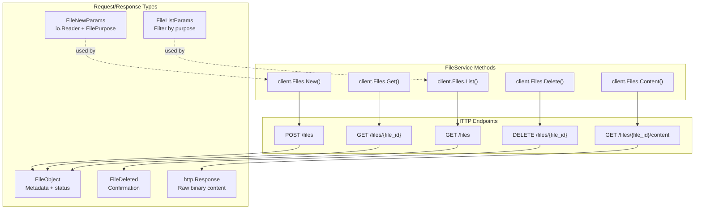
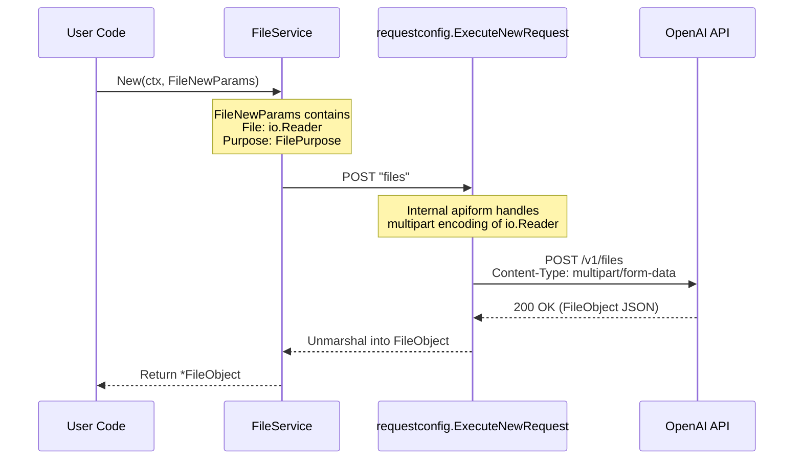
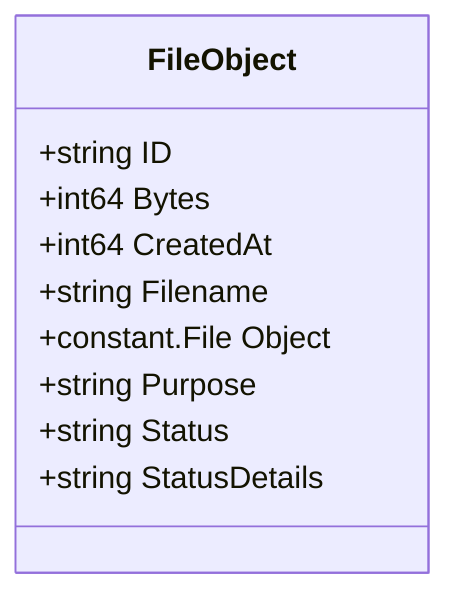

<!-- source: DeepWiki mcp.deepwiki.com · repo openai/openai-go · page 13.1 Files API · fetched 2026-10-26 -->

# Files API

<details>
<summary>Relevant source files</summary>

The following files were used as context for generating this wiki page:

- [audio.go](audio.go)
- [audiotranscription_test.go](audiotranscription_test.go)
- [audiotranslation_test.go](audiotranslation_test.go)
- [batch.go](batch.go)
- [completion.go](completion.go)
- [file.go](file.go)
- [file_test.go](file_test.go)
- [finetuningjob.go](finetuningjob.go)
- [finetuningjob_test.go](finetuningjob_test.go)
- [upload.go](upload.go)

</details>


The Files API provides functionality for uploading, managing, and retrieving files used by other OpenAI APIs. Files serve as input data for fine-tuning jobs, assistants, batch processing, and vector stores for retrieval-augmented generation (RAG). This page documents file upload mechanics, lifecycle management, and integration patterns with downstream APIs.

## File Service Architecture

The Files API is accessed via `client.Files` and provides operations for uploading (`New`), retrieving metadata (`Get`), listing (`List`), deleting (`Delete`), and downloading raw content (`Content`).



**Sources:** [file.go:76-141]()

## File Purposes and Use Cases

Files must be uploaded with a specific purpose that determines their intended use and validation rules. Individual files can be up to 512 MB, and projects can store up to 2.5 TB in total [file.go:49-52]().

| Purpose | Constant | Description |
|---------|----------|-------------|
| Fine-tuning | `FilePurposeFineTune` | Training/validation data in `.jsonl` format [file.go:58-63](). |
| Assistants | `FilePurposeAssistants` | Files for code interpreter or file search (up to 2M tokens) [file.go:54-57](). |
| Batch | `FilePurposeBatch` | Batch API input requests in `.jsonl` format (up to 200 MB) [file.go:64-66](). |
| Batch Output | `FilePurposeBatchOutput` | Results generated by the Batch API [file.go:176-177](). |
| Vision | `FilePurposeVision` | Images for vision-capable models [file.go:176-177](). |

**Sources:** [file.go:49-75](), [file.go:175-182]()

## File Upload Mechanics

### Multipart Form Data Upload

File uploads use `multipart/form-data` encoding. The `FileNewParams` struct accepts an `io.Reader` for the file content, which is handled by the internal `apiform` package during request execution.



**Sources:** [file.go:76-81](), [file.go:185-195]()

### File Upload Examples

The library provides flexibility in how file data is provided via the `FileNewParams` struct:

```go
// Example: Basic File Upload
file, _ := os.Open("data.jsonl")
defer file.Close()

fileObject, err := client.Files.New(context.TODO(), openai.FileNewParams{
    File:    file,
    Purpose: openai.FilePurposeFineTune,
})
```

**Sources:** [file_test.go:20-46]()

## File Metadata and Expiration

### FileObject Structure

The `FileObject` represents an uploaded document. It includes metadata such as size, creation time, and status.



**Sources:** [file.go:164-184]()

### File Expiration Policies

Files can be configured to expire automatically using the `ExpiresAfter` parameter during upload. This is useful for managing temporary storage and remaining within the 2.5 TB project limit [file.go:50-51]().

```go
fileObject, err := client.Files.New(context.TODO(), openai.FileNewParams{
    File:    reader,
    Purpose: openai.FilePurposeAssistants,
    ExpiresAfter: openai.FileNewParamsExpiresAfter{
        Seconds: 3600, // Expires in 1 hour
    },
})
```

**Sources:** [file_test.go:35-37](), [file.go:201-205]()

## File Retrieval and Content Download

### Metadata Retrieval

Retrieve metadata for a specific file by its ID:

```go
fileObject, err := client.Files.Get(context.TODO(), "file-id")
```

**Sources:** [file.go:84-93]()

### Listing Files

List all files with optional filtering by purpose. The SDK supports auto-paging for large lists:

```go
// Auto-paging through all files
iter := client.Files.ListAutoPaging(context.TODO(), openai.FileListParams{
    Purpose: openai.String("fine-tune"),
})
for iter.Next() {
    file := iter.Current()
    fmt.Println(file.ID)
}
```

**Sources:** [file.go:96-116]()

### Downloading Raw Content

The `Content()` method returns the raw binary content of the file as an `http.Response`. This allows for efficient streaming of large files directly to disk or other sinks without loading the entire content into memory.

```go
resp, err := client.Files.Content(context.TODO(), "file-id")
if err != nil {
    panic(err)
}
defer resp.Body.Close()

// Copy content to stdout
io.Copy(os.Stdout, resp.Body)
```

**Sources:** [file.go:131-141](), [file_test.go:119-151]()

## File Deletion

Deleting a file removes it from OpenAI storage and detaches it from all associated vector stores [file.go:118-119]().

```go
deleted, err := client.Files.Delete(context.TODO(), "file-id")
if err != nil {
    panic(err)
}
fmt.Printf("Deleted: %v\n", deleted.Deleted)
```

**Sources:** [file.go:119-128](), [file.go:143-155]()

## Integration with Downstream APIs

Files are primarily used as building blocks for other services:

1.  **Fine-Tuning**: `.jsonl` files are passed to `client.FineTuning.Jobs.New` as `TrainingFile` or `ValidationFile` [finetuningjob.go:49-61]().
2.  **Batch API**: `.jsonl` files containing a list of requests are passed to `client.Batches.New` as `InputFileID` [batch.go:46-51]().
3.  **Vector Stores**: Files are added to vector stores for RAG via `client.VectorStores.Files.New`.
4.  **Audio**: Audio files are uploaded directly to the transcription/translation services using `io.Reader` [audiotranscription_test.go:31-33]().

**Sources:** [file.go:54-72](), [batch.go:111](), [finetuningjob_test.go:32]()

---

