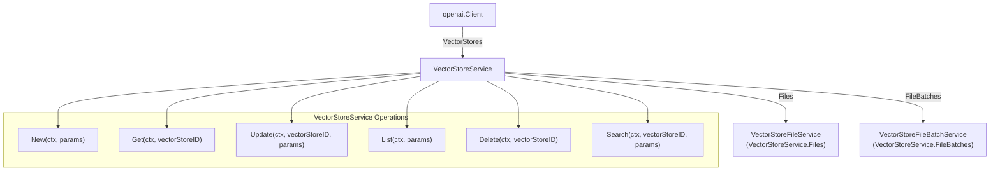
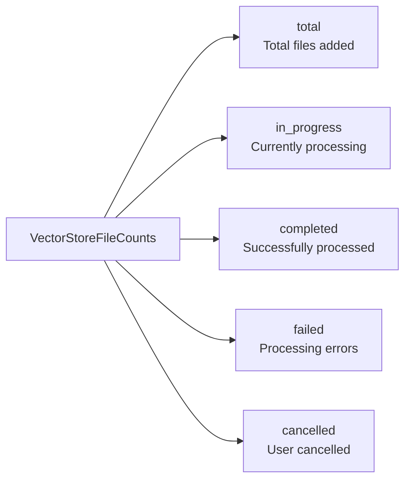
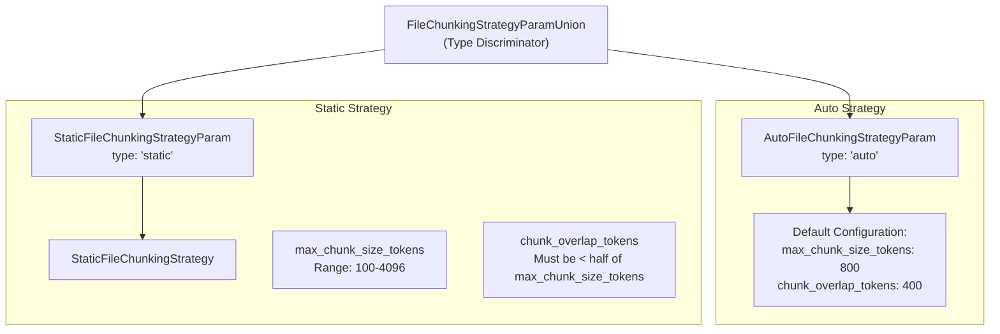
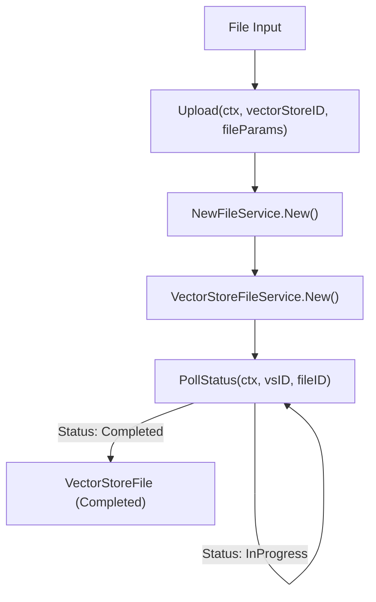

<!-- source: DeepWiki mcp.deepwiki.com · repo openai/openai-go · page 13.2 Vector Stores API · fetched 2026-10-26 -->

# Vector Stores API

<details>
<summary>Relevant source files</summary>

The following files were used as context for generating this wiki page:

- [betathreadmessage.go](betathreadmessage.go)
- [betathreadrunstep.go](betathreadrunstep.go)
- [polling.go](polling.go)
- [vectorstore.go](vectorstore.go)
- [vectorstorefile.go](vectorstorefile.go)
- [vectorstorefilebatch.go](vectorstorefilebatch.go)

</details>


The Vector Stores API provides a file storage and search system that processes files into searchable chunks for use with semantic search and RAG (Retrieval-Augmented Generation) workflows. Vector stores support configurable chunking strategies, batch file processing, and advanced search with filters and ranking options.

Vector stores are accessed via `VectorStoreService` and integrate with file search tools in both the Responses API ([Section 4.2]()) and the deprecated Beta Assistants API ([Section 15]()).

## Service Architecture

The Vector Store system is implemented through `VectorStoreService` and two sub-services for managing individual files and file batches.

**VectorStoreService Hierarchy**



**Sources:** [vectorstore.go:31-45](), [vectorstore.go:49-140]()

### VectorStore Data Structure

The `VectorStore` type represents a collection of processed files with the following key properties:

| Field | Type | Description |
|-------|------|-------------|
| `ID` | `string` | Unique identifier (e.g., `vs_abc123`) |
| `CreatedAt` | `int64` | Unix timestamp of creation |
| `LastActiveAt` | `int64` | Unix timestamp of last activity |
| `Status` | `VectorStoreStatus` | One of `"in_progress"`, `"completed"`, `"expired"` |
| `Name` | `string` | Human-readable name |
| `FileCounts` | `VectorStoreFileCounts` | File processing statistics |
| `UsageBytes` | `int64` | Total storage used by files |
| `Metadata` | `shared.Metadata` | Up to 16 key-value pairs |
| `ExpiresAfter` | `VectorStoreExpiresAfter` | Expiration policy configuration |
| `ExpiresAt` | `int64` | Unix timestamp when store will expire (nullable) |

**Sources:** [vectorstore.go:405-459]()

### File Processing Counts

`VectorStoreFileCounts` tracks file processing status:



**Sources:** [vectorstore.go:461-488]()

## Chunking Strategies

Vector stores process files into searchable chunks using one of two strategies: automatic or static.

**Chunking Strategy Type System**



**Sources:** [vectorstore.go:148-170](), [vectorstore.go:236-290](), [vectorstore.go:312-363]()

### Auto Chunking Strategy

The `AutoFileChunkingStrategyParam` uses intelligent defaults optimized for most use cases:

```go
chunking := NewAutoFileChunkingStrategyParam()
// Equivalent to:
// {
//   Type: "auto"
// }
```

**Sources:** [vectorstore.go:148-163]()

### Static Chunking Strategy

For fine-grained control, use `StaticFileChunkingStrategyParam`:

| Parameter | Type | Constraints | Description |
|-----------|------|-------------|-------------|
| `MaxChunkSizeTokens` | `int64` | 100-4096 | Maximum tokens per chunk |
| `ChunkOverlapTokens` | `int64` | < `MaxChunkSizeTokens / 2` | Tokens shared between adjacent chunks |

**Sources:** [vectorstore.go:236-273](), [vectorstore.go:312-363]()

## Vector Store Search

The `Search()` method performs semantic search within a vector store, returning ranked results with file attributes and content chunks.

**Search Method Signature**

```go
func (r *VectorStoreService) Search(
    ctx context.Context, 
    vectorStoreID string, 
    body VectorStoreSearchParams, 
    opts ...option.RequestOption,
) (res *pagination.Page[VectorStoreSearchResponse], err error)
```

**Sources:** [vectorstore.go:121-140]()

### Search Parameters and Response

| Parameter | Type | Description |
|-----------|------|-------------|
| `Query` | `VectorStoreSearchParamsQueryUnion` | Search query as string or array of strings |
| `MaxNumResults` | `int64` | Maximum results to return (1-50) |
| `RewriteQuery` | `bool` | Whether to rewrite query for better vector search |
| `Filters` | `VectorStoreSearchParamsFiltersUnion` | File attribute filters |
| `RankingOptions` | `VectorStoreSearchParamsRankingOptions` | Scoring and ranking configuration |

**Sources:** [vectorstore.go:778-901]()

## File and File Batch Operations

### VectorStoreFileService and Polling

The `VectorStoreFileService` manages individual files. It includes helper methods like `NewAndPoll`, `Upload`, and `UploadAndPoll` to simplify the file processing lifecycle.



**Sources:** [vectorstorefile.go:76-85](), [vectorstorefile.go:89-95](), [polling.go:30-61]()

### VectorStoreFileBatchService

The `VectorStoreFileBatchService` enables batch operations for adding multiple files simultaneously.

| Method | Purpose |
|--------|---------|
| `New()` | Create a batch of files to be added to a vector store |
| `NewAndPoll()` | Create batch and block until all files are processed |
| `UploadAndPoll()` | Concurrently upload files to Files API then create and poll batch |
| `Cancel()` | Attempt to cancel processing of files in a batch |

**Sources:** [vectorstorefilebatch.go:44-148]()

## Lifecycle Management

Vector Stores support expiration policies and status tracking.

| Operation | Method | Path |
|-----------|--------|------|
| Create | `New()` | `POST /vector_stores` |
| Retrieve | `Get()` | `GET /vector_stores/{id}` |
| Update | `Update()` | `POST /vector_stores/{id}` |
| List | `List()` | `GET /vector_stores` |
| Delete | `Delete()` | `DELETE /vector_stores/{id}` |

**Sources:** [vectorstore.go:49-117]()

---

