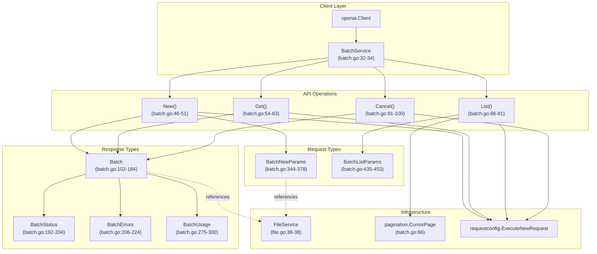
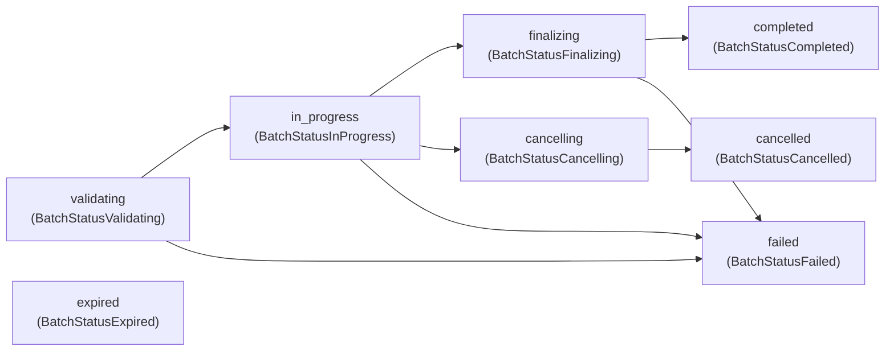

<!-- source: DeepWiki mcp.deepwiki.com · repo openai/openai-go · page 13.3 Batches API · fetched 2026-10-26 -->

# Batches API

<details>
<summary>Relevant source files</summary>

The following files were used as context for generating this wiki page:

- [batch.go](batch.go)
- [batch_test.go](batch_test.go)
- [completion.go](completion.go)
- [file.go](file.go)
- [finetuningjob.go](finetuningjob.go)
- [finetuningjob_test.go](finetuningjob_test.go)
- [upload.go](upload.go)

</details>


## Purpose and Scope

The Batches API provides asynchronous batch processing for OpenAI API requests. It allows users to submit large volumes of API requests as a single batch job, which is processed asynchronously with results delivered via downloadable files. This is ideal for processing thousands of requests cost-effectively and without rate limit concerns.

This page documents the `BatchService` and its operations for creating, monitoring, and managing batch jobs. For file upload operations needed to prepare batch input files, see [Files API](#13.1). For processing individual synchronous requests, see [Chat Completions API](#3) or [Responses API](#4).

**Sources:** [batch.go:24-43]()

---

## Architecture Overview



**Diagram:** Batches API Architecture

The `BatchService` provides four core operations accessed via `client.Batches`. All operations use the `requestconfig` infrastructure for HTTP execution and error handling. Batch creation requires a pre-uploaded input file via the Files API, and results are delivered as downloadable output files.

**Sources:** [batch.go:24-100](), [file.go:36-47]()

---

## Core Data Types

### Batch Structure

The `Batch` type represents a batch job with comprehensive status and metadata:

| Field | Type | Description |
|-------|------|-------------|
| `ID` | `string` | Unique batch identifier |
| `Status` | `BatchStatus` | Current batch status (8 possible states) |
| `Endpoint` | `string` | API endpoint for all requests |
| `InputFileID` | `string` | ID of uploaded input file |
| `OutputFileID` | `string` | ID of results file (when completed) |
| `ErrorFileID` | `string` | ID of errors file (if any) |
| `RequestCounts` | `BatchRequestCounts` | Completed, failed, total counts |
| `Usage` | `BatchUsage` | Token usage statistics (populated after Sept 7, 2025) |
| `CompletionWindow` | `string` | Processing timeframe (e.g., "24h") |
| `Metadata` | `shared.Metadata` | User-defined key-value pairs |
| `CreatedAt` | `int64` | Unix timestamp of creation |
| `CompletedAt` | `int64` | Unix timestamp of completion |

**Sources:** [batch.go:102-159]()

### Batch Status Constants



**Diagram:** Batch Status Lifecycle

Eight status constants defined in `BatchStatus`:

- `validating`: Input file is being validated [batch.go:193]()
- `in_progress`: Requests are being processed [batch.go:195]()
- `finalizing`: Results are being compiled [batch.go:196]()
- `completed`: All requests processed successfully [batch.go:197]()
- `failed`: Batch processing failed [batch.go:194]()
- `cancelling`: Cancellation in progress (up to 10 minutes) [batch.go:199]()
- `cancelled`: Batch was cancelled [batch.go:200]()
- `expired`: Batch expired before completion [batch.go:198]()

**Sources:** [batch.go:192-204]()

### Request Counts

The `BatchRequestCounts` structure tracks processing progress:

```go
type BatchRequestCounts struct {
	Completed int64 `json:"completed,required"`
	Failed    int64 `json:"failed,required"`
	Total     int64 `json:"total,required"`
}
```

**Sources:** [batch.go:251-273]()

### Usage Statistics

The `BatchUsage` type provides detailed token usage (for batches created after September 7, 2025):

```go
type BatchUsage struct {
	InputTokens         int64                         `json:"input_tokens"`
	InputTokensDetails  BatchUsageInputTokensDetails  `json:"input_tokens_details"`
	OutputTokens        int64                         `json:"output_tokens"`
	OutputTokensDetails BatchUsageOutputTokensDetails `json:"output_tokens_details"`
	TotalTokens         int64                         `json:"total_tokens"`
}
```

**Sources:** [batch.go:275-300]()

---

## Creating Batches

### Method: `New()`

```go
func (r *BatchService) New(ctx context.Context, body BatchNewParams, opts ...option.RequestOption) (res *Batch, err error)
```

Creates and executes a batch from an uploaded file of requests.

**Sources:** [batch.go:46-51]()

### Request Parameters

The `BatchNewParams` structure defines batch creation parameters:

| Parameter | Type | Required | Description |
|-----------|------|----------|-------------|
| `CompletionWindow` | `BatchNewParamsCompletionWindow` | Yes | Processing timeframe (currently only "24h") |
| `Endpoint` | `BatchNewParamsEndpoint` | Yes | API endpoint for all requests |
| `InputFileID` | `string` | Yes | ID of uploaded JSONL file |
| `Metadata` | `shared.Metadata` | No | User-defined key-value pairs (16 max) |
| `OutputExpiresAfter` | `BatchNewParamsOutputExpiresAfter` | No | Expiration policy for result files |

**Sources:** [batch.go:344-378]()

### Supported Endpoints

Four endpoints are supported for batch processing via typed constants:

```go
const (
	BatchNewParamsEndpointV1Responses       BatchNewParamsEndpoint = "/v1/responses"
	BatchNewParamsEndpointV1ChatCompletions BatchNewParamsEndpoint = "/v1/chat/completions"
	BatchNewParamsEndpointV1Embeddings      BatchNewParamsEndpoint = "/v1/embeddings"
	BatchNewParamsEndpointV1Completions     BatchNewParamsEndpoint = "/v1/completions"
)
```

**Sources:** [batch.go:397-408]()

### Example Usage

```go
batch, err := client.Batches.New(context.TODO(), openai.BatchNewParams{
    CompletionWindow: openai.BatchNewParamsCompletionWindow24h,
    Endpoint:         openai.BatchNewParamsEndpointV1ChatCompletions,
    InputFileID:      "file-abc123",
    Metadata: shared.Metadata{
        "foo": "string",
    },
})
```

**Sources:** [batch_test.go:29-47]()

---

## Retrieving Batch Information

### Method: `Get()`

```go
func (r *BatchService) Get(ctx context.Context, batchID string, opts ...option.RequestOption) (res *Batch, err error)
```

Retrieves detailed information about a specific batch by ID.

**Request Path:** `GET /batches/{batch_id}`

**Sources:** [batch.go:54-63]()

### Example Usage

```go
batch, err := client.Batches.Get(context.TODO(), "batch_id")
if err != nil {
    return err
}
fmt.Printf("Status: %s\n", batch.Status)
```

**Sources:** [batch_test.go:61-69]()

---

## Listing Batches

### Method: `List()` and `ListAutoPaging()`

```go
func (r *BatchService) List(ctx context.Context, query BatchListParams, opts ...option.RequestOption) (res *pagination.CursorPage[Batch], err error)

func (r *BatchService) ListAutoPaging(ctx context.Context, query BatchListParams, opts ...option.RequestOption) *pagination.CursorPageAutoPager[Batch]
```

Lists all batches in the organization with cursor-based pagination.

**Sources:** [batch.go:66-86]()

### List Parameters

The `BatchListParams` structure supports pagination:

| Parameter | Type | Description |
|-----------|------|-------------|
| `After` | `param.Opt[string]` | Cursor for pagination (object ID) |
| `Limit` | `param.Opt[int64]` | Number of objects (1-100) |

**Sources:** [batch.go:435-453]()

### Auto-Pagination Pattern

```go
iter := client.Batches.ListAutoPaging(ctx, openai.BatchListParams{})
for iter.Next() {
    batch := iter.Current()
    fmt.Printf("Batch: %s\n", batch.ID)
}
if err := iter.Err(); err != nil {
    return err
}
```

**Sources:** [batch.go:84-86]()

---

## Cancelling Batches

### Method: `Cancel()`

```go
func (r *BatchService) Cancel(ctx context.Context, batchID string, opts ...option.RequestOption) (res *Batch, err error)
```

Cancels an in-progress batch. The batch will be in status `cancelling` for up to 10 minutes, before changing to `cancelled`, where it will have partial results (if any) available in the output file.

**Sources:** [batch.go:91-100]()

---

## Input File Format

### JSONL Structure

Batch input files must be JSONL (JSON Lines) format. The Batch API only supports `.jsonl` files up to 200 MB in size [file.go:64-66]().

### Supported Purposes

When uploading a file for use with the Batch API, the `purpose` must be set to `batch`:

```go
const FilePurposeBatch FilePurpose = "batch"
```

**Sources:** [file.go:163-178](), [file.go:197]()

---

## Output and Errors

### Result Files

When a batch completes, result files are generated and accessible via `FileID` fields on the `Batch` object:

1. **Output File** (`OutputFileID`): Contains successful request results [batch.go:152]().
2. **Error File** (`ErrorFileID`): Contains details for requests that failed during execution [batch.go:126]().

### Batch Errors Structure

If the batch itself fails or contains invalid requests, the `Errors` field is populated:

```go
type BatchErrors struct {
	Data   []BatchError `json:"data"`
	Object string       `json:"object"` // Always "list"
}

type BatchError struct {
	Code    string `json:"code"`           // Error code
	Line    int64  `json:"line,nullable"`  // Line number in input file
	Message string `json:"message"`        // Human-readable message
	Param   string `json:"param,nullable"` // Parameter that caused error
}
```

**Sources:** [batch.go:206-249]()

---

## Summary Table of Operations

| Operation | Service Method | HTTP Method | Endpoint |
|-----------|----------------|-------------|----------|
| Create | `New` | POST | `/batches` |
| Retrieve | `Get` | GET | `/batches/{batch_id}` |
| List | `List` | GET | `/batches` |
| Cancel | `Cancel` | POST | `/batches/{batch_id}/cancel` |

**Sources:** [batch.go:46-100]()

---

