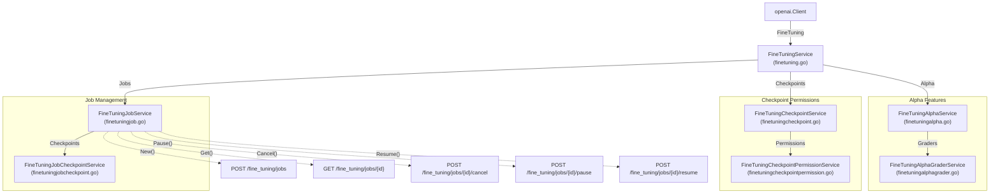
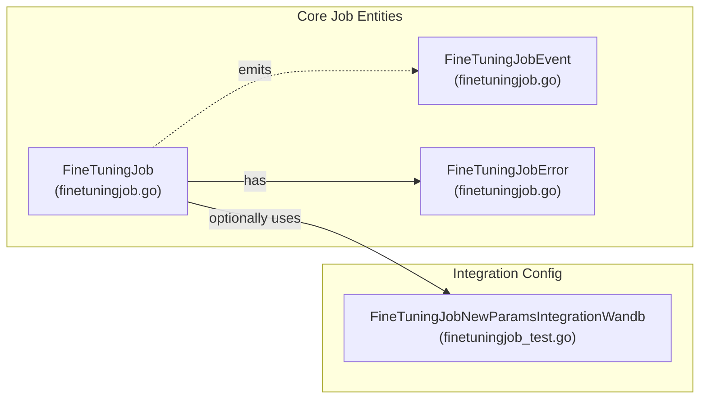

<!-- source: DeepWiki mcp.deepwiki.com · repo openai/openai-go · page 14 Fine-Tuning API · fetched 2026-10-26 -->

# Fine-Tuning API

Relevant source files

The following files were used as context for generating this wiki page:

- [batch.go](batch.go)
- [completion.go](completion.go)
- [file.go](file.go)
- [finetuning.go](finetuning.go)
- [finetuningalpha.go](finetuningalpha.go)
- [finetuningalphagrader.go](finetuningalphagrader.go)
- [finetuningcheckpoint.go](finetuningcheckpoint.go)
- [finetuningjob.go](finetuningjob.go)
- [finetuningjob_test.go](finetuningjob_test.go)
- [finetuningmethod.go](finetuningmethod.go)
- [grader.go](grader.go)
- [gradergradermodel.go](gradergradermodel.go)
- [upload.go](upload.go)

The Fine-Tuning API provides capabilities for customizing OpenAI models on your own training data. This API supports multiple training methods (supervised, DPO, and reinforcement learning), job lifecycle management, checkpoint creation and permissions, and integration with external monitoring tools like Weights & Biases.

For information about using fine-tuned models with the Chat Completions API, see [Chat Completions API](#3). For file management of training data, see [Files API](#13.1).

## Service Architecture

The Fine-Tuning API is organized as a hierarchical service within `FineTuningService` [finetuning.go:15-22](). It manages jobs, checkpoints, and experimental alpha features.

**Sources:** [finetuning.go:15-22](), [finetuningjob.go:33-46](), [finetuningalpha.go:15-19](), [finetuningcheckpoint.go:15-19]()

## Core Types and Methods

### Training Method Types

The API supports three distinct training methods [finetuningjob.go:55-57](). In the SDK, these are represented by parameter unions and response structures.

| Training Method | Parameter Type | Response Type | Description |
|----------------|----------------|---------------|-------------|
| Supervised | `SupervisedMethodParam` | `SupervisedMethod` | Standard supervised fine-tuning [finetuningjob_test.go:104-116]() |
| DPO | `DpoMethodParam` | `DpoMethod` | Direct Preference Optimization [finetuningjob_test.go:57-72]() |
| Reinforcement | `ReinforcementMethodParam` | `ReinforcementMethod` | Reinforcement learning with graders [finetuningjob_test.go:73-103]() |

Each method type includes its own hyperparameters structure, such as `DpoHyperparametersResp` [finetuningmethod.go:35-57]() or `SupervisedHyperparameters` [finetuningjob_test.go:105-115]().

**Sources:** [finetuningmethod.go:35-72](), [finetuningjob_test.go:55-117]()

### Key Data Structures

**Sources:** [finetuningjob.go:165-172](), [finetuningjob_test.go:45-51]()

## Fine-Tuning Jobs

Fine-tuning jobs represent the complete training process. For detailed job lifecycle management, see [Fine-Tuning Jobs and Lifecycle](#14.1).

### Creating a Job
Jobs are created via `FineTuningJobService.New` [finetuningjob.go:56-61](). Training data must be uploaded first using the `FileService` with purpose `fine-tune` [file.go:58-63]().

### Job Operations
- **Get**: Retrieve job details by ID [finetuningjob.go:66-75]().
- **List**: Paginated list of organization jobs [finetuningjob.go:78-98]().
- **Cancel**: Immediately stop a running job [finetuningjob.go:101-110]().
- **Pause/Resume**: Temporarily halt or restart training [finetuningjob.go:139-161]().
- **Events**: Retrieve a stream of job-related logs and metrics [finetuningjob.go:113-137]().

**Sources:** [finetuningjob.go:56-161](), [file.go:58-63]()

## Training Methods and Monitoring

The SDK supports complex training configurations, including hyperparameter tuning and third-party observability. For deep technical details, see [Training Methods and Monitoring](#14.2).

### Hyperparameters
Hyperparameters like `BatchSize`, `LearningRateMultiplier`, and `NEpochs` can be set to specific values or `constant.Auto` [finetuningjob_test.go:33-43]().

### Weights & Biases
Integration with Weights & Biases (W&B) is supported via the `Integrations` field in `FineTuningJobNewParams` [finetuningjob_test.go:44-51]().

**Sources:** [finetuningjob_test.go:33-51](), [finetuningmethod.go:35-57]()

## Alpha Features: Graders

The `FineTuningAlphaGraderService` provides experimental functionality for evaluating models during reinforcement learning fine-tuning.

### Grader Types
The system supports multiple evaluation strategies via `ReinforcementMethodGraderUnionParam` [finetuningjob_test.go:74-81]():
- **String Check**: Matches model output against reference strings [gradergradermodel.go:101-113]().
- **Model-Based**: Uses another model (like GPT-4) to score outputs.
- **Python**: Executes sandboxed code to evaluate responses.

### Operations
- **Run**: Execute a grader against specific inputs [finetuningalphagrader.go:40-45]().
- **Validate**: Check a grader configuration for errors [finetuningalphagrader.go:48-53]().

**Sources:** [finetuningalphagrader.go:26-53](), [gradergradermodel.go:101-113](), [finetuningjob_test.go:73-81]()

## Checkpoints

Checkpoints are snapshots of a model during the training process.
- **Job Checkpoints**: Listed via `FineTuningJobCheckpointService.List` [finetuningjob.go:45]().
- **Permissions**: Control who can access or use specific checkpoints via `FineTuningCheckpointPermissionService` [finetuningcheckpoint.go:18]().

**Sources:** [finetuningjob.go:36-45](), [finetuningcheckpoint.go:15-29]()

---

