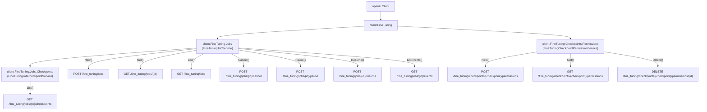
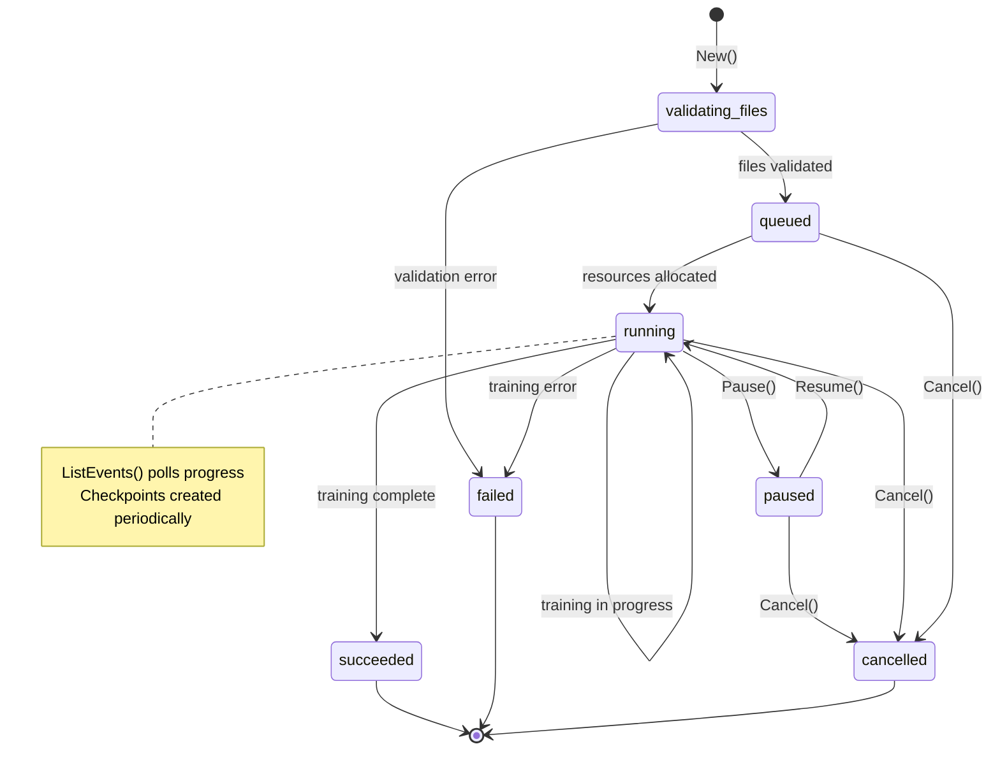
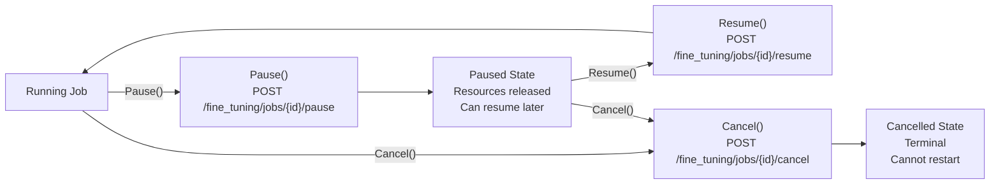

<!-- source: DeepWiki mcp.deepwiki.com · repo openai/openai-go · page 14.1 Fine-Tuning Jobs and Lifecycle · fetched 2026-10-26 -->

# Fine-Tuning Jobs and Lifecycle

<details>
<summary>Relevant source files</summary>

The following files were used as context for generating this wiki page:

- [batch.go](batch.go)
- [completion.go](completion.go)
- [file.go](file.go)
- [finetuningcheckpointpermission.go](finetuningcheckpointpermission.go)
- [finetuningcheckpointpermission_test.go](finetuningcheckpointpermission_test.go)
- [finetuningjob.go](finetuningjob.go)
- [finetuningjob_test.go](finetuningjob_test.go)
- [finetuningjobcheckpoint.go](finetuningjobcheckpoint.go)
- [model.go](model.go)
- [upload.go](upload.go)

</details>


## Purpose and Scope

This document covers the management of fine-tuning jobs through the `FineTuningJobService` API. It explains creating jobs, monitoring their progress through events, controlling job execution (pause/resume/cancel), and managing training checkpoints.

For information about training methods (supervised, DPO, reinforcement learning) and hyperparameters, see [Conversation Items](#11.2).

**Sources:** [finetuningjob.go:25-32]()

## Fine-Tuning Job Service Architecture

The fine-tuning functionality is organized hierarchically under `client.FineTuning.Jobs`. The SDK uses a service-based pattern where sub-resources like checkpoints and permissions are managed by specialized service structs.



**Sources:** [finetuningjob.go:33-47](), [finetuningjobcheckpoint.go:31-42](), [finetuningcheckpointpermission.go:31-42]()

## Job Lifecycle and States

Fine-tuning jobs progress through multiple states. The job lifecycle can be controlled and monitored through various API methods. The `FineTuningJob` object contains a `Status` field which tracks these transitions.



**Sources:** [finetuningjob.go:56-61](), [finetuningjob.go:101-110](), [finetuningjob.go:139-161]()

## Core Data Structures

The primary data structures used in fine-tuning operations are defined in `finetuningjob.go` and related files.

| Type | Description | File |
|------|-------------|------|
| `FineTuningJob` | Represents the job state, including model names and timestamps. | [finetuningjob.go:165-180]() |
| `FineTuningJobEvent` | A log entry generated during the training process. | [finetuningjob.go:214-225]() |
| `FineTuningJobCheckpoint` | A model snapshot ready for use during or after training. | [finetuningjobcheckpoint.go:73-88]() |
| `FineTuningJobNewParams` | Parameters for job creation, including hyperparameters and integrations. | [finetuningjob.go:311-340]() |

**Sources:** [finetuningjob.go:165-225](), [finetuningjobcheckpoint.go:73-88]()

## Creating Fine-Tuning Jobs

### Method Signature

```go
func (r *FineTuningJobService) New(ctx context.Context, body FineTuningJobNewParams, opts ...option.RequestOption) (res *FineTuningJob, err error)
```

**HTTP:** `POST /fine_tuning/jobs`

### Key Parameters

The `FineTuningJobNewParams` structure allows configuration of the base model and training environment.

| Parameter | Type | Required | Description |
|-----------|------|----------|-------------|
| `Model` | `FineTuningJobNewParamsModel` | Yes | Base model to fine-tune (e.g., `gpt-4o-mini`). |
| `TrainingFile` | `string` | Yes | File ID containing training data (must be `.jsonl`). |
| `ValidationFile` | `string` | No | File ID for validation data. |
| `Method` | `FineTuningJobNewParamsMethod` | No | Training method (supervised, DPO, reinforcement). |
| `Hyperparameters` | `FineTuningJobNewParamsHyperparameters` | No | Global hyperparameter overrides. |
| `Integrations` | `[]FineTuningJobNewParamsIntegration` | No | Third-party integrations like Weights & Biases. |

**Sources:** [finetuningjob.go:56-61](), [finetuningjob.go:311-350]()

## Monitoring Job Progress

### Retrieving Job Status

```go
func (r *FineTuningJobService) Get(ctx context.Context, fineTuningJobID string, opts ...option.RequestOption) (res *FineTuningJob, err error)
```

**HTTP:** `GET /fine_tuning/jobs/{fine_tuning_job_id}`

Returns the current state of a specific job. If a job has failed, the `Error` field in the `FineTuningJob` object provides details on the cause.

### Listing Jobs

```go
func (r *FineTuningJobService) List(ctx context.Context, query FineTuningJobListParams, opts ...option.RequestOption) (res *pagination.CursorPage[FineTuningJob], err error)
```

**HTTP:** `GET /fine_tuning/jobs`

Returns a paginated list of jobs. Use `ListAutoPaging` for automatic iterator-based traversal of all jobs.

### Event Stream Monitoring

```go
func (r *FineTuningJobService) ListEvents(ctx context.Context, fineTuningJobID string, query FineTuningJobListEventsParams, opts ...option.RequestOption) (res *pagination.CursorPage[FineTuningJobEvent], err error)
```

**HTTP:** `GET /fine_tuning/jobs/{fine_tuning_job_id}/events`

Retrieves granular training events. Events contain a `Level` (e.g., "info", "warn") and a `Message` detailing progress like loss metrics or checkpoint creation.

**Sources:** [finetuningjob.go:66-75](), [finetuningjob.go:78-98](), [finetuningjob.go:113-137]()

## Job Control Operations

The fine-tuning job lifecycle can be controlled through three specific operations:



### Pause and Resume

*   **Pause**: `Pause(ctx, id)` stops the training and releases compute resources. The job must be in a `running` or `queued` state.
*   **Resume**: `Resume(ctx, id)` continues training from the last saved checkpoint.

### Cancel

*   **Cancel**: `Cancel(ctx, id)` permanently terminates the job. This is a terminal state.

**Sources:** [finetuningjob.go:101-110](), [finetuningjob.go:139-161]()

## Checkpoint Management

Checkpoints are model snapshots created periodically during training. They allow users to evaluate intermediate performance or share partial progress.

### Listing Job Checkpoints

```go
func (r *FineTuningJobCheckpointService) List(ctx context.Context, fineTuningJobID string, query FineTuningJobCheckpointListParams, opts ...option.RequestOption) (res *pagination.CursorPage[FineTuningJobCheckpoint], err error)
```

**HTTP:** `GET /fine_tuning/jobs/{fine_tuning_job_id}/checkpoints`

Each `FineTuningJobCheckpoint` includes:
- `FineTunedModelCheckpoint`: The actual model ID usable in the Completions API.
- `Metrics`: `TrainLoss`, `ValidLoss`, and accuracy stats at that specific `StepNumber`.

**Sources:** [finetuningjobcheckpoint.go:45-64](), [finetuningjobcheckpoint.go:73-88]()

## Checkpoint Permissions

Checkpoints can be shared with other projects within an organization using `FineTuningCheckpointPermissionService`. **Note:** These operations require an admin API key.

### Managing Permissions

| Operation | Method | Description |
|-----------|--------|-------------|
| **Create** | `New()` | Shares a checkpoint with specific project IDs. |
| **List** | `List()` | Returns all permissions for a specific checkpoint. |
| **Delete** | `Delete()` | Revokes access for a specific permission ID. |

**Sources:** [finetuningcheckpointpermission.go:48-67](), [finetuningcheckpointpermission.go:99-118](), [finetuningcheckpointpermission.go:132-145]()

## Weights & Biases Integration

Fine-tuning jobs support integration with Weights & Biases (W&B) for experiment tracking.

### Configuration

The `FineTuningJobNewParamsIntegrationWandb` structure configures W&B:

| Field | Type | Description |
|-------|------|-------------|
| `Project` | `string` | The name of the W&B project. |
| `Entity` | `string` | The entity (team or user) to log to. |
| `Name` | `string` | A specific name for the run. |
| `Tags` | `[]string` | Custom tags for filtering runs in W&B. |

**Sources:** [finetuningjob.go:435-447](), [finetuningjob_test.go:44-51]()

---

