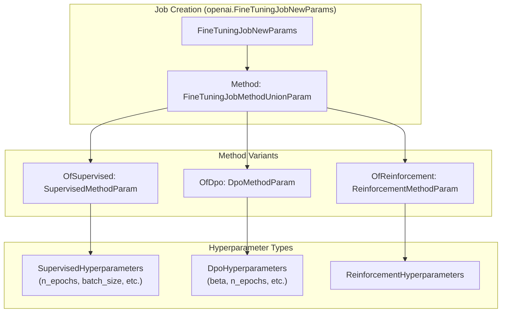
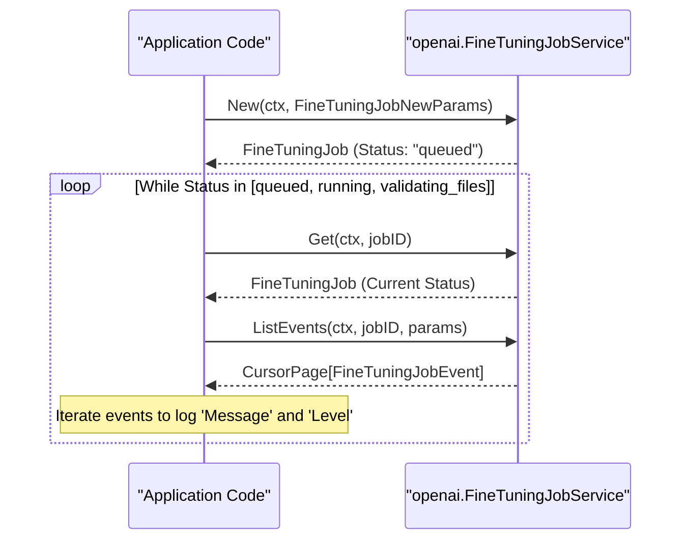
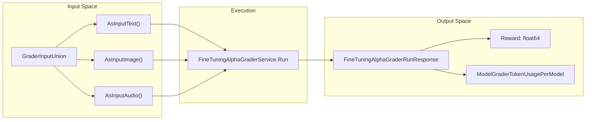

<!-- source: DeepWiki mcp.deepwiki.com · repo openai/openai-go · page 14.2 Training Methods and Monitoring · fetched 2026-10-26 -->

# Training Methods and Monitoring

Relevant source files

The following files were used as context for generating this wiki page:

- [examples/fine-tuning/main.go](examples/fine-tuning/main.go)
- [finetuning.go](finetuning.go)
- [finetuningalpha.go](finetuningalpha.go)
- [finetuningalphagrader.go](finetuningalphagrader.go)
- [finetuningcheckpoint.go](finetuningcheckpoint.go)
- [finetuningmethod.go](finetuningmethod.go)
- [grader.go](grader.go)
- [gradergradermodel.go](gradergradermodel.go)

This page documents the fine-tuning training methods available in the OpenAI Go SDK (supervised, DPO, and reinforcement learning), their hyperparameter configurations, job monitoring via events, Weights & Biases integration, and checkpoint management.

---

## Training Method Architecture

The fine-tuning system supports three distinct training methodologies. These are configured via the `Method` field in `FineTuningJobNewParams` [finetuningjob.go:503-504](). The SDK uses a union pattern to handle different method-specific parameters and response structures.

### Method Selection and Configuration

**Sources:** [finetuningjob.go:503-504](), [finetuningjob.go:887-900](), [finetuningmethod.go:230-244]()

---

## Supervised Fine-Tuning

Supervised fine-tuning trains models on input-output example pairs. This is the standard approach for adapting a model to a specific task or style.

### Configuration and Hyperparameters

The `SupervisedHyperparameters` struct allows for precise control over the training process. Most fields support a union of a specific value (e.g., `int64`) or the `constant.Auto` string [finetuningmethod.go:420-435]().

| Parameter | Type | Description |
|-----------|------|-------------|
| `BatchSize` | `SupervisedHyperparametersBatchSizeUnion` | Number of examples in each batch [finetuningmethod.go:422-424](). |
| `LearningRateMultiplier` | `SupervisedHyperparametersLearningRateMultiplierUnion` | Scaling factor for the learning rate [finetuningmethod.go:426-428](). |
| `NEpochs` | `SupervisedHyperparametersNEpochsUnion` | Number of full cycles through the dataset [finetuningmethod.go:430-432](). |

**Sources:** [finetuningmethod.go:420-445]()

---

## DPO (Direct Preference Optimization)

DPO fine-tuning aligns models with human preferences using paired data (preferred vs. rejected completions).

### Hyperparameters

DPO includes a unique `Beta` parameter which is not present in standard supervised training.

| Field | Type | Description |
|-------|------|-------------|
| `Beta` | `DpoHyperparametersBetaUnion` | Controls the weight of the penalty between the policy and reference model [finetuningmethod.go:341-343](). |
| `NEpochs` | `DpoHyperparametersNEpochsUnion` | Standard epoch count [finetuningmethod.go:347-349](). |

**Sources:** [finetuningmethod.go:335-357]()

---

## Job Monitoring with Events

The SDK provides mechanisms to track fine-tuning progress through the `FineTuningJobService.ListEvents` method [finetuningjob.go:121-124]().

### Monitoring Flow in Code

The following diagram illustrates how an application uses the `FineTuningJobService` to monitor a job's lifecycle.

**Sources:** [examples/fine-tuning/main.go:46-85](), [finetuningjob.go:121-124]()

### Event Structure

Each `FineTuningJobEvent` contains metadata about the training step:
- `Level`: Severity of the event (`info`, `warn`, `error`) [finetuningjob.go:315-316]().
- `Message`: Human-readable progress description [finetuningjob.go:318-319]().
- `Data`: Contains metrics like `Step`, `TrainLoss`, and `TrainMeanTokenAccuracy` [finetuningjob.go:312-313]().

---

## Weights & Biases Integration

Integration with Weights & Biases (W&B) is managed through the `Integrations` field in the job creation parameters [finetuningjob.go:500-501]().

### Configuration Parameters

The `FineTuningJobWandbIntegration` struct defines the connection to W&B:

| Field | Type | Role |
|-------|------|------|
| `Project` | `string` | The W&B project name (Required) [finetuningjob.go:1047-1048](). |
| `Name` | `string` | Specific run name [finetuningjob.go:1044-1045](). |
| `Entity` | `string` | The W&B entity/team name [finetuningjob.go:1041-1042](). |
| `Tags` | `[]string` | Tags for filtering in the W&B dashboard [finetuningjob.go:1050-1051](). |

**Sources:** [finetuningjob.go:1034-1061]()

---

## Checkpoint Management and Permissions

As training progresses, the system generates checkpoints. These can be listed via `FineTuningCheckpointService.List` [finetuningcheckpoint.go:20-22]().

### Checkpoint Permissions

Access to these checkpoints is governed by the `FineTuningCheckpointPermissionService` [finetuningcheckpointpermission.go:22-24]().

- **New Permission**: Create a new access rule for a checkpoint [finetuningcheckpointpermission.go:39-41]().
- **List Permissions**: Retrieve all permissions associated with a checkpoint [finetuningcheckpointpermission.go:48-50]().
- **Delete Permission**: Revoke access [finetuningcheckpointpermission.go:57-59]().

**Sources:** [finetuningcheckpoint.go:15-30](), [finetuningcheckpointpermission.go:15-65]()

---

## Evaluation with Graders (Alpha)

The `FineTuningAlphaGraderService` provides tools to evaluate model performance during or after the fine-tuning process.

### Grader Operations

The service provides two primary methods:
1. `Run`: Executes a grader against specific inputs [finetuningalphagrader.go:40-45]().
2. `Validate`: Verifies that a grader configuration is valid before execution [finetuningalphagrader.go:48-53]().

### Input and Output Data Flow

**Sources:** [gradergradermodel.go:46-91](), [finetuningalphagrader.go:40-45](), [finetuningalphagrader.go:55-69]()

---

