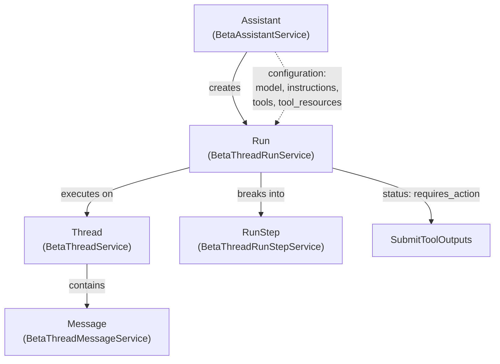
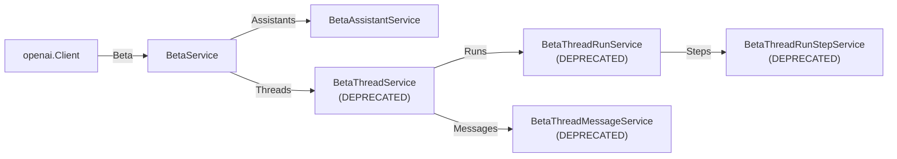
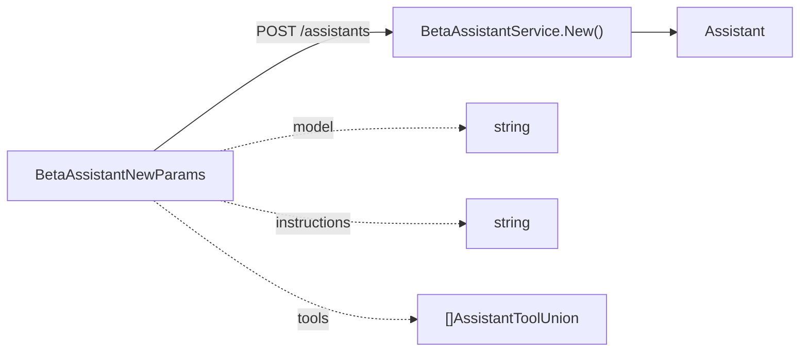
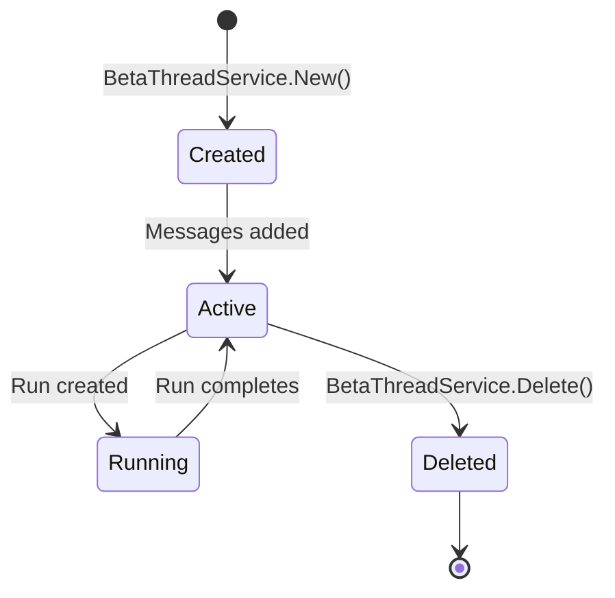
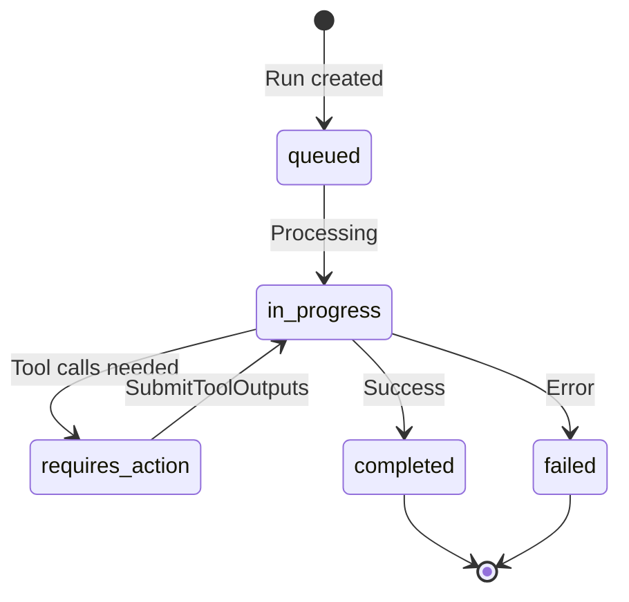

<!-- source: DeepWiki mcp.deepwiki.com · repo openai/openai-go · page 15 Beta Assistants API (Deprecated) · fetched 2026-10-26 -->

# Beta Assistants API (Deprecated)

<details>
<summary>Relevant source files</summary>

The following files were used as context for generating this wiki page:

- [MIGRATION.md](MIGRATION.md)
- [beta.go](beta.go)
- [betaassistant.go](betaassistant.go)
- [betathread.go](betathread.go)
- [betathreadrun.go](betathreadrun.go)

</details>


The Beta Assistants API is a legacy system for building stateful AI assistants with persistent conversation threads, background execution, and tool calling capabilities. **This API is deprecated in favor of the [Responses API](#4)**, which provides a simplified architecture with inline tool execution and improved streaming. This documentation is maintained for teams still using the Assistants API during migration.

For modern assistant implementations, see [Responses API](#4). For stateless chat interactions, see [Chat Completions API](#3).

## Architecture Overview

The Assistants API follows a stateful, asynchronous execution model with five primary entities:



**Sources:** [betaassistant.go:25-42](), [betathread.go:23-48](), [betathreadrun.go:25-47]()

### Entity Responsibilities

| Entity | Type | Purpose | Key Fields |
|--------|------|---------|------------|
| **Assistant** | Configuration | Reusable AI agent definition | `model`, `instructions`, `tools`, `tool_resources` |
| **Thread** | Container | Persistent conversation history | `messages`, `metadata`, `tool_resources` |
| **Message** | Content | User or assistant message | `role`, `content`, `attachments` |
| **Run** | Execution | Async execution of assistant on thread | `status`, `required_action`, `usage` |
| **RunStep** | Execution Detail | Granular execution breakdown | `step_details`, `type` (message_creation, tool_calls) |

**Sources:** [betaassistant.go:129-201](), [betathread.go:453-488](), [betathreadrun.go:269-415]()

## Service Hierarchy

The service hierarchy is organized under the `Beta` service of the main client. Note that most services in this hierarchy are now marked as deprecated.



**Sources:** [beta.go:15-36](), [betathread.go:31-43](), [betathreadrun.go:33-41]()

### Deprecation Status

All thread and run services are explicitly marked as deprecated in the codebase:

```go
// BetaThreadService
// Deprecated: The Assistants API is deprecated in favor of the Responses API
type BetaThreadService struct { ... }

// BetaThreadRunService  
// Deprecated: The Assistants API is deprecated in favor of the Responses API
type BetaThreadRunService struct { ... }
```

The `BetaAssistantService` itself remains active, as assistant configurations are still utilized in newer execution models.

**Sources:** [betathread.go:30-37](), [betathreadrun.go:32-36]()

## Assistants

### Creating and Configuring Assistants

Assistants are defined by their model, instructions, and tool capabilities. Creation is handled via the `New` method on `BetaAssistantService`.

For details on configuration, see [Assistants and Configuration](#15.1).



**Sources:** [betaassistant.go:44-55](), [betaassistant.go:129-162]()

### CRUD Operations

The `BetaAssistantService` provides standard lifecycle management for assistant objects. All requests include the `OpenAI-Beta: assistants=v2` header.

| Method | HTTP Route | Purpose |
|--------|-----------|---------|
| `New(ctx, params)` | `POST /assistants` | Create assistant |
| `Get(ctx, assistantID)` | `GET /assistants/{id}` | Retrieve assistant |
| `Update(ctx, assistantID, params)` | `POST /assistants/{id}` | Modify assistant |
| `List(ctx, query)` | `GET /assistants` | List with pagination |
| `Delete(ctx, assistantID)` | `DELETE /assistants/{id}` | Delete assistant |

**Sources:** [betaassistant.go:44-127]()

## Threads and Messages

### Conversation Management

Threads serve as persistent session containers for messages. Unlike the Chat Completions API, the history is stored server-side.

For details, see [Threads and Messages](#15.2).



**Sources:** [betathread.go:56-110]()

### Message Structure

Messages are added to threads and can contain text, images, and file attachments.

```go
type Thread struct {
    ID            string               `json:"id,required"`
    CreatedAt     int64                `json:"created_at,required"`
    Metadata      shared.Metadata      `json:"metadata,required"`
    ToolResources ThreadToolResources  `json:"tool_resources,required"`
}
```

**Sources:** [betathread.go:453-488]()

## Runs and Execution Flow

### Execution Lifecycle

A `Run` is an invocation of an Assistant on a Thread. Because execution is asynchronous, the Run transitions through several statuses, most notably `requires_action` when tool outputs are needed.

For details, see [Runs and Execution Flow](#15.3).



**Sources:** [betathreadrun.go:555-570]()

### Streaming Support

The SDK supports streaming for runs to provide real-time updates on message creation and tool usage.

```go
// Streaming run creation
stream := client.Beta.Threads.Runs.NewStreaming(ctx, threadID, params)
```

The stream emits `AssistantStreamEventUnion` objects, covering events from `thread.run.created` to `thread.message.delta`.

**Sources:** [betathreadrun.go:68-86](), [betaassistant.go:290-575]()

## Migration to Responses API

The Assistants API is being phased out in favor of the **Responses API**. Developers should plan migrations based on the following architectural shifts:

1.  **Statelessness**: Move from persistent Threads to the `conversation` parameter or `previous_response_id` chaining in the [Responses API](#4).
2.  **Inline Tools**: Transition from the `requires_action` polling loop to the Responses API's inline tool execution model.
3.  **Event Handling**: Refactor `AssistantStreamEventUnion` handlers to use the new `ResponseStreamEventUnion` types.
4.  **Configuration**: Shift from managing persistent `Assistant` objects to defining tool and model configuration directly in the `Response.New` call.

**Sources:** [MIGRATION.md:1-254](), [betathread.go:32-43]()

## Error and Usage Tracking

### Run Terminal States

When a run fails or is incomplete, detailed information is provided in the `Run` object:
*   `LastError`: Contains `Code` and `Message` for failures. [betathreadrun.go:440-460]()
*   `IncompleteDetails`: Explains why a run stopped (e.g., `max_completion_tokens`). [betathreadrun.go:418-437]()

### Usage Metrics

Usage is tracked per run and available in the `Usage` field once the run reaches a terminal state.

```go
type RunUsage struct {
    CompletionTokens int64 `json:"completion_tokens,required"`
    PromptTokens     int64 `json:"prompt_tokens,required"`
    TotalTokens      int64 `json:"total_tokens,required"`
}
```

**Sources:** [betathreadrun.go:530-553]()

---

