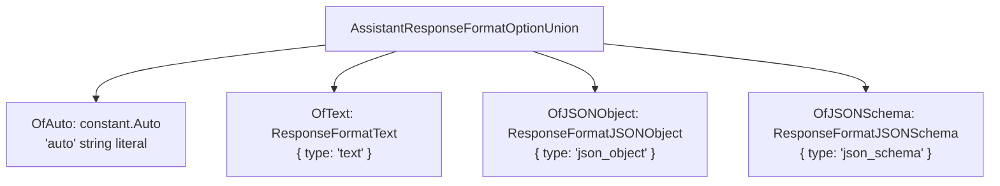

<!-- source: DeepWiki mcp.deepwiki.com · repo openai/openai-go · page 15.1 Assistants and Configuration · fetched 2026-10-26 -->

# Assistants and Configuration

<details>
<summary>Relevant source files</summary>

The following files were used as context for generating this wiki page:

- [betaassistant.go](betaassistant.go)
- [betathread.go](betathread.go)
- [betathreadrun.go](betathreadrun.go)

</details>


This page documents the Beta Assistants API's core configuration system, specifically focusing on the `Assistant` object and the `BetaAssistantService` that manages assistant creation, configuration, and lifecycle operations.

**Deprecation Notice**: The Assistants API is deprecated in favor of the Responses API. For information about the modern replacement, see [Responses API](#4). For details on threads and runs within the Assistants API, see [Threads and Messages](#15.2) and [Runs and Execution Flow](#15.3).

---

## Assistant Object Structure

The `Assistant` object ([betaassistant.go:132-217]()) represents a configured AI assistant with a specific model, instructions, tools, and resource configuration. Assistants are reusable configurations that can be referenced across multiple threads and runs.

### Core Assistant Fields

Title: Assistant Data Model
```mermaid
graph TB
    Assistant["Assistant<br/>(betaassistant.go:132)"]
    
    subgraph "Identity"
        ID["ID: string<br/>Unique identifier"]
        Name["Name: string<br/>Max 256 chars"]
        Description["Description: string<br/>Max 512 chars"]
        CreatedAt["CreatedAt: int64<br/>Unix timestamp"]
    end
    
    subgraph "Model Configuration"
        Model["Model: string<br/>Model identifier"]
        Instructions["Instructions: string<br/>System prompt<br/>Max 256,000 chars"]
        Temperature["Temperature: float64<br/>0-2 sampling"]
        TopP["TopP: float64<br/>Nucleus sampling"]
    end
    
    subgraph "Tools & Resources"
        Tools["Tools: []AssistantToolUnion<br/>Max 128 tools"]
        ToolResources["ToolResources: AssistantToolResources<br/>File IDs & Vector Stores"]
    end
    
    subgraph "Output Control"
        ResponseFormat["ResponseFormat: AssistantResponseFormatOptionUnion<br/>Text/JSON/JSONSchema"]
    end
    
    subgraph "Additional"
        Metadata["Metadata: shared.Metadata<br/>16 key-value pairs"]
        Object["Object: constant.Assistant<br/>Always 'assistant'"]
    end
    
    Assistant --> "Identity"
    Assistant --> "Model Configuration"
    Assistant --> "Tools & Resources"
    Assistant --> "Output Control"
    Assistant --> "Additional"
```

**Sources**: [betaassistant.go:132-217]()

---

## BetaAssistantService Operations

The `BetaAssistantService` ([betaassistant.go:33-44]()) provides CRUD operations for managing assistants. All requests require the `OpenAI-Beta: assistants=v2` header, which is automatically added by the service methods via `option.WithHeader` ([betaassistant.go:51]()).

### Service Method Overview

| Method | Purpose | HTTP Endpoint | Returns |
|--------|---------|---------------|---------|
| `New()` | Create assistant | `POST /assistants` | `*Assistant` |
| `Get()` | Retrieve assistant | `GET /assistants/{id}` | `*Assistant` |
| `Update()` | Modify assistant | `POST /assistants/{id}` | `*Assistant` |
| `List()` | List assistants | `GET /assistants` | `*pagination.CursorPage[Assistant]` |
| `ListAutoPaging()` | Auto-paginated list | `GET /assistants` | `*pagination.CursorPageAutoPager[Assistant]` |
| `Delete()` | Delete assistant | `DELETE /assistants/{id}` | `*AssistantDeleted` |

**Sources**: [betaassistant.go:49-127]()

---

## Creating Assistants

### Required Parameters

The `BetaAssistantNewParams` requires the `Model` field. All other configuration is optional.

Title: Assistant Creation Parameters
```mermaid
graph LR
    Params["BetaAssistantNewParams"]
    
    subgraph "CoreConfig"
        Model["Model: shared.ChatModel<br/>(Required)"]
        Instructions["Instructions: string<br/>System prompt"]
        Name["Name: string"]
        Description["Description: string"]
    end
    
    subgraph "Sampling"
        Temp["Temperature: float64"]
        TopP["TopP: float64"]
    end
    
    subgraph "ToolsConfig"
        ToolsList["Tools: []AssistantToolUnionParam"]
        ToolRes["ToolResources"]
    end
    
    subgraph "OutputConfig"
        RespFormat["ResponseFormat"]
    end
    
    Params --> "CoreConfig"
    Params --> "Sampling"
    Params --> "ToolsConfig"
    Params --> "OutputConfig"
```

**Sources**: [betaassistant.go:49-55](), [betaassistant.go:306-400]()

---

## Tool Configuration

Assistants support three primary tool types: `code_interpreter`, `file_search`, and `function`. Each tool type requires specific resource configuration.

### Tool Resources Structure

Title: Tool Resource Mapping
```mermaid
graph TB
    ToolResources["AssistantToolResources<br/>(betaassistant.go:229)"]
    
    subgraph "CodeInterpreterConfig"
        CI["CodeInterpreter"]
        CIFiles["FileIDs: []string<br/>Max 20 files"]
    end
    
    subgraph "FileSearchConfig"
        FS["FileSearch"]
        VSIDs["VectorStoreIDs: []string<br/>Max 1 vector store"]
    end
    
    ToolResources --> "CodeInterpreterConfig"
    ToolResources --> "FileSearchConfig"
```

### Code Interpreter Tool

Code Interpreter allows the assistant to execute Python code. Files attached to this tool can be used within the code execution environment:

- **Maximum files**: 20 per assistant
- **Resource type**: `AssistantToolResourcesCodeInterpreter` ([betaassistant.go:247-264]())
- **Field**: `FileIDs []string`

### File Search Tool

File Search enables semantic search over attached vector stores:

- **Maximum vector stores**: 1 per assistant
- **Resource type**: `AssistantToolResourcesFileSearch` ([betaassistant.go:266-284]())
- **Field**: `VectorStoreIDs []string`

Alternatively, vector stores can be created inline during assistant creation with automatic chunking strategies ([betaassistant.go:572-612]()).

**Sources**: [betaassistant.go:229-284](), [betaassistant.go:530-612]()

---

## Response Format Configuration

The `ResponseFormat` field controls the structure of assistant outputs. It uses the `AssistantResponseFormatOptionUnion` type ([betathread.go:147-195]()).

### Response Format Options

Title: Assistant Output Formats


**Important**: When using JSON modes, you must instruct the model to produce JSON in the `Instructions` field. Without this, the model may generate whitespace indefinitely.

**Sources**: [betathread.go:147-195](), [betaassistant.go:179-197]()

---

## Tool Choice Configuration

The `ToolChoice` parameter controls which tools the assistant uses during execution. It uses the `AssistantToolChoiceOptionUnion` type ([betathread.go:373-464]()).

### Tool Choice Modes

| Mode | Behavior |
|------|----------|
| **None** | Model will not call any tools |
| **Auto** | Model decides whether to use tools (default) |
| **Required** | Model must call at least one tool |
| **Specific** | Forces a specific tool (e.g., a specific function) |

To force a specific tool, use the `AssistantToolChoice` structure ([betathread.go:271-284]()), specifying the `Type` (e.g., `function`) and the specific `Function.Name`.

**Sources**: [betathread.go:271-464]()

---

## Managing Assistants

### Retrieving an Assistant

Retrieval is performed by providing the unique `assistant_id` to the `Get` method ([betaassistant.go:60-70]()).

### Updating an Assistant

The `Update` method ([betaassistant.go:75-85]()) allows modifying an existing assistant. All fields except `ID`, `CreatedAt`, and `Object` can be updated.

### Listing Assistants

The `List` method supports cursor-based pagination ([betaassistant.go:90-105]()). For automatic pagination, use `ListAutoPaging` ([betaassistant.go:110-112]()), which returns a `*pagination.CursorPageAutoPager[Assistant]`.

### Deleting an Assistant

Deleting an assistant ([betaassistant.go:117-127]()) returns an `AssistantDeleted` object ([betaassistant.go:286-304]()). Deleting an assistant does not delete associated threads, messages, or files.

**Sources**: [betaassistant.go:60-127](), [betaassistant.go:286-304]()

---

## Configuration Limits

| Resource | Limit | Source |
|----------|-------|--------|
| Instructions length | 256,000 characters | [betaassistant.go:139-141]() |
| Name length | 256 characters | [betaassistant.go:156]() |
| Description length | 512 characters | [betaassistant.go:137]() |
| Tools per assistant | 128 | [betaassistant.go:159-162]() |
| Code Interpreter files | 20 per assistant | [betaassistant.go:252]() |
| Metadata entries | 16 key-value pairs | [betaassistant.go:142-148]() |

**Sources**: [betaassistant.go:132-284]()

---

