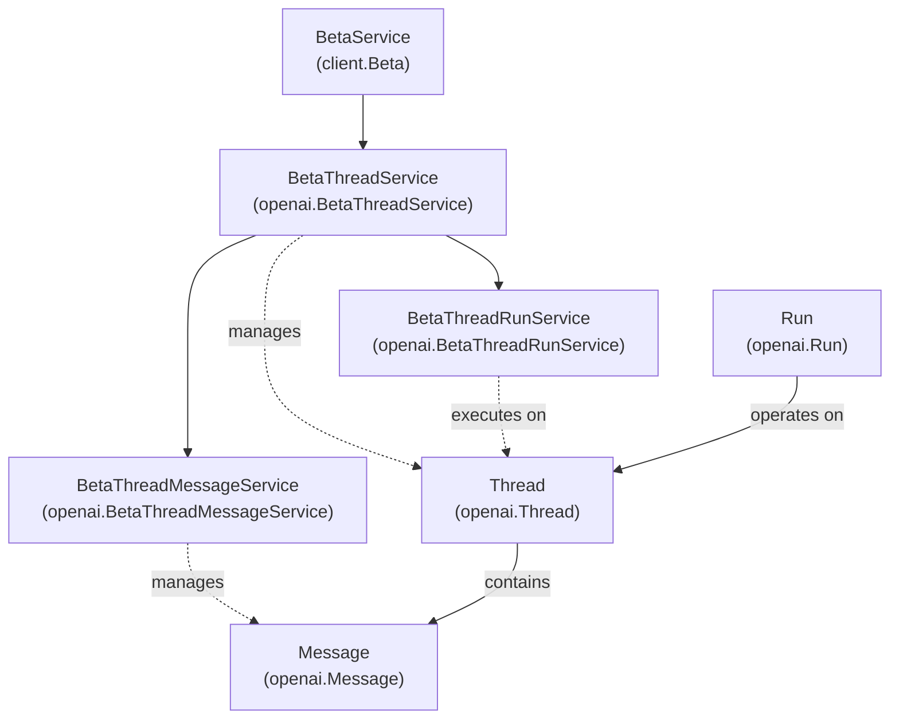
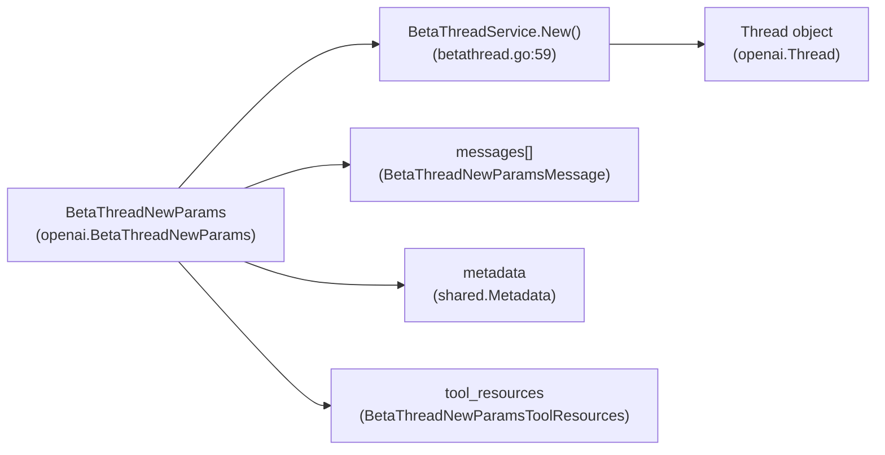
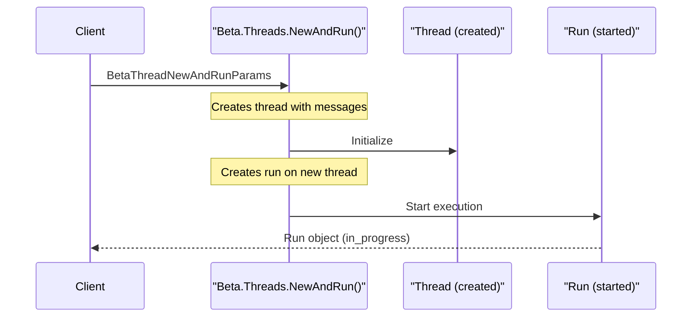
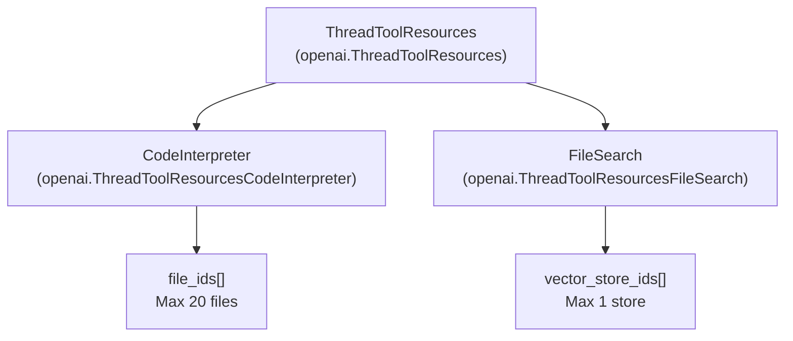
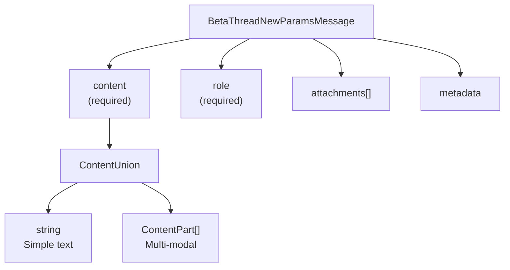
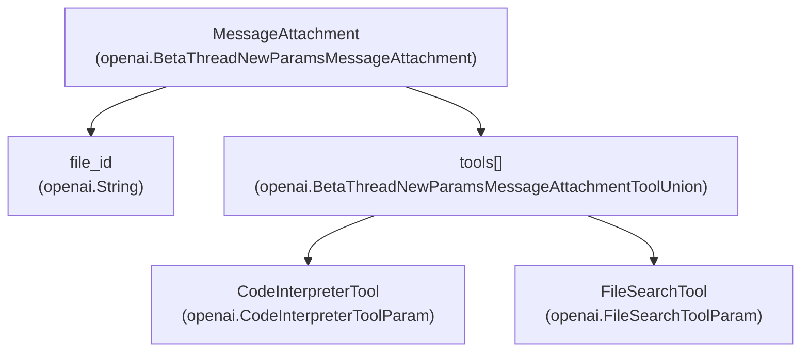

<!-- source: DeepWiki mcp.deepwiki.com · repo openai/openai-go · page 15.2 Threads and Messages · fetched 2026-10-26 -->

# Threads and Messages

<details>
<summary>Relevant source files</summary>

The following files were used as context for generating this wiki page:

- [betaassistant.go](betaassistant.go)
- [betaassistant_test.go](betaassistant_test.go)
- [betathread.go](betathread.go)
- [betathread_test.go](betathread_test.go)
- [betathreadmessage.go](betathreadmessage.go)
- [betathreadrun.go](betathreadrun.go)
- [betathreadrun_test.go](betathreadrun_test.go)
- [betathreadrunstep.go](betathreadrunstep.go)
- [vectorstore.go](vectorstore.go)

</details>


**Purpose**: This page documents the Beta Assistants API's Thread and Message system, which provides a stateful conversation container for organizing multi-turn interactions with assistants. Threads persist messages across multiple runs and support tool resources like code interpreter and file search.

**⚠️ Deprecation Notice**: The entire Assistants API, including Threads and Messages, is deprecated in favor of the [Responses API](#4). The Responses API provides a modernized, stateless or linked conversation model with inline tool execution. This documentation is maintained for legacy usage only [betathread.go:32-34]().

**Scope**: This page covers thread lifecycle management, message structure, content types, attachments, and tool resources. For information about executing runs on threads, see [Runs and Execution Flow](#15.3). For assistant configuration, see [Assistants and Configuration](#15.1).

## Thread Service Architecture

The thread system is organized into a hierarchical service structure where `BetaThreadService` manages thread lifecycle and contains sub-services for runs and messages.

**Natural Language Space to Code Entity Space: Service Hierarchy**


**Sources**: [betathread.go:33-54](), [betathreadrun.go:35-51](), [betathreadmessage.go:35-46]()

## Thread Lifecycle Operations

The `BetaThreadService` provides CRUD operations for managing thread objects. All operations require the `OpenAI-Beta: assistants=v2` header, which is automatically added by the SDK [betathread.go:61-61]().

### Creating Threads

Threads can be created with optional initial messages, metadata, and tool resources.

**Natural Language Space to Code Entity Space: Thread Creation**


**Method Signature**:
- `New(ctx, BetaThreadNewParams) (*Thread, error)` - Creates a new thread [betathread.go:59-65]()

**Parameters**:
- `Messages`: Array of initial messages to start the thread with [betathread.go:571-572]()
- `Metadata`: Up to 16 key-value pairs (64 char keys, 512 char values) [betathread.go:574-575]()
- `ToolResources`: Resources for code interpreter and file search tools [betathread.go:577-578]()

**Sources**: [betathread.go:59-65](), [betathread.go:570-596](), [betathread_test.go:18-74]()

### Retrieving, Updating, and Deleting Threads

| Operation | Method | Parameters | Return Type | File Reference |
|-----------|--------|------------|-------------|----------------|
| Retrieve | `Get` | `threadID` | `*Thread` | [betathread.go:70-80]() |
| Update | `Update` | `threadID`, `params` | `*Thread` | [betathread.go:85-95]() |
| Delete | `Delete` | `threadID` | `*ThreadDeleted` | [betathread.go:100-110]() |

**Update Operations**:
- Modify `Metadata` [betathread.go:941-942]()
- Update `ToolResources` (add/remove file IDs or vector store IDs) [betathread.go:944-945]()

**Delete Response**:
- `ID`: The deleted thread ID [betathread.go:553-554]()
- `Deleted`: Boolean confirmation [betathread.go:556-557]()
- `Object`: Always `constant.ThreadDeleted` [betathread.go:559-560]()

**Sources**: [betathread.go:70-110](), [betathread_test.go:76-156]()

### Create and Run (Convenience Method)

The `NewAndRun` method combines thread creation with run execution in a single API call to the `threads/runs` endpoint [betathread.go:118-118]().

**Execution Flow**


**Method Signatures**:
- `NewAndRun(ctx, params) (*Run, error)` - Synchronous creation and execution [betathread.go:115-121]()
- `NewAndRunStreaming(ctx, params) (*Stream[AssistantStreamEventUnion])` - Streaming variant using SSE [betathread.go:126-137]()

**Sources**: [betathread.go:115-137](), [betathread_test.go:158-248]()

## Thread Structure

The `Thread` type represents a stateful conversation container that persists messages across multiple runs.

### Thread Properties

| Field | Type | Description |
|-------|------|-------------|
| `ID` | `string` | Unique identifier for API references [betathread.go:453-454]() |
| `CreatedAt` | `int64` | Unix timestamp (seconds) of creation [betathread.go:456-457]() |
| `Metadata` | `shared.Metadata` | Custom key-value pairs (max 16) [betathread.go:463-464]() |
| `Object` | `constant.Thread` | Always `"thread"` [betathread.go:466-467]() |
| `ToolResources` | `ThreadToolResources` | Available tools and their resources [betathread.go:469-470]() |

**Sources**: [betathread.go:451-488]()

### Tool Resources

Tool resources specify which files and vector stores are available to the assistant's tools within the thread context.

**Thread Tool Resource Mapping**


**CodeInterpreter Resources**:
- `FileIDs`: List of file IDs available to code interpreter [betathread.go:520-521]()
- Maximum 20 files per thread [betathread.go:516-517]()

**FileSearch Resources**:
- `VectorStoreIDs`: List of vector store IDs for semantic search [betathread.go:540-541]()
- Maximum 1 vector store per thread [betathread.go:535-536]()

**Sources**: [betathread.go:490-549](), [betathread_test.go:49-65]()

## Messages within Threads

Messages are the fundamental content units within threads, representing either user input or assistant responses.

### Message Structure in Thread Creation

When creating threads with initial messages, each message follows the `BetaThreadNewParamsMessage` structure [betathread.go:598-635]().

**Message Components**


**Required Fields**:
- `Content`: Text content or array of content parts [betathread.go:603-605]()
- `Role`: Either `"user"` or `"assistant"` [betathread.go:611-612]()

**Sources**: [betathread.go:598-635](), [betathread_test.go:31-45]()

### Message Content Types

The `BetaThreadNewParamsMessageContentUnion` supports two content formats:

**Simple String Content**:
```go
Content: BetaThreadNewParamsMessageContentUnion{
    OfString: openai.String("What is in this image?"),
}
```

**Array of Content Parts**:
```go
Content: BetaThreadNewParamsMessageContentUnion{
    OfArrayOfContentParts: []MessageContentPartParamUnion{
        // Text, image, audio, or file content parts
    },
}
```

**Implementation**:
- `OfString`: Direct text content [betathread.go:640-642]()
- `OfArrayOfContentParts`: Multi-modal content array [betathread.go:644-645]()
- Uses `param.MarshalUnion()` for serialization [betathread.go:653-655]()

**Sources**: [betathread.go:637-660](), [betathread_test.go:32-34]()

### Message Attachments

Attachments link files to messages and specify tool access [betathread.go:662-676]().

**Attachment Architecture**


**Tool Union Types**:
- `OfCodeInterpreter`: Makes file available to code interpreter [betathread.go:681-682]()
- `OfFileSearch`: Makes file available to file search [betathread.go:684-685]()

**Sources**: [betathread.go:662-741](), [betathread_test.go:36-41]()

## Thread Tool Resources in Detail

### Code Interpreter Resources
- Specify up to 20 file IDs [betathread.go:765-766]()
- Files persist across all runs on the thread [betathread.go:761-762]()

### File Search Resources
- `VectorStoreIDs`: Reference existing stores [betathread.go:781-782]()
- `VectorStores`: Create new ones inline with `ChunkingStrategy` [betathread.go:787-788]()
- `ChunkingStrategy`: Supports `OfAuto` or `OfStatic` [betathread.go:801-815]()

**Sources**: [betathread.go:747-896](), [betathread_test.go:50-64]()

## Response Format and Tool Choice

Runs executed on threads can specify output constraints.

### Response Format Options
Supported via `AssistantResponseFormatOptionUnion` [betathread.go:132-147]():
- `OfAuto`: Default behavior [betathread.go:150-150]()
- `OfText`: Plain text output [betathread.go:167-169]()
- `OfJSONObject`: JSON object without schema [betathread.go:172-174]()
- `OfJSONSchema`: Structured Outputs with validation [betathread.go:176-178]()

### Tool Choice Configuration
Controlled via `AssistantToolChoiceOptionUnion` [betathread.go:254-269]():
- `"none"`: No tool calls [betathread.go:411-411]()
- `"auto"`: Optional tool calls [betathread.go:413-413]()
- `"required"`: Must call a tool [betathread.go:415-415]()
- Specific Tool: Force a specific function or tool type [betathread.go:271-285]()

**Sources**: [betathread.go:132-449](), [betathread_test.go:180-182](), [betathread_test.go:221-223]()

## Deprecation and Migration Path

The Beta Assistants API is deprecated. The migration path involves shifting from stateful Threads to the Responses API.

| Aspect | Beta Threads (Deprecated) | Responses API |
|--------|---------------------------|---------------|
| State Management | Stateful container (`Thread`) | Stateless or linked via `previous_response_id` |
| Execution | Via `Run` with polling | Inline or background execution |
| Header | `OpenAI-Beta: assistants=v2` | No special beta header required |
| Service | `client.Beta.Threads` | `client.Responses` |

**Migration Considerations**:
- For stateful conversations, use the Responses API's `store: true` parameter.
- Use the Conversation API for explicit conversation management.
- Vector stores remain compatible and are managed via `client.VectorStores` [vectorstore.go:31-35]().

**Sources**: [betathread.go:32-34](), [vectorstore.go:31-35]()

---

