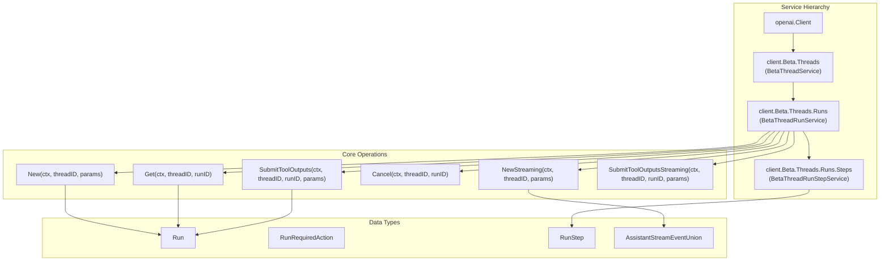
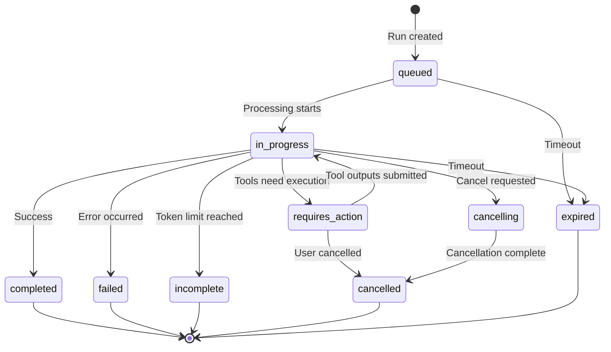
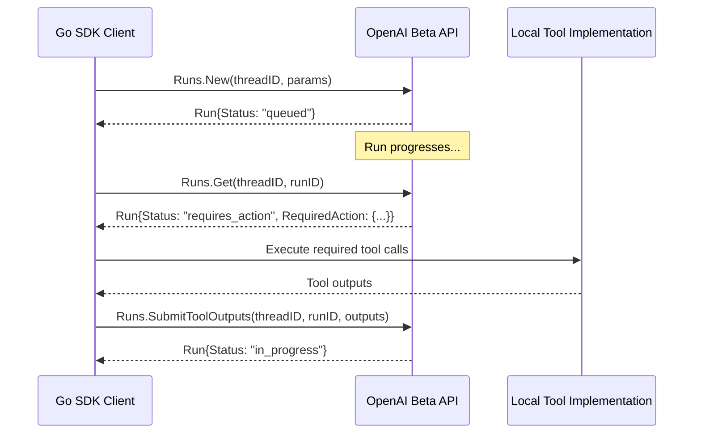
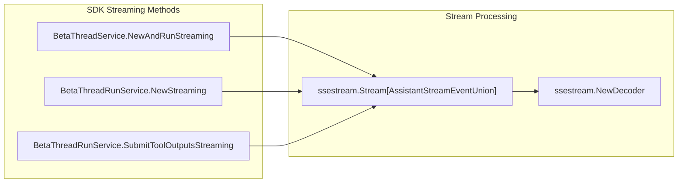
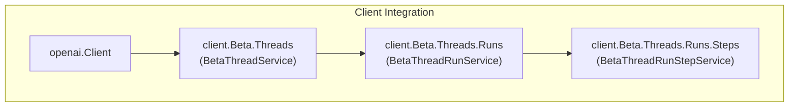

<!-- source: DeepWiki mcp.deepwiki.com · repo openai/openai-go · page 15.3 Runs and Execution Flow · fetched 2026-10-26 -->

# Runs and Execution Flow

Relevant source files

The following files were used as context for generating this wiki page:

- [betaassistant.go](betaassistant.go)
- [betaassistant_test.go](betaassistant_test.go)
- [betathread.go](betathread.go)
- [betathread_test.go](betathread_test.go)
- [betathreadrun.go](betathreadrun.go)
- [betathreadrun_test.go](betathreadrun_test.go)
- [polling.go](polling.go)

This document covers the run lifecycle and tool execution functionality in the deprecated Beta Assistants API. Runs execute an assistant on a thread, manage tool calls, and track execution progress through multiple states. Run steps provide granular tracking of tool invocations and message creation.

**Note: The Assistants API is deprecated in favor of the Responses API.** For assistant configuration, see [Assistants and Configuration](#15.1). For thread and message management, see [Threads and Messages](#15.2).

## Run Service Architecture

The run execution system is managed by `BetaThreadRunService` and `BetaThreadRunStepService`. These services are nested within the `BetaThreadService`.

**BetaThreadRunService Component Structure**

**Sources:** [betathreadrun.go:35-41](), [betathreadrun.go:56-174](), [betathreadrunstep.go:24-43]()

## Run Lifecycle

### Creating and Managing Runs

The SDK provides methods for creating runs on existing threads, or creating a thread and run in a single request.

**BetaThreadRunService Methods**

| Method | HTTP | Purpose | Return Type |
|--------|------|---------|-------------|
| `New` | `POST /threads/{id}/runs` | Create a run | `*Run` |
| `NewStreaming` | `POST /threads/{id}/runs` | Create streaming run | `*ssestream.Stream[AssistantStreamEventUnion]` |
| `Get` | `GET /threads/{id}/runs/{id}` | Retrieve run details | `*Run` |
| `Update` | `POST /threads/{id}/runs/{id}` | Update metadata | `*Run` |
| `List` | `GET /threads/{id}/runs` | List thread runs | `*pagination.CursorPage[Run]` |
| `Cancel` | `POST /threads/{id}/runs/{id}/cancel` | Cancel active run | `*Run` |
| `SubmitToolOutputs` | `POST /threads/{id}/runs/{id}/submit_tool_outputs` | Submit tool results | `*Run` |
| `SubmitToolOutputsStreaming` | `POST /threads/{id}/runs/{id}/submit_tool_outputs` | Submit with streaming | `*ssestream.Stream[AssistantStreamEventUnion]` |

**Sources:** [betathreadrun.go:56-216]()

### Run Parameters

The `BetaThreadRunNewParams` struct allows for extensive overrides of the Assistant's default configuration for a specific execution.

| Field | Type | Purpose |
|-------|------|---------|
| `AssistantID` | `string` | Required assistant to execute |
| `Instructions` | `param.Opt[string]` | Override assistant instructions |
| `AdditionalInstructions` | `param.Opt[string]` | Append to assistant instructions |
| `Model` | `shared.ChatModel` | Override assistant model |
| `Tools` | `[]AssistantToolUnionParam` | Override assistant tools |
| `ToolChoice` | `AssistantToolChoiceOptionUnionParam` | Control tool selection |
| `MaxCompletionTokens` | `param.Opt[int64]` | Limit completion tokens |
| `MaxPromptTokens` | `param.Opt[int64]` | Limit prompt tokens |
| `Temperature` | `param.Opt[float64]` | Sampling temperature (0-2) |
| `TopP` | `param.Opt[float64]` | Nucleus sampling |
| `ParallelToolCalls` | `param.Opt[bool]` | Enable parallel tool execution |
| `ResponseFormat` | `AssistantResponseFormatOptionUnionParam` | JSON schema output format |
| `TruncationStrategy` | `BetaThreadRunNewParamsTruncationStrategy` | Context window control |
| `ReasoningEffort` | `shared.ReasoningEffort` | Reasoning model effort level |
| `AdditionalMessages` | `[]BetaThreadRunNewParamsAdditionalMessage` | Messages to add before run |

**Sources:** [betathreadrun.go:571-678]()

### Run Status States

Runs are asynchronous. The status must be monitored to determine when the model requires tool outputs or has completed.

**Run State Transitions**

**RunStatus Constants**

- `RunStatusQueued` - Waiting to start
- `RunStatusInProgress` - Currently executing
- `RunStatusRequiresAction` - Needs tool output submission
- `RunStatusCancelling` - Cancellation in progress
- `RunStatusCancelled` - Successfully cancelled
- `RunStatusFailed` - Execution failed
- `RunStatusCompleted` - Finished successfully
- `RunStatusIncomplete` - Stopped due to token limits
- `RunStatusExpired` - Timed out

**Sources:** [betathreadrun.go:555-569]()

### Run Structure

The `Run` object represents an execution of an Assistant on a Thread.

| Field | Type | Description |
|-------|------|-------------|
| `ID` | `string` | Unique run identifier |
| `ThreadID` | `string` | Parent thread ID |
| `AssistantID` | `string` | Assistant being executed |
| `Status` | `RunStatus` | Current state |
| `RequiredAction` | `RunRequiredAction` | Details when `requires_action` |
| `LastError` | `RunLastError` | Error details if failed |
| `IncompleteDetails` | `RunIncompleteDetails` | Token limit information |
| `Usage` | `RunUsage` | Token consumption |
| `CreatedAt` | `int64` | Unix timestamp |

**Sources:** [betathreadrun.go:267-408]()

## Required Actions and Tool Execution

### Required Action Flow

When a run reaches `requires_action` status, the `RequiredAction` field contains tool calls that the client must execute locally and then submit the results back to the API.

**Required Action Workflow**

**Sources:** [betathreadrun.go:176-216](), [betathreadrun.go:461-499]()

### RunRequiredAction Structure

The `RunRequiredAction` struct identifies the type of action needed (currently only `submit_tool_outputs`).

| Field | Type | Description |
|-------|------|-------------|
| `Type` | `constant.SubmitToolOutputs` | Always `"submit_tool_outputs"` |
| `SubmitToolOutputs` | `RunRequiredActionSubmitToolOutputs` | List of tool calls |

Each tool call in `SubmitToolOutputs.ToolCalls` contains a `Function` object with:
- `Name`: The name of the function to call.
- `Arguments`: A JSON string of arguments.

**Sources:** [betathreadrun.go:461-499](), [betathreadrun.go:219-265]()

### Submitting Tool Outputs

Tool outputs are submitted using `BetaThreadRunSubmitToolOutputsParams`.

| Field | Type | Required | Description |
|-------|------|----------|-------------|
| `ToolOutputs` | `[]BetaThreadRunSubmitToolOutputsParamsToolOutput` | Yes | List of results |

Each output must include the `ToolCallID` provided in the `RequiredAction` and the string `Output` from the tool.

**Sources:** [betathreadrun.go:933-962]()

## Run Steps

Run steps provide a detailed breakdown of what happened during a run, such as which tools were called and when messages were created.

### Run Step Service

The `BetaThreadRunStepService` allows retrieving specific steps or listing all steps for a run.

| Method | HTTP | Purpose | Return Type |
|--------|------|---------|-------------|
| `Get` | `GET /threads/{id}/runs/{id}/steps/{id}` | Retrieve step details | `*RunStep` |
| `List` | `GET /threads/{id}/runs/{id}/steps` | List run steps | `*pagination.CursorPage[RunStep]` |

**Sources:** [betathreadrunstep.go:45-92]()

### Step Detail Types

A `RunStep` has a `StepDetails` field which is a union of `MessageCreationStepDetails` or `ToolCallsStepDetails`.

**1. Message Creation Steps**
Indicates the assistant created a message on the thread. Contains the `MessageID`.

**2. Tool Calls Steps**
Contains an array of tool calls. Supported types include:
- `CodeInterpreter`: Contains `Input` (code) and `Outputs` (logs/images).
- `FileSearch`: Contains search results and ranking options.
- `Function`: Contains function `Name`, `Arguments`, and the returned `Output`.

**Sources:** [betathreadrunstep.go:193-274](), [betathreadrunstep.go:276-560]()

## Streaming Support

Streaming in the Assistants API is implemented using Server-Sent Events (SSE). The SDK uses `ssestream.Stream[AssistantStreamEventUnion]` to handle these events.

### Implementation Pattern

**Sources:** [betathread.go:126-137](), [betathreadrun.go:71-86](), [betathreadrun.go:197-216]()

### Stream Events

Events include lifecycle updates (`thread.run.created`, `thread.run.completed`) and content deltas (`thread.message.delta`, `thread.run.step.delta`).

**Sources:** [betaassistant.go:289-454]()

## Service Hierarchy

**Sources:** [betathread.go:48-54](), [betathreadrun.go:46-51]()

---

