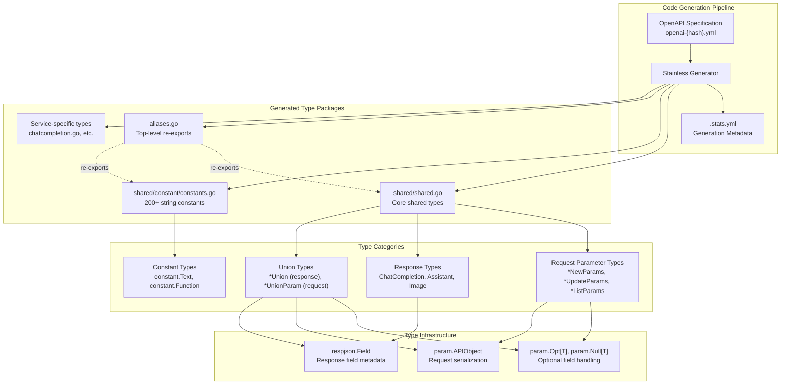
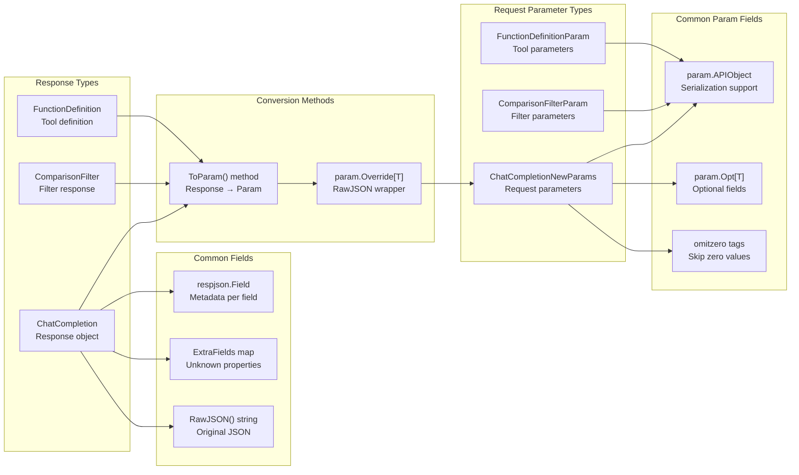
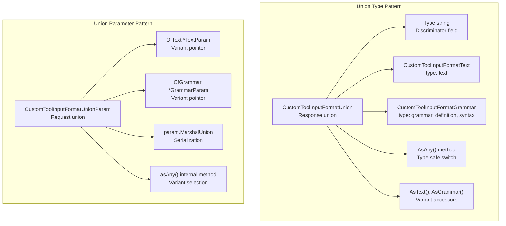
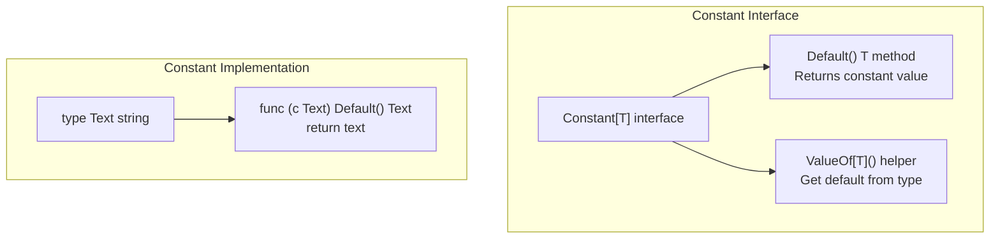

<!-- source: DeepWiki mcp.deepwiki.com · repo openai/openai-go · page 16 Type System and Data Structures · fetched 2026-10-26 -->

# Type System and Data Structures

<details>
<summary>Relevant source files</summary>

The following files were used as context for generating this wiki page:

- [aliases.go](aliases.go)
- [client.go](client.go)
- [default_http_client.go](default_http_client.go)
- [internal/encoding/json/time.go](internal/encoding/json/time.go)
- [packages/param/encoder.go](packages/param/encoder.go)
- [packages/param/encoder_test.go](packages/param/encoder_test.go)
- [packages/param/option.go](packages/param/option.go)
- [packages/param/param.go](packages/param/param.go)
- [responses/aliases.go](responses/aliases.go)
- [shared/constant/constants.go](shared/constant/constants.go)
- [shared/shared.go](shared/shared.go)

</details>


This document describes the generated type system in openai-go, including request/response type pairing, union types with discriminators, the constants library, parameter helpers, and metadata tracking. The entire type system is code-generated from the OpenAPI specification to ensure API contract compliance.

For information about specific service APIs and their data structures, see sections [Chat Completions API](#3) (Chat Completions), [Responses API](#4) (Responses API), [Image Generation and Editing](#5) (specialized services), and [Data Management](#13) (data management). For code generation details, see [Development and Code Generation](#18).

## Generated Type System Architecture

All types in openai-go are generated from the OpenAPI specification using the Stainless generator. The type system follows consistent patterns for request parameters, response objects, unions, and constants.



**Sources:** [shared/shared.go:1-12]() , [shared/constant/constants.go:1-20]() , [aliases.go:1-9]() , [client.go:1-59]()

## Request and Response Type Pairing

Every API operation has paired request and response types. Request types use the `*Param` suffix and embed `param.APIObject` for serialization. Response types embed `respjson.Field` metadata and provide `ToParam()` methods for round-tripping.



**Key Type Pairs:**

| Response Type | Request Parameter Type | Location |
|--------------|----------------------|----------|
| `ComparisonFilter` | `ComparisonFilterParam` | [shared/shared.go:90-144]() |
| `CompoundFilter` | `CompoundFilterParam` | [shared/shared.go:338-369]() |
| `FunctionDefinition` | `FunctionDefinitionParam` | [shared/shared.go:658-736]() |
| `Reasoning` | `ReasoningParam` | [shared/shared.go:746-870]() |
| `ResponseFormatJSONObject` | `ResponseFormatJSONObjectParam` | [shared/shared.go:892-945]() |
| `ResponseFormatJSONSchema` | `ResponseFormatJSONSchemaParam` | [shared/shared.go:950-1065]() |
| `ResponseFormatText` | `ResponseFormatTextParam` | [shared/shared.go:1068-1118]() |

### Response Type Structure

Response types follow a consistent pattern with metadata tracking using `respjson.Field`.

```go
// Example from shared/shared.go:90-118
type ComparisonFilter struct {
	Key   string                       `json:"key,required"`
	Type  ComparisonFilterType         `json:"type,required"`
	Value ComparisonFilterValueUnion   `json:"value,required"`
	JSON  struct {
		Key         respjson.Field
		Type        respjson.Field
		Value       respjson.Field
		ExtraFields map[string]respjson.Field
		raw         string
	} `json:"-"`
}
```

**Sources:** [shared/shared.go:90-118]()

### Request Parameter Type Structure

Request parameter types embed `param.APIObject` (aliased as `paramObj`) and use `param.Opt[T]` for optional fields to support `omitzero` behavior.

```go
// Example from shared/shared.go:250-279
type ComparisonFilterParam struct {
	Key   string                            `json:"key,required"`
	Type  ComparisonFilterType              `json:"type,omitzero,required"`
	Value ComparisonFilterValueUnionParam   `json:"value,omitzero,required"`
	paramObj
}
```

**Sources:** [shared/shared.go:250-279]() , [packages/param/param.go:118-119]()

### ToParam() Conversion Method

Response types provide `ToParam()` methods that wrap the raw JSON for efficient round-tripping. This allows "send back what you received" patterns without re-serialization.

```go
// Example from shared/shared.go:126-128
func (r ComparisonFilter) ToParam() ComparisonFilterParam {
	return param.Override[ComparisonFilterParam](json.RawMessage(r.RawJSON()))
}
```

**Sources:** [shared/shared.go:126-128]() , [packages/param/param.go:37-42]()

## Union Types and Discriminators

Union types represent fields that can hold multiple variant types. The SDK implements discriminated unions using a `type` field to determine the variant.



### Response Union Type

Response unions provide type-safe variant access via `AsAny()` or specific variant accessors like `AsText()`.

```go
// Example from shared/shared.go:406-435
type CustomToolInputFormatUnion struct {
	Type       string `json:"type"`
	Definition string `json:"definition"`
	Syntax     string `json:"syntax"`
	JSON       struct {
		Type       respjson.Field
		Definition respjson.Field
		Syntax     respjson.Field
		raw        string
	} `json:"-"`
}

func (u CustomToolInputFormatUnion) AsAny() anyCustomToolInputFormat {
	switch u.Type {
	case "text":
		return u.AsText()
	case "grammar":
		return u.AsGrammar()
	}
	return nil
}
```

**Sources:** [shared/shared.go:406-461]()

### Parameter Union Type

Parameter unions use pointers to variant structs for construction and embed `param.APIUnion` (aliased as `paramUnion`).

```go
// Example from shared/shared.go:529-541
type CustomToolInputFormatUnionParam struct {
	OfText    *CustomToolInputFormatTextParam    `json:",omitzero,inline"`
	OfGrammar *CustomToolInputFormatGrammarParam `json:",omitzero,inline"`
	paramUnion
}

func (u CustomToolInputFormatUnionParam) MarshalJSON() ([]byte, error) {
	return param.MarshalUnion(u, u.OfText, u.OfGrammar)
}
```

**Sources:** [shared/shared.go:529-549]() , [packages/param/encoder.go:76-100]()

## Constants Library

The SDK provides 200+ typed string constants in the `shared/constant` package. Constants implement the `Constant[T]` interface.



### Constant Implementation Pattern

Each constant type provides a `Default()` method returning its fixed string value.

```go
// From shared/constant/constants.go:9-11
type Constant[T any] interface {
	Default() T
}

// Example usage
func ValueOf[T Constant[T]]() T {
	var t T
	return t.Default()
}
```

**Sources:** [shared/constant/constants.go:9-19]() , [shared/constant/constants.go:21-95]()

## Parameter Helpers

The SDK uses helper types from the `packages/param` package to handle optional fields and request serialization.

### param.Opt[T] for Optional Fields

`param.Opt[T]` distinguishes between omitted, null, and present values.

```go
// From packages/param/option.go:30-35
type Opt[T comparable] struct {
	Value T
	status status
	opt
}
```

- `param.NewOpt(v)`: Field is included with value `v`.
- `param.Null[T]()`: Field is explicitly sent as `null`.
- Zero value `param.Opt[T]{}`: Field is omitted from JSON (using `omitzero`).

**Sources:** [packages/param/option.go:11-35]() , [packages/param/param.go:63-71]()

### ExtraFields for Unknown Properties

Parameter types allow setting arbitrary extra fields via `SetExtraFields`.

```go
// From packages/param/param.go:157-159
func (m *metadata) SetExtraFields(extraFields map[string]any) {
	m.any = metadataExtraFields(extraFields)
}
```

**Sources:** [packages/param/param.go:157-159]() , [packages/param/encoder.go:43-65]()

## Filter and Query System

The SDK provides filter types for querying vector stores, including `ComparisonFilter` and `CompoundFilter`.

| Type | Purpose | Operators |
|------|---------|-----------|
| `ComparisonFilter` | Single field comparison | `eq`, `ne`, `gt`, `gte`, `lt`, `lte` |
| `CompoundFilter` | Logical composition | `and`, `or` |

**Sources:** [shared/shared.go:90-155]() , [shared/shared.go:338-376]()

## Shared Model and Type Aliases

Core models like `ChatModel` and `ResponsesModel` are defined as string aliases with extensive constants.

```go
// From shared/shared.go:39-40
type ChatModel = string
type ResponsesModel = string

// From shared/shared.go:45-47
const (
	ChatModelGPT5_4     ChatModel = "gpt-5.4"
	ChatModelGPT5_4Mini ChatModel = "gpt-5.4-mini"
	ChatModelGPT5_4Nano ChatModel = "gpt-5.4-nano"
)
```

**Sources:** [shared/shared.go:39-121]() , [aliases.go:20-224]()

---

For more detailed information, see the following child pages:
- [Shared Types and Model Constants](#16.1)
- [Constants and String Identifiers](#16.2)
- [Parameter Types and Unions](#16.3)
- [Filter and Query System](#16.4)

---

