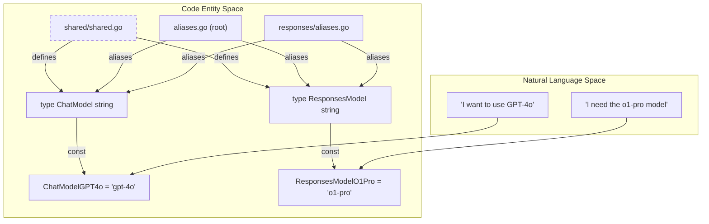
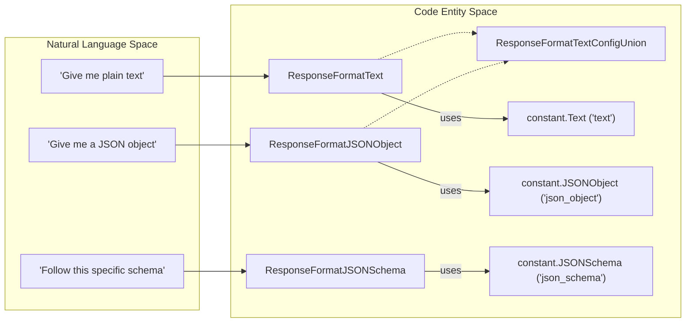

<!-- source: DeepWiki mcp.deepwiki.com · repo openai/openai-go · page 16.1 Shared Types and Model Constants · fetched 2026-10-26 -->

# Shared Types and Model Constants

<details>
<summary>Relevant source files</summary>

The following files were used as context for generating this wiki page:

- [aliases.go](aliases.go)
- [client.go](client.go)
- [default_http_client.go](default_http_client.go)
- [responses/aliases.go](responses/aliases.go)
- [shared/constant/constants.go](shared/constant/constants.go)
- [shared/shared.go](shared/shared.go)

</details>


This page documents the core shared types and model identifier constants defined in [shared/shared.go]() that are used across multiple services in the OpenAI SDK. These types provide common data structures for API requests and responses, including model selection, function definitions, reasoning configuration, and response formatting.

For the broader constant system covering resources, events, and tool types, see [Constants and String Identifiers](#16.2). For parameter types and union type patterns, see [Parameter Types and Unions](#16.3). For filter-specific types used in vector search, see [Filter and Query System](#16.4).

## Model Type Aliases

The SDK defines three primary model type aliases as string types, each with an extensive set of constants representing available models.

### AllModels Type
`AllModels` is a catch-all string type used for generic model references. It accepts any `string` or `ChatModel` [shared/shared.go:18-19](). It includes high-capability variants like `o1-pro`, `o3-pro`, and `gpt-5-pro` [shared/shared.go:21-35]().

### ChatModel Type

`ChatModel` is a string type alias used by the Chat Completions API and other conversational endpoints [shared/shared.go:39](). It includes over 60 model constants spanning multiple generations:

**Model Families:**

| Family | Examples | Usage |
|--------|----------|-------|
| GPT-5 Series | `ChatModelGPT5`, `ChatModelGPT5Mini`, `ChatModelGPT5Nano` | Latest generation models with dated variants [shared/shared.go:45-67]() |
| GPT-4.1 Series | `ChatModelGPT4_1`, `ChatModelGPT4_1Mini`, `ChatModelGPT4_1Nano` | Mid-generation models [shared/shared.go:68-73]() |
| O-Series | `ChatModelO1`, `ChatModelO3`, `ChatModelO4Mini` | Reasoning-focused models [shared/shared.go:74-85]() |
| GPT-4o Series | `ChatModelGPT4o`, `ChatModelGPT4oMini` | Optimized GPT-4 variants [shared/shared.go:86-103]() |
| GPT-4o Audio | `ChatModelGPT4oAudioPreview` | Audio-capable models [shared/shared.go:90-95]() |
| GPT-4o Search | `ChatModelGPT4oSearchPreview` | Search-enhanced models [shared/shared.go:96-99]() |
| Legacy | `ChatModelGPT4`, `ChatModelGPT3_5Turbo` | Older stable models [shared/shared.go:110-121]() |

**Sources:** [shared/shared.go:39-121](), [aliases.go:64-224]()

### ResponsesModel Type

`ResponsesModel` is a string type alias used specifically by the modern Responses API for advanced model deployments [shared/shared.go:40]().

### Model Constants Location Diagram

This diagram shows how model types and constants are defined in the `shared` package and then re-exported through various package aliases to provide a unified developer experience.



**Sources:** [shared/shared.go:39-40](), [aliases.go:64-224](), [responses/aliases.go:64-224]()

## Function Definition Types

### FunctionDefinition

The `FunctionDefinition` type describes a function that can be called by models during tool execution. It is used across Chat Completions, Responses API, and Beta Assistants.

```go
type FunctionDefinition struct {
    Name        string              `json:"name,required"`
    Description string              `json:"description"`
    Parameters  FunctionParameters  `json:"parameters"`
    Strict      bool                `json:"strict,nullable"`
}
```

**Fields:**

| Field | Type | Description |
|-------|------|-------------|
| `Name` | `string` | Function name (a-z, A-Z, 0-9, underscores, dashes; max 64 chars) |
| `Description` | `string` | Natural language description used by model for selection |
| `Parameters` | `FunctionParameters` | JSON Schema object describing accepted parameters |
| `Strict` | `bool` | Enable strict schema adherence for Structured Outputs |

**FunctionParameters Type:**

`FunctionParameters` is defined as `map[string]any` to represent arbitrary JSON Schema objects.

**Sources:** [shared/shared.go:658-678](), [aliases.go:318-320]()

## Reasoning Configuration

### Reasoning Type

The `Reasoning` type configures reasoning behavior for o-series and gpt-5 models. It controls reasoning effort levels and summary generation.

```go
type Reasoning struct {
    Effort          ReasoningEffort          `json:"effort,nullable"`
    GenerateSummary ReasoningGenerateSummary `json:"generate_summary,nullable"` // Deprecated
    Summary         ReasoningSummary         `json:"summary,nullable"`
}
```

**ReasoningEffort Constants:**

```go
type ReasoningEffort string

const (
    ReasoningEffortMinimal ReasoningEffort = "minimal"
    ReasoningEffortLow     ReasoningEffort = "low"
    ReasoningEffortMedium  ReasoningEffort = "medium"
    ReasoningEffortHigh    ReasoningEffort = "high"
)
```

Lower effort values result in faster responses with fewer reasoning tokens.

**Sources:** [shared/shared.go:746-764](), [shared/shared.go:816-834](), [aliases.go:350-376]()

## Response Format Types

Response format types control the structure of model outputs. Three format types are available: text (default), JSON object, and JSON schema.

### Type Hierarchy and Data Flow

This diagram bridges the conceptual requirement for "Structured Output" to the specific code entities implementing it.



**Sources:** [shared/shared.go:892-1162](), [shared/constant/constants.go:38-39]()

### ResponseFormatText

Default format that returns unstructured text responses.

```go
type ResponseFormatText struct {
    Type constant.Text `json:"type,required"` // Always "text"
}
```

**Sources:** [shared/shared.go:1092-1100](), [aliases.go:461-466]()

### ResponseFormatJSONObject

Legacy JSON format requiring natural language instruction in the prompt. Prefer `ResponseFormatJSONSchema` for models that support it.

```go
type ResponseFormatJSONObject struct {
    Type constant.JSONObject `json:"type,required"` // Always "json_object"
}
```

**Sources:** [shared/shared.go:892-900](), [aliases.go:425-432]()

### ResponseFormatJSONSchema

Structured Outputs format with strict JSON Schema validation. Enables reliable structured data extraction.

```go
type ResponseFormatJSONSchema struct {
    JSONSchema ResponseFormatJSONSchemaJSONSchema `json:"json_schema,required"`
    Type       constant.JSONSchema                `json:"type,required"` // Always "json_schema"
}
```

**Sources:** [shared/shared.go:950-958](), [aliases.go:439-456]()

## Metadata and Errors

### Metadata Type
`Metadata` is a simple map type for attaching arbitrary key-value pairs to API objects [shared/shared.go:740]().
- **Keys**: max 64 characters.
- **Values**: max 512 characters.

### Error Object Type
`ErrorObject` provides structured error information in API responses, including `Code`, `Message`, `Param`, and `Type` [shared/shared.go:636-646]().

## Type Aliasing Pattern

The SDK uses a consistent aliasing pattern to expose shared types across multiple packages without creating import cycles. This is primarily handled in `aliases.go` files in the root and sub-packages like `responses`.

### Alias Examples
The root `aliases.go` re-exports types from the `shared` package:
- `type ChatModel = shared.ChatModel` [aliases.go:65]()
- `const ChatModelGPT4o = shared.ChatModelGPT4o` [aliases.go:190]()
- `type Error = apierror.Error` [aliases.go:17]()

This pattern is repeated in [responses/aliases.go:20-224]() to ensure types are available regardless of which package a developer imports.

**Sources:** [aliases.go:1-508](), [responses/aliases.go:1-508]()

## Response Type to Param Type Pattern

All shared response types follow a pairing pattern with corresponding parameter types for use in requests. Response types (e.g., `FunctionDefinition`) are used for deserializing API responses, while param types (e.g., `FunctionDefinitionParam`) are used for constructing requests.

### ToParam() Conversion Methods
Response types provide `ToParam()` methods for conversion to parameter types [shared/shared.go:696-703](). These methods use `param.Override` to pass the raw JSON data into the parameter structure.

**Sources:** [shared/shared.go:696-703](), [shared/shared.go:792-799](), [shared/shared.go:912-919]()

---

