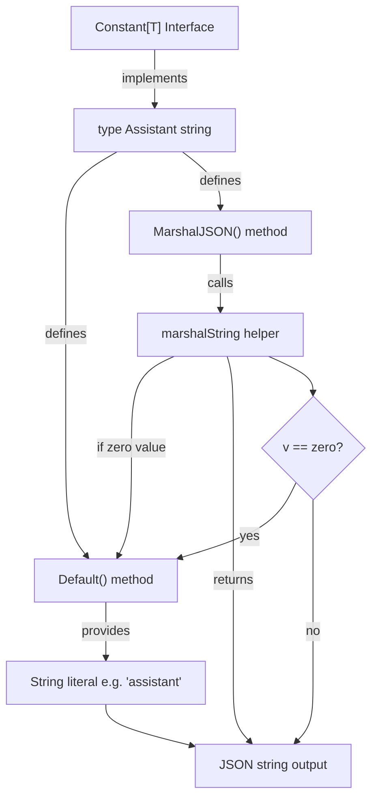
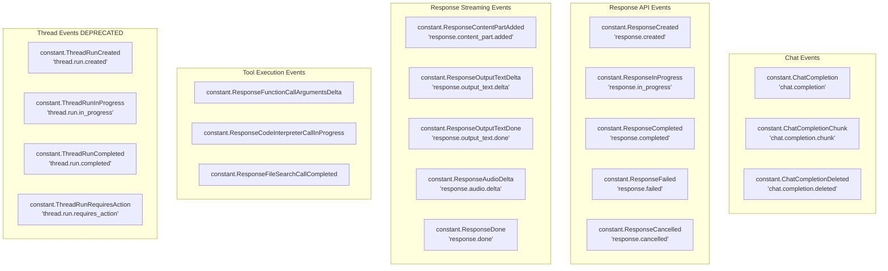
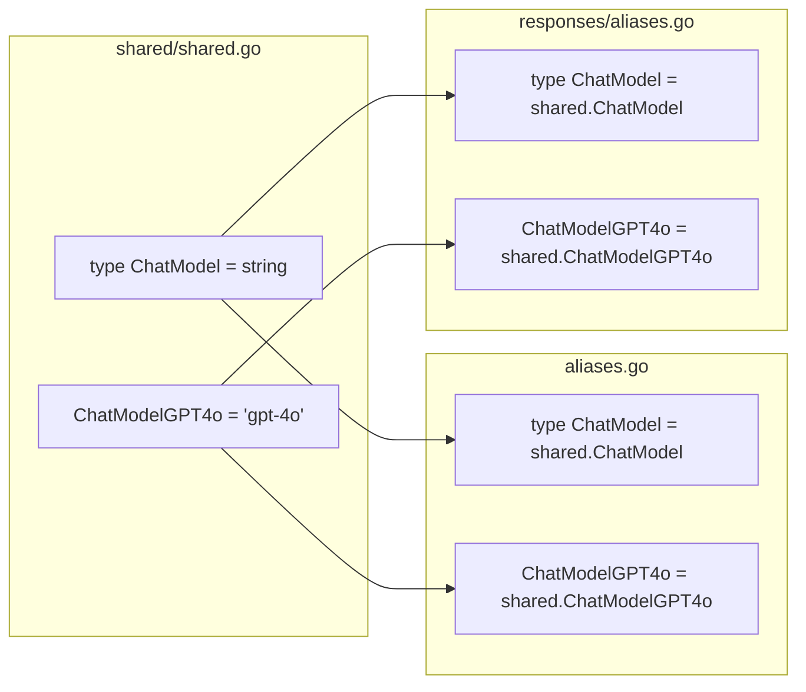

<!-- source: DeepWiki mcp.deepwiki.com · repo openai/openai-go · page 16.2 Constants and String Identifiers · fetched 2026-10-26 -->

# Constants and String Identifiers

<details>
<summary>Relevant source files</summary>

The following files were used as context for generating this wiki page:

- [aliases.go](aliases.go)
- [client.go](client.go)
- [default_http_client.go](default_http_client.go)
- [responses/aliases.go](responses/aliases.go)
- [shared/constant/constants.go](shared/constant/constants.go)
- [shared/shared.go](shared/shared.go)

</details>


This document describes the typed string constant system in the openai-go SDK, which provides type-safe identifiers for resources, events, tools, states, and other enumerated values throughout the API. The constant system ensures compile-time safety while maintaining serialization compatibility with the OpenAI API's string-based wire format.

For information about other type system components, see [Shared Types and Model Constants](16.1) and [Parameter Types and Unions](16.3).

---

## Overview and Purpose

The SDK defines over 200 typed string constants in the `shared/constant` package [shared/constant/constants.go:1-1046](). These constants serve as discriminators for union types, status indicators, event types, and resource identifiers. Each constant is a distinct Go type that wraps a string literal, providing IDE auto-completion and compile-time type checking while serializing to plain strings in JSON.

**Sources**: [shared/constant/constants.go:1-20]()

---

## The Constant[T] Interface

All typed constants implement the `Constant[T]` interface, which defines a single method:

```go
type Constant[T any] interface {
    Default() T
}
```

The `Default()` method returns the canonical string value for the constant. This pattern enables zero-value handling: when a constant variable is declared but not initialized (resulting in an empty string), the JSON marshaler calls `Default()` to retrieve the correct value.

### ValueOf Helper Function

The `ValueOf[T]` generic function constructs a constant from its type:

```go
func ValueOf[T Constant[T]]() T {
	var t T
	return t.Default()
}
```

This is particularly useful when building union type variants in a generic context:

```go
// Example usage with union types
toolType := constant.ValueOf[constant.Function]()  // Returns "function"
```

**Sources**: [shared/constant/constants.go:9-19]()

---

## Typed String Constants Structure

Each constant type follows a consistent pattern:

| Element | Description | Example |
|---------|-------------|---------|
| Type Declaration | Named string type | `type Assistant string` |
| Comment | Documents the literal value | `// Always "assistant"` |
| Default() Method | Returns the string literal | `func (c Assistant) Default() Assistant { return "assistant" }` |
| MarshalJSON() Method | Serializes to JSON string | `func (c Assistant) MarshalJSON() ([]byte, error) { return marshalString(c) }` |

### Zero-Value Marshaling Behavior

The `marshalString` helper function implements special zero-value handling:

```go
func marshalString[T ~string, PT interface {
	*T
	Constant[T]
}](v T) ([]byte, error) {
	var zero T
	if v == zero {
		v = PT(&v).Default()
	}
	return shimjson.Marshal(string(v))
}
```

When a constant has its zero value (empty string), `marshalString` automatically populates it with the default value before serialization. This ensures that uninitialized constants serialize correctly without explicit initialization.

**Diagram: Constant Type Structure and Marshaling Flow**



**Sources**: [shared/constant/constants.go:1034-1045](), [shared/constant/constants.go:306-310](), [shared/constant/constants.go:737-741]()

---

## Constant Categories

The SDK organizes constants into semantic categories. Below is a comprehensive taxonomy:

### Resource Types

Constants representing API resource types:

| Constant Type | Value | Usage Context |
|---------------|-------|---------------|
| `Assistant` | `"assistant"` | Beta Assistant API resources [shared/constant/constants.go:29]() |
| `Thread` | `"thread"` | Thread conversation containers [shared/constant/constants.go:284]() |
| `Message` | `"message"` | Message objects in threads [shared/constant/constants.go:174]() |
| `Response` | `"response"` | Response API resources [shared/constant/constants.go:217]() |
| `Conversation` | `"conversation"` | Conversation API resources [shared/constant/constants.go:66]() |
| `File` | `"file"` | File storage resources [shared/constant/constants.go:121]() |
| `VectorStore` | `"vector_store"` | Vector store resources [shared/constant/constants.go:294]() |
| `Batch` | `"batch"` | Batch processing jobs [shared/constant/constants.go:33]() |
| `FineTuningJob` | `"fine_tuning.job"` | Fine-tuning job resources [shared/constant/constants.go:126]() |
| `Upload` | `"upload"` | Multipart upload resources [shared/constant/constants.go:291]() |

**Sources**: [shared/constant/constants.go:21-304]()

### Event Types

Constants for webhook and streaming events:

**Diagram: Event Type Hierarchy**



**Sources**: [shared/constant/constants.go:32-304]()

### Tool Type Constants

Constants identifying tool types in the tool calling system:

| Constant Type | Value | Tool Capability |
|---------------|-------|-----------------|
| `Function` | `"function"` | Custom function execution [shared/constant/constants.go:133]() |
| `CodeInterpreter` | `"code_interpreter"` | Python code execution [shared/constant/constants.go:54]() |
| `FileSearch` | `"file_search"` | RAG over documents [shared/constant/constants.go:122]() |
| `WebSearch` | `"web_search"` | Internet search queries [shared/constant/constants.go:298]() |
| `Computer` | `"computer"` | UI interaction (preview) [shared/constant/constants.go:57]() |
| `Mcp` | `"mcp"` | Model Context Protocol integration [shared/constant/constants.go:173]() |
| `Custom` | `"custom"` | Grammar-based custom tools [shared/constant/constants.go:85]() |

**Sources**: [shared/constant/constants.go:48-304]()

### Status and State Constants

Constants representing lifecycle states:

| Constant Type | Value | Application |
|---------------|-------|-------------|
| `Active` | `"active"` | Resource is active [shared/constant/constants.go:21]() |
| `Locked` | `"locked"` | Resource is locked [shared/constant/constants.go:167]() |
| `Closed` | `"closed"` | Resource is closed [shared/constant/constants.go:53]() |
| `ResponseQueued` | `"response.queued"` | Response queued for processing [shared/constant/constants.go:245]() |
| `ResponseInProgress` | `"response.in_progress"` | Response generation in progress [shared/constant/constants.go:240]() |
| `ResponseCompleted` | `"response.completed"` | Response generation completed [shared/constant/constants.go:224]() |
| `ResponseFailed` | `"response.failed"` | Response generation failed [shared/constant/constants.go:234]() |
| `ResponseIncomplete` | `"response.incomplete"` | Response generation incomplete [shared/constant/constants.go:238]() |

**Sources**: [shared/constant/constants.go:21-304]()

---

## Model Identifiers and Aliases

While many identifiers are found in `shared/constant`, model identifiers are handled as typed string aliases in `shared/shared.go` and aliased at the package level in `aliases.go`.

**Diagram: Model Alias Mapping**



**Sources**: [shared/shared.go:39-121](), [aliases.go:65-191](), [responses/aliases.go:65-191]()

---

## Usage in Union Types and Discriminators

Constants serve as discriminators in union types, enabling type-safe variant selection. Union types use the `type` field with constant values to distinguish between variants.

### Example: Tool Union Types

Tool variants use constant types to identify themselves to the `apijson` marshaler.

```go
// Example Variant Structure
type FunctionTool struct {
    Type constant.Function  // Serializes to "function"
    Function FunctionDefinition
}
```

**Sources**: [shared/constant/constants.go:133]()

### Example: Event Stream Discriminators

Streaming events use constants to identify event types. Client code can switch on event types using constant values:

```go
// Example logic
switch event.Type {
case constant.ResponseOutputTextDelta:
    // Handle text delta
case constant.ResponseAudioDelta:
    // Handle audio delta
case constant.ResponseDone:
    // Handle completion
}
```

**Sources**: [shared/constant/constants.go:242-251]()

---

## Implementation Details

### String Type Constraint

Each constant type uses the underlying `string` type, allowing string operations while maintaining type safety.

```go
type Assistant string  // [shared/constant/constants.go:29]
```

### Custom JSON Encoder Import

The package imports a custom JSON encoder for marshaling:

```go
import (
	shimjson "github.com/openai/openai-go/v3/internal/encoding/json"
)
```

This custom encoder is used in `marshalString` to ensure consistent serialization behavior across the SDK.

**Sources**: [shared/constant/constants.go:5-7](), [shared/constant/constants.go:1034-1045]()

---

## Generated Code Notice

All constant types are automatically generated from the OpenAPI specification via the Stainless code generator. The file header indicates:

```go
// File generated from our OpenAPI spec by Stainless. See CONTRIBUTING.md for details.
```

This ensures that constants remain synchronized with the OpenAI API contract. Manual modifications to this file will be overwritten during regeneration.

**Sources**: [shared/constant/constants.go:1]()

---

