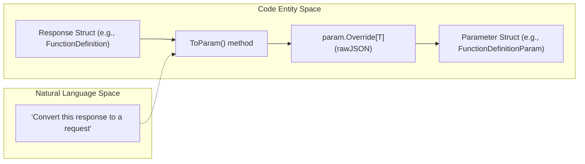
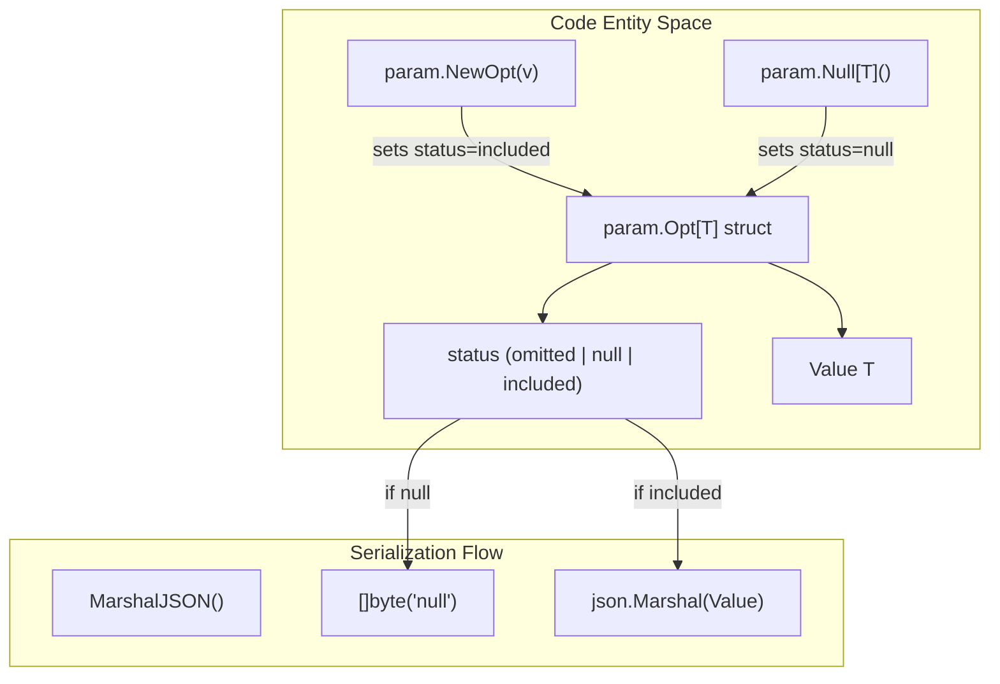
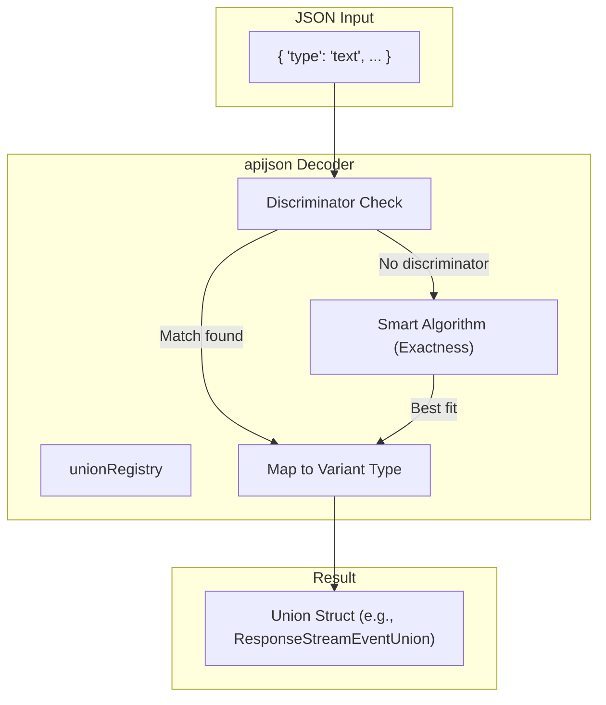

<!-- source: DeepWiki mcp.deepwiki.com · repo openai/openai-go · page 16.3 Parameter Types and Unions · fetched 2026-10-26 -->

# Parameter Types and Unions

Relevant source files

The following files were used as context for generating this wiki page:

- [aliases.go](aliases.go)
- [internal/apijson/decodeparam_test.go](internal/apijson/decodeparam_test.go)
- [internal/apijson/union.go](internal/apijson/union.go)
- [internal/encoding/json/time.go](internal/encoding/json/time.go)
- [packages/param/encoder.go](packages/param/encoder.go)
- [packages/param/encoder_test.go](packages/param/encoder_test.go)
- [packages/param/option.go](packages/param/option.go)
- [packages/param/param.go](packages/param/param.go)
- [packages/respjson/respjson.go](packages/respjson/respjson.go)
- [responses/aliases.go](responses/aliases.go)
- [shared/shared.go](shared/shared.go)

This page documents the type system used for request parameters and response objects in the openai-go SDK, including the pairing pattern between response and parameter types, `param.Opt[T]` for optional fields, union type representations with discriminators, and metadata tracking via `ExtraFields`.

---

## Request/Response Type Pairing Pattern

The SDK follows a strict pairing pattern where every response type has a corresponding request parameter type, typically suffixed with `Param` or `Params`. This allows for a "round-trip" pattern where data received from the API can be sent back in a subsequent request.

### ToParam() Conversion

Response types implement a `.ToParam()` method. This method converts the response object into its parameter equivalent by wrapping the raw JSON response. This is implemented using `param.Override[T]()`, which ensures that the exact structure (including unknown fields) is preserved when sent back to the API.

**Sources:** [shared/shared.go:126-133](), [shared/shared.go:690-703](), [packages/param/param.go:37-42]()

### Implementation Differences

While they represent the same data, the internal implementations differ to support their specific roles:
*   **Response Types**: Embed `respjson.Field` metadata and `ExtraFields` to handle API-returned data and unknown properties.
*   **Parameter Types**: Embed `param.APIObject` (or `param.APIUnion`) and use `param.Opt[T]` for fields to handle serialization logic like `omitzero`.

**Sources:** [shared/shared.go:14-17](), [shared/shared.go:658-688](), [packages/param/param.go:119-122]()

---

## Optional Fields: param.Opt[T]

Optional fields in request parameters are wrapped in `param.Opt[T]`. This generic wrapper tracks whether a field is **omitted**, set to **null**, or **included** with a specific value.

### Field States and Serialization

| State | `param.Opt[T]` Configuration | JSON Output |
| :--- | :--- | :--- |
| **Omitted** | Zero value: `param.Opt[string]{}` | (Field excluded) |
| **Null** | `param.Null[string]()` | `null` |
| **Included** | `param.NewOpt("value")` | `"value"` |

**Sources:** [packages/param/option.go:11-35](), [packages/param/option.go:62-67]()

### Implementation of Opt[T]

The `Opt[T]` struct uses an internal `status` field to manage these states. It implements `MarshalJSON` to handle the conversion to bytes based on the status.

**Sources:** [packages/param/option.go:20-35](), [packages/param/option.go:62-67](), [packages/param/encoder_test.go:92-100]()

---

## Union Types and Discriminators

Unions represent fields that can hold one of several different types. The SDK distinguishes between **Request Unions** (sending data) and **Response Unions** (receiving data).

### Request Unions (Parameters)

Request unions are structs where multiple fields are marked with `json:",inline"`. Only one of these fields should be populated. They embed `param.APIUnion` and use `param.MarshalUnion` for serialization.

**Key Functions:**
*   `param.MarshalUnion(metadata, variants...)`: Ensures exactly one variant is present before marshaling.

**Sources:** [packages/param/encoder.go:76-100](), [packages/param/param.go:122-122](), [shared/shared.go:526-537]()

### Response Unions (JSON Decoding)

Response unions use a "smart" decoding algorithm. During `UnmarshalJSON`, the SDK attempts to match the JSON data against known variants. If a **discriminator key** (like `type`) is present, it uses that to select the correct variant immediately.

**Sources:** [internal/apijson/union.go:80-115](), [internal/apijson/union.go:146-173](), [internal/apijson/union.go:25-38]()

---

## ExtraFields and Unknown Properties

To ensure forward compatibility with new API features, the SDK captures properties not explicitly defined in the struct models.

### Handling Unknown Fields in Responses

Response objects include a `JSON` metadata struct containing an `ExtraFields` map of type `map[string]respjson.Field`. This allows users to access new fields before the SDK is updated.

**Sources:** [shared/shared.go:115-117](), [packages/respjson/respjson.go:49-52]()

### Sending Extra Fields in Requests

Parameter structs provide a `SetExtraFields(map[string]any)` method. When the struct is marshaled, these extra fields are merged into the final JSON object. If an extra field has the same key as a defined struct field, the extra field takes precedence.

**Key Implementation:**
*   `param.MarshalWithExtras`: Uses `sjson` to inject extra fields into the marshaled bytes of the base struct.
*   `param.Omit`: A special value that can be used in `SetExtraFields` to force the omission of a field that would otherwise be sent.

**Sources:** [packages/param/encoder.go:43-71](), [packages/param/param.go:157-159](), [packages/param/encoder_test.go:159-177](), [packages/param/encoder_test.go:200-216]()

---

## Type System Summary Table

| Feature | Code Entity | Purpose |
| :--- | :--- | :--- |
| **Optionality** | `param.Opt[T]` | Distinguishes between omitted, null, and valued fields in requests. |
| **Null Structs** | `param.NullStruct[T]()` | Sets an entire parameter struct to JSON `null`. |
| **Unions** | `param.APIUnion` | Handles fields that can be one of several types (e.g., Tool outputs). |
| **Metadata** | `param.APIObject` | Internal marker for parameter structs to support metadata/extra fields. |
| **Response Meta** | `respjson.Field` | Tracks raw JSON and validity for every field in a response. |

**Sources:** [packages/param/param.go:18-23](), [packages/param/param.go:119-122](), [packages/respjson/respjson.go:49-52](), [packages/param/option.go:30-35]()

---

