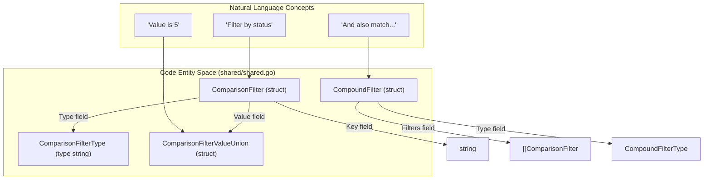
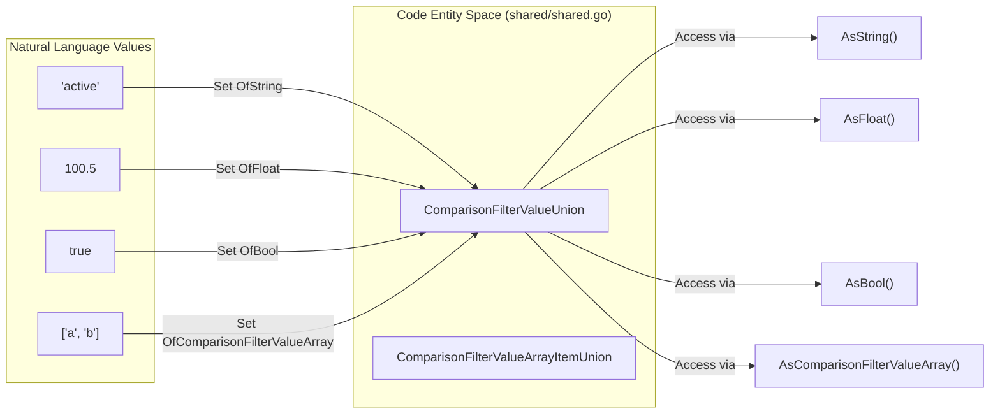
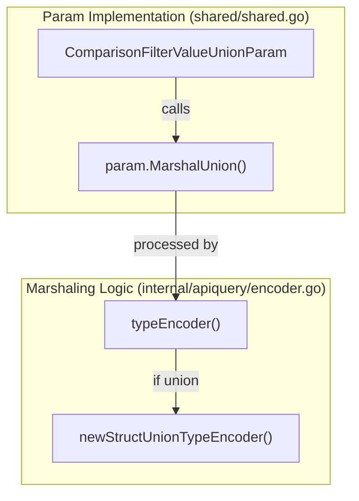

<!-- source: DeepWiki mcp.deepwiki.com · repo openai/openai-go · page 16.4 Filter and Query System · fetched 2026-10-26 -->

# Filter and Query System

Relevant source files

The following files were used as context for generating this wiki page:

- [aliases.go](aliases.go)
- [internal/apiquery/encoder.go](internal/apiquery/encoder.go)
- [responses/aliases.go](responses/aliases.go)
- [shared/shared.go](shared/shared.go)

## Purpose and Scope

The filter and query system provides structured filtering capabilities for vector store search operations. It enables filtering of search results based on metadata attributes using comparison operators and logical composition. The system consists of two primary filter types: `ComparisonFilter` for single attribute comparisons and `CompoundFilter` for combining multiple filters with logical operators.

For information about vector stores and their search capabilities, see [Vector Stores API](#13.2). For parameter types and union handling, see [Parameter Types and Unions](#16.3).

**Sources:** [shared/shared.go:1-398](), [aliases.go:208-290]()

---

## Filter Type Architecture

The filter system provides a two-level hierarchy where comparison filters perform individual attribute checks and compound filters combine multiple filters with boolean logic.

### Natural Language to Code Entity Mapping: Filters
The following diagram maps search concepts to the specific Go types and fields used in the SDK.

**Sources:** [shared/shared.go:88-134](), [shared/shared.go:337-398]()

---

## ComparisonFilter Structure

`ComparisonFilter` performs a single comparison operation between an attribute key and a target value. The filter consists of three required fields that define the comparison operation.

### Field Definitions

| Field | Type | Description |
|-------|------|-------------|
| `Key` | `string` | The metadata attribute key to compare against |
| `Type` | `ComparisonFilterType` | The comparison operator to apply |
| `Value` | `ComparisonFilterValueUnion` | The target value for comparison |

### Comparison Operators

The `ComparisonFilterType` enum defines the available comparison operators. These are implemented as typed strings in the `shared` package and aliased in the root `openai` package.

| Constant | Value | Operation |
|----------|-------|-----------|
| `ComparisonFilterTypeEq` | `"eq"` | Equals |
| `ComparisonFilterTypeNe` | `"ne"` | Not equal |
| `ComparisonFilterTypeGt` | `"gt"` | Greater than |
| `ComparisonFilterTypeGte` | `"gte"` | Greater than or equal |
| `ComparisonFilterTypeLt` | `"lt"` | Less than |
| `ComparisonFilterTypeLte` | `"lte"` | Less than or equal |

**Sources:** [shared/shared.go:88-155](), [aliases.go:227-245]()

---

## Value Types and Unions

The `ComparisonFilterValueUnion` supports multiple value types through a discriminated union structure, enabling comparisons against strings, numbers, booleans, and arrays.

### Natural Language to Code Entity Mapping: Value Unions
This diagram shows how different data types in a query map to the SDK's union implementation.

### Union Access Methods

The union provides type-specific accessor methods for extracting values from API responses:

| Method | Return Type | Purpose |
|--------|-------------|---------|
| `AsString()` | `string` | Extract string value |
| `AsFloat()` | `float64` | Extract numeric value |
| `AsBool()` | `bool` | Extract boolean value |
| `AsComparisonFilterValueArray()` | `[]ComparisonFilterValueArrayItemUnion` | Extract array value |
| `RawJSON()` | `string` | Get unmodified JSON |

**Sources:** [shared/shared.go:157-244](), [shared/shared.go:217-244]()

---

## CompoundFilter Structure

`CompoundFilter` combines multiple comparison filters using logical operators (`and` or `or`). This enables construction of complex filter expressions through boolean composition.

### Field Definitions

| Field | Type | Description |
|-------|------|-------------|
| `Filters` | `[]ComparisonFilter` | Array of filters to combine |
| `Type` | `CompoundFilterType` | Logical operator (`and` or `or`) |

### Logical Operators

| Constant | Value | Operation |
|----------|-------|-----------|
| `CompoundFilterTypeAnd` | `"and"` | All filters must match (conjunction) |
| `CompoundFilterTypeOr` | `"or"` | Any filter must match (disjunction) |

**Sources:** [shared/shared.go:337-398](), [aliases.go:274-290]()

---

## Parameter Type Pairing

The filter system follows the SDK's type pairing pattern, providing separate types for API responses and request parameters.

### Response Types vs. Parameter Types

Response types (e.g., `ComparisonFilter`) are used when receiving data from the API and include metadata for JSON reflection. Parameter types (e.g., `ComparisonFilterParam`) are used when sending requests and use `param.Opt[T]` for optionality.

- **ComparisonFilter**: [shared/shared.go:88-134]()
  - Implements `UnmarshalJSON()` via `apijson.UnmarshalRoot` [shared/shared.go:122-124]()
  - Provides `ToParam()` for conversion to request type [shared/shared.go:126-133]()

- **ComparisonFilterParam**: [shared/shared.go:246-279]()
  - Implements `MarshalJSON()` via `param.MarshalObject` [shared/shared.go:273-279]()
  - Fields like `Key`, `Type`, and `Value` are marked with `omitzero` tags.

### Union Parameter Marshaling

Union parameter types like `ComparisonFilterValueUnionParam` [shared/shared.go:281-310]() use `param.MarshalUnion` to ensure only one variant is serialized into the final JSON.

**Sources:** [shared/shared.go:281-310](), [internal/apiquery/encoder.go:214-236]()

---

## Type Aliasing and Package Exports

The filter types are defined in `shared/shared.go` and re-exported through type aliases in multiple packages, making them accessible at different API levels without requiring cross-package imports.

### Alias Locations

The following packages alias the core filter types:
- **openai**: The primary entry point for the SDK [aliases.go:208-290]()
- **responses**: For the modern Responses API [responses/aliases.go:208-290]()

### Constant Re-exports

Constants are aliased using the standard Go pattern:
- `const ComparisonFilterTypeEq = shared.ComparisonFilterTypeEq` [aliases.go:227]()
- `const CompoundFilterTypeAnd = shared.CompoundFilterTypeAnd` [aliases.go:274]()

This ensures that `openai.ComparisonFilterTypeEq` is functionally identical to `shared.ComparisonFilterTypeEq`.

**Sources:** [aliases.go:208-290](), [responses/aliases.go:208-290]()

---

