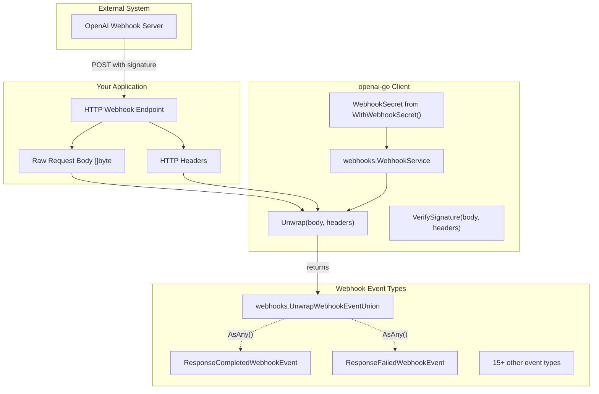
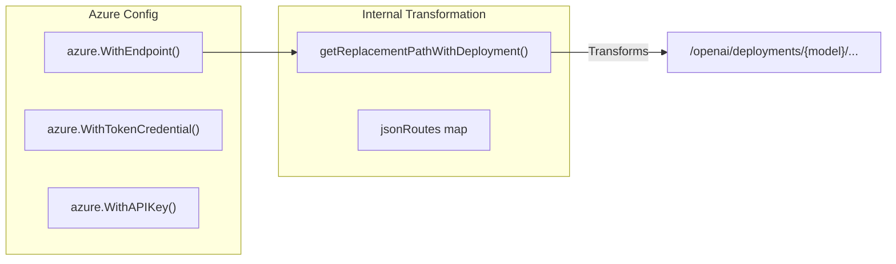

<!-- source: DeepWiki mcp.deepwiki.com · repo openai/openai-go · page 17 Advanced Topics · fetched 2026-10-26 -->

# Advanced Topics

Relevant source files

The following files were used as context for generating this wiki page:

- [azure/azure.go](azure/azure.go)
- [azure/azure_test.go](azure/azure_test.go)
- [azure/example_test.go](azure/example_test.go)
- [container.go](container.go)
- [container_test.go](container_test.go)
- [containerfile.go](containerfile.go)
- [containerfilecontent.go](containerfilecontent.go)
- [containerfilecontent_test.go](containerfilecontent_test.go)
- [packages/pagination/pagination.go](packages/pagination/pagination.go)
- [realtime/call.go](realtime/call.go)
- [webhooks/webhook.go](webhooks/webhook.go)

This page documents advanced features of the `openai-go` library, including webhook signature verification, pagination patterns, Azure OpenAI integration, custom middleware, and specialized services like Containers, Skills, and Graders.

For basic API usage and client configuration, see [Client Configuration and Options](#2.1). For request execution fundamentals, see [Request Execution Pipeline](#2.2).

---

## Webhooks and Event Verification

The library provides built-in webhook signature verification to securely handle incoming events from OpenAI. This ensures that webhook payloads originate from OpenAI and have not been tampered with.

### Architecture Overview

**Sources**: [webhooks/webhook.go:31-42](), [webhooks/webhook.go:45-58]()

### Verification Patterns

The `WebhookService` offers several ways to handle verification:
- **`Unwrap`**: The standard method that verifies the signature and unmarshals the body into an `UnwrapWebhookEventUnion` [webhooks/webhook.go:45-58]().
- **`VerifySignature`**: Performs only the HMAC-SHA256 validation without parsing the body [webhooks/webhook.go:96-98]().
- **`WithWebhookSecret`**: Configures the secret (prefixed with `whsec_` or raw) used for verification [option/requestoption.go:293-299]().

For details, see [Webhooks and Event Verification](#17.1).

---

## Pagination Patterns

The library supports cursor-based pagination for listing resources like Files, Batches, and Fine-tuning jobs.

### Pagination Mechanics

| Type | Description | Key Methods |
|------|-------------|-------------|
| `CursorPage[T]` | Standard cursor-based page using item IDs [pagination/pagination.go:119-131](). | `GetNextPage()`, `SetPageConfig()` |
| `PageAutoPager[T]` | Iterator that automatically fetches new pages as you call `Next()` [pagination/pagination.go:74-81](). | `Next()`, `Current()`, `Err()` |
| `ConversationCursorPage[T]` | Specialized pagination for conversation items using an explicit `LastID` [pagination/pagination.go:225-239](). | `GetNextPage()` |

The `ListAutoPaging` method available on most services returns a pager that abstracts away the underlying HTTP requests [pagination/pagination.go:189-194]().

For details, see [Pagination Patterns](#17.2).

---

## Azure OpenAI Integration

The `azure` package provides configuration options to use the SDK with Azure OpenAI instances.

**Sources**: [azure/azure.go:53-91](), [azure/azure.go:178-189]()

### Key Features
- **Authentication**: Supports both `azcore.TokenCredential` for Entra ID and standard API Keys [azure/azure.go:109-148]().
- **Path Mapping**: Automatically transforms standard OpenAI paths into Azure-compatible deployment paths by extracting the `model` parameter from the request body [azure/azure.go:178-189]().
- **API Versioning**: Enforces the `api-version` query parameter required by Azure [azure/azure.go:58-75]().

For details, see [Azure OpenAI Integration](#17.3).

---

## Custom Middleware and HTTP Clients

The SDK allows deep customization of the request lifecycle via `option.WithMiddleware` and `option.WithHTTPClient`.

- **Middleware**: Functions that wrap the request execution, allowing for logging, custom headers, or specialized error handling [option/requestoption.go:76-92]().
- **HTTP Client**: You can provide a custom `*http.Client` to configure timeouts, proxy settings, or custom transports [option/requestoption.go:44-55]().

For details, see [Custom Middleware and HTTP Clients](#17.4).

---

## Generic Request Methods

For accessing undocumented endpoints or experimental features, the SDK provides generic HTTP methods on the client.

- **`Execute`**: The core method for sending requests and unmarshaling responses into specific types.
- **HTTP Verbs**: `Get`, `Post`, `Put`, `Patch`, and `Delete` are available for direct interaction with the API.

For details, see [Generic Request Methods](#17.5).

---

## Containers and Skills

The SDK provides services for managing sandboxed execution environments and reusable logic units.

- **`ContainerService`**: Manages lifecycle (Create, Get, List, Delete) of execution containers [container.go:29-32](). Supports memory limits (e.g., `1g`, `4g`) and network policies [container.go:171-181]().
- **`ContainerFileService`**: Handles file uploads and downloads specifically for these sandboxed environments [containerfile.go:33-36]().
- **`SkillService`**: Manages reusable "skills" which can be attached to containers to provide specific capabilities [container_test.go:40-45]().

For details, see [Containers and Skills](#17.6).

---

## Graders and Model Evaluation

The library includes services for evaluating model performance, often used in Reinforcement Learning from Human Feedback (RLHF) or fine-tuning workflows.

- **`GraderService`**: Manages the lifecycle of graders.
- **Grader Types**: Supports various evaluation strategies including string checks, text similarity, and python-based graders.
- **Evaluation**: Used to generate scores or labels for model outputs to guide optimization.

For details, see [Graders and Model Evaluation](#17.7).

---

## Realtime Telephony

The `realtime.CallService` provides specialized methods for handling SIP-based voice interactions.

- **`Accept`**: Accepts an incoming SIP call and configures the realtime session [realtime/call.go:40-50]().
- **`Hangup`**: Ends an active Realtime API call [realtime/call.go:53-63]().
- **`Refer`**: Transfers a SIP call to a new destination [realtime/call.go:66-76]().

For details, see [Realtime API](#12).

**Sources**: [realtime/call.go:19-27]()

---

