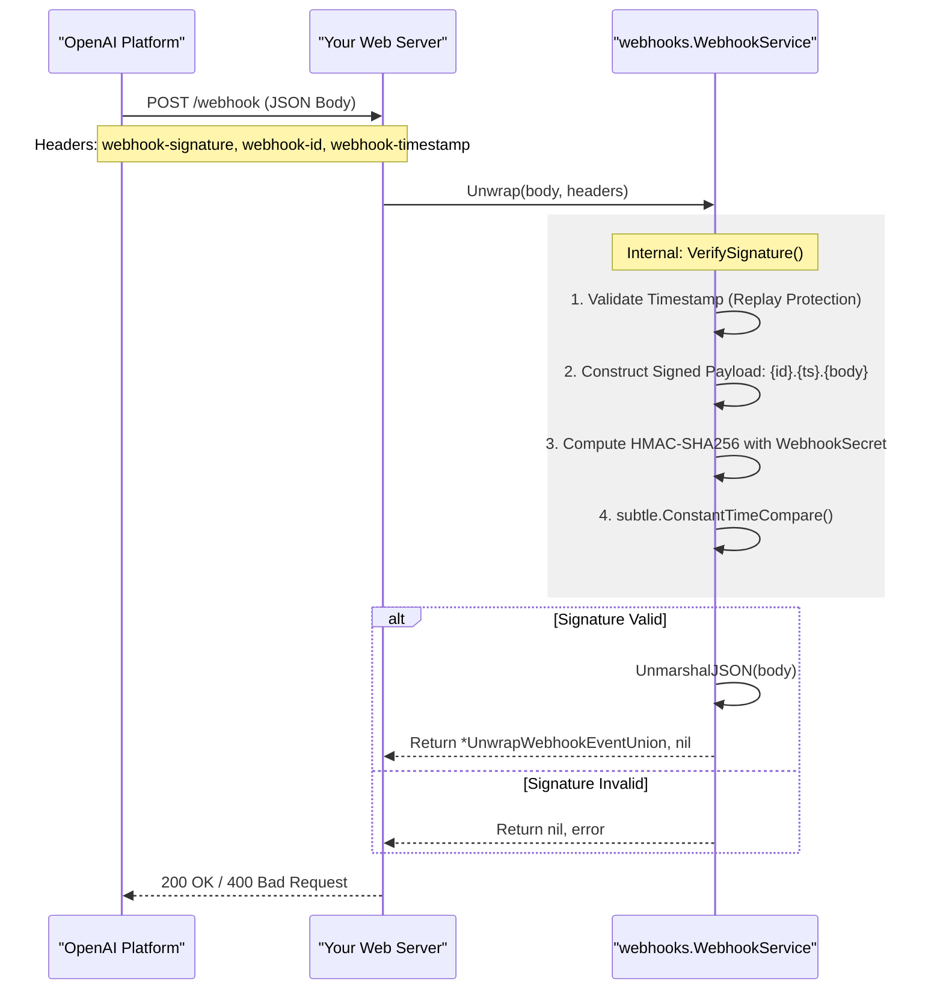
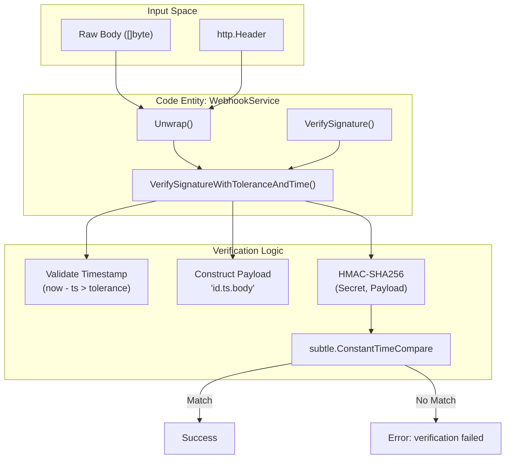

<!-- source: DeepWiki mcp.deepwiki.com · repo openai/openai-go · page 17.1 Webhooks and Event Verification · fetched 2026-10-26 -->

# Webhooks and Event Verification

<details>
<summary>Relevant source files</summary>

The following files were used as context for generating this wiki page:

- [conversations/aliases.go](conversations/aliases.go)
- [realtime/aliases.go](realtime/aliases.go)
- [webhooks/aliases.go](webhooks/aliases.go)
- [webhooks/webhook.go](webhooks/webhook.go)

</details>


This document explains the webhook signature verification system provided by the `openai-go` library. Webhooks allow OpenAI's platform to send event notifications to your application via HTTP POST requests. The verification system ensures that incoming webhook requests authentically originated from OpenAI and have not been tampered with.

## Overview

The webhook verification system provides cryptographic signature validation for incoming webhook requests using HMAC-SHA256. OpenAI signs each webhook request with a secret key, and the library verifies these signatures to ensure authenticity and prevent replay attacks.

The system is encapsulated in the `WebhookService`, which offers two primary approaches:
1.  **Combined verification and parsing** via `Unwrap()` — validates the signature and deserializes the event in one call.
2.  **Separate verification** via `VerifySignature()` — validates the signature only, leaving parsing to the application.

Sources: [webhooks/webhook.go:25-33](), [webhooks/webhook.go:45-58](), [webhooks/webhook.go:96-98]()

## Configuration

### Setting the Webhook Secret

The webhook secret must be provided to the `WebhookService`. While the library's standard clients often read from environment variables, the `WebhookService` requires explicit configuration via `option.WithWebhookSecret()`.

```go
// Example configuration
client := openai.NewClient(
    option.WithWebhookSecret("whsec_..."), // Your secret from OpenAI dashboard
)
```

The secret is used within `VerifySignatureWithToleranceAndTime` to decode the `whsec_` prefixed string and compute the expected HMAC.

Sources: [webhooks/webhook.go:28-30](), [webhooks/webhook.go:116-120](), [webhooks/webhook.go:171-180]()

## Webhook Request Flow

The following diagram illustrates the interaction between the OpenAI platform and the SDK's `WebhookService`.



**Webhook Request Flow**: Detailed lifecycle of a webhook request including the internal steps of the `VerifySignature` logic.

Sources: [webhooks/webhook.go:45-58](), [webhooks/webhook.go:111-198]()

## Signature Verification Architecture

The verification logic is designed to be timing-safe and resilient to replay attacks by validating the `webhook-timestamp` header against a tolerance window (defaulting to 5 minutes).



**Verification Architecture**: Maps the relationship between input data and the internal verification methods.

Sources: [webhooks/webhook.go:45-58](), [webhooks/webhook.go:96-110](), [webhooks/webhook.go:148-157](), [webhooks/webhook.go:182-198]()

## Using Unwrap() for Combined Verification and Parsing

The `Unwrap()` method is the standard entry point for processing webhooks. It internally calls `VerifySignature()` and then unmarshals the raw bytes into a discriminated union.

### Implementation Details

| Function | Purpose | Default Tolerance |
| :--- | :--- | :--- |
| `Unwrap` | Verify and parse JSON. | 5 minutes |
| `UnwrapWithTolerance` | Verify and parse with custom `time.Duration`. | User-defined |
| `UnwrapWithToleranceAndTime` | Verify and parse with custom time (useful for tests). | User-defined |

### The Event Union Pattern

`Unwrap()` returns an `UnwrapWebhookEventUnion`. This struct uses the SDK's union pattern, allowing you to access specific event data via type assertion or the `AsAny()` helper.

```go
event, err := client.Webhooks.Unwrap(body, headers)
if err != nil {
    // Handle verification or parsing error
}

switch e := event.AsAny().(type) {
case webhooks.ResponseCompletedWebhookEvent:
    fmt.Printf("Response ID: %s\n", e.Data.ID)
case webhooks.ResponseFailedWebhookEvent:
    fmt.Printf("Error: %s\n", e.Data.LastError.Message)
}
```

Sources: [webhooks/webhook.go:45-58](), [webhooks/webhook.go:62-74](), [webhooks/webhook.go:200-210]()

## Security Implementation Details

### Replay Protection
The SDK enforces a timestamp check. If the difference between the current time and the `webhook-timestamp` header exceeds the tolerance, the request is rejected.
Sources: [webhooks/webhook.go:148-157]()

### Constant Time Comparison
To prevent timing attacks, the SDK uses `subtle.ConstantTimeCompare` when validating the computed HMAC against the signatures provided in the `webhook-signature` header.
Sources: [webhooks/webhook.go:192-194]()

### Multiple Signatures
The `webhook-signature` header may contain multiple signatures (e.g., during secret rotation). The SDK splits these signatures and returns `nil` (success) if *any* of them match the computed HMAC.
Sources: [webhooks/webhook.go:162-170](), [webhooks/webhook.go:191-196]()

## Webhook Event Types

The library provides strongly typed structures for webhook events. Common events include:

| Event Constant / Type | Description |
| :--- | :--- |
| `ResponseCompletedWebhookEvent` | Sent when a Response reaches a terminal `completed` state. |
| `ResponseFailedWebhookEvent` | Sent when a Response reaches a terminal `failed` state. |
| `ResponseIncompleteWebhookEvent` | Sent when a Response reaches an `incomplete` state. |

Sources: [webhooks/webhook.go:200-210](), [webhooks/webhook.go:230-240]()

---

