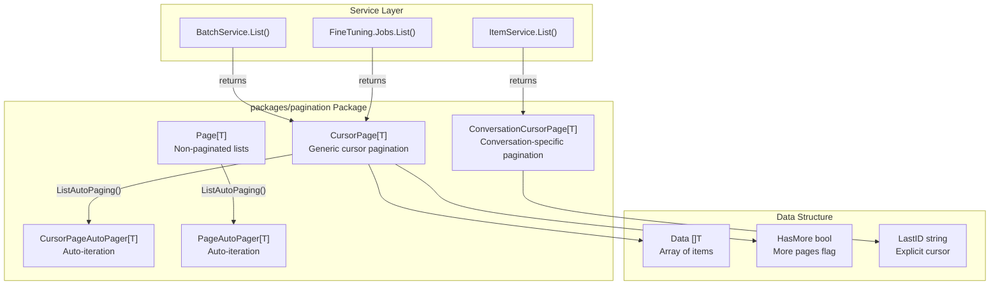
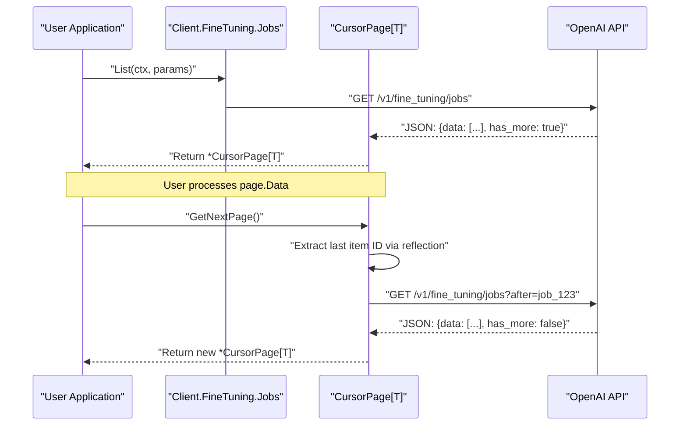

<!-- source: DeepWiki mcp.deepwiki.com · repo openai/openai-go · page 17.2 Pagination Patterns · fetched 2026-10-26 -->

# Pagination Patterns

<details>
<summary>Relevant source files</summary>

The following files were used as context for generating this wiki page:

- [internal/testutil/testutil.go](internal/testutil/testutil.go)
- [packages/pagination/pagination.go](packages/pagination/pagination.go)
- [paginationauto_test.go](paginationauto_test.go)
- [paginationmanual_test.go](paginationmanual_test.go)

</details>


## Purpose and Scope

This document explains the pagination system in the `openai-go` library, covering cursor-based pagination for list endpoints. It details the primary page types (`Page[T]`, `CursorPage[T]`, and `ConversationCursorPage[T]`), manual pagination with `GetNextPage()`, and automatic iteration with `ListAutoPaging()`.

---

## Pagination Architecture

The library provides a generic pagination infrastructure in the `packages/pagination` package that supports cursor-based pagination across multiple API endpoints. All paginated list operations follow a consistent pattern regardless of the underlying resource type.

### Natural Language to Code Entity Mapping

| Concept | Code Entity | File Path |
| :--- | :--- | :--- |
| **Standard Page** | `Page[T]` | [packages/pagination/pagination.go:22-34]() |
| **Cursor Page** | `CursorPage[T]` | [packages/pagination/pagination.go:119-131]() |
| **Auto-Paging Iterator** | `CursorPageAutoPager[T]` | [packages/pagination/pagination.go:180-187]() |
| **Manual Fetching** | `GetNextPage()` | [packages/pagination/pagination.go:142-170]() |
| **Request Config** | `RequestConfig` | [packages/pagination/pagination.go:129-129]() |

### Data Flow Diagram



**Sources:** [packages/pagination/pagination.go:1-240]()

---

## Page Types

### CursorPage[T]

The `CursorPage[T]` type is the standard pagination container used by most list endpoints (e.g., Fine-Tuning Jobs, Batches). It uses the `ID` field of the last item in the current page as the cursor for fetching the next page.

| Field | Type | Description |
|-------|------|-------------|
| `Data` | `[]T` | Array of items in the current page |
| `HasMore` | `bool` | Whether additional pages are available |
| `cfg` | `*requestconfig.RequestConfig` | Internal request configuration for cloning |
| `res` | `*http.Response` | Raw HTTP response |

**Sources:** [packages/pagination/pagination.go:119-131]()

### ConversationCursorPage[T]

Specialized for the Conversations API, this type includes an explicit `LastID` field. This eliminates the need for reflection-based cursor extraction from the `Data` slice.

**Sources:** [packages/pagination/pagination.go:225-239]()

### Page[T]

The `Page[T]` type represents responses that are not actually paginated at the API level. Its `GetNextPage()` method returns `(nil, nil)` to signify the end of the list.

**Sources:** [packages/pagination/pagination.go:22-64]()

---

## Manual Pagination Pattern

Manual pagination allows developers to control when to fetch the next set of results, typically used in UI components with "Load More" buttons or when specific logic is needed between pages.

### Request Lifecycle



**Implementation Details:**
The `GetNextPage()` method for `CursorPage[T]` clones the original `RequestConfig` and applies the `after` query parameter using the `ID` of the last element in the current `Data` slice.

**Sources:** [packages/pagination/pagination.go:142-170](), [paginationmanual_test.go:27-45]()

---

## Auto-Paging Pattern

Auto-paging provides an iterator interface (`Next()`, `Current()`, `Err()`) that automatically fetches new pages as the user iterates through items.

### Iterator State Machine

| Method | Logic |
| :--- | :--- |
| `Next()` | Checks if `idx` is at the end of `page.Data`. If so, calls `GetNextPage()`. Returns `false` on error or completion. |
| `Current()` | Returns the item at the current `idx`. |
| `Err()` | Returns the first error encountered during iteration. |

**Usage Example:**
```go
iter := client.FineTuning.Jobs.ListAutoPaging(ctx, params)
for iter.Next() {
    job := iter.Current()
    // process job
}
if err := iter.Err(); err != nil {
    // handle error
}
```

**Sources:** [packages/pagination/pagination.go:196-223](), [paginationauto_test.go:27-38]()

---

## Technical Implementation Details

### Cursor Extraction via Reflection
For `CursorPage[T]`, the SDK must extract an `ID` field from a generic type `T`. This is performed in `GetNextPage` using the `reflect` package:

```go
// [packages/pagination/pagination.go:155-157]
value := reflect.ValueOf(items[len(items)-1])
field := value.FieldByName("ID")
err = cfg.Apply(option.WithQuery("after", field.Interface().(string)))
```

### Configuration Persistence
The `SetPageConfig` method is critical for pagination. It stores the `requestconfig.RequestConfig` inside the page object. When `GetNextPage` is called, this config is cloned, ensuring that headers (like API Keys), context, and middleware are preserved across page requests.

**Sources:** [packages/pagination/pagination.go:66-72](), [packages/pagination/pagination.go:154-154]()

### Termination Conditions
Pagination terminates under three conditions in `GetNextPage()`:
1. `Data` slice is empty: [packages/pagination/pagination.go:143-145]()
2. `HasMore` is explicitly `false` (if the field is valid in JSON): [packages/pagination/pagination.go:147-149]()
3. For `ConversationCursorPage`, if `LastID` is empty: [packages/pagination/pagination.go:259-261]()

---

