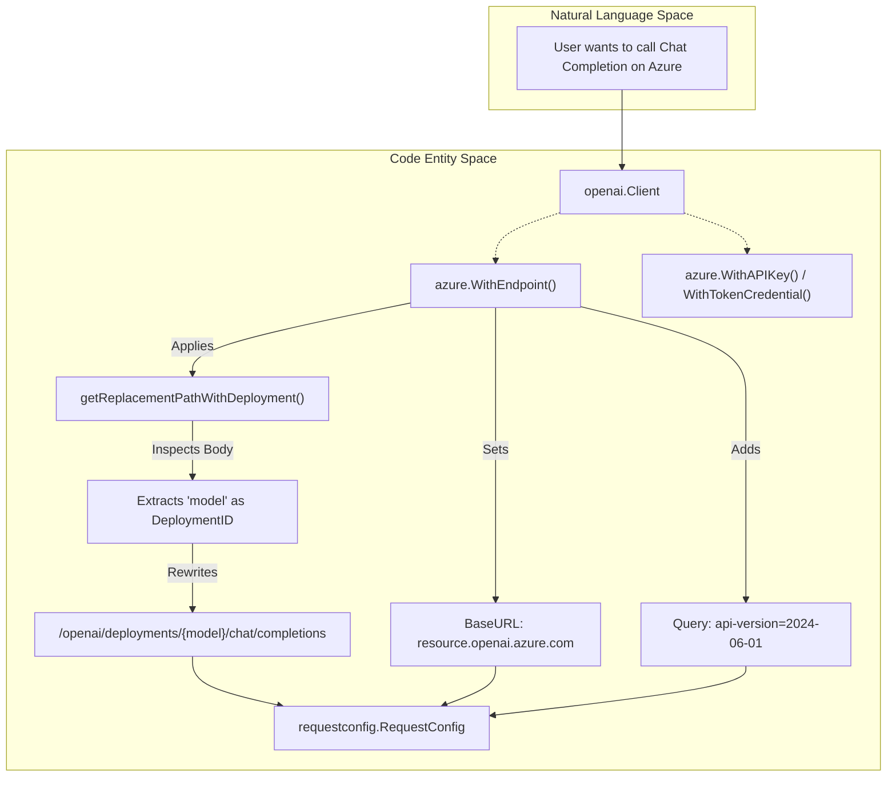
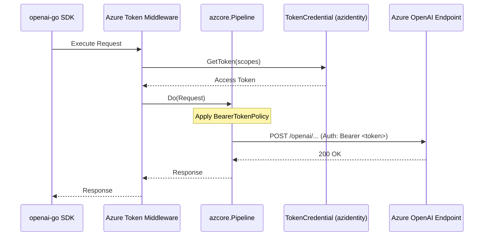

<!-- source: DeepWiki mcp.deepwiki.com · repo openai/openai-go · page 17.3 Azure OpenAI Integration · fetched 2026-10-26 -->

# Azure OpenAI Integration

<details>
<summary>Relevant source files</summary>

The following files were used as context for generating this wiki page:

- [azure/azure.go](azure/azure.go)
- [azure/azure_test.go](azure/azure_test.go)
- [azure/example_test.go](azure/example_test.go)
- [examples/azure/main.go](examples/azure/main.go)
- [examples/video-generation/main.go](examples/video-generation/main.go)

</details>


The `azure` package provides specialized configuration options for connecting the `openai-go` SDK to Microsoft Azure OpenAI Service. Azure OpenAI utilizes resource-specific endpoints, mandatory API versioning, and distinct authentication mechanisms (Azure Active Directory or specific API keys) that differ from the standard OpenAI API.

## Overview

Azure OpenAI Service hosts OpenAI models on Azure infrastructure with enterprise security and regional availability. The integration in this SDK is primarily implemented through `option.RequestOption` functions that modify the request lifecycle to match Azure's expected request format and authentication headers.

Key architectural differences handled by the `azure` package:
- **Resource-Specific Endpoints**: Requests are routed to `https://<resource-name>.openai.azure.com`.
- **API Versioning**: Every request must include an `api-version` query parameter [azure/azure.go:42-42]().
- **Deployment Routing**: Azure uses "Deployment Names" as the `model` identifier [azure/azure_test.go:17-17]().
- **Authentication**: Supports Azure Identity `TokenCredential` or a specialized `Api-Key` header [azure/azure.go:109-156]().

**Sources**: [azure/azure.go:1-18](), [azure/azure.go:39-53](), [examples/azure/main.go:12-21]()

## Configuration and Initialization

The `azure` package offers three primary functions to configure an `openai.Client` or individual services like `openai.ChatCompletionService`.

### 1. Endpoint and Versioning
The `azure.WithEndpoint(endpoint, apiVersion)` function is mandatory for Azure integration. It performs three critical tasks:
1. Sets the `BaseURL` to the Azure resource URL [azure/azure.go:59-59]().
2. Adds the `api-version` query parameter to all requests [azure/azure.go:58-58]().
3. Injects a middleware that rewrites standard OpenAI paths to Azure's `/openai/deployments/...` structure [azure/azure.go:61-70]().

### 2. Authentication: API Key
Azure uses a custom header `Api-Key` instead of the standard `Authorization: Bearer` header. The `azure.WithAPIKey(apiKey)` function correctly sets this header [azure/azure.go:152-156]().

### 3. Authentication: Token Credential
For enterprise security, `azure.WithTokenCredential(tokenCredential)` allows using `azcore.TokenCredential` from the Azure Identity SDK. This is ideal for Managed Identities or Service Principals [azure/azure.go:109-113]().

**Sources**: [azure/azure.go:53-91](), [azure/azure.go:113-148](), [azure/azure.go:152-156]()

## Internal Request Transformation

Azure OpenAI requires a different URL path structure than standard OpenAI. The SDK uses a middleware pattern to dynamically rewrite the request path based on the `model` parameter provided in the request body.

### Path Rewriting Logic
Standard OpenAI paths like `/chat/completions` are transformed into Azure-specific paths:
`/openai/deployments/{deployment_id}/chat/completions`

The logic distinguishes between routes that require a deployment ID (like chat completions) and those that do not (like listing files).

| Route Type | Examples | Azure Transformation |
| :--- | :--- | :--- |
| **JSON Routes** | `/chat/completions`, `/embeddings` | `/openai/deployments/{model}/...` |
| **Multipart Routes** | `/audio/transcriptions`, `/images/edits` | `/openai/deployments/{model}/...` |
| **Standard Routes** | `/files`, `/models` | `/openai/...` |

**Sources**: [azure/azure.go:160-174](), [azure/azure.go:178-189](), [azure/azure_test.go:104-124]()

### Request Lifecycle Diagram
The following diagram illustrates how the `azure` package entities interact with the core SDK to transform a standard request into an Azure-compatible one.


**Diagram: Azure Path Transformation and Configuration Flow**
**Sources**: [azure/azure.go:53-91](), [azure/azure.go:178-189](), [azure/azure_test.go:15-45]()

## Authentication Flow: Token Credential

When using `WithTokenCredential`, the SDK integrates with the `Azure/azure-sdk-for-go/sdk/azcore` pipeline. It creates a `BearerTokenPolicy` and wraps the SDK's internal `MiddlewareNext` function into a `policyAdapter` to ensure tokens are injected and refreshed correctly.


**Diagram: Azure Token Credential Authentication Sequence**
**Sources**: [azure/azure.go:113-148](), [azure/azure.go:215-226]()

## Implementation Details

### JSON Route Handling
For routes like `/chat/completions`, the middleware must peek into the JSON body to find the `model` field, which Azure treats as the `deployment_id`.
1. Read the entire `req.Body` [azure/azure.go:193-197]().
2. Restore the body using `io.NopCloser` so it can be read again by the actual transport [azure/azure.go:200-200]().
3. Extract the `Model` string and URL-escape it for the path [azure/azure.go:202-212]().

### Multipart Route Handling
For file uploads (transcriptions, translations), the SDK parses the `multipart/form-data` to find the `model` field. It creates a temporary `multipart.Reader` to locate the deployment name without destroying the stream for the final upload [azure/azure.go:232-258]().

### Example Usage
```go
client := openai.NewClient(
    azure.WithEndpoint("https://my-resource.openai.azure.com", "2024-05-01-preview"),
    azure.WithAPIKey(os.Getenv("AZURE_OPENAI_API_KEY")),
)

resp, err := client.Responses.New(ctx, responses.ResponseNewParams{
    Model: openai.ChatModel("my-deployment-name"),
    Input: responses.ResponseNewParamsInputUnion{OfString: openai.String("Hello Azure!")},
})
```

**Sources**: [azure/azure.go:191-212](), [azure/azure.go:230-262](), [examples/azure/main.go:18-30]()

## Testing Patterns
The `azure_test.go` file demonstrates how the path replacement logic is validated across different route types.

- **JSON Path Validation**: Tests that `/chat/completions` with model `gpt-4` becomes `/openai/deployments/gpt-4/chat/completions` [azure/azure_test.go:104-124]().
- **Escaping**: Ensures models with special characters (e.g., `my-model/v1`) are correctly URL-escaped in the resulting path [azure/azure_test.go:126-134]().
- **Multipart Validation**: Validates that the `model` field is correctly extracted from form-data for audio transcription routes [azure/azure_test.go:47-87]().

**Sources**: [azure/azure_test.go:15-134]()

---

