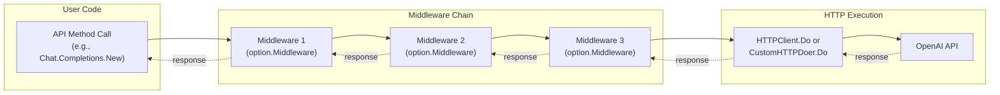
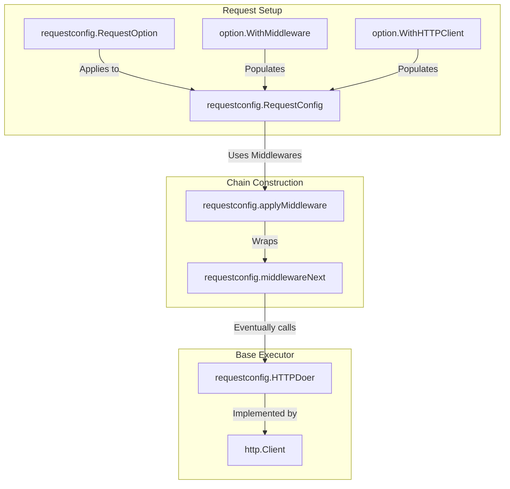

<!-- source: DeepWiki mcp.deepwiki.com · repo openai/openai-go · page 17.4 Custom Middleware and HTTP Clients · fetched 2026-10-26 -->

# Custom Middleware and HTTP Clients

<details>
<summary>Relevant source files</summary>

The following files were used as context for generating this wiki page:

- [auth/error.go](auth/error.go)
- [auth/middleware.go](auth/middleware.go)
- [auth/subjecttokenprovider.go](auth/subjecttokenprovider.go)
- [auth/subjecttokenprovider_test.go](auth/subjecttokenprovider_test.go)
- [auth/types.go](auth/types.go)
- [auth/workloadidentity.go](auth/workloadidentity.go)
- [auth/workloadidentity_test.go](auth/workloadidentity_test.go)
- [internal/requestconfig/requestconfig.go](internal/requestconfig/requestconfig.go)
- [option/middleware.go](option/middleware.go)
- [option/requestoption.go](option/requestoption.go)

</details>


This page documents how to customize the HTTP execution layer of the `openai-go` client through middleware and custom HTTP clients. Middleware provides request interception for cross-cutting concerns like logging and metrics, while custom HTTP clients enable low-level transport configuration.

## Overview

The `openai-go` client provides two primary mechanisms for customizing HTTP behavior:

1.  **Middleware** (`option.WithMiddleware`) - High-level request interception for application logic.
2.  **HTTP Clients** (`option.WithHTTPClient`) - Low-level transport configuration.

These mechanisms operate at different layers of the request pipeline, with middleware wrapping around the HTTP client execution.

## Middleware

Middleware in `openai-go` follows a functional composition pattern where each middleware function wraps the next handler in the chain. The middleware has the opportunity to inspect and modify the request before it is sent, and to inspect and modify the response after it is received.

### Middleware Type Signature

```go
type Middleware = func(*http.Request, MiddlewareNext) (*http.Response, error)
type MiddlewareNext = func(*http.Request) (*http.Response, error)
```

The `Middleware` function receives:
*   `*http.Request`: The HTTP request to be sent.
*   `MiddlewareNext`: A function to call the next handler in the chain.

It returns:
*   `*http.Response`: The HTTP response from the API.
*   `error`: Any error that occurred.

**Sources:** [option/requestoption.go:78-85]()

### Middleware Chain Architecture

The middleware chain is constructed by wrapping the base HTTP executor (the "Next" function) with each provided middleware.



**Sources:** [internal/requestconfig/requestconfig.go:210-221](), [internal/requestconfig/requestconfig.go:238-248]()

## Implementing Custom Middleware

A middleware function must conform to the `Middleware` type signature. The function can execute logic before calling `next`, after calling `next`, or both.

### Debug Logging Middleware
The SDK provides a built-in `WithDebugLog` middleware that utilizes `httputil.DumpRequest` and `httputil.DumpResponse` to log full request/response cycles.

```go
func WithDebugLog(logger *log.Logger) RequestOption {
	return WithMiddleware(func(req *http.Request, nxt MiddlewareNext) (*http.Response, error) {
		// ... logic to dump request ...
		resp, err := nxt(req)
		// ... logic to dump response ...
		return resp, err
	})
}
```

**Sources:** [option/middleware.go:17-38]()

### Authentication Middleware Example
The `auth` package implements `WorkloadIdentityMiddleware` which intercepts requests to inject a Bearer token and handles `401 Unauthorized` by invalidating the token and retrying the request once.

```go
func WorkloadIdentityMiddleware(wia *WorkloadIdentityAuth, httpClient HTTPDoer, req *http.Request, next func(*http.Request) (*http.Response, error)) (*http.Response, error) {
	token, err := wia.GetToken(req.Context(), httpClient)
	if err != nil { return nil, err }
	req.Header.Set("Authorization", "Bearer "+token)

	resp, err := next(req)
    // Handle retry on 401
	if err != nil || resp == nil || resp.StatusCode != http.StatusUnauthorized {
		return resp, err
	}
    // ... token invalidation and retry logic ...
    return next(retryReq)
}
```

**Sources:** [auth/middleware.go:7-50]()

## Applying Middleware

Middleware is applied using `option.WithMiddleware()`, which appends the provided functions to the `Middlewares` slice in the `RequestConfig`.

### Client and Request Level Application

```go
// Applied at client level (affects all requests)
client := openai.NewClient(
    option.WithMiddleware(MyGlobalMiddleware),
)

// Applied at request level (affects only this call)
response, err := client.Chat.Completions.New(
    ctx, 
    params, 
    option.WithMiddleware(MyRequestMiddleware),
)
```

**Sources:** [option/requestoption.go:89-94](), [internal/requestconfig/requestconfig.go:210-221]()

## Custom HTTP Clients

The `option.WithHTTPClient` function allows you to replace the default `http.DefaultClient` with a custom HTTP client. This is useful for configuring transport settings like connection pooling, proxies, or custom `RoundTripper` logic.

### HTTPClient Interface

The SDK defines an `HTTPClient` interface that is compatible with `*http.Client`.

```go
type HTTPClient interface {
	Do(*http.Request) (*http.Response, error)
}
```

**Sources:** [option/requestoption.go:51-53]()

### Using WithHTTPClient

When a custom client is provided, the SDK distinguishes between a standard `*http.Client` and a custom implementation of the interface.

```go
func WithHTTPClient(client HTTPClient) RequestOption {
	return requestconfig.RequestOptionFunc(func(r *requestconfig.RequestConfig) error {
		if c, ok := client.(*http.Client); ok {
			r.HTTPClient = c // native client
			r.CustomHTTPDoer = nil
		} else {
			r.CustomHTTPDoer = client // custom implementation
		}
		return nil
	})
}
```

**Sources:** [option/requestoption.go:60-76]()

## Internal Execution Flow

The `RequestConfig` handles the final assembly of the execution chain.

### Execution Entity Mapping

The following diagram maps the high-level request concepts to the internal code entities responsible for them.



**Sources:** [internal/requestconfig/requestconfig.go:81-91](), [internal/requestconfig/requestconfig.go:202-221](), [internal/requestconfig/requestconfig.go:244-248](), [option/requestoption.go:60-94]()

### Request Initialization logic

When `NewRequestConfig` is called, it initializes the `RequestConfig` with defaults before applying user-provided options.

1.  **Default Setup**: Sets `MaxRetries` to 2 and `HTTPClient` to `http.DefaultClient`.
2.  **Platform Headers**: Adds `User-Agent`, `X-Stainless-Lang`, `X-Stainless-OS`, and `X-Stainless-Arch`.
3.  **Option Application**: Calls `cfg.Apply(opts...)` which runs the logic in `WithMiddleware` or `WithHTTPClient`.

**Sources:** [internal/requestconfig/requestconfig.go:91-181](), [internal/requestconfig/requestconfig.go:28-79]()

## Workload Identity and Authentication Providers

The `auth` package provides specialized middleware and providers for cloud-native authentication (Kubernetes, Azure, GCP).

### Subject Token Providers
These providers fetch an initial identity token from the environment.

| Provider | Code Entity | Target Environment |
| :--- | :--- | :--- |
| **Kubernetes** | `auth.K8sServiceAccountTokenProvider` | K8s Pods (reads from disk) |
| **Azure** | `auth.AzureManagedIdentityTokenProvider` | Azure VM/App Service (IMDS) |
| **GCP** | `auth.GCPIDTokenProvider` | Google Cloud (Metadata Server) |

**Sources:** [auth/subjecttokenprovider.go:25-30](), [auth/subjecttokenprovider.go:67-79](), [auth/subjecttokenprovider.go:169-178]()

### Workload Identity Flow
The `WorkloadIdentityAuth` struct manages the exchange of a subject token for an OpenAI access token via `https://auth.openai.com/oauth/token`.

1.  **GetToken**: Checks if a `cachedToken` is valid.
2.  **Refresh**: If expired (or within `RefreshBufferSeconds`), it triggers a `refreshToken` call.
3.  **Single-flight**: Uses `tokenRefreshState` and a `sync.Mutex` to ensure only one refresh happens concurrently.

**Sources:** [auth/workloadidentity.go:26-34](), [auth/workloadidentity.go:78-116](), [auth/workloadidentity.go:173-212]()

---

