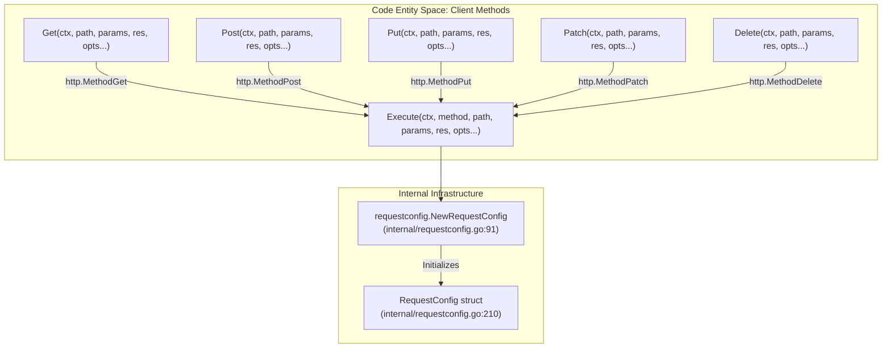
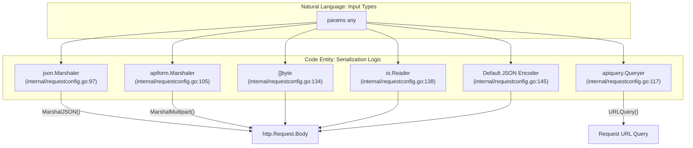

<!-- source: DeepWiki mcp.deepwiki.com · repo openai/openai-go · page 17.5 Generic Request Methods · fetched 2026-10-26 -->

# Generic Request Methods

<details>
<summary>Relevant source files</summary>

The following files were used as context for generating this wiki page:

- [client_test.go](client_test.go)
- [internal/requestconfig/requestconfig.go](internal/requestconfig/requestconfig.go)
- [option/requestoption.go](option/requestoption.go)
- [usage_test.go](usage_test.go)

</details>


This document covers the generic HTTP request methods available on the `Client` type that allow direct API calls to any endpoint, including undocumented or custom endpoints. These methods provide an escape hatch for scenarios where the typed service methods are insufficient.

For information about typed service-specific methods (e.g., `Chat.Completions.New`), see the specific service documentation. For information about request configuration and options, see **2.1 Client Configuration and Options**. For middleware and HTTP client customization, see **17.4 Custom Middleware and HTTP Clients**.

## Overview

The `Client` provides six generic request methods for direct HTTP access while retaining all client configuration (authentication, retries, base URL, middleware):

| Method | Purpose |
|--------|---------|
| `Execute` | Core method supporting any HTTP verb |
| `Get` | Convenience wrapper for GET requests |
| `Post` | Convenience wrapper for POST requests |
| `Put` | Convenience wrapper for PUT requests |
| `Patch` | Convenience wrapper for PATCH requests |
| `Delete` | Convenience wrapper for DELETE requests |

These methods are designed for maximum flexibility in parameter serialization and response deserialization.

**Sources:** [internal/requestconfig/requestconfig.go:91-198]()

## Method Architecture

The generic request methods follow a pattern where all HTTP verb methods delegate to the core request configuration and execution logic. The `RequestConfig` struct acts as the central state holder for a single request's lifecycle.



**Sources:** [internal/requestconfig/requestconfig.go:91-180](), [internal/requestconfig/requestconfig.go:210-234]()

## The Request Configuration Process

When a generic method is called, the SDK uses `NewRequestConfig` to prepare the underlying `*http.Request`. This function handles the heavy lifting of serialization and header initialization.

### Parameters and State

The `RequestConfig` struct ([internal/requestconfig/requestconfig.go:210-234]()) tracks:
- `MaxRetries`: Number of allowed attempts (default 2) [internal/requestconfig/requestconfig.go:174]().
- `HTTPClient`: The `*http.Client` used for execution [internal/requestconfig/requestconfig.go:177]().
- `ResponseBodyInto`: The destination for deserialization [internal/requestconfig/requestconfig.go:180]().
- `Request`: The initialized `*http.Request` [internal/requestconfig/requestconfig.go:176]().

**Sources:** [internal/requestconfig/requestconfig.go:173-180](), [internal/requestconfig/requestconfig.go:210-234]()

## Request Parameter Serialization

The `NewRequestConfig` function inspects the `body` (params) argument and applies serialization based on supported interfaces:



### Serialization Rules

1. **JSON Marshaler**: If the body implements `json.Marshaler`, `MarshalJSON()` is called [internal/requestconfig/requestconfig.go:97-104]().
2. **Multipart Form**: If the body implements `apiform.Marshaler`, it produces a multipart body and sets the appropriate `Content-Type` [internal/requestconfig/requestconfig.go:105-116]().
3. **URL Query**: If the body implements `apiquery.Queryer`, parameters are encoded into the URL query string [internal/requestconfig/requestconfig.go:117-133]().
4. **Raw Data**: `[]byte` and `io.Reader` are passed directly to the request body [internal/requestconfig/requestconfig.go:134-141]().
5. **Fallback**: If no special interface is met, the SDK defaults to standard JSON encoding via `json.NewEncoder` [internal/requestconfig/requestconfig.go:145-153]().

**Sources:** [internal/requestconfig/requestconfig.go:91-153]()

## Response Deserialization

The `ResponseBodyInto` field in `RequestConfig` determines how the response is handled after the HTTP call.

### Deserialization Rules

1. **Typed Structs**: If a pointer to a struct is provided, the SDK attempts to deserialize the JSON response into that struct [internal/requestconfig/requestconfig.go:229]().
2. **Raw Bytes**: If the destination is a `[]byte`, the raw response body is returned as-is [internal/requestconfig/requestconfig.go:227-228]().
3. **HTTP Response**: The `ResponseInto` field can be used to capture the underlying `*http.Response` object [internal/requestconfig/requestconfig.go:232]().

**Sources:** [internal/requestconfig/requestconfig.go:226-234]()

## Option Application and Merging

Generic methods allow passing `RequestOption` values to modify the request on the fly. These are applied via the `Apply` method on the `RequestConfig` struct [internal/requestconfig/requestconfig.go:181]().

### Common Generic Options

- `WithHeader`: Sets a specific header value [option/requestoption.go:113-118]().
- `WithQuery`: Sets a URL query parameter [option/requestoption.go:139-146]().
- `WithJSONSet`: Modifies the JSON body using a key path [option/requestoption.go:173-195]().
- `WithMaxRetries`: Overrides the default retry count for a specific call [option/requestoption.go:101-109]().

```go
// Example of generic option usage
client.Post(ctx, "/v1/custom", body, &res, 
    option.WithHeader("X-Custom-Header", "Value"),
    option.WithJSONSet("experimental_flag", true),
)
```

**Sources:** [option/requestoption.go:113-195](), [internal/requestconfig/requestconfig.go:181-184]()

## Request Lifecycle and Middleware

The generic request follows the standard internal pipeline, which includes header initialization and middleware execution.

1. **Default Headers**: Every request receives `User-Agent` and `X-Stainless` platform headers [internal/requestconfig/requestconfig.go:163-172]().
2. **Middleware Chaining**: Any middlewares configured on the client or via options are wrapped around the execution [internal/requestconfig/requestconfig.go:244-248]().
3. **Execution**: The request is dispatched via `HTTPDoer.Do` [internal/requestconfig/requestconfig.go:202-204]().

**Sources:** [internal/requestconfig/requestconfig.go:28-32](), [internal/requestconfig/requestconfig.go:70-79](), [internal/requestconfig/requestconfig.go:238-248]()

## Integration with Client Configuration

Generic request methods respect all client-level settings established during initialization:

| Configuration | Implementation Detail |
|---------------|-----------------------|
| **Base URL** | Parsed and stored in `RequestConfig.BaseURL` [option/requestoption.go:30-44](). |
| **HTTP Client** | Stored in `RequestConfig.HTTPClient` or `CustomHTTPDoer` [option/requestoption.go:60-76](). |
| **Retries** | Managed via `RequestConfig.MaxRetries` [option/requestoption.go:105-108](). |
| **Timeout** | Set via `X-Stainless-Timeout` header if configured [internal/requestconfig/requestconfig.go:189-195](). |

**Sources:** [option/requestoption.go:30-109](), [internal/requestconfig/requestconfig.go:189-195]()

---

