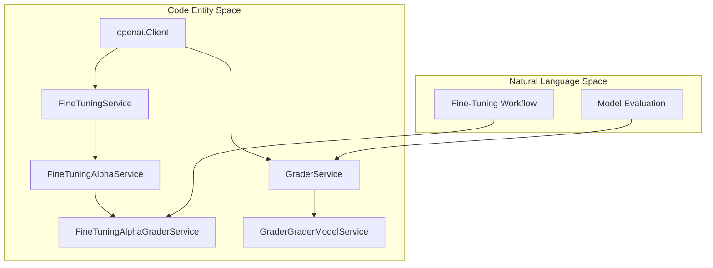
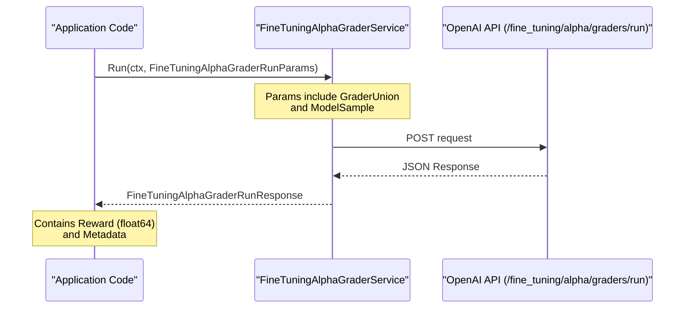

<!-- source: DeepWiki mcp.deepwiki.com · repo openai/openai-go · page 17.7 Graders and Model Evaluation · fetched 2026-10-26 -->

# Graders and Model Evaluation

Relevant source files

The following files were used as context for generating this wiki page:

- [finetuning.go](finetuning.go)
- [finetuningalpha.go](finetuningalpha.go)
- [finetuningalphagrader.go](finetuningalphagrader.go)
- [finetuningalphagrader_test.go](finetuningalphagrader_test.go)
- [finetuningcheckpoint.go](finetuningcheckpoint.go)
- [finetuningmethod.go](finetuningmethod.go)
- [grader.go](grader.go)
- [gradergradermodel.go](gradergradermodel.go)

The Grader system provides a framework for evaluating model outputs against specific criteria, which is a critical component for reinforcement fine-tuning and quality assurance. This system is primarily managed through the `GraderService` and its specialized sub-services, allowing developers to run and validate various types of evaluation logic (graders) against model-generated samples.

### Service Architecture

The evaluation infrastructure is divided into several specialized services that handle different aspects of the grading lifecycle.

*   **`GraderService`**: The entry point for grader-related operations, housing the `GraderGraderModelService` [grader.go:9-18]().
*   **`FineTuningAlphaGraderService`**: Provides methods to `Run` and `Validate` graders within the context of fine-tuning workflows [finetuningalphagrader.go:26-53]().
*   **`GraderGraderModelService`**: Manages the configuration and inputs for model-based evaluation [gradergradermodel.go:17-25]().

#### Service Relationship Diagram
This diagram shows how the Grader services are organized within the `openai.Client` hierarchy.

Sources: [grader.go:9-28](), [finetuning.go:15-35](), [finetuningalpha.go:9-29](), [finetuningalphagrader.go:26-37]()

---

### Grader Types and Configuration

The SDK supports several distinct grader implementations through union types. These graders are used to generate a `Reward` or `Score` based on the model's output [finetuningalphagrader.go:55-59]().

| Grader Type | Purpose | Key Parameters |
| :--- | :--- | :--- |
| **String Check** | Simple text matching (equality, contains, etc.) | `Operation`, `Reference`, `Input` |
| **Text Similarity** | Evaluates semantic similarity between texts | `Threshold`, `Model` |
| **Score Model** | Uses a model to output a numeric score | `Model`, `Instructions` |
| **Label Model** | Uses a model to categorize output into labels | `Labels`, `Model` |
| **Python** | Executes custom Python logic for evaluation | `Code` |

When running a grader via `FineTuningAlphaGraderService.Run`, the grader configuration is provided as a `FineTuningAlphaGraderRunParamsGraderUnion` [finetuningalphagrader_test.go:28-36]().

Sources: [finetuningalphagrader_test.go:28-39](), [finetuningalphagrader.go:55-59]()

---

### Data Flow for Model Evaluation

The evaluation process involves sending a model sample and an item (the context) to a specific grader. The system then returns metadata regarding execution time, token usage, and the calculated reward.

#### Evaluation Request Flow
This diagram maps the parameters and return types used in the `Run` method.

Sources: [finetuningalphagrader.go:40-45](), [finetuningalphagrader.go:55-59](), [finetuningalphagrader_test.go:28-39]()

---

### Input Handling and Unions

Model evaluation requires flexible input structures, as graders might need to process text, images, or audio. The SDK uses `GraderInputUnion` to handle these polymorphic inputs [gradergradermodel.go:46-66]().

*   **`GraderInputOutputText`**: Represents the text generated by the model being evaluated [gradergradermodel.go:101-113]().
*   **`GraderInputInputImage`**: Represents image data used as context for the evaluation [gradergradermodel.go:122-138]().
*   **`GraderInputUnionParam`**: The parameter version used for constructing requests, allowing `OfString`, `OfInputText`, `OfOutputText`, `OfInputImage`, or `OfInputAudio` [gradergradermodel.go:151-158]().

#### Input Type Casting
Because inputs are returned as unions, the SDK provides helper methods to cast them back to specific types:
*   `AsOutputText()` [gradergradermodel.go:78-81]()
*   `AsInputImage()` [gradergradermodel.go:83-86]()
*   `AsInputAudio()` [gradergradermodel.go:88-91]()

Sources: [gradergradermodel.go:38-91](), [gradergradermodel.go:151-166]()

---

### Error Handling in Evaluations

Evaluations can fail for numerous technical and logical reasons. The `FineTuningAlphaGraderRunResponseMetadataErrors` struct provides detailed flags to diagnose why a grader failed to produce a score [finetuningalphagrader.go:105-139]().

Key error categories include:
*   **Logic Errors**: `FormulaParseError`, `InvalidVariableError` [finetuningalphagrader.go:106-107]().
*   **Model Errors**: `ModelGraderRefusalError`, `ModelGraderServerError` [finetuningalphagrader.go:109-110]().
*   **Runtime Errors**: `PythonGraderRuntimeError`, `PythonGraderServerError` [finetuningalphagrader.go:113-115]().
*   **Content Errors**: `SampleParseError`, `TruncatedObservationError` [finetuningalphagrader.go:117-118]().

Sources: [finetuningalphagrader.go:105-140]()

---

