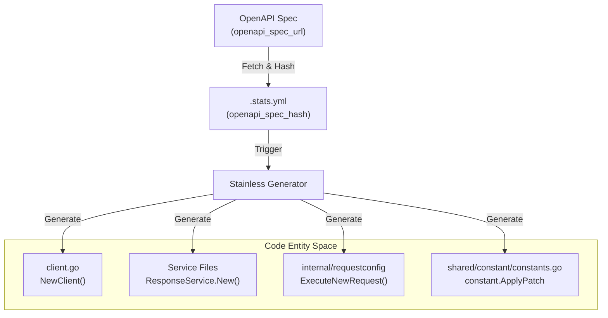
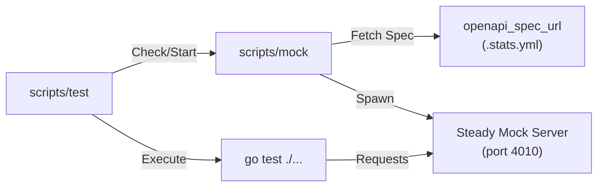

<!-- source: DeepWiki mcp.deepwiki.com · repo openai/openai-go · page 18 Development and Code Generation · fetched 2026-10-26 -->

# Development and Code Generation

Relevant source files

The following files were used as context for generating this wiki page:

- [.github/workflows/ci.yml](.github/workflows/ci.yml)
- [.github/workflows/create-releases.yml](.github/workflows/create-releases.yml)
- [.github/workflows/detect-breaking-changes.yml](.github/workflows/detect-breaking-changes.yml)
- [.stats.yml](.stats.yml)
- [Brewfile](Brewfile)
- [CONTRIBUTING.md](CONTRIBUTING.md)
- [release-please-config.json](release-please-config.json)
- [responses/response.go](responses/response.go)
- [scripts/check-go-mod](scripts/check-go-mod)
- [scripts/mock](scripts/mock)
- [scripts/test](scripts/test)

This document explains the code generation pipeline that transforms OpenAPI specifications into the `openai-go` SDK. It covers the generation metadata system, the Stainless code generator, and the automated testing infrastructure.

For details on the specific components, see the following child pages:
- [OpenAPI Specification and Generation](#18.1) — Detailed documentation of `.stats.yml` metadata, spec verification, and the Stainless generator.
- [Testing Patterns](#18.2) — Deep dive into parameter construction, option usage, and mock response handling in tests.

## Overview

The `openai-go` library is **fully code-generated** from OpenAPI specifications using the Stainless SDK generator. This architecture ensures the SDK maintains perfect fidelity with OpenAI's API contract while providing idiomatic Go interfaces.

**Generation Summary:**
*   **139 configured API endpoints** tracked in metadata [[.stats.yml:1-1]()]
*   **200+ typed string constants** for discriminators and identifiers [[shared/constant/constants.go:1-1046]()]
*   **Complete type system** with request/response pairs for every operation.
*   **Service implementations** with synchronous and streaming variants [[responses/response.go:61-89]()]

## Generation Metadata System

The [.stats.yml:1-4]() file serves as the single source of truth for code generation, tracking which OpenAPI specification version generated the current SDK code. It contains the `openapi_spec_url`, `openapi_spec_hash`, and the number of `configured_endpoints`.

### Generation Pipeline Diagram

The following diagram bridges the Natural Language requirements (OpenAPI Spec) to the Code Entity Space (Generated Services and Internal Helpers).

**Title: Code Generation Workflow**

**Sources:** [.stats.yml:1-4](), [responses/response.go:61-66](), [shared/constant/constants.go:161-163]()

## Testing Infrastructure

Generated code includes test scaffolding to validate the SDK's functionality. Most tests require a mock server running against the OpenAPI spec.

### Testing Workflow

The codebase uses a mock server named `Steady` to validate requests against the OpenAPI specification.

**Title: Test Execution Pipeline**

**Sources:** [scripts/test:12-57](), [scripts/mock:11-51](), [.stats.yml:2-2]()

### Key Testing Components:
*   **Mock Server:** The `scripts/mock` script starts a `@stdy/cli` (Steady) server that validates SDK requests against the OpenAPI spec [[scripts/mock:25-27]()].
*   **CI Integration:** The GitHub Actions workflow `ci.yml` automates the execution of `./scripts/test` and `./scripts/lint` on every push [[.github/workflows/ci.yml:68-85]()].
*   **Breaking Change Detection:** A dedicated script `scripts/detect-breaking-changes` compares the current branch against the base branch to prevent regression [[.github/workflows/detect-breaking-changes.yml:28-33]()].

## Development Workflow

Since the SDK is generated, manual modifications to generated files (identified by the Stainless header) are discouraged.

1.  **Environment Setup:** Run `./scripts/bootstrap` to install dependencies [[CONTRIBUTING.md:3-6]()].
2.  **Modifying Code:** Most modifications should happen in the OpenAPI spec. Manual patches in the SDK may cause merge conflicts during the next generation cycle [[CONTRIBUTING.md:16-18]()].
3.  **Examples:** Files in the `examples/` directory are never modified by the generator and are the primary location for manual code [[CONTRIBUTING.md:22-23]()].
4.  **Formatting:** Use `./scripts/format` to ensure standard `gofmt` compliance [[CONTRIBUTING.md:59-64]()].

For details, see [OpenAPI Specification and Generation](#18.1).

**Sources:** [CONTRIBUTING.md:1-64](), [.github/workflows/ci.yml:1-86](), [responses/response.go:1-1]()

---

