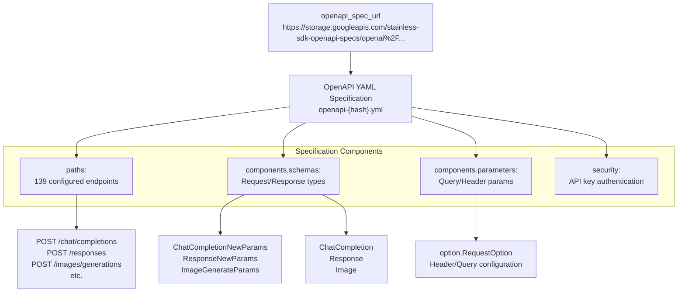
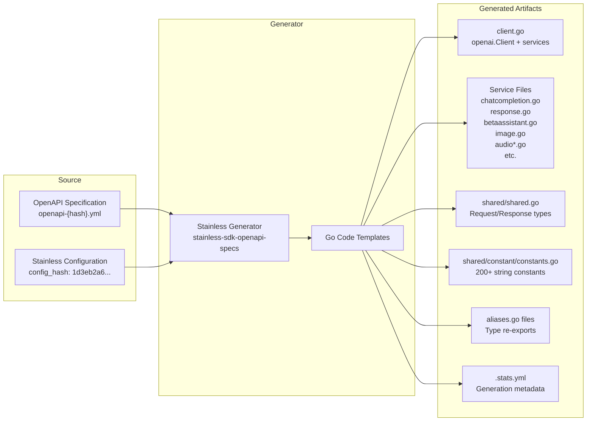
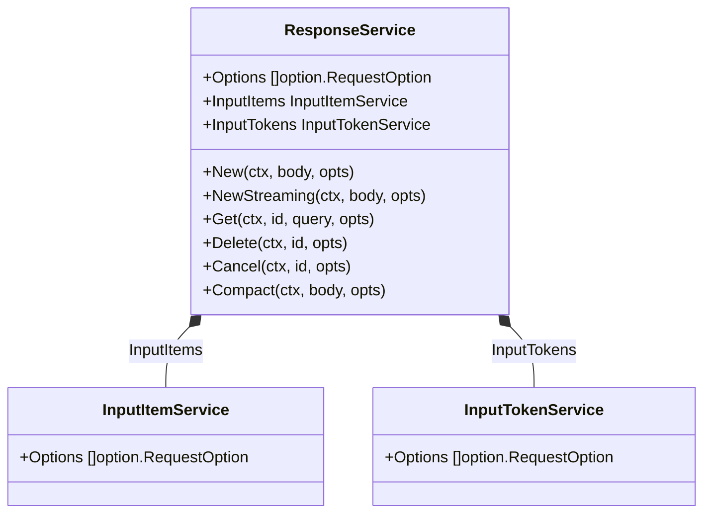

<!-- source: DeepWiki mcp.deepwiki.com · repo openai/openai-go · page 18.1 OpenAPI Specification and Generation · fetched 2026-10-26 -->

# OpenAPI Specification and Generation

<details>
<summary>Relevant source files</summary>

The following files were used as context for generating this wiki page:

- [.github/workflows/ci.yml](.github/workflows/ci.yml)
- [.github/workflows/create-releases.yml](.github/workflows/create-releases.yml)
- [.github/workflows/detect-breaking-changes.yml](.github/workflows/detect-breaking-changes.yml)
- [.stats.yml](.stats.yml)
- [release-please-config.json](release-please-config.json)
- [responses/response.go](responses/response.go)
- [scripts/check-go-mod](scripts/check-go-mod)

</details>


## Purpose and Scope

This document explains how the `openai-go` SDK is generated from an OpenAPI specification using the Stainless code generator. It covers the `.stats.yml` metadata file, specification versioning via hash verification, the generation pipeline, and what artifacts are produced from the specification.

For information about the generated type system and data structures, see [Type System and Data Structures](#16). For testing patterns with generated code, see [Testing Patterns](#18.2).

---

## Overview

The `openai-go` SDK is a fully generated codebase. All client code, services, types, constants, and request/response structures are automatically produced from an OpenAPI specification maintained by OpenAI. This generation-based approach ensures 1:1 API contract compliance and eliminates manual maintenance of API definitions.

The generation process is managed by Stainless, an OpenAPI-to-SDK generator that produces idiomatic Go code with streaming support, pagination utilities, retry logic, and type-safe parameter construction.

**Sources:** [.stats.yml:1-5](), [responses/response.go:1-1]()

---

## Generation Metadata: `.stats.yml`

The `.stats.yml` file in the repository root tracks generation metadata and ensures version consistency between the SDK and its source OpenAPI specification.

### File Structure

```yaml
configured_endpoints: 139
openapi_spec_url: https://storage.googleapis.com/stainless-sdk-openapi-specs/openai%2Fopenai-9919ae12a2ab24389e4bcd032e986437cbc8a4b70057dda0f524976c9378f4c1.yml
openapi_spec_hash: c670ab80573e61e664f6a16f5a96d67f
config_hash: 1d3eb2a6fc36f206d2d67bfcf1a7080d
```

| Field | Purpose |
|-------|---------|
| `configured_endpoints` | Total number of API endpoints defined in the OpenAPI spec |
| `openapi_spec_url` | Storage URL for the canonical OpenAPI specification file |
| `openapi_spec_hash` | MD5 hash of the OpenAPI specification content for verification |
| `config_hash` | Hash of the Stainless generator configuration |

### Hash-Based Verification

The `openapi_spec_hash` field provides cryptographic verification that the SDK was generated from a specific version of the OpenAPI specification. This hash:

- Identifies the exact specification version used
- Enables reproducible builds
- Detects drift between SDK code and specification
- Links SDK releases to specification snapshots

The hash `c670ab80573e61e664f6a16f5a96d67f` uniquely identifies the specification content, while the URL's embedded hash `9919ae12a2ab24389e4bcd032e986437cbc8a4b70057dda0f524976c9378f4c1` provides content addressability at the storage layer.

**Sources:** [.stats.yml:1-5]()

---

## OpenAPI Specification Structure



**Diagram: OpenAPI Specification to SDK Components**

The OpenAPI specification defines:

1. **Endpoints** (`paths` section): HTTP method, path template, request body schema, response schema, and parameters for each API operation.
2. **Schemas** (`components.schemas` section): Type definitions for all request parameters and response objects.
3. **Parameters**: Reusable query parameters, header parameters, and path parameters.
4. **Security**: Authentication schemes (API key in `Authorization: Bearer` header).

The 139 configured endpoints tracked in `.stats.yml` correspond to distinct API operations across all services.

**Sources:** [.stats.yml:1-3]()

---

## Stainless Generation Pipeline



**Diagram: Code Generation Flow from OpenAPI to Go SDK**

The Stainless generator performs the following transformations:

1. **Service Generation**: Each `paths` group generates a service file (e.g., `/responses` → `responses/response.go`) [[responses/response.go:63-64]]().
2. **Type Generation**: Each `schema` generates Go structs with JSON tags and validation.
3. **Method Generation**: Each endpoint generates methods like `New()`, `NewStreaming()`, `Get()`, `List()`, `Update()`, `Delete()` [[responses/response.go:61-145]]().
4. **Parameter Types**: Request schemas generate `*Params` structs (e.g., `ResponseNewParams`) [[responses/response.go:61-61]]().
5. **Response Types**: Response schemas generate structs (e.g., `Response`) [[responses/response.go:92-92]]().
6. **Constants**: Enum values and discriminators generate typed constants in `shared/constant/` [[responses/response.go:163-163]]().
7. **Union Types**: `oneOf`/`anyOf` schemas generate union types with discriminator registration (e.g., `ResponseStreamEventUnion`) [[responses/response.go:79-79]]().

**Sources:** [.stats.yml:1-5](), [responses/response.go:61-163]()

---

## Generated Code Artifacts

### Client and Service Hierarchy

The generator produces a hierarchical service structure. A primary example is the `ResponseService`, which contains sub-services for granular resource management:



**Diagram: Service Hierarchy for Responses API**

This hierarchy maps directly to the OpenAPI specification's path structure. Nested services represent resource scoping (e.g., `/responses/{response_id}/input_items` → `ResponseService.InputItems`).

**Sources:** [responses/response.go:33-48](), [responses/response.go:61-158]()

---

## Type Generation Patterns

### Request Parameter Types

For each API endpoint, the generator creates a parameter struct:

| OpenAPI Path | Generated Parameter Type | Purpose |
|--------------|-------------------------|---------|
| `POST /responses` | `ResponseNewParams` | Response creation parameters [[responses/response.go:61]]() |
| `GET /responses/{id}` | `ResponseGetParams` | Response retrieval with options [[responses/response.go:92]]() |
| `POST /responses/compact` | `ResponseCompactParams` | Conversation compaction [[responses/response.go:153]]() |

### Response Types

For each response schema, the generator creates a response struct:

| OpenAPI Schema | Generated Response Type | Usage Site |
|----------------|------------------------|------------|
| `Response` | `Response` | `ResponseService.New` [[responses/response.go:61]]() |
| `CompactedResponse` | `CompactedResponse` | `ResponseService.Compact` [[responses/response.go:153]]() |

### Union Types

OpenAPI `oneOf`/`anyOf` schemas generate union types with discriminators. A key example in the Responses API is the streaming event union:

- `ResponseStreamEventUnion`: Represents the union of all 24 possible event types sent during a response lifecycle [[responses/response.go:79]]().

**Sources:** [responses/response.go:61-158]()

---

## Constants Generation

The generator produces typed string constants from OpenAPI enum values. These are used for field validation and tool types:

### Example: Tool Type Constants

The `ApplyPatchTool` struct uses a constant to define its type:

```go
type ApplyPatchTool struct {
	// The type of the tool. Always `apply_patch`.
	Type constant.ApplyPatch...
}
```

**Sources:** [responses/response.go:161-163]()

---

## Endpoint Configuration

### Configured Endpoints Count

The `.stats.yml` file tracks `configured_endpoints: 139`, representing the total number of distinct API operations defined in the OpenAPI specification.

Each configured endpoint generates:
1. A service method (e.g., `ResponseService.New()`) [[responses/response.go:61]]()
2. Parameter types (e.g., `ResponseNewParams`) [[responses/response.go:61]]()
3. Response types (e.g., `Response`) [[responses/response.go:61]]()
4. Streaming variants if applicable (e.g., `ResponseService.NewStreaming()`) [[responses/response.go:79]]()

**Sources:** [.stats.yml:1](), [responses/response.go:61-79]()

---

## Generation Consistency

### Configuration Hash

The `config_hash: 1d3eb2a6fc36f206d2d67bfcf1a7080d` field tracks the Stainless generator configuration. This hash covers Go-specific generation settings, package structure, and custom type mappings.

### Reproducible Builds

Together, `openapi_spec_hash` and `config_hash` enable reproducible SDK generation:

```
SDK Version = f(OpenAPI Spec Hash, Config Hash)
```

This ensures that given the same inputs, the generator produces identical output, allowing SDK versions to be traced back to specific specification and configuration versions.

**Sources:** [.stats.yml:4-5]()

---

## CI/CD and Release Workflow

The generation metadata is validated as part of the CI pipeline.

1. **Linting and Tidying**: The `scripts/lint` and `scripts/check-go-mod` ensure that the generated code adheres to project standards and that `go.mod` is consistent [[scripts/check-go-mod:1-20](), [.github/workflows/ci.yml:49-67]]().
2. **Breaking Change Detection**: The `scripts/detect-breaking-changes` script is run on pull requests to identify if changes in the OpenAPI spec (and thus the generated code) introduce breaking changes [[.github/workflows/detect-breaking-changes.yml:9-33]]().
3. **Automated Releases**: The `release-please` workflow automates the release process, updating `internal/version.go` and creating GitHub releases when the generated code is merged to main [[.github/workflows/create-releases.yml:1-31](), [release-please-config.json:63-67]]().

**Sources:** [.github/workflows/ci.yml:49-67](), [.github/workflows/detect-breaking-changes.yml:9-33](), [.github/workflows/create-releases.yml:1-31](), [scripts/check-go-mod:1-20](), [release-please-config.json:63-67]()

---

