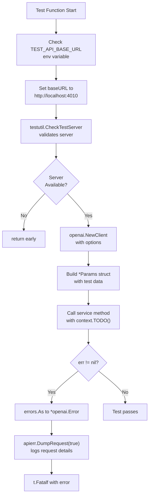
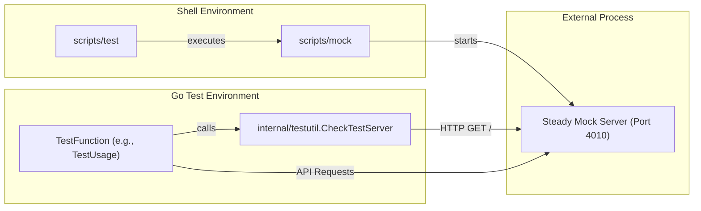

<!-- source: DeepWiki mcp.deepwiki.com · repo openai/openai-go · page 18.2 Testing Patterns · fetched 2026-10-26 -->

# Testing Patterns

<details>
<summary>Relevant source files</summary>

The following files were used as context for generating this wiki page:

- [Brewfile](Brewfile)
- [CONTRIBUTING.md](CONTRIBUTING.md)
- [client_test.go](client_test.go)
- [conversations/conversation_test.go](conversations/conversation_test.go)
- [conversations/item_test.go](conversations/item_test.go)
- [internal/testutil/testutil.go](internal/testutil/testutil.go)
- [paginationauto_test.go](paginationauto_test.go)
- [paginationmanual_test.go](paginationmanual_test.go)
- [responses/inputitem_test.go](responses/inputitem_test.go)
- [responses/response_test.go](responses/response_test.go)
- [scripts/mock](scripts/mock)
- [scripts/test](scripts/test)
- [usage_test.go](usage_test.go)

</details>


This document describes the standard testing patterns used throughout the `openai-go` SDK test suite. These patterns are generated alongside the main SDK code and demonstrate how to construct requests, handle parameters, and verify API interactions.

For information about the code generation system that produces these tests, see [OpenAPI Specification and Generation](#18.1). For information about error handling in production code, see [Error Handling and Retries](#2.3).

## Purpose and Scope

The test files in this repository follow a consistent structure designed to verify API contract compliance and demonstrate proper SDK usage. All test files are generated from the OpenAPI specification and serve dual purposes:
- Validate that the SDK correctly serializes requests and deserializes responses.
- Provide executable examples of API usage with all optional parameters.

This page covers:
- Test server configuration and environment setup.
- Client initialization patterns.
- Parameter construction with optional fields and union types.
- Error handling and request debugging.
- Specialized testing for retries, headers, and pagination.

---

## Test Execution Flow

All tests in the repository follow a standard execution pattern that includes server validation, client setup, API call execution, and error handling.

### Natural Language to Code Entity Space: Execution Flow



**Sources**: [responses/response_test.go:18-101](), [usage_test.go:16-42](), [conversations/conversation_test.go:19-53]()

---

## Test Infrastructure and Mocking

The SDK uses a mock server named **Steady** to validate requests against the OpenAPI specification.

### Mock Server Orchestration

| Script | Purpose | Implementation Detail |
|--------|---------|-----------------------|
| `scripts/mock` | Starts the Steady mock server | Runs `npm exec @stdy/cli` against the URL in `.stats.yml` [scripts/mock:11-27]() |
| `scripts/test` | Orchestrates the test run | Checks if server is running, starts it if not, then runs `go test ./...` [scripts/test:12-56]() |
| `internal/testutil` | Utility for test functions | `CheckTestServer` verifies connectivity and handles `SKIP_MOCK_TESTS` [internal/testutil/testutil.go:10-27]() |

### Code Entity Space: Mocking Components



**Sources**: [scripts/mock:1-52](), [scripts/test:1-57](), [internal/testutil/testutil.go:1-27]()

---

## Client Initialization and Option Usage

Tests demonstrate the functional options pattern used throughout the SDK.

### Standard Client Setup
```go
client := openai.NewClient(
    option.WithBaseURL(baseURL),
    option.WithAPIKey("My API Key"),
)
```

### Advanced Option Testing
Tests in `client_test.go` verify that options correctly modify the request pipeline, such as setting custom headers or deleting default ones.

| Test Function | Purpose | Option Used |
|---------------|---------|-------------|
| `TestUserAgentHeader` | Verifies the User-Agent string | `option.WithHTTPClient` [client_test.go:28-56]() |
| `TestDeleteRetryCountHeader` | Verifies header removal | `option.WithHeaderDel` [client_test.go:101-138]() |
| `TestOverwriteRetryCountHeader` | Verifies header override | `option.WithHeader` [client_test.go:140-177]() |

**Sources**: [client_test.go:28-177](), [responses/response_test.go:26-29]()

---

## Parameter Construction Patterns

Tests demonstrate how to construct complex parameter objects using helper functions and union types.

### Optional Field Helpers
The SDK uses `param.Opt[T]` for optional fields. Tests use pointer helpers to populate these:
- `openai.String("...")` [responses/response_test.go:37]()
- `openai.Int(1000)` [responses/response_test.go:34]()
- `openai.Float(1)` [responses/response_test.go:74]()
- `openai.Bool(true)` [responses/response_test.go:31]()

### Union Type Construction
Union types allow a field to accept multiple distinct types. Tests show the `Of...` selector pattern:

```go
// Example of a union parameter in a test
responses.ResponseNewParams{
    Conversation: responses.ResponseNewParamsConversationUnion{
        OfString: openai.String("string"),
    },
    Input: responses.ResponseNewParamsInputUnion{
        OfString: openai.String("string"),
    },
    Tools: []responses.ToolUnionParam{{
        OfFunction: &responses.FunctionToolParam{
            Name: "name",
            Strict: openai.Bool(true),
        },
    }},
}
```

**Sources**: [responses/response_test.go:30-94](), [conversations/conversation_test.go:31-45]()

---

## Error Handling and Mock Response Handling

Tests implement a standard error handling block that facilitates debugging by dumping the request state on failure.

### Standard Error Assertion
```go
if err != nil {
    var apierr *openai.Error
    if errors.As(err, &apierr) {
        t.Log(string(apierr.DumpRequest(true)))
    }
    t.Fatalf("err should be nil: %s", err.Error())
}
```

### Mocking Transport for Edge Cases
To test specific HTTP behaviors like retries or context cancellation, tests use a `closureTransport` to intercept requests.

```go
type closureTransport struct {
    fn func(req *http.Request) (*http.Response, error)
}

func (t *closureTransport) RoundTrip(req *http.Request) (*http.Response, error) {
    return t.fn(req)
}
```

This is used to test the `Retry-After` header logic [client_test.go:58-99]() and `Retry-After-Ms` [client_test.go:179-213]().

**Sources**: [client_test.go:20-26](), [client_test.go:58-75](), [responses/response_test.go:100-106]()

---

## Pagination Testing

Tests cover both automatic and manual pagination patterns to ensure large datasets can be traversed.

### Auto-Pagination
`ListAutoPaging` returns an iterator that handles fetching subsequent pages automatically.
```go
iter := client.FineTuning.Jobs.ListAutoPaging(context.TODO(), openai.FineTuningJobListParams{
    Limit: openai.Int(20),
})
for iter.Next() {
    job := iter.Current()
    // ...
}
```

### Manual Pagination
Manual pagination involves calling `GetNextPage()` on a page object.
```go
page, err := client.FineTuning.Jobs.List(context.TODO(), params)
// ... process page.Data
page, err = page.GetNextPage()
```

**Sources**: [paginationauto_test.go:15-38](), [paginationmanual_test.go:15-46]()

---

