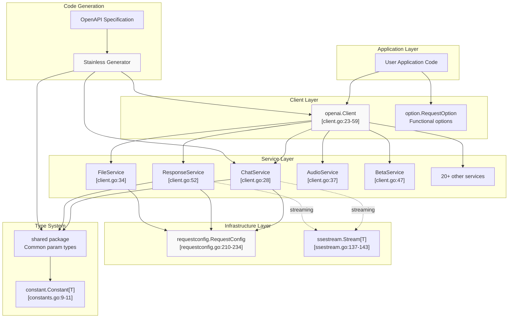
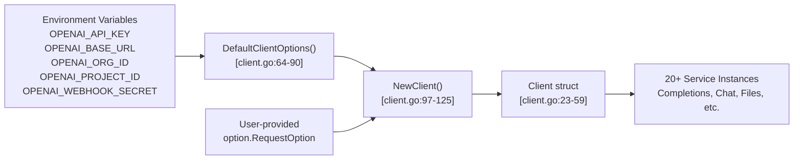

<!-- source: DeepWiki mcp.deepwiki.com · repo openai/openai-go · page 2 Core Architecture · fetched 2026-10-26 -->

# Core Architecture

Relevant source files

The following files were used as context for generating this wiki page:

- [.release-please-manifest.json](.release-please-manifest.json)
- [CHANGELOG.md](CHANGELOG.md)
- [README.md](README.md)
- [client.go](client.go)
- [default_http_client.go](default_http_client.go)
- [internal/requestconfig/requestconfig.go](internal/requestconfig/requestconfig.go)
- [internal/version.go](internal/version.go)
- [option/requestoption.go](option/requestoption.go)
- [packages/ssestream/ssestream.go](packages/ssestream/ssestream.go)
- [shared/constant/constants.go](shared/constant/constants.go)

## Purpose and Scope

This document explains the fundamental architectural layers of the `openai-go` SDK and how they work together to provide a robust, type-safe client for the OpenAI API. It covers the client initialization pattern, service organization, infrastructure components for request execution, the type system, and the code generation pipeline.

For specific details on:
- Client configuration options and patterns, see [Client Configuration and Options](#2.1)
- Request execution internals and middleware, see [Request Execution Pipeline](#2.2)
- Error handling and retry behavior, see [Error Handling and Retries](#2.3)
- Streaming implementation details, see [Streaming Architecture](#2.4)

---

## Architecture Overview

The SDK follows a layered architecture with clear separation of concerns:

**Sources:** [client.go:23-59](), [packages/ssestream/ssestream.go:137-217](), [shared/constant/constants.go:1-20](), [internal/requestconfig/requestconfig.go:210-234]()

---

## Client Layer

### Client Initialization

The `Client` struct serves as the main entry point and aggregates all service interfaces. It is initialized using the `NewClient` function [client.go:97-125]() with functional options:

The client initialization pattern uses defaults from environment variables, which can be overridden by user-provided options:

| Environment Variable | Purpose | Default Option Function |
|---------------------|---------|------------------------|
| `OPENAI_API_KEY` | Authentication | `option.WithAPIKey()` |
| `OPENAI_BASE_URL` | Base API URL | `option.WithBaseURL()` |
| `OPENAI_ORG_ID` | Organization ID | `option.WithOrganization()` |
| `OPENAI_PROJECT_ID` | Project ID | `option.WithProject()` |
| `OPENAI_WEBHOOK_SECRET` | Webhook verification | `option.WithWebhookSecret()` |

**Sources:** [client.go:64-125](), [README.md:61-78]()

### Client Service Structure

The `Client` struct [client.go:23-59]() provides access to services organized by API domain. Each service is initialized with the same options passed to the client [client.go:102-122](), enabling consistent configuration across all services.

**Sources:** [client.go:23-122]()

### Generic Request Methods

The `Client` provides generic HTTP methods for accessing undocumented endpoints while retaining configuration [client.go:158-185]():

- `Execute(ctx, method, path, params, res, opts...)` [client.go:158]()
- `Get(ctx, path, params, res, opts...)` [client.go:165]()
- `Post(ctx, path, params, res, opts...)` [client.go:171]()

These methods support flexible parameter serialization and response deserialization:
- Parameters can be structs with `MarshalJSON`, byte slices, or `io.Reader` [internal/requestconfig/requestconfig.go:97-141]().
- All client options (auth, retries, middleware) are preserved via `slices.Concat(r.Options, opts)` [client.go:159]().

**Sources:** [client.go:158-185](), [internal/requestconfig/requestconfig.go:91-153]()

---

## Infrastructure Layer

### Request Execution Engine

The `internal/requestconfig` package provides the core HTTP execution engine. All service methods route through `NewRequestConfig`, which handles:

- **Header Management**: Default headers like `User-Agent` [requestconfig.go:28-32]() and platform properties [requestconfig.go:70-79]().
- **Serialization**: Automatic selection of JSON, Multipart, or Query string serialization based on the body type [requestconfig.go:97-153]().
- **Middleware Chain**: Intercepting and modifying requests [requestconfig.go:244-248]().
- **Retry Logic**: Determining if a request is retryable based on status codes and idempotency [requestconfig.go:250-264]().

**Sources:** [internal/requestconfig/requestconfig.go:28-264]()

### Streaming Infrastructure

The `ssestream` package [ssestream.go:1-245]() implements Server-Sent Events (SSE) streaming. The `Stream[T]` generic type [ssestream.go:137-143]() provides a type-safe iterator:

- `Next()` advances to the next event, handling `[DONE]` markers [ssestream.go:181-185]() and parsing the "data" field into type `T` [ssestream.go:216]().
- `Current()` returns the current deserialized event [ssestream.go:230]().
- `Err()` returns any error that occurred during streaming, including `StreamError` for structured API errors [ssestream.go:55-62]().

**Sources:** [packages/ssestream/ssestream.go:1-245]()

---

## Type System

### Shared Types and Constants

The type system is organized around shared types and typed constants. The `constant` package [constants.go:1-304]() provides a pattern for typed string constants:

- **Constant Interface**: `Constant[T]` defines a `Default()` method [constants.go:9-11]().
- **Typed Constants**: Over 200 constants like `constant.ChatCompletion` [constants.go:38](), `constant.Assistant` [constants.go:29](), and `constant.CodeInterpreter` [constants.go:54]().
- **Type Safety**: Use `constant.ValueOf[T]()` to safely retrieve default values [constants.go:16-19]().

**Sources:** [shared/constant/constants.go:1-304]()

---

## Code Generation Pipeline

The entire SDK is generated from OpenAPI specifications using the Stainless generator.

- **Generation Markers**: Files include a header indicating they are generated [client.go:1](), [internal/version.go:1]().
- **Version Tracking**: The `internal.PackageVersion` is synced with the release manifest [internal/version.go:5](), [.release-please-manifest.json:2]().
- **Metadata**: Platform properties (OS, Architecture, Runtime) are automatically injected into request headers for telemetry [internal/requestconfig/requestconfig.go:70-79]().

**Sources:** [client.go:1](), [internal/version.go:1-6](), [internal/requestconfig/requestconfig.go:70-79](), [.release-please-manifest.json:1-3]()

---

## Summary

The `openai-go` architecture provides a consistent, type-safe interface for OpenAI services by layering high-level client services over a robust request execution and streaming infrastructure. The heavy use of code generation ensures that the SDK remains in sync with the underlying REST API while providing Go-idiomatic patterns like functional options and generic streams.

**Sources:** [client.go:1-185](), [internal/requestconfig/requestconfig.go:1-264](), [packages/ssestream/ssestream.go:1-245]()

---

