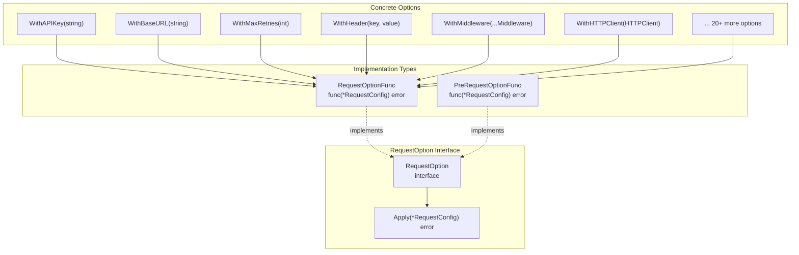
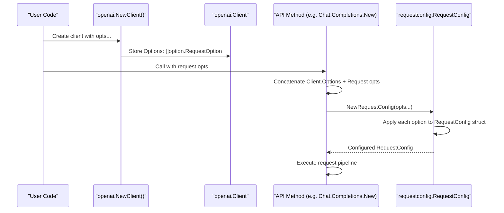
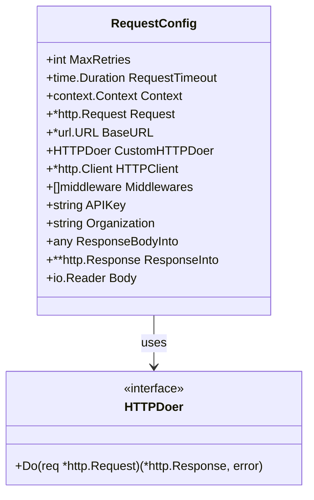

<!-- source: DeepWiki mcp.deepwiki.com · repo openai/openai-go · page 2.1 Client Configuration and Options · fetched 2026-10-26 -->

# Client Configuration and Options

<details>
<summary>Relevant source files</summary>

The following files were used as context for generating this wiki page:

- [client.go](client.go)
- [default_http_client.go](default_http_client.go)
- [internal/requestconfig/requestconfig.go](internal/requestconfig/requestconfig.go)
- [option/middleware.go](option/middleware.go)
- [option/requestoption.go](option/requestoption.go)
- [shared/constant/constants.go](shared/constant/constants.go)

</details>


This document describes the client configuration system, including the functional options pattern, available configuration options, and how options are applied at both client and request levels. For information about how these options are used during request execution, see [Request Execution Pipeline](#2.2).

## Overview

The `openai-go` library uses the **functional options pattern** to configure both the client and individual API requests. This pattern provides a flexible, type-safe way to configure the client with sensible defaults while allowing fine-grained control when needed. Options are represented by the `option.RequestOption` interface and can be applied at two levels:

1. **Client-level**: Options passed to `openai.NewClient()` that apply to all requests.
2. **Request-level**: Options passed to individual API methods that override client defaults.

The configuration system is implemented in two primary locations:
- `option.RequestOption` interface and concrete implementations in [option/requestoption.go:20-250]()
- `requestconfig.RequestConfig` struct and application logic in [internal/requestconfig/requestconfig.go:81-234]()

## The Functional Options Pattern

The functional options pattern uses functions that modify a configuration object. Each option is a function that implements the `RequestOption` interface:

Title: Request Option Type Hierarchy

Sources: [option/requestoption.go:25-26](), [internal/requestconfig/requestconfig.go:81-90]()

The `RequestOption` interface has a single method `Apply(*RequestConfig) error` that modifies the configuration. Two function types implement this interface:

- `RequestOptionFunc`: Regular options that modify configuration during or after request creation [internal/requestconfig/requestconfig.go:85-88]().
- `PreRequestOptionFunc`: Special options that must be known before request creation, such as those used in webhook verification [internal/requestconfig/requestconfig.go:86-89]().

## Client-Level vs Request-Level Configuration

Options can be specified at two levels, with request-level options overriding client-level options.

Title: Option Application Lifecycle

Sources: [client.go:97-125](), [client.go:158-161](), [internal/requestconfig/requestconfig.go:181-184]()

### Client-Level Configuration

Client-level options are provided to `openai.NewClient()` and apply to all requests made by that client. If no options are provided, `NewClient` uses `DefaultClientOptions()` which reads from environment variables [client.go:64-90]().

```go
client := openai.NewClient(
    option.WithAPIKey("sk-..."),              
    option.WithOrganization("org-..."),       
    option.WithMaxRetries(5),                 
)
```
Sources: [client.go:97-100](), [client.go:61-63]()

### Request-Level Configuration

Request-level options are passed as the final arguments to service methods and override client defaults for that specific call [client.go:158-161]().

```go
completion, err := client.Chat.Completions.New(
    ctx,
    params,
    option.WithHeader("X-Custom-Header", "value"),
    option.WithMaxRetries(0), // Disable retries for this call
)
```
Sources: [client.go:158-161](), [option/requestoption.go:101-109]()

## Available Configuration Options

### Authentication and Identity

| Option | Description | File Reference |
|--------|-------------|----------------|
| `WithAPIKey(string)` | Sets the OpenAI API key | [option/requestoption.go:275-281]() |
| `WithOrganization(string)` | Sets the `OpenAI-Organization` header | [option/requestoption.go:283-289]() |
| `WithProject(string)` | Sets the `OpenAI-Project` header | [option/requestoption.go:291-297]() |
| `WithWebhookSecret(string)`| Sets secret for webhook verification | [option/requestoption.go:299-305]() |

### Infrastructure and Network

| Option | Description | Default |
|--------|-------------|---------|
| `WithBaseURL(string)` | Overrides the base URL for API requests | `https://api.openai.com/v1/` |
| `WithHTTPClient(HTTPClient)` | Replaces the underlying `*http.Client` | `defaultHTTPClient()` |
| `WithMaxRetries(int)` | Sets maximum retry attempts | 2 |
| `WithMiddleware(...Middleware)` | Adds custom request/response interceptors | None |

Sources: [option/requestoption.go:30-44](), [option/requestoption.go:60-76](), [option/requestoption.go:96-109](), [option/requestoption.go:89-94](), [internal/requestconfig/requestconfig.go:174-177]()

### Body and Parameter Manipulation

The SDK provides powerful options for modifying the request body using JSON path syntax via `sjson`.

| Option | Description | Example |
|--------|-------------|---------|
| `WithJSONSet(key, val)` | Sets a JSON value in the request body | `option.WithJSONSet("stream", true)` |
| `WithJSONDel(key)` | Deletes a JSON key from the request body | `option.WithJSONDel("user")` |
| `WithHeader(key, val)` | Sets an HTTP header | `option.WithHeader("X-ID", "123")` |
| `WithQuery(key, val)` | Sets a URL query parameter | `option.WithQuery("limit", "10")` |

Sources: [option/requestoption.go:173-195](), [option/requestoption.go:201-213](), [option/requestoption.go:113-118](), [option/requestoption.go:139-146]()

## RequestConfig Structure

The `RequestConfig` struct is the internal state container that options modify.

Title: Code Entity Mapping - RequestConfig

Sources: [internal/requestconfig/requestconfig.go:202-234]()

### Default Headers and Platform Properties

The SDK automatically populates `RequestConfig` with platform metadata to assist in debugging and usage tracking. These are set in `NewRequestConfig`.

- **User-Agent**: `OpenAI/Go {PackageVersion}` [internal/requestconfig/requestconfig.go:28-32]()
- **X-Stainless-Lang**: `go` [internal/requestconfig/requestconfig.go:72]()
- **X-Stainless-OS**: Normalized OS name (e.g., "MacOS", "Linux") [internal/requestconfig/requestconfig.go:34-53]()
- **X-Stainless-Arch**: Architecture (e.g., "x64", "arm64") [internal/requestconfig/requestconfig.go:55-68]()
- **X-Stainless-Runtime-Version**: The Go version [internal/requestconfig/requestconfig.go:77]()

## Implementation Detail: Body Serialization

`NewRequestConfig` handles complex serialization logic based on the input `body` type:

1. **JSON**: If it implements `json.Marshaler` [internal/requestconfig/requestconfig.go:97-104]().
2. **Multipart**: If it implements `apiform.Marshaler` [internal/requestconfig/requestconfig.go:105-116]().
3. **Query**: If it implements `apiquery.Queryer`, parameters are appended to the URL [internal/requestconfig/requestconfig.go:117-133]().
4. **Raw**: `[]byte` or `io.Reader` are used directly [internal/requestconfig/requestconfig.go:134-141]().

Sources: [internal/requestconfig/requestconfig.go:91-153]()

## HTTP Client Customization

The SDK uses a default client with a 10-minute `ResponseHeaderTimeout` to prevent indefinite hangs while allowing long-running streams [default_http_client.go:10-24](). Users can override this using `option.WithHTTPClient`. If the provided client is a standard `*http.Client`, it is assigned to `RequestConfig.HTTPClient`; otherwise, it is treated as a `CustomHTTPDoer` [option/requestoption.go:60-76]().

Sources: [default_http_client.go:20-24](), [option/requestoption.go:51-53](), [internal/requestconfig/requestconfig.go:202-204]()

---

