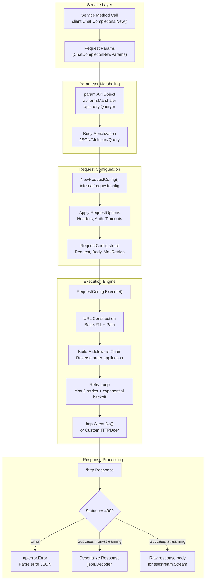
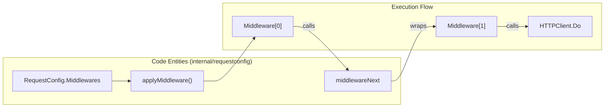
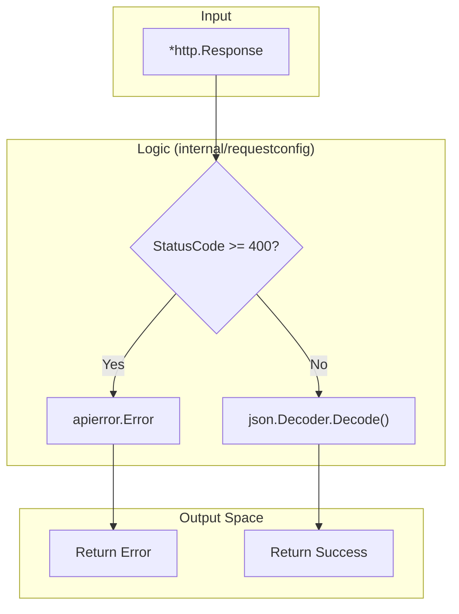

<!-- source: DeepWiki mcp.deepwiki.com · repo openai/openai-go · page 2.2 Request Execution Pipeline · fetched 2026-10-26 -->

# Request Execution Pipeline

<details>
<summary>Relevant source files</summary>

The following files were used as context for generating this wiki page:

- [internal/apiform/encoder.go](internal/apiform/encoder.go)
- [internal/apiform/form_test.go](internal/apiform/form_test.go)
- [internal/apijson/encoder.go](internal/apijson/encoder.go)
- [internal/apijson/json_test.go](internal/apijson/json_test.go)
- [internal/apiquery/encoder.go](internal/apiquery/encoder.go)
- [internal/requestconfig/requestconfig.go](internal/requestconfig/requestconfig.go)
- [option/requestoption.go](option/requestoption.go)

</details>


This document explains the internal request processing flow in the `openai-go` library, detailing how API method calls are transformed into HTTP requests and executed. It covers body serialization, URL construction, middleware application, retry logic, and response handling.

For client initialization and configuration options, see [Client Configuration and Options](#2.1). For error handling details, see [Error Handling and Retries](#2.3). For streaming architecture, see [Streaming Architecture](#2.4).

## Overview

The request execution pipeline is the core infrastructure that transforms API method calls into HTTP requests and processes responses. Every API call flows through this pipeline, from parameter marshaling to response deserialization.

### Entry Points and Flow

Service methods (e.g., `Chat.Completions.New()`) call `ExecuteNewRequest()` at [internal/requestconfig/requestconfig.go:564-570](), which creates a `RequestConfig` via `NewRequestConfig()` and executes it. This function serves as the bridge between high-level API methods and low-level HTTP operations.

### Pipeline Stages

**Request Execution Pipeline - Complete Flow**



**Sources:** [internal/requestconfig/requestconfig.go:91-192](), [internal/requestconfig/requestconfig.go:380-562](), [internal/requestconfig/requestconfig.go:564-570]()

## Parameter Marshaling and Body Serialization

Request parameters in `openai-go` implement specific interfaces for serialization. The `NewRequestConfig` function at [internal/requestconfig/requestconfig.go:91-192]() detects the appropriate strategy through interface checks.

### Serialization Interfaces and Strategy

| Interface | Content Type | Use Case | Implementation File |
|-----------|--------------|----------|---------------------|
| `json.Marshaler` | `application/json` | JSON request bodies | [internal/apijson/encoder.go]() |
| `apiform.Marshaler` | `multipart/form-data` | File uploads | [internal/apiform/encoder.go]() |
| `apiquery.Queryer` | N/A (URL params) | List operations | [internal/apiquery/encoder.go]() |
| `[]byte` | `application/json` | Pre-serialized content | [internal/requestconfig/requestconfig.go:134-137]() |
| `io.Reader` | `application/json` | Streaming uploads | [internal/requestconfig/requestconfig.go:138-141]() |

### Serialization Logic Flow

The serialization logic at [internal/requestconfig/requestconfig.go:97-153]() checks each interface in order:

1.  **JSON Marshaling** ([lines 97-104]()): Calls `body.MarshalJSON()`. Sets `hasSerializationFunc = true`.
2.  **Multipart Form** ([lines 105-116]()): Calls `body.MarshalMultipart()` from the `apiform` package. Used for file uploads.
3.  **Query Parameters** ([lines 117-133]()): Calls `body.URLQuery()` from `apiquery` and appends encoded params to the URL.
4.  **Raw Bytes/Reader** ([lines 134-141]()): Direct pass-through for `[]byte` or `io.Reader`.
5.  **Fallback JSON** ([lines 145-153]()): If no interface was detected, uses `json.NewEncoder` with `SetEscapeHTML(false)`.

**Sources:** [internal/requestconfig/requestconfig.go:91-153](), [internal/apiform/encoder.go:21-27](), [internal/apijson/encoder.go:25-28]()

## Request Configuration

After serialization, `NewRequestConfig` creates an `http.Request` and initializes the `RequestConfig` struct.

### Default Headers

The following headers are set by default at [internal/requestconfig/requestconfig.go:160-172]():

```go
// From getDefaultHeaders() at lines 28-32
"User-Agent": "OpenAI/Go {version}"

// From getPlatformProperties() at lines 70-79
"X-Stainless-Lang": "go"
"X-Stainless-Package-Version": "{version}"
"X-Stainless-OS": "{normalized OS}"
"X-Stainless-Arch": "{architecture}"
"X-Stainless-Runtime": "go"
"X-Stainless-Runtime-Version": "{go version}"

// Other defaults
"Accept": "application/json"
"X-Stainless-Retry-Count": "0"
"X-Stainless-Timeout": "0"
```

The platform properties are normalized at [internal/requestconfig/requestconfig.go:34-68]() to provide consistent cross-platform identification.

### RequestConfig Struct

The `RequestConfig` struct at [internal/requestconfig/requestconfig.go:210-234]() holds the execution state:

| Field | Type | Description |
|-------|------|-------------|
| `MaxRetries` | `int` | Maximum retry attempts (default 2) |
| `HTTPClient` | `*http.Client` | The standard library client |
| `CustomHTTPDoer` | `HTTPDoer` | Custom implementation for `Do(req)` |
| `Middlewares` | `[]middleware` | Chain of request interceptors |
| `ResponseBodyInto` | `any` | Target for deserialization |

**Sources:** [internal/requestconfig/requestconfig.go:160-172](), [internal/requestconfig/requestconfig.go:210-234]()

## Request Option Application

Request options are applied at [internal/requestconfig/requestconfig.go:181-184]() using the `Apply` method. Options implement the `RequestOption` interface at [internal/requestconfig/requestconfig.go:81-90]().

Common options from [option/requestoption.go]():

-   `WithBaseURL(string)`: Overrides base URL ([lines 30-44]())
-   `WithHTTPClient(HTTPClient)`: Custom HTTP client ([lines 60-76]())
-   `WithMiddleware(...Middleware)`: Adds middleware ([lines 87-94]())
-   `WithMaxRetries(int)`: Configures retry behavior ([lines 101-109]())
-   `WithHeader(key, value string)`: Sets request header ([lines 113-118]())
-   `WithJSONSet(key string, value any)`: Modifies JSON body using `sjson` ([lines 173-195]())

**Sources:** [internal/requestconfig/requestconfig.go:81-90](), [option/requestoption.go:30-195]()

## RequestConfig.Execute() Method

The `Execute()` method at [internal/requestconfig/requestconfig.go:380-562]() orchestrates the HTTP lifecycle.

### Body Setup and GetBody

For retryable requests, the body must be repeatable. The code at [internal/requestconfig/requestconfig.go:394-415]() sets up `GetBody` callbacks:

-   **`*bytes.Buffer`**: Captures bytes and creates a `GetBody` function returning a new reader.
-   **`*bytes.Reader`**: Creates a `GetBody` that seeks to the start.
-   **Other `io.Reader`**: Cannot be retried if `GetBody` is not provided.

### Middleware Chain

The chain is built at [internal/requestconfig/requestconfig.go:417-423](). Middlewares are applied in **reverse order** so the first middleware added is the outermost.

**Code Entity Association: Middleware Logic**



**Sources:** [internal/requestconfig/requestconfig.go:244-248](), [internal/requestconfig/requestconfig.go:394-415](), [internal/requestconfig/requestconfig.go:417-423]()

## Retry Loop and Delay

The retry loop at [internal/requestconfig/requestconfig.go:430-474]() attempts the request up to `MaxRetries + 1` times.

### shouldRetry Conditions

The `shouldRetry` function at [internal/requestconfig/requestconfig.go:250-269]() returns true for:
-   Connection errors (`res == nil`)
-   Status codes: 408 (Timeout), 409 (Conflict), 429 (Rate Limit), or 5xx (Server Error).
-   Explicit `x-should-retry` headers.

### Retry Delay Calculation

The `retryDelay` function at [internal/requestconfig/requestconfig.go:361-378]() implements exponential backoff:
1.  Checks `Retry-After` or `Retry-After-Ms` headers via `parseRetryAfterHeader` ([lines 271-324]()).
2.  Calculates `0.5 * 2^retryCount` seconds.
3.  Caps delay at 8 seconds.
4.  Applies random jitter.

**Sources:** [internal/requestconfig/requestconfig.go:250-269](), [internal/requestconfig/requestconfig.go:271-324](), [internal/requestconfig/requestconfig.go:361-378]()

## Response Handling

Responses are processed at [internal/requestconfig/requestconfig.go:476-562]().

**Code Entity Association: Response Processing**



### Error Processing
For status codes >= 400, the pipeline reads the body, restores it for debugging, and unmarshals the OpenAI error object into an `apierror.Error` at [internal/requestconfig/requestconfig.go:492-511]().

### Success Processing
For successful responses, the pipeline checks `ResponseBodyInto`. If it's a pointer to a struct, it uses `json.Decoder` to populate it ([lines 547-548]()). If it's `**http.Response`, it returns the raw response wrapped in `bodyWithTimeout` ([lines 514-523]()).

**Sources:** [internal/requestconfig/requestconfig.go:476-562](), [internal/requestconfig/requestconfig.go:337-359]()

---

