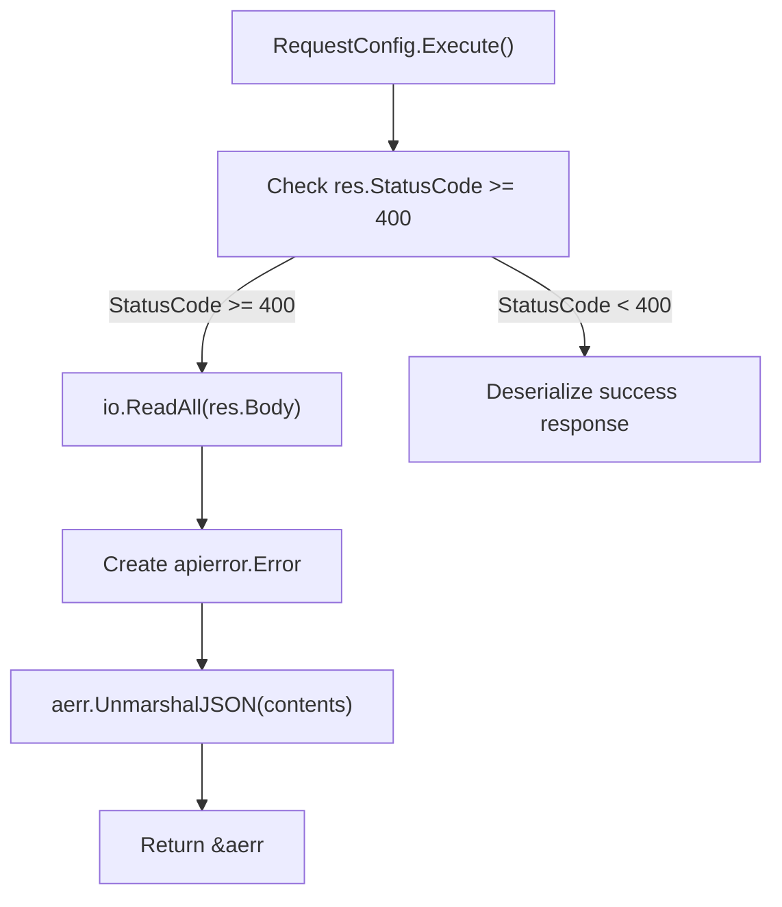
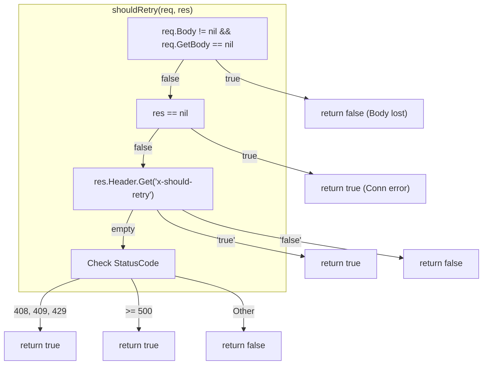
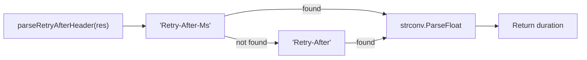
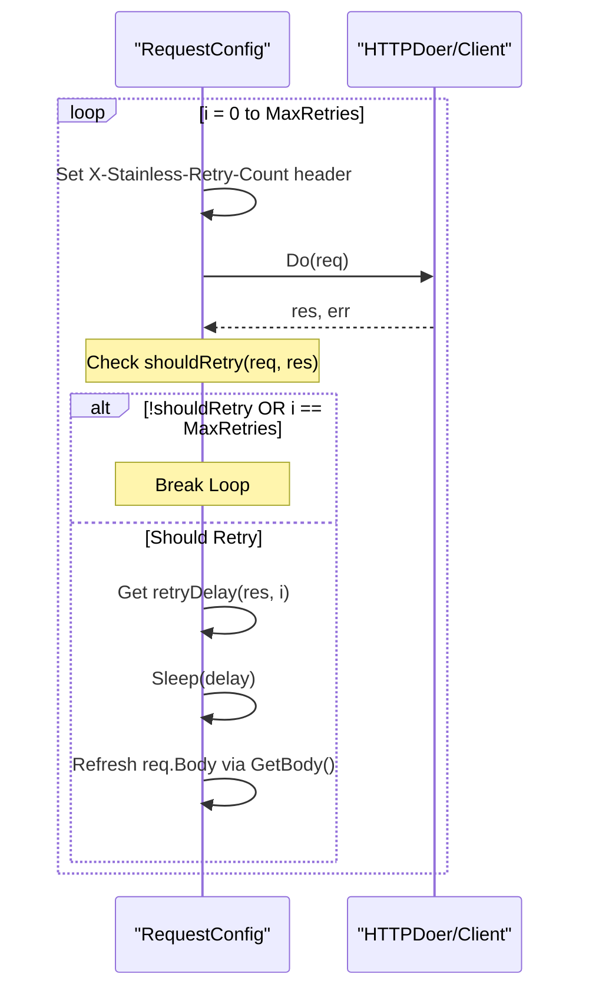

<!-- source: DeepWiki mcp.deepwiki.com · repo openai/openai-go · page 2.3 Error Handling and Retries · fetched 2026-10-26 -->

# Error Handling and Retries

<details>
<summary>Relevant source files</summary>

The following files were used as context for generating this wiki page:

- [client_test.go](client_test.go)
- [internal/apierror/apierror.go](internal/apierror/apierror.go)
- [internal/requestconfig/requestconfig.go](internal/requestconfig/requestconfig.go)
- [option/requestoption.go](option/requestoption.go)
- [usage_test.go](usage_test.go)

</details>


This page documents the error handling and automatic retry mechanisms in the `openai-go` library. It covers the structured error types returned by the API, the automatic retry logic with exponential backoff, configuration options, and best practices for error handling in client code.

---

## Error Types

The library returns structured errors of type `*apierror.Error` when the API responds with a non-success status code (>= 400). This error type provides detailed information about the failure, including the full HTTP request and response.

### apierror.Error Structure

The `apierror.Error` type represents errors originating from the API. It includes standard fields like `Code`, `Message`, and `Type`, which are parsed from the API's JSON response.

| Field | Type | Description |
|-------|------|-------------|
| `StatusCode` | `int` | HTTP status code from the response [internal/apierror/apierror.go:31]() |
| `Code` | `string` | A short string identifier for the error type [internal/apierror/apierror.go:18]() |
| `Message` | `string` | A human-readable message providing more details [internal/apierror/apierror.go:19]() |
| `Request` | `*http.Request` | The original HTTP request [internal/apierror/apierror.go:32]() |
| `Response` | `*http.Response` | The HTTP response [internal/apierror/apierror.go:33]() |

**Sources:** [internal/apierror/apierror.go:17-34]()

### Error Creation Flow

When a request is executed, the library checks the status code. If it is 400 or higher, it attempts to parse the response body as an error.



**Sources:** [internal/requestconfig/requestconfig.go:492-510](), [internal/apierror/apierror.go:38-40]()

---

## Retry Behavior

The library automatically retries certain failed requests using exponential backoff with jitter. By default, requests are retried up to 2 times (for a total of 3 attempts including the initial request).

### Default Retry Configuration

The default maximum retry count is initialized in `NewRequestConfig`:

```go
cfg := RequestConfig{
    MaxRetries: 2,
    // ...
}
```

**Sources:** [internal/requestconfig/requestconfig.go:174]()

### Retriable Conditions

The `shouldRetry` function determines whether a request should be retried based on the response or the error encountered.



**Sources:** [internal/requestconfig/requestconfig.go:250-269]()

---

## Exponential Backoff Algorithm

The retry delay uses exponential backoff with jitter to avoid thundering herd problems and respect rate limits.

### Retry-After Header Support

Before calculating exponential backoff, the library checks for `Retry-After` or `Retry-After-Ms` headers. `Retry-After-Ms` is preferred as it provides millisecond precision.



**Sources:** [internal/requestconfig/requestconfig.go:271-324]()

### Exponential Backoff Calculation

If no valid `Retry-After` header is found, the delay is calculated as `0.5 * 2^retryCount` seconds, capped at 8 seconds, with a random jitter reduction of up to 25%.

| Retry Count | Base Delay | Max Cap | Jitter Range (25%) |
|-------------|------------|---------|--------------------|
| 0           | 0.5s       | 8.0s    | 0 - 0.125s         |
| 1           | 1.0s       | 8.0s    | 0 - 0.25s          |
| 2           | 2.0s       | 8.0s    | 0 - 0.5s           |

**Sources:** [internal/requestconfig/requestconfig.go:361-378]()

---

## Retry Loop Implementation

The retry loop is implemented within the `Execute` method of `RequestConfig`.



**Key implementation details:**
1. **Header Tracking:** The `X-Stainless-Retry-Count` header is updated on every attempt [internal/requestconfig/requestconfig.go:444]().
2. **Body Refresh:** Retries are only possible if the request body can be re-read using `req.GetBody` [internal/requestconfig/requestconfig.go:456-466]().
3. **Timeout Management:** Each attempt can have its own timeout if `RequestTimeout` is set, which is reflected in the `X-Stainless-Timeout` header [internal/requestconfig/requestconfig.go:432-442]().

**Sources:** [internal/requestconfig/requestconfig.go:424-474]()

---

## Configuring Retries

Retries can be configured globally on the client or per-request using `RequestOption`s.

### Client-Level Configuration
```go
client := openai.NewClient(
    option.WithMaxRetries(5), // Set default retries to 5
)
```
**Sources:** [option/requestoption.go:101-109]()

### Per-Request Configuration
```go
client.Chat.Completions.New(ctx, params, option.WithMaxRetries(0)) // Disable for this call
```
**Sources:** [option/requestoption.go:105-108]()

---

## Request Timeout vs Context Timeout

The SDK distinguishes between a per-attempt timeout and the overall context deadline.

1. **Context Timeout:** Governs the entire execution, including all retries. If the context expires, the loop terminates immediately [internal/requestconfig/requestconfig.go:448-450]().
2. **Request Timeout:** Set via `option.WithRequestTimeout`. This applies to each individual HTTP call. The library sets the `X-Stainless-Timeout` header to inform the server of this limit [internal/requestconfig/requestconfig.go:189-195]().

**Sources:** [internal/requestconfig/requestconfig.go:432-442](), [option/requestoption.go:210-217]()

---

## Error Inspection Utilities

The `apierror.Error` type provides helper methods to inspect the raw data exchanged with the API:

*   **`RawJSON()`**: Returns the unmodified JSON body received from the API [internal/apierror/apierror.go:37]().
*   **`DumpRequest(body bool)`**: Uses `httputil.DumpRequestOut` to return the full request data [internal/apierror/apierror.go:47-53]().
*   **`DumpResponse(body bool)`**: Uses `httputil.DumpResponse` to return the full response data [internal/apierror/apierror.go:55-58]().

**Sources:** [internal/apierror/apierror.go:37-58]()

---

