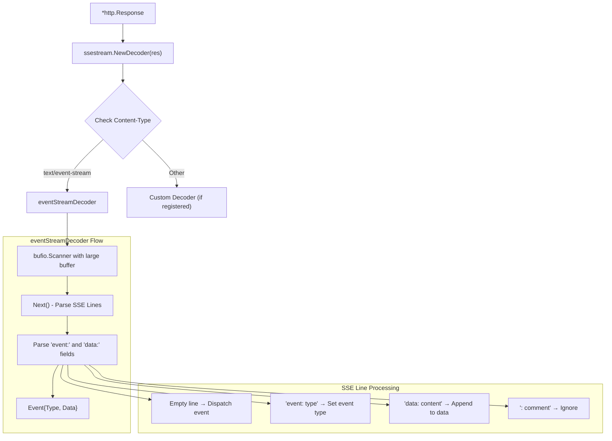
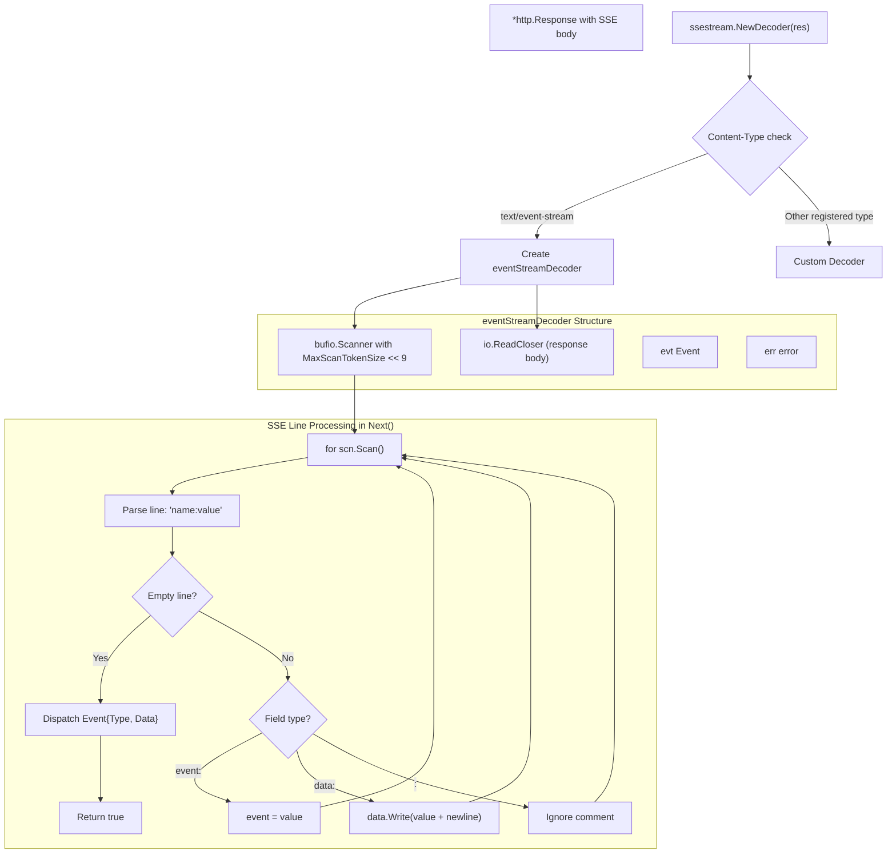
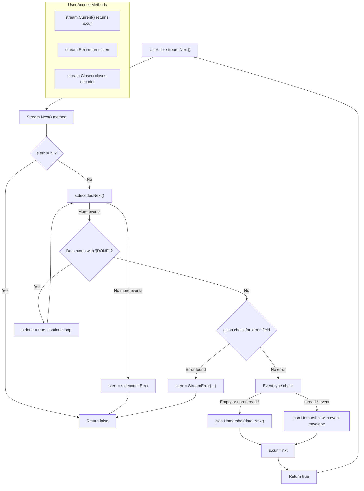
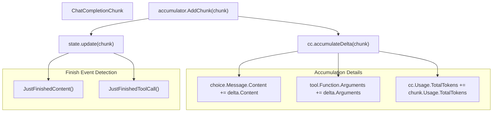
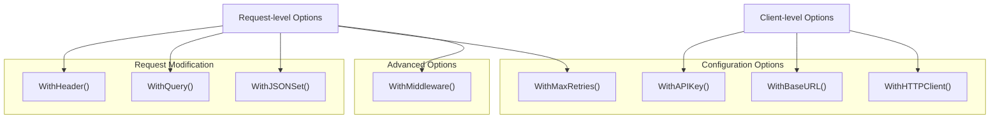
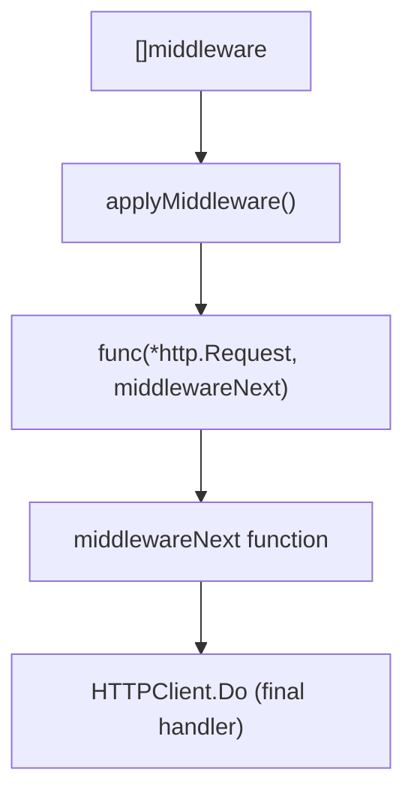

<!-- source: DeepWiki mcp.deepwiki.com · repo openai/openai-go · page 2.4 Streaming Architecture · fetched 2026-10-26 -->

# Streaming Architecture

<details>
<summary>Relevant source files</summary>

The following files were used as context for generating this wiki page:

- [.release-please-manifest.json](.release-please-manifest.json)
- [CHANGELOG.md](CHANGELOG.md)
- [README.md](README.md)
- [examples/chat-completion-accumulating/main.go](examples/chat-completion-accumulating/main.go)
- [internal/requestconfig/requestconfig.go](internal/requestconfig/requestconfig.go)
- [internal/version.go](internal/version.go)
- [option/requestoption.go](option/requestoption.go)
- [packages/ssestream/ssestream.go](packages/ssestream/ssestream.go)
- [streamaccumulator.go](streamaccumulator.go)
- [streamaccumulator_test.go](streamaccumulator_test.go)

</details>


This document explains the streaming architecture in the openai-go library, focusing on how Server-Sent Events (SSE) are processed through the `ssestream.Stream[T]` type, the iterator pattern, and accumulator helpers for building complete responses from incremental updates.

For request execution details, see [Request Execution Pipeline](#2.2). For chat-specific streaming examples, see [Streaming Chat Responses](#3.2). For response streaming, see [Response Streaming Events](#4.3).

## Overview of Streaming in openai-go

The openai-go library provides streaming support for several APIs (Chat Completions, Responses, Images, Audio, and Beta Assistants). All streaming methods return a `ssestream.Stream[T]` instance that parses Server-Sent Events from the HTTP response and provides a type-safe iterator interface.

**Key streaming APIs:**

| API Service | Streaming Method | Event Type |
|------------|-----------------|------------|
| Chat Completions | `NewStreaming()` | `ChatCompletionChunk` |
| Responses | `NewStreaming()` | `ResponseStreamEventUnion` |
| Images | `EditStreaming()` | `ImageEditStreamEventUnion` |
| Audio Transcriptions | `NewStreaming()` | `TranscriptionStreamEventUnion` |
| Beta Assistants | `NewAndRunStreaming()` | `AssistantStreamEventUnion` |

**Sources:** [README.md:163-187](), [streamaccumulator_test.go:54-88]()

## SSE Decoder and Event Processing

The streaming system processes Server-Sent Events (SSE) through a layered architecture. At the lowest level, the `Decoder` interface provides access to raw SSE events.



### Event Struct and Decoder Interface

The `Event` struct represents a parsed SSE event with its type and data:

```go
type Event struct {
	Type string
	Data []byte
}
```

The `Decoder` interface defines the contract for SSE parsing:

```go
type Decoder interface {
	Event() Event
	Next() bool
	Close() error
	Err() error
}
```

**Sources:** [packages/ssestream/ssestream.go:48-51](), [packages/ssestream/ssestream.go:18-23]()

### eventStreamDecoder Implementation

The concrete `eventStreamDecoder` type implements the `Decoder` interface using `bufio.Scanner` with a large buffer to handle SSE streams:

**Title:** eventStreamDecoder SSE Parsing Process



The `Next()` method at [packages/ssestream/ssestream.go:72-123]() accumulates `data:` lines into a buffer and dispatches an event when it encounters an empty line. The `event:` field sets the event type, and lines starting with `:` are treated as comments and ignored.

**Sources:** [packages/ssestream/ssestream.go:25-40](), [packages/ssestream/ssestream.go:65-135]()

## Stream[T] Generic Type and Iterator Pattern

The `Stream[T]` generic type wraps a `Decoder` and provides type-safe iteration over deserialized events. It follows the standard Go iterator pattern with `Next()`, `Current()`, and `Err()` methods.

### Stream Structure and Creation

```go
type Stream[T any] struct {
	decoder             Decoder
	cur                 T
	err                 error
	done                bool
	synthesizeEventData bool
}
```

Streams are created by `NewStream[T](decoder, err)` at [packages/ssestream/ssestream.go:145-150]() and returned from streaming API methods.

### Iterator Pattern Implementation

**Title:** Stream[T] Iterator Pattern Flow



The `Next()` method at [packages/ssestream/ssestream.go:171-228]() implements the following logic:

1.  **Check for existing errors**: Returns `false` if `s.err` is already set.
2.  **Loop through decoder events**: Calls `s.decoder.Next()` to get raw SSE events.
3.  **Handle `[DONE]` signal**: Sets `s.done = true` and continues (doesn't break).
4.  **Check for error field**: Uses `gjson.GetBytes(s.decoder.Event().Data, "error")` to detect error events.
5.  **Unmarshal event data**: Deserializes JSON into type `T`. If `synthesizeEventData` is true or it's a `thread.*` event, it wraps the data in an event envelope.
6.  **Update current value**: Sets `s.cur = nxt` and returns `true`.

**Sources:** [packages/ssestream/ssestream.go:137-244]()

## Accumulator Patterns

For APIs like Chat Completions, the SDK provides a `ChatCompletionAccumulator` to simplify merging incremental chunks into a complete object.

### ChatCompletionAccumulator

The `ChatCompletionAccumulator` tracks the state of the conversation and provides helper methods to detect when specific parts of the response (content, tool calls, refusals) have finished.

**Title:** ChatCompletionAccumulator Logic



The `AddChunk` method at [streamaccumulator.go:38-53]() incorporates a chunk and updates internal state tracking. Methods like `JustFinishedContent()` allow users to react to the completion of specific segments without waiting for the entire stream to close.

**Sources:** [streamaccumulator.go:6-168](), [examples/chat-completion-accumulating/main.go:34-62]()

## Event Type Handling

The stream processes different event types based on the SSE `event:` field:

| Event Type Pattern | Handling | Example |
|-------------------|----------|---------|
| Empty or non-`thread.*` | Direct JSON unmarshal of `data:` field | Chat completion chunks |
| Starts with `thread.` | Wraps in envelope: `{"event": "type", "data": {...}}` | Assistant streaming events |

This special handling for `thread.*` events at [packages/ssestream/ssestream.go:197-205]() allows discriminated union types to deserialize correctly based on the event type field.

### DONE Signal Handling

The SSE stream can include a special `[DONE]` marker to signal the end of the stream. The `Stream[T].Next()` method handles this at [packages/ssestream/ssestream.go:181-185]():

```go
if bytes.HasPrefix(s.decoder.Event().Data, []byte("[DONE]")) {
    // In this case we don't break because we still want to iterate through the full stream.
    s.done = true
    continue
}
```

Key behaviors:
- The `[DONE]` marker sets `s.done = true` but doesn't terminate iteration.
- The loop continues to drain any remaining events after `[DONE]`.
- Iteration only stops when `decoder.Next()` returns `false`.

**Sources:** [packages/ssestream/ssestream.go:181-185]()

## Request Options System

The `RequestOption` interface provides a flexible way to configure requests through functional options.

### Option Categories and Application



**Sources:** [option/requestoption.go:27-195](), [internal/requestconfig/requestconfig.go:81-90]()

### Middleware Chain and Execution

Middleware functions intercept requests and can modify them or the responses:



**Sources:** [internal/requestconfig/requestconfig.go:236-248](), [option/requestoption.go:87-94]()

---

