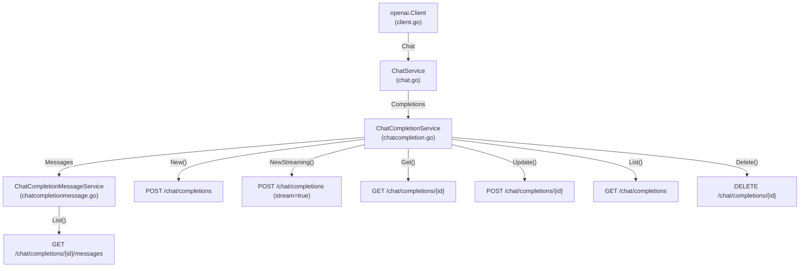
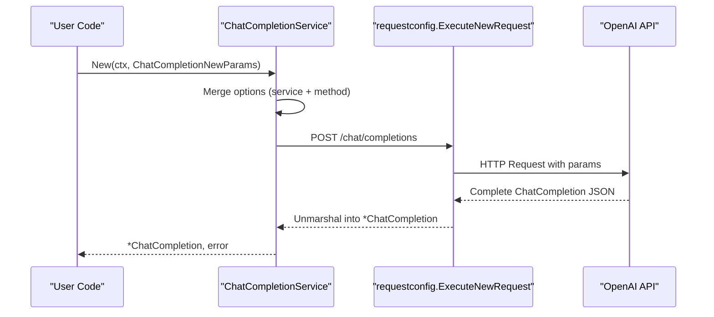
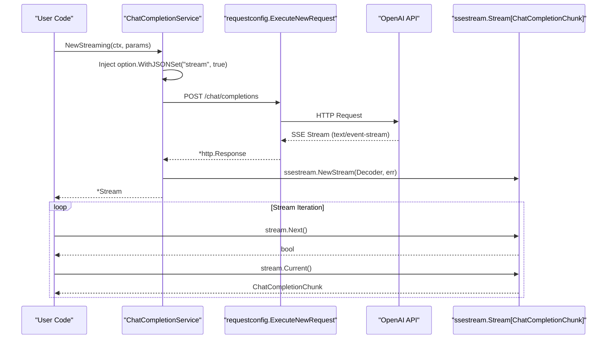
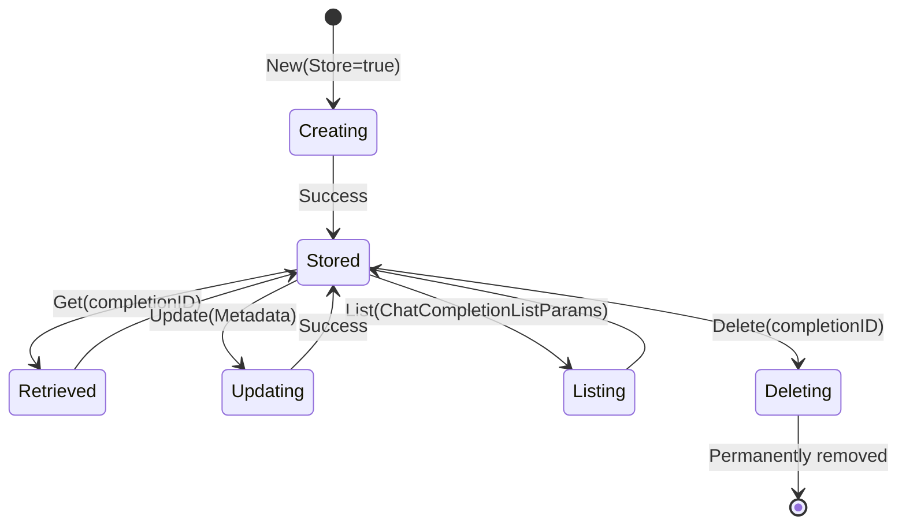

<!-- source: DeepWiki mcp.deepwiki.com · repo openai/openai-go · page 3 Chat Completions API · fetched 2026-10-26 -->

# Chat Completions API

Relevant source files

The following files were used as context for generating this wiki page:

- [chat.go](chat.go)
- [chatcompletion.go](chatcompletion.go)
- [chatcompletion_test.go](chatcompletion_test.go)
- [chatcompletionmessage.go](chatcompletionmessage.go)

This page covers the Chat Completions API service (`ChatCompletionService`), which provides the primary interface for generating text-based conversational responses from OpenAI models. This is the most commonly used API for interactive chat applications, supporting text, images, audio, and tool calling.

For information about the newer Responses API (recommended for new projects), see [Responses API](#4). For information about legacy text completions (non-chat), see [Text Completions API](#8).

## Service Structure and Position

The Chat Completions API is exposed through the `ChatCompletionService`, which is accessible via `client.Chat.Completions`. This service is part of a two-level hierarchy under the main client:

**Service Hierarchy Diagram**

The service structure is defined with two fields: request options that apply to all methods, and a sub-service for message retrieval:

| Field | Type | Purpose |
|-------|------|---------|
| `Options` | `[]option.RequestOption` | Default options applied to all requests |
| `Messages` | `ChatCompletionMessageService` | Sub-service for stored message retrieval |

**Sources:** [chatcompletion.go:35-50](), [chat.go:15-30](), [chatcompletionmessage.go:29-40]()

## Core Methods Overview

The `ChatCompletionService` provides methods organized into creation and storage management:

### Creation Methods

| Method | HTTP | Path | Return Type | Purpose |
|--------|------|------|-------------|---------|
| `New()` | POST | `/chat/completions` | `*ChatCompletion` | Create synchronous completion |
| `NewStreaming()` | POST | `/chat/completions` | `*ssestream.Stream[ChatCompletionChunk]` | Create streaming completion |

### Storage Management Methods

| Method | HTTP | Path | Return Type | Purpose |
|--------|------|------|-------------|---------|
| `Get()` | GET | `/chat/completions/{id}` | `*ChatCompletion` | Retrieve stored completion |
| `Update()` | POST | `/chat/completions/{id}` | `*ChatCompletion` | Update completion metadata |
| `List()` | GET | `/chat/completions` | `*pagination.CursorPage[ChatCompletion]` | List stored completions |
| `Delete()` | DELETE | `/chat/completions/{id}` | `*ChatCompletionDeleted` | Delete stored completion |

Storage methods only work with completions created with the `store: true` parameter set in `ChatCompletionNewParams`.

**Sources:** [chatcompletion.go:72-163]()

## Request/Response Flow

**Synchronous Completion Flow**

The synchronous method implementation at [chatcompletion.go:72-77]() directly calls the request execution layer, blocking until the full response is available.

**Streaming Completion Flow**

The streaming implementation at [chatcompletion.go:99-109]() automatically sets `stream: true` using `option.WithJSONSet()`, then wraps the HTTP response in an `ssestream.Stream` iterator.

**Sources:** [chatcompletion.go:72-109](), [packages/ssestream/ssestream.go:125-217]()

## Stored Completions Management

Completions can be stored for later retrieval and management by setting `Store: openai.Bool(true)` in the request parameters.

**Stored Completion Lifecycle**

### Get: Retrieve Stored Completion
Retrieve a previously stored completion by its ID using `Get(ctx, completionID)`. It returns a `*ChatCompletion` object if the ID exists and was created with `store: true`.

**Sources:** [chatcompletion.go:113-122]()

### Update: Modify Stored Metadata
Modify the metadata of a stored completion using `Update(ctx, completionID, body)`. Currently, only the `Metadata` field can be updated.

**Sources:** [chatcompletion.go:127-136](), [chatcompletion_test.go:166-174]()

### List: Query Stored Completions
List stored completions with filtering (model, metadata) and pagination. Use `ListAutoPaging` for automatic cursor handling across multiple pages.

**Sources:** [chatcompletion.go:140-160](), [chatcompletionmessage.go:44-69]()

## Request Parameters Overview

`ChatCompletionNewParams` contains a wide array of configurations for the model:

| Category | Parameters |
|----------|------------|
| **Core** | `Messages`, `Model` |
| **Sampling** | `Temperature`, `TopP`, `N`, `Seed`, `FrequencyPenalty`, `PresencePenalty` |
| **Limits** | `MaxTokens`, `MaxCompletionTokens`, `Stop` |
| **Tools** | `Tools`, `ToolChoice`, `ParallelToolCalls` |
| **Modality** | `Modalities`, `Audio` |
| **Storage** | `Store`, `Metadata` |
| **Reasoning** | `ReasoningEffort` |

For detailed information on these parameters, refer to the child pages.

**Sources:** [chatcompletion.go:495-577](), [chatcompletion_test.go:29-122]()

## Related Pages

This page provides an overview of the Chat Completions service. For detailed information on specific features:

- **[Messages and Content Types](#3.1)** — Document message structure, role types (user, assistant, developer, system), content part unions for multi-modal input (text, images, audio, files), and message parameters.
- **[Streaming Chat Responses](#3.2)** — Explain `NewStreaming` method, `ChatCompletionChunk` structure, delta processing, and `ChatCompletionAccumulator` usage.
- **[Tool Calling and Functions](#3.3)** — Document function tools, custom tools with grammar-based formats, tool choice options, parallel tool calls, and tool call response handling.
- **[Structured Outputs and Response Formats](#3.4)** — Explain response format options: text, JSON object, and JSON schema with strict mode for validated structured outputs.

**Sources:** [chatcompletion.go:35-109]()

---

