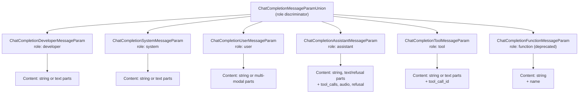
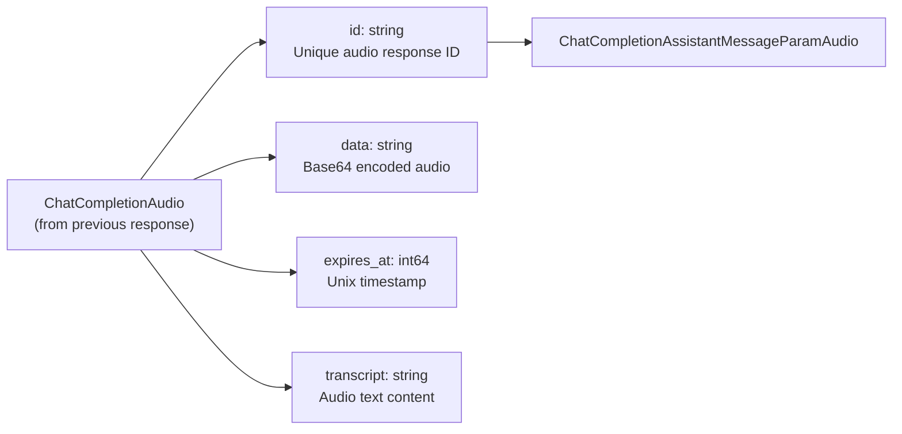
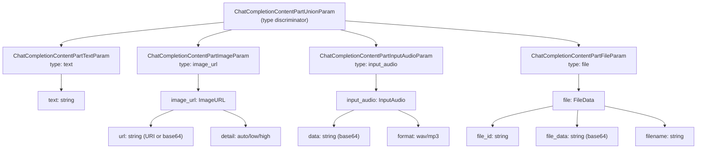
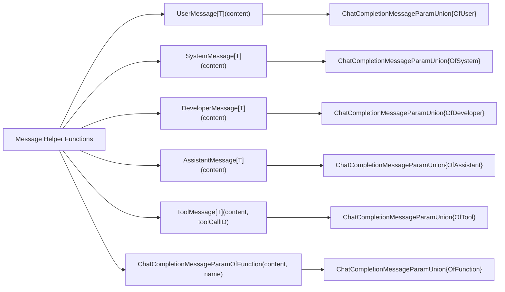
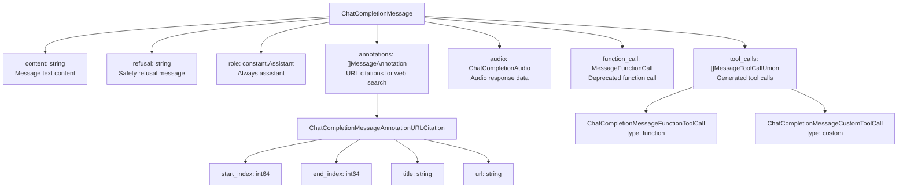

<!-- source: DeepWiki mcp.deepwiki.com · repo openai/openai-go · page 3.1 Messages and Content Types · fetched 2026-10-26 -->

# Messages and Content Types

<details>
<summary>Relevant source files</summary>

The following files were used as context for generating this wiki page:

- [chatcompletion.go](chatcompletion.go)
- [chatcompletion_test.go](chatcompletion_test.go)
- [chatcompletionmessage.go](chatcompletionmessage.go)

</details>


This page documents the message structure and content types used in the Chat Completions API. Messages form the core input to chat models, with each message having a role (user, assistant, system, developer, tool) and content that can be text, images, audio, or files. For information about streaming chat responses, see [Streaming Chat Responses](#3.2). For tool calling integration, see [Tool Calling and Functions](#3.3). For the modern Responses API alternative, see [Responses API](#4).

## Message Structure Overview

Chat messages in the `openai-go` SDK are represented as discriminated unions based on the `role` field. All message types are wrapped in the `ChatCompletionMessageParamUnion` type, which provides type-safe access to six distinct message roles.

Title: Message Type Hierarchy


**Sources:** [chatcompletion.go:1957-2117]()

## Message Roles

### Developer Messages

Developer messages replace the legacy system messages for o1 models and newer. They provide instructions that the model should follow regardless of user input. Developer messages accept either a simple string or an array of text content parts.

| Field | Type | Required | Description |
|-------|------|----------|-------------|
| `role` | `constant.Developer` | Yes | Always "developer" |
| `content` | `ChatCompletionDeveloperMessageParamContentUnion` | Yes | String or array of text parts |
| `name` | `param.Opt[string]` | No | Participant name for differentiation |

**Sources:** [chatcompletion.go:1397-1420]()

### System Messages

System messages provide instructions for older model versions. For o1 and newer models, use developer messages instead. System messages have the same structure as developer messages.

| Field | Type | Required | Description |
|-------|------|----------|-------------|
| `role` | `constant.System` | Yes | Always "system" |
| `content` | `ChatCompletionSystemMessageParamContentUnion` | Yes | String or array of text parts |
| `name` | `param.Opt[string]` | No | Participant name for differentiation |

**Sources:** [chatcompletion.go:2524-2562]()

### User Messages

User messages represent input from the end user or application. They support multi-modal content including text, images, audio, and file attachments.

| Field | Type | Required | Description |
|-------|------|----------|-------------|
| `role` | `constant.User` | Yes | Always "user" |
| `content` | `ChatCompletionUserMessageParamContentUnion` | Yes | String or array of content parts |
| `name` | `param.Opt[string]` | No | Participant name for differentiation |

**Sources:** [chatcompletion.go:2564-2587]()

### Assistant Messages

Assistant messages represent model-generated responses. They can include text content, refusal messages, tool calls, and audio responses. Assistant messages are typically used when providing conversation history to the model.

| Field | Type | Required | Description |
|-------|------|----------|-------------|
| `role` | `constant.Assistant` | Yes | Always "assistant" |
| `content` | `ChatCompletionAssistantMessageParamContentUnion` | No | String or array of text/refusal parts |
| `refusal` | `param.Opt[string]` | No | Refusal message from the assistant |
| `name` | `param.Opt[string]` | No | Participant name |
| `audio` | `ChatCompletionAssistantMessageParamAudio` | No | Previous audio response data |
| `tool_calls` | `[]ChatCompletionMessageToolCallUnionParam` | No | Tool calls generated by the model |
| `function_call` | `ChatCompletionAssistantMessageParamFunctionCall` | No | Deprecated function call data |

The `audio` field references a previous audio response by ID and is used for multi-turn conversations with audio modality:

Title: Assistant Audio Reference Data Flow


**Sources:** [chatcompletion.go:329-365](), [chatcompletion.go:366-382](), [chatcompletion.go:494-522]()

### Tool Messages

Tool messages provide the results of tool calls back to the model. Each tool message must reference a specific tool call ID from a previous assistant message.

| Field | Type | Required | Description |
|-------|------|----------|-------------|
| `role` | `constant.Tool` | Yes | Always "tool" |
| `content` | `ChatCompletionToolMessageParamContentUnion` | Yes | String or array of text parts |
| `tool_call_id` | `string` | Yes | ID of the tool call being responded to |

**Sources:** [chatcompletion.go:2589-2612]()

### Function Messages (Deprecated)

Function messages are deprecated in favor of tool messages. They provide results from function calls in the legacy function calling pattern.

| Field | Type | Required | Description |
|-------|------|----------|-------------|
| `role` | `constant.Function` | Yes | Always "function" |
| `content` | `param.Opt[string]` | Yes | Function execution result |
| `name` | `string` | Yes | Name of the function |

**Sources:** [chatcompletion.go:1465-1486]()

## Content Part Types

User and assistant messages can contain multi-modal content through content part unions. The `ChatCompletionContentPartUnionParam` discriminated union supports four content types distinguished by the `type` field.

Title: Multi-modal Content Part Union


**Sources:** [chatcompletion.go:864-949]()

### Text Content Parts

Text content parts contain plain text content. This is the most common content type for messages.

| Field | Type | Required | Description |
|-------|------|----------|-------------|
| `type` | `constant.Text` | Yes | Always "text" |
| `text` | `string` | Yes | The text content |

Helper function:
```go
TextContentPart(text string) ChatCompletionContentPartUnionParam
```

**Sources:** [chatcompletion.go:1154-1206](), [chatcompletion.go:840-844]()

### Image Content Parts

Image content parts enable vision capabilities by providing images as URLs or base64-encoded data. The `detail` parameter controls the fidelity level for image understanding.

| Field | Type | Required | Description |
|-------|------|----------|-------------|
| `type` | `constant.ImageURL` | Yes | Always "image_url" |
| `image_url.url` | `string` | Yes | Image URL or base64 data URI |
| `image_url.detail` | `string` | No | "auto", "low", or "high" |

The `detail` parameter affects token usage and processing quality:
- **auto**: Model decides based on image characteristics
- **low**: Low-resolution processing (512x512), uses 85 tokens
- **high**: High-resolution processing with detail tiles, uses more tokens

Helper function:
```go
ImageContentPart(imageURL ChatCompletionContentPartImageImageURLParam) ChatCompletionContentPartUnionParam
```

**Sources:** [chatcompletion.go:991-1088](), [chatcompletion.go:846-850]()

### Audio Content Parts

Audio content parts allow including audio input in user messages. Audio data must be base64-encoded and currently supports WAV and MP3 formats.

| Field | Type | Required | Description |
|-------|------|----------|-------------|
| `type` | `constant.InputAudio` | Yes | Always "input_audio" |
| `input_audio.data` | `string` | Yes | Base64 encoded audio data |
| `input_audio.format` | `string` | Yes | "wav" or "mp3" |

Helper function:
```go
InputAudioContentPart(inputAudio ChatCompletionContentPartInputAudioInputAudioParam) ChatCompletionContentPartUnionParam
```

**Sources:** [chatcompletion.go:1090-1133](), [chatcompletion.go:852-856]()

### File Content Parts

File content parts allow attaching documents for text generation. Files can be referenced by ID (previously uploaded) or provided inline as base64-encoded data.

| Field | Type | Required | Description |
|-------|------|----------|-------------|
| `type` | `constant.File` | Yes | Always "file" |
| `file.file_id` | `param.Opt[string]` | No* | ID of uploaded file |
| `file.file_data` | `param.Opt[string]` | No* | Base64 encoded file data |
| `file.filename` | `param.Opt[string]` | No | File name for inline data |

*Either `file_id` or `file_data` must be provided.

Helper function:
```go
FileContentPart(file ChatCompletionContentPartFileFileParam) ChatCompletionContentPartUnionParam
```

**Sources:** [chatcompletion.go:951-989](), [chatcompletion.go:858-862]()

## Message Construction Helpers

The SDK provides convenience functions for constructing common message types. These functions simplify message creation and ensure type safety.

Title: Message Helper Function Mapping


| Function | Parameters | Returns | Description |
|----------|------------|---------|-------------|
| `UserMessage[T]` | `content T` | `ChatCompletionMessageParamUnion` | Creates user message (T = string or []ContentParts) |
| `SystemMessage[T]` | `content T` | `ChatCompletionMessageParamUnion` | Creates system message (T = string or []TextParts) |
| `DeveloperMessage[T]` | `content T` | `ChatCompletionMessageParamUnion` | Creates developer message (T = string or []TextParts) |
| `AssistantMessage[T]` | `content T` | `ChatCompletionMessageParamUnion` | Creates assistant message (T = string or []ContentParts) |
| `ToolMessage[T]` | `content T, toolCallID string` | `ChatCompletionMessageParamUnion` | Creates tool message with call ID |
| `ChatCompletionMessageParamOfFunction` | `content string, name string` | `ChatCompletionMessageParamUnion` | Creates function message (deprecated) |

**Sources:** [chatcompletion.go:1878-1952]()

## Response Messages

The `ChatCompletionMessage` type represents messages returned by the model. It differs from parameter types by being a response structure with additional metadata.

Title: ChatCompletionMessage Response Structure


The `ChatCompletionMessage` type includes a `ToParam()` method that converts it to a `ChatCompletionMessageParamUnion` for use in subsequent requests:

```go
func (r ChatCompletionMessage) ToParam() ChatCompletionMessageParamUnion
func (r ChatCompletionMessage) ToAssistantMessageParam() ChatCompletionAssistantMessageParam
```

This allows including previous model responses in conversation history without manual reconstruction.

**Sources:** [chatcompletion.go:1508-1601](), [chatcompletion.go:1603-1649]()

## Tool Calls in Messages

Assistant messages can include tool calls, represented as a discriminated union based on the `type` field. There are two tool call types: function tools and custom tools.

### Function Tool Calls

Function tool calls represent standard function calling with JSON parameters.

| Field | Type | Description |
|-------|------|-------------|
| `id` | `string` | Unique ID for the tool call |
| `type` | `constant.Function` | Always "function" |
| `function.name` | `string` | Function name to call |
| `function.arguments` | `string` | JSON-formatted arguments |

**Sources:** [chatcompletion.go:1775-1831](), [chatcompletion.go:1833-1876]()

### Custom Tool Calls

Custom tool calls represent grammar-based tool invocations with structured input formats.

| Field | Type | Description |
|-------|------|-------------|
| `id` | `string` | Unique ID for the tool call |
| `type` | `constant.Custom` | Always "custom" |
| `custom.name` | `string` | Custom tool name |
| `custom.input` | `string` | Input formatted per tool's grammar |

**Sources:** [chatcompletion.go:1678-1731](), [chatcompletion.go:1733-1773]()

### Tool Call Union

The `ChatCompletionMessageToolCallUnion` type provides type-safe access to tool call variants:

```go
type ChatCompletionMessageToolCallUnion struct {
    ID       string
    Function ChatCompletionMessageFunctionToolCallFunction // for function type
    Type     string
    Custom   ChatCompletionMessageCustomToolCallCustom     // for custom type
}

func (u ChatCompletionMessageToolCallUnion) AsAny() anyChatCompletionMessageToolCall
func (u ChatCompletionMessageToolCallUnion) AsFunction() ChatCompletionMessageFunctionToolCall
func (u ChatCompletionMessageToolCallUnion) AsCustom() ChatCompletionMessageCustomToolCall
```

**Sources:** [chatcompletion.go:2119-2197]()

## Union Type Navigation

All union types in the message system provide accessor methods for type-safe property access without explicit type assertions.

### ChatCompletionMessageParamUnion Accessors

| Method | Return Type | Description |
|--------|-------------|-------------|
| `GetRole()` | `*string` | Returns role from any variant |
| `GetName()` | `*string` | Returns name if present |
| `GetContent()` | `chatCompletionMessageParamUnionContent` | Returns content with subtype access |
| `GetAudio()` | `*ChatCompletionAssistantMessageParamAudio` | Returns audio from assistant variant |
| `GetRefusal()` | `*string` | Returns refusal from assistant variant |
| `GetToolCalls()` | `[]ChatCompletionMessageToolCallUnionParam` | Returns tool calls from assistant variant |
| `GetToolCallID()` | `*string` | Returns tool_call_id from tool variant |
| `GetFunctionCall()` | `*ChatCompletionAssistantMessageParamFunctionCall` | Returns deprecated function_call |

### Content Union Accessors

The `ChatCompletionContentPartUnionParam` provides accessors for each content type variant:

| Method | Return Type | Description |
|--------|-------------|-------------|
| `GetText()` | `*string` | Returns text from text variant |
| `GetImageURL()` | `*ChatCompletionContentPartImageImageURLParam` | Returns image_url from image variant |
| `GetInputAudio()` | `*ChatCompletionContentPartInputAudioInputAudioParam` | Returns input_audio from audio variant |
| `GetFile()` | `*ChatCompletionContentPartFileFileParam` | Returns file from file variant |
| `GetType()` | `*string` | Returns type discriminator |

**Sources:** [chatcompletion.go:1996-2088](), [chatcompletion.go:895-939]()

## Usage Example Pattern

The following demonstrates typical message construction patterns used in tests and production code:

```go
// Simple text messages
messages := []openai.ChatCompletionMessageParamUnion{
    openai.UserMessage("What is the weather?"),
    openai.SystemMessage("You are a helpful assistant."),
}

// Multi-modal user message with image
messages := []openai.ChatCompletionMessageParamUnion{
    openai.UserMessage([]openai.ChatCompletionContentPartUnionParam{
        openai.TextContentPart("What's in this image?"),
        openai.ImageContentPart(openai.ChatCompletionContentPartImageImageURLParam{
            URL: "https://example.com/image.jpg",
            Detail: "high",
        }),
    }),
}

// Assistant message with tool calls
messages := []openai.ChatCompletionMessageParamUnion{
    openai.AssistantMessage("I'll check the weather for you."),
    {
        OfAssistant: &openai.ChatCompletionAssistantMessageParam{
            ToolCalls: []openai.ChatCompletionMessageToolCallUnionParam{
                {
                    OfFunction: &openai.ChatCompletionMessageFunctionToolCallParam{
                        ID: "call_123",
                        Function: openai.ChatCompletionMessageFunctionToolCallFunctionParam{
                            Name:      "get_weather",
                            Arguments: `{"location":"San Francisco"}`,
                        },
                    },
                },
            },
        },
    },
}

// Tool response message
messages = append(messages, 
    openai.ToolMessage(`{"temperature": 72, "condition": "sunny"}`, "call_123"),
)
```

**Sources:** [chatcompletion_test.go:29-37](), [chatcompletion.go:1911-1920](), [chatcompletion.go:1935-1945]()

---

