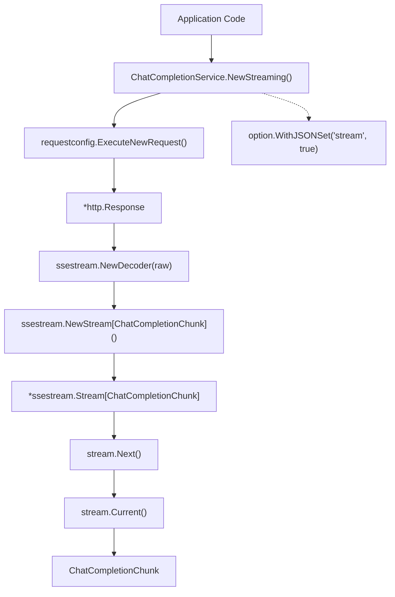
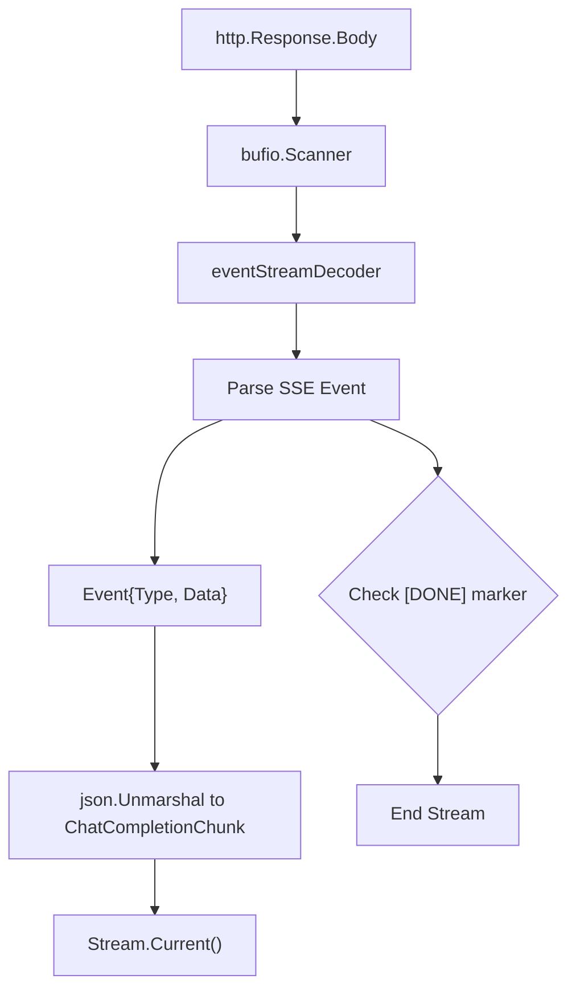
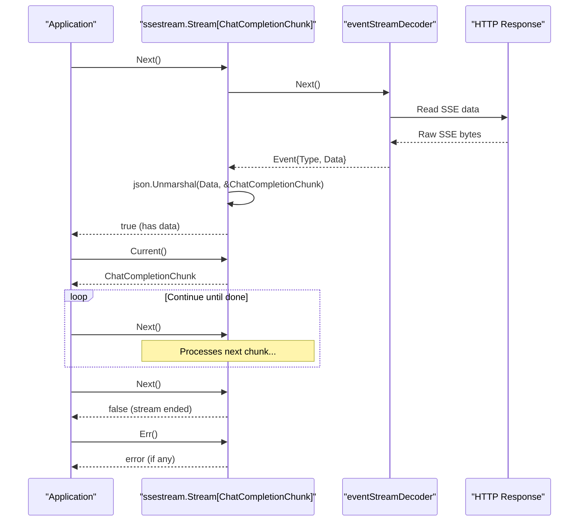
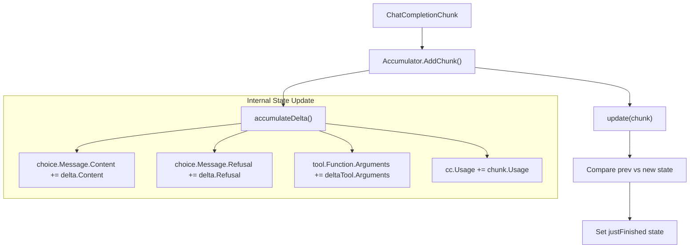

<!-- source: DeepWiki mcp.deepwiki.com · repo openai/openai-go · page 3.2 Streaming Chat Responses · fetched 2026-10-26 -->

# Streaming Chat Responses

<details>
<summary>Relevant source files</summary>

The following files were used as context for generating this wiki page:

- [chatcompletion.go](chatcompletion.go)
- [chatcompletion_test.go](chatcompletion_test.go)
- [examples/chat-completion-accumulating/main.go](examples/chat-completion-accumulating/main.go)
- [streamaccumulator.go](streamaccumulator.go)
- [streamaccumulator_test.go](streamaccumulator_test.go)

</details>


This document explains how to use streaming chat completions to receive progressive responses from OpenAI models in real-time. Streaming allows you to process model output as it's generated rather than waiting for the complete response.

## Core Streaming Architecture

The streaming system is built on Server-Sent Events (SSE) and provides a type-safe iterator pattern for processing chat completion chunks.

### Stream Creation Flow

The `ChatCompletionService.NewStreaming` method initializes the request by setting the `stream: true` parameter in the JSON body and wrapping the resulting HTTP response in an SSE decoder.



Sources: [chatcompletion.go:99-109](), [packages/ssestream/ssestream.go:132-137]()

### SSE Processing Pipeline

The underlying `ssestream` package handles the complexities of parsing the SSE format, including the `data:` prefix and the `[DONE]` termination marker.



Sources: [packages/ssestream/ssestream.go:53-123](), [packages/ssestream/ssestream.go:150-201]()

## Stream Lifecycle and Iteration

### Basic Streaming Pattern

The streaming interface follows a standard Go iterator pattern using `Next()` and `Current()` methods.



Sources: [packages/ssestream/ssestream.go:150-201](), [packages/ssestream/ssestream.go:203-209]()

## Data Types and Delta Processing

### ChatCompletionChunk Structure

The `ChatCompletionChunk` is the unit of data received during streaming. Unlike the full `ChatCompletion` object, it contains a `Delta` field instead of a `Message`.

| Field | Type | Description |
|-------|------|-------------|
| `ID` | `string` | Unique identifier for the completion. |
| `Choices` | `[]ChatCompletionChunkChoice` | List of incremental response variations. |
| `Usage` | `CompletionUsage` | Token usage statistics (usually sent in the final chunk). |

Sources: [chatcompletion.go:15291-15336]()

### Delta Content

The `ChatCompletionChunkChoiceDelta` contains the actual incremental updates:

| Field | Description |
|-------|-------------|
| `Content` | Incremental text content. |
| `Role` | The role of the message author (e.g., "assistant"). |
| `ToolCalls` | Incremental tool call fragments. |
| `Refusal` | Incremental refusal message. |

Sources: [chatcompletion.go:15371-15403]()

## ChatCompletionAccumulator

The `ChatCompletionAccumulator` is a utility designed to merge incoming `ChatCompletionChunk` objects into a single, coherent `ChatCompletion` state.

### Accumulation Logic

The `AddChunk` method incorporates new data. It handles string concatenation for content and refusal, and merges tool call arguments by index.



Sources: [streamaccumulator.go:38-53](), [streamaccumulator.go:104-168]()

### JustFinished Detection

The accumulator tracks state transitions to provide "one-shot" notifications when a specific part of the response (content, refusal, or a tool call) has finished streaming.

| Method | Return Type | Logic |
|--------|-------------|-------|
| `JustFinishedContent()` | `(string, bool)` | Returns true if the previous chunk had content and the current one does not. |
| `JustFinishedRefusal()` | `(string, bool)` | Returns true if the refusal field just stopped receiving updates. |
| `JustFinishedToolCall()` | `(FinishedChatCompletionToolCall, bool)` | Returns true when a tool call is fully formed (detected when the stream moves to a new tool index or stops). |

Sources: [streamaccumulator.go:59-98](), [streamaccumulator.go:172-195]()

## Examples

### Using the Accumulator

The following pattern is recommended for handling streamed responses with the accumulator:

```go
acc := openai.ChatCompletionAccumulator{}
for stream.Next() {
    chunk := stream.Current()
    acc.AddChunk(chunk)

    if content, ok := acc.JustFinishedContent(); ok {
        fmt.Println("Full content received:", content)
    }

    if tool, ok := acc.JustFinishedToolCall(); ok {
        fmt.Printf("Tool call finished: %s with args %s\n", tool.Name, tool.Arguments)
    }
}
```

Sources: [examples/chat-completion-accumulating/main.go:33-62](), [streamaccumulator_test.go:90-112]()

### Error Handling

Always check `stream.Err()` after the iteration loop finishes to detect network interruptions or API errors.

Sources: [packages/ssestream/ssestream.go:203-209](), [examples/chat-completion-accumulating/main.go:64-66]()

---

