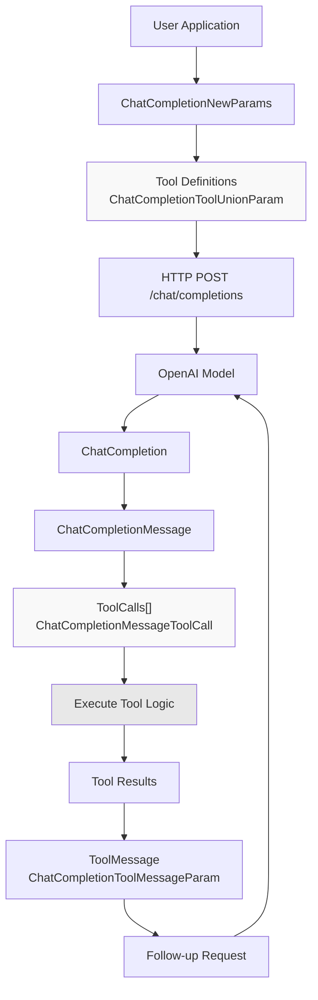
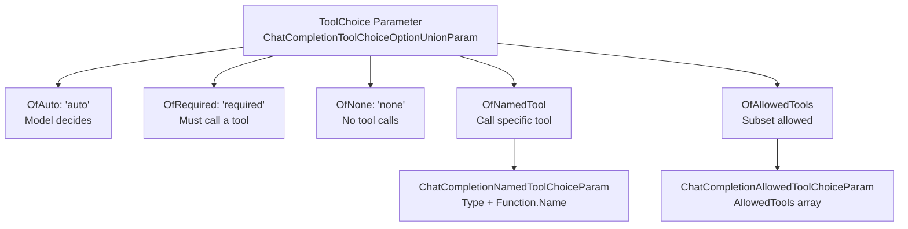
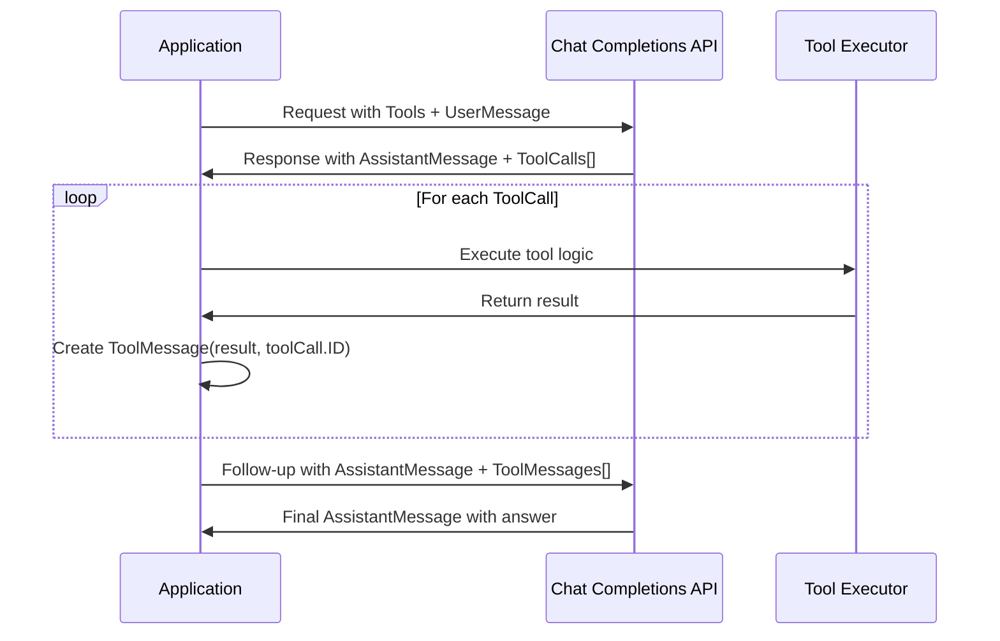

<!-- source: DeepWiki mcp.deepwiki.com · repo openai/openai-go · page 3.3 Tool Calling and Functions · fetched 2026-10-26 -->

# Tool Calling and Functions

<details>
<summary>Relevant source files</summary>

The following files were used as context for generating this wiki page:

- [aliases.go](aliases.go)
- [chatcompletion.go](chatcompletion.go)
- [chatcompletion_test.go](chatcompletion_test.go)
- [examples/chat-completion-tool-calling/main.go](examples/chat-completion-tool-calling/main.go)
- [examples/fine-tuning/fine-tuning-data.jsonl](examples/fine-tuning/fine-tuning-data.jsonl)
- [responses/aliases.go](responses/aliases.go)
- [shared/shared.go](shared/shared.go)

</details>


This page documents tool calling and function invocation capabilities in the Chat Completions API. Tools allow models to invoke external functions, execute code, search files, browse the web, interact with computers, and more. This page focuses specifically on **function tools** (JSON schema-based) and **custom tools** (grammar-based) within Chat Completions.

For tool capabilities in the modern Responses API, see [Response Tool System](#4.2). For other Chat Completions features, see [Messages and Content Types](#3.1), [Streaming Chat Responses](#3.2), and [Structured Outputs and Response Formats](#3.4).

---

## Overview of Tool Types

The Chat Completions API supports two primary tool types for user-defined logic:

| Tool Type | Purpose | Definition Method | Input Format |
|-----------|---------|-------------------|--------------|
| **Function Tool** | Call external functions with JSON arguments | JSON Schema | JSON object |
| **Custom Tool** | Grammar-constrained input parsing | Lark grammar or regex | Structured text |

Additional built-in tools (Code Interpreter, File Search, Web Search, Computer, MCP) are primarily utilized in the Responses API and are covered in the [Response Tool System](#4.2) documentation.

**Sources:** [chatcompletion.go:308-327](), [chatcompletion.go:2801-2882]()

---

## Tool Request and Response Flow



**Diagram: Tool Calling Request/Response Cycle**

The model decides when to invoke tools based on the conversation context. Tool calls are returned in `ChatCompletionMessage.ToolCalls`, which the application must execute and return results via `ToolMessage` in a follow-up request.

**Sources:** [examples/chat-completion-tool-calling/main.go:21-86](), [chatcompletion.go:2243-2301]()

---

## Function Tools

### Function Tool Definition

Function tools are defined using JSON Schema to specify parameters. The model generates JSON arguments that your application must validate and execute.

```go
// Type hierarchy
ChatCompletionToolUnionParam
  └── OfFunction *ChatCompletionFunctionToolParam
        └── Function FunctionDefinitionParam
              ├── Name string (required)
              ├── Description string (optional)
              ├── Parameters FunctionParameters (JSON Schema)
              └── Strict bool (enable strict mode)
```

**Key Fields:**

- **`Name`**: Function identifier.
- **`Description`**: Helps the model decide when to call the function.
- **`Parameters`**: JSON Schema (typically `type: "object"` with `properties` and `required`).
- **`Strict`**: When `true`, enforces exact schema compliance [shared/shared.go:215-232]().

**Example Construction:**

```go
tool := openai.ChatCompletionToolUnionParam{
    OfFunction: &openai.ChatCompletionFunctionToolParam{
        Function: shared.FunctionDefinitionParam{
            Name:        "get_weather",
            Description: openai.String("Get current weather at location"),
            Parameters: shared.FunctionParameters{
                "type": "object",
                "properties": map[string]interface{}{
                    "location": map[string]string{
                        "type":        "string",
                        "description": "City name",
                    },
                },
                "required": []string{"location"},
            },
            Strict: openai.Bool(true),
        },
    },
}
```

**Sources:** [examples/chat-completion-tool-calling/main.go:25-39](), [chatcompletion.go:2802-2820](), [shared/shared.go:215-232]()

### Using Function Tools in Requests

Function tools are passed via the `Tools` parameter of `ChatCompletionNewParams`:

[chatcompletion.go:2587-2600]()

```go
params := openai.ChatCompletionNewParams{
    Messages: []openai.ChatCompletionMessageParamUnion{
        openai.UserMessage("What is the weather in New York City?"),
    },
    Tools: []openai.ChatCompletionToolUnionParam{
        {OfFunction: &openai.ChatCompletionFunctionToolParam{...}},
    },
    Model: openai.ChatModelGPT4o,
}

completion, err := client.Chat.Completions.New(ctx, params)
```

**Sources:** [chatcompletion_test.go:92-106](), [chatcompletion.go:2587-2600]()

### Processing Function Tool Calls

When the model invokes a function, it returns tool calls in the response `Choices`:

[chatcompletion.go:2243-2301]()

```go
// Response structure
ChatCompletion
  └── Choices[0]
        └── Message (ChatCompletionMessage)
              ├── Role: "assistant"
              ├── Content: string (may be empty)
              └── ToolCalls []ChatCompletionMessageToolCall
                    ├── ID: string (unique identifier)
                    ├── Type: "function"
                    └── Function
                          ├── Name: string
                          ├── Arguments: string (JSON string)
```

**Example Processing:**

[examples/chat-completion-tool-calling/main.go:50-78]()

```go
toolCalls := completion.Choices[0].Message.ToolCalls
for _, toolCall := range toolCalls {
    if toolCall.Function.Name == "get_weather" {
        var args map[string]interface{}
        json.Unmarshal([]byte(toolCall.Function.Arguments), &args)
        
        location := args["location"].(string)
        weatherData := getWeather(location) // Simulated logic
        
        // Append tool result to conversation
        params.Messages = append(params.Messages, 
            openai.ToolMessage(weatherData, toolCall.ID))
    }
}
```

The `ToolMessage` helper constructs a `ChatCompletionToolMessageParam` with role `"tool"`, content, and the specific `tool_call_id`.

**Sources:** [examples/chat-completion-tool-calling/main.go:50-78](), [chatcompletion.go:2311-2337](), [chatcompletion.go:3853-3859]()

---

## Custom Tools

Custom tools allow grammar-constrained input formats using **Lark grammar** or **regular expressions**. This enables structured parsing beyond standard JSON.

### Custom Tool Definition

[chatcompletion.go:2822-2882]()

```go
// Type structure
ChatCompletionToolUnionParam
  └── OfCustom *ChatCompletionCustomToolParam
        └── Custom ChatCompletionCustomToolParamCustom
              ├── Name string (required)
              ├── Description string
              ├── InputFormat ChatCompletionCustomToolParamCustomInputFormat
              │     ├── Type: "lark" or "regex"
              │     └── Value: grammar string or regex pattern
              └── Instructions string
```

**Input Format Types:**

| Type | Purpose |
|------|---------|
| `"lark"` | Context-free grammar parsing for DSLs or complex structured data. |
| `"regex"` | Regular expression matching for pattern extraction. |

**Sources:** [chatcompletion.go:2822-2882]()

### Custom Tool Call Processing

Custom tool calls follow the same response pattern as function tools but provide the model-generated input matching the specified grammar:

[chatcompletion.go:2349-2391]()

```go
// Response structure
ChatCompletionMessageToolCall
  ├── ID: string
  ├── Type: "custom"
  └── Custom
        ├── Name: string
        └── Input: string (matches the grammar/regex)
```

**Sources:** [chatcompletion.go:2349-2391]()

---

## Tool Choice Configuration

The `ToolChoice` parameter controls how the model selects tools.

### Tool Choice Options



**Diagram: Tool Choice Option Hierarchy**

**Sources:** [chatcompletion.go:2657-2729](), [chatcompletion.go:308-327]()

### Tool Choice Modes

[chatcompletion.go:2657-2729]()

| Mode | Type | Behavior |
|------|------|----------|
| `"auto"` | String | Model decides whether to call tools based on context (default). |
| `"required"` | String | Model must call at least one tool before responding. |
| `"none"` | String | Model cannot call any tools. |
| Named Tool | Object | Model must call the specified tool. |
| Allowed Tools | Object | Model can only call tools from the provided allowed list. |

**Sources:** [chatcompletion.go:2657-2729](), [chatcompletion.go:308-327](), [chatcompletion_test.go:92-94]()

---

## Parallel Tool Calls

The `ParallelToolCalls` parameter enables concurrent execution of multiple tools in a single model turn:

[chatcompletion.go:2562-2565]()

```go
params := openai.ChatCompletionNewParams{
    // ...
    ParallelToolCalls: openai.Bool(true), // default: true
}
```

**Behavior:**

- **`true`**: Model can return multiple tool calls in `ToolCalls[]`.
- **`false`**: Model returns at most one tool call per response.

**Sources:** [chatcompletion.go:2562-2565](), [chatcompletion_test.go:67]()

---

## Tool Call Response Handling

### Message Flow with Tools



**Diagram: Tool Call Message Sequence**

**Sources:** [examples/chat-completion-tool-calling/main.go:44-86]()

### Constructing Tool Messages

[chatcompletion.go:3853-3859]()

The SDK provides helper functions for constructing tool-related messages:

```go
// Helper: Create a tool message
func ToolMessage(content string, toolCallID string) ChatCompletionMessageParamUnion

// Manual Construction:
ChatCompletionMessageParamUnion{
    OfTool: &ChatCompletionToolMessageParam{
        Content: ChatCompletionToolMessageParamContentUnion{
            OfString: openai.String(content),
        },
        ToolCallID: toolCallID, // Must match the tool call ID from assistant
    },
}
```

**Sources:** [examples/chat-completion-tool-calling/main.go:76](), [chatcompletion.go:3853-3859]()

---

## Deprecated Function Call Pattern

Prior to the current tools system, Chat Completions used a legacy `function_call` pattern. These fields are marked as deprecated in favor of the `tools` array.

[chatcompletion.go:2539-2552]()

| Deprecated Field | Modern Replacement |
|------------------|-------------------|
| `FunctionCall` (request) | `ToolChoice` |
| `Functions` (request) | `Tools` array |
| `FunctionCall` (response) | `ToolCalls` array |

**Sources:** [chatcompletion.go:2539-2552](), [chatcompletion_test.go:46-55]()

---

## Summary of Key Types

| Type | Purpose | Location |
|------|---------|----------|
| `ChatCompletionToolUnionParam` | Union for tool definitions (function/custom). | [chatcompletion.go:2801-2882]() |
| `ChatCompletionFunctionToolParam` | Defines a function tool using JSON Schema. | [chatcompletion.go:2802-2820]() |
| `ChatCompletionCustomToolParam` | Defines a custom tool using Lark/Regex. | [chatcompletion.go:2822-2882]() |
| `ChatCompletionToolChoiceOptionUnionParam` | Configures tool selection behavior. | [chatcompletion.go:2657-2729]() |
| `ChatCompletionMessageToolCall` | Represents a tool call returned by the model. | [chatcompletion.go:2243-2301]() |
| `ChatCompletionToolMessageParam` | Message containing the result of a tool execution. | [chatcompletion.go:3760-3851]() |
| `FunctionDefinitionParam` | Shared structure for function schemas. | [shared/shared.go:215-232]() |

**Sources:** [chatcompletion.go:2801-2882](), [chatcompletion.go:2243-2301](), [chatcompletion.go:3760-3851](), [shared/shared.go:215-232]()

---

