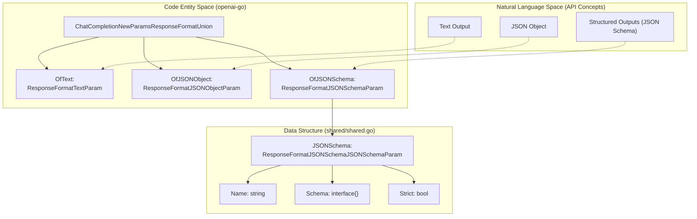
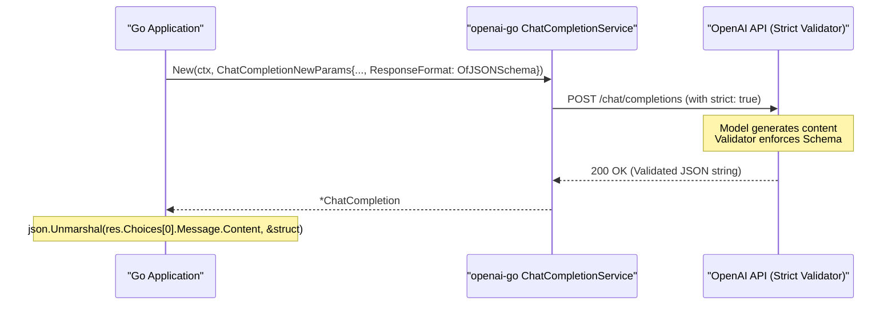

<!-- source: DeepWiki mcp.deepwiki.com · repo openai/openai-go · page 3.4 Structured Outputs and Response Formats · fetched 2026-10-26 -->

# Structured Outputs and Response Formats

<details>
<summary>Relevant source files</summary>

The following files were used as context for generating this wiki page:

- [aliases.go](aliases.go)
- [chatcompletion.go](chatcompletion.go)
- [chatcompletion_test.go](chatcompletion_test.go)
- [examples/go.mod](examples/go.mod)
- [examples/go.sum](examples/go.sum)
- [examples/structured-outputs/main.go](examples/structured-outputs/main.go)
- [responses/aliases.go](responses/aliases.go)
- [shared/shared.go](shared/shared.go)

</details>


This document explains how to control the format of model responses in the Chat Completions API using the `response_format` parameter. Response formats allow you to constrain model outputs to specific structures, ranging from simple text to validated JSON conforming to a JSON Schema.

For information about tool calling and function outputs, see [Tool Calling and Functions](#3.3). While both features deal with structured data, response formats control the primary response structure, while tools define external function interfaces.

---

## Overview of Response Format Types

The Chat Completions API supports three response format types through the `ChatCompletionNewParamsResponseFormatUnion` parameter. Each format serves different use cases for controlling model output structure.

| Format Type | Constant | Use Case | Strict Mode |
|------------|----------|----------|-------------|
| **Text** | `constant.ResponseFormatTypeText` | Default unstructured text responses | N/A |
| **JSON Object** | `constant.ResponseFormatTypeJSONObject` | Legacy JSON generation (requires prompt instruction) | No |
| **JSON Schema** | `constant.ResponseFormatTypeJSONSchema` | Validated structured outputs with schema enforcement | Yes |

**Sources:** [shared/shared.go:911-1118](), [chatcompletion.go:77-79]()

---

## Response Format Type System

The response format system uses a discriminated union pattern with a `type` field to distinguish between variants. In the SDK, this is implemented using the `ChatCompletionNewParamsResponseFormatUnion` type.



**Diagram: Response Format Type Hierarchy and Structure**

**Sources:** [shared/shared.go:889-1118](), [chatcompletion.go:74-76]()

---

## Text Response Format

The `ResponseFormatTextParam` type represents the default, unstructured text output mode. This format places no constraints on the model's response structure.

### Construction

```go
// Using the union variant
responseFormat := openai.ChatCompletionNewParamsResponseFormatUnion{
    OfText: &shared.ResponseFormatTextParam{
        Type: openai.F(shared.ResponseFormatTextParamTypeText),
    },
}
```

The `Type` field is typically set to `shared.ResponseFormatTextParamTypeText` [shared/shared.go:1096-1110]().

**Sources:** [shared/shared.go:1067-1118](), [aliases.go:458-466]()

---

## JSON Object Response Format

`ResponseFormatJSONObjectParam` is an older method for generating JSON responses. Unlike JSON Schema, this format does **not** validate the output structure against a specific template.

### Requirements and Limitations

1. **Prompt Instruction Required**: The model will only generate JSON if explicitly instructed in a system or user message.
2. **No Schema Validation**: The model may generate any valid JSON structure.
3. **Legacy Pattern**: The `json_schema` format is recommended for models that support it.

### Construction

```go
responseFormat := openai.ChatCompletionNewParamsResponseFormatUnion{
    OfJSONObject: &shared.ResponseFormatJSONObjectParam{
        Type: openai.F(shared.ResponseFormatJSONObjectParamTypeJSONObject),
    },
}
```

**Sources:** [shared/shared.go:889-945](), [aliases.go:420-432]()

---

## JSON Schema Response Format (Structured Outputs)

`ResponseFormatJSONSchemaParam` provides the most powerful output control through JSON Schema validation. This is the implementation of the "Structured Outputs" feature.

### Schema Configuration

The `JSONSchema` field (type `ResponseFormatJSONSchemaJSONSchemaParam`) contains properties that define the output structure:

| Property | Type | Required | Description |
|----------|------|----------|-------------|
| `Name` | `string` | Yes | Schema identifier (alphanumeric, underscores, dashes) |
| `Description` | `string` | No | Helps model understand response purpose |
| `Schema` | `interface{}` | Yes | JSON Schema object defining structure |
| `Strict` | `bool` | No | Enables strict schema adherence (default: `false`) |

### Automated Schema Generation

In Go, you can use third-party libraries like `github.com/invopop/jsonschema` to generate the `Schema` field from native Go structs [examples/structured-outputs/main.go:30-40]().

```go
type HistoricalComputer struct {
    Name   string `json:"full_name"`
    Legacy string `json:"legacy" jsonschema:"enum=positive,enum=neutral,enum=negative"`
}

// Generate schema using jsonschema library
reflector := jsonschema.Reflector{AllowAdditionalProperties: false, DoNotReference: true}
schema := reflector.Reflect(HistoricalComputer{})

schemaParam := openai.ResponseFormatJSONSchemaJSONSchemaParam{
    Name:   openai.String("historical_computer"),
    Schema: openai.F(schema),
    Strict: openai.Bool(true),
}
```

**Sources:** [examples/structured-outputs/main.go:18-59](), [shared/shared.go:947-1065]()

---

## Strict Mode and Request Flow

When `Strict` is set to `true`, the model guarantees exact adherence to the provided JSON Schema.



**Diagram: Structured Output Request Flow**

### Strict Mode Behavior

1. **Exact Schema Adherence**: The model will follow the schema exactly as defined [shared/shared.go:993-996]().
2. **Subset Support**: Only a subset of JSON Schema is supported (e.g., `additionalProperties` must be `false`).
3. **Function Tools**: The same `strict` mode is available for function tool definitions via `shared.FunctionDefinitionParam.Strict` [chatcompletion_test.go:103]().

**Sources:** [chatcompletion.go:72-76](), [shared/shared.go:980-1065](), [examples/structured-outputs/main.go:78-82]()

---

## Practical Implementation Example

The following example demonstrates how to use the SDK to request structured data and parse it back into a Go struct.

```go
func main() {
    client := openai.NewClient()
    
    // 1. Define the format
    schemaParam := openai.ResponseFormatJSONSchemaJSONSchemaParam{
        Name:   openai.String("weather_report"),
        Strict: openai.Bool(true),
        Schema: openai.F(map[string]any{
            "type": "object",
            "properties": map[string]any{
                "temp": map[string]any{"type": "number"},
                "unit": map[string]any{"type": "string", "enum": []string{"c", "f"}},
            },
            "required": []string{"temp", "unit"},
            "additionalProperties": false,
        }),
    }

    // 2. Execute request
    chat, _ := client.Chat.Completions.New(context.TODO(), openai.ChatCompletionNewParams{
        Messages: []openai.ChatCompletionMessageParamUnion{
            openai.UserMessage("What is the weather in SF?"),
        },
        ResponseFormat: openai.ChatCompletionNewParamsResponseFormatUnion{
            OfJSONSchema: &openai.ResponseFormatJSONSchemaParam{JSONSchema: schemaParam},
        },
        Model: openai.ChatModelGPT4o,
    })

    // 3. Parse the structured content
    var result struct { Temp float64; Unit string }
    json.Unmarshal([]byte(chat.Choices[0].Message.Content), &result)
}
```

**Sources:** [examples/structured-outputs/main.go:45-93](), [chatcompletion_test.go:29-122]()

---

## Response Format in Streaming Mode

Response formats work identically in streaming mode. The `ResponseFormat` parameter applies to the accumulated content across all `ChatCompletionChunk` events. The partial JSON will be delivered in the `Choices[0].Delta.Content` field [chatcompletion.go:88-109]().

**Sources:** [chatcompletion.go:99-109](), [chatcompletion_test.go:87-90]()

---

## Relationship to Function Tools

| Feature | Response Format | Function Tools |
|---------|----------------|----------------|
| **Location** | `Choices[0].Message.Content` | `Choices[0].Message.ToolCalls` |
| **Strict Mode** | `ResponseFormatJSONSchemaJSONSchemaParam.Strict` | `FunctionDefinitionParam.Strict` |
| **Use Case** | Final output for the user/app | Arguments for a specific function call |

**Sources:** [shared/shared.go:673-678](), [shared/shared.go:947-1065]()

---

