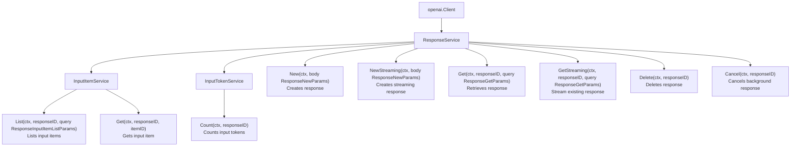
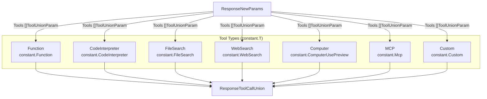
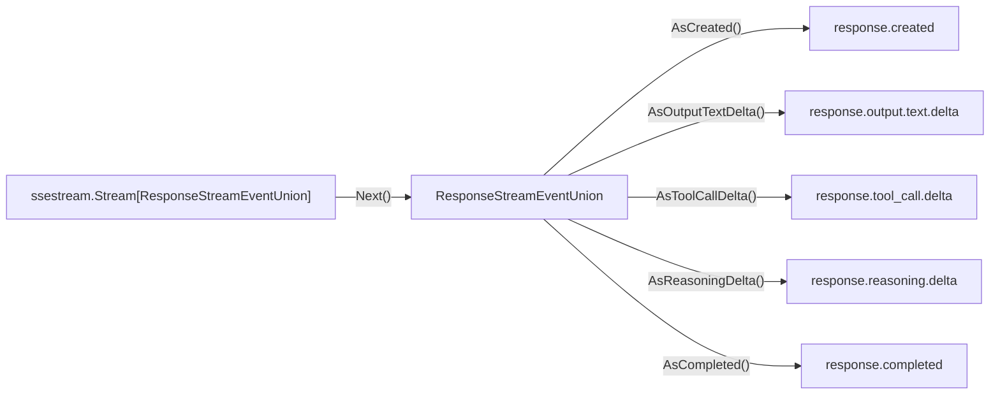

<!-- source: DeepWiki mcp.deepwiki.com · repo openai/openai-go · page 4 Responses API · fetched 2026-10-26 -->

# Responses API

Relevant source files

The following files were used as context for generating this wiki page:

- [.release-please-manifest.json](.release-please-manifest.json)
- [.stats.yml](.stats.yml)
- [CHANGELOG.md](CHANGELOG.md)
- [README.md](README.md)
- [internal/version.go](internal/version.go)
- [packages/ssestream/ssestream.go](packages/ssestream/ssestream.go)
- [responses/response.go](responses/response.go)

The Responses API is OpenAI's modern interface for generating model responses with text, images, or structured outputs. It supports inline tool execution (functions, web search, file search, computer use, MCP tools, and more), managed prompts with variables, and both streaming and background execution patterns. This API serves as the successor to the deprecated Beta Assistants API ([Beta Assistants API (Deprecated)](#15)), offering a stateless or linked design that simplifies conversation management.

For simple chat interactions without managed tools, see the [Chat Completions API](#3). For persistent stateful conversations, see the [Conversations API](#11).

## Service Architecture

The Responses API is accessed via `ResponseService` in the client hierarchy. It includes specialized sub-services for managing input items and token counting.

**Sources:** [responses/response.go:27-48](), [responses/response.go:61-145]()

## Core Response Lifecycle

Responses can be created synchronously, asynchronously with streaming, or as background jobs. Each response is assigned a unique ID and follows a lifecycle from creation to completion or cancellation.

| Method | Return Type | Use Case |
|--------|-------------|----------|
| `New` | `*Response` | Synchronous execution; returns when complete or queued (if background). |
| `NewStreaming` | `*ssestream.Stream[ResponseStreamEventUnion]` | Real-time updates for text, reasoning, and tool calls. |
| `Get` | `*Response` | Polling the status of a background or existing response. |
| `GetStreaming` | `*ssestream.Stream[ResponseStreamEventUnion]` | Resuming the stream of an existing response. |
| `Cancel` | `*Response` | Aborting a response that has `background: true` and is in progress. |

For details on managing the lifecycle and background execution, see [Creating and Managing Responses](#4.1).

**Sources:** [responses/response.go:61-145]()

## Response Tool System

The Responses API supports seven distinct tool types. Unlike the Chat Completions API, the Responses API can execute these tools inline, managing the transition between model reasoning and tool output automatically or via previous response chaining.

For details on configuring tools and handling results, see [Response Tool System](#4.2).

**Sources:** [responses/response.go:148-944](), [responses/response.go:3402-3433]()

## Response Streaming Events

The streaming interface utilizes the `ssestream.Stream` type to deliver granular updates. The API defines 24 specific event types within the `ResponseStreamEventUnion` to communicate content deltas, tool call lifecycle, and reasoning progress.

For a full list of event types and delta processing, see [Response Streaming Events](#4.3).

**Sources:** [responses/response.go:4823-6078](), [packages/ssestream/ssestream.go:171-228]()

## Key Features

### Stateless & Linked Design
The Responses API does not require a persistent "Thread" object. Instead, developers can chain responses using the `PreviousResponseID` field in `ResponseNewParams` to provide context from earlier turns.
**Sources:** [responses/response.go:3396-3398]()

### Managed Prompts
Instructions can be provided as plain text or via `PromptReference`, which allows the use of versioned prompts stored on the OpenAI platform with variable substitution.
**Sources:** [responses/response.go:2798-2846]()

### Input Items and Tokens
The API provides deep visibility into the input context through the `InputItems` and `InputTokens` sub-services, allowing for item-level inspection and precise token counting of the context window.
**Sources:** [responses/inputitem.go:38-87](), [responses/inputtoken.go:38-64]()

### Response Formatting
Supports structured outputs via `ResponseFormatTextJSONSchemaConfigParam`, ensuring the model's output conforms to a specific JSON schema with `Strict` mode.
**Sources:** [responses/response.go:2489-2556](), [shared/shared.go:1417-1479]()

---

