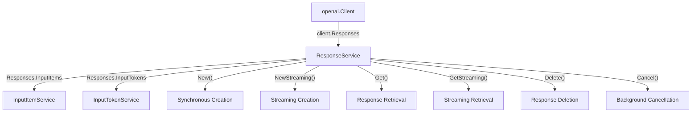
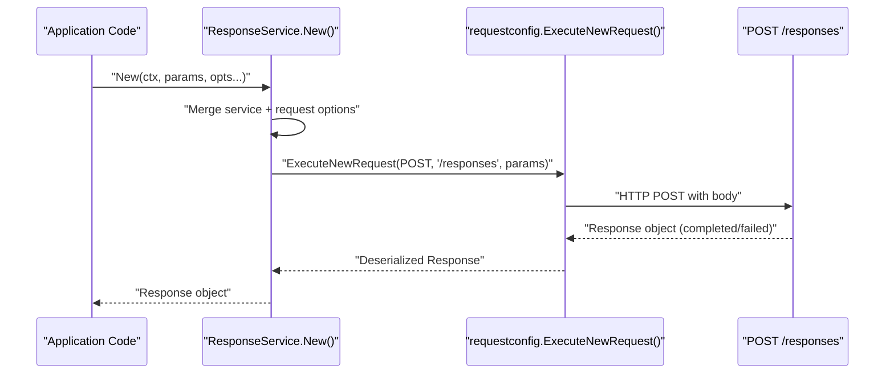
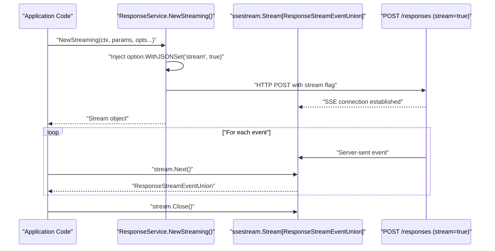
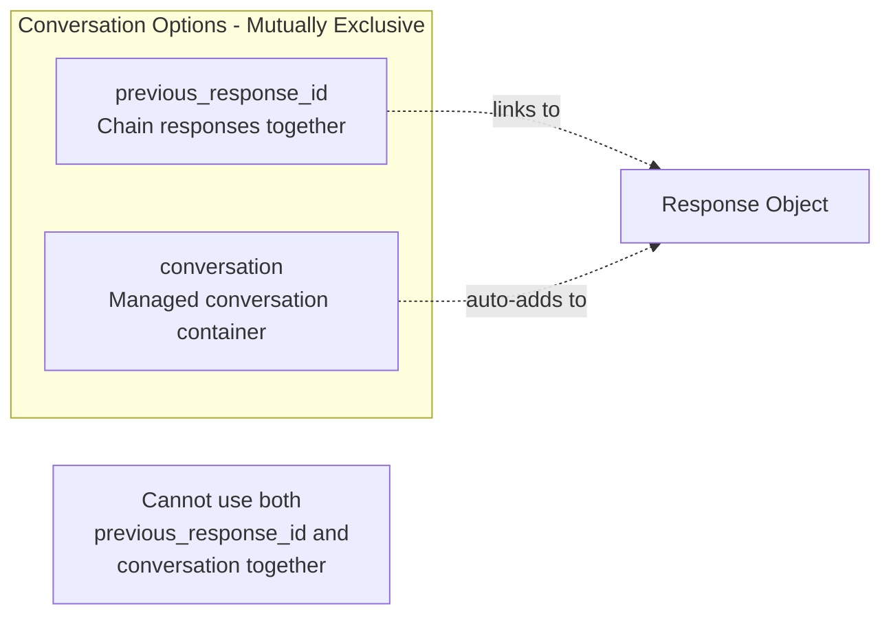
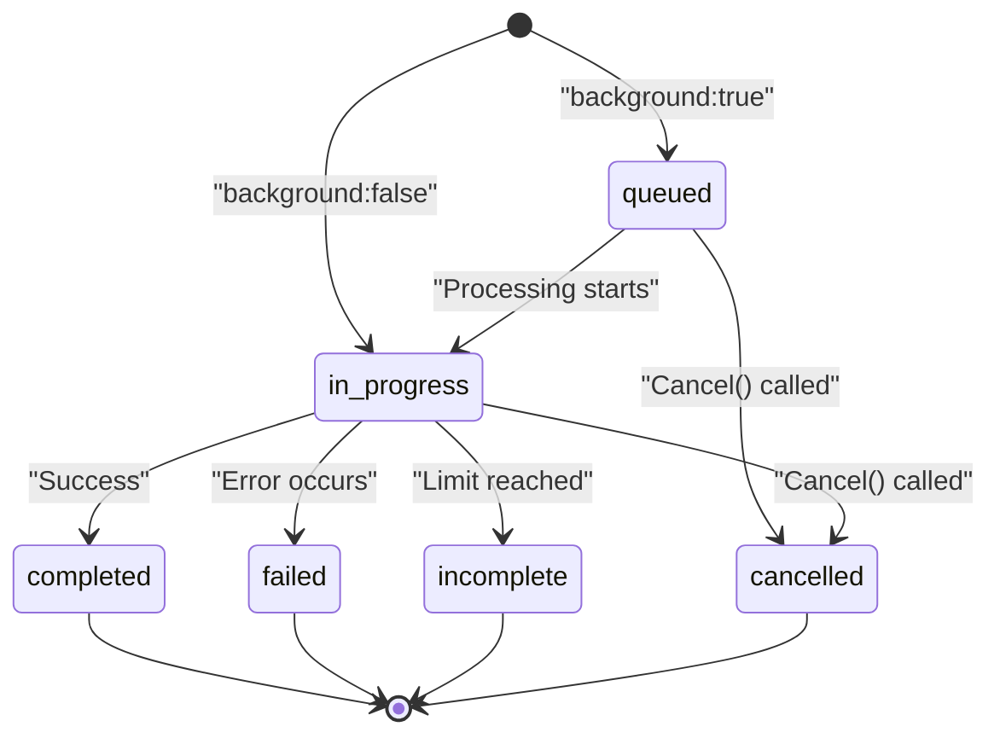

<!-- source: DeepWiki mcp.deepwiki.com · repo openai/openai-go · page 4.1 Creating and Managing Responses · fetched 2026-10-26 -->

# Creating and Managing Responses

<details>
<summary>Relevant source files</summary>

The following files were used as context for generating this wiki page:

- [.stats.yml](.stats.yml)
- [conversations/conversation_test.go](conversations/conversation_test.go)
- [conversations/item_test.go](conversations/item_test.go)
- [responses/inputitem_test.go](responses/inputitem_test.go)
- [responses/response.go](responses/response.go)
- [responses/response_test.go](responses/response_test.go)

</details>


This document covers the lifecycle management of Response objects in the Responses API, including creation, retrieval, deletion, and cancellation. The `ResponseService` provides stateless or conversation-linked response generation as a modern replacement for the deprecated Beta Assistants API.

For information about the tool system available within responses, see [Response Tool System](#4.2). For streaming event types, see [Response Streaming Events](#4.3). For the overall Responses API introduction, see [Responses API](#4).

## ResponseService Overview

The `ResponseService` provides methods for creating and managing model responses. Unlike the deprecated Assistants API which maintains stateful threads, responses are designed to be stateless (optionally linked via `previous_response_id` or `conversation`).

### ResponseService Architecture


**Sources:** [responses/response.go:27-48]()

The service is instantiated as part of the main client and should not be created directly. It includes two sub-services for managing input items and input tokens. [responses/response.go:33-47]()

## Creating Responses

### Synchronous Creation

The `Response.New()` method creates a model response and waits for completion. This is suitable for non-background requests where you need the complete result immediately.

### Response.New Execution Flow


**Sources:** [responses/response.go:61-66]()

The method signature is:
```go
func (r *ResponseService) New(ctx context.Context, body ResponseNewParams, opts ...option.RequestOption) (res *Response, err error)
```

Key characteristics:
- Blocks until the response is complete or fails. [responses/response.go:61-65]()
- Returns a `Response` object with a `status` field indicating the completion state. [responses/response.go:1079-1083]()
- Accepts `ResponseNewParams` containing all configuration. [responses/response.go:946-1114]()

### Streaming Creation

The `Response.NewStreaming()` method creates a response with progressive event delivery via Server-Sent Events (SSE).

### Response.NewStreaming SSE Flow


**Sources:** [responses/response.go:79-89]()

The method signature is:
```go
func (r *ResponseService) NewStreaming(ctx context.Context, body ResponseNewParams, opts ...option.RequestOption) (stream *ssestream.Stream[ResponseStreamEventUnion])
```

Key characteristics:
- Automatically sets `stream: true` in the request body via `option.WithJSONSet`. [responses/response.go:85]()
- Returns `ssestream.Stream[ResponseStreamEventUnion]` for event iteration. [responses/response.go:88]()
- Provides event types covering lifecycle, content deltas, and tool calls. [responses/response.go:79]()

## Response Creation Parameters

The `ResponseNewParams` type configures response generation. It contains numerous fields for controlling model behavior, tools, conversation state, and output format.

### Core Parameters

| Parameter | Type | Required | Description |
|-----------|------|----------|-------------|
| `Model` | `shared.ResponsesModel` | No | Model ID (e.g., `gpt-4o`, `o3`). [responses/response_test.go:49]() |
| `Instructions` | `ResponseInstructionsUnion` | No | System/developer instructions. [responses/response_test.go:43]() |
| `Temperature` | `param.Opt[float64]` | No | Sampling temperature (0-2). [responses/response_test.go:74]() |
| `MaxOutputTokens` | `param.Opt[int64]` | No | Maximum tokens including reasoning tokens. [responses/response_test.go:44]() |
| `Tools` | `[]ToolUnionParam` | No | Available tools (function, file search, etc.). [responses/response_test.go:84]() |
| `ToolChoice` | `ResponseNewParamsToolChoiceUnion` | No | Tool selection strategy. [responses/response_test.go:81]() |

**Sources:** [responses/response.go:946-1114](), [responses/response_test.go:18-107]()

### Conversation State Parameters

### Chaining Logic


**Sources:** [responses/response.go:1036-1040]()

| Parameter | Type | Description |
|-----------|------|-------------|
| `PreviousResponseID` | `param.Opt[string]` | Link to previous response for multi-turn conversations. [responses/response_test.go:51]() |
| `Conversation` | `ResponseNewParamsConversationUnion` | Conversation container for automatic item management. [responses/response_test.go:36]() |

### Storage and Execution Parameters

| Parameter | Type | Description |
|-----------|------|-------------|
| `Background` | `param.Opt[bool]` | Run response in background mode. [responses/response_test.go:31]() |
| `Store` | `param.Opt[bool]` | Persist response for later retrieval. [responses/response_test.go:70]() |
| `Truncation` | `param.Opt[ResponseNewParamsTruncation]` | Context window truncation strategy. [responses/response_test.go:97]() |

**Background mode** (`background: true`):
- Response is processed asynchronously.
- `New()` returns immediately with `status: "queued"`. [responses/response.go:1083]()
- Can be cancelled with `Cancel()`. [responses/response.go:136]()

**Sources:** [responses/response.go:1021-1035](), [responses/response_test.go:31]()

## Retrieving Responses

### Synchronous Retrieval

The `Response.Get()` method retrieves a completed or in-progress response by ID. [responses/response.go:92-101]()

Method signature:
```go
func (r *ResponseService) Get(ctx context.Context, responseID string, query ResponseGetParams, opts ...option.RequestOption) (res *Response, err error)
```

The `responseID` parameter is required. The method returns an error if the ID is missing. [responses/response.go:94-97]()

### Streaming Retrieval

The `Response.GetStreaming()` method retrieves a response with streaming events. [responses/response.go:104-118]()

Method signature:
```go
func (r *ResponseService) GetStreaming(ctx context.Context, responseID string, query ResponseGetParams, opts ...option.RequestOption) (stream *ssestream.Stream[ResponseStreamEventUnion])
```

This is useful for monitoring background responses as they process. [responses/response.go:104]()

## Response Structure

The `Response` type represents a model response with comprehensive metadata.

### Response Data Model
```mermaid
graph TB
    Response["Response"]
    
    subgraph "Identity & Lifecycle"
        ID["id: string<br/>Unique identifier"]
        CreatedAt["created_at: float64<br/>Unix timestamp"]
        Status["status: ResponseStatus<br/>completed/failed/in_progress/<br/>cancelled/queued/incomplete"]
        Object["object: constant.Response<br/>Always 'response'"]
    end
    
    subgraph "Configuration"
        Model["model: ResponsesModel<br/>Model used"]
        Instructions["instructions: ResponseInstructionsUnion<br/>System/developer messages"]
        Tools["tools: []ToolUnion<br/>Available tools"]
    end
    
    subgraph "Output"
        Output["output: []ResponseOutputItemUnion<br/>Generated content items"]
        Usage["usage: ResponseUsage<br/>Token counts"]
    end
    
    Response --> Identity & Lifecycle
    Response --> Configuration
    Response --> Output
```

**Sources:** [responses/response.go:946-1149]()

### Response Status Values

The `status` field tracks response lifecycle: `completed`, `failed`, `in_progress`, `cancelled`, `queued`, `incomplete`. [responses/response.go:1083]()

### Output Helper

The SDK provides a convenience method `Response.OutputText()` that concatenates all text content parts:
```go
response, _ := client.Responses.New(ctx, params)
text := response.OutputText()
```
**Sources:** [responses/response.go:1151-1161]()

## Deleting Responses

The `Response.Delete()` method permanently removes a response. [responses/response.go:121-131]()

Method signature:
```go
func (r *ResponseService) Delete(ctx context.Context, responseID string, opts ...option.RequestOption) (err error)
```

It sets the `Accept` header to `*/*` as it expects no response body. [responses/response.go:123]()

## Cancelling Background Responses

The `Response.Cancel()` method stops a background response. [responses/response.go:136-145]()

Method signature:
```go
func (r *ResponseService) Cancel(ctx context.Context, responseID string, opts ...option.RequestOption) (res *Response, err error)
```

Only responses created with `background: true` can be cancelled. [responses/response.go:133-135]()

## Response Lifecycle State Machine



**Sources:** [responses/response.go:1083](), [responses/response.go:136-145](), [responses/response.go:1170-1187]()

## Usage Tracking

The `Response.Usage` field provides detailed token consumption metrics including `InputTokens`, `OutputTokens`, and details for reasoning and audio tokens. [responses/response.go:1105]()

**Sources:** [responses/response.go:1105]()

---

