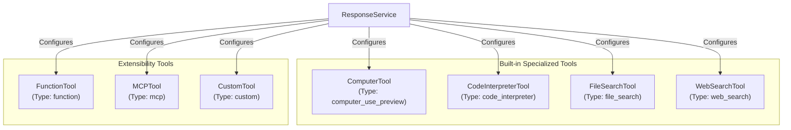
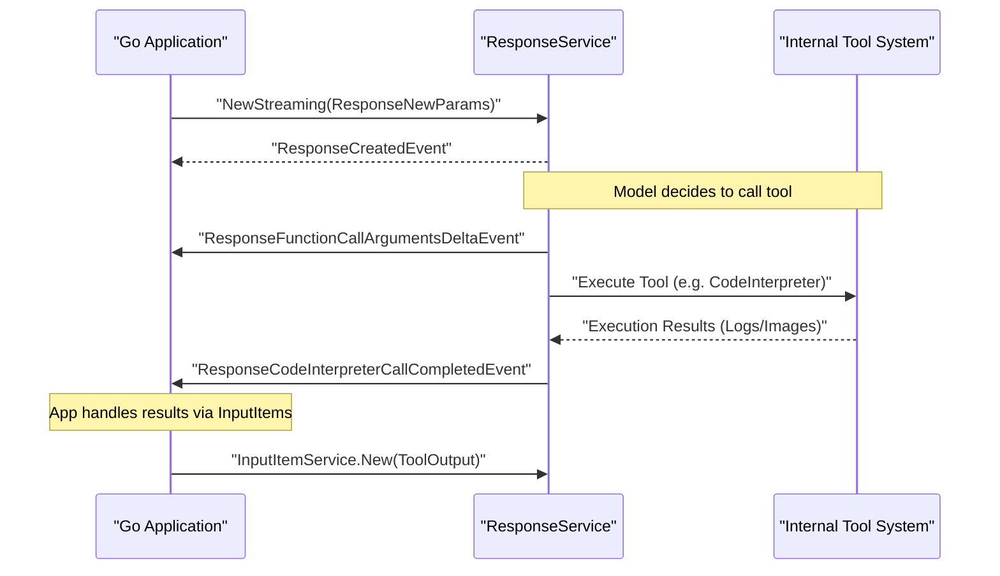

<!-- source: DeepWiki mcp.deepwiki.com · repo openai/openai-go · page 4.2 Response Tool System · fetched 2026-10-26 -->

# Response Tool System

Relevant source files

The following files were used as context for generating this wiki page:

- [.stats.yml](.stats.yml)
- [aliases.go](aliases.go)
- [responses/aliases.go](responses/aliases.go)
- [responses/response.go](responses/response.go)
- [shared/shared.go](shared/shared.go)

This document details the advanced tool integration system within the `ResponseService`. The Response API supports seven distinct tool types, sophisticated tool choice logic, and a real-time event-driven architecture for handling tool execution results.

## Tool Types Overview

The Response API categorizes tools into built-in specialized tools (Computer, Code Interpreter, File Search, Web Search), standard programmatic tools (Function), and integration-focused tools (MCP, Custom).

### Supported Tool Categories

**Sources:** [responses/response.go:50-60](), [responses/response.go:161-163](), [responses/response.go:1375-1377](), [responses/response.go:4151-4153]()

## Implementation of Tool Types

### 1. Computer Tool
The `ComputerTool` allows models to interact with virtual environments. It is defined by its display dimensions and environment type.

*   **Key Fields:** `DisplayHeight`, `DisplayWidth`, and `Environment` (e.g., `ubuntu`, `browser`).
*   **Actions:** Handled via `ResponseComputerToolCallActionUnion`, including `click`, `keypress`, `screenshot`, and `scroll`.

**Sources:** [responses/response.go:144-193](), [responses/response.go:1757-1765]()

### 2. Code Interpreter
The `CodeInterpreterTool` enables Python execution within a sandboxed environment.

*   **Data Flow:** The model generates code deltas (`ResponseCodeInterpreterCallCodeDeltaEvent`) which are executed, producing logs or image outputs (`ResponseCodeInterpreterToolCallOutputImage`).

**Sources:** [responses/response.go:1230-1317](), [responses/response.go:1492-1532]()

### 3. File Search
The `FileSearchTool` utilizes vector stores for semantic retrieval.

*   **Configuration:** Includes `VectorStoreIDs` and `RankingOptions` (e.g., `ScoreThreshold`).
*   **Filtering:** Uses `FileSearchToolFiltersUnion` which supports `ComparisonFilter` and `CompoundFilter`.

**Sources:** [responses/response.go:440-659](), [responses/response.go:3447-3460]()

### 4. Web Search
The `WebSearchTool` allows the model to browse the internet.

*   **Actions:** `ResponseFunctionWebSearchActionSearch` (querying), `OpenPage` (visiting URLs), and `Find` (searching text on pages).

**Sources:** [responses/response.go:4151-4200]()

### 5. Function Tool
The standard `FunctionTool` uses JSON Schema for structured data exchange.

*   **Parameters:** Defined as a `map[string]any`.
*   **Strict Mode:** When `Strict` is true, the API enforces schema adherence.

**Sources:** [responses/response.go:661-731]()

### 6. MCP (Model Context Protocol)
The `MCPTool` enables integration with MCP servers.

*   **Fields:** Requires `Name` and `ServerLabel` to route requests to the correct protocol handler.

**Sources:** [responses/response.go:1013-1079]()

### 7. Custom Tool
`CustomTool` supports proprietary or grammar-based formats.

*   **Format:** Defined via `CustomToolInputFormatUnion`.
*   **Streaming:** Emits `ResponseCustomToolCallInputDeltaEvent` as the model generates the custom-formatted input.

**Sources:** [responses/response.go:224-284](), [responses/response.go:3137-3150]()

## Tool Choice Configuration

The `ResponseToolChoiceUnion` determines how the model selects tools during a turn.

| Choice Type | Description |
| :--- | :--- |
| `ToolChoiceOptions` | String constants: `auto`, `none`, or `required`. |
| `ToolChoiceAllowed` | Specifies a set of allowed tools and a mode. |
| `ToolChoiceFunction` | Forces the call of a specific function by name. |
| `ToolChoiceMcp` | Forces the call of a specific MCP tool. |

**Sources:** [responses/response.go:1013-1079]()

## Tool Call Result Handling

Tool execution follows an asynchronous or streaming pattern where the model requests an action, and the system provides results back to the conversation.

### Execution Data Flow

**Sources:** [responses/response.go:79-89](), [responses/response.go:35-37](), [responses/response.go:1230-1250]()

### Safety and Acknowledgment
For sensitive tools like `ComputerTool`, the system implements `PendingSafetyChecks`. The application must acknowledge these checks via `AcknowledgedSafetyChecks` in the tool output to proceed with execution.

**Sources:** [responses/response.go:2158-2180](), [responses/response.go:2719-2743]()

---

