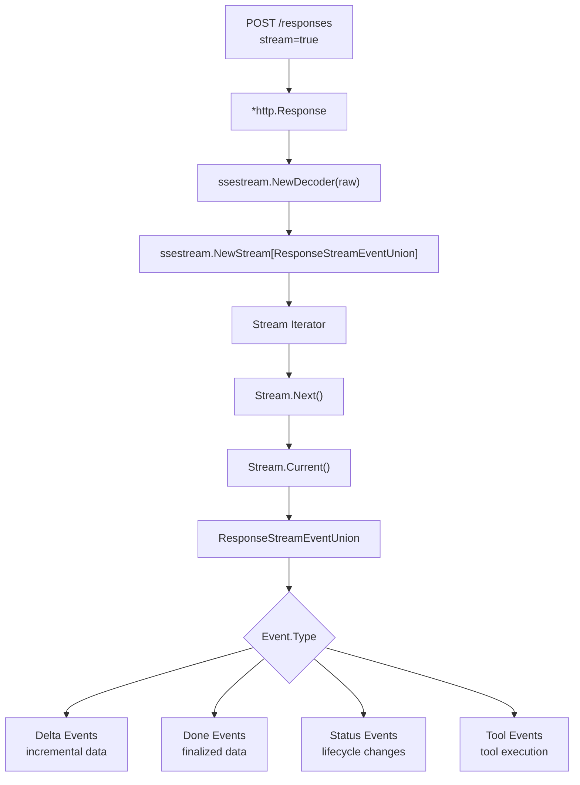
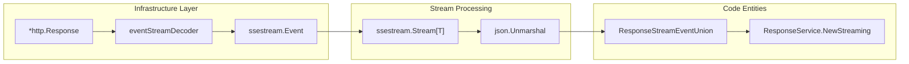

<!-- source: DeepWiki mcp.deepwiki.com · repo openai/openai-go · page 4.3 Response Streaming Events · fetched 2026-10-26 -->

# Response Streaming Events

<details>
<summary>Relevant source files</summary>

The following files were used as context for generating this wiki page:

- [.release-please-manifest.json](.release-please-manifest.json)
- [.stats.yml](.stats.yml)
- [CHANGELOG.md](CHANGELOG.md)
- [README.md](README.md)
- [conversations/conversation_test.go](conversations/conversation_test.go)
- [conversations/item_test.go](conversations/item_test.go)
- [internal/version.go](internal/version.go)
- [packages/ssestream/ssestream.go](packages/ssestream/ssestream.go)
- [responses/inputitem_test.go](responses/inputitem_test.go)
- [responses/response.go](responses/response.go)
- [responses/response_test.go](responses/response_test.go)

</details>


## Purpose and Scope

The Response API supports Server-Sent Events (SSE) streaming through the `NewStreaming` and `GetStreaming` methods. Streaming returns a `ssestream.Stream[ResponseStreamEventUnion]` that delivers incremental updates as the model generates output, executes tools, and produces content.

This page documents the streaming methods, the `ResponseStreamEventUnion` discriminated union type, and event processing patterns for the 24 distinct event types.

## Streaming Methods

### NewStreaming

The `NewStreaming` method creates a streaming response and automatically sets `stream: true` in the request options:

```go
func (r *ResponseService) NewStreaming(ctx context.Context, body ResponseNewParams, opts ...option.RequestOption) (stream *ssestream.Stream[ResponseStreamEventUnion])
```

**Sources:** [responses/response.go:79-89]()

### GetStreaming

The `GetStreaming` method retrieves an existing response by ID with streaming enabled:

```go
func (r *ResponseService) GetStreaming(ctx context.Context, responseID string, query ResponseGetParams, opts ...option.RequestOption) (stream *ssestream.Stream[ResponseStreamEventUnion])
```

**Sources:** [responses/response.go:104-118]()

### Implementation Details

Both methods:
1. Append `option.WithJSONSet("stream", true)` to the options.
2. Execute the HTTP request via `requestconfig.ExecuteNewRequest`.
3. Wrap the raw `*http.Response` in a `ssestream.NewDecoder`.
4. Return a `ssestream.Stream[ResponseStreamEventUnion]`.

The `ssestream.Stream` type implements the iterator pattern with `Next()`, `Current()`, and `Err()` methods for event processing.

**Sources:** [responses/response.go:79-89](), [responses/response.go:104-118](), [packages/ssestream/ssestream.go:145-150]()

## ResponseStreamEventUnion

The `ResponseStreamEventUnion` is a discriminated union type that encompasses all possible streaming event types. Each event has a `type` field discriminator and a `sequence_number` field for ordering.

### Event Processing Flow



**Sources:** [responses/response.go:79-89](), [packages/ssestream/ssestream.go:171-228]()

## Event Categories

### Lifecycle Events

| Event Type | Constant | Purpose |
|------------|----------|---------|
| `ResponseCreatedEvent` | `constant.ResponseCreated` | Response generation initiated |
| `ResponseInProgressEvent` | `constant.ResponseInProgress` | Response is actively generating |
| `ResponseCompletedEvent` | `constant.ResponseCompleted` | Response generation finished successfully |
| `ResponseFailedEvent` | `constant.ResponseFailed` | Response generation failed |
| `ResponseCancelledEvent` | `constant.ResponseCancelled` | Response was cancelled |
| `ResponseErrorEvent` | `constant.ResponseError` | Error occurred during generation |

**Sources:** [responses/response.go:3044-3066](), [responses/response.go:4696-4718](), [responses/response.go:1884-1906](), [responses/response.go:3343-3365](), [responses/response.go:3313-3341]()

### Audio Events

| Event Type | Constant | Purpose |
|------------|----------|---------|
| `ResponseAudioDeltaEvent` | `constant.ResponseAudioDelta` | Partial audio chunk (Base64 encoded) |
| `ResponseAudioDoneEvent` | `constant.ResponseAudioDone` | Audio generation complete |
| `ResponseAudioTranscriptDeltaEvent` | `constant.ResponseAudioTranscriptDelta` | Partial audio transcript |
| `ResponseAudioTranscriptDoneEvent` | `constant.ResponseAudioTranscriptDone` | Audio transcript complete |

**Sources:** [responses/response.go:1351-1367](), [responses/response.go:1375-1393](), [responses/response.go:1396-1418](), [responses/response.go:1420-1438]()

### Content Part Events

| Event Type | Constant | Purpose |
|------------|----------|---------|
| `ResponseContentPartAddedEvent` | `constant.ResponseContentPartAdded` | New content part added to output |
| `ResponseContentPartDoneEvent` | `constant.ResponseContentPartDone` | Content part finalized |

**Sources:** [responses/response.go:2815-2847](), [responses/response.go:2921-2953]()

### Tool Call Events

#### Function Call Events

| Event Type | Constant | Purpose |
|------------|----------|---------|
| `ResponseFunctionCallArgumentsDeltaEvent` | `constant.ResponseFunctionCallArgumentsDelta` | Incremental function arguments (JSON string) |
| `ResponseFunctionCallArgumentsDoneEvent` | `constant.ResponseFunctionCallArgumentsDone` | Function arguments finalized |

**Sources:** [responses/response.go:3933-3961](), [responses/response.go:3907-3932]()

#### Code Interpreter Events

| Event Type | Constant | Purpose |
|------------|----------|---------|
| `ResponseCodeInterpreterCallInProgressEvent` | `constant.ResponseCodeInterpreterCallInProgress` | Code execution started |
| `ResponseCodeInterpreterCallInterpretingEvent` | `constant.ResponseCodeInterpreterCallInterpreting` | Actively interpreting code |
| `ResponseCodeInterpreterCallCodeDeltaEvent` | `constant.ResponseCodeInterpreterCallCodeDelta` | Partial code snippet |
| `ResponseCodeInterpreterCallCodeDoneEvent` | `constant.ResponseCodeInterpreterCallCodeDone` | Code snippet finalized |
| `ResponseCodeInterpreterCallCompletedEvent` | `constant.ResponseCodeInterpreterCallCompleted` | Execution completed |

**Sources:** [responses/response.go:1530-1556](), [responses/response.go:1558-1584](), [responses/response.go:1441-1470](), [responses/response.go:1472-1500](), [responses/response.go:1502-1528]()

#### File Search Events

| Event Type | Constant | Purpose |
|------------|----------|---------|
| `ResponseFileSearchCallInProgressEvent` | `constant.ResponseFileSearchCallInProgress` | File search initiated |
| `ResponseFileSearchCallSearchingEvent` | `constant.ResponseFileSearchCallSearching` | Actively searching files |
| `ResponseFileSearchCallCompletedEvent` | `constant.ResponseFileSearchCallCompleted` | Search completed |

**Sources:** [responses/response.go:3394-3420](), [responses/response.go:3421-3447](), [responses/response.go:3367-3393]()

#### Custom Tool Events

| Event Type | Constant | Purpose |
|------------|----------|---------|
| `ResponseCustomToolCallInputDeltaEvent` | `constant.ResponseCustomToolCallInputDelta` | Partial custom tool input |
| `ResponseCustomToolCallInputDoneEvent` | `constant.ResponseCustomToolCallInputDone` | Custom tool input finalized |

**Sources:** [responses/response.go:3137-3165](), [responses/response.go:3110-3136]()

### Text Content Events

| Event Type | Constant | Purpose |
|------------|----------|---------|
| `ResponseOutputTextDeltaEvent` | `constant.ResponseOutputTextDelta` | Incremental text output |
| `ResponseOutputTextDoneEvent` | `constant.ResponseOutputTextDone` | Text output finalized |
| `ResponseOutputTextAnnotationsDeltaEvent` | `constant.ResponseOutputTextAnnotationsDelta` | Incremental text annotations |
| `ResponseOutputTextAnnotationsDoneEvent` | `constant.ResponseOutputTextAnnotationsDone` | Annotations finalized |

**Sources:** [responses/response.go:4329-4361](), [responses/response.go:4363-4395](), [responses/response.go:4226-4254](), [responses/response.go:4256-4284]()

### Reasoning Events

| Event Type | Constant | Purpose |
|------------|----------|---------|
| `ResponseReasoningSummaryDeltaEvent` | `constant.ResponseReasoningSummaryDelta` | Partial reasoning summary |
| `ResponseReasoningSummaryDoneEvent` | `constant.ResponseReasoningSummaryDone` | Reasoning summary complete |

**Sources:** [responses/response.go:4641-4669](), [responses/response.go:4671-4694]()

## Processing Stream Events

### Basic Iteration Pattern

The `ssestream.Stream` type follows the iterator pattern:

```go
stream := client.Responses.NewStreaming(ctx, responses.ResponseNewParams{
    Model: openai.ChatModelGPT4o,
    Input: responses.ResponseNewParamsInputUnion{
        OfString: openai.String("Explain quantum computing"),
    },
})

for stream.Next() {
    event := stream.Current()
    // Process event
}

if err := stream.Err(); err != nil {
    // Handle stream error
}
```

**Sources:** [responses/response.go:79-89](), [packages/ssestream/ssestream.go:171-228]()

### Event Type Discrimination

Each event in `ResponseStreamEventUnion` has a `Type` field that identifies its variant using constants from `shared/constant`:

```go
for stream.Next() {
    event := stream.Current()
    
    switch event.Type {
    case constant.ResponseCreated:
        // Handle ResponseCreatedEvent
    case constant.ResponseCompleted:
        // Handle ResponseCompletedEvent with final Response object
    case constant.ResponseOutputTextDelta:
        // Handle incremental text via event.Delta
    }
}
```

**Sources:** [responses/response.go:1884-1906](), [responses/response.go:3044-3066]()

## Internal Data Flow

The following diagram maps the relationship between the SSE decoder and the high-level Response stream.



**Sources:** [packages/ssestream/ssestream.go:25-40](), [packages/ssestream/ssestream.go:171-228](), [responses/response.go:79-89]()

### Delta/Done Accumulation Pattern

Many event types follow a delta/done pattern where incremental updates are followed by a final event:

| Delta Event | Done Event | Data Type |
|-------------|------------|-----------|
| `ResponseOutputTextDeltaEvent` | `ResponseOutputTextDoneEvent` | Text content |
| `ResponseAudioDeltaEvent` | `ResponseAudioDoneEvent` | Audio data |
| `ResponseFunctionCallArgumentsDeltaEvent` | `ResponseFunctionCallArgumentsDoneEvent` | Function arguments |
| `ResponseCodeInterpreterCallCodeDeltaEvent` | `ResponseCodeInterpreterCallCodeDoneEvent` | Code snippets |

The delta events contain partial data in a `delta` field, while done events signify the end of that specific segment.

**Sources:** [responses/response.go:4329-4361](), [responses/response.go:4363-4395](), [responses/response.go:1351-1367](), [responses/response.go:1375-1393]()

### Error Handling

The SDK distinguishes between transport-level errors and API-level errors within the stream:

1.  **Transport Errors:** Returned by `stream.Err()` after `stream.Next()` returns `false`.
2.  **API Errors:** Delivered as `ResponseErrorEvent` (type `constant.ResponseError`) within the stream iteration.

**Sources:** [packages/ssestream/ssestream.go:187-194](), [responses/response.go:3313-3341]()

### Sequence Numbers

All 24 event types include a `sequence_number` field (type `int64`) for ordering. This allows the client to detect missing events or reconstruct the generation timeline.

**Sources:** [responses/response.go:1351-1367](), [responses/response.go:4329-4361]()

---

