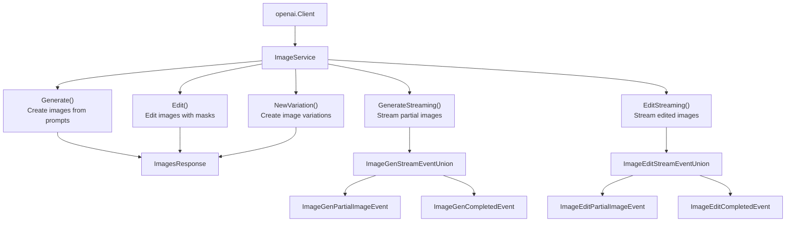
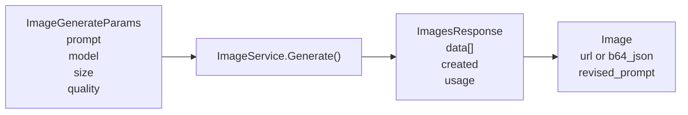
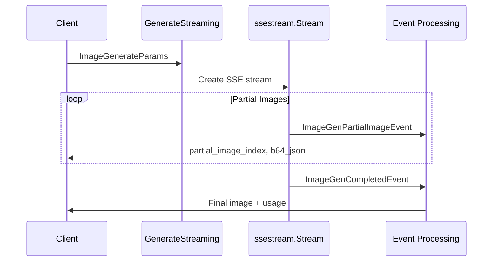
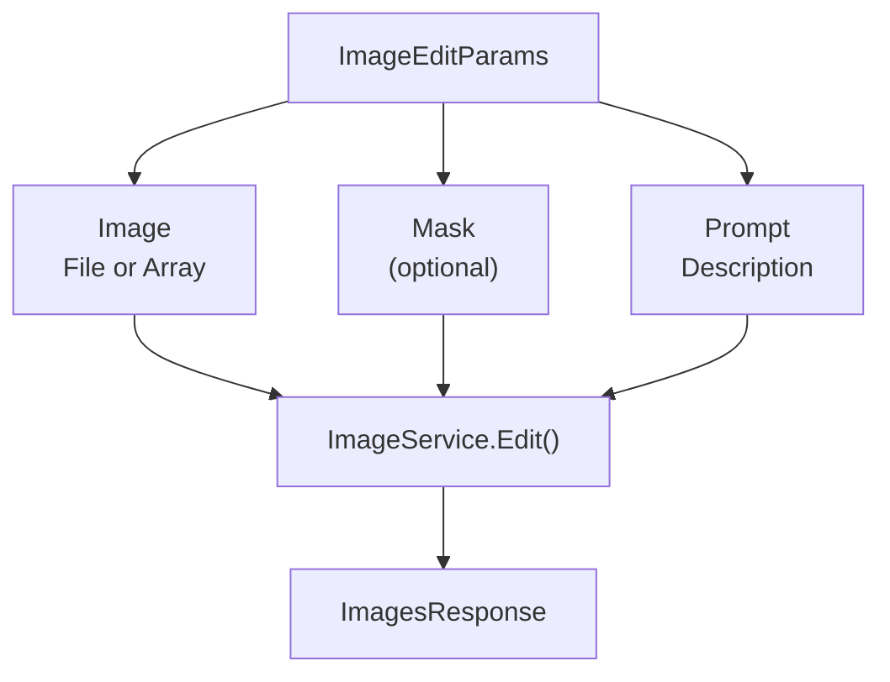
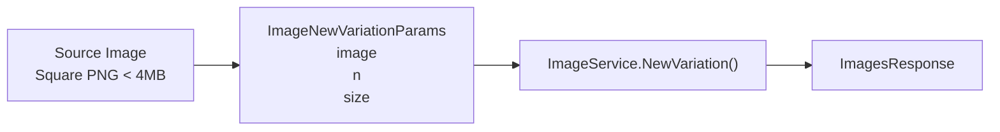
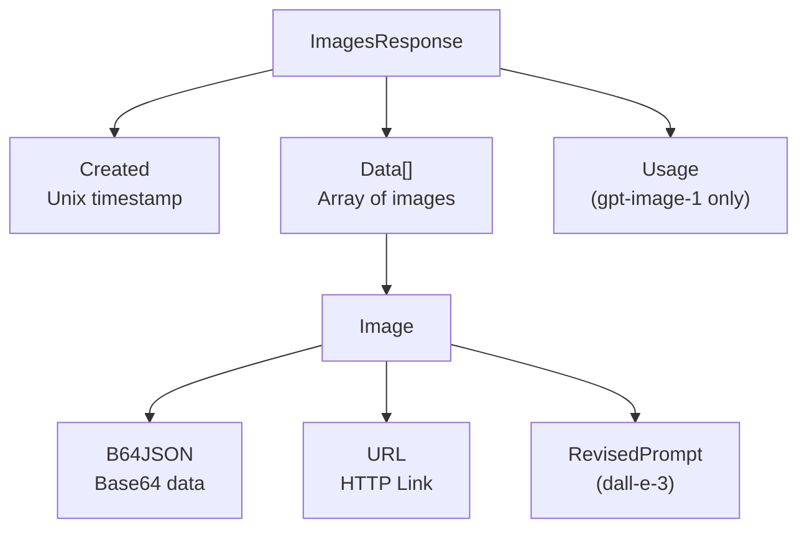

<!-- source: DeepWiki mcp.deepwiki.com · repo openai/openai-go · page 5 Image Generation and Editing · fetched 2026-10-26 -->

# Image Generation and Editing

<details>
<summary>Relevant source files</summary>

The following files were used as context for generating this wiki page:

- [examples/image-streaming/main.go](examples/image-streaming/main.go)
- [image.go](image.go)
- [image_test.go](image_test.go)

</details>


**Purpose:** This document covers the `ImageService` which provides methods for generating new images from text prompts, editing existing images with masks, and creating variations of source images. It details the supported models (dall-e-2, dall-e-3, gpt-image-1), synchronous and streaming response modes, and configuration options for size, quality, format, and background transparency.

For audio processing capabilities, see [Audio Services](#6). For video generation, see [Video Generation](#7).

## ImageService Overview

The `ImageService` provides three primary operations for image manipulation. All methods support model-specific capabilities and various output configurations.



**Sources:** [image.go:32-101](), [image.go:132-154](), [image.go:423-445]()

## Supported Models and Capabilities

The ImageService supports several models with varying capabilities. While `dall-e-3` is standard for high-quality generation, the `gpt-image` series introduces advanced features like streaming and detailed token usage.

| Model | Generate | Edit | Variations | Streaming | Token Usage | Key Features |
|-------|----------|------|------------|-----------|-------------|--------------|
| `dall-e-2` | ✓ | ✓ | ✓ | ✗ | ✗ | Legacy model, URL/b64_json response |
| `dall-e-3` | ✓ | ✗ | ✗ | ✗ | ✗ | High quality, revised prompts |
| `gpt-image-1` | ✓ | ✓ | ✗ | ✓ | ✓ | Streaming support, token tracking |
| `gpt-image-1.5` | ✓ | ✓ | ✗ | ✓ | ✓ | Latest GPT image model |

Model constants are defined in `ImageModel`:

```go
const (
	ImageModelDallE2           ImageModel = "dall-e-2"
	ImageModelDallE3           ImageModel = "dall-e-3"
	ImageModelGPTImage1        ImageModel = "gpt-image-1"
	ImageModelGPTImage1_5      ImageModel = "gpt-image-1.5"
	ImageModelChatGPTImageLatest ImageModel = "chatgpt-image-latest"
)
```

**Sources:** [image.go:53-55](), [image.go:1218-1230]()

## Image Generation

### Basic Generation

The `Generate` method creates images from text prompts. It accepts an `ImageGenerateParams` struct and returns an `ImagesResponse`.



**Key Parameters:**
- `Prompt` (required): Text description of desired image. [image.go:1111-1112]()
- `Model`: One of dall-e-2, dall-e-3, gpt-image-1, etc. [image.go:1100-1102]()
- `Size`: Image dimensions (e.g., `1024x1024`, `1024x1536`). [image.go:1143-1145]()
- `Quality`: `low`, `medium`, `high`, or `auto`. [image.go:1131-1133]()
- `ResponseFormat`: `url` (default) or `b64_json`. [image.go:1137-1141]()
- `PartialImages`: Number of partial images during streaming (gpt-image-1 only). [image.go:1126-1129]()

**Sources:** [image.go:82-87](), [image_test.go:86-120]()

### Streaming Generation

The `GenerateStreaming` method enables progressive rendering of images as they generate. It returns a `ssestream.Stream[ImageGenStreamEventUnion]` that emits events.



The `GenerateStreaming` method automatically injects the `stream: true` option into the request. [image.go:91-101]()

**Event Types:**

1. **ImageGenPartialImageEvent** (type: `image_generation.partial_image`)
   - `B64JSON`: Base64-encoded partial image data. [image.go:602-603]()
   - `PartialImageIndex`: 0-based index of the partial image. [image.go:618-619]()

2. **ImageGenCompletedEvent** (type: `image_generation.completed`)
   - `B64JSON`: Final complete image. [image.go:425-426]()
   - `Usage`: Token usage information for the generation. [image.go:444-445]()

**Sources:** [image.go:91-101](), [image.go:423-717](), [examples/image-streaming/main.go:19-57]()

## Image Editing

### Edit Method

The `Edit` method modifies existing images using a text prompt and optional mask. This method uses multipart form encoding to transmit image files. [image.go:56-61]()



**Key Parameters:**
- `Image`: Source image(s). Can be a single file or an array for GPT image models. [image.go:943-945]()
- `Prompt` (required): Text description of desired changes. [image.go:1016-1017]()
- `Mask`: An optional image whose fully transparent areas indicate where the image should be edited. [image.go:986-988]()
- `InputFidelity`: Controls how closely the output matches the input (low, medium, high). [image.go:975-977]()

**Sources:** [image.go:56-61](), [image_test.go:47-84](), [image.go:924-1087]()

### Streaming Image Editing

The `EditStreaming` method provides progressive updates during image editing, similar to generation. It sets `stream: true` using `SetExtraFields`. [image.go:66-78]()

**Sources:** [image.go:66-78](), [image.go:128-421]()

## Image Variations

The `NewVariation` method creates variations of a source image. This endpoint is primarily for `dall-e-2`. [image.go:45-46]()



**Parameters:**
- `Image` (required): The image to use as the basis for the variation(s). [image.go:873-874]()
- `Model`: Defaults to `dall-e-2`. [image.go:876-878]()
- `N`: Number of images to generate (1-10). [image.go:880-881]()

**Sources:** [image.go:46-51](), [image_test.go:18-45](), [image.go:859-922]()

## Response Types and Data Structures

### ImagesResponse

The primary response type for synchronous operations containing an array of `Image` objects. [image.go:729-733]()



- **Image.B64JSON**: Base64-encoded image data. [image.go:108]()
- **Image.URL**: The URL of the generated image (expires after 60 mins). [image.go:114]()
- **Image.RevisedPrompt**: The prompt as modified by the model for `dall-e-3`. [image.go:110]()

**Sources:** [image.go:104-123](), [image.go:729-857]()

### Usage and Token Tracking

For `gpt-image-1` models, the SDK provides detailed token usage metrics. [image.go:812-813]()

- `InputTokens`: Total tokens in the request. [image.go:825-826]()
- `OutputTokens`: Tokens generated in the output image. [image.go:830-831]()
- `InputTokensDetails`: Breakdown between `ImageTokens` and `TextTokens`. [image.go:848-857]()

**Sources:** [image.go:812-857](), [image.go:212-237](), [image.go:508-554]()

## Integration with Request Pipeline

The `ImageService` utilizes the internal request infrastructure to handle complex types:

1. **Multipart Handling**: Parameters like `ImageNewVariationParams` implement `MarshalMultipart` to handle file uploads via `apiform`. [image.go:859-871]()
2. **Streaming Unions**: Streaming methods use union types (`ImageGenStreamEventUnion`) which allow the SDK to deserialize different SSE event types into a single stream. [image.go:641-717]()
3. **Extra Fields**: Methods like `EditStreaming` use `SetExtraFields` to inject the `stream` parameter without modifying the public parameter struct. [image.go:72-74]()

**Sources:** [image.go:46-51](), [image.go:66-78](), [image.go:859-871]()

---

