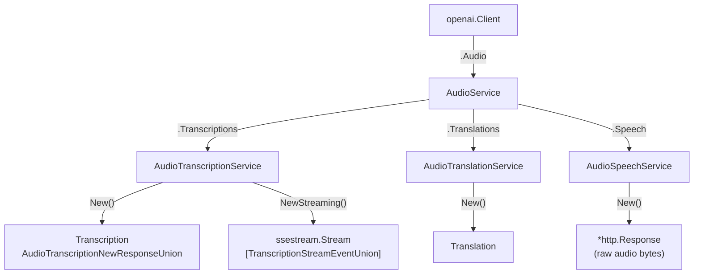
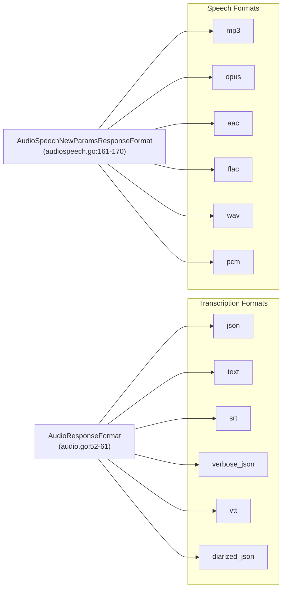
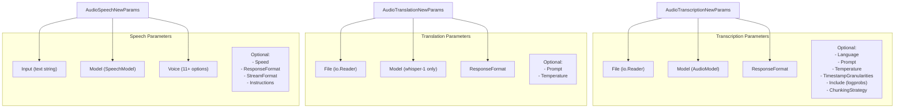
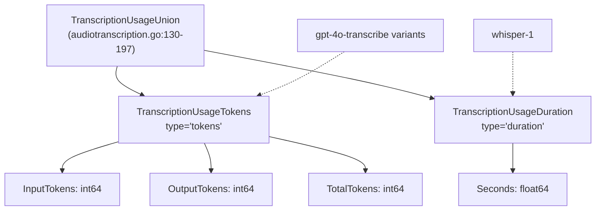
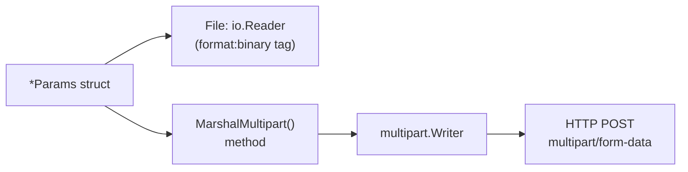

<!-- source: DeepWiki mcp.deepwiki.com · repo openai/openai-go · page 6 Audio Services · fetched 2026-10-26 -->

# Audio Services

Relevant source files

The following files were used as context for generating this wiki page:

- [audio.go](audio.go)
- [audiospeech.go](audiospeech.go)
- [audiotranscription.go](audiotranscription.go)
- [audiotranscription_test.go](audiotranscription_test.go)
- [audiotranslation.go](audiotranslation.go)
- [audiotranslation_test.go](audiotranslation_test.go)
- [file_test.go](file_test.go)
- [moderation.go](moderation.go)
- [realtime/clientsecret.go](realtime/clientsecret.go)
- [realtime/realtime.go](realtime/realtime.go)
- [uploadpart.go](uploadpart.go)

The Audio Services provide capabilities for converting between audio and text, including speech-to-text transcription, audio translation to English, and text-to-speech synthesis. These services support both synchronous and streaming modes of operation, with multiple models optimized for different use cases.

**Scope**: This page provides an overview of the three audio sub-services and their common characteristics. For detailed information on transcription features including diarization and streaming events, see [Audio Transcription](#6.1). For details on translation and speech synthesis, see [Audio Translation and Speech Synthesis](#6.2).

## Service Architecture

The `AudioService` acts as a parent container for three specialized sub-services, each handling a distinct audio processing capability.

**Sources**: [audio.go:15-35](), [audiotranscription.go:32-72](), [audiotranslation.go:29-48](), [audiospeech.go:24-46]()

The service hierarchy is established in [audio.go:28-35](), where `NewAudioService` initializes all three sub-services with shared options. Each sub-service is instantiated through its own constructor:
- `NewAudioTranscriptionService` in [audiotranscription.go:39-43]()
- `NewAudioTranslationService` in [audiotranslation.go:36-40]()
- `NewAudioSpeechService` in [audiospeech.go:31-35]()

## Model Support

Audio services support multiple models with different capabilities and billing structures:

| Model | Constant | Service | Billing | Features |
|-------|----------|---------|---------|----------|
| `whisper-1` | `AudioModelWhisper1` | Transcription, Translation | Duration-based | General-purpose Whisper V2 |
| `gpt-4o-transcribe` | `AudioModelGPT4oTranscribe` | Transcription | Token-based | Advanced accuracy, logprobs support |
| `gpt-4o-mini-transcribe` | `AudioModelGPT4oMiniTranscribe` | Transcription | Token-based | Cost-optimized, logprobs support |
| `gpt-4o-transcribe-diarize` | `AudioModelGPT4oTranscribeDiarize` | Transcription | Token-based | Speaker identification |
| `tts-1` | `SpeechModelTTS1` | Speech | N/A | Standard TTS quality |
| `tts-1-hd` | `SpeechModelTTS1HD` | Speech | N/A | High-definition TTS |
| `gpt-4o-mini-tts` | `SpeechModelGPT4oMiniTTS` | Speech | N/A | Advanced TTS with instructions |

**Sources**: [audio.go:37-45](), [audiospeech.go:48-55](), [realtime/realtime.go:84-92]()

The model constants are defined as string types, enabling compile-time validation while maintaining flexibility. Transcription models support different billing approaches represented by the `TranscriptionUsageUnion` discriminated union in [audiotranscription.go:130-197]().

## Response Format Options

**Sources**: [audio.go:47-61](), [audiospeech.go:159-170]()

The `AudioResponseFormat` enum ([audio.go:52-61]()) defines output formats for transcription and translation services. Format compatibility varies by model:
- `gpt-4o-transcribe` and `gpt-4o-mini-transcribe`: Only `json` format supported in some configurations [audio.go:48-49]().
- `gpt-4o-transcribe-diarize`: `json`, `text`, and `diarized_json` (required for speaker annotations) [audio.go:50-51]().
- `whisper-1`: All formats supported.

Speech synthesis formats are defined separately in [audiospeech.go:161-170](), supporting six audio codecs with different compression and quality characteristics.

## Request Parameter Patterns

All audio services accept file input through multipart form data or direct text input, with model-specific parameters:

**Sources**: [audiotranscription_test.go:31-45](), [audiotranslation.go:66-90](), [audiospeech.go:57-87]()

Transcription parameters include advanced features like `ChunkingStrategy` and `TimestampGranularities` [audiotranscription_test.go:34-44](). Diarization models further support `KnownSpeakerNames` and `KnownSpeakerReferences` [audiotranscription_test.go:38-39]().

Translation parameters ([audiotranslation.go:66-90]()) are simpler, primarily supporting `whisper-1` for English translation [audiotranslation.go:70-72]().

Speech parameters ([audiospeech.go:57-87]()) support voice selection through a union type `AudioSpeechNewParamsVoiceUnion` [audiospeech.go:100-107](), including built-in voices like `alloy`, `ash`, and `shimmer` [audiospeech.go:129-140]().

## Synchronous vs Streaming Modes

The transcription service supports dual-mode operation, while translation and speech services are synchronous in this SDK implementation:

| Service | Synchronous Method | Streaming Method | Stream Type |
|---------|-------------------|------------------|-------------|
| Transcription | `New()` | `NewStreaming()` | `ssestream.Stream[TranscriptionStreamEventUnion]` |
| Translation | `New()` | N/A | N/A |
| Speech | `New()` | N/A (returns raw response) | N/A |

**Sources**: [audiotranscription.go:49-72](), [audiotranslation.go:43-48](), [audiospeech.go:40-46]()

The transcription streaming implementation ([audiotranscription.go:60-72]()) sets `stream: true` and wraps the HTTP response in an SSE decoder. Speech synthesis returns a raw `*http.Response` ([audiospeech.go:40]()) allowing the client to read the audio stream directly from `res.Body`.

## Usage Billing Models

Transcription services employ two distinct billing approaches based on the model:

**Sources**: [audiotranscription.go:130-197]()

The `TranscriptionUsageUnion` discriminated union ([audiotranscription.go:130-152]()) uses a `type` field to distinguish between:
- `TranscriptionUsageTokens`: For GPT-4o based models, providing token counts [audiotranscription.go:174-175]().
- `TranscriptionUsageDuration`: For Whisper-1, measuring audio duration in `Seconds` [audiotranscription.go:176-177]().

## File Upload and Multipart Encoding

Audio transcription and translation services use multipart form encoding for binary file uploads:

**Sources**: [audiotranslation.go:69-108](), [audiotranscription.go:9-10]()

The parameter structs like `AudioTranslationNewParams` implement `MarshalMultipart()` ([audiotranslation.go:92-108]()) which uses `apiform.MarshalRoot` to handle the binary `io.Reader` and associated metadata fields.

## Common Infrastructure

All audio services share these infrastructure characteristics:

| Feature | Implementation | Location |
|---------|---------------|----------|
| Request Execution | `requestconfig.ExecuteNewRequest` | [audiotranscription.go:52](), [audiotranslation.go:46](), [audiospeech.go:44]() |
| Context Support | `context.Context` | All service methods |
| Options Merging | `slices.Concat(r.Options, opts)` | [audiotranscription.go:50](), [audiotranslation.go:44](), [audiospeech.go:41]() |
| Error Handling | `apierror.Error` | All service methods |

**Sources**: [audiotranscription.go:49-72](), [audiotranslation.go:43-48](), [audiospeech.go:40-46]()

The services follow the standard request execution pattern, merging service-level defaults with per-request options before execution. Speech synthesis uniquely forces an `Accept: application/octet-stream` header to ensure the correct response type [audiospeech.go:42]().

---

