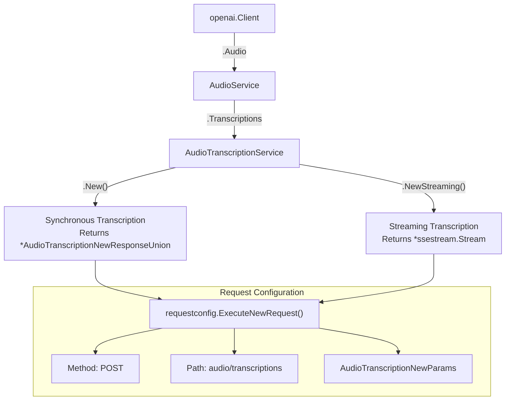
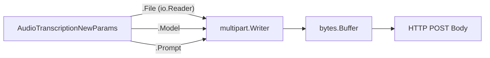
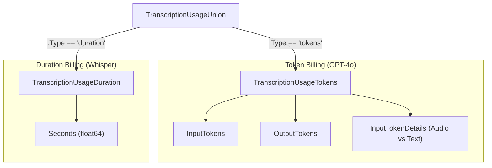

<!-- source: DeepWiki mcp.deepwiki.com · repo openai/openai-go · page 6.1 Audio Transcription · fetched 2026-10-26 -->

# Audio Transcription

<details>
<summary>Relevant source files</summary>

The following files were used as context for generating this wiki page:

- [audio.go](audio.go)
- [audiotranscription.go](audiotranscription.go)
- [audiotranscription_test.go](audiotranscription_test.go)
- [audiotranslation.go](audiotranslation.go)
- [audiotranslation_test.go](audiotranslation_test.go)
- [file_test.go](file_test.go)
- [moderation.go](moderation.go)
- [uploadpart.go](uploadpart.go)

</details>


The Audio API provides specialized services for converting audio to text through the `AudioTranscriptionService`. This service is accessed via the `Audio.Transcriptions` property of the `openai.Client` and supports both synchronous and streaming transcription modes, multiple model variants (including Whisper and GPT-4o-transcribe), and advanced features like diarization and token-level log probabilities.

## Service Architecture

The `AudioTranscriptionService` acts as a specialized sub-service within the `AudioService` hierarchy. It is designed to interact specifically with the `/audio/transcriptions` endpoint.

### Service Entity Diagram

This diagram maps the SDK's service structure to the underlying API communication logic.



Sources: [audio.go:15-23](), [audiotranscription.go:32-43](), [audiotranscription.go:49-54](), [audiotranscription.go:60-72]()

## Transcription Models and Support

The SDK defines several constants for audio models, ranging from the standard Whisper model to the latest GPT-4o variants optimized for transcription.

| Model Constant | Value | Supported Response Formats | Billing Model |
|----------------|-------|---------------------------|---------------|
| `AudioModelWhisper1` | `"whisper-1"` | `json`, `text`, `srt`, `verbose_json`, `vtt` | Duration-based |
| `AudioModelGPT4oTranscribe` | `"gpt-4o-transcribe"` | `json` | Token-based |
| `AudioModelGPT4oMiniTranscribe` | `"gpt-4o-mini-transcribe"` | `json` | Token-based |
| `AudioModelGPT4oTranscribeDiarize` | `"gpt-4o-transcribe-diarize"` | `json`, `text`, `diarized_json` | Token-based |

Sources: [audio.go:37-45](), [audio.go:47-61](), [audiotranscription.go:74-81]()

## Synchronous Transcription

The `New` method performs a standard blocking request. Depending on the `ResponseFormat` requested in `AudioTranscriptionNewParams`, the API returns a union response.

### Request Flow and Multipart Handling

Since audio transcription requires file uploads, the `AudioTranscriptionNewParams` struct implements `MarshalMultipart` to handle binary data alongside JSON metadata.



Sources: [audiotranscription.go:564-580](), [audiotranscription.go:529-562]()

## Streaming Transcription

The `NewStreaming` method allows for real-time transcription processing. It automatically injects `"stream": "true"` into the request payload.

### Transcription Event Union

The stream emits `TranscriptionStreamEventUnion` objects, which represent different stages of the transcription lifecycle.

| Event Type | Struct | Description |
|------------|--------|-------------|
| `"transcript.text.delta"` | `TranscriptionTextDeltaEvent` | Real-time incremental text updates. |
| `"transcript.text.done"` | `TranscriptionTextDoneEvent` | Final transcription containing the full text and usage. |

Sources: [audiotranscription.go:60-72](), [audiotranscription.go:269-282](), [audiotranscription.go:370-381](), [audiotranscription.go:422-433]()

## Billing and Usage Models

The SDK supports two distinct billing models for transcription, represented by the `TranscriptionUsageUnion`.

### Usage Type Mapping



Sources: [audiotranscription.go:124-152](), [audiotranscription.go:191-208](), [audiotranscription.go:242-251]()

## Diarization and Advanced Features

For models like `gpt-4o-transcribe-diarize`, the service supports speaker identification and metadata.

### Key Parameters for Advanced Transcription
- **Diarization**: Enabled by setting `ResponseFormat` to `AudioResponseFormatDiarizedJSON`.
- **Speaker Context**: `KnownSpeakerNames` and `KnownSpeakerReferences` can be provided to help the model identify specific individuals.
- **Logprobs**: If `gpt-4o-transcribe` is used, adding `TranscriptionIncludeLogprobs` to the `Include` array will return token-level probabilities.
- **Timestamp Granularity**: Can be set to `"word"` or `"segment"` to get precise timing data in `verbose_json`.

Sources: [audiotranscription_test.go:31-45](), [audiotranscription.go:529-562](), [audio.go:54-61]()

## Implementation Example (Test Context)

The following sequence illustrates how parameters are constructed for a transcription request with diarization and logprobs enabled.

```go
client.Audio.Transcriptions.New(ctx, openai.AudioTranscriptionNewParams{
    File:                   audioReader,
    Model:                  openai.AudioModelGPT4oTranscribe,
    Include:                []openai.TranscriptionInclude{openai.TranscriptionIncludeLogprobs},
    ResponseFormat:         openai.AudioResponseFormatJSON,
    TimestampGranularities: []string{"word"},
})
```

Sources: [audiotranscription_test.go:31-45]()

---

