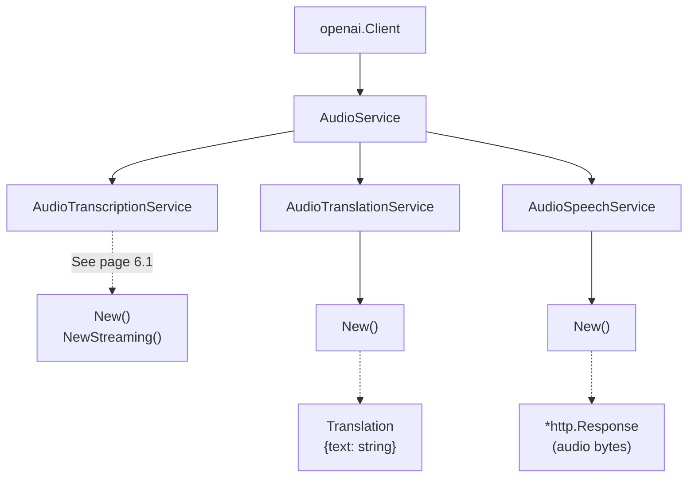
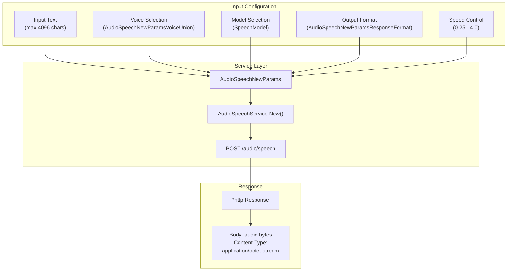
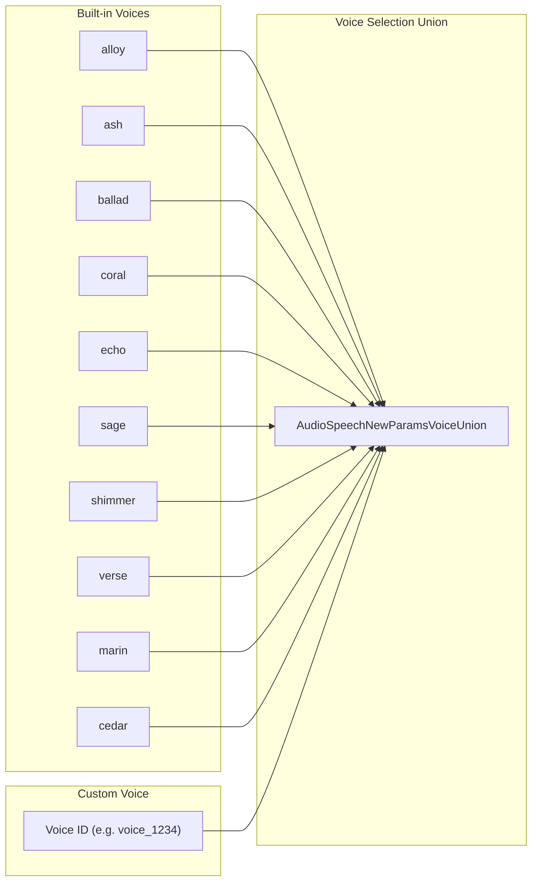

<!-- source: DeepWiki mcp.deepwiki.com · repo openai/openai-go · page 6.2 Audio Translation and Speech Synthesis · fetched 2026-10-26 -->

# Audio Translation and Speech Synthesis

<details>
<summary>Relevant source files</summary>

The following files were used as context for generating this wiki page:

- [audiospeech.go](audiospeech.go)
- [audiospeech_test.go](audiospeech_test.go)
- [audiotranscription.go](audiotranscription.go)
- [audiotranslation.go](audiotranslation.go)
- [completion_test.go](completion_test.go)
- [moderation.go](moderation.go)
- [moderation_test.go](moderation_test.go)
- [realtime/call_test.go](realtime/call_test.go)
- [realtime/clientsecret.go](realtime/clientsecret.go)
- [realtime/clientsecret_test.go](realtime/clientsecret_test.go)
- [realtime/realtime.go](realtime/realtime.go)
- [uploadpart.go](uploadpart.go)

</details>


This page documents the Audio Translation and Speech Synthesis capabilities of the openai-go SDK. Audio Translation converts audio in any language to English text, while Speech Synthesis generates spoken audio from text input. These services are accessed through `AudioTranslationService` and `AudioSpeechService` respectively.

For audio transcription (converting audio to text in its original language), see [Audio Transcription](#6.1).

---

## Service Hierarchy

The Audio Translation and Speech Synthesis services are accessed via the client's `Audio` field.



**Sources:** [audiotranslation.go:29-32](), [audiospeech.go:24-26]()

The services are accessed via the client's `Audio` field:
- **Translation:** `client.Audio.Translations.New()` [audiotranslation.go:43-48]()
- **Speech:** `client.Audio.Speech.New()` [audiospeech.go:40-46]()

---

## Audio Translation Service

### Overview

`AudioTranslationService` translates audio files in any language to English text. Unlike transcription (which preserves the original language), translation always outputs English regardless of the input language.

| Feature | Details |
|---------|---------|
| Service Path | `audio/translations` |
| Method | `AudioTranslationService.New()` |
| Model Support | `whisper-1` only |
| Input Formats | flac, mp3, mp4, mpeg, mpga, m4a, ogg, wav, webm |
| Output Formats | json, text, srt, verbose_json, vtt |
| HTTP Method | POST (multipart/form-data) |

**Sources:** [audiotranslation.go:43-48](), [audiotranslation.go:66-88]()

### Request Flow

```mermaid
graph LR
    subgraph "Input"
        AudioFile["Audio File<br/>(io.Reader)"]
        Params["AudioTranslationNewParams"]
    end
    
    subgraph "Service"
        Service["AudioTranslationService.New()"]
        Multipart["Multipart Form<br/>Encoding"]
        Request["POST /audio/translations"]
    end
    
    subgraph "API"
        WhisperModel["whisper-1 model"]
        Processing["Translation<br/>Processing"]
    end
    
    subgraph "Response"
        Translation["Translation<br/>{text: string}"]
    end
    
    AudioFile --> Params
    Params --> Service
    Service --> Multipart
    Multipart --> Request
    Request --> WhisperModel
    WhisperModel --> Processing
    Processing --> Translation
```

**Sources:** [audiotranslation.go:43-48](), [audiotranslation.go:92-108]()

### Parameters

The `AudioTranslationNewParams` structure controls the translation behavior:

| Parameter | Type | Required | Description |
|-----------|------|----------|-------------|
| `File` | `io.Reader` | Yes | Audio file to translate (binary stream) |
| `Model` | `AudioModel` | Yes | Must be `whisper-1` |
| `Prompt` | `param.Opt[string]` | No | Optional text to guide the model's style (in English) |
| `Temperature` | `param.Opt[float64]` | No | Sampling temperature 0-1. |
| `ResponseFormat` | `AudioTranslationNewParamsResponseFormat` | No | Output format: `json`, `text`, `srt`, `verbose_json`, `vtt` |

**Sources:** [audiotranslation.go:66-90]()

### Response Structure

The `Translation` response contains the translated text:

```go
type Translation struct {
	Text string `json:"text" api:"required"`
	JSON struct {
		Text        respjson.Field
		ExtraFields map[string]respjson.Field
		raw         string
	} `json:"-"`
}
```

**Sources:** [audiotranslation.go:50-58]()

---

## Audio Speech Service (Text-to-Speech)

### Overview

`AudioSpeechService` generates spoken audio from text input. It supports multiple voices, models, and output formats, with fine-grained control over speech characteristics.

| Feature | Details |
|---------|---------|
| Service Path | `audio/speech` |
| Method | `AudioSpeechService.New()` |
| Models | `tts-1`, `tts-1-hd`, `gpt-4o-mini-tts` |
| Voices | 13 options (alloy, ash, ballad, coral, echo, fable, onyx, nova, sage, shimmer, verse, marin, cedar) |
| Output Formats | mp3, opus, aac, flac, wav, pcm |
| Stream Formats | sse, audio |
| Response Type | `*http.Response` (raw audio bytes) |

**Sources:** [audiospeech.go:40-46](), [audiospeech.go:50-55](), [audiospeech.go:63-69]()

### Speech Synthesis Request Flow



**Sources:** [audiospeech.go:40-46](), [audiospeech.go:57-87]()

### Voice Options

The SDK supports built-in voices via `AudioSpeechNewParamsVoiceString2` and custom voices via `AudioSpeechNewParamsVoiceID`.



**Sources:** [audiospeech.go:100-107](), [audiospeech.go:127-140](), [audiospeech.go:145-149]()

### Model Capabilities

The service supports multiple TTS models with varying capabilities:

| Model | Instructions Support | SSE Streaming | Use Case |
|-------|----------------------|---------------|----------|
| `tts-1` | No | No | Low-latency synthesis |
| `tts-1-hd` | No | No | High-definition output |
| `gpt-4o-mini-tts` | Yes | Yes | Advanced control and streaming |

**Sources:** [audiospeech.go:51-55](), [audiospeech.go:70-72](), [audiospeech.go:81-85]()

### Response Format Options

The `AudioSpeechNewParamsResponseFormat` controls the audio codec:

| Format | Extension | Description |
|--------|-----------|-------------|
| `mp3` | .mp3 | MPEG audio layer 3 (default) |
| `opus` | .opus | Opus codec (high quality, low latency) |
| `aac` | .aac | Advanced Audio Coding |
| `flac` | .flac | Free Lossless Audio Codec |
| `wav` | .wav | Waveform Audio File Format |
| `pcm` | .pcm | Pulse-code modulation (raw audio) |

**Sources:** [audiospeech.go:161-170]()

### Streaming and Response Handling

`AudioSpeechService.New()` returns a raw `*http.Response`. The audio data is provided in the response body as a stream of bytes.

```go
func (r *AudioSpeechService) New(ctx context.Context, body AudioSpeechNewParams, opts ...option.RequestOption) (res *http.Response, err error) {
    // ... execution logic
}
```

**Sources:** [audiospeech.go:40-46]()

For `gpt-4o-mini-tts`, the `StreamFormat` can be set to `sse` for Server-Sent Events or `audio` for a raw binary stream. Note that `sse` is not supported for `tts-1` or `tts-1-hd`.

**Sources:** [audiospeech.go:81-85]()

---

## Implementation Details

### Multipart Form Marshaling

Translation requests require binary file uploads, handled via `MarshalMultipart` in `AudioTranslationNewParams`. This method uses `apiform.MarshalRoot` to encode the request body.

**Sources:** [audiotranslation.go:92-108]()

### Response Processing

Speech synthesis responses require manual body management. Users must close the `http.Response.Body` to avoid resource leaks.

```go
resp, err := client.Audio.Speech.New(ctx, openai.AudioSpeechNewParams{...})
if err != nil {
    return err
}
defer resp.Body.Close()
// Read audio data from resp.Body
```

**Sources:** [audiospeech_test.go:29-47]()

### Request Customization

Both services accept variadic `option.RequestOption`. The `AudioSpeechService` specifically prepends a header to ensure binary data is accepted.

```go
opts = append([]option.RequestOption{option.WithHeader("Accept", "application/octet-stream")}, opts...)
```

**Sources:** [audiospeech.go:41-42]()

---

