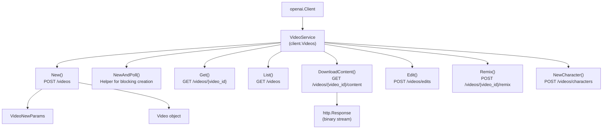
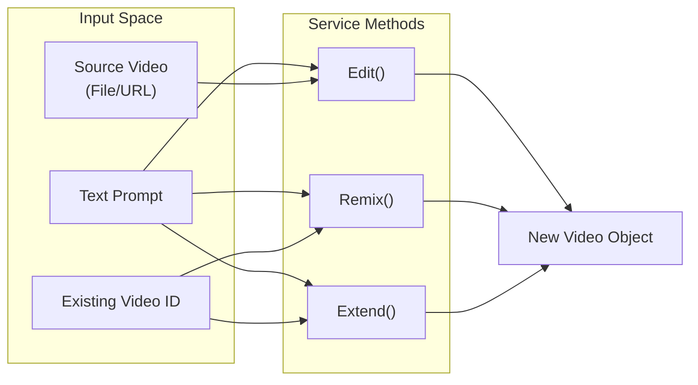
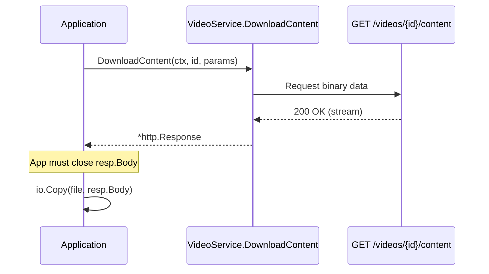
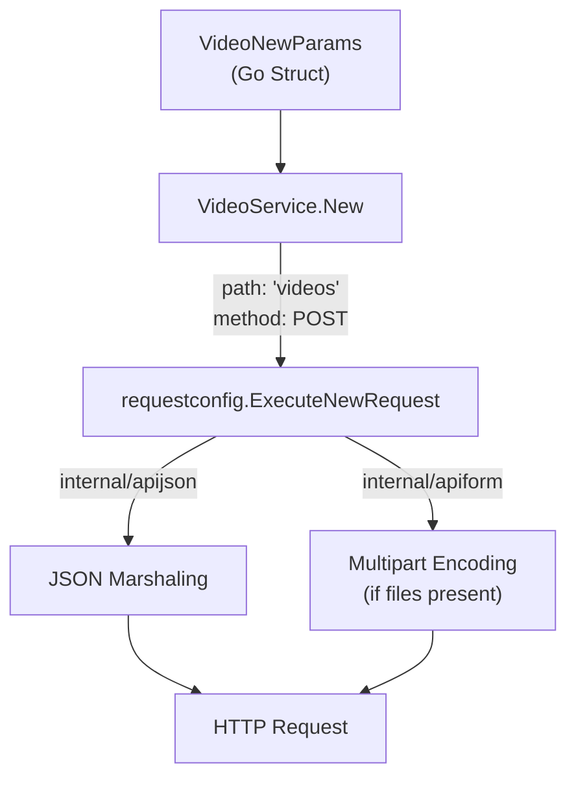

<!-- source: DeepWiki mcp.deepwiki.com · repo openai/openai-go · page 7 Video Generation · fetched 2026-10-26 -->

# Video Generation

<details>
<summary>Relevant source files</summary>

The following files were used as context for generating this wiki page:

- [examples/azure/main.go](examples/azure/main.go)
- [examples/video-generation/main.go](examples/video-generation/main.go)
- [scripts/detect-breaking-changes](scripts/detect-breaking-changes)
- [video.go](video.go)
- [video_test.go](video_test.go)

</details>


This document covers the `VideoService` for generating and managing videos using the OpenAI API. The service provides video generation, editing, remixing, and character creation capabilities primarily through the `sora-1.0` model family.

## Overview and Service Architecture

The `VideoService` is accessible through the client's `Videos` property. It manages the lifecycle of video generation jobs, which are asynchronous by nature.



**Sources:** [video.go:27-35](), [video.go:47-52](), [video.go:124-134]()

## Video Generation and Polling

Video generation is initiated via `New()`. Because generation takes time, the SDK provides a `NewAndPoll()` helper that blocks until the video reaches a terminal state.

### Blocking Generation Example
The following logic demonstrates using the `NewAndPoll` helper to simplify the asynchronous workflow.

```go
video, err := client.Videos.NewAndPoll(ctx, openai.VideoNewParams{
    Model:  openai.VideoModelSora2,
    Prompt: "A video of the words 'Thank you' in sparkling letters",
}, 1000) // Poll every 1000ms
```

**Sources:** [examples/video-generation/main.go:15-18](), [video.go:58-64]()

### Core Parameters and Constants
The API uses strictly typed constants for configuration to ensure compatibility with model capabilities.

| Type | Purpose | Key Constants |
|------|---------|---------------|
| `VideoModel` | Model selection | `VideoModelSora2` |
| `VideoSize` | Resolution/Aspect Ratio | `VideoSize720x1280`, `VideoSize1280x720`, `VideoSize1024x1024` |
| `VideoSeconds` | Duration control | `VideoSeconds4`, `VideoSeconds8` |

**Sources:** [video_test.go:37-39](), [video.go:177-185]()

## Advanced Generation Workflows

Beyond simple text-to-video, the `VideoService` supports complex transformations and asset-based generation.

### Editing and Remixing
- **Edit**: Create a new video by modifying a source video (provided via file upload or URL) based on a prompt.
- **Remix**: Create a variation of an *existing* generated video by providing a new prompt.
- **Extend**: Increase the duration of a completed video.



**Sources:** [video.go:138-143](), [video.go:146-151](), [video.go:166-175]()

### Character Creation
The `NewCharacter` method allows users to define a persistent character from an uploaded video asset, which can then be referenced in subsequent generation tasks.

**Sources:** [video.go:114-119](), [video_test.go:132-135]()

## Content Download

Generated videos are not returned as base64 in the metadata; they must be streamed via the `DownloadContent` method. This method forces the `Accept: application/binary` header and returns a raw `*http.Response`.



**Sources:** [video.go:124-134](), [video_test.go:156-172]()

## Data Structures and Statuses

The `Video` struct is the central entity for all video operations.

| Field | Type | Description |
|-------|------|-------------|
| `ID` | `string` | The unique identifier for the video job. |
| `Status` | `VideoStatus` | `processing`, `completed`, or `failed`. |
| `Prompt` | `string` | The original prompt used for generation. |
| `Error` | `VideoCreateError` | Contains details if the status is `failed`. |

### Implementation Detail: Union Types
Input references (like providing a video file vs. a URL) are handled via Union types such as `VideoNewParamsInputReferenceUnion`. These allow the SDK to accept multiple input formats (e.g., `io.Reader` for uploads or `string` for URLs) while maintaining type safety.

**Sources:** [video.go:177-185](), [video_test.go:34-36](), [examples/video-generation/main.go:23-27]()

## Request Execution Flow

All video methods utilize `requestconfig.ExecuteNewRequest` to handle the underlying HTTP lifecycle, including automatic retries and JSON/Multipart encoding.



**Sources:** [video.go:47-51](), [video.go:16-19]()

---

