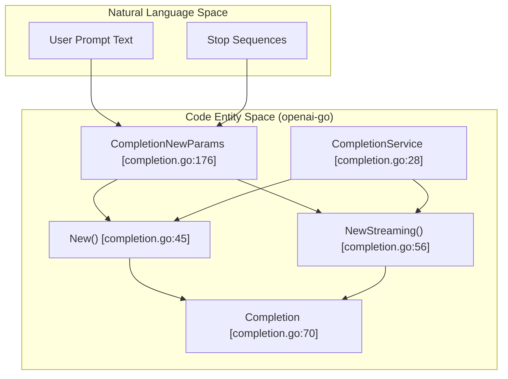
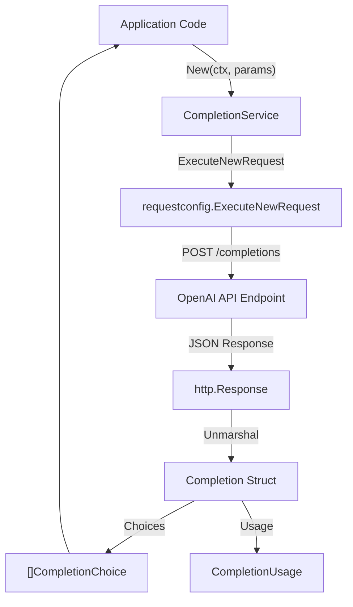
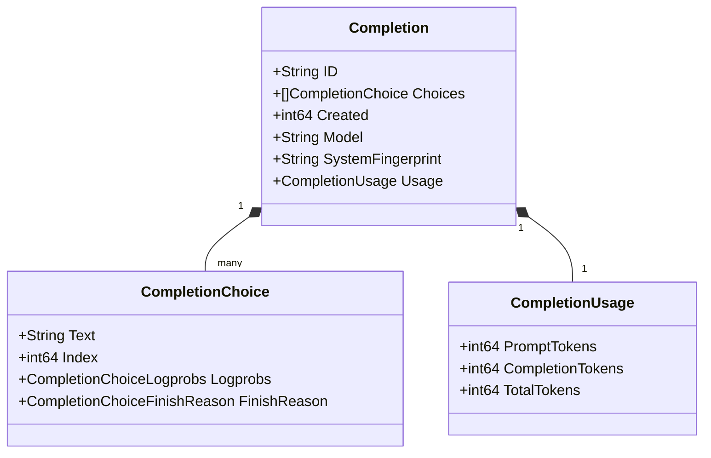

<!-- source: DeepWiki mcp.deepwiki.com · repo openai/openai-go · page 8 Text Completions API · fetched 2026-10-26 -->

# Text Completions API

<details>
<summary>Relevant source files</summary>

The following files were used as context for generating this wiki page:

- [batch.go](batch.go)
- [completion.go](completion.go)
- [file.go](file.go)
- [finetuningjob.go](finetuningjob.go)
- [finetuningjob_test.go](finetuningjob_test.go)
- [upload.go](upload.go)

</details>


The Text Completions API provides a legacy interface for generating text completions from language models using a simple prompt-based approach. This API is accessed through the `CompletionService` in the `openai-go` SDK.

**Scope**: This document covers the `CompletionService` for non-chat text completions, which represents the original completion endpoint (`POST /completions`). For modern conversational AI applications, see the Chat Completions API.

**Note**: The Text Completions API is considered legacy. OpenAI recommends using the Chat Completions API for most use cases, as it provides better model support, multi-turn conversations, and more advanced features.

## Service Architecture

The `CompletionService` follows the standard service layer architecture pattern used throughout the SDK. It is initialized via the `NewCompletionService` function and is typically accessed through the main `Client`.

### System to Code Entity Mapping

This diagram bridges the conceptual "Completion Request" to the specific Go entities used in the implementation.



**Sources**: [completion.go:28-30](), [completion.go:45-50](), [completion.go:56-66](), [completion.go:70-100]()

### Internal Data Flow

The following diagram illustrates how a completion request moves from the SDK to the OpenAI API and back.



**Sources**: [completion.go:45-50](), [completion.go:70-87](), [completion.go:108-118]()

## Request Implementation

### CompletionNewParams

The `CompletionNewParams` type defines the parameters for creating a completion. Unlike the Chat API, the primary input is a `Prompt` (string or array of strings) rather than a list of message objects.

| Parameter | Type | Description |
|-----------|------|-------------|
| `Model` | `string` | ID of the model to use (e.g., `gpt-3.5-turbo-instruct`). |
| `Prompt` | `CompletionNewParamsPromptUnion` | The prompt(s) to generate completions for. |
| `Suffix` | `string` | The suffix that comes after a completion of inserted text. |
| `MaxTokens` | `int64` | The maximum number of tokens to generate in the completion. |
| `Stream` | `bool` | Whether to stream back partial progress. |
| `Logprobs` | `int64` | Include the log probabilities on the `logprobs` most likely tokens. |

**Sources**: [completion.go:176-210]()

### Streaming Completions

The SDK supports Server-Sent Events (SSE) for completions via the `NewStreaming` method. This returns an `ssestream.Stream[Completion]`.

```go
stream := client.Completions.NewStreaming(ctx, openai.CompletionNewParams{
    Model:  openai.String("gpt-3.5-turbo-instruct"),
    Prompt: openai.String("Say this is a test"),
})
defer stream.Close()

for stream.Next() {
    completion := stream.Current()
    fmt.Print(completion.Choices[0].Text)
}
```

**Sources**: [completion.go:56-66](), [completion.go:65]()

## Response Structure

The `Completion` struct represents the unified response for both standard and streaming requests.



**Sources**: [completion.go:70-100](), [completion.go:108-128](), [completion.go:171-174]()

### Choice and Finish Reasons

The `FinishReason` in `CompletionChoice` identifies why the model stopped generating:
- `stop`: Hit a natural stop point or provided stop sequence. [completion.go:143]()
- `length`: Reached `max_tokens`. [completion.go:144]()
- `content_filter`: Content omitted due to safety flags. [completion.go:145]()

**Sources**: [completion.go:140-146]()

## Integration with Shared Infrastructure

The `CompletionService` utilizes the core SDK infrastructure for request execution and type safety.

1.  **Request Configuration**: Uses `requestconfig.ExecuteNewRequest` to handle headers, retries, and context. [completion.go:48]()
2.  **Constants**: Uses `constant.TextCompletion` for the `Object` field, which defaults to `"text_completion"`. [completion.go:80]()
3.  **JSON Handling**: Uses `apijson.UnmarshalRoot` for strict and metadata-aware deserialization. [completion.go:104-106]()

**Sources**: [completion.go:48](), [completion.go:80](), [completion.go:104-106]()

## Differences from Chat Completions API

| Feature | Text Completions (Legacy) | Chat Completions (Current) |
|---------|---------------------------|----------------------------|
| **Service** | `CompletionService` | `ChatCompletionService` |
| **Input** | `Prompt` (String) | `Messages` (Role-based) |
| **Models** | `gpt-3.5-turbo-instruct`, `davinci-002` | `gpt-4o`, `gpt-4-turbo`, etc. |
| **Streaming** | Same struct (`Completion`) | Different struct (`ChatCompletionChunk`) |
| **Tools/Functions**| Not Supported | Supported |

**Sources**: [completion.go:19-24](), [completion.go:68-69]()

---

