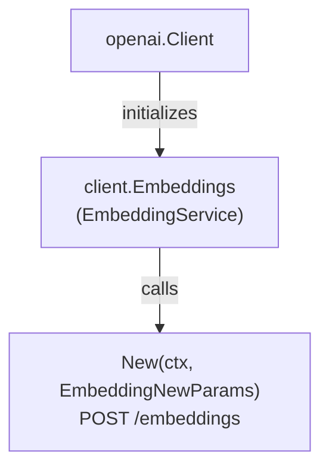
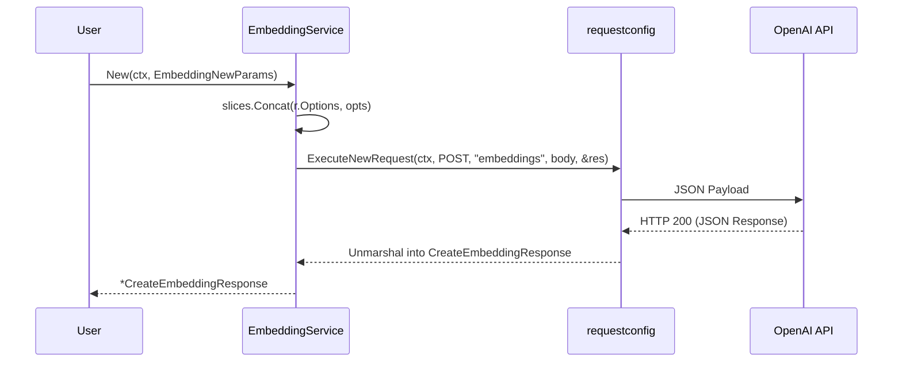
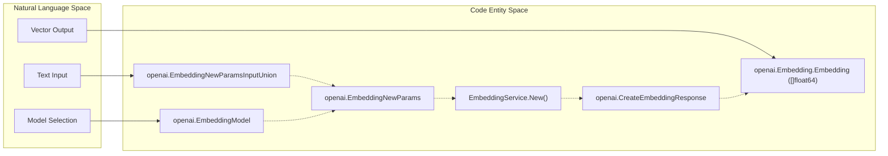

<!-- source: DeepWiki mcp.deepwiki.com · repo openai/openai-go · page 9 Embeddings API · fetched 2026-10-26 -->

# Embeddings API

<details>
<summary>Relevant source files</summary>

The following files were used as context for generating this wiki page:

- [embedding.go](embedding.go)
- [embedding_test.go](embedding_test.go)

</details>


The `EmbeddingService` generates vector representations of text input using OpenAI's embedding models. These numerical vectors capture semantic meaning, enabling operations such as similarity calculations, semantic search, and clustering.

## Service Access

The embedding service is accessed via the `Embeddings` field on the `openai.Client` instance. It is initialized through the internal service hierarchy during client construction.



**Diagram: Service structure showing the EmbeddingService and its relationship to the primary client.**

Sources: [embedding.go:27-38](), [embedding.go:41-46]()

## Implementation Details

The `EmbeddingService` is a specialized service layer that wraps the OpenAI `/embeddings` endpoint. It uses `requestconfig.ExecuteNewRequest` to handle the underlying HTTP POST request and JSON marshaling.

### Data Flow and Request Execution

The following diagram illustrates the transition from high-level Go parameters to the raw network request and back to structured response objects.



**Diagram: Sequence of data flow from EmbeddingNewParams to CreateEmbeddingResponse.**

Sources: [embedding.go:41-46](), [embedding.go:129-159]()

## Types and Parameters

### Request Parameters (`EmbeddingNewParams`)

The `EmbeddingNewParams` struct defines the configuration for an embedding request. It utilizes a union type for the `Input` field to support various input formats.

| Field | Type | Description |
|-------|------|-------------|
| `Input` | `EmbeddingNewParamsInputUnion` | The text to embed. Supports `string`, `[]string`, `[]int64` (tokens), or `[][]int64` (token arrays). |
| `Model` | `EmbeddingModel` | The ID of the model to use (e.g., `text-embedding-3-small`). |
| `Dimensions` | `param.Opt[int64]` | The number of dimensions for output vectors (supported in `v3` models). |
| `EncodingFormat` | `EmbeddingNewParamsEncodingFormat` | Format of the return: `float` or `base64`. |
| `User` | `param.Opt[string]` | Unique identifier for end-user monitoring. |

Sources: [embedding.go:129-159](), [embedding.go:172-176]()

### Response Structure (`CreateEmbeddingResponse`)

The API returns a `CreateEmbeddingResponse` containing a list of `Embedding` objects and usage statistics.

| Field | Type | Description |
|-------|------|-------------|
| `Data` | `[]Embedding` | List of embedding vectors. |
| `Model` | `string` | The specific model used. |
| `Usage` | `CreateEmbeddingResponseUsage` | Token consumption details (`PromptTokens`, `TotalTokens`). |

Each `Embedding` object contains:
- `Embedding`: `[]float64` (The actual vector).
- `Index`: `int64` (The index in the input list).
- `Object`: `constant.Embedding` (Always "embedding").

Sources: [embedding.go:48-66](), [embedding.go:75-87](), [embedding.go:96-113]()

## Model Constants

The SDK provides typed constants for common embedding models to ensure type safety during parameter construction.

| Constant | Value |
|----------|-------|
| `EmbeddingModelTextEmbeddingAda002` | `"text-embedding-ada-002"` |
| `EmbeddingModelTextEmbedding3Small` | `"text-embedding-3-small"` |
| `EmbeddingModelTextEmbedding3Large` | `"text-embedding-3-large"` |

Sources: [embedding.go:121-127]()

## Code Entity Mapping

The following diagram maps the logical concepts of the Embeddings API to specific Go structs and constants found in the codebase.



**Diagram: Mapping of domain concepts to SDK code entities.**

Sources: [embedding.go:41-46](), [embedding.go:96-104](), [embedding.go:123-127](), [embedding.go:129-139]()

## Usage Example

The following pattern demonstrates how to initialize a client and generate embeddings using the `EmbeddingService`.

```go
client := openai.NewClient(
    option.WithAPIKey("My API Key"),
)

res, err := client.Embeddings.New(context.TODO(), openai.EmbeddingNewParams{
    Input: openai.EmbeddingNewParamsInputUnion{
        OfString: openai.String("The quick brown fox jumped over the lazy dog"),
    },
    Model: openai.EmbeddingModelTextEmbedding3Small,
})
```

Sources: [embedding_test.go:24-36]()

---

