# Page: Overview

# Overview

<details>
<summary>Relevant source files</summary>

The following files were used as context for generating this wiki page:

- [.release-please-manifest.json](.release-please-manifest.json)
- [CHANGELOG.md](CHANGELOG.md)
- [README.md](README.md)
- [api.md](api.md)
- [client.go](client.go)
- [default_http_client.go](default_http_client.go)
- [internal/version.go](internal/version.go)
- [packages/ssestream/ssestream.go](packages/ssestream/ssestream.go)
- [shared/constant/constants.go](shared/constant/constants.go)

</details>


This document introduces the **openai-go SDK**, the official Go client library for accessing the OpenAI REST API. It covers the SDK's architecture, code generation pipeline, service organization, and key features including streaming responses, multi-modal inputs, and tool calling capabilities.

For detailed information about specific APIs:
- Chat Completions API: see [Chat Completions API](#3)
- Modern Responses API: see [Responses API](#4)
- Deprecated Beta Assistants: see [Beta Assistants API (Deprecated)](#15)
- Advanced configuration options: see [Client Configuration and Options](#2.1)

**Sources:** [README.md:1-10](), [client.go:23-59]()

## Purpose and Key Features

The openai-go SDK provides convenient, type-safe access to OpenAI's REST API from Go applications. The library is entirely generated from an OpenAPI specification, ensuring consistency with the API contract and automatic updates when the API evolves.

**Key capabilities:**

| Feature | Description | Code Entry Point |
|---------|-------------|------------------|
| **Type Safety** | Generated strongly-typed request/response structs | `openai.ChatCompletionNewParams`, `openai.ChatCompletion` |
| **Streaming** | Server-Sent Events for progressive responses | `ssestream.Stream[T]`, `.NewStreaming()` methods |
| **Multi-Modal** | Text, images, audio, files in single requests | `openai.ChatCompletionContentPartUnionParam` |
| **Tool Calling** | 7 tool types (Function, FileSearch, WebSearch, etc.) | `responses.ToolUnionParam` |
| **Retry Logic** | Exponential backoff with 2 default retries | `option.WithMaxRetries()` |
| **Modern API** | State-of-the-art Responses API for text/tools | `client.Responses` |

The SDK requires **Go 1.22+** and is distributed as `github.com/openai/openai-go/v3` with the current version at **3.33.0**.

**Sources:** [README.md:16-41](), [internal/version.go:5](), [README.md:46-48]()

## Layered Architecture

The SDK follows a clean layered architecture separating concerns across client initialization, service interfaces, HTTP execution, and type systems.

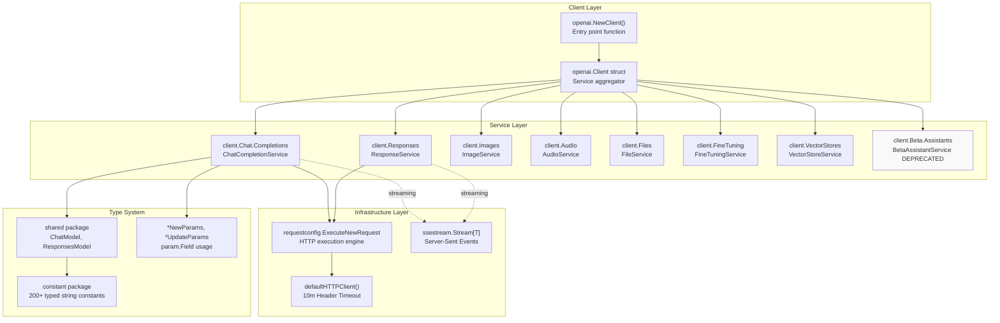

**Architecture Overview**

### Client Layer
The `openai.NewClient()` function ([client.go:97-125]()) serves as the single entry point, returning an `openai.Client` struct that aggregates all service interfaces. Configuration is applied via functional options from the `option` package.

### Service Layer
Top-level services are accessed as fields on the client (e.g., `client.Chat`, `client.Responses`, `client.Images`). Each service exposes methods for API operations like `.New()`, `.Get()`, `.List()`, `.Delete()`.

**Key Services:**
- `ChatCompletionService`: Multi-modal chat completions with tool calling ([api.md:49-65]())
- `ResponseService`: Modern response API with stateless/linked design ([client.go:52]())
- `RealtimeService`: WebSocket-based voice and audio communication ([client.go:53]())
- `ConversationService`: Management of stateful conversation items ([client.go:55]())

### Infrastructure Layer
- **`requestconfig.ExecuteNewRequest`**: Handles HTTP request execution, retry logic, and serialization ([client.go:158-161]()).
- **`ssestream.Stream[T]`**: Generic streaming iterator for Server-Sent Events ([packages/ssestream/ssestream.go:137-143]()).
- **`defaultHTTPClient`**: Clones `http.DefaultTransport` and adds a 10-minute `ResponseHeaderTimeout` ([default_http_client.go:20-24]()).

### Type System
- **Shared Types**: Common types like `ChatModel`, `ResponsesModel`, and `FunctionDefinition` reside in the `shared` package ([api.md:3-16]()).
- **Constants**: The `constant` package provides hundreds of typed string constants for events, models, and statuses ([shared/constant/constants.go:21-97]()).

**Sources:** [client.go:23-59](), [packages/ssestream/ssestream.go:137-143](), [default_http_client.go:14-24]()

## Service Hierarchy and Entry Points

The SDK organizes 20+ services in a hierarchical structure.

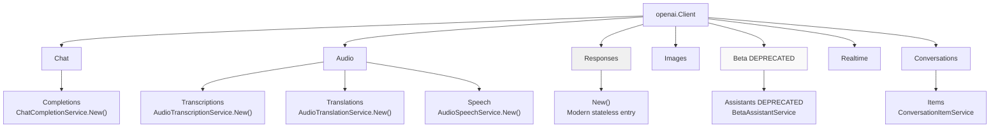

**Service Access Patterns**

Services are accessed via dot notation on the client:
- **Level 1**: `client.Chat`, `client.Responses`, `client.Images` ([client.go:23-59]())
- **Level 2**: `client.Chat.Completions`, `client.Audio.Transcriptions` ([api.md:45-120]())

Common method names across services:
- `.New(ctx, params)`: Create a resource ([api.md:45]())
- `.NewStreaming(ctx, params)`: Create with streaming response ([README.md:168]())
- `.Get(ctx, id)`: Retrieve a resource by ID

**Sources:** [api.md:35-311](), [client.go:23-59]()

## Request/Response Flow

The SDK implements a pipeline with parameter transformation and dual response modes.

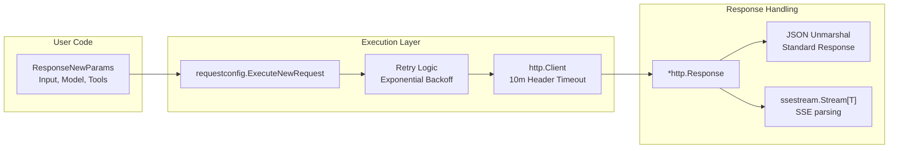

**Streaming Mechanism**
The `ssestream.Stream[T]` handles SSE events, parsing `[DONE]` markers and synthesizing event data for thread-based events ([packages/ssestream/ssestream.go:181-206]()).

**Sources:** [packages/ssestream/ssestream.go:171-228](), [default_http_client.go:14-24]()

## Installation and Quick Start

### Installation

```bash
# Install the v3 SDK
go get -u 'github.com/openai/openai-go/v3@v3.33.0'
```

**Minimum version:** Go 1.22+ ([README.md:40]())

### Basic Usage Example (Modern Responses API)

```go
package main

import (
	"context"
	"github.com/openai/openai-go/v3"
	"github.com/openai/openai-go/v3/option"
	"github.com/openai/openai-go/v3/responses"
)

func main() {
	client := openai.NewClient(
		option.WithAPIKey("My API Key"), // defaults to OPENAI_API_KEY
	)

	resp, err := client.Responses.New(context.Background(), responses.ResponseNewParams{
		Input: responses.ResponseNewParamsInputUnion{OfString: openai.String("Hello!")},
		Model: openai.ChatModelGPT4o,
	})
	if err != nil {
		panic(err)
	}
	println(resp.OutputText())
}
```

**Sources:** [README.md:46-78](), [client.go:61-90]()

## Architectural Shift: Beta Assistants → Responses API

The SDK highlights a transition from the stateful **Beta Assistants API** to the modern **Responses API**.

| Aspect | Beta Assistants (Deprecated) | Responses API (Modern) |
|--------|----------------------------|----------------------|
| **Primary Field** | `client.Beta.Assistants` | `client.Responses` |
| **Context** | Stateful `Thread` objects | Linked via `PreviousResponseID` |
| **Usage** | Persistent configuration | Stateless/Linked per-request |
| **Streaming** | Run events | `ResponseStreamEventUnion` |

The Responses API is now the recommended primary API for interacting with OpenAI models ([README.md:46]()).

**Sources:** [README.md:46-48](), [README.md:84-107](), [client.go:47-52]()

---
For details on installation, see [Installation and Setup](#1.1).  
To start coding immediately, see [Quick Start Guide](#1.2).

---

# Page: Installation and Setup

# Installation and Setup

<details>
<summary>Relevant source files</summary>

The following files were used as context for generating this wiki page:

- [.release-please-manifest.json](.release-please-manifest.json)
- [CHANGELOG.md](CHANGELOG.md)
- [README.md](README.md)
- [auth/error.go](auth/error.go)
- [auth/middleware.go](auth/middleware.go)
- [auth/subjecttokenprovider.go](auth/subjecttokenprovider.go)
- [auth/subjecttokenprovider_test.go](auth/subjecttokenprovider_test.go)
- [auth/types.go](auth/types.go)
- [auth/workloadidentity.go](auth/workloadidentity.go)
- [auth/workloadidentity_test.go](auth/workloadidentity_test.go)
- [client.go](client.go)
- [default_http_client.go](default_http_client.go)
- [internal/version.go](internal/version.go)
- [packages/ssestream/ssestream.go](packages/ssestream/ssestream.go)
- [shared/constant/constants.go](shared/constant/constants.go)

</details>


This document covers the installation of the `openai-go` SDK, authentication configuration, and client initialization. It provides the foundational steps required to begin making API calls to OpenAI's services.

For information about configuring request options and middleware, see **Client Configuration and Options**. For details on making your first API call, see **Quick Start Guide**.

---

## System Requirements

The `openai-go` SDK requires **Go 1.22 or later**.

**Sources:** [README.md:38-40]()

---

## Installation

### Adding the SDK Dependency

Import the SDK in your Go code:

```go
import (
    "github.com/openai/openai-go/v3" // imported as openai
)
```

The SDK uses semantic versioning with the major version in the import path. The current major version is `v3`.

**Sources:** [README.md:18-26]()

### Version Pinning

To pin a specific version using `go get`:

```sh
go get -u 'github.com/openai/openai-go/v3@v3.33.0'
```

The current version is tracked in multiple locations:
- [.release-please-manifest.json:2]() - Release version manifest
- [internal/version.go:5]() - Package version constant `PackageVersion`

**Sources:** [README.md:28-36](), [.release-please-manifest.json:1-3](), [internal/version.go:1-6]()

---

## Authentication Configuration

The SDK supports multiple authentication methods, with API keys being the primary mechanism. Authentication can be configured via environment variables, direct client options, or advanced Workload Identity.

### Environment Variable Configuration

The SDK automatically reads authentication credentials from the following environment variables:

| Environment Variable | Purpose |
|---------------------|---------|
| `OPENAI_API_KEY` | OpenAI API authentication key |
| `OPENAI_ORG_ID` | Organization identifier |
| `OPENAI_PROJECT_ID` | Project identifier |
| `OPENAI_WEBHOOK_SECRET` | Webhook signature verification secret |
| `OPENAI_BASE_URL` | Custom base URL for API endpoint |
| `OPENAI_CUSTOM_HEADERS` | Newline-separated custom headers (e.g., `Header: Value`) |

#### Environment Variable to Configuration Mapping

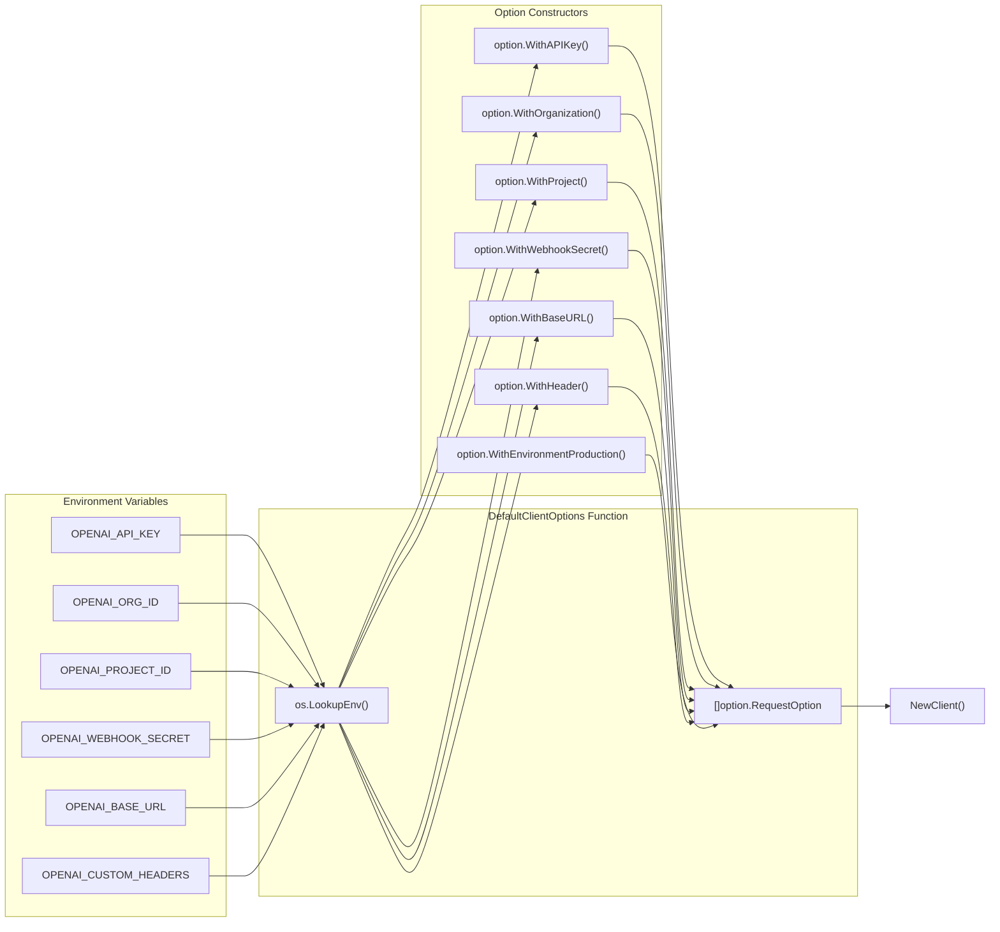

The [client.go:64-90]() `DefaultClientOptions` function performs this environment variable lookup and returns a slice of `option.RequestOption` values. These are automatically applied when calling [client.go:97]() `NewClient`.

**Sources:** [client.go:61-90](), [README.md:62]()

### Direct Configuration via Options

Authentication can be explicitly configured using option functions, which override environment variables:

```go
client := openai.NewClient(
    option.WithAPIKey("sk-..."),           // Override OPENAI_API_KEY
    option.WithOrganization("org-..."),    // Override OPENAI_ORG_ID
    option.WithProject("proj-..."),        // Override OPENAI_PROJECT_ID
)
```

Options passed to `NewClient` are appended to defaults, meaning they take precedence.

**Sources:** [README.md:59-63](), [client.go:97-100]()

### Advanced: Workload Identity

For environments requiring short-lived tokens or identity-based auth (Kubernetes, Azure, GCP), the SDK provides a `WorkloadIdentity` system.

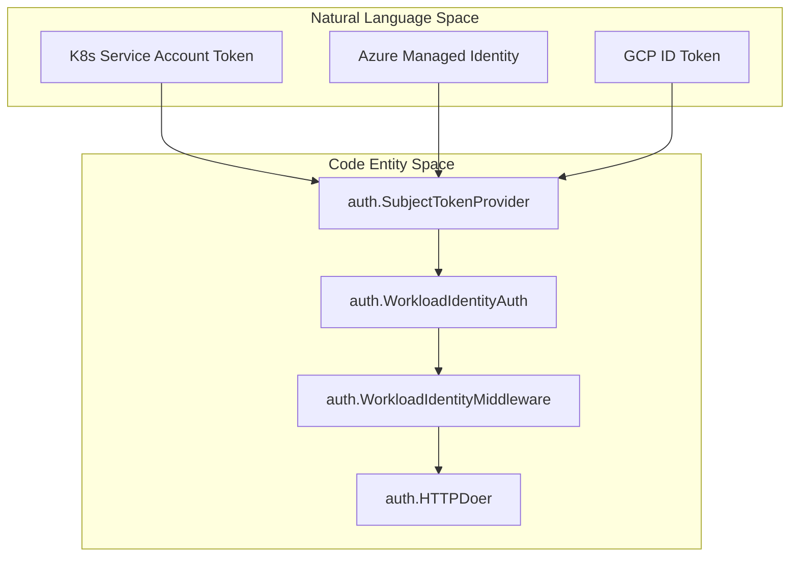

Key components include:
- **`SubjectTokenProvider`**: Fetches the initial subject token (e.g., K8s JWT from disk) [auth/types.go:19-22]().
- **`WorkloadIdentityAuth`**: Manages token exchange for OpenAI access tokens and handles caching/expiration [auth/workloadidentity_test.go:82-87]().
- **`WorkloadIdentityMiddleware`**: Automatically injects the `Authorization: Bearer <token>` header and handles 401 Unauthorized retries by invalidating the cached token [auth/middleware.go:7-25]().

**Sources:** [auth/types.go:19-30](), [auth/middleware.go:7-50](), [auth/subjecttokenprovider_test.go:14-162]()

---

## Client Initialization

### Basic Client Creation

The primary entry point is the `openai.NewClient` function, which initializes the main client and all sub-services.

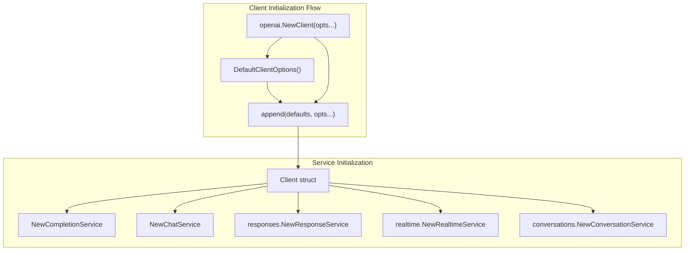

The [client.go:97-125]() `NewClient` function:
1. Combines default options with provided options.
2. Sets a default HTTP client with a 10-minute header timeout if none is provided [default_http_client.go:14-24]().
3. Instantiates the `Client` struct and initializes all services.

**Sources:** [client.go:97-125](), [default_http_client.go:10-24]()

### Client Structure

The `Client` struct aggregates services that route to specific API segments:

| Service Field | Type | Purpose |
|--------------|------|---------|
| `Responses` | `responses.ResponseService` | Modern Responses API (successor to Assistants) |
| `Chat` | `ChatService` | Standard Chat Completion APIs |
| `Realtime` | `realtime.RealtimeService` | WebSocket-based real-time communication |
| `Conversations`| `conversations.ConversationService` | State management for conversation items |
| `Files` | `FileService` | File upload and management |
| `Beta` | `BetaService` | Legacy Assistants and other beta features |

**Sources:** [client.go:23-59]()

---

## Verification

Verify the client setup by making a simple request to the modern `Responses` API:

```go
package main

import (
    "context"
    "github.com/openai/openai-go/v3"
    "github.com/openai/openai-go/v3/responses"
)

func main() {
    client := openai.NewClient()
    
    resp, err := client.Responses.New(context.Background(), responses.ResponseNewParams{
        Model: openai.ChatModelGPT4o,
        Input: responses.ResponseNewParamsInputUnion{
            OfString: openai.String("Hello, world!"),
        },
    })
    if err != nil {
        panic(err)
    }
    println(resp.OutputText())
}
```

**Sources:** [README.md:59-78]()

---

# Page: Quick Start Guide

# Quick Start Guide

<details>
<summary>Relevant source files</summary>

The following files were used as context for generating this wiki page:

- [.release-please-manifest.json](.release-please-manifest.json)
- [CHANGELOG.md](CHANGELOG.md)
- [README.md](README.md)
- [examples/audio-text-to-speech/main.go](examples/audio-text-to-speech/main.go)
- [examples/audio-transcriptions/main.go](examples/audio-transcriptions/main.go)
- [examples/chat-completion-streaming/main.go](examples/chat-completion-streaming/main.go)
- [examples/chat-completion/main.go](examples/chat-completion/main.go)
- [examples/go.mod](examples/go.mod)
- [examples/go.sum](examples/go.sum)
- [examples/image-generation/main.go](examples/image-generation/main.go)
- [examples/structured-outputs/main.go](examples/structured-outputs/main.go)
- [internal/version.go](internal/version.go)
- [packages/ssestream/ssestream.go](packages/ssestream/ssestream.go)

</details>


This guide provides a minimal working example to get started with the `openai-go` SDK. It covers installation, client initialization, and making your first API call using the primary **Responses API**. For detailed information about client configuration options, see [Client Configuration and Options](#2.1).

## Installation and Requirements

The `openai-go` SDK requires **Go 1.22 or later** [README.md:38-40](). Install the SDK using Go modules:

```bash
go get -u 'github.com/openai/openai-go/v3@v3.33.0'
```

Import the package in your code:

```go
import (
    "github.com/openai/openai-go/v3"
    "github.com/openai/openai-go/v3/option"
    "github.com/openai/openai-go/v3/responses"
)
```

The SDK version is managed via `internal.PackageVersion` [internal/version.go:5]().

**Sources:** [README.md:16-40](), [internal/version.go:1-6](), [.release-please-manifest.json:1-2]()

---

## Client Initialization Flow

The following diagram shows how the client initialization process maps to code entities. The SDK uses a functional options pattern to configure the client.

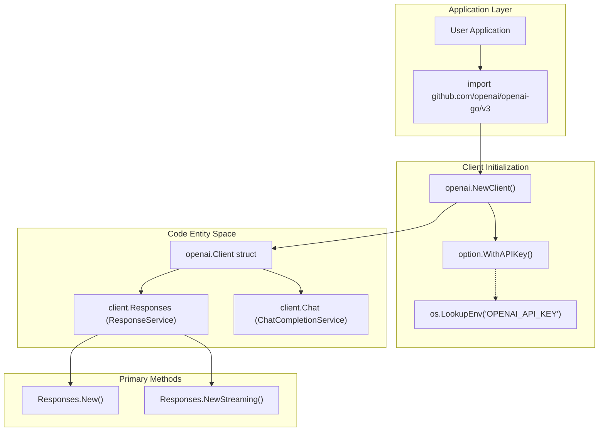

**Sources:** [README.md:59-63](), [examples/chat-completion/main.go:10-10]()

---

## Initializing the Client

The `openai.NewClient()` function creates a client instance. Authentication is handled via API key, which defaults to the `OPENAI_API_KEY` environment variable [README.md:62-62]():

```go
// Using environment variable (default)
client := openai.NewClient()

// Or explicitly set the API key using functional options
client := openai.NewClient(
    option.WithAPIKey("My API Key"),
)
```

The client provides access to various services like `Responses`, `Chat`, `Audio`, and `Images`.

**Sources:** [README.md:59-63](), [examples/audio-transcriptions/main.go:11-11]()

---

## Making Your First Response Request

The primary API for interacting with OpenAI models is the **Responses API** [README.md:46-46](). This replaces the legacy Chat Completions API for most use cases.

### Request Data Flow

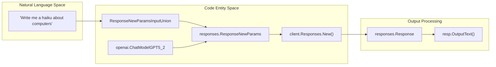

### Minimal Example

```go
ctx := context.Background()
client := openai.NewClient()

resp, err := client.Responses.New(ctx, responses.ResponseNewParams{
    Input: responses.ResponseNewParamsInputUnion{
        OfString: openai.String("Write me a haiku about computers"),
    },
    Model: openai.ChatModelGPT5_2,
})

if err != nil {
    panic(err)
}

println(resp.OutputText())
```

| Component | Code Entity | Role |
|-----------|-------------|------|
| **Input** | `ResponseNewParamsInputUnion` | Accepts strings or structured items [README.md:68-68]() |
| **Model** | `openai.ChatModelGPT5_2` | Typed constant for model selection [README.md:69-69]() |
| **Method** | `client.Responses.New()` | Executes the request [README.md:67-67]() |
| **Output** | `resp.OutputText()` | Helper to extract text from the response object [README.md:76-76]() |

**Sources:** [README.md:49-78](), [examples/chat-completion/main.go:10-30]()

---

## Streaming Responses

For real-time applications, use `NewStreaming`. The SDK manages the Server-Sent Events (SSE) stream using the `ssestream` package.

```go
stream := client.Responses.NewStreaming(ctx, responses.ResponseNewParams{
    Model: openai.ChatModelGPT5_2,
    Input: responses.ResponseNewParamsInputUnion{
        OfString: openai.String("Write a haiku about programming"),
    },
})

for stream.Next() {
    event := stream.Current()
    print(event.Delta)
}

if stream.Err() != nil {
    panic(stream.Err())
}
```

The `Stream[T]` struct handles the iteration logic, checking for `[DONE]` markers and unmarshaling incoming JSON chunks [packages/ssestream/ssestream.go:137-228]().

**Sources:** [README.md:168-183](), [packages/ssestream/ssestream.go:171-228]()

---

## Continuing Conversations

The Responses API is stateless by default but allows chaining via `PreviousResponseID`.

```go
// First turn
resp, _ := client.Responses.New(ctx, responses.ResponseNewParams{
    Model: openai.ChatModelGPT5_2,
    Input: responses.ResponseNewParamsInputUnion{OfString: openai.String("What is the capital of France?")},
})

// Second turn - referencing the first response
followUp, _ := client.Responses.New(ctx, responses.ResponseNewParams{
    Model:              openai.ChatModelGPT5_2,
    PreviousResponseID: openai.String(resp.ID),
    Input:              responses.ResponseNewParamsInputUnion{OfString: openai.String("And its population?")},
})
```

**Sources:** [README.md:84-107]()

---

## Next Steps

Explore advanced capabilities of the SDK:

- **[Structured Outputs and Response Formats](#3.4)**: Use `ResponseFormatJSONSchema` for validated JSON responses [examples/structured-outputs/main.go:54-71]().
- **[Tool Calling and Functions](#3.3)**: Define functions for the model to call using `FunctionToolParam` [README.md:201-214]().
- **[Audio Services](#6)**: Generate speech [examples/audio-text-to-speech/main.go:17-22]() or transcribe audio [examples/audio-transcriptions/main.go:19-22]().
- **[Image Generation and Editing](#5)**: Create images with DALL-E 3 [examples/image-generation/main.go:24-29]().

**Sources:** [README.md:43](), [examples/structured-outputs/main.go:1-93]()

---

# Page: Core Architecture

# Core Architecture

<details>
<summary>Relevant source files</summary>

The following files were used as context for generating this wiki page:

- [.release-please-manifest.json](.release-please-manifest.json)
- [CHANGELOG.md](CHANGELOG.md)
- [README.md](README.md)
- [client.go](client.go)
- [default_http_client.go](default_http_client.go)
- [internal/requestconfig/requestconfig.go](internal/requestconfig/requestconfig.go)
- [internal/version.go](internal/version.go)
- [option/requestoption.go](option/requestoption.go)
- [packages/ssestream/ssestream.go](packages/ssestream/ssestream.go)
- [shared/constant/constants.go](shared/constant/constants.go)

</details>


## Purpose and Scope

This document explains the fundamental architectural layers of the `openai-go` SDK and how they work together to provide a robust, type-safe client for the OpenAI API. It covers the client initialization pattern, service organization, infrastructure components for request execution, the type system, and the code generation pipeline.

For specific details on:
- Client configuration options and patterns, see [Client Configuration and Options](#2.1)
- Request execution internals and middleware, see [Request Execution Pipeline](#2.2)
- Error handling and retry behavior, see [Error Handling and Retries](#2.3)
- Streaming implementation details, see [Streaming Architecture](#2.4)

---

## Architecture Overview

The SDK follows a layered architecture with clear separation of concerns:

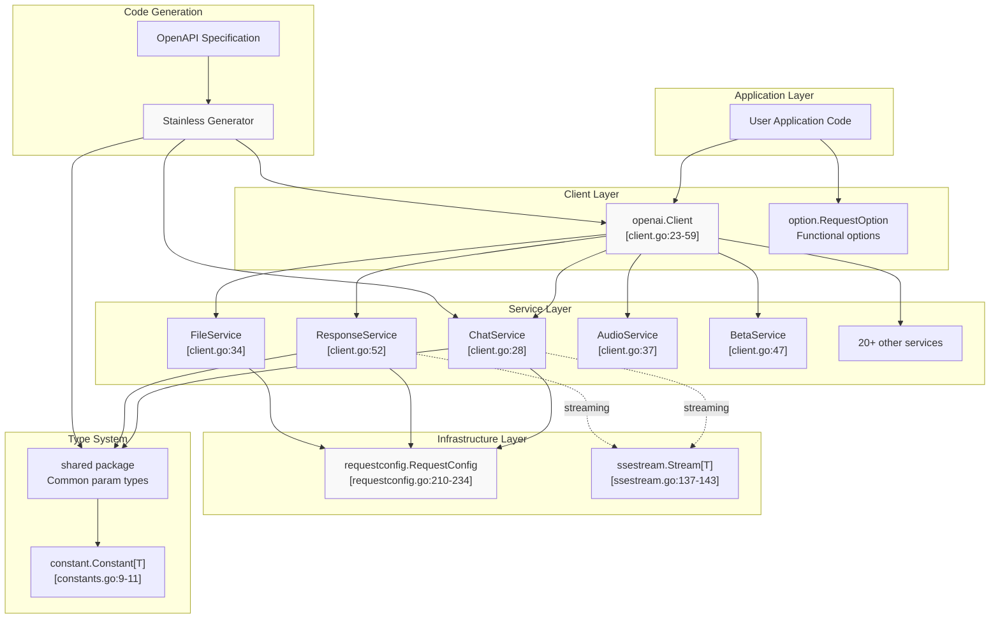

**Sources:** [client.go:23-59](), [packages/ssestream/ssestream.go:137-217](), [shared/constant/constants.go:1-20](), [internal/requestconfig/requestconfig.go:210-234]()

---

## Client Layer

### Client Initialization

The `Client` struct serves as the main entry point and aggregates all service interfaces. It is initialized using the `NewClient` function [client.go:97-125]() with functional options:

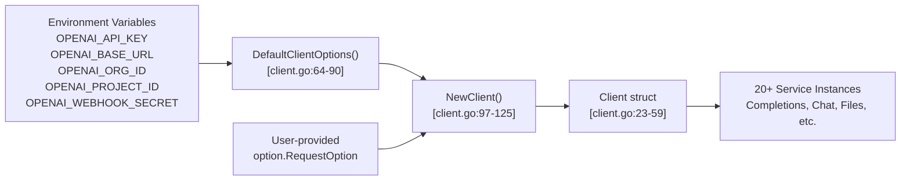

The client initialization pattern uses defaults from environment variables, which can be overridden by user-provided options:

| Environment Variable | Purpose | Default Option Function |
|---------------------|---------|------------------------|
| `OPENAI_API_KEY` | Authentication | `option.WithAPIKey()` |
| `OPENAI_BASE_URL` | Base API URL | `option.WithBaseURL()` |
| `OPENAI_ORG_ID` | Organization ID | `option.WithOrganization()` |
| `OPENAI_PROJECT_ID` | Project ID | `option.WithProject()` |
| `OPENAI_WEBHOOK_SECRET` | Webhook verification | `option.WithWebhookSecret()` |

**Sources:** [client.go:64-125](), [README.md:61-78]()

### Client Service Structure

The `Client` struct [client.go:23-59]() provides access to services organized by API domain. Each service is initialized with the same options passed to the client [client.go:102-122](), enabling consistent configuration across all services.

**Sources:** [client.go:23-122]()

### Generic Request Methods

The `Client` provides generic HTTP methods for accessing undocumented endpoints while retaining configuration [client.go:158-185]():

- `Execute(ctx, method, path, params, res, opts...)` [client.go:158]()
- `Get(ctx, path, params, res, opts...)` [client.go:165]()
- `Post(ctx, path, params, res, opts...)` [client.go:171]()

These methods support flexible parameter serialization and response deserialization:
- Parameters can be structs with `MarshalJSON`, byte slices, or `io.Reader` [internal/requestconfig/requestconfig.go:97-141]().
- All client options (auth, retries, middleware) are preserved via `slices.Concat(r.Options, opts)` [client.go:159]().

**Sources:** [client.go:158-185](), [internal/requestconfig/requestconfig.go:91-153]()

---

## Infrastructure Layer

### Request Execution Engine

The `internal/requestconfig` package provides the core HTTP execution engine. All service methods route through `NewRequestConfig`, which handles:

- **Header Management**: Default headers like `User-Agent` [requestconfig.go:28-32]() and platform properties [requestconfig.go:70-79]().
- **Serialization**: Automatic selection of JSON, Multipart, or Query string serialization based on the body type [requestconfig.go:97-153]().
- **Middleware Chain**: Intercepting and modifying requests [requestconfig.go:244-248]().
- **Retry Logic**: Determining if a request is retryable based on status codes and idempotency [requestconfig.go:250-264]().

**Sources:** [internal/requestconfig/requestconfig.go:28-264]()

### Streaming Infrastructure

The `ssestream` package [ssestream.go:1-245]() implements Server-Sent Events (SSE) streaming. The `Stream[T]` generic type [ssestream.go:137-143]() provides a type-safe iterator:

- `Next()` advances to the next event, handling `[DONE]` markers [ssestream.go:181-185]() and parsing the "data" field into type `T` [ssestream.go:216]().
- `Current()` returns the current deserialized event [ssestream.go:230]().
- `Err()` returns any error that occurred during streaming, including `StreamError` for structured API errors [ssestream.go:55-62]().

**Sources:** [packages/ssestream/ssestream.go:1-245]()

---

## Type System

### Shared Types and Constants

The type system is organized around shared types and typed constants. The `constant` package [constants.go:1-304]() provides a pattern for typed string constants:

- **Constant Interface**: `Constant[T]` defines a `Default()` method [constants.go:9-11]().
- **Typed Constants**: Over 200 constants like `constant.ChatCompletion` [constants.go:38](), `constant.Assistant` [constants.go:29](), and `constant.CodeInterpreter` [constants.go:54]().
- **Type Safety**: Use `constant.ValueOf[T]()` to safely retrieve default values [constants.go:16-19]().

**Sources:** [shared/constant/constants.go:1-304]()

---

## Code Generation Pipeline

The entire SDK is generated from OpenAPI specifications using the Stainless generator.

- **Generation Markers**: Files include a header indicating they are generated [client.go:1](), [internal/version.go:1]().
- **Version Tracking**: The `internal.PackageVersion` is synced with the release manifest [internal/version.go:5](), [.release-please-manifest.json:2]().
- **Metadata**: Platform properties (OS, Architecture, Runtime) are automatically injected into request headers for telemetry [internal/requestconfig/requestconfig.go:70-79]().

**Sources:** [client.go:1](), [internal/version.go:1-6](), [internal/requestconfig/requestconfig.go:70-79](), [.release-please-manifest.json:1-3]()

---

## Summary

The `openai-go` architecture provides a consistent, type-safe interface for OpenAI services by layering high-level client services over a robust request execution and streaming infrastructure. The heavy use of code generation ensures that the SDK remains in sync with the underlying REST API while providing Go-idiomatic patterns like functional options and generic streams.

**Sources:** [client.go:1-185](), [internal/requestconfig/requestconfig.go:1-264](), [packages/ssestream/ssestream.go:1-245]()

---

# Page: Client Configuration and Options

# Client Configuration and Options

<details>
<summary>Relevant source files</summary>

The following files were used as context for generating this wiki page:

- [client.go](client.go)
- [default_http_client.go](default_http_client.go)
- [internal/requestconfig/requestconfig.go](internal/requestconfig/requestconfig.go)
- [option/middleware.go](option/middleware.go)
- [option/requestoption.go](option/requestoption.go)
- [shared/constant/constants.go](shared/constant/constants.go)

</details>


This document describes the client configuration system, including the functional options pattern, available configuration options, and how options are applied at both client and request levels. For information about how these options are used during request execution, see [Request Execution Pipeline](#2.2).

## Overview

The `openai-go` library uses the **functional options pattern** to configure both the client and individual API requests. This pattern provides a flexible, type-safe way to configure the client with sensible defaults while allowing fine-grained control when needed. Options are represented by the `option.RequestOption` interface and can be applied at two levels:

1. **Client-level**: Options passed to `openai.NewClient()` that apply to all requests.
2. **Request-level**: Options passed to individual API methods that override client defaults.

The configuration system is implemented in two primary locations:
- `option.RequestOption` interface and concrete implementations in [option/requestoption.go:20-250]()
- `requestconfig.RequestConfig` struct and application logic in [internal/requestconfig/requestconfig.go:81-234]()

## The Functional Options Pattern

The functional options pattern uses functions that modify a configuration object. Each option is a function that implements the `RequestOption` interface:

Title: Request Option Type Hierarchy
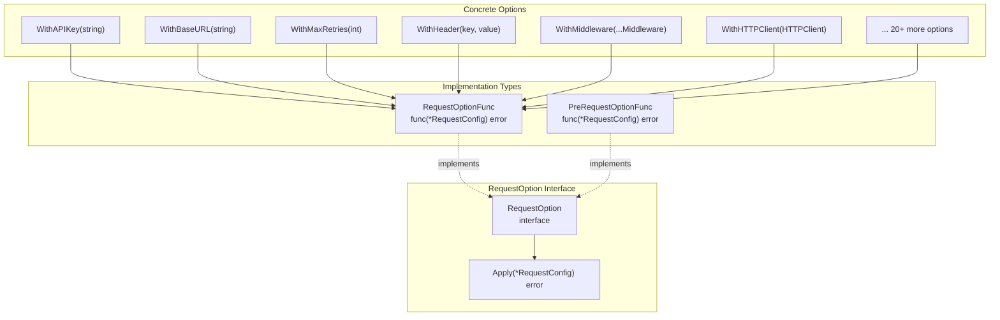
Sources: [option/requestoption.go:25-26](), [internal/requestconfig/requestconfig.go:81-90]()

The `RequestOption` interface has a single method `Apply(*RequestConfig) error` that modifies the configuration. Two function types implement this interface:

- `RequestOptionFunc`: Regular options that modify configuration during or after request creation [internal/requestconfig/requestconfig.go:85-88]().
- `PreRequestOptionFunc`: Special options that must be known before request creation, such as those used in webhook verification [internal/requestconfig/requestconfig.go:86-89]().

## Client-Level vs Request-Level Configuration

Options can be specified at two levels, with request-level options overriding client-level options.

Title: Option Application Lifecycle
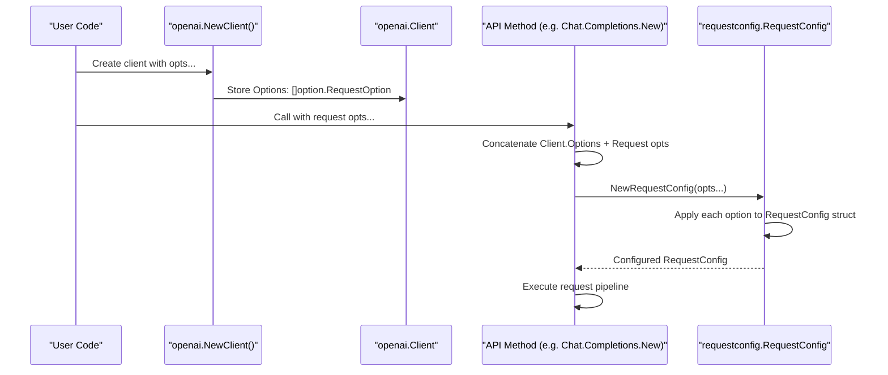
Sources: [client.go:97-125](), [client.go:158-161](), [internal/requestconfig/requestconfig.go:181-184]()

### Client-Level Configuration

Client-level options are provided to `openai.NewClient()` and apply to all requests made by that client. If no options are provided, `NewClient` uses `DefaultClientOptions()` which reads from environment variables [client.go:64-90]().

```go
client := openai.NewClient(
    option.WithAPIKey("sk-..."),              
    option.WithOrganization("org-..."),       
    option.WithMaxRetries(5),                 
)
```
Sources: [client.go:97-100](), [client.go:61-63]()

### Request-Level Configuration

Request-level options are passed as the final arguments to service methods and override client defaults for that specific call [client.go:158-161]().

```go
completion, err := client.Chat.Completions.New(
    ctx,
    params,
    option.WithHeader("X-Custom-Header", "value"),
    option.WithMaxRetries(0), // Disable retries for this call
)
```
Sources: [client.go:158-161](), [option/requestoption.go:101-109]()

## Available Configuration Options

### Authentication and Identity

| Option | Description | File Reference |
|--------|-------------|----------------|
| `WithAPIKey(string)` | Sets the OpenAI API key | [option/requestoption.go:275-281]() |
| `WithOrganization(string)` | Sets the `OpenAI-Organization` header | [option/requestoption.go:283-289]() |
| `WithProject(string)` | Sets the `OpenAI-Project` header | [option/requestoption.go:291-297]() |
| `WithWebhookSecret(string)`| Sets secret for webhook verification | [option/requestoption.go:299-305]() |

### Infrastructure and Network

| Option | Description | Default |
|--------|-------------|---------|
| `WithBaseURL(string)` | Overrides the base URL for API requests | `https://api.openai.com/v1/` |
| `WithHTTPClient(HTTPClient)` | Replaces the underlying `*http.Client` | `defaultHTTPClient()` |
| `WithMaxRetries(int)` | Sets maximum retry attempts | 2 |
| `WithMiddleware(...Middleware)` | Adds custom request/response interceptors | None |

Sources: [option/requestoption.go:30-44](), [option/requestoption.go:60-76](), [option/requestoption.go:96-109](), [option/requestoption.go:89-94](), [internal/requestconfig/requestconfig.go:174-177]()

### Body and Parameter Manipulation

The SDK provides powerful options for modifying the request body using JSON path syntax via `sjson`.

| Option | Description | Example |
|--------|-------------|---------|
| `WithJSONSet(key, val)` | Sets a JSON value in the request body | `option.WithJSONSet("stream", true)` |
| `WithJSONDel(key)` | Deletes a JSON key from the request body | `option.WithJSONDel("user")` |
| `WithHeader(key, val)` | Sets an HTTP header | `option.WithHeader("X-ID", "123")` |
| `WithQuery(key, val)` | Sets a URL query parameter | `option.WithQuery("limit", "10")` |

Sources: [option/requestoption.go:173-195](), [option/requestoption.go:201-213](), [option/requestoption.go:113-118](), [option/requestoption.go:139-146]()

## RequestConfig Structure

The `RequestConfig` struct is the internal state container that options modify.

Title: Code Entity Mapping - RequestConfig
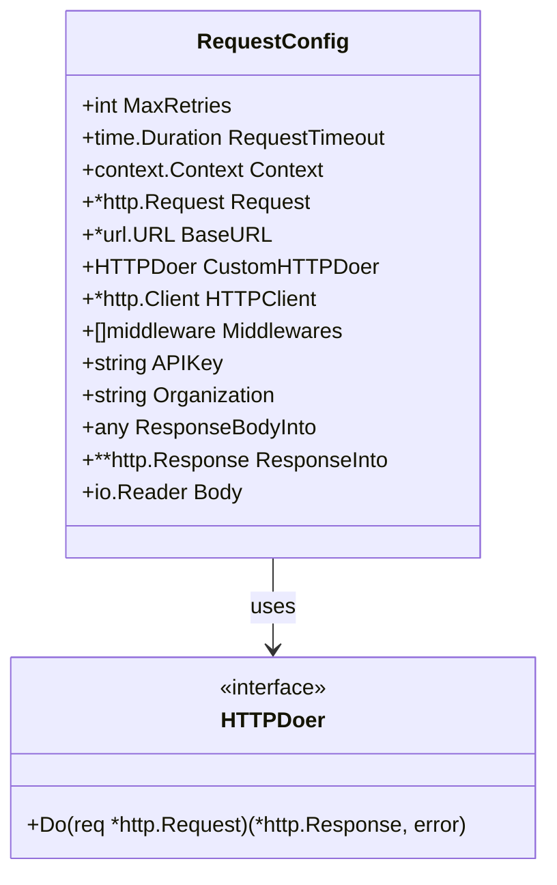
Sources: [internal/requestconfig/requestconfig.go:202-234]()

### Default Headers and Platform Properties

The SDK automatically populates `RequestConfig` with platform metadata to assist in debugging and usage tracking. These are set in `NewRequestConfig`.

- **User-Agent**: `OpenAI/Go {PackageVersion}` [internal/requestconfig/requestconfig.go:28-32]()
- **X-Stainless-Lang**: `go` [internal/requestconfig/requestconfig.go:72]()
- **X-Stainless-OS**: Normalized OS name (e.g., "MacOS", "Linux") [internal/requestconfig/requestconfig.go:34-53]()
- **X-Stainless-Arch**: Architecture (e.g., "x64", "arm64") [internal/requestconfig/requestconfig.go:55-68]()
- **X-Stainless-Runtime-Version**: The Go version [internal/requestconfig/requestconfig.go:77]()

## Implementation Detail: Body Serialization

`NewRequestConfig` handles complex serialization logic based on the input `body` type:

1. **JSON**: If it implements `json.Marshaler` [internal/requestconfig/requestconfig.go:97-104]().
2. **Multipart**: If it implements `apiform.Marshaler` [internal/requestconfig/requestconfig.go:105-116]().
3. **Query**: If it implements `apiquery.Queryer`, parameters are appended to the URL [internal/requestconfig/requestconfig.go:117-133]().
4. **Raw**: `[]byte` or `io.Reader` are used directly [internal/requestconfig/requestconfig.go:134-141]().

Sources: [internal/requestconfig/requestconfig.go:91-153]()

## HTTP Client Customization

The SDK uses a default client with a 10-minute `ResponseHeaderTimeout` to prevent indefinite hangs while allowing long-running streams [default_http_client.go:10-24](). Users can override this using `option.WithHTTPClient`. If the provided client is a standard `*http.Client`, it is assigned to `RequestConfig.HTTPClient`; otherwise, it is treated as a `CustomHTTPDoer` [option/requestoption.go:60-76]().

Sources: [default_http_client.go:20-24](), [option/requestoption.go:51-53](), [internal/requestconfig/requestconfig.go:202-204]()

---

# Page: Request Execution Pipeline

# Request Execution Pipeline

<details>
<summary>Relevant source files</summary>

The following files were used as context for generating this wiki page:

- [internal/apiform/encoder.go](internal/apiform/encoder.go)
- [internal/apiform/form_test.go](internal/apiform/form_test.go)
- [internal/apijson/encoder.go](internal/apijson/encoder.go)
- [internal/apijson/json_test.go](internal/apijson/json_test.go)
- [internal/apiquery/encoder.go](internal/apiquery/encoder.go)
- [internal/requestconfig/requestconfig.go](internal/requestconfig/requestconfig.go)
- [option/requestoption.go](option/requestoption.go)

</details>


This document explains the internal request processing flow in the `openai-go` library, detailing how API method calls are transformed into HTTP requests and executed. It covers body serialization, URL construction, middleware application, retry logic, and response handling.

For client initialization and configuration options, see [Client Configuration and Options](#2.1). For error handling details, see [Error Handling and Retries](#2.3). For streaming architecture, see [Streaming Architecture](#2.4).

## Overview

The request execution pipeline is the core infrastructure that transforms API method calls into HTTP requests and processes responses. Every API call flows through this pipeline, from parameter marshaling to response deserialization.

### Entry Points and Flow

Service methods (e.g., `Chat.Completions.New()`) call `ExecuteNewRequest()` at [internal/requestconfig/requestconfig.go:564-570](), which creates a `RequestConfig` via `NewRequestConfig()` and executes it. This function serves as the bridge between high-level API methods and low-level HTTP operations.

### Pipeline Stages

**Request Execution Pipeline - Complete Flow**

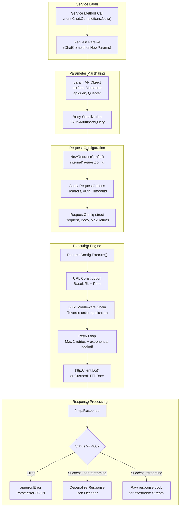

**Sources:** [internal/requestconfig/requestconfig.go:91-192](), [internal/requestconfig/requestconfig.go:380-562](), [internal/requestconfig/requestconfig.go:564-570]()

## Parameter Marshaling and Body Serialization

Request parameters in `openai-go` implement specific interfaces for serialization. The `NewRequestConfig` function at [internal/requestconfig/requestconfig.go:91-192]() detects the appropriate strategy through interface checks.

### Serialization Interfaces and Strategy

| Interface | Content Type | Use Case | Implementation File |
|-----------|--------------|----------|---------------------|
| `json.Marshaler` | `application/json` | JSON request bodies | [internal/apijson/encoder.go]() |
| `apiform.Marshaler` | `multipart/form-data` | File uploads | [internal/apiform/encoder.go]() |
| `apiquery.Queryer` | N/A (URL params) | List operations | [internal/apiquery/encoder.go]() |
| `[]byte` | `application/json` | Pre-serialized content | [internal/requestconfig/requestconfig.go:134-137]() |
| `io.Reader` | `application/json` | Streaming uploads | [internal/requestconfig/requestconfig.go:138-141]() |

### Serialization Logic Flow

The serialization logic at [internal/requestconfig/requestconfig.go:97-153]() checks each interface in order:

1.  **JSON Marshaling** ([lines 97-104]()): Calls `body.MarshalJSON()`. Sets `hasSerializationFunc = true`.
2.  **Multipart Form** ([lines 105-116]()): Calls `body.MarshalMultipart()` from the `apiform` package. Used for file uploads.
3.  **Query Parameters** ([lines 117-133]()): Calls `body.URLQuery()` from `apiquery` and appends encoded params to the URL.
4.  **Raw Bytes/Reader** ([lines 134-141]()): Direct pass-through for `[]byte` or `io.Reader`.
5.  **Fallback JSON** ([lines 145-153]()): If no interface was detected, uses `json.NewEncoder` with `SetEscapeHTML(false)`.

**Sources:** [internal/requestconfig/requestconfig.go:91-153](), [internal/apiform/encoder.go:21-27](), [internal/apijson/encoder.go:25-28]()

## Request Configuration

After serialization, `NewRequestConfig` creates an `http.Request` and initializes the `RequestConfig` struct.

### Default Headers

The following headers are set by default at [internal/requestconfig/requestconfig.go:160-172]():

```go
// From getDefaultHeaders() at lines 28-32
"User-Agent": "OpenAI/Go {version}"

// From getPlatformProperties() at lines 70-79
"X-Stainless-Lang": "go"
"X-Stainless-Package-Version": "{version}"
"X-Stainless-OS": "{normalized OS}"
"X-Stainless-Arch": "{architecture}"
"X-Stainless-Runtime": "go"
"X-Stainless-Runtime-Version": "{go version}"

// Other defaults
"Accept": "application/json"
"X-Stainless-Retry-Count": "0"
"X-Stainless-Timeout": "0"
```

The platform properties are normalized at [internal/requestconfig/requestconfig.go:34-68]() to provide consistent cross-platform identification.

### RequestConfig Struct

The `RequestConfig` struct at [internal/requestconfig/requestconfig.go:210-234]() holds the execution state:

| Field | Type | Description |
|-------|------|-------------|
| `MaxRetries` | `int` | Maximum retry attempts (default 2) |
| `HTTPClient` | `*http.Client` | The standard library client |
| `CustomHTTPDoer` | `HTTPDoer` | Custom implementation for `Do(req)` |
| `Middlewares` | `[]middleware` | Chain of request interceptors |
| `ResponseBodyInto` | `any` | Target for deserialization |

**Sources:** [internal/requestconfig/requestconfig.go:160-172](), [internal/requestconfig/requestconfig.go:210-234]()

## Request Option Application

Request options are applied at [internal/requestconfig/requestconfig.go:181-184]() using the `Apply` method. Options implement the `RequestOption` interface at [internal/requestconfig/requestconfig.go:81-90]().

Common options from [option/requestoption.go]():

-   `WithBaseURL(string)`: Overrides base URL ([lines 30-44]())
-   `WithHTTPClient(HTTPClient)`: Custom HTTP client ([lines 60-76]())
-   `WithMiddleware(...Middleware)`: Adds middleware ([lines 87-94]())
-   `WithMaxRetries(int)`: Configures retry behavior ([lines 101-109]())
-   `WithHeader(key, value string)`: Sets request header ([lines 113-118]())
-   `WithJSONSet(key string, value any)`: Modifies JSON body using `sjson` ([lines 173-195]())

**Sources:** [internal/requestconfig/requestconfig.go:81-90](), [option/requestoption.go:30-195]()

## RequestConfig.Execute() Method

The `Execute()` method at [internal/requestconfig/requestconfig.go:380-562]() orchestrates the HTTP lifecycle.

### Body Setup and GetBody

For retryable requests, the body must be repeatable. The code at [internal/requestconfig/requestconfig.go:394-415]() sets up `GetBody` callbacks:

-   **`*bytes.Buffer`**: Captures bytes and creates a `GetBody` function returning a new reader.
-   **`*bytes.Reader`**: Creates a `GetBody` that seeks to the start.
-   **Other `io.Reader`**: Cannot be retried if `GetBody` is not provided.

### Middleware Chain

The chain is built at [internal/requestconfig/requestconfig.go:417-423](). Middlewares are applied in **reverse order** so the first middleware added is the outermost.

**Code Entity Association: Middleware Logic**

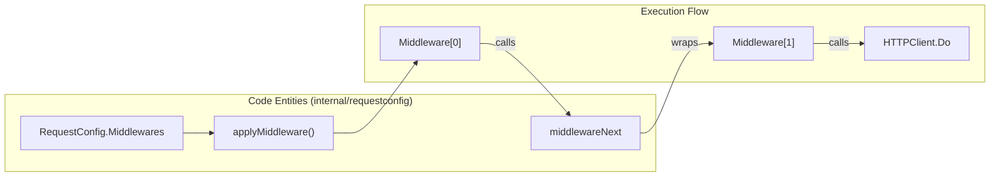

**Sources:** [internal/requestconfig/requestconfig.go:244-248](), [internal/requestconfig/requestconfig.go:394-415](), [internal/requestconfig/requestconfig.go:417-423]()

## Retry Loop and Delay

The retry loop at [internal/requestconfig/requestconfig.go:430-474]() attempts the request up to `MaxRetries + 1` times.

### shouldRetry Conditions

The `shouldRetry` function at [internal/requestconfig/requestconfig.go:250-269]() returns true for:
-   Connection errors (`res == nil`)
-   Status codes: 408 (Timeout), 409 (Conflict), 429 (Rate Limit), or 5xx (Server Error).
-   Explicit `x-should-retry` headers.

### Retry Delay Calculation

The `retryDelay` function at [internal/requestconfig/requestconfig.go:361-378]() implements exponential backoff:
1.  Checks `Retry-After` or `Retry-After-Ms` headers via `parseRetryAfterHeader` ([lines 271-324]()).
2.  Calculates `0.5 * 2^retryCount` seconds.
3.  Caps delay at 8 seconds.
4.  Applies random jitter.

**Sources:** [internal/requestconfig/requestconfig.go:250-269](), [internal/requestconfig/requestconfig.go:271-324](), [internal/requestconfig/requestconfig.go:361-378]()

## Response Handling

Responses are processed at [internal/requestconfig/requestconfig.go:476-562]().

**Code Entity Association: Response Processing**

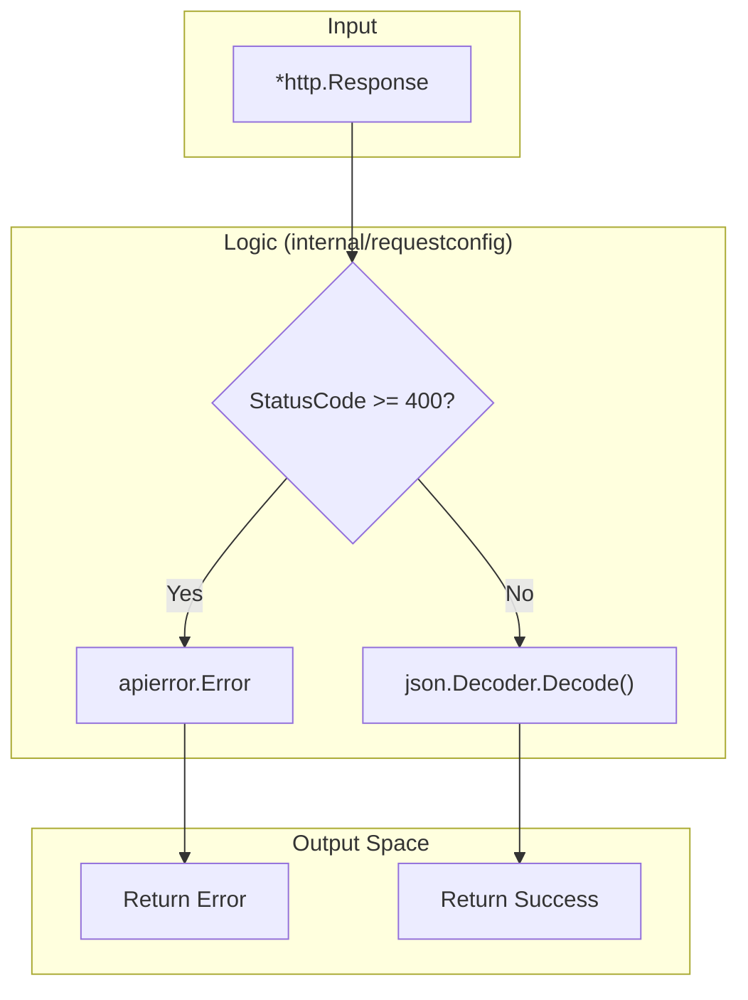

### Error Processing
For status codes >= 400, the pipeline reads the body, restores it for debugging, and unmarshals the OpenAI error object into an `apierror.Error` at [internal/requestconfig/requestconfig.go:492-511]().

### Success Processing
For successful responses, the pipeline checks `ResponseBodyInto`. If it's a pointer to a struct, it uses `json.Decoder` to populate it ([lines 547-548]()). If it's `**http.Response`, it returns the raw response wrapped in `bodyWithTimeout` ([lines 514-523]()).

**Sources:** [internal/requestconfig/requestconfig.go:476-562](), [internal/requestconfig/requestconfig.go:337-359]()

---

# Page: Error Handling and Retries

# Error Handling and Retries

<details>
<summary>Relevant source files</summary>

The following files were used as context for generating this wiki page:

- [client_test.go](client_test.go)
- [internal/apierror/apierror.go](internal/apierror/apierror.go)
- [internal/requestconfig/requestconfig.go](internal/requestconfig/requestconfig.go)
- [option/requestoption.go](option/requestoption.go)
- [usage_test.go](usage_test.go)

</details>


This page documents the error handling and automatic retry mechanisms in the `openai-go` library. It covers the structured error types returned by the API, the automatic retry logic with exponential backoff, configuration options, and best practices for error handling in client code.

---

## Error Types

The library returns structured errors of type `*apierror.Error` when the API responds with a non-success status code (>= 400). This error type provides detailed information about the failure, including the full HTTP request and response.

### apierror.Error Structure

The `apierror.Error` type represents errors originating from the API. It includes standard fields like `Code`, `Message`, and `Type`, which are parsed from the API's JSON response.

| Field | Type | Description |
|-------|------|-------------|
| `StatusCode` | `int` | HTTP status code from the response [internal/apierror/apierror.go:31]() |
| `Code` | `string` | A short string identifier for the error type [internal/apierror/apierror.go:18]() |
| `Message` | `string` | A human-readable message providing more details [internal/apierror/apierror.go:19]() |
| `Request` | `*http.Request` | The original HTTP request [internal/apierror/apierror.go:32]() |
| `Response` | `*http.Response` | The HTTP response [internal/apierror/apierror.go:33]() |

**Sources:** [internal/apierror/apierror.go:17-34]()

### Error Creation Flow

When a request is executed, the library checks the status code. If it is 400 or higher, it attempts to parse the response body as an error.

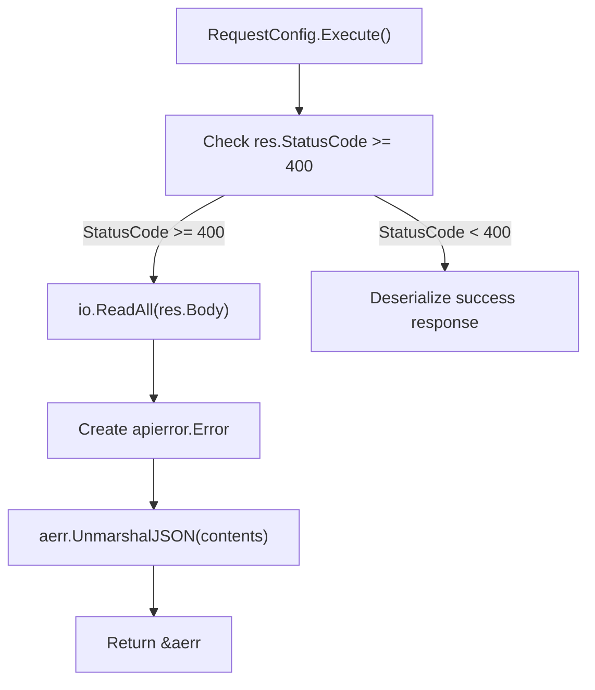

**Sources:** [internal/requestconfig/requestconfig.go:492-510](), [internal/apierror/apierror.go:38-40]()

---

## Retry Behavior

The library automatically retries certain failed requests using exponential backoff with jitter. By default, requests are retried up to 2 times (for a total of 3 attempts including the initial request).

### Default Retry Configuration

The default maximum retry count is initialized in `NewRequestConfig`:

```go
cfg := RequestConfig{
    MaxRetries: 2,
    // ...
}
```

**Sources:** [internal/requestconfig/requestconfig.go:174]()

### Retriable Conditions

The `shouldRetry` function determines whether a request should be retried based on the response or the error encountered.

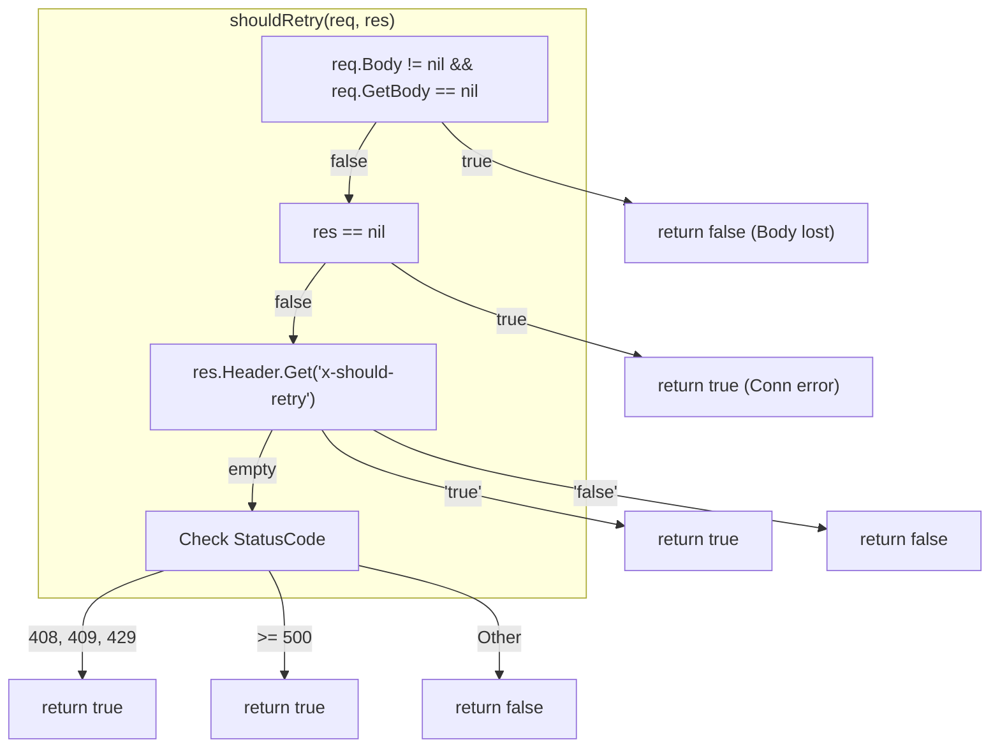

**Sources:** [internal/requestconfig/requestconfig.go:250-269]()

---

## Exponential Backoff Algorithm

The retry delay uses exponential backoff with jitter to avoid thundering herd problems and respect rate limits.

### Retry-After Header Support

Before calculating exponential backoff, the library checks for `Retry-After` or `Retry-After-Ms` headers. `Retry-After-Ms` is preferred as it provides millisecond precision.

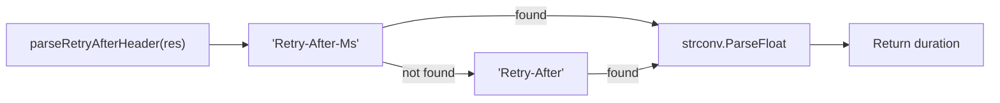

**Sources:** [internal/requestconfig/requestconfig.go:271-324]()

### Exponential Backoff Calculation

If no valid `Retry-After` header is found, the delay is calculated as `0.5 * 2^retryCount` seconds, capped at 8 seconds, with a random jitter reduction of up to 25%.

| Retry Count | Base Delay | Max Cap | Jitter Range (25%) |
|-------------|------------|---------|--------------------|
| 0           | 0.5s       | 8.0s    | 0 - 0.125s         |
| 1           | 1.0s       | 8.0s    | 0 - 0.25s          |
| 2           | 2.0s       | 8.0s    | 0 - 0.5s           |

**Sources:** [internal/requestconfig/requestconfig.go:361-378]()

---

## Retry Loop Implementation

The retry loop is implemented within the `Execute` method of `RequestConfig`.

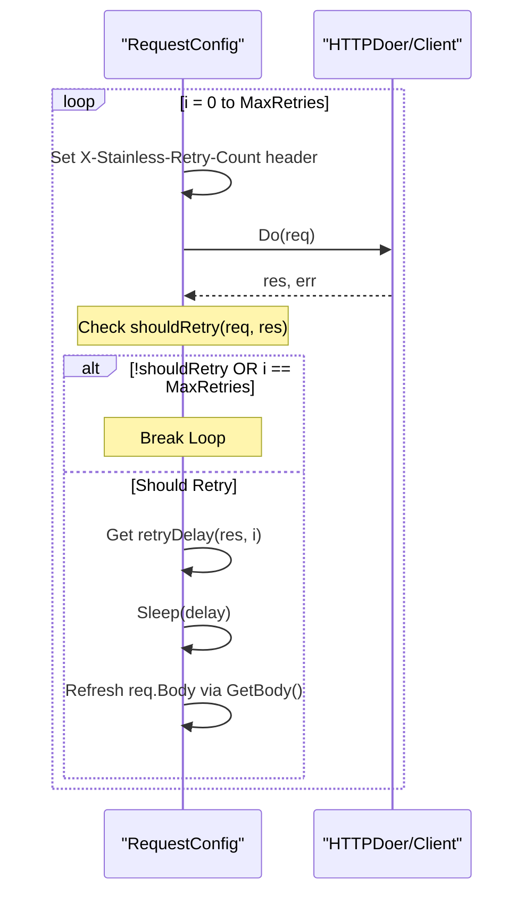

**Key implementation details:**
1. **Header Tracking:** The `X-Stainless-Retry-Count` header is updated on every attempt [internal/requestconfig/requestconfig.go:444]().
2. **Body Refresh:** Retries are only possible if the request body can be re-read using `req.GetBody` [internal/requestconfig/requestconfig.go:456-466]().
3. **Timeout Management:** Each attempt can have its own timeout if `RequestTimeout` is set, which is reflected in the `X-Stainless-Timeout` header [internal/requestconfig/requestconfig.go:432-442]().

**Sources:** [internal/requestconfig/requestconfig.go:424-474]()

---

## Configuring Retries

Retries can be configured globally on the client or per-request using `RequestOption`s.

### Client-Level Configuration
```go
client := openai.NewClient(
    option.WithMaxRetries(5), // Set default retries to 5
)
```
**Sources:** [option/requestoption.go:101-109]()

### Per-Request Configuration
```go
client.Chat.Completions.New(ctx, params, option.WithMaxRetries(0)) // Disable for this call
```
**Sources:** [option/requestoption.go:105-108]()

---

## Request Timeout vs Context Timeout

The SDK distinguishes between a per-attempt timeout and the overall context deadline.

1. **Context Timeout:** Governs the entire execution, including all retries. If the context expires, the loop terminates immediately [internal/requestconfig/requestconfig.go:448-450]().
2. **Request Timeout:** Set via `option.WithRequestTimeout`. This applies to each individual HTTP call. The library sets the `X-Stainless-Timeout` header to inform the server of this limit [internal/requestconfig/requestconfig.go:189-195]().

**Sources:** [internal/requestconfig/requestconfig.go:432-442](), [option/requestoption.go:210-217]()

---

## Error Inspection Utilities

The `apierror.Error` type provides helper methods to inspect the raw data exchanged with the API:

*   **`RawJSON()`**: Returns the unmodified JSON body received from the API [internal/apierror/apierror.go:37]().
*   **`DumpRequest(body bool)`**: Uses `httputil.DumpRequestOut` to return the full request data [internal/apierror/apierror.go:47-53]().
*   **`DumpResponse(body bool)`**: Uses `httputil.DumpResponse` to return the full response data [internal/apierror/apierror.go:55-58]().

**Sources:** [internal/apierror/apierror.go:37-58]()

---

# Page: Streaming Architecture

# Streaming Architecture

<details>
<summary>Relevant source files</summary>

The following files were used as context for generating this wiki page:

- [.release-please-manifest.json](.release-please-manifest.json)
- [CHANGELOG.md](CHANGELOG.md)
- [README.md](README.md)
- [examples/chat-completion-accumulating/main.go](examples/chat-completion-accumulating/main.go)
- [internal/requestconfig/requestconfig.go](internal/requestconfig/requestconfig.go)
- [internal/version.go](internal/version.go)
- [option/requestoption.go](option/requestoption.go)
- [packages/ssestream/ssestream.go](packages/ssestream/ssestream.go)
- [streamaccumulator.go](streamaccumulator.go)
- [streamaccumulator_test.go](streamaccumulator_test.go)

</details>


This document explains the streaming architecture in the openai-go library, focusing on how Server-Sent Events (SSE) are processed through the `ssestream.Stream[T]` type, the iterator pattern, and accumulator helpers for building complete responses from incremental updates.

For request execution details, see [Request Execution Pipeline](#2.2). For chat-specific streaming examples, see [Streaming Chat Responses](#3.2). For response streaming, see [Response Streaming Events](#4.3).

## Overview of Streaming in openai-go

The openai-go library provides streaming support for several APIs (Chat Completions, Responses, Images, Audio, and Beta Assistants). All streaming methods return a `ssestream.Stream[T]` instance that parses Server-Sent Events from the HTTP response and provides a type-safe iterator interface.

**Key streaming APIs:**

| API Service | Streaming Method | Event Type |
|------------|-----------------|------------|
| Chat Completions | `NewStreaming()` | `ChatCompletionChunk` |
| Responses | `NewStreaming()` | `ResponseStreamEventUnion` |
| Images | `EditStreaming()` | `ImageEditStreamEventUnion` |
| Audio Transcriptions | `NewStreaming()` | `TranscriptionStreamEventUnion` |
| Beta Assistants | `NewAndRunStreaming()` | `AssistantStreamEventUnion` |

**Sources:** [README.md:163-187](), [streamaccumulator_test.go:54-88]()

## SSE Decoder and Event Processing

The streaming system processes Server-Sent Events (SSE) through a layered architecture. At the lowest level, the `Decoder` interface provides access to raw SSE events.

```mermaid
graph TD
    HTTPResponse["*http.Response"]
    NewDecoder["ssestream.NewDecoder(res)"]
    ContentTypeCheck{"Check Content-Type"}
    EventStreamDecoder["eventStreamDecoder"]
    CustomDecoder["Custom Decoder (if registered)"]
    
    HTTPResponse --> NewDecoder
    NewDecoder --> ContentTypeCheck
    ContentTypeCheck -->|text/event-stream| EventStreamDecoder
    ContentTypeCheck -->|Other| CustomDecoder
    
    subgraph "eventStreamDecoder Flow"
        Scanner["bufio.Scanner with large buffer"]
        NextMethod["Next() - Parse SSE Lines"]
        EventParsing["Parse 'event:' and 'data:' fields"]
        EventStruct["Event{Type, Data}"]
    end
    
    EventStreamDecoder --> Scanner
    Scanner --> NextMethod
    NextMethod --> EventParsing
    EventParsing --> EventStruct
    
    subgraph "SSE Line Processing"
        EmptyLine["Empty line → Dispatch event"]
        EventLine["'event: type' → Set event type"]
        DataLine["'data: content' → Append to data"]
        CommentLine["': comment' → Ignore"]
    end
    
    EventParsing --> EmptyLine
    EventParsing --> EventLine
    EventParsing --> DataLine
    EventParsing --> CommentLine
```

### Event Struct and Decoder Interface

The `Event` struct represents a parsed SSE event with its type and data:

```go
type Event struct {
	Type string
	Data []byte
}
```

The `Decoder` interface defines the contract for SSE parsing:

```go
type Decoder interface {
	Event() Event
	Next() bool
	Close() error
	Err() error
}
```

**Sources:** [packages/ssestream/ssestream.go:48-51](), [packages/ssestream/ssestream.go:18-23]()

### eventStreamDecoder Implementation

The concrete `eventStreamDecoder` type implements the `Decoder` interface using `bufio.Scanner` with a large buffer to handle SSE streams:

**Title:** eventStreamDecoder SSE Parsing Process

```mermaid
graph TD
    HTTPResponse["*http.Response with SSE body"]
    NewDecoder["ssestream.NewDecoder(res)"]
    CheckContentType{"Content-Type check"}
    CreateDecoder["Create eventStreamDecoder"]
    
    NewDecoder --> CheckContentType
    CheckContentType -->|"text/event-stream"| CreateDecoder
    CheckContentType -->|"Other registered type"| CustomDecoder["Custom Decoder"]
    
    subgraph "eventStreamDecoder Structure"
        BufioScanner["bufio.Scanner with MaxScanTokenSize << 9"]
        ReadCloser["io.ReadCloser (response body)"]
        CurrentEvent["evt Event"]
        ErrorState["err error"]
    end
    
    CreateDecoder --> BufioScanner
    CreateDecoder --> ReadCloser
    
    subgraph "SSE Line Processing in Next()"
        ScanLoop["for scn.Scan()"]
        ParseLine["Parse line: 'name:value'"]
        EmptyLineCheck{"Empty line?"}
        FieldType{"Field type?"}
        
        ScanLoop --> ParseLine
        ParseLine --> EmptyLineCheck
        EmptyLineCheck -->|Yes| DispatchEvent["Dispatch Event{Type, Data}"]
        EmptyLineCheck -->|No| FieldType
        
        FieldType -->|"event:"| SetEventType["event = value"]
        FieldType -->|"data:"| AppendData["data.Write(value + newline)"]
        FieldType -->|":"| IgnoreComment["Ignore comment"]
        
        SetEventType --> ScanLoop
        AppendData --> ScanLoop
        IgnoreComment --> ScanLoop
        DispatchEvent --> ReturnTrue["Return true"]
    end
    
    BufioScanner --> ScanLoop
```

The `Next()` method at [packages/ssestream/ssestream.go:72-123]() accumulates `data:` lines into a buffer and dispatches an event when it encounters an empty line. The `event:` field sets the event type, and lines starting with `:` are treated as comments and ignored.

**Sources:** [packages/ssestream/ssestream.go:25-40](), [packages/ssestream/ssestream.go:65-135]()

## Stream[T] Generic Type and Iterator Pattern

The `Stream[T]` generic type wraps a `Decoder` and provides type-safe iteration over deserialized events. It follows the standard Go iterator pattern with `Next()`, `Current()`, and `Err()` methods.

### Stream Structure and Creation

```go
type Stream[T any] struct {
	decoder             Decoder
	cur                 T
	err                 error
	done                bool
	synthesizeEventData bool
}
```

Streams are created by `NewStream[T](decoder, err)` at [packages/ssestream/ssestream.go:145-150]() and returned from streaming API methods.

### Iterator Pattern Implementation

**Title:** Stream[T] Iterator Pattern Flow

```mermaid
graph TD
    UserCode["User: for stream.Next()"]
    Next["Stream.Next() method"]
    CheckErr{"s.err != nil?"}
    DecoderNext["s.decoder.Next()"]
    CheckDoneSignal{"Data starts with '[DONE]'?"}
    CheckErrorField{"gjson check for 'error' field"}
    DetermineUnmarshal["Event type check"]
    
    UserCode --> Next
    Next --> CheckErr
    CheckErr -->|Yes| ReturnFalse["Return false"]
    CheckErr -->|No| DecoderNext
    
    DecoderNext -->|More events| CheckDoneSignal
    DecoderNext -->|No more events| CheckDecoderErr["s.err = s.decoder.Err()"]
    CheckDecoderErr --> ReturnFalse
    
    CheckDoneSignal -->|Yes| SetDone["s.done = true, continue loop"]
    CheckDoneSignal -->|No| CheckErrorField
    SetDone --> DecoderNext
    
    CheckErrorField -->|Error found| SetError["s.err = StreamError{...}"]
    CheckErrorField -->|No error| DetermineUnmarshal
    SetError --> ReturnFalse
    
    DetermineUnmarshal -->|"Empty or non-thread.*"| DirectUnmarshal["json.Unmarshal(data, &nxt)"]
    DetermineUnmarshal -->|"thread.* event"| EnvelopeUnmarshal["json.Unmarshal with event envelope"]
    
    DirectUnmarshal --> UpdateCurrent["s.cur = nxt"]
    EnvelopeUnmarshal --> UpdateCurrent
    UpdateCurrent --> ReturnTrue["Return true"]
    
    ReturnTrue --> UserCode
    
    subgraph "User Access Methods"
        GetCurrent["stream.Current() returns s.cur"]
        GetErr["stream.Err() returns s.err"]
        CloseStream["stream.Close() closes decoder"]
    end
```

The `Next()` method at [packages/ssestream/ssestream.go:171-228]() implements the following logic:

1.  **Check for existing errors**: Returns `false` if `s.err` is already set.
2.  **Loop through decoder events**: Calls `s.decoder.Next()` to get raw SSE events.
3.  **Handle `[DONE]` signal**: Sets `s.done = true` and continues (doesn't break).
4.  **Check for error field**: Uses `gjson.GetBytes(s.decoder.Event().Data, "error")` to detect error events.
5.  **Unmarshal event data**: Deserializes JSON into type `T`. If `synthesizeEventData` is true or it's a `thread.*` event, it wraps the data in an event envelope.
6.  **Update current value**: Sets `s.cur = nxt` and returns `true`.

**Sources:** [packages/ssestream/ssestream.go:137-244]()

## Accumulator Patterns

For APIs like Chat Completions, the SDK provides a `ChatCompletionAccumulator` to simplify merging incremental chunks into a complete object.

### ChatCompletionAccumulator

The `ChatCompletionAccumulator` tracks the state of the conversation and provides helper methods to detect when specific parts of the response (content, tool calls, refusals) have finished.

**Title:** ChatCompletionAccumulator Logic

```mermaid
graph TD
    Chunk["ChatCompletionChunk"]
    AddChunk["accumulator.AddChunk(chunk)"]
    AccumulateDelta["cc.accumulateDelta(chunk)"]
    UpdateState["state.update(chunk)"]
    
    AddChunk --> AccumulateDelta
    AddChunk --> UpdateState
    
    subgraph "Accumulation Details"
        ConcatContent["choice.Message.Content += delta.Content"]
        ConcatTools["tool.Function.Arguments += delta.Arguments"]
        SumUsage["cc.Usage.TotalTokens += chunk.Usage.TotalTokens"]
    end
    
    AccumulateDelta --> ConcatContent
    AccumulateDelta --> ConcatTools
    AccumulateDelta --> SumUsage
    
    subgraph "Finish Event Detection"
        JustFinishedContent["JustFinishedContent()"]
        JustFinishedTool["JustFinishedToolCall()"]
    end
    
    UpdateState --> JustFinishedContent
    UpdateState --> JustFinishedTool
```

The `AddChunk` method at [streamaccumulator.go:38-53]() incorporates a chunk and updates internal state tracking. Methods like `JustFinishedContent()` allow users to react to the completion of specific segments without waiting for the entire stream to close.

**Sources:** [streamaccumulator.go:6-168](), [examples/chat-completion-accumulating/main.go:34-62]()

## Event Type Handling

The stream processes different event types based on the SSE `event:` field:

| Event Type Pattern | Handling | Example |
|-------------------|----------|---------|
| Empty or non-`thread.*` | Direct JSON unmarshal of `data:` field | Chat completion chunks |
| Starts with `thread.` | Wraps in envelope: `{"event": "type", "data": {...}}` | Assistant streaming events |

This special handling for `thread.*` events at [packages/ssestream/ssestream.go:197-205]() allows discriminated union types to deserialize correctly based on the event type field.

### DONE Signal Handling

The SSE stream can include a special `[DONE]` marker to signal the end of the stream. The `Stream[T].Next()` method handles this at [packages/ssestream/ssestream.go:181-185]():

```go
if bytes.HasPrefix(s.decoder.Event().Data, []byte("[DONE]")) {
    // In this case we don't break because we still want to iterate through the full stream.
    s.done = true
    continue
}
```

Key behaviors:
- The `[DONE]` marker sets `s.done = true` but doesn't terminate iteration.
- The loop continues to drain any remaining events after `[DONE]`.
- Iteration only stops when `decoder.Next()` returns `false`.

**Sources:** [packages/ssestream/ssestream.go:181-185]()

## Request Options System

The `RequestOption` interface provides a flexible way to configure requests through functional options.

### Option Categories and Application

```mermaid
graph TD
    ClientOptions["Client-level Options"]
    RequestOptions["Request-level Options"]
    
    subgraph "Configuration Options"
        WithAPIKey["WithAPIKey()"]
        WithBaseURL["WithBaseURL()"]
        WithHTTPClient["WithHTTPClient()"]
        WithMaxRetries["WithMaxRetries()"]
    end
    
    subgraph "Request Modification"
        WithHeader["WithHeader()"]
        WithQuery["WithQuery()"]
        WithJSONSet["WithJSONSet()"]
    end
    
    subgraph "Advanced Options"
        WithMiddleware["WithMiddleware()"]
    end
    
    ClientOptions --> WithAPIKey
    ClientOptions --> WithBaseURL
    ClientOptions --> WithHTTPClient
    
    RequestOptions --> WithHeader
    RequestOptions --> WithQuery
    RequestOptions --> WithJSONSet
    RequestOptions --> WithMaxRetries
    RequestOptions --> WithMiddleware
```

**Sources:** [option/requestoption.go:27-195](), [internal/requestconfig/requestconfig.go:81-90]()

### Middleware Chain and Execution

Middleware functions intercept requests and can modify them or the responses:

```mermaid
graph TD
    MiddlewareStack["[]middleware"]
    ApplyMiddleware["applyMiddleware()"]
    MiddlewareFunc["func(*http.Request, middlewareNext)"]
    NextHandler["middlewareNext function"]
    HTTPClientDo["HTTPClient.Do (final handler)"]
    
    MiddlewareStack --> ApplyMiddleware
    ApplyMiddleware --> MiddlewareFunc
    MiddlewareFunc --> NextHandler
    NextHandler --> HTTPClientDo
```

**Sources:** [internal/requestconfig/requestconfig.go:236-248](), [option/requestoption.go:87-94]()

---

# Page: Chat Completions API

# Chat Completions API

<details>
<summary>Relevant source files</summary>

The following files were used as context for generating this wiki page:

- [chat.go](chat.go)
- [chatcompletion.go](chatcompletion.go)
- [chatcompletion_test.go](chatcompletion_test.go)
- [chatcompletionmessage.go](chatcompletionmessage.go)

</details>


This page covers the Chat Completions API service (`ChatCompletionService`), which provides the primary interface for generating text-based conversational responses from OpenAI models. This is the most commonly used API for interactive chat applications, supporting text, images, audio, and tool calling.

For information about the newer Responses API (recommended for new projects), see [Responses API](#4). For information about legacy text completions (non-chat), see [Text Completions API](#8).

## Service Structure and Position

The Chat Completions API is exposed through the `ChatCompletionService`, which is accessible via `client.Chat.Completions`. This service is part of a two-level hierarchy under the main client:

**Service Hierarchy Diagram**

```mermaid
graph TB
    Client["openai.Client<br/>(client.go)"]
    Chat["ChatService<br/>(chat.go)"]
    Completions["ChatCompletionService<br/>(chatcompletion.go)"]
    Messages["ChatCompletionMessageService<br/>(chatcompletionmessage.go)"]
    
    Client -->|"Chat"| Chat
    Chat -->|"Completions"| Completions
    Completions -->|"Messages"| Messages
    
    Completions -->|"New()"| New["POST /chat/completions"]
    Completions -->|"NewStreaming()"| NewStreaming["POST /chat/completions (stream=true)"]
    Completions -->|"Get()"| Get["GET /chat/completions/{id}"]
    Completions -->|"Update()"| Update["POST /chat/completions/{id}"]
    Completions -->|"List()"| List["GET /chat/completions"]
    Completions -->|"Delete()"| Delete["DELETE /chat/completions/{id}"]
    
    Messages -->|"List()"| ListMessages["GET /chat/completions/{id}/messages"]
```

The service structure is defined with two fields: request options that apply to all methods, and a sub-service for message retrieval:

| Field | Type | Purpose |
|-------|------|---------|
| `Options` | `[]option.RequestOption` | Default options applied to all requests |
| `Messages` | `ChatCompletionMessageService` | Sub-service for stored message retrieval |

**Sources:** [chatcompletion.go:35-50](), [chat.go:15-30](), [chatcompletionmessage.go:29-40]()

## Core Methods Overview

The `ChatCompletionService` provides methods organized into creation and storage management:

### Creation Methods

| Method | HTTP | Path | Return Type | Purpose |
|--------|------|------|-------------|---------|
| `New()` | POST | `/chat/completions` | `*ChatCompletion` | Create synchronous completion |
| `NewStreaming()` | POST | `/chat/completions` | `*ssestream.Stream[ChatCompletionChunk]` | Create streaming completion |

### Storage Management Methods

| Method | HTTP | Path | Return Type | Purpose |
|--------|------|------|-------------|---------|
| `Get()` | GET | `/chat/completions/{id}` | `*ChatCompletion` | Retrieve stored completion |
| `Update()` | POST | `/chat/completions/{id}` | `*ChatCompletion` | Update completion metadata |
| `List()` | GET | `/chat/completions` | `*pagination.CursorPage[ChatCompletion]` | List stored completions |
| `Delete()` | DELETE | `/chat/completions/{id}` | `*ChatCompletionDeleted` | Delete stored completion |

Storage methods only work with completions created with the `store: true` parameter set in `ChatCompletionNewParams`.

**Sources:** [chatcompletion.go:72-163]()

## Request/Response Flow

**Synchronous Completion Flow**

```mermaid
sequenceDiagram
    participant User as "User Code"
    participant Service as "ChatCompletionService"
    participant Request as "requestconfig.ExecuteNewRequest"
    participant API as "OpenAI API"
    
    User->>Service: New(ctx, ChatCompletionNewParams)
    Service->>Service: Merge options (service + method)
    Service->>Request: POST /chat/completions
    Request->>API: HTTP Request with params
    API-->>Request: Complete ChatCompletion JSON
    Request-->>Service: Unmarshal into *ChatCompletion
    Service-->>User: *ChatCompletion, error
```

The synchronous method implementation at [chatcompletion.go:72-77]() directly calls the request execution layer, blocking until the full response is available.

**Streaming Completion Flow**

```mermaid
sequenceDiagram
    participant User as "User Code"
    participant Service as "ChatCompletionService"
    participant Request as "requestconfig.ExecuteNewRequest"
    participant API as "OpenAI API"
    participant Stream as "ssestream.Stream[ChatCompletionChunk]"
    
    User->>Service: NewStreaming(ctx, params)
    Service->>Service: Inject option.WithJSONSet("stream", true)
    Service->>Request: POST /chat/completions
    Request->>API: HTTP Request
    API-->>Request: SSE Stream (text/event-stream)
    Request-->>Service: *http.Response
    Service->>Stream: ssestream.NewStream(Decoder, err)
    Service-->>User: *Stream
    
    loop Stream Iteration
        User->>Stream: stream.Next()
        Stream-->>User: bool
        User->>Stream: stream.Current()
        Stream-->>User: ChatCompletionChunk
    end
```

The streaming implementation at [chatcompletion.go:99-109]() automatically sets `stream: true` using `option.WithJSONSet()`, then wraps the HTTP response in an `ssestream.Stream` iterator.

**Sources:** [chatcompletion.go:72-109](), [packages/ssestream/ssestream.go:125-217]()

## Stored Completions Management

Completions can be stored for later retrieval and management by setting `Store: openai.Bool(true)` in the request parameters.

**Stored Completion Lifecycle**

```mermaid
stateDiagram-v2
    [*] --> Creating: New(Store=true)
    Creating --> Stored: Success
    
    Stored --> Retrieved: Get(completionID)
    Stored --> Updating: Update(Metadata)
    Stored --> Listing: List(ChatCompletionListParams)
    Stored --> Deleting: Delete(completionID)
    
    Updating --> Stored: Success
    Retrieved --> Stored
    Listing --> Stored
    Deleting --> [*]: Permanently removed
```

### Get: Retrieve Stored Completion
Retrieve a previously stored completion by its ID using `Get(ctx, completionID)`. It returns a `*ChatCompletion` object if the ID exists and was created with `store: true`.

**Sources:** [chatcompletion.go:113-122]()

### Update: Modify Stored Metadata
Modify the metadata of a stored completion using `Update(ctx, completionID, body)`. Currently, only the `Metadata` field can be updated.

**Sources:** [chatcompletion.go:127-136](), [chatcompletion_test.go:166-174]()

### List: Query Stored Completions
List stored completions with filtering (model, metadata) and pagination. Use `ListAutoPaging` for automatic cursor handling across multiple pages.

**Sources:** [chatcompletion.go:140-160](), [chatcompletionmessage.go:44-69]()

## Request Parameters Overview

`ChatCompletionNewParams` contains a wide array of configurations for the model:

| Category | Parameters |
|----------|------------|
| **Core** | `Messages`, `Model` |
| **Sampling** | `Temperature`, `TopP`, `N`, `Seed`, `FrequencyPenalty`, `PresencePenalty` |
| **Limits** | `MaxTokens`, `MaxCompletionTokens`, `Stop` |
| **Tools** | `Tools`, `ToolChoice`, `ParallelToolCalls` |
| **Modality** | `Modalities`, `Audio` |
| **Storage** | `Store`, `Metadata` |
| **Reasoning** | `ReasoningEffort` |

For detailed information on these parameters, refer to the child pages.

**Sources:** [chatcompletion.go:495-577](), [chatcompletion_test.go:29-122]()

## Related Pages

This page provides an overview of the Chat Completions service. For detailed information on specific features:

- **[Messages and Content Types](#3.1)** — Document message structure, role types (user, assistant, developer, system), content part unions for multi-modal input (text, images, audio, files), and message parameters.
- **[Streaming Chat Responses](#3.2)** — Explain `NewStreaming` method, `ChatCompletionChunk` structure, delta processing, and `ChatCompletionAccumulator` usage.
- **[Tool Calling and Functions](#3.3)** — Document function tools, custom tools with grammar-based formats, tool choice options, parallel tool calls, and tool call response handling.
- **[Structured Outputs and Response Formats](#3.4)** — Explain response format options: text, JSON object, and JSON schema with strict mode for validated structured outputs.

**Sources:** [chatcompletion.go:35-109]()

---

# Page: Messages and Content Types

# Messages and Content Types

<details>
<summary>Relevant source files</summary>

The following files were used as context for generating this wiki page:

- [chatcompletion.go](chatcompletion.go)
- [chatcompletion_test.go](chatcompletion_test.go)
- [chatcompletionmessage.go](chatcompletionmessage.go)

</details>


This page documents the message structure and content types used in the Chat Completions API. Messages form the core input to chat models, with each message having a role (user, assistant, system, developer, tool) and content that can be text, images, audio, or files. For information about streaming chat responses, see [Streaming Chat Responses](#3.2). For tool calling integration, see [Tool Calling and Functions](#3.3). For the modern Responses API alternative, see [Responses API](#4).

## Message Structure Overview

Chat messages in the `openai-go` SDK are represented as discriminated unions based on the `role` field. All message types are wrapped in the `ChatCompletionMessageParamUnion` type, which provides type-safe access to six distinct message roles.

Title: Message Type Hierarchy
```mermaid
graph TB
    Union["ChatCompletionMessageParamUnion<br/>(role discriminator)"]
    
    Union --> Developer["ChatCompletionDeveloperMessageParam<br/>role: developer"]
    Union --> System["ChatCompletionSystemMessageParam<br/>role: system"]
    Union --> User["ChatCompletionUserMessageParam<br/>role: user"]
    Union --> Assistant["ChatCompletionAssistantMessageParam<br/>role: assistant"]
    Union --> Tool["ChatCompletionToolMessageParam<br/>role: tool"]
    Union --> Function["ChatCompletionFunctionMessageParam<br/>role: function (deprecated)"]
    
    Developer --> DevContent["Content: string or text parts"]
    System --> SysContent["Content: string or text parts"]
    User --> UserContent["Content: string or multi-modal parts"]
    Assistant --> AsstContent["Content: string, text/refusal parts<br/>+ tool_calls, audio, refusal"]
    Tool --> ToolContent["Content: string or text parts<br/>+ tool_call_id"]
    Function --> FuncContent["Content: string<br/>+ name"]
```

**Sources:** [chatcompletion.go:1957-2117]()

## Message Roles

### Developer Messages

Developer messages replace the legacy system messages for o1 models and newer. They provide instructions that the model should follow regardless of user input. Developer messages accept either a simple string or an array of text content parts.

| Field | Type | Required | Description |
|-------|------|----------|-------------|
| `role` | `constant.Developer` | Yes | Always "developer" |
| `content` | `ChatCompletionDeveloperMessageParamContentUnion` | Yes | String or array of text parts |
| `name` | `param.Opt[string]` | No | Participant name for differentiation |

**Sources:** [chatcompletion.go:1397-1420]()

### System Messages

System messages provide instructions for older model versions. For o1 and newer models, use developer messages instead. System messages have the same structure as developer messages.

| Field | Type | Required | Description |
|-------|------|----------|-------------|
| `role` | `constant.System` | Yes | Always "system" |
| `content` | `ChatCompletionSystemMessageParamContentUnion` | Yes | String or array of text parts |
| `name` | `param.Opt[string]` | No | Participant name for differentiation |

**Sources:** [chatcompletion.go:2524-2562]()

### User Messages

User messages represent input from the end user or application. They support multi-modal content including text, images, audio, and file attachments.

| Field | Type | Required | Description |
|-------|------|----------|-------------|
| `role` | `constant.User` | Yes | Always "user" |
| `content` | `ChatCompletionUserMessageParamContentUnion` | Yes | String or array of content parts |
| `name` | `param.Opt[string]` | No | Participant name for differentiation |

**Sources:** [chatcompletion.go:2564-2587]()

### Assistant Messages

Assistant messages represent model-generated responses. They can include text content, refusal messages, tool calls, and audio responses. Assistant messages are typically used when providing conversation history to the model.

| Field | Type | Required | Description |
|-------|------|----------|-------------|
| `role` | `constant.Assistant` | Yes | Always "assistant" |
| `content` | `ChatCompletionAssistantMessageParamContentUnion` | No | String or array of text/refusal parts |
| `refusal` | `param.Opt[string]` | No | Refusal message from the assistant |
| `name` | `param.Opt[string]` | No | Participant name |
| `audio` | `ChatCompletionAssistantMessageParamAudio` | No | Previous audio response data |
| `tool_calls` | `[]ChatCompletionMessageToolCallUnionParam` | No | Tool calls generated by the model |
| `function_call` | `ChatCompletionAssistantMessageParamFunctionCall` | No | Deprecated function call data |

The `audio` field references a previous audio response by ID and is used for multi-turn conversations with audio modality:

Title: Assistant Audio Reference Data Flow
```mermaid
graph LR
    AudioResp["ChatCompletionAudio<br/>(from previous response)"]
    AudioParam["ChatCompletionAssistantMessageParamAudio"]
    
    AudioResp --> ID["id: string<br/>Unique audio response ID"]
    AudioResp --> Data["data: string<br/>Base64 encoded audio"]
    AudioResp --> ExpiresAt["expires_at: int64<br/>Unix timestamp"]
    AudioResp --> Transcript["transcript: string<br/>Audio text content"]
    
    ID --> AudioParam
```

**Sources:** [chatcompletion.go:329-365](), [chatcompletion.go:366-382](), [chatcompletion.go:494-522]()

### Tool Messages

Tool messages provide the results of tool calls back to the model. Each tool message must reference a specific tool call ID from a previous assistant message.

| Field | Type | Required | Description |
|-------|------|----------|-------------|
| `role` | `constant.Tool` | Yes | Always "tool" |
| `content` | `ChatCompletionToolMessageParamContentUnion` | Yes | String or array of text parts |
| `tool_call_id` | `string` | Yes | ID of the tool call being responded to |

**Sources:** [chatcompletion.go:2589-2612]()

### Function Messages (Deprecated)

Function messages are deprecated in favor of tool messages. They provide results from function calls in the legacy function calling pattern.

| Field | Type | Required | Description |
|-------|------|----------|-------------|
| `role` | `constant.Function` | Yes | Always "function" |
| `content` | `param.Opt[string]` | Yes | Function execution result |
| `name` | `string` | Yes | Name of the function |

**Sources:** [chatcompletion.go:1465-1486]()

## Content Part Types

User and assistant messages can contain multi-modal content through content part unions. The `ChatCompletionContentPartUnionParam` discriminated union supports four content types distinguished by the `type` field.

Title: Multi-modal Content Part Union
```mermaid
graph TB
    ContentUnion["ChatCompletionContentPartUnionParam<br/>(type discriminator)"]
    
    ContentUnion --> Text["ChatCompletionContentPartTextParam<br/>type: text"]
    ContentUnion --> Image["ChatCompletionContentPartImageParam<br/>type: image_url"]
    ContentUnion --> Audio["ChatCompletionContentPartInputAudioParam<br/>type: input_audio"]
    ContentUnion --> File["ChatCompletionContentPartFileParam<br/>type: file"]
    
    Text --> TextField["text: string"]
    
    Image --> ImageURL["image_url: ImageURL"]
    ImageURL --> URL["url: string (URI or base64)"]
    ImageURL --> Detail["detail: auto/low/high"]
    
    Audio --> InputAudio["input_audio: InputAudio"]
    InputAudio --> AudioData["data: string (base64)"]
    InputAudio --> Format["format: wav/mp3"]
    
    File --> FileData["file: FileData"]
    FileData --> FileID["file_id: string"]
    FileData --> FileDataStr["file_data: string (base64)"]
    FileData --> Filename["filename: string"]
```

**Sources:** [chatcompletion.go:864-949]()

### Text Content Parts

Text content parts contain plain text content. This is the most common content type for messages.

| Field | Type | Required | Description |
|-------|------|----------|-------------|
| `type` | `constant.Text` | Yes | Always "text" |
| `text` | `string` | Yes | The text content |

Helper function:
```go
TextContentPart(text string) ChatCompletionContentPartUnionParam
```

**Sources:** [chatcompletion.go:1154-1206](), [chatcompletion.go:840-844]()

### Image Content Parts

Image content parts enable vision capabilities by providing images as URLs or base64-encoded data. The `detail` parameter controls the fidelity level for image understanding.

| Field | Type | Required | Description |
|-------|------|----------|-------------|
| `type` | `constant.ImageURL` | Yes | Always "image_url" |
| `image_url.url` | `string` | Yes | Image URL or base64 data URI |
| `image_url.detail` | `string` | No | "auto", "low", or "high" |

The `detail` parameter affects token usage and processing quality:
- **auto**: Model decides based on image characteristics
- **low**: Low-resolution processing (512x512), uses 85 tokens
- **high**: High-resolution processing with detail tiles, uses more tokens

Helper function:
```go
ImageContentPart(imageURL ChatCompletionContentPartImageImageURLParam) ChatCompletionContentPartUnionParam
```

**Sources:** [chatcompletion.go:991-1088](), [chatcompletion.go:846-850]()

### Audio Content Parts

Audio content parts allow including audio input in user messages. Audio data must be base64-encoded and currently supports WAV and MP3 formats.

| Field | Type | Required | Description |
|-------|------|----------|-------------|
| `type` | `constant.InputAudio` | Yes | Always "input_audio" |
| `input_audio.data` | `string` | Yes | Base64 encoded audio data |
| `input_audio.format` | `string` | Yes | "wav" or "mp3" |

Helper function:
```go
InputAudioContentPart(inputAudio ChatCompletionContentPartInputAudioInputAudioParam) ChatCompletionContentPartUnionParam
```

**Sources:** [chatcompletion.go:1090-1133](), [chatcompletion.go:852-856]()

### File Content Parts

File content parts allow attaching documents for text generation. Files can be referenced by ID (previously uploaded) or provided inline as base64-encoded data.

| Field | Type | Required | Description |
|-------|------|----------|-------------|
| `type` | `constant.File` | Yes | Always "file" |
| `file.file_id` | `param.Opt[string]` | No* | ID of uploaded file |
| `file.file_data` | `param.Opt[string]` | No* | Base64 encoded file data |
| `file.filename` | `param.Opt[string]` | No | File name for inline data |

*Either `file_id` or `file_data` must be provided.

Helper function:
```go
FileContentPart(file ChatCompletionContentPartFileFileParam) ChatCompletionContentPartUnionParam
```

**Sources:** [chatcompletion.go:951-989](), [chatcompletion.go:858-862]()

## Message Construction Helpers

The SDK provides convenience functions for constructing common message types. These functions simplify message creation and ensure type safety.

Title: Message Helper Function Mapping
```mermaid
graph LR
    Helpers["Message Helper Functions"]
    
    Helpers --> UserMsg["UserMessage[T](content)"]
    Helpers --> SystemMsg["SystemMessage[T](content)"]
    Helpers --> DevMsg["DeveloperMessage[T](content)"]
    Helpers --> AsstMsg["AssistantMessage[T](content)"]
    Helpers --> ToolMsg["ToolMessage[T](content, toolCallID)"]
    Helpers --> FuncMsg["ChatCompletionMessageParamOfFunction(content, name)"]
    
    UserMsg --> UserUnion["ChatCompletionMessageParamUnion{OfUser}"]
    SystemMsg --> SysUnion["ChatCompletionMessageParamUnion{OfSystem}"]
    DevMsg --> DevUnion["ChatCompletionMessageParamUnion{OfDeveloper}"]
    AsstMsg --> AsstUnion["ChatCompletionMessageParamUnion{OfAssistant}"]
    ToolMsg --> ToolUnion["ChatCompletionMessageParamUnion{OfTool}"]
    FuncMsg --> FuncUnion["ChatCompletionMessageParamUnion{OfFunction}"]
```

| Function | Parameters | Returns | Description |
|----------|------------|---------|-------------|
| `UserMessage[T]` | `content T` | `ChatCompletionMessageParamUnion` | Creates user message (T = string or []ContentParts) |
| `SystemMessage[T]` | `content T` | `ChatCompletionMessageParamUnion` | Creates system message (T = string or []TextParts) |
| `DeveloperMessage[T]` | `content T` | `ChatCompletionMessageParamUnion` | Creates developer message (T = string or []TextParts) |
| `AssistantMessage[T]` | `content T` | `ChatCompletionMessageParamUnion` | Creates assistant message (T = string or []ContentParts) |
| `ToolMessage[T]` | `content T, toolCallID string` | `ChatCompletionMessageParamUnion` | Creates tool message with call ID |
| `ChatCompletionMessageParamOfFunction` | `content string, name string` | `ChatCompletionMessageParamUnion` | Creates function message (deprecated) |

**Sources:** [chatcompletion.go:1878-1952]()

## Response Messages

The `ChatCompletionMessage` type represents messages returned by the model. It differs from parameter types by being a response structure with additional metadata.

Title: ChatCompletionMessage Response Structure
```mermaid
graph TB
    Response["ChatCompletionMessage"]
    
    Response --> Content["content: string<br/>Message text content"]
    Response --> Refusal["refusal: string<br/>Safety refusal message"]
    Response --> Role["role: constant.Assistant<br/>Always assistant"]
    Response --> Annotations["annotations: []MessageAnnotation<br/>URL citations for web search"]
    Response --> Audio["audio: ChatCompletionAudio<br/>Audio response data"]
    Response --> FunctionCall["function_call: MessageFunctionCall<br/>Deprecated function call"]
    Response --> ToolCalls["tool_calls: []MessageToolCallUnion<br/>Generated tool calls"]
    
    Annotations --> URLCitation["ChatCompletionMessageAnnotationURLCitation"]
    URLCitation --> StartIdx["start_index: int64"]
    URLCitation --> EndIdx["end_index: int64"]
    URLCitation --> Title["title: string"]
    URLCitation --> URL["url: string"]
    
    ToolCalls --> FuncToolCall["ChatCompletionMessageFunctionToolCall<br/>type: function"]
    ToolCalls --> CustomToolCall["ChatCompletionMessageCustomToolCall<br/>type: custom"]
```

The `ChatCompletionMessage` type includes a `ToParam()` method that converts it to a `ChatCompletionMessageParamUnion` for use in subsequent requests:

```go
func (r ChatCompletionMessage) ToParam() ChatCompletionMessageParamUnion
func (r ChatCompletionMessage) ToAssistantMessageParam() ChatCompletionAssistantMessageParam
```

This allows including previous model responses in conversation history without manual reconstruction.

**Sources:** [chatcompletion.go:1508-1601](), [chatcompletion.go:1603-1649]()

## Tool Calls in Messages

Assistant messages can include tool calls, represented as a discriminated union based on the `type` field. There are two tool call types: function tools and custom tools.

### Function Tool Calls

Function tool calls represent standard function calling with JSON parameters.

| Field | Type | Description |
|-------|------|-------------|
| `id` | `string` | Unique ID for the tool call |
| `type` | `constant.Function` | Always "function" |
| `function.name` | `string` | Function name to call |
| `function.arguments` | `string` | JSON-formatted arguments |

**Sources:** [chatcompletion.go:1775-1831](), [chatcompletion.go:1833-1876]()

### Custom Tool Calls

Custom tool calls represent grammar-based tool invocations with structured input formats.

| Field | Type | Description |
|-------|------|-------------|
| `id` | `string` | Unique ID for the tool call |
| `type` | `constant.Custom` | Always "custom" |
| `custom.name` | `string` | Custom tool name |
| `custom.input` | `string` | Input formatted per tool's grammar |

**Sources:** [chatcompletion.go:1678-1731](), [chatcompletion.go:1733-1773]()

### Tool Call Union

The `ChatCompletionMessageToolCallUnion` type provides type-safe access to tool call variants:

```go
type ChatCompletionMessageToolCallUnion struct {
    ID       string
    Function ChatCompletionMessageFunctionToolCallFunction // for function type
    Type     string
    Custom   ChatCompletionMessageCustomToolCallCustom     // for custom type
}

func (u ChatCompletionMessageToolCallUnion) AsAny() anyChatCompletionMessageToolCall
func (u ChatCompletionMessageToolCallUnion) AsFunction() ChatCompletionMessageFunctionToolCall
func (u ChatCompletionMessageToolCallUnion) AsCustom() ChatCompletionMessageCustomToolCall
```

**Sources:** [chatcompletion.go:2119-2197]()

## Union Type Navigation

All union types in the message system provide accessor methods for type-safe property access without explicit type assertions.

### ChatCompletionMessageParamUnion Accessors

| Method | Return Type | Description |
|--------|-------------|-------------|
| `GetRole()` | `*string` | Returns role from any variant |
| `GetName()` | `*string` | Returns name if present |
| `GetContent()` | `chatCompletionMessageParamUnionContent` | Returns content with subtype access |
| `GetAudio()` | `*ChatCompletionAssistantMessageParamAudio` | Returns audio from assistant variant |
| `GetRefusal()` | `*string` | Returns refusal from assistant variant |
| `GetToolCalls()` | `[]ChatCompletionMessageToolCallUnionParam` | Returns tool calls from assistant variant |
| `GetToolCallID()` | `*string` | Returns tool_call_id from tool variant |
| `GetFunctionCall()` | `*ChatCompletionAssistantMessageParamFunctionCall` | Returns deprecated function_call |

### Content Union Accessors

The `ChatCompletionContentPartUnionParam` provides accessors for each content type variant:

| Method | Return Type | Description |
|--------|-------------|-------------|
| `GetText()` | `*string` | Returns text from text variant |
| `GetImageURL()` | `*ChatCompletionContentPartImageImageURLParam` | Returns image_url from image variant |
| `GetInputAudio()` | `*ChatCompletionContentPartInputAudioInputAudioParam` | Returns input_audio from audio variant |
| `GetFile()` | `*ChatCompletionContentPartFileFileParam` | Returns file from file variant |
| `GetType()` | `*string` | Returns type discriminator |

**Sources:** [chatcompletion.go:1996-2088](), [chatcompletion.go:895-939]()

## Usage Example Pattern

The following demonstrates typical message construction patterns used in tests and production code:

```go
// Simple text messages
messages := []openai.ChatCompletionMessageParamUnion{
    openai.UserMessage("What is the weather?"),
    openai.SystemMessage("You are a helpful assistant."),
}

// Multi-modal user message with image
messages := []openai.ChatCompletionMessageParamUnion{
    openai.UserMessage([]openai.ChatCompletionContentPartUnionParam{
        openai.TextContentPart("What's in this image?"),
        openai.ImageContentPart(openai.ChatCompletionContentPartImageImageURLParam{
            URL: "https://example.com/image.jpg",
            Detail: "high",
        }),
    }),
}

// Assistant message with tool calls
messages := []openai.ChatCompletionMessageParamUnion{
    openai.AssistantMessage("I'll check the weather for you."),
    {
        OfAssistant: &openai.ChatCompletionAssistantMessageParam{
            ToolCalls: []openai.ChatCompletionMessageToolCallUnionParam{
                {
                    OfFunction: &openai.ChatCompletionMessageFunctionToolCallParam{
                        ID: "call_123",
                        Function: openai.ChatCompletionMessageFunctionToolCallFunctionParam{
                            Name:      "get_weather",
                            Arguments: `{"location":"San Francisco"}`,
                        },
                    },
                },
            },
        },
    },
}

// Tool response message
messages = append(messages, 
    openai.ToolMessage(`{"temperature": 72, "condition": "sunny"}`, "call_123"),
)
```

**Sources:** [chatcompletion_test.go:29-37](), [chatcompletion.go:1911-1920](), [chatcompletion.go:1935-1945]()

---

# Page: Streaming Chat Responses

# Streaming Chat Responses

<details>
<summary>Relevant source files</summary>

The following files were used as context for generating this wiki page:

- [chatcompletion.go](chatcompletion.go)
- [chatcompletion_test.go](chatcompletion_test.go)
- [examples/chat-completion-accumulating/main.go](examples/chat-completion-accumulating/main.go)
- [streamaccumulator.go](streamaccumulator.go)
- [streamaccumulator_test.go](streamaccumulator_test.go)

</details>


This document explains how to use streaming chat completions to receive progressive responses from OpenAI models in real-time. Streaming allows you to process model output as it's generated rather than waiting for the complete response.

## Core Streaming Architecture

The streaming system is built on Server-Sent Events (SSE) and provides a type-safe iterator pattern for processing chat completion chunks.

### Stream Creation Flow

The `ChatCompletionService.NewStreaming` method initializes the request by setting the `stream: true` parameter in the JSON body and wrapping the resulting HTTP response in an SSE decoder.

```mermaid
flowchart TD
    App["Application Code"] --> NewStreaming["ChatCompletionService.NewStreaming()"]
    NewStreaming --> Execute["requestconfig.ExecuteNewRequest()"]
    NewStreaming -.-> JSONSet["option.WithJSONSet('stream', true)"]
    Execute --> HTTPResponse["*http.Response"]
    HTTPResponse --> NewDecoder["ssestream.NewDecoder(raw)"]
    NewDecoder --> NewStream["ssestream.NewStream[ChatCompletionChunk]()"]
    NewStream --> StreamInstance["*ssestream.Stream[ChatCompletionChunk]"]
    
    StreamInstance --> Next["stream.Next()"]
    Next --> Current["stream.Current()"]
    Current --> Chunk["ChatCompletionChunk"]
```

Sources: [chatcompletion.go:99-109](), [packages/ssestream/ssestream.go:132-137]()

### SSE Processing Pipeline

The underlying `ssestream` package handles the complexities of parsing the SSE format, including the `data:` prefix and the `[DONE]` termination marker.

```mermaid
flowchart TD
    HTTPResponse["http.Response.Body"] --> Scanner["bufio.Scanner"]
    Scanner --> EventDecoder["eventStreamDecoder"]
    EventDecoder --> ParseEvent["Parse SSE Event"]
    ParseEvent --> EventStruct["Event{Type, Data}"]
    EventStruct --> JSONUnmarshal["json.Unmarshal to ChatCompletionChunk"]
    JSONUnmarshal --> StreamCurrent["Stream.Current()"]
    
    ParseEvent --> DoneCheck{"Check [DONE] marker"}
    DoneCheck --> EndStream["End Stream"]
```

Sources: [packages/ssestream/ssestream.go:53-123](), [packages/ssestream/ssestream.go:150-201]()

## Stream Lifecycle and Iteration

### Basic Streaming Pattern

The streaming interface follows a standard Go iterator pattern using `Next()` and `Current()` methods.

```mermaid
sequenceDiagram
    participant App as "Application"
    participant Stream as "ssestream.Stream[ChatCompletionChunk]"
    participant Decoder as "eventStreamDecoder"
    participant HTTP as "HTTP Response"

    App->>Stream: Next()
    Stream->>Decoder: Next()
    Decoder->>HTTP: Read SSE data
    HTTP-->>Decoder: Raw SSE bytes
    Decoder-->>Stream: Event{Type, Data}
    Stream->>Stream: json.Unmarshal(Data, &ChatCompletionChunk)
    Stream-->>App: true (has data)
    
    App->>Stream: Current()
    Stream-->>App: ChatCompletionChunk
    
    loop Continue until done
        App->>Stream: Next()
        Note over Stream: Processes next chunk...
    end
    
    App->>Stream: Next()
    Stream-->>App: false (stream ended)
    App->>Stream: Err()
    Stream-->>App: error (if any)
```

Sources: [packages/ssestream/ssestream.go:150-201](), [packages/ssestream/ssestream.go:203-209]()

## Data Types and Delta Processing

### ChatCompletionChunk Structure

The `ChatCompletionChunk` is the unit of data received during streaming. Unlike the full `ChatCompletion` object, it contains a `Delta` field instead of a `Message`.

| Field | Type | Description |
|-------|------|-------------|
| `ID` | `string` | Unique identifier for the completion. |
| `Choices` | `[]ChatCompletionChunkChoice` | List of incremental response variations. |
| `Usage` | `CompletionUsage` | Token usage statistics (usually sent in the final chunk). |

Sources: [chatcompletion.go:15291-15336]()

### Delta Content

The `ChatCompletionChunkChoiceDelta` contains the actual incremental updates:

| Field | Description |
|-------|-------------|
| `Content` | Incremental text content. |
| `Role` | The role of the message author (e.g., "assistant"). |
| `ToolCalls` | Incremental tool call fragments. |
| `Refusal` | Incremental refusal message. |

Sources: [chatcompletion.go:15371-15403]()

## ChatCompletionAccumulator

The `ChatCompletionAccumulator` is a utility designed to merge incoming `ChatCompletionChunk` objects into a single, coherent `ChatCompletion` state.

### Accumulation Logic

The `AddChunk` method incorporates new data. It handles string concatenation for content and refusal, and merges tool call arguments by index.

```mermaid
flowchart TD
    Chunk["ChatCompletionChunk"] --> AddChunk["Accumulator.AddChunk()"]
    AddChunk --> AccumulateDelta["accumulateDelta()"]
    
    subgraph Internal State Update
    AccumulateDelta --> ConcatContent["choice.Message.Content += delta.Content"]
    AccumulateDelta --> ConcatRefusal["choice.Message.Refusal += delta.Refusal"]
    AccumulateDelta --> MergeTools["tool.Function.Arguments += deltaTool.Arguments"]
    AccumulateDelta --> UpdateUsage["cc.Usage += chunk.Usage"]
    end
    
    AddChunk --> UpdateState["update(chunk)"]
    UpdateState --> DetectFinish["Compare prev vs new state"]
    DetectFinish --> JustFinished["Set justFinished state"]
```

Sources: [streamaccumulator.go:38-53](), [streamaccumulator.go:104-168]()

### JustFinished Detection

The accumulator tracks state transitions to provide "one-shot" notifications when a specific part of the response (content, refusal, or a tool call) has finished streaming.

| Method | Return Type | Logic |
|--------|-------------|-------|
| `JustFinishedContent()` | `(string, bool)` | Returns true if the previous chunk had content and the current one does not. |
| `JustFinishedRefusal()` | `(string, bool)` | Returns true if the refusal field just stopped receiving updates. |
| `JustFinishedToolCall()` | `(FinishedChatCompletionToolCall, bool)` | Returns true when a tool call is fully formed (detected when the stream moves to a new tool index or stops). |

Sources: [streamaccumulator.go:59-98](), [streamaccumulator.go:172-195]()

## Examples

### Using the Accumulator

The following pattern is recommended for handling streamed responses with the accumulator:

```go
acc := openai.ChatCompletionAccumulator{}
for stream.Next() {
    chunk := stream.Current()
    acc.AddChunk(chunk)

    if content, ok := acc.JustFinishedContent(); ok {
        fmt.Println("Full content received:", content)
    }

    if tool, ok := acc.JustFinishedToolCall(); ok {
        fmt.Printf("Tool call finished: %s with args %s\n", tool.Name, tool.Arguments)
    }
}
```

Sources: [examples/chat-completion-accumulating/main.go:33-62](), [streamaccumulator_test.go:90-112]()

### Error Handling

Always check `stream.Err()` after the iteration loop finishes to detect network interruptions or API errors.

Sources: [packages/ssestream/ssestream.go:203-209](), [examples/chat-completion-accumulating/main.go:64-66]()

---

# Page: Tool Calling and Functions

# Tool Calling and Functions

<details>
<summary>Relevant source files</summary>

The following files were used as context for generating this wiki page:

- [aliases.go](aliases.go)
- [chatcompletion.go](chatcompletion.go)
- [chatcompletion_test.go](chatcompletion_test.go)
- [examples/chat-completion-tool-calling/main.go](examples/chat-completion-tool-calling/main.go)
- [examples/fine-tuning/fine-tuning-data.jsonl](examples/fine-tuning/fine-tuning-data.jsonl)
- [responses/aliases.go](responses/aliases.go)
- [shared/shared.go](shared/shared.go)

</details>


This page documents tool calling and function invocation capabilities in the Chat Completions API. Tools allow models to invoke external functions, execute code, search files, browse the web, interact with computers, and more. This page focuses specifically on **function tools** (JSON schema-based) and **custom tools** (grammar-based) within Chat Completions.

For tool capabilities in the modern Responses API, see [Response Tool System](#4.2). For other Chat Completions features, see [Messages and Content Types](#3.1), [Streaming Chat Responses](#3.2), and [Structured Outputs and Response Formats](#3.4).

---

## Overview of Tool Types

The Chat Completions API supports two primary tool types for user-defined logic:

| Tool Type | Purpose | Definition Method | Input Format |
|-----------|---------|-------------------|--------------|
| **Function Tool** | Call external functions with JSON arguments | JSON Schema | JSON object |
| **Custom Tool** | Grammar-constrained input parsing | Lark grammar or regex | Structured text |

Additional built-in tools (Code Interpreter, File Search, Web Search, Computer, MCP) are primarily utilized in the Responses API and are covered in the [Response Tool System](#4.2) documentation.

**Sources:** [chatcompletion.go:308-327](), [chatcompletion.go:2801-2882]()

---

## Tool Request and Response Flow

```mermaid
graph TB
    UserApp["User Application"]
    Params["ChatCompletionNewParams"]
    ToolDef["Tool Definitions<br/>ChatCompletionToolUnionParam"]
    Request["HTTP POST /chat/completions"]
    
    Model["OpenAI Model"]
    Response["ChatCompletion"]
    Message["ChatCompletionMessage"]
    ToolCalls["ToolCalls[]<br/>ChatCompletionMessageToolCall"]
    
    Execute["Execute Tool Logic"]
    ToolResult["Tool Results"]
    ToolMsg["ToolMessage<br/>ChatCompletionToolMessageParam"]
    NextRequest["Follow-up Request"]
    
    UserApp --> Params
    Params --> ToolDef
    ToolDef --> Request
    Request --> Model
    
    Model --> Response
    Response --> Message
    Message --> ToolCalls
    
    ToolCalls --> Execute
    Execute --> ToolResult
    ToolResult --> ToolMsg
    ToolMsg --> NextRequest
    NextRequest --> Model
    
    style ToolDef fill:#f9f9f9
    style ToolCalls fill:#f9f9f9
    style Execute fill:#e8e8e8
```

**Diagram: Tool Calling Request/Response Cycle**

The model decides when to invoke tools based on the conversation context. Tool calls are returned in `ChatCompletionMessage.ToolCalls`, which the application must execute and return results via `ToolMessage` in a follow-up request.

**Sources:** [examples/chat-completion-tool-calling/main.go:21-86](), [chatcompletion.go:2243-2301]()

---

## Function Tools

### Function Tool Definition

Function tools are defined using JSON Schema to specify parameters. The model generates JSON arguments that your application must validate and execute.

```go
// Type hierarchy
ChatCompletionToolUnionParam
  └── OfFunction *ChatCompletionFunctionToolParam
        └── Function FunctionDefinitionParam
              ├── Name string (required)
              ├── Description string (optional)
              ├── Parameters FunctionParameters (JSON Schema)
              └── Strict bool (enable strict mode)
```

**Key Fields:**

- **`Name`**: Function identifier.
- **`Description`**: Helps the model decide when to call the function.
- **`Parameters`**: JSON Schema (typically `type: "object"` with `properties` and `required`).
- **`Strict`**: When `true`, enforces exact schema compliance [shared/shared.go:215-232]().

**Example Construction:**

```go
tool := openai.ChatCompletionToolUnionParam{
    OfFunction: &openai.ChatCompletionFunctionToolParam{
        Function: shared.FunctionDefinitionParam{
            Name:        "get_weather",
            Description: openai.String("Get current weather at location"),
            Parameters: shared.FunctionParameters{
                "type": "object",
                "properties": map[string]interface{}{
                    "location": map[string]string{
                        "type":        "string",
                        "description": "City name",
                    },
                },
                "required": []string{"location"},
            },
            Strict: openai.Bool(true),
        },
    },
}
```

**Sources:** [examples/chat-completion-tool-calling/main.go:25-39](), [chatcompletion.go:2802-2820](), [shared/shared.go:215-232]()

### Using Function Tools in Requests

Function tools are passed via the `Tools` parameter of `ChatCompletionNewParams`:

[chatcompletion.go:2587-2600]()

```go
params := openai.ChatCompletionNewParams{
    Messages: []openai.ChatCompletionMessageParamUnion{
        openai.UserMessage("What is the weather in New York City?"),
    },
    Tools: []openai.ChatCompletionToolUnionParam{
        {OfFunction: &openai.ChatCompletionFunctionToolParam{...}},
    },
    Model: openai.ChatModelGPT4o,
}

completion, err := client.Chat.Completions.New(ctx, params)
```

**Sources:** [chatcompletion_test.go:92-106](), [chatcompletion.go:2587-2600]()

### Processing Function Tool Calls

When the model invokes a function, it returns tool calls in the response `Choices`:

[chatcompletion.go:2243-2301]()

```go
// Response structure
ChatCompletion
  └── Choices[0]
        └── Message (ChatCompletionMessage)
              ├── Role: "assistant"
              ├── Content: string (may be empty)
              └── ToolCalls []ChatCompletionMessageToolCall
                    ├── ID: string (unique identifier)
                    ├── Type: "function"
                    └── Function
                          ├── Name: string
                          ├── Arguments: string (JSON string)
```

**Example Processing:**

[examples/chat-completion-tool-calling/main.go:50-78]()

```go
toolCalls := completion.Choices[0].Message.ToolCalls
for _, toolCall := range toolCalls {
    if toolCall.Function.Name == "get_weather" {
        var args map[string]interface{}
        json.Unmarshal([]byte(toolCall.Function.Arguments), &args)
        
        location := args["location"].(string)
        weatherData := getWeather(location) // Simulated logic
        
        // Append tool result to conversation
        params.Messages = append(params.Messages, 
            openai.ToolMessage(weatherData, toolCall.ID))
    }
}
```

The `ToolMessage` helper constructs a `ChatCompletionToolMessageParam` with role `"tool"`, content, and the specific `tool_call_id`.

**Sources:** [examples/chat-completion-tool-calling/main.go:50-78](), [chatcompletion.go:2311-2337](), [chatcompletion.go:3853-3859]()

---

## Custom Tools

Custom tools allow grammar-constrained input formats using **Lark grammar** or **regular expressions**. This enables structured parsing beyond standard JSON.

### Custom Tool Definition

[chatcompletion.go:2822-2882]()

```go
// Type structure
ChatCompletionToolUnionParam
  └── OfCustom *ChatCompletionCustomToolParam
        └── Custom ChatCompletionCustomToolParamCustom
              ├── Name string (required)
              ├── Description string
              ├── InputFormat ChatCompletionCustomToolParamCustomInputFormat
              │     ├── Type: "lark" or "regex"
              │     └── Value: grammar string or regex pattern
              └── Instructions string
```

**Input Format Types:**

| Type | Purpose |
|------|---------|
| `"lark"` | Context-free grammar parsing for DSLs or complex structured data. |
| `"regex"` | Regular expression matching for pattern extraction. |

**Sources:** [chatcompletion.go:2822-2882]()

### Custom Tool Call Processing

Custom tool calls follow the same response pattern as function tools but provide the model-generated input matching the specified grammar:

[chatcompletion.go:2349-2391]()

```go
// Response structure
ChatCompletionMessageToolCall
  ├── ID: string
  ├── Type: "custom"
  └── Custom
        ├── Name: string
        └── Input: string (matches the grammar/regex)
```

**Sources:** [chatcompletion.go:2349-2391]()

---

## Tool Choice Configuration

The `ToolChoice` parameter controls how the model selects tools.

### Tool Choice Options

```mermaid
graph TD
    ToolChoice["ToolChoice Parameter<br/>ChatCompletionToolChoiceOptionUnionParam"]
    
    Auto["OfAuto: 'auto'<br/>Model decides"]
    Required["OfRequired: 'required'<br/>Must call a tool"]
    None["OfNone: 'none'<br/>No tool calls"]
    Specific["OfNamedTool<br/>Call specific tool"]
    Allowed["OfAllowedTools<br/>Subset allowed"]
    
    ToolChoice --> Auto
    ToolChoice --> Required
    ToolChoice --> None
    ToolChoice --> Specific
    ToolChoice --> Allowed
    
    Specific --> SpecFunc["ChatCompletionNamedToolChoiceParam<br/>Type + Function.Name"]
    Allowed --> AllowedList["ChatCompletionAllowedToolChoiceParam<br/>AllowedTools array"]
```

**Diagram: Tool Choice Option Hierarchy**

**Sources:** [chatcompletion.go:2657-2729](), [chatcompletion.go:308-327]()

### Tool Choice Modes

[chatcompletion.go:2657-2729]()

| Mode | Type | Behavior |
|------|------|----------|
| `"auto"` | String | Model decides whether to call tools based on context (default). |
| `"required"` | String | Model must call at least one tool before responding. |
| `"none"` | String | Model cannot call any tools. |
| Named Tool | Object | Model must call the specified tool. |
| Allowed Tools | Object | Model can only call tools from the provided allowed list. |

**Sources:** [chatcompletion.go:2657-2729](), [chatcompletion.go:308-327](), [chatcompletion_test.go:92-94]()

---

## Parallel Tool Calls

The `ParallelToolCalls` parameter enables concurrent execution of multiple tools in a single model turn:

[chatcompletion.go:2562-2565]()

```go
params := openai.ChatCompletionNewParams{
    // ...
    ParallelToolCalls: openai.Bool(true), // default: true
}
```

**Behavior:**

- **`true`**: Model can return multiple tool calls in `ToolCalls[]`.
- **`false`**: Model returns at most one tool call per response.

**Sources:** [chatcompletion.go:2562-2565](), [chatcompletion_test.go:67]()

---

## Tool Call Response Handling

### Message Flow with Tools

```mermaid
sequenceDiagram
    participant App as Application
    participant API as Chat Completions API
    participant Exec as Tool Executor
    
    App->>API: Request with Tools + UserMessage
    API->>App: Response with AssistantMessage + ToolCalls[]
    
    loop For each ToolCall
        App->>Exec: Execute tool logic
        Exec->>App: Return result
        App->>App: Create ToolMessage(result, toolCall.ID)
    end
    
    App->>API: Follow-up with AssistantMessage + ToolMessages[]
    API->>App: Final AssistantMessage with answer
```

**Diagram: Tool Call Message Sequence**

**Sources:** [examples/chat-completion-tool-calling/main.go:44-86]()

### Constructing Tool Messages

[chatcompletion.go:3853-3859]()

The SDK provides helper functions for constructing tool-related messages:

```go
// Helper: Create a tool message
func ToolMessage(content string, toolCallID string) ChatCompletionMessageParamUnion

// Manual Construction:
ChatCompletionMessageParamUnion{
    OfTool: &ChatCompletionToolMessageParam{
        Content: ChatCompletionToolMessageParamContentUnion{
            OfString: openai.String(content),
        },
        ToolCallID: toolCallID, // Must match the tool call ID from assistant
    },
}
```

**Sources:** [examples/chat-completion-tool-calling/main.go:76](), [chatcompletion.go:3853-3859]()

---

## Deprecated Function Call Pattern

Prior to the current tools system, Chat Completions used a legacy `function_call` pattern. These fields are marked as deprecated in favor of the `tools` array.

[chatcompletion.go:2539-2552]()

| Deprecated Field | Modern Replacement |
|------------------|-------------------|
| `FunctionCall` (request) | `ToolChoice` |
| `Functions` (request) | `Tools` array |
| `FunctionCall` (response) | `ToolCalls` array |

**Sources:** [chatcompletion.go:2539-2552](), [chatcompletion_test.go:46-55]()

---

## Summary of Key Types

| Type | Purpose | Location |
|------|---------|----------|
| `ChatCompletionToolUnionParam` | Union for tool definitions (function/custom). | [chatcompletion.go:2801-2882]() |
| `ChatCompletionFunctionToolParam` | Defines a function tool using JSON Schema. | [chatcompletion.go:2802-2820]() |
| `ChatCompletionCustomToolParam` | Defines a custom tool using Lark/Regex. | [chatcompletion.go:2822-2882]() |
| `ChatCompletionToolChoiceOptionUnionParam` | Configures tool selection behavior. | [chatcompletion.go:2657-2729]() |
| `ChatCompletionMessageToolCall` | Represents a tool call returned by the model. | [chatcompletion.go:2243-2301]() |
| `ChatCompletionToolMessageParam` | Message containing the result of a tool execution. | [chatcompletion.go:3760-3851]() |
| `FunctionDefinitionParam` | Shared structure for function schemas. | [shared/shared.go:215-232]() |

**Sources:** [chatcompletion.go:2801-2882](), [chatcompletion.go:2243-2301](), [chatcompletion.go:3760-3851](), [shared/shared.go:215-232]()

---

# Page: Structured Outputs and Response Formats

# Structured Outputs and Response Formats

<details>
<summary>Relevant source files</summary>

The following files were used as context for generating this wiki page:

- [aliases.go](aliases.go)
- [chatcompletion.go](chatcompletion.go)
- [chatcompletion_test.go](chatcompletion_test.go)
- [examples/go.mod](examples/go.mod)
- [examples/go.sum](examples/go.sum)
- [examples/structured-outputs/main.go](examples/structured-outputs/main.go)
- [responses/aliases.go](responses/aliases.go)
- [shared/shared.go](shared/shared.go)

</details>


This document explains how to control the format of model responses in the Chat Completions API using the `response_format` parameter. Response formats allow you to constrain model outputs to specific structures, ranging from simple text to validated JSON conforming to a JSON Schema.

For information about tool calling and function outputs, see [Tool Calling and Functions](#3.3). While both features deal with structured data, response formats control the primary response structure, while tools define external function interfaces.

---

## Overview of Response Format Types

The Chat Completions API supports three response format types through the `ChatCompletionNewParamsResponseFormatUnion` parameter. Each format serves different use cases for controlling model output structure.

| Format Type | Constant | Use Case | Strict Mode |
|------------|----------|----------|-------------|
| **Text** | `constant.ResponseFormatTypeText` | Default unstructured text responses | N/A |
| **JSON Object** | `constant.ResponseFormatTypeJSONObject` | Legacy JSON generation (requires prompt instruction) | No |
| **JSON Schema** | `constant.ResponseFormatTypeJSONSchema` | Validated structured outputs with schema enforcement | Yes |

**Sources:** [shared/shared.go:911-1118](), [chatcompletion.go:77-79]()

---

## Response Format Type System

The response format system uses a discriminated union pattern with a `type` field to distinguish between variants. In the SDK, this is implemented using the `ChatCompletionNewParamsResponseFormatUnion` type.

```mermaid
graph TB
    subgraph "Natural Language Space (API Concepts)"
        NL_Text["Text Output"]
        NL_JSON["JSON Object"]
        NL_Schema["Structured Outputs (JSON Schema)"]
    end

    subgraph "Code Entity Space (openai-go)"
        Union["ChatCompletionNewParamsResponseFormatUnion"]
        
        Union --> Text["OfText:<br/>ResponseFormatTextParam"]
        Union --> JSONObj["OfJSONObject:<br/>ResponseFormatJSONObjectParam"]
        Union --> JSONSchema["OfJSONSchema:<br/>ResponseFormatJSONSchemaParam"]
        
        NL_Text -.-> Text
        NL_JSON -.-> JSONObj
        NL_Schema -.-> JSONSchema
    end
    
    subgraph "Data Structure (shared/shared.go)"
        JSONSchema --> SchemaConfig["JSONSchema:<br/>ResponseFormatJSONSchemaJSONSchemaParam"]
        
        SchemaConfig --> SchemaName["Name: string"]
        SchemaConfig --> SchemaObj["Schema: interface{}"]
        SchemaConfig --> SchemaStrict["Strict: bool"]
    end
```

**Diagram: Response Format Type Hierarchy and Structure**

**Sources:** [shared/shared.go:889-1118](), [chatcompletion.go:74-76]()

---

## Text Response Format

The `ResponseFormatTextParam` type represents the default, unstructured text output mode. This format places no constraints on the model's response structure.

### Construction

```go
// Using the union variant
responseFormat := openai.ChatCompletionNewParamsResponseFormatUnion{
    OfText: &shared.ResponseFormatTextParam{
        Type: openai.F(shared.ResponseFormatTextParamTypeText),
    },
}
```

The `Type` field is typically set to `shared.ResponseFormatTextParamTypeText` [shared/shared.go:1096-1110]().

**Sources:** [shared/shared.go:1067-1118](), [aliases.go:458-466]()

---

## JSON Object Response Format

`ResponseFormatJSONObjectParam` is an older method for generating JSON responses. Unlike JSON Schema, this format does **not** validate the output structure against a specific template.

### Requirements and Limitations

1. **Prompt Instruction Required**: The model will only generate JSON if explicitly instructed in a system or user message.
2. **No Schema Validation**: The model may generate any valid JSON structure.
3. **Legacy Pattern**: The `json_schema` format is recommended for models that support it.

### Construction

```go
responseFormat := openai.ChatCompletionNewParamsResponseFormatUnion{
    OfJSONObject: &shared.ResponseFormatJSONObjectParam{
        Type: openai.F(shared.ResponseFormatJSONObjectParamTypeJSONObject),
    },
}
```

**Sources:** [shared/shared.go:889-945](), [aliases.go:420-432]()

---

## JSON Schema Response Format (Structured Outputs)

`ResponseFormatJSONSchemaParam` provides the most powerful output control through JSON Schema validation. This is the implementation of the "Structured Outputs" feature.

### Schema Configuration

The `JSONSchema` field (type `ResponseFormatJSONSchemaJSONSchemaParam`) contains properties that define the output structure:

| Property | Type | Required | Description |
|----------|------|----------|-------------|
| `Name` | `string` | Yes | Schema identifier (alphanumeric, underscores, dashes) |
| `Description` | `string` | No | Helps model understand response purpose |
| `Schema` | `interface{}` | Yes | JSON Schema object defining structure |
| `Strict` | `bool` | No | Enables strict schema adherence (default: `false`) |

### Automated Schema Generation

In Go, you can use third-party libraries like `github.com/invopop/jsonschema` to generate the `Schema` field from native Go structs [examples/structured-outputs/main.go:30-40]().

```go
type HistoricalComputer struct {
    Name   string `json:"full_name"`
    Legacy string `json:"legacy" jsonschema:"enum=positive,enum=neutral,enum=negative"`
}

// Generate schema using jsonschema library
reflector := jsonschema.Reflector{AllowAdditionalProperties: false, DoNotReference: true}
schema := reflector.Reflect(HistoricalComputer{})

schemaParam := openai.ResponseFormatJSONSchemaJSONSchemaParam{
    Name:   openai.String("historical_computer"),
    Schema: openai.F(schema),
    Strict: openai.Bool(true),
}
```

**Sources:** [examples/structured-outputs/main.go:18-59](), [shared/shared.go:947-1065]()

---

## Strict Mode and Request Flow

When `Strict` is set to `true`, the model guarantees exact adherence to the provided JSON Schema.

```mermaid
sequenceDiagram
    participant App as "Go Application"
    participant SDK as "openai-go ChatCompletionService"
    participant API as "OpenAI API (Strict Validator)"
    
    App->>SDK: New(ctx, ChatCompletionNewParams{..., ResponseFormat: OfJSONSchema})
    SDK->>API: POST /chat/completions (with strict: true)
    Note over API: Model generates content<br/>Validator enforces Schema
    API-->>SDK: 200 OK (Validated JSON string)
    SDK-->>App: *ChatCompletion
    Note over App: json.Unmarshal(res.Choices[0].Message.Content, &struct)
```

**Diagram: Structured Output Request Flow**

### Strict Mode Behavior

1. **Exact Schema Adherence**: The model will follow the schema exactly as defined [shared/shared.go:993-996]().
2. **Subset Support**: Only a subset of JSON Schema is supported (e.g., `additionalProperties` must be `false`).
3. **Function Tools**: The same `strict` mode is available for function tool definitions via `shared.FunctionDefinitionParam.Strict` [chatcompletion_test.go:103]().

**Sources:** [chatcompletion.go:72-76](), [shared/shared.go:980-1065](), [examples/structured-outputs/main.go:78-82]()

---

## Practical Implementation Example

The following example demonstrates how to use the SDK to request structured data and parse it back into a Go struct.

```go
func main() {
    client := openai.NewClient()
    
    // 1. Define the format
    schemaParam := openai.ResponseFormatJSONSchemaJSONSchemaParam{
        Name:   openai.String("weather_report"),
        Strict: openai.Bool(true),
        Schema: openai.F(map[string]any{
            "type": "object",
            "properties": map[string]any{
                "temp": map[string]any{"type": "number"},
                "unit": map[string]any{"type": "string", "enum": []string{"c", "f"}},
            },
            "required": []string{"temp", "unit"},
            "additionalProperties": false,
        }),
    }

    // 2. Execute request
    chat, _ := client.Chat.Completions.New(context.TODO(), openai.ChatCompletionNewParams{
        Messages: []openai.ChatCompletionMessageParamUnion{
            openai.UserMessage("What is the weather in SF?"),
        },
        ResponseFormat: openai.ChatCompletionNewParamsResponseFormatUnion{
            OfJSONSchema: &openai.ResponseFormatJSONSchemaParam{JSONSchema: schemaParam},
        },
        Model: openai.ChatModelGPT4o,
    })

    // 3. Parse the structured content
    var result struct { Temp float64; Unit string }
    json.Unmarshal([]byte(chat.Choices[0].Message.Content), &result)
}
```

**Sources:** [examples/structured-outputs/main.go:45-93](), [chatcompletion_test.go:29-122]()

---

## Response Format in Streaming Mode

Response formats work identically in streaming mode. The `ResponseFormat` parameter applies to the accumulated content across all `ChatCompletionChunk` events. The partial JSON will be delivered in the `Choices[0].Delta.Content` field [chatcompletion.go:88-109]().

**Sources:** [chatcompletion.go:99-109](), [chatcompletion_test.go:87-90]()

---

## Relationship to Function Tools

| Feature | Response Format | Function Tools |
|---------|----------------|----------------|
| **Location** | `Choices[0].Message.Content` | `Choices[0].Message.ToolCalls` |
| **Strict Mode** | `ResponseFormatJSONSchemaJSONSchemaParam.Strict` | `FunctionDefinitionParam.Strict` |
| **Use Case** | Final output for the user/app | Arguments for a specific function call |

**Sources:** [shared/shared.go:673-678](), [shared/shared.go:947-1065]()

---

# Page: Responses API

# Responses API

<details>
<summary>Relevant source files</summary>

The following files were used as context for generating this wiki page:

- [.release-please-manifest.json](.release-please-manifest.json)
- [.stats.yml](.stats.yml)
- [CHANGELOG.md](CHANGELOG.md)
- [README.md](README.md)
- [internal/version.go](internal/version.go)
- [packages/ssestream/ssestream.go](packages/ssestream/ssestream.go)
- [responses/response.go](responses/response.go)

</details>


The Responses API is OpenAI's modern interface for generating model responses with text, images, or structured outputs. It supports inline tool execution (functions, web search, file search, computer use, MCP tools, and more), managed prompts with variables, and both streaming and background execution patterns. This API serves as the successor to the deprecated Beta Assistants API ([Beta Assistants API (Deprecated)](#15)), offering a stateless or linked design that simplifies conversation management.

For simple chat interactions without managed tools, see the [Chat Completions API](#3). For persistent stateful conversations, see the [Conversations API](#11).

## Service Architecture

The Responses API is accessed via `ResponseService` in the client hierarchy. It includes specialized sub-services for managing input items and token counting.

```mermaid
graph TB
    Client["openai.Client"]
    ResponseService["ResponseService"]
    InputItemService["InputItemService"]
    InputTokenService["InputTokenService"]
    
    Client --> ResponseService
    ResponseService --> InputItemService
    ResponseService --> InputTokenService
    
    New["New(ctx, body ResponseNewParams)<br/>Creates response"]
    NewStreaming["NewStreaming(ctx, body ResponseNewParams)<br/>Creates streaming response"]
    Get["Get(ctx, responseID, query ResponseGetParams)<br/>Retrieves response"]
    GetStreaming["GetStreaming(ctx, responseID, query ResponseGetParams)<br/>Stream existing response"]
    Delete["Delete(ctx, responseID)<br/>Deletes response"]
    Cancel["Cancel(ctx, responseID)<br/>Cancels background response"]
    
    ResponseService --> New
    ResponseService --> NewStreaming
    ResponseService --> Get
    ResponseService --> GetStreaming
    ResponseService --> Delete
    ResponseService --> Cancel
    
    InputItemsList["List(ctx, responseID, query ResponseInputItemListParams)<br/>Lists input items"]
    InputItemsGet["Get(ctx, responseID, itemID)<br/>Gets input item"]
    
    InputItemService --> InputItemsList
    InputItemService --> InputItemsGet
    
    InputTokensCount["Count(ctx, responseID)<br/>Counts input tokens"]
    
    InputTokenService --> InputTokensCount
```

**Sources:** [responses/response.go:27-48](), [responses/response.go:61-145]()

## Core Response Lifecycle

Responses can be created synchronously, asynchronously with streaming, or as background jobs. Each response is assigned a unique ID and follows a lifecycle from creation to completion or cancellation.

| Method | Return Type | Use Case |
|--------|-------------|----------|
| `New` | `*Response` | Synchronous execution; returns when complete or queued (if background). |
| `NewStreaming` | `*ssestream.Stream[ResponseStreamEventUnion]` | Real-time updates for text, reasoning, and tool calls. |
| `Get` | `*Response` | Polling the status of a background or existing response. |
| `GetStreaming` | `*ssestream.Stream[ResponseStreamEventUnion]` | Resuming the stream of an existing response. |
| `Cancel` | `*Response` | Aborting a response that has `background: true` and is in progress. |

For details on managing the lifecycle and background execution, see [Creating and Managing Responses](#4.1).

**Sources:** [responses/response.go:61-145]()

## Response Tool System

The Responses API supports seven distinct tool types. Unlike the Chat Completions API, the Responses API can execute these tools inline, managing the transition between model reasoning and tool output automatically or via previous response chaining.

```mermaid
graph TD
    subgraph "Tool Types (constant.T)"
        F["Function<br/>constant.Function"]
        CI["CodeInterpreter<br/>constant.CodeInterpreter"]
        FS["FileSearch<br/>constant.FileSearch"]
        WS["WebSearch<br/>constant.WebSearch"]
        C["Computer<br/>constant.ComputerUsePreview"]
        M["MCP<br/>constant.Mcp"]
        CU["Custom<br/>constant.Custom"]
    end

    ResponseNewParams["ResponseNewParams"] -- "Tools []ToolUnionParam" --> F
    ResponseNewParams -- "Tools []ToolUnionParam" --> CI
    ResponseNewParams -- "Tools []ToolUnionParam" --> FS
    ResponseNewParams -- "Tools []ToolUnionParam" --> WS
    ResponseNewParams -- "Tools []ToolUnionParam" --> C
    ResponseNewParams -- "Tools []ToolUnionParam" --> M
    ResponseNewParams -- "Tools []ToolUnionParam" --> CU

    F --> ToolCall["ResponseToolCallUnion"]
    CI --> ToolCall
    FS --> ToolCall
    WS --> ToolCall
    C --> ToolCall
    M --> ToolCall
    CU --> ToolCall
```

For details on configuring tools and handling results, see [Response Tool System](#4.2).

**Sources:** [responses/response.go:148-944](), [responses/response.go:3402-3433]()

## Response Streaming Events

The streaming interface utilizes the `ssestream.Stream` type to deliver granular updates. The API defines 24 specific event types within the `ResponseStreamEventUnion` to communicate content deltas, tool call lifecycle, and reasoning progress.

```mermaid
graph LR
    Stream["ssestream.Stream[ResponseStreamEventUnion]"] -- "Next()" --> Event["ResponseStreamEventUnion"]
    
    Event -- "AsCreated()" --> Created["response.created"]
    Event -- "AsOutputTextDelta()" --> Delta["response.output.text.delta"]
    Event -- "AsToolCallDelta()" --> ToolDelta["response.tool_call.delta"]
    Event -- "AsReasoningDelta()" --> ReasonDelta["response.reasoning.delta"]
    Event -- "AsCompleted()" --> Completed["response.completed"]
```

For a full list of event types and delta processing, see [Response Streaming Events](#4.3).

**Sources:** [responses/response.go:4823-6078](), [packages/ssestream/ssestream.go:171-228]()

## Key Features

### Stateless & Linked Design
The Responses API does not require a persistent "Thread" object. Instead, developers can chain responses using the `PreviousResponseID` field in `ResponseNewParams` to provide context from earlier turns.
**Sources:** [responses/response.go:3396-3398]()

### Managed Prompts
Instructions can be provided as plain text or via `PromptReference`, which allows the use of versioned prompts stored on the OpenAI platform with variable substitution.
**Sources:** [responses/response.go:2798-2846]()

### Input Items and Tokens
The API provides deep visibility into the input context through the `InputItems` and `InputTokens` sub-services, allowing for item-level inspection and precise token counting of the context window.
**Sources:** [responses/inputitem.go:38-87](), [responses/inputtoken.go:38-64]()

### Response Formatting
Supports structured outputs via `ResponseFormatTextJSONSchemaConfigParam`, ensuring the model's output conforms to a specific JSON schema with `Strict` mode.
**Sources:** [responses/response.go:2489-2556](), [shared/shared.go:1417-1479]()

---

# Page: Creating and Managing Responses

# Creating and Managing Responses

<details>
<summary>Relevant source files</summary>

The following files were used as context for generating this wiki page:

- [.stats.yml](.stats.yml)
- [conversations/conversation_test.go](conversations/conversation_test.go)
- [conversations/item_test.go](conversations/item_test.go)
- [responses/inputitem_test.go](responses/inputitem_test.go)
- [responses/response.go](responses/response.go)
- [responses/response_test.go](responses/response_test.go)

</details>


This document covers the lifecycle management of Response objects in the Responses API, including creation, retrieval, deletion, and cancellation. The `ResponseService` provides stateless or conversation-linked response generation as a modern replacement for the deprecated Beta Assistants API.

For information about the tool system available within responses, see [Response Tool System](#4.2). For streaming event types, see [Response Streaming Events](#4.3). For the overall Responses API introduction, see [Responses API](#4).

## ResponseService Overview

The `ResponseService` provides methods for creating and managing model responses. Unlike the deprecated Assistants API which maintains stateful threads, responses are designed to be stateless (optionally linked via `previous_response_id` or `conversation`).

### ResponseService Architecture
```mermaid
graph TB
    Client["openai.Client"]
    ResponseService["ResponseService"]
    InputItemService["InputItemService"]
    InputTokenService["InputTokenService"]
    
    Client -->|"client.Responses"| ResponseService
    ResponseService -->|"Responses.InputItems"| InputItemService
    ResponseService -->|"Responses.InputTokens"| InputTokenService
    
    ResponseService -->|"New()"| SyncCreation["Synchronous Creation"]
    ResponseService -->|"NewStreaming()"| StreamCreation["Streaming Creation"]
    ResponseService -->|"Get()"| Retrieval["Response Retrieval"]
    ResponseService -->|"GetStreaming()"| StreamRetrieval["Streaming Retrieval"]
    ResponseService -->|"Delete()"| Deletion["Response Deletion"]
    ResponseService -->|"Cancel()"| Cancellation["Background Cancellation"]
```

**Sources:** [responses/response.go:27-48]()

The service is instantiated as part of the main client and should not be created directly. It includes two sub-services for managing input items and input tokens. [responses/response.go:33-47]()

## Creating Responses

### Synchronous Creation

The `Response.New()` method creates a model response and waits for completion. This is suitable for non-background requests where you need the complete result immediately.

### Response.New Execution Flow
```mermaid
sequenceDiagram
    participant App as "Application Code"
    participant RS as "ResponseService.New()"
    participant RC as "requestconfig.ExecuteNewRequest()"
    participant API as "POST /responses"
    
    App->>RS: "New(ctx, params, opts...)"
    RS->>RS: "Merge service + request options"
    RS->>RC: "ExecuteNewRequest(POST, '/responses', params)"
    RC->>API: "HTTP POST with body"
    API-->>RC: "Response object (completed/failed)"
    RC-->>RS: "Deserialized Response"
    RS-->>App: "Response object"
```

**Sources:** [responses/response.go:61-66]()

The method signature is:
```go
func (r *ResponseService) New(ctx context.Context, body ResponseNewParams, opts ...option.RequestOption) (res *Response, err error)
```

Key characteristics:
- Blocks until the response is complete or fails. [responses/response.go:61-65]()
- Returns a `Response` object with a `status` field indicating the completion state. [responses/response.go:1079-1083]()
- Accepts `ResponseNewParams` containing all configuration. [responses/response.go:946-1114]()

### Streaming Creation

The `Response.NewStreaming()` method creates a response with progressive event delivery via Server-Sent Events (SSE).

### Response.NewStreaming SSE Flow
```mermaid
sequenceDiagram
    participant App as "Application Code"
    participant RS as "ResponseService.NewStreaming()"
    participant SSE as "ssestream.Stream[ResponseStreamEventUnion]"
    participant API as "POST /responses (stream=true)"
    
    App->>RS: "NewStreaming(ctx, params, opts...)"
    RS->>RS: "Inject option.WithJSONSet('stream', true)"
    RS->>API: "HTTP POST with stream flag"
    API-->>SSE: "SSE connection established"
    RS-->>App: "Stream object"
    
    loop "For each event"
        API->>SSE: "Server-sent event"
        App->>SSE: "stream.Next()"
        SSE-->>App: "ResponseStreamEventUnion"
    end
    
    App->>SSE: "stream.Close()"
```

**Sources:** [responses/response.go:79-89]()

The method signature is:
```go
func (r *ResponseService) NewStreaming(ctx context.Context, body ResponseNewParams, opts ...option.RequestOption) (stream *ssestream.Stream[ResponseStreamEventUnion])
```

Key characteristics:
- Automatically sets `stream: true` in the request body via `option.WithJSONSet`. [responses/response.go:85]()
- Returns `ssestream.Stream[ResponseStreamEventUnion]` for event iteration. [responses/response.go:88]()
- Provides event types covering lifecycle, content deltas, and tool calls. [responses/response.go:79]()

## Response Creation Parameters

The `ResponseNewParams` type configures response generation. It contains numerous fields for controlling model behavior, tools, conversation state, and output format.

### Core Parameters

| Parameter | Type | Required | Description |
|-----------|------|----------|-------------|
| `Model` | `shared.ResponsesModel` | No | Model ID (e.g., `gpt-4o`, `o3`). [responses/response_test.go:49]() |
| `Instructions` | `ResponseInstructionsUnion` | No | System/developer instructions. [responses/response_test.go:43]() |
| `Temperature` | `param.Opt[float64]` | No | Sampling temperature (0-2). [responses/response_test.go:74]() |
| `MaxOutputTokens` | `param.Opt[int64]` | No | Maximum tokens including reasoning tokens. [responses/response_test.go:44]() |
| `Tools` | `[]ToolUnionParam` | No | Available tools (function, file search, etc.). [responses/response_test.go:84]() |
| `ToolChoice` | `ResponseNewParamsToolChoiceUnion` | No | Tool selection strategy. [responses/response_test.go:81]() |

**Sources:** [responses/response.go:946-1114](), [responses/response_test.go:18-107]()

### Conversation State Parameters

### Chaining Logic
```mermaid
graph LR
    subgraph "Conversation Options - Mutually Exclusive"
        PreviousResponseID["previous_response_id<br/>Chain responses together"]
        Conversation["conversation<br/>Managed conversation container"]
    end
    
    Response["Response Object"]
    
    PreviousResponseID -.->|"links to"| Response
    Conversation -.->|"auto-adds to"| Response
    
    Note["Cannot use both<br/>previous_response_id and<br/>conversation together"]
```

**Sources:** [responses/response.go:1036-1040]()

| Parameter | Type | Description |
|-----------|------|-------------|
| `PreviousResponseID` | `param.Opt[string]` | Link to previous response for multi-turn conversations. [responses/response_test.go:51]() |
| `Conversation` | `ResponseNewParamsConversationUnion` | Conversation container for automatic item management. [responses/response_test.go:36]() |

### Storage and Execution Parameters

| Parameter | Type | Description |
|-----------|------|-------------|
| `Background` | `param.Opt[bool]` | Run response in background mode. [responses/response_test.go:31]() |
| `Store` | `param.Opt[bool]` | Persist response for later retrieval. [responses/response_test.go:70]() |
| `Truncation` | `param.Opt[ResponseNewParamsTruncation]` | Context window truncation strategy. [responses/response_test.go:97]() |

**Background mode** (`background: true`):
- Response is processed asynchronously.
- `New()` returns immediately with `status: "queued"`. [responses/response.go:1083]()
- Can be cancelled with `Cancel()`. [responses/response.go:136]()

**Sources:** [responses/response.go:1021-1035](), [responses/response_test.go:31]()

## Retrieving Responses

### Synchronous Retrieval

The `Response.Get()` method retrieves a completed or in-progress response by ID. [responses/response.go:92-101]()

Method signature:
```go
func (r *ResponseService) Get(ctx context.Context, responseID string, query ResponseGetParams, opts ...option.RequestOption) (res *Response, err error)
```

The `responseID` parameter is required. The method returns an error if the ID is missing. [responses/response.go:94-97]()

### Streaming Retrieval

The `Response.GetStreaming()` method retrieves a response with streaming events. [responses/response.go:104-118]()

Method signature:
```go
func (r *ResponseService) GetStreaming(ctx context.Context, responseID string, query ResponseGetParams, opts ...option.RequestOption) (stream *ssestream.Stream[ResponseStreamEventUnion])
```

This is useful for monitoring background responses as they process. [responses/response.go:104]()

## Response Structure

The `Response` type represents a model response with comprehensive metadata.

### Response Data Model
```mermaid
graph TB
    Response["Response"]
    
    subgraph "Identity & Lifecycle"
        ID["id: string<br/>Unique identifier"]
        CreatedAt["created_at: float64<br/>Unix timestamp"]
        Status["status: ResponseStatus<br/>completed/failed/in_progress/<br/>cancelled/queued/incomplete"]
        Object["object: constant.Response<br/>Always 'response'"]
    end
    
    subgraph "Configuration"
        Model["model: ResponsesModel<br/>Model used"]
        Instructions["instructions: ResponseInstructionsUnion<br/>System/developer messages"]
        Tools["tools: []ToolUnion<br/>Available tools"]
    end
    
    subgraph "Output"
        Output["output: []ResponseOutputItemUnion<br/>Generated content items"]
        Usage["usage: ResponseUsage<br/>Token counts"]
    end
    
    Response --> Identity & Lifecycle
    Response --> Configuration
    Response --> Output
```

**Sources:** [responses/response.go:946-1149]()

### Response Status Values

The `status` field tracks response lifecycle: `completed`, `failed`, `in_progress`, `cancelled`, `queued`, `incomplete`. [responses/response.go:1083]()

### Output Helper

The SDK provides a convenience method `Response.OutputText()` that concatenates all text content parts:
```go
response, _ := client.Responses.New(ctx, params)
text := response.OutputText()
```
**Sources:** [responses/response.go:1151-1161]()

## Deleting Responses

The `Response.Delete()` method permanently removes a response. [responses/response.go:121-131]()

Method signature:
```go
func (r *ResponseService) Delete(ctx context.Context, responseID string, opts ...option.RequestOption) (err error)
```

It sets the `Accept` header to `*/*` as it expects no response body. [responses/response.go:123]()

## Cancelling Background Responses

The `Response.Cancel()` method stops a background response. [responses/response.go:136-145]()

Method signature:
```go
func (r *ResponseService) Cancel(ctx context.Context, responseID string, opts ...option.RequestOption) (res *Response, err error)
```

Only responses created with `background: true` can be cancelled. [responses/response.go:133-135]()

## Response Lifecycle State Machine

```mermaid
stateDiagram-v2
    [*] --> queued: "background:true"
    [*] --> in_progress: "background:false"
    
    queued --> in_progress: "Processing starts"
    queued --> cancelled: "Cancel() called"
    
    in_progress --> completed: "Success"
    in_progress --> failed: "Error occurs"
    in_progress --> incomplete: "Limit reached"
    in_progress --> cancelled: "Cancel() called"
    
    completed --> [*]
    failed --> [*]
    incomplete --> [*]
    cancelled --> [*]
```

**Sources:** [responses/response.go:1083](), [responses/response.go:136-145](), [responses/response.go:1170-1187]()

## Usage Tracking

The `Response.Usage` field provides detailed token consumption metrics including `InputTokens`, `OutputTokens`, and details for reasoning and audio tokens. [responses/response.go:1105]()

**Sources:** [responses/response.go:1105]()

---

# Page: Response Tool System

# Response Tool System

<details>
<summary>Relevant source files</summary>

The following files were used as context for generating this wiki page:

- [.stats.yml](.stats.yml)
- [aliases.go](aliases.go)
- [responses/aliases.go](responses/aliases.go)
- [responses/response.go](responses/response.go)
- [shared/shared.go](shared/shared.go)

</details>


This document details the advanced tool integration system within the `ResponseService`. The Response API supports seven distinct tool types, sophisticated tool choice logic, and a real-time event-driven architecture for handling tool execution results.

## Tool Types Overview

The Response API categorizes tools into built-in specialized tools (Computer, Code Interpreter, File Search, Web Search), standard programmatic tools (Function), and integration-focused tools (MCP, Custom).

### Supported Tool Categories

```mermaid
graph TB
    ResponseService["ResponseService"]
    
    subgraph "Built-in Specialized Tools"
        ComputerTool["ComputerTool<br/>(Type: computer_use_preview)"]
        CodeInterpreter["CodeInterpreterTool<br/>(Type: code_interpreter)"]
        FileSearchTool["FileSearchTool<br/>(Type: file_search)"]
        WebSearch["WebSearchTool<br/>(Type: web_search)"]
    end
    
    subgraph "Extensibility Tools"
        FunctionTool["FunctionTool<br/>(Type: function)"]
        MCPTool["MCPTool<br/>(Type: mcp)"]
        CustomTool["CustomTool<br/>(Type: custom)"]
    end
    
    ResponseService -- "Configures" --> ComputerTool
    ResponseService -- "Configures" --> CodeInterpreter
    ResponseService -- "Configures" --> FileSearchTool
    ResponseService -- "Configures" --> WebSearch
    ResponseService -- "Configures" --> FunctionTool
    ResponseService -- "Configures" --> MCPTool
    ResponseService -- "Configures" --> CustomTool
```

**Sources:** [responses/response.go:50-60](), [responses/response.go:161-163](), [responses/response.go:1375-1377](), [responses/response.go:4151-4153]()

## Implementation of Tool Types

### 1. Computer Tool
The `ComputerTool` allows models to interact with virtual environments. It is defined by its display dimensions and environment type.

*   **Key Fields:** `DisplayHeight`, `DisplayWidth`, and `Environment` (e.g., `ubuntu`, `browser`).
*   **Actions:** Handled via `ResponseComputerToolCallActionUnion`, including `click`, `keypress`, `screenshot`, and `scroll`.

**Sources:** [responses/response.go:144-193](), [responses/response.go:1757-1765]()

### 2. Code Interpreter
The `CodeInterpreterTool` enables Python execution within a sandboxed environment.

*   **Data Flow:** The model generates code deltas (`ResponseCodeInterpreterCallCodeDeltaEvent`) which are executed, producing logs or image outputs (`ResponseCodeInterpreterToolCallOutputImage`).

**Sources:** [responses/response.go:1230-1317](), [responses/response.go:1492-1532]()

### 3. File Search
The `FileSearchTool` utilizes vector stores for semantic retrieval.

*   **Configuration:** Includes `VectorStoreIDs` and `RankingOptions` (e.g., `ScoreThreshold`).
*   **Filtering:** Uses `FileSearchToolFiltersUnion` which supports `ComparisonFilter` and `CompoundFilter`.

**Sources:** [responses/response.go:440-659](), [responses/response.go:3447-3460]()

### 4. Web Search
The `WebSearchTool` allows the model to browse the internet.

*   **Actions:** `ResponseFunctionWebSearchActionSearch` (querying), `OpenPage` (visiting URLs), and `Find` (searching text on pages).

**Sources:** [responses/response.go:4151-4200]()

### 5. Function Tool
The standard `FunctionTool` uses JSON Schema for structured data exchange.

*   **Parameters:** Defined as a `map[string]any`.
*   **Strict Mode:** When `Strict` is true, the API enforces schema adherence.

**Sources:** [responses/response.go:661-731]()

### 6. MCP (Model Context Protocol)
The `MCPTool` enables integration with MCP servers.

*   **Fields:** Requires `Name` and `ServerLabel` to route requests to the correct protocol handler.

**Sources:** [responses/response.go:1013-1079]()

### 7. Custom Tool
`CustomTool` supports proprietary or grammar-based formats.

*   **Format:** Defined via `CustomToolInputFormatUnion`.
*   **Streaming:** Emits `ResponseCustomToolCallInputDeltaEvent` as the model generates the custom-formatted input.

**Sources:** [responses/response.go:224-284](), [responses/response.go:3137-3150]()

## Tool Choice Configuration

The `ResponseToolChoiceUnion` determines how the model selects tools during a turn.

| Choice Type | Description |
| :--- | :--- |
| `ToolChoiceOptions` | String constants: `auto`, `none`, or `required`. |
| `ToolChoiceAllowed` | Specifies a set of allowed tools and a mode. |
| `ToolChoiceFunction` | Forces the call of a specific function by name. |
| `ToolChoiceMcp` | Forces the call of a specific MCP tool. |

**Sources:** [responses/response.go:1013-1079]()

## Tool Call Result Handling

Tool execution follows an asynchronous or streaming pattern where the model requests an action, and the system provides results back to the conversation.

### Execution Data Flow

```mermaid
sequenceDiagram
    participant App as "Go Application"
    participant Service as "ResponseService"
    participant ToolSys as "Internal Tool System"

    App->>Service: "NewStreaming(ResponseNewParams)"
    Service-->>App: "ResponseCreatedEvent"
    
    Note over Service, ToolSys: Model decides to call tool
    
    Service->>App: "ResponseFunctionCallArgumentsDeltaEvent"
    Service->>ToolSys: "Execute Tool (e.g. CodeInterpreter)"
    
    ToolSys-->>Service: "Execution Results (Logs/Images)"
    Service->>App: "ResponseCodeInterpreterCallCompletedEvent"
    
    Note over App: App handles results via InputItems
    App->>Service: "InputItemService.New(ToolOutput)"
```

**Sources:** [responses/response.go:79-89](), [responses/response.go:35-37](), [responses/response.go:1230-1250]()

### Safety and Acknowledgment
For sensitive tools like `ComputerTool`, the system implements `PendingSafetyChecks`. The application must acknowledge these checks via `AcknowledgedSafetyChecks` in the tool output to proceed with execution.

**Sources:** [responses/response.go:2158-2180](), [responses/response.go:2719-2743]()

---

# Page: Response Streaming Events

# Response Streaming Events

<details>
<summary>Relevant source files</summary>

The following files were used as context for generating this wiki page:

- [.release-please-manifest.json](.release-please-manifest.json)
- [.stats.yml](.stats.yml)
- [CHANGELOG.md](CHANGELOG.md)
- [README.md](README.md)
- [conversations/conversation_test.go](conversations/conversation_test.go)
- [conversations/item_test.go](conversations/item_test.go)
- [internal/version.go](internal/version.go)
- [packages/ssestream/ssestream.go](packages/ssestream/ssestream.go)
- [responses/inputitem_test.go](responses/inputitem_test.go)
- [responses/response.go](responses/response.go)
- [responses/response_test.go](responses/response_test.go)

</details>


## Purpose and Scope

The Response API supports Server-Sent Events (SSE) streaming through the `NewStreaming` and `GetStreaming` methods. Streaming returns a `ssestream.Stream[ResponseStreamEventUnion]` that delivers incremental updates as the model generates output, executes tools, and produces content.

This page documents the streaming methods, the `ResponseStreamEventUnion` discriminated union type, and event processing patterns for the 24 distinct event types.

## Streaming Methods

### NewStreaming

The `NewStreaming` method creates a streaming response and automatically sets `stream: true` in the request options:

```go
func (r *ResponseService) NewStreaming(ctx context.Context, body ResponseNewParams, opts ...option.RequestOption) (stream *ssestream.Stream[ResponseStreamEventUnion])
```

**Sources:** [responses/response.go:79-89]()

### GetStreaming

The `GetStreaming` method retrieves an existing response by ID with streaming enabled:

```go
func (r *ResponseService) GetStreaming(ctx context.Context, responseID string, query ResponseGetParams, opts ...option.RequestOption) (stream *ssestream.Stream[ResponseStreamEventUnion])
```

**Sources:** [responses/response.go:104-118]()

### Implementation Details

Both methods:
1. Append `option.WithJSONSet("stream", true)` to the options.
2. Execute the HTTP request via `requestconfig.ExecuteNewRequest`.
3. Wrap the raw `*http.Response` in a `ssestream.NewDecoder`.
4. Return a `ssestream.Stream[ResponseStreamEventUnion]`.

The `ssestream.Stream` type implements the iterator pattern with `Next()`, `Current()`, and `Err()` methods for event processing.

**Sources:** [responses/response.go:79-89](), [responses/response.go:104-118](), [packages/ssestream/ssestream.go:145-150]()

## ResponseStreamEventUnion

The `ResponseStreamEventUnion` is a discriminated union type that encompasses all possible streaming event types. Each event has a `type` field discriminator and a `sequence_number` field for ordering.

### Event Processing Flow

```mermaid
graph TB
    HTTPReq["POST /responses<br/>stream=true"] --> RawHTTP["*http.Response"]
    RawHTTP --> NewDecoder["ssestream.NewDecoder(raw)"]
    NewDecoder --> NewStream["ssestream.NewStream[ResponseStreamEventUnion]"]
    
    NewStream --> Iterator["Stream Iterator"]
    Iterator --> Next["Stream.Next()"]
    Next --> Current["Stream.Current()"]
    Current --> EventUnion["ResponseStreamEventUnion"]
    
    EventUnion --> TypeSwitch{Event.Type}
    TypeSwitch --> DeltaEvents["Delta Events<br/>incremental data"]
    TypeSwitch --> DoneEvents["Done Events<br/>finalized data"]
    TypeSwitch --> StatusEvents["Status Events<br/>lifecycle changes"]
    TypeSwitch --> ToolEvents["Tool Events<br/>tool execution"]
```

**Sources:** [responses/response.go:79-89](), [packages/ssestream/ssestream.go:171-228]()

## Event Categories

### Lifecycle Events

| Event Type | Constant | Purpose |
|------------|----------|---------|
| `ResponseCreatedEvent` | `constant.ResponseCreated` | Response generation initiated |
| `ResponseInProgressEvent` | `constant.ResponseInProgress` | Response is actively generating |
| `ResponseCompletedEvent` | `constant.ResponseCompleted` | Response generation finished successfully |
| `ResponseFailedEvent` | `constant.ResponseFailed` | Response generation failed |
| `ResponseCancelledEvent` | `constant.ResponseCancelled` | Response was cancelled |
| `ResponseErrorEvent` | `constant.ResponseError` | Error occurred during generation |

**Sources:** [responses/response.go:3044-3066](), [responses/response.go:4696-4718](), [responses/response.go:1884-1906](), [responses/response.go:3343-3365](), [responses/response.go:3313-3341]()

### Audio Events

| Event Type | Constant | Purpose |
|------------|----------|---------|
| `ResponseAudioDeltaEvent` | `constant.ResponseAudioDelta` | Partial audio chunk (Base64 encoded) |
| `ResponseAudioDoneEvent` | `constant.ResponseAudioDone` | Audio generation complete |
| `ResponseAudioTranscriptDeltaEvent` | `constant.ResponseAudioTranscriptDelta` | Partial audio transcript |
| `ResponseAudioTranscriptDoneEvent` | `constant.ResponseAudioTranscriptDone` | Audio transcript complete |

**Sources:** [responses/response.go:1351-1367](), [responses/response.go:1375-1393](), [responses/response.go:1396-1418](), [responses/response.go:1420-1438]()

### Content Part Events

| Event Type | Constant | Purpose |
|------------|----------|---------|
| `ResponseContentPartAddedEvent` | `constant.ResponseContentPartAdded` | New content part added to output |
| `ResponseContentPartDoneEvent` | `constant.ResponseContentPartDone` | Content part finalized |

**Sources:** [responses/response.go:2815-2847](), [responses/response.go:2921-2953]()

### Tool Call Events

#### Function Call Events

| Event Type | Constant | Purpose |
|------------|----------|---------|
| `ResponseFunctionCallArgumentsDeltaEvent` | `constant.ResponseFunctionCallArgumentsDelta` | Incremental function arguments (JSON string) |
| `ResponseFunctionCallArgumentsDoneEvent` | `constant.ResponseFunctionCallArgumentsDone` | Function arguments finalized |

**Sources:** [responses/response.go:3933-3961](), [responses/response.go:3907-3932]()

#### Code Interpreter Events

| Event Type | Constant | Purpose |
|------------|----------|---------|
| `ResponseCodeInterpreterCallInProgressEvent` | `constant.ResponseCodeInterpreterCallInProgress` | Code execution started |
| `ResponseCodeInterpreterCallInterpretingEvent` | `constant.ResponseCodeInterpreterCallInterpreting` | Actively interpreting code |
| `ResponseCodeInterpreterCallCodeDeltaEvent` | `constant.ResponseCodeInterpreterCallCodeDelta` | Partial code snippet |
| `ResponseCodeInterpreterCallCodeDoneEvent` | `constant.ResponseCodeInterpreterCallCodeDone` | Code snippet finalized |
| `ResponseCodeInterpreterCallCompletedEvent` | `constant.ResponseCodeInterpreterCallCompleted` | Execution completed |

**Sources:** [responses/response.go:1530-1556](), [responses/response.go:1558-1584](), [responses/response.go:1441-1470](), [responses/response.go:1472-1500](), [responses/response.go:1502-1528]()

#### File Search Events

| Event Type | Constant | Purpose |
|------------|----------|---------|
| `ResponseFileSearchCallInProgressEvent` | `constant.ResponseFileSearchCallInProgress` | File search initiated |
| `ResponseFileSearchCallSearchingEvent` | `constant.ResponseFileSearchCallSearching` | Actively searching files |
| `ResponseFileSearchCallCompletedEvent` | `constant.ResponseFileSearchCallCompleted` | Search completed |

**Sources:** [responses/response.go:3394-3420](), [responses/response.go:3421-3447](), [responses/response.go:3367-3393]()

#### Custom Tool Events

| Event Type | Constant | Purpose |
|------------|----------|---------|
| `ResponseCustomToolCallInputDeltaEvent` | `constant.ResponseCustomToolCallInputDelta` | Partial custom tool input |
| `ResponseCustomToolCallInputDoneEvent` | `constant.ResponseCustomToolCallInputDone` | Custom tool input finalized |

**Sources:** [responses/response.go:3137-3165](), [responses/response.go:3110-3136]()

### Text Content Events

| Event Type | Constant | Purpose |
|------------|----------|---------|
| `ResponseOutputTextDeltaEvent` | `constant.ResponseOutputTextDelta` | Incremental text output |
| `ResponseOutputTextDoneEvent` | `constant.ResponseOutputTextDone` | Text output finalized |
| `ResponseOutputTextAnnotationsDeltaEvent` | `constant.ResponseOutputTextAnnotationsDelta` | Incremental text annotations |
| `ResponseOutputTextAnnotationsDoneEvent` | `constant.ResponseOutputTextAnnotationsDone` | Annotations finalized |

**Sources:** [responses/response.go:4329-4361](), [responses/response.go:4363-4395](), [responses/response.go:4226-4254](), [responses/response.go:4256-4284]()

### Reasoning Events

| Event Type | Constant | Purpose |
|------------|----------|---------|
| `ResponseReasoningSummaryDeltaEvent` | `constant.ResponseReasoningSummaryDelta` | Partial reasoning summary |
| `ResponseReasoningSummaryDoneEvent` | `constant.ResponseReasoningSummaryDone` | Reasoning summary complete |

**Sources:** [responses/response.go:4641-4669](), [responses/response.go:4671-4694]()

## Processing Stream Events

### Basic Iteration Pattern

The `ssestream.Stream` type follows the iterator pattern:

```go
stream := client.Responses.NewStreaming(ctx, responses.ResponseNewParams{
    Model: openai.ChatModelGPT4o,
    Input: responses.ResponseNewParamsInputUnion{
        OfString: openai.String("Explain quantum computing"),
    },
})

for stream.Next() {
    event := stream.Current()
    // Process event
}

if err := stream.Err(); err != nil {
    // Handle stream error
}
```

**Sources:** [responses/response.go:79-89](), [packages/ssestream/ssestream.go:171-228]()

### Event Type Discrimination

Each event in `ResponseStreamEventUnion` has a `Type` field that identifies its variant using constants from `shared/constant`:

```go
for stream.Next() {
    event := stream.Current()
    
    switch event.Type {
    case constant.ResponseCreated:
        // Handle ResponseCreatedEvent
    case constant.ResponseCompleted:
        // Handle ResponseCompletedEvent with final Response object
    case constant.ResponseOutputTextDelta:
        // Handle incremental text via event.Delta
    }
}
```

**Sources:** [responses/response.go:1884-1906](), [responses/response.go:3044-3066]()

## Internal Data Flow

The following diagram maps the relationship between the SSE decoder and the high-level Response stream.

```mermaid
graph LR
    subgraph "Infrastructure Layer"
        R["*http.Response"] --> ESD["eventStreamDecoder"]
        ESD --> EV["ssestream.Event"]
    end

    subgraph "Stream Processing"
        EV --> S["ssestream.Stream[T]"]
        S --> JSON["json.Unmarshal"]
    end

    subgraph "Code Entities"
        JSON --> RSEU["ResponseStreamEventUnion"]
        RSEU --> RS["ResponseService.NewStreaming"]
    end
```

**Sources:** [packages/ssestream/ssestream.go:25-40](), [packages/ssestream/ssestream.go:171-228](), [responses/response.go:79-89]()

### Delta/Done Accumulation Pattern

Many event types follow a delta/done pattern where incremental updates are followed by a final event:

| Delta Event | Done Event | Data Type |
|-------------|------------|-----------|
| `ResponseOutputTextDeltaEvent` | `ResponseOutputTextDoneEvent` | Text content |
| `ResponseAudioDeltaEvent` | `ResponseAudioDoneEvent` | Audio data |
| `ResponseFunctionCallArgumentsDeltaEvent` | `ResponseFunctionCallArgumentsDoneEvent` | Function arguments |
| `ResponseCodeInterpreterCallCodeDeltaEvent` | `ResponseCodeInterpreterCallCodeDoneEvent` | Code snippets |

The delta events contain partial data in a `delta` field, while done events signify the end of that specific segment.

**Sources:** [responses/response.go:4329-4361](), [responses/response.go:4363-4395](), [responses/response.go:1351-1367](), [responses/response.go:1375-1393]()

### Error Handling

The SDK distinguishes between transport-level errors and API-level errors within the stream:

1.  **Transport Errors:** Returned by `stream.Err()` after `stream.Next()` returns `false`.
2.  **API Errors:** Delivered as `ResponseErrorEvent` (type `constant.ResponseError`) within the stream iteration.

**Sources:** [packages/ssestream/ssestream.go:187-194](), [responses/response.go:3313-3341]()

### Sequence Numbers

All 24 event types include a `sequence_number` field (type `int64`) for ordering. This allows the client to detect missing events or reconstruct the generation timeline.

**Sources:** [responses/response.go:1351-1367](), [responses/response.go:4329-4361]()

---

# Page: Image Generation and Editing

# Image Generation and Editing

<details>
<summary>Relevant source files</summary>

The following files were used as context for generating this wiki page:

- [examples/image-streaming/main.go](examples/image-streaming/main.go)
- [image.go](image.go)
- [image_test.go](image_test.go)

</details>


**Purpose:** This document covers the `ImageService` which provides methods for generating new images from text prompts, editing existing images with masks, and creating variations of source images. It details the supported models (dall-e-2, dall-e-3, gpt-image-1), synchronous and streaming response modes, and configuration options for size, quality, format, and background transparency.

For audio processing capabilities, see [Audio Services](#6). For video generation, see [Video Generation](#7).

## ImageService Overview

The `ImageService` provides three primary operations for image manipulation. All methods support model-specific capabilities and various output configurations.

```mermaid
graph TB
    Client["openai.Client"]
    ImageService["ImageService"]
    
    Client --> ImageService
    
    ImageService --> Generate["Generate()<br/>Create images from prompts"]
    ImageService --> Edit["Edit()<br/>Edit images with masks"]
    ImageService --> NewVariation["NewVariation()<br/>Create image variations"]
    
    ImageService --> GenerateStreaming["GenerateStreaming()<br/>Stream partial images"]
    ImageService --> EditStreaming["EditStreaming()<br/>Stream edited images"]
    
    Generate --> ImagesResponse["ImagesResponse"]
    Edit --> ImagesResponse
    NewVariation --> ImagesResponse
    
    GenerateStreaming --> ImageGenStream["ImageGenStreamEventUnion"]
    EditStreaming --> ImageEditStream["ImageEditStreamEventUnion"]
    
    ImageGenStream --> GenPartial["ImageGenPartialImageEvent"]
    ImageGenStream --> GenComplete["ImageGenCompletedEvent"]
    
    ImageEditStream --> EditPartial["ImageEditPartialImageEvent"]
    ImageEditStream --> EditComplete["ImageEditCompletedEvent"]
```

**Sources:** [image.go:32-101](), [image.go:132-154](), [image.go:423-445]()

## Supported Models and Capabilities

The ImageService supports several models with varying capabilities. While `dall-e-3` is standard for high-quality generation, the `gpt-image` series introduces advanced features like streaming and detailed token usage.

| Model | Generate | Edit | Variations | Streaming | Token Usage | Key Features |
|-------|----------|------|------------|-----------|-------------|--------------|
| `dall-e-2` | ✓ | ✓ | ✓ | ✗ | ✗ | Legacy model, URL/b64_json response |
| `dall-e-3` | ✓ | ✗ | ✗ | ✗ | ✗ | High quality, revised prompts |
| `gpt-image-1` | ✓ | ✓ | ✗ | ✓ | ✓ | Streaming support, token tracking |
| `gpt-image-1.5` | ✓ | ✓ | ✗ | ✓ | ✓ | Latest GPT image model |

Model constants are defined in `ImageModel`:

```go
const (
	ImageModelDallE2           ImageModel = "dall-e-2"
	ImageModelDallE3           ImageModel = "dall-e-3"
	ImageModelGPTImage1        ImageModel = "gpt-image-1"
	ImageModelGPTImage1_5      ImageModel = "gpt-image-1.5"
	ImageModelChatGPTImageLatest ImageModel = "chatgpt-image-latest"
)
```

**Sources:** [image.go:53-55](), [image.go:1218-1230]()

## Image Generation

### Basic Generation

The `Generate` method creates images from text prompts. It accepts an `ImageGenerateParams` struct and returns an `ImagesResponse`.

```mermaid
graph LR
    Params["ImageGenerateParams<br/>prompt<br/>model<br/>size<br/>quality"]
    Generate["ImageService.Generate()"]
    Response["ImagesResponse<br/>data[]<br/>created<br/>usage"]
    Image["Image<br/>url or b64_json<br/>revised_prompt"]
    
    Params --> Generate
    Generate --> Response
    Response --> Image
```

**Key Parameters:**
- `Prompt` (required): Text description of desired image. [image.go:1111-1112]()
- `Model`: One of dall-e-2, dall-e-3, gpt-image-1, etc. [image.go:1100-1102]()
- `Size`: Image dimensions (e.g., `1024x1024`, `1024x1536`). [image.go:1143-1145]()
- `Quality`: `low`, `medium`, `high`, or `auto`. [image.go:1131-1133]()
- `ResponseFormat`: `url` (default) or `b64_json`. [image.go:1137-1141]()
- `PartialImages`: Number of partial images during streaming (gpt-image-1 only). [image.go:1126-1129]()

**Sources:** [image.go:82-87](), [image_test.go:86-120]()

### Streaming Generation

The `GenerateStreaming` method enables progressive rendering of images as they generate. It returns a `ssestream.Stream[ImageGenStreamEventUnion]` that emits events.

```mermaid
sequenceDiagram
    participant Client
    participant GenerateStreaming
    participant Stream as ssestream.Stream
    participant Events as Event Processing
    
    Client->>GenerateStreaming: ImageGenerateParams
    GenerateStreaming->>Stream: Create SSE stream
    
    loop Partial Images
        Stream->>Events: ImageGenPartialImageEvent
        Events->>Client: partial_image_index, b64_json
    end
    
    Stream->>Events: ImageGenCompletedEvent
    Events->>Client: Final image + usage
```

The `GenerateStreaming` method automatically injects the `stream: true` option into the request. [image.go:91-101]()

**Event Types:**

1. **ImageGenPartialImageEvent** (type: `image_generation.partial_image`)
   - `B64JSON`: Base64-encoded partial image data. [image.go:602-603]()
   - `PartialImageIndex`: 0-based index of the partial image. [image.go:618-619]()

2. **ImageGenCompletedEvent** (type: `image_generation.completed`)
   - `B64JSON`: Final complete image. [image.go:425-426]()
   - `Usage`: Token usage information for the generation. [image.go:444-445]()

**Sources:** [image.go:91-101](), [image.go:423-717](), [examples/image-streaming/main.go:19-57]()

## Image Editing

### Edit Method

The `Edit` method modifies existing images using a text prompt and optional mask. This method uses multipart form encoding to transmit image files. [image.go:56-61]()

```mermaid
graph TB
    Input["ImageEditParams"]
    Image["Image<br/>File or Array"]
    Mask["Mask<br/>(optional)"]
    Prompt["Prompt<br/>Description"]
    
    Input --> Image
    Input --> Mask
    Input --> Prompt
    
    Edit["ImageService.Edit()"]
    Response["ImagesResponse"]
    
    Image --> Edit
    Mask --> Edit
    Prompt --> Edit
    
    Edit --> Response
```

**Key Parameters:**
- `Image`: Source image(s). Can be a single file or an array for GPT image models. [image.go:943-945]()
- `Prompt` (required): Text description of desired changes. [image.go:1016-1017]()
- `Mask`: An optional image whose fully transparent areas indicate where the image should be edited. [image.go:986-988]()
- `InputFidelity`: Controls how closely the output matches the input (low, medium, high). [image.go:975-977]()

**Sources:** [image.go:56-61](), [image_test.go:47-84](), [image.go:924-1087]()

### Streaming Image Editing

The `EditStreaming` method provides progressive updates during image editing, similar to generation. It sets `stream: true` using `SetExtraFields`. [image.go:66-78]()

**Sources:** [image.go:66-78](), [image.go:128-421]()

## Image Variations

The `NewVariation` method creates variations of a source image. This endpoint is primarily for `dall-e-2`. [image.go:45-46]()

```mermaid
graph LR
    Source["Source Image<br/>Square PNG < 4MB"]
    Params["ImageNewVariationParams<br/>image<br/>n<br/>size"]
    Method["ImageService.NewVariation()"]
    Response["ImagesResponse"]
    
    Source --> Params
    Params --> Method
    Method --> Response
```

**Parameters:**
- `Image` (required): The image to use as the basis for the variation(s). [image.go:873-874]()
- `Model`: Defaults to `dall-e-2`. [image.go:876-878]()
- `N`: Number of images to generate (1-10). [image.go:880-881]()

**Sources:** [image.go:46-51](), [image_test.go:18-45](), [image.go:859-922]()

## Response Types and Data Structures

### ImagesResponse

The primary response type for synchronous operations containing an array of `Image` objects. [image.go:729-733]()

```mermaid
graph TB
    ImagesResponse["ImagesResponse"]
    
    ImagesResponse --> Created["Created<br/>Unix timestamp"]
    ImagesResponse --> Data["Data[]<br/>Array of images"]
    ImagesResponse --> Usage["Usage<br/>(gpt-image-1 only)"]
    
    Data --> Image["Image"]
    Image --> B64JSON["B64JSON<br/>Base64 data"]
    Image --> URL["URL<br/>HTTP Link"]
    Image --> RevisedPrompt["RevisedPrompt<br/>(dall-e-3)"]
```

- **Image.B64JSON**: Base64-encoded image data. [image.go:108]()
- **Image.URL**: The URL of the generated image (expires after 60 mins). [image.go:114]()
- **Image.RevisedPrompt**: The prompt as modified by the model for `dall-e-3`. [image.go:110]()

**Sources:** [image.go:104-123](), [image.go:729-857]()

### Usage and Token Tracking

For `gpt-image-1` models, the SDK provides detailed token usage metrics. [image.go:812-813]()

- `InputTokens`: Total tokens in the request. [image.go:825-826]()
- `OutputTokens`: Tokens generated in the output image. [image.go:830-831]()
- `InputTokensDetails`: Breakdown between `ImageTokens` and `TextTokens`. [image.go:848-857]()

**Sources:** [image.go:812-857](), [image.go:212-237](), [image.go:508-554]()

## Integration with Request Pipeline

The `ImageService` utilizes the internal request infrastructure to handle complex types:

1. **Multipart Handling**: Parameters like `ImageNewVariationParams` implement `MarshalMultipart` to handle file uploads via `apiform`. [image.go:859-871]()
2. **Streaming Unions**: Streaming methods use union types (`ImageGenStreamEventUnion`) which allow the SDK to deserialize different SSE event types into a single stream. [image.go:641-717]()
3. **Extra Fields**: Methods like `EditStreaming` use `SetExtraFields` to inject the `stream` parameter without modifying the public parameter struct. [image.go:72-74]()

**Sources:** [image.go:46-51](), [image.go:66-78](), [image.go:859-871]()

---

# Page: Audio Services

# Audio Services

<details>
<summary>Relevant source files</summary>

The following files were used as context for generating this wiki page:

- [audio.go](audio.go)
- [audiospeech.go](audiospeech.go)
- [audiotranscription.go](audiotranscription.go)
- [audiotranscription_test.go](audiotranscription_test.go)
- [audiotranslation.go](audiotranslation.go)
- [audiotranslation_test.go](audiotranslation_test.go)
- [file_test.go](file_test.go)
- [moderation.go](moderation.go)
- [realtime/clientsecret.go](realtime/clientsecret.go)
- [realtime/realtime.go](realtime/realtime.go)
- [uploadpart.go](uploadpart.go)

</details>


The Audio Services provide capabilities for converting between audio and text, including speech-to-text transcription, audio translation to English, and text-to-speech synthesis. These services support both synchronous and streaming modes of operation, with multiple models optimized for different use cases.

**Scope**: This page provides an overview of the three audio sub-services and their common characteristics. For detailed information on transcription features including diarization and streaming events, see [Audio Transcription](#6.1). For details on translation and speech synthesis, see [Audio Translation and Speech Synthesis](#6.2).

## Service Architecture

The `AudioService` acts as a parent container for three specialized sub-services, each handling a distinct audio processing capability.

```mermaid
graph TB
    Client["openai.Client"]
    AudioService["AudioService"]
    Transcriptions["AudioTranscriptionService"]
    Translations["AudioTranslationService"]
    Speech["AudioSpeechService"]
    
    Client -->|".Audio"| AudioService
    AudioService -->|".Transcriptions"| Transcriptions
    AudioService -->|".Translations"| Translations
    AudioService -->|".Speech"| Speech
    
    Transcriptions -->|"New()"| TranscriptionSync["Transcription<br/>AudioTranscriptionNewResponseUnion"]
    Transcriptions -->|"NewStreaming()"| TranscriptionStream["ssestream.Stream<br/>[TranscriptionStreamEventUnion]"]
    
    Translations -->|"New()"| TranslationResp["Translation"]
    
    Speech -->|"New()"| SpeechResp["*http.Response<br/>(raw audio bytes)"]
```

**Sources**: [audio.go:15-35](), [audiotranscription.go:32-72](), [audiotranslation.go:29-48](), [audiospeech.go:24-46]()

The service hierarchy is established in [audio.go:28-35](), where `NewAudioService` initializes all three sub-services with shared options. Each sub-service is instantiated through its own constructor:
- `NewAudioTranscriptionService` in [audiotranscription.go:39-43]()
- `NewAudioTranslationService` in [audiotranslation.go:36-40]()
- `NewAudioSpeechService` in [audiospeech.go:31-35]()

## Model Support

Audio services support multiple models with different capabilities and billing structures:

| Model | Constant | Service | Billing | Features |
|-------|----------|---------|---------|----------|
| `whisper-1` | `AudioModelWhisper1` | Transcription, Translation | Duration-based | General-purpose Whisper V2 |
| `gpt-4o-transcribe` | `AudioModelGPT4oTranscribe` | Transcription | Token-based | Advanced accuracy, logprobs support |
| `gpt-4o-mini-transcribe` | `AudioModelGPT4oMiniTranscribe` | Transcription | Token-based | Cost-optimized, logprobs support |
| `gpt-4o-transcribe-diarize` | `AudioModelGPT4oTranscribeDiarize` | Transcription | Token-based | Speaker identification |
| `tts-1` | `SpeechModelTTS1` | Speech | N/A | Standard TTS quality |
| `tts-1-hd` | `SpeechModelTTS1HD` | Speech | N/A | High-definition TTS |
| `gpt-4o-mini-tts` | `SpeechModelGPT4oMiniTTS` | Speech | N/A | Advanced TTS with instructions |

**Sources**: [audio.go:37-45](), [audiospeech.go:48-55](), [realtime/realtime.go:84-92]()

The model constants are defined as string types, enabling compile-time validation while maintaining flexibility. Transcription models support different billing approaches represented by the `TranscriptionUsageUnion` discriminated union in [audiotranscription.go:130-197]().

## Response Format Options

```mermaid
graph LR
    subgraph "Transcription Formats"
        JSON["json"]
        Text["text"]
        SRT["srt"]
        VerboseJSON["verbose_json"]
        VTT["vtt"]
        DiarizedJSON["diarized_json"]
    end
    
    subgraph "Speech Formats"
        MP3["mp3"]
        Opus["opus"]
        AAC["aac"]
        FLAC["flac"]
        WAV["wav"]
        PCM["pcm"]
    end
    
    AudioResponseFormat["AudioResponseFormat<br/>(audio.go:52-61)"]
    SpeechResponseFormat["AudioSpeechNewParamsResponseFormat<br/>(audiospeech.go:161-170)"]
    
    AudioResponseFormat --> JSON
    AudioResponseFormat --> Text
    AudioResponseFormat --> SRT
    AudioResponseFormat --> VerboseJSON
    AudioResponseFormat --> VTT
    AudioResponseFormat --> DiarizedJSON
    
    SpeechResponseFormat --> MP3
    SpeechResponseFormat --> Opus
    SpeechResponseFormat --> AAC
    SpeechResponseFormat --> FLAC
    SpeechResponseFormat --> WAV
    SpeechResponseFormat --> PCM
```

**Sources**: [audio.go:47-61](), [audiospeech.go:159-170]()

The `AudioResponseFormat` enum ([audio.go:52-61]()) defines output formats for transcription and translation services. Format compatibility varies by model:
- `gpt-4o-transcribe` and `gpt-4o-mini-transcribe`: Only `json` format supported in some configurations [audio.go:48-49]().
- `gpt-4o-transcribe-diarize`: `json`, `text`, and `diarized_json` (required for speaker annotations) [audio.go:50-51]().
- `whisper-1`: All formats supported.

Speech synthesis formats are defined separately in [audiospeech.go:161-170](), supporting six audio codecs with different compression and quality characteristics.

## Request Parameter Patterns

All audio services accept file input through multipart form data or direct text input, with model-specific parameters:

```mermaid
graph TD
    subgraph "Transcription Parameters"
        TFile["File (io.Reader)"]
        TModel["Model (AudioModel)"]
        TFormat["ResponseFormat"]
        TOptional["Optional:<br/>- Language<br/>- Prompt<br/>- Temperature<br/>- TimestampGranularities<br/>- Include (logprobs)<br/>- ChunkingStrategy"]
    end
    
    subgraph "Translation Parameters"
        RFile["File (io.Reader)"]
        RModel["Model (whisper-1 only)"]
        RFormat["ResponseFormat"]
        ROptional["Optional:<br/>- Prompt<br/>- Temperature"]
    end
    
    subgraph "Speech Parameters"
        SInput["Input (text string)"]
        SModel["Model (SpeechModel)"]
        SVoice["Voice (11+ options)"]
        SOptional["Optional:<br/>- Speed<br/>- ResponseFormat<br/>- StreamFormat<br/>- Instructions"]
    end
    
    AudioTranscriptionNewParams --> TFile
    AudioTranscriptionNewParams --> TModel
    AudioTranscriptionNewParams --> TFormat
    
    AudioTranslationNewParams --> RFile
    AudioTranslationNewParams --> RModel
    AudioTranslationNewParams --> RFormat
    
    AudioSpeechNewParams --> SInput
    AudioSpeechNewParams --> SModel
    AudioSpeechNewParams --> SVoice
```

**Sources**: [audiotranscription_test.go:31-45](), [audiotranslation.go:66-90](), [audiospeech.go:57-87]()

Transcription parameters include advanced features like `ChunkingStrategy` and `TimestampGranularities` [audiotranscription_test.go:34-44](). Diarization models further support `KnownSpeakerNames` and `KnownSpeakerReferences` [audiotranscription_test.go:38-39]().

Translation parameters ([audiotranslation.go:66-90]()) are simpler, primarily supporting `whisper-1` for English translation [audiotranslation.go:70-72]().

Speech parameters ([audiospeech.go:57-87]()) support voice selection through a union type `AudioSpeechNewParamsVoiceUnion` [audiospeech.go:100-107](), including built-in voices like `alloy`, `ash`, and `shimmer` [audiospeech.go:129-140]().

## Synchronous vs Streaming Modes

The transcription service supports dual-mode operation, while translation and speech services are synchronous in this SDK implementation:

| Service | Synchronous Method | Streaming Method | Stream Type |
|---------|-------------------|------------------|-------------|
| Transcription | `New()` | `NewStreaming()` | `ssestream.Stream[TranscriptionStreamEventUnion]` |
| Translation | `New()` | N/A | N/A |
| Speech | `New()` | N/A (returns raw response) | N/A |

**Sources**: [audiotranscription.go:49-72](), [audiotranslation.go:43-48](), [audiospeech.go:40-46]()

The transcription streaming implementation ([audiotranscription.go:60-72]()) sets `stream: true` and wraps the HTTP response in an SSE decoder. Speech synthesis returns a raw `*http.Response` ([audiospeech.go:40]()) allowing the client to read the audio stream directly from `res.Body`.

## Usage Billing Models

Transcription services employ two distinct billing approaches based on the model:

```mermaid
graph TB
    Usage["TranscriptionUsageUnion<br/>(audiotranscription.go:130-197)"]
    
    TokenBased["TranscriptionUsageTokens<br/>type='tokens'"]
    DurationBased["TranscriptionUsageDuration<br/>type='duration'"]
    
    Usage --> TokenBased
    Usage --> DurationBased
    
    TokenBased --> InputTokens["InputTokens: int64"]
    TokenBased --> OutputTokens["OutputTokens: int64"]
    TokenBased --> TotalTokens["TotalTokens: int64"]
    
    DurationBased --> Seconds["Seconds: float64"]
    
    Models1["gpt-4o-transcribe variants"] -.-> TokenBased
    Models2["whisper-1"] -.-> DurationBased
```

**Sources**: [audiotranscription.go:130-197]()

The `TranscriptionUsageUnion` discriminated union ([audiotranscription.go:130-152]()) uses a `type` field to distinguish between:
- `TranscriptionUsageTokens`: For GPT-4o based models, providing token counts [audiotranscription.go:174-175]().
- `TranscriptionUsageDuration`: For Whisper-1, measuring audio duration in `Seconds` [audiotranscription.go:176-177]().

## File Upload and Multipart Encoding

Audio transcription and translation services use multipart form encoding for binary file uploads:

```mermaid
graph LR
    Params["*Params struct"]
    File["File: io.Reader<br/>(format:binary tag)"]
    
    MarshalMultipart["MarshalMultipart()<br/>method"]
    Writer["multipart.Writer"]
    
    Params --> File
    Params --> MarshalMultipart
    MarshalMultipart --> Writer
    Writer --> Request["HTTP POST<br/>multipart/form-data"]
```

**Sources**: [audiotranslation.go:69-108](), [audiotranscription.go:9-10]()

The parameter structs like `AudioTranslationNewParams` implement `MarshalMultipart()` ([audiotranslation.go:92-108]()) which uses `apiform.MarshalRoot` to handle the binary `io.Reader` and associated metadata fields.

## Common Infrastructure

All audio services share these infrastructure characteristics:

| Feature | Implementation | Location |
|---------|---------------|----------|
| Request Execution | `requestconfig.ExecuteNewRequest` | [audiotranscription.go:52](), [audiotranslation.go:46](), [audiospeech.go:44]() |
| Context Support | `context.Context` | All service methods |
| Options Merging | `slices.Concat(r.Options, opts)` | [audiotranscription.go:50](), [audiotranslation.go:44](), [audiospeech.go:41]() |
| Error Handling | `apierror.Error` | All service methods |

**Sources**: [audiotranscription.go:49-72](), [audiotranslation.go:43-48](), [audiospeech.go:40-46]()

The services follow the standard request execution pattern, merging service-level defaults with per-request options before execution. Speech synthesis uniquely forces an `Accept: application/octet-stream` header to ensure the correct response type [audiospeech.go:42]().

---

# Page: Audio Transcription

# Audio Transcription

<details>
<summary>Relevant source files</summary>

The following files were used as context for generating this wiki page:

- [audio.go](audio.go)
- [audiotranscription.go](audiotranscription.go)
- [audiotranscription_test.go](audiotranscription_test.go)
- [audiotranslation.go](audiotranslation.go)
- [audiotranslation_test.go](audiotranslation_test.go)
- [file_test.go](file_test.go)
- [moderation.go](moderation.go)
- [uploadpart.go](uploadpart.go)

</details>


The Audio API provides specialized services for converting audio to text through the `AudioTranscriptionService`. This service is accessed via the `Audio.Transcriptions` property of the `openai.Client` and supports both synchronous and streaming transcription modes, multiple model variants (including Whisper and GPT-4o-transcribe), and advanced features like diarization and token-level log probabilities.

## Service Architecture

The `AudioTranscriptionService` acts as a specialized sub-service within the `AudioService` hierarchy. It is designed to interact specifically with the `/audio/transcriptions` endpoint.

### Service Entity Diagram

This diagram maps the SDK's service structure to the underlying API communication logic.

```mermaid
graph TB
    Client["openai.Client"]
    AudioService["AudioService"]
    TranscriptionService["AudioTranscriptionService"]
    
    Client -->|".Audio"| AudioService
    AudioService -->|".Transcriptions"| TranscriptionService
    
    TranscriptionService -->|".New()"| SyncCall["Synchronous Transcription<br/>Returns *AudioTranscriptionNewResponseUnion"]
    TranscriptionService -->|".NewStreaming()"| StreamCall["Streaming Transcription<br/>Returns *ssestream.Stream"]
    
    SyncCall --> Execute["requestconfig.ExecuteNewRequest()"]
    StreamCall --> Execute
    
    subgraph "Request Configuration"
        Execute --> Method["Method: POST"]
        Execute --> Path["Path: audio/transcriptions"]
        Execute --> Params["AudioTranscriptionNewParams"]
    end
```

Sources: [audio.go:15-23](), [audiotranscription.go:32-43](), [audiotranscription.go:49-54](), [audiotranscription.go:60-72]()

## Transcription Models and Support

The SDK defines several constants for audio models, ranging from the standard Whisper model to the latest GPT-4o variants optimized for transcription.

| Model Constant | Value | Supported Response Formats | Billing Model |
|----------------|-------|---------------------------|---------------|
| `AudioModelWhisper1` | `"whisper-1"` | `json`, `text`, `srt`, `verbose_json`, `vtt` | Duration-based |
| `AudioModelGPT4oTranscribe` | `"gpt-4o-transcribe"` | `json` | Token-based |
| `AudioModelGPT4oMiniTranscribe` | `"gpt-4o-mini-transcribe"` | `json` | Token-based |
| `AudioModelGPT4oTranscribeDiarize` | `"gpt-4o-transcribe-diarize"` | `json`, `text`, `diarized_json` | Token-based |

Sources: [audio.go:37-45](), [audio.go:47-61](), [audiotranscription.go:74-81]()

## Synchronous Transcription

The `New` method performs a standard blocking request. Depending on the `ResponseFormat` requested in `AudioTranscriptionNewParams`, the API returns a union response.

### Request Flow and Multipart Handling

Since audio transcription requires file uploads, the `AudioTranscriptionNewParams` struct implements `MarshalMultipart` to handle binary data alongside JSON metadata.

```mermaid
graph LR
    Params["AudioTranscriptionNewParams"]
    Writer["multipart.Writer"]
    Buffer["bytes.Buffer"]
    
    Params -->|".File (io.Reader)"| Writer
    Params -->|".Model"| Writer
    Params -->|".Prompt"| Writer
    
    Writer --> Buffer
    Buffer --> Request["HTTP POST Body"]
```

Sources: [audiotranscription.go:564-580](), [audiotranscription.go:529-562]()

## Streaming Transcription

The `NewStreaming` method allows for real-time transcription processing. It automatically injects `"stream": "true"` into the request payload.

### Transcription Event Union

The stream emits `TranscriptionStreamEventUnion` objects, which represent different stages of the transcription lifecycle.

| Event Type | Struct | Description |
|------------|--------|-------------|
| `"transcript.text.delta"` | `TranscriptionTextDeltaEvent` | Real-time incremental text updates. |
| `"transcript.text.done"` | `TranscriptionTextDoneEvent` | Final transcription containing the full text and usage. |

Sources: [audiotranscription.go:60-72](), [audiotranscription.go:269-282](), [audiotranscription.go:370-381](), [audiotranscription.go:422-433]()

## Billing and Usage Models

The SDK supports two distinct billing models for transcription, represented by the `TranscriptionUsageUnion`.

### Usage Type Mapping

```mermaid
graph TD
    UsageUnion["TranscriptionUsageUnion"]
    
    UsageUnion -- ".Type == 'tokens'" --> Tokens["TranscriptionUsageTokens"]
    UsageUnion -- ".Type == 'duration'" --> Duration["TranscriptionUsageDuration"]
    
    subgraph "Token Billing (GPT-4o)"
        Tokens --> T1["InputTokens"]
        Tokens --> T2["OutputTokens"]
        Tokens --> T3["InputTokenDetails (Audio vs Text)"]
    end
    
    subgraph "Duration Billing (Whisper)"
        Duration --> D1["Seconds (float64)"]
    end
```

Sources: [audiotranscription.go:124-152](), [audiotranscription.go:191-208](), [audiotranscription.go:242-251]()

## Diarization and Advanced Features

For models like `gpt-4o-transcribe-diarize`, the service supports speaker identification and metadata.

### Key Parameters for Advanced Transcription
- **Diarization**: Enabled by setting `ResponseFormat` to `AudioResponseFormatDiarizedJSON`.
- **Speaker Context**: `KnownSpeakerNames` and `KnownSpeakerReferences` can be provided to help the model identify specific individuals.
- **Logprobs**: If `gpt-4o-transcribe` is used, adding `TranscriptionIncludeLogprobs` to the `Include` array will return token-level probabilities.
- **Timestamp Granularity**: Can be set to `"word"` or `"segment"` to get precise timing data in `verbose_json`.

Sources: [audiotranscription_test.go:31-45](), [audiotranscription.go:529-562](), [audio.go:54-61]()

## Implementation Example (Test Context)

The following sequence illustrates how parameters are constructed for a transcription request with diarization and logprobs enabled.

```go
client.Audio.Transcriptions.New(ctx, openai.AudioTranscriptionNewParams{
    File:                   audioReader,
    Model:                  openai.AudioModelGPT4oTranscribe,
    Include:                []openai.TranscriptionInclude{openai.TranscriptionIncludeLogprobs},
    ResponseFormat:         openai.AudioResponseFormatJSON,
    TimestampGranularities: []string{"word"},
})
```

Sources: [audiotranscription_test.go:31-45]()

---

# Page: Audio Translation and Speech Synthesis

# Audio Translation and Speech Synthesis

<details>
<summary>Relevant source files</summary>

The following files were used as context for generating this wiki page:

- [audiospeech.go](audiospeech.go)
- [audiospeech_test.go](audiospeech_test.go)
- [audiotranscription.go](audiotranscription.go)
- [audiotranslation.go](audiotranslation.go)
- [completion_test.go](completion_test.go)
- [moderation.go](moderation.go)
- [moderation_test.go](moderation_test.go)
- [realtime/call_test.go](realtime/call_test.go)
- [realtime/clientsecret.go](realtime/clientsecret.go)
- [realtime/clientsecret_test.go](realtime/clientsecret_test.go)
- [realtime/realtime.go](realtime/realtime.go)
- [uploadpart.go](uploadpart.go)

</details>


This page documents the Audio Translation and Speech Synthesis capabilities of the openai-go SDK. Audio Translation converts audio in any language to English text, while Speech Synthesis generates spoken audio from text input. These services are accessed through `AudioTranslationService` and `AudioSpeechService` respectively.

For audio transcription (converting audio to text in its original language), see [Audio Transcription](#6.1).

---

## Service Hierarchy

The Audio Translation and Speech Synthesis services are accessed via the client's `Audio` field.

```mermaid
graph TB
    Client["openai.Client"]
    AudioService["AudioService"]
    Transcriptions["AudioTranscriptionService"]
    Translations["AudioTranslationService"]
    Speech["AudioSpeechService"]
    
    Client --> AudioService
    AudioService --> Transcriptions
    AudioService --> Translations
    AudioService --> Speech
    
    Transcriptions -.->|"See page 6.1"| TranscriptionOps["New()<br/>NewStreaming()"]
    Translations --> TranslationOps["New()"]
    Speech --> SpeechOps["New()"]
    
    TranslationOps -.-> TranslationResp["Translation<br/>{text: string}"]
    SpeechOps -.-> SpeechResp["*http.Response<br/>(audio bytes)"]
```

**Sources:** [audiotranslation.go:29-32](), [audiospeech.go:24-26]()

The services are accessed via the client's `Audio` field:
- **Translation:** `client.Audio.Translations.New()` [audiotranslation.go:43-48]()
- **Speech:** `client.Audio.Speech.New()` [audiospeech.go:40-46]()

---

## Audio Translation Service

### Overview

`AudioTranslationService` translates audio files in any language to English text. Unlike transcription (which preserves the original language), translation always outputs English regardless of the input language.

| Feature | Details |
|---------|---------|
| Service Path | `audio/translations` |
| Method | `AudioTranslationService.New()` |
| Model Support | `whisper-1` only |
| Input Formats | flac, mp3, mp4, mpeg, mpga, m4a, ogg, wav, webm |
| Output Formats | json, text, srt, verbose_json, vtt |
| HTTP Method | POST (multipart/form-data) |

**Sources:** [audiotranslation.go:43-48](), [audiotranslation.go:66-88]()

### Request Flow

```mermaid
graph LR
    subgraph "Input"
        AudioFile["Audio File<br/>(io.Reader)"]
        Params["AudioTranslationNewParams"]
    end
    
    subgraph "Service"
        Service["AudioTranslationService.New()"]
        Multipart["Multipart Form<br/>Encoding"]
        Request["POST /audio/translations"]
    end
    
    subgraph "API"
        WhisperModel["whisper-1 model"]
        Processing["Translation<br/>Processing"]
    end
    
    subgraph "Response"
        Translation["Translation<br/>{text: string}"]
    end
    
    AudioFile --> Params
    Params --> Service
    Service --> Multipart
    Multipart --> Request
    Request --> WhisperModel
    WhisperModel --> Processing
    Processing --> Translation
```

**Sources:** [audiotranslation.go:43-48](), [audiotranslation.go:92-108]()

### Parameters

The `AudioTranslationNewParams` structure controls the translation behavior:

| Parameter | Type | Required | Description |
|-----------|------|----------|-------------|
| `File` | `io.Reader` | Yes | Audio file to translate (binary stream) |
| `Model` | `AudioModel` | Yes | Must be `whisper-1` |
| `Prompt` | `param.Opt[string]` | No | Optional text to guide the model's style (in English) |
| `Temperature` | `param.Opt[float64]` | No | Sampling temperature 0-1. |
| `ResponseFormat` | `AudioTranslationNewParamsResponseFormat` | No | Output format: `json`, `text`, `srt`, `verbose_json`, `vtt` |

**Sources:** [audiotranslation.go:66-90]()

### Response Structure

The `Translation` response contains the translated text:

```go
type Translation struct {
	Text string `json:"text" api:"required"`
	JSON struct {
		Text        respjson.Field
		ExtraFields map[string]respjson.Field
		raw         string
	} `json:"-"`
}
```

**Sources:** [audiotranslation.go:50-58]()

---

## Audio Speech Service (Text-to-Speech)

### Overview

`AudioSpeechService` generates spoken audio from text input. It supports multiple voices, models, and output formats, with fine-grained control over speech characteristics.

| Feature | Details |
|---------|---------|
| Service Path | `audio/speech` |
| Method | `AudioSpeechService.New()` |
| Models | `tts-1`, `tts-1-hd`, `gpt-4o-mini-tts` |
| Voices | 13 options (alloy, ash, ballad, coral, echo, fable, onyx, nova, sage, shimmer, verse, marin, cedar) |
| Output Formats | mp3, opus, aac, flac, wav, pcm |
| Stream Formats | sse, audio |
| Response Type | `*http.Response` (raw audio bytes) |

**Sources:** [audiospeech.go:40-46](), [audiospeech.go:50-55](), [audiospeech.go:63-69]()

### Speech Synthesis Request Flow

```mermaid
graph TB
    subgraph "Input Configuration"
        Text["Input Text<br/>(max 4096 chars)"]
        Voice["Voice Selection<br/>(AudioSpeechNewParamsVoiceUnion)"]
        Model["Model Selection<br/>(SpeechModel)"]
        Format["Output Format<br/>(AudioSpeechNewParamsResponseFormat)"]
        Speed["Speed Control<br/>(0.25 - 4.0)"]
    end
    
    subgraph "Service Layer"
        Params["AudioSpeechNewParams"]
        Service["AudioSpeechService.New()"]
        Request["POST /audio/speech"]
    end
    
    subgraph "Response"
        HTTPResponse["*http.Response"]
        AudioStream["Body: audio bytes<br/>Content-Type:<br/>application/octet-stream"]
    end
    
    Text --> Params
    Voice --> Params
    Model --> Params
    Format --> Params
    Speed --> Params
    
    Params --> Service
    Service --> Request
    Request --> HTTPResponse
    HTTPResponse --> AudioStream
```

**Sources:** [audiospeech.go:40-46](), [audiospeech.go:57-87]()

### Voice Options

The SDK supports built-in voices via `AudioSpeechNewParamsVoiceString2` and custom voices via `AudioSpeechNewParamsVoiceID`.

```mermaid
graph LR
    subgraph "Voice Selection Union"
        Union["AudioSpeechNewParamsVoiceUnion"]
    end
    
    subgraph "Built-in Voices"
        V1["alloy"]
        V2["ash"]
        V3["ballad"]
        V4["coral"]
        V5["echo"]
        V6["sage"]
        V7["shimmer"]
        V8["verse"]
        V9["marin"]
        V10["cedar"]
    end
    
    subgraph "Custom Voice"
        CID["Voice ID (e.g. voice_1234)"]
    end
    
    V1 & V2 & V3 & V4 & V5 & V6 & V7 & V8 & V9 & V10 --> Union
    CID --> Union
```

**Sources:** [audiospeech.go:100-107](), [audiospeech.go:127-140](), [audiospeech.go:145-149]()

### Model Capabilities

The service supports multiple TTS models with varying capabilities:

| Model | Instructions Support | SSE Streaming | Use Case |
|-------|----------------------|---------------|----------|
| `tts-1` | No | No | Low-latency synthesis |
| `tts-1-hd` | No | No | High-definition output |
| `gpt-4o-mini-tts` | Yes | Yes | Advanced control and streaming |

**Sources:** [audiospeech.go:51-55](), [audiospeech.go:70-72](), [audiospeech.go:81-85]()

### Response Format Options

The `AudioSpeechNewParamsResponseFormat` controls the audio codec:

| Format | Extension | Description |
|--------|-----------|-------------|
| `mp3` | .mp3 | MPEG audio layer 3 (default) |
| `opus` | .opus | Opus codec (high quality, low latency) |
| `aac` | .aac | Advanced Audio Coding |
| `flac` | .flac | Free Lossless Audio Codec |
| `wav` | .wav | Waveform Audio File Format |
| `pcm` | .pcm | Pulse-code modulation (raw audio) |

**Sources:** [audiospeech.go:161-170]()

### Streaming and Response Handling

`AudioSpeechService.New()` returns a raw `*http.Response`. The audio data is provided in the response body as a stream of bytes.

```go
func (r *AudioSpeechService) New(ctx context.Context, body AudioSpeechNewParams, opts ...option.RequestOption) (res *http.Response, err error) {
    // ... execution logic
}
```

**Sources:** [audiospeech.go:40-46]()

For `gpt-4o-mini-tts`, the `StreamFormat` can be set to `sse` for Server-Sent Events or `audio` for a raw binary stream. Note that `sse` is not supported for `tts-1` or `tts-1-hd`.

**Sources:** [audiospeech.go:81-85]()

---

## Implementation Details

### Multipart Form Marshaling

Translation requests require binary file uploads, handled via `MarshalMultipart` in `AudioTranslationNewParams`. This method uses `apiform.MarshalRoot` to encode the request body.

**Sources:** [audiotranslation.go:92-108]()

### Response Processing

Speech synthesis responses require manual body management. Users must close the `http.Response.Body` to avoid resource leaks.

```go
resp, err := client.Audio.Speech.New(ctx, openai.AudioSpeechNewParams{...})
if err != nil {
    return err
}
defer resp.Body.Close()
// Read audio data from resp.Body
```

**Sources:** [audiospeech_test.go:29-47]()

### Request Customization

Both services accept variadic `option.RequestOption`. The `AudioSpeechService` specifically prepends a header to ensure binary data is accepted.

```go
opts = append([]option.RequestOption{option.WithHeader("Accept", "application/octet-stream")}, opts...)
```

**Sources:** [audiospeech.go:41-42]()

---

# Page: Video Generation

# Video Generation

<details>
<summary>Relevant source files</summary>

The following files were used as context for generating this wiki page:

- [examples/azure/main.go](examples/azure/main.go)
- [examples/video-generation/main.go](examples/video-generation/main.go)
- [scripts/detect-breaking-changes](scripts/detect-breaking-changes)
- [video.go](video.go)
- [video_test.go](video_test.go)

</details>


This document covers the `VideoService` for generating and managing videos using the OpenAI API. The service provides video generation, editing, remixing, and character creation capabilities primarily through the `sora-1.0` model family.

## Overview and Service Architecture

The `VideoService` is accessible through the client's `Videos` property. It manages the lifecycle of video generation jobs, which are asynchronous by nature.

```mermaid
graph TB
    Client["openai.Client"]
    VideoService["VideoService<br/>(client.Videos)"]
    
    VideoService --> New["New()<br/>POST /videos"]
    VideoService --> NewAndPoll["NewAndPoll()<br/>Helper for blocking creation"]
    VideoService --> Get["Get()<br/>GET /videos/{video_id}"]
    VideoService --> List["List()<br/>GET /videos"]
    VideoService --> DownloadContent["DownloadContent()<br/>GET /videos/{video_id}/content"]
    VideoService --> Edit["Edit()<br/>POST /videos/edits"]
    VideoService --> Remix["Remix()<br/>POST /videos/{video_id}/remix"]
    VideoService --> NewCharacter["NewCharacter()<br/>POST /videos/characters"]
    
    Client --> VideoService
    
    New --> VideoNewParams["VideoNewParams"]
    New --> Video["Video object"]
    
    DownloadContent --> HTTPResponse["http.Response<br/>(binary stream)"]
```

**Sources:** [video.go:27-35](), [video.go:47-52](), [video.go:124-134]()

## Video Generation and Polling

Video generation is initiated via `New()`. Because generation takes time, the SDK provides a `NewAndPoll()` helper that blocks until the video reaches a terminal state.

### Blocking Generation Example
The following logic demonstrates using the `NewAndPoll` helper to simplify the asynchronous workflow.

```go
video, err := client.Videos.NewAndPoll(ctx, openai.VideoNewParams{
    Model:  openai.VideoModelSora2,
    Prompt: "A video of the words 'Thank you' in sparkling letters",
}, 1000) // Poll every 1000ms
```

**Sources:** [examples/video-generation/main.go:15-18](), [video.go:58-64]()

### Core Parameters and Constants
The API uses strictly typed constants for configuration to ensure compatibility with model capabilities.

| Type | Purpose | Key Constants |
|------|---------|---------------|
| `VideoModel` | Model selection | `VideoModelSora2` |
| `VideoSize` | Resolution/Aspect Ratio | `VideoSize720x1280`, `VideoSize1280x720`, `VideoSize1024x1024` |
| `VideoSeconds` | Duration control | `VideoSeconds4`, `VideoSeconds8` |

**Sources:** [video_test.go:37-39](), [video.go:177-185]()

## Advanced Generation Workflows

Beyond simple text-to-video, the `VideoService` supports complex transformations and asset-based generation.

### Editing and Remixing
- **Edit**: Create a new video by modifying a source video (provided via file upload or URL) based on a prompt.
- **Remix**: Create a variation of an *existing* generated video by providing a new prompt.
- **Extend**: Increase the duration of a completed video.

```mermaid
graph LR
    subgraph "Input Space"
        TextPrompt["Text Prompt"]
        SourceVideo["Source Video<br/>(File/URL)"]
        ExistingID["Existing Video ID"]
    end

    subgraph "Service Methods"
        EditMethod["Edit()"]
        RemixMethod["Remix()"]
        ExtendMethod["Extend()"]
    end

    TextPrompt & SourceVideo --> EditMethod
    TextPrompt & ExistingID --> RemixMethod
    TextPrompt & ExistingID --> ExtendMethod

    EditMethod & RemixMethod & ExtendMethod --> NewVideo["New Video Object"]
```

**Sources:** [video.go:138-143](), [video.go:146-151](), [video.go:166-175]()

### Character Creation
The `NewCharacter` method allows users to define a persistent character from an uploaded video asset, which can then be referenced in subsequent generation tasks.

**Sources:** [video.go:114-119](), [video_test.go:132-135]()

## Content Download

Generated videos are not returned as base64 in the metadata; they must be streamed via the `DownloadContent` method. This method forces the `Accept: application/binary` header and returns a raw `*http.Response`.

```mermaid
sequenceDiagram
    participant App as Application
    participant SDK as VideoService.DownloadContent
    participant API as GET /videos/{id}/content
    
    App->>SDK: DownloadContent(ctx, id, params)
    SDK->>API: Request binary data
    API-->>SDK: 200 OK (stream)
    SDK-->>App: *http.Response
    Note over App: App must close resp.Body
    App->>App: io.Copy(file, resp.Body)
```

**Sources:** [video.go:124-134](), [video_test.go:156-172]()

## Data Structures and Statuses

The `Video` struct is the central entity for all video operations.

| Field | Type | Description |
|-------|------|-------------|
| `ID` | `string` | The unique identifier for the video job. |
| `Status` | `VideoStatus` | `processing`, `completed`, or `failed`. |
| `Prompt` | `string` | The original prompt used for generation. |
| `Error` | `VideoCreateError` | Contains details if the status is `failed`. |

### Implementation Detail: Union Types
Input references (like providing a video file vs. a URL) are handled via Union types such as `VideoNewParamsInputReferenceUnion`. These allow the SDK to accept multiple input formats (e.g., `io.Reader` for uploads or `string` for URLs) while maintaining type safety.

**Sources:** [video.go:177-185](), [video_test.go:34-36](), [examples/video-generation/main.go:23-27]()

## Request Execution Flow

All video methods utilize `requestconfig.ExecuteNewRequest` to handle the underlying HTTP lifecycle, including automatic retries and JSON/Multipart encoding.

```mermaid
graph TD
    Params["VideoNewParams<br/>(Go Struct)"]
    Service["VideoService.New"]
    Exec["requestconfig.ExecuteNewRequest"]
    
    Params --> Service
    Service -->|"path: 'videos'<br/>method: POST"| Exec
    Exec -->|"internal/apijson"| Marshal["JSON Marshaling"]
    Exec -->|"internal/apiform"| Multipart["Multipart Encoding<br/>(if files present)"]
    Marshal & Multipart --> Wire["HTTP Request"]
```

**Sources:** [video.go:47-51](), [video.go:16-19]()

---

# Page: Text Completions API

# Text Completions API

<details>
<summary>Relevant source files</summary>

The following files were used as context for generating this wiki page:

- [batch.go](batch.go)
- [completion.go](completion.go)
- [file.go](file.go)
- [finetuningjob.go](finetuningjob.go)
- [finetuningjob_test.go](finetuningjob_test.go)
- [upload.go](upload.go)

</details>


The Text Completions API provides a legacy interface for generating text completions from language models using a simple prompt-based approach. This API is accessed through the `CompletionService` in the `openai-go` SDK.

**Scope**: This document covers the `CompletionService` for non-chat text completions, which represents the original completion endpoint (`POST /completions`). For modern conversational AI applications, see the Chat Completions API.

**Note**: The Text Completions API is considered legacy. OpenAI recommends using the Chat Completions API for most use cases, as it provides better model support, multi-turn conversations, and more advanced features.

## Service Architecture

The `CompletionService` follows the standard service layer architecture pattern used throughout the SDK. It is initialized via the `NewCompletionService` function and is typically accessed through the main `Client`.

### System to Code Entity Mapping

This diagram bridges the conceptual "Completion Request" to the specific Go entities used in the implementation.

```mermaid
graph TB
    subgraph "Natural Language Space"
        Prompt["User Prompt Text"]
        StopSeq["Stop Sequences"]
    end

    subgraph "Code Entity Space (openai-go)"
        Service["CompletionService [completion.go:28]"]
        Params["CompletionNewParams [completion.go:176]"]
        NewFn["New() [completion.go:45]"]
        StreamFn["NewStreaming() [completion.go:56]"]
        Result["Completion [completion.go:70]"]
    end

    Prompt --> Params
    StopSeq --> Params
    Params --> NewFn
    Params --> StreamFn
    Service --> NewFn
    Service --> StreamFn
    NewFn --> Result
    StreamFn --> Result
```

**Sources**: [completion.go:28-30](), [completion.go:45-50](), [completion.go:56-66](), [completion.go:70-100]()

### Internal Data Flow

The following diagram illustrates how a completion request moves from the SDK to the OpenAI API and back.

```mermaid
graph TD
    App["Application Code"] -->|"New(ctx, params)"| Service["CompletionService"]
    Service -->|"ExecuteNewRequest"| ReqConfig["requestconfig.ExecuteNewRequest"]
    ReqConfig -->|"POST /completions"| API["OpenAI API Endpoint"]
    
    API -->|"JSON Response"| Resp["http.Response"]
    Resp -->|"Unmarshal"| Completion["Completion Struct"]
    Completion -->|"Choices"| Choices["[]CompletionChoice"]
    Completion -->|"Usage"| Usage["CompletionUsage"]
    
    Choices --> App
```

**Sources**: [completion.go:45-50](), [completion.go:70-87](), [completion.go:108-118]()

## Request Implementation

### CompletionNewParams

The `CompletionNewParams` type defines the parameters for creating a completion. Unlike the Chat API, the primary input is a `Prompt` (string or array of strings) rather than a list of message objects.

| Parameter | Type | Description |
|-----------|------|-------------|
| `Model` | `string` | ID of the model to use (e.g., `gpt-3.5-turbo-instruct`). |
| `Prompt` | `CompletionNewParamsPromptUnion` | The prompt(s) to generate completions for. |
| `Suffix` | `string` | The suffix that comes after a completion of inserted text. |
| `MaxTokens` | `int64` | The maximum number of tokens to generate in the completion. |
| `Stream` | `bool` | Whether to stream back partial progress. |
| `Logprobs` | `int64` | Include the log probabilities on the `logprobs` most likely tokens. |

**Sources**: [completion.go:176-210]()

### Streaming Completions

The SDK supports Server-Sent Events (SSE) for completions via the `NewStreaming` method. This returns an `ssestream.Stream[Completion]`.

```go
stream := client.Completions.NewStreaming(ctx, openai.CompletionNewParams{
    Model:  openai.String("gpt-3.5-turbo-instruct"),
    Prompt: openai.String("Say this is a test"),
})
defer stream.Close()

for stream.Next() {
    completion := stream.Current()
    fmt.Print(completion.Choices[0].Text)
}
```

**Sources**: [completion.go:56-66](), [completion.go:65]()

## Response Structure

The `Completion` struct represents the unified response for both standard and streaming requests.

```mermaid
classDiagram
    class Completion {
        +String ID
        +[]CompletionChoice Choices
        +int64 Created
        +String Model
        +String SystemFingerprint
        +CompletionUsage Usage
    }
    class CompletionChoice {
        +String Text
        +int64 Index
        +CompletionChoiceLogprobs Logprobs
        +CompletionChoiceFinishReason FinishReason
    }
    class CompletionUsage {
        +int64 PromptTokens
        +int64 CompletionTokens
        +int64 TotalTokens
    }
    Completion "1" *-- "many" CompletionChoice
    Completion "1" *-- "1" CompletionUsage
```

**Sources**: [completion.go:70-100](), [completion.go:108-128](), [completion.go:171-174]()

### Choice and Finish Reasons

The `FinishReason` in `CompletionChoice` identifies why the model stopped generating:
- `stop`: Hit a natural stop point or provided stop sequence. [completion.go:143]()
- `length`: Reached `max_tokens`. [completion.go:144]()
- `content_filter`: Content omitted due to safety flags. [completion.go:145]()

**Sources**: [completion.go:140-146]()

## Integration with Shared Infrastructure

The `CompletionService` utilizes the core SDK infrastructure for request execution and type safety.

1.  **Request Configuration**: Uses `requestconfig.ExecuteNewRequest` to handle headers, retries, and context. [completion.go:48]()
2.  **Constants**: Uses `constant.TextCompletion` for the `Object` field, which defaults to `"text_completion"`. [completion.go:80]()
3.  **JSON Handling**: Uses `apijson.UnmarshalRoot` for strict and metadata-aware deserialization. [completion.go:104-106]()

**Sources**: [completion.go:48](), [completion.go:80](), [completion.go:104-106]()

## Differences from Chat Completions API

| Feature | Text Completions (Legacy) | Chat Completions (Current) |
|---------|---------------------------|----------------------------|
| **Service** | `CompletionService` | `ChatCompletionService` |
| **Input** | `Prompt` (String) | `Messages` (Role-based) |
| **Models** | `gpt-3.5-turbo-instruct`, `davinci-002` | `gpt-4o`, `gpt-4-turbo`, etc. |
| **Streaming** | Same struct (`Completion`) | Different struct (`ChatCompletionChunk`) |
| **Tools/Functions**| Not Supported | Supported |

**Sources**: [completion.go:19-24](), [completion.go:68-69]()

---

# Page: Embeddings API

# Embeddings API

<details>
<summary>Relevant source files</summary>

The following files were used as context for generating this wiki page:

- [embedding.go](embedding.go)
- [embedding_test.go](embedding_test.go)

</details>


The `EmbeddingService` generates vector representations of text input using OpenAI's embedding models. These numerical vectors capture semantic meaning, enabling operations such as similarity calculations, semantic search, and clustering.

## Service Access

The embedding service is accessed via the `Embeddings` field on the `openai.Client` instance. It is initialized through the internal service hierarchy during client construction.

```mermaid
graph TB
    Client["openai.Client"]
    Embeddings["client.Embeddings<br/>(EmbeddingService)"]
    New["New(ctx, EmbeddingNewParams)<br/>POST /embeddings"]
    
    Client -- "initializes" --> Embeddings
    Embeddings -- "calls" --> New
```

**Diagram: Service structure showing the EmbeddingService and its relationship to the primary client.**

Sources: [embedding.go:27-38](), [embedding.go:41-46]()

## Implementation Details

The `EmbeddingService` is a specialized service layer that wraps the OpenAI `/embeddings` endpoint. It uses `requestconfig.ExecuteNewRequest` to handle the underlying HTTP POST request and JSON marshaling.

### Data Flow and Request Execution

The following diagram illustrates the transition from high-level Go parameters to the raw network request and back to structured response objects.

```mermaid
sequenceDiagram
    participant User
    participant Svc as EmbeddingService
    participant RC as requestconfig
    participant API as OpenAI API

    User->>Svc: New(ctx, EmbeddingNewParams)
    Svc->>Svc: slices.Concat(r.Options, opts)
    Svc->>RC: ExecuteNewRequest(ctx, POST, "embeddings", body, &res)
    RC->>API: JSON Payload
    API-->>RC: HTTP 200 (JSON Response)
    RC-->>Svc: Unmarshal into CreateEmbeddingResponse
    Svc-->>User: *CreateEmbeddingResponse
```

**Diagram: Sequence of data flow from EmbeddingNewParams to CreateEmbeddingResponse.**

Sources: [embedding.go:41-46](), [embedding.go:129-159]()

## Types and Parameters

### Request Parameters (`EmbeddingNewParams`)

The `EmbeddingNewParams` struct defines the configuration for an embedding request. It utilizes a union type for the `Input` field to support various input formats.

| Field | Type | Description |
|-------|------|-------------|
| `Input` | `EmbeddingNewParamsInputUnion` | The text to embed. Supports `string`, `[]string`, `[]int64` (tokens), or `[][]int64` (token arrays). |
| `Model` | `EmbeddingModel` | The ID of the model to use (e.g., `text-embedding-3-small`). |
| `Dimensions` | `param.Opt[int64]` | The number of dimensions for output vectors (supported in `v3` models). |
| `EncodingFormat` | `EmbeddingNewParamsEncodingFormat` | Format of the return: `float` or `base64`. |
| `User` | `param.Opt[string]` | Unique identifier for end-user monitoring. |

Sources: [embedding.go:129-159](), [embedding.go:172-176]()

### Response Structure (`CreateEmbeddingResponse`)

The API returns a `CreateEmbeddingResponse` containing a list of `Embedding` objects and usage statistics.

| Field | Type | Description |
|-------|------|-------------|
| `Data` | `[]Embedding` | List of embedding vectors. |
| `Model` | `string` | The specific model used. |
| `Usage` | `CreateEmbeddingResponseUsage` | Token consumption details (`PromptTokens`, `TotalTokens`). |

Each `Embedding` object contains:
- `Embedding`: `[]float64` (The actual vector).
- `Index`: `int64` (The index in the input list).
- `Object`: `constant.Embedding` (Always "embedding").

Sources: [embedding.go:48-66](), [embedding.go:75-87](), [embedding.go:96-113]()

## Model Constants

The SDK provides typed constants for common embedding models to ensure type safety during parameter construction.

| Constant | Value |
|----------|-------|
| `EmbeddingModelTextEmbeddingAda002` | `"text-embedding-ada-002"` |
| `EmbeddingModelTextEmbedding3Small` | `"text-embedding-3-small"` |
| `EmbeddingModelTextEmbedding3Large` | `"text-embedding-3-large"` |

Sources: [embedding.go:121-127]()

## Code Entity Mapping

The following diagram maps the logical concepts of the Embeddings API to specific Go structs and constants found in the codebase.

```mermaid
graph LR
    subgraph "Natural Language Space"
        Input["Text Input"]
        ModelChoice["Model Selection"]
        Vector["Vector Output"]
    end

    subgraph "Code Entity Space"
        Input --> InputUnion["openai.EmbeddingNewParamsInputUnion"]
        ModelChoice --> ModelConst["openai.EmbeddingModel"]
        Vector --> EmbeddingStruct["openai.Embedding.Embedding ([]float64)"]
        
        InputUnion -.-> Params["openai.EmbeddingNewParams"]
        ModelConst -.-> Params
        Params -.-> NewMethod["EmbeddingService.New()"]
        NewMethod -.-> Resp["openai.CreateEmbeddingResponse"]
        Resp -.-> EmbeddingStruct
    end
```

**Diagram: Mapping of domain concepts to SDK code entities.**

Sources: [embedding.go:41-46](), [embedding.go:96-104](), [embedding.go:123-127](), [embedding.go:129-139]()

## Usage Example

The following pattern demonstrates how to initialize a client and generate embeddings using the `EmbeddingService`.

```go
client := openai.NewClient(
    option.WithAPIKey("My API Key"),
)

res, err := client.Embeddings.New(context.TODO(), openai.EmbeddingNewParams{
    Input: openai.EmbeddingNewParamsInputUnion{
        OfString: openai.String("The quick brown fox jumped over the lazy dog"),
    },
    Model: openai.EmbeddingModelTextEmbedding3Small,
})
```

Sources: [embedding_test.go:24-36]()

---

# Page: Content Moderation

# Content Moderation

<details>
<summary>Relevant source files</summary>

The following files were used as context for generating this wiki page:

- [audiospeech_test.go](audiospeech_test.go)
- [audiotranscription.go](audiotranscription.go)
- [audiotranslation.go](audiotranslation.go)
- [completion_test.go](completion_test.go)
- [moderation.go](moderation.go)
- [moderation_test.go](moderation_test.go)
- [realtime/call_test.go](realtime/call_test.go)
- [realtime/clientsecret_test.go](realtime/clientsecret_test.go)
- [uploadpart.go](uploadpart.go)

</details>


The `ModerationService` classifies text and image inputs for potentially harmful content. It returns binary flags and confidence scores across 13 harm categories, enabling applications to implement content filtering policies based on OpenAI's safety guidelines.

## Overview

The moderation API analyzes text and/or image inputs against OpenAI's content policy, returning both flagged status and per-category confidence scores. Applications can use these results to block, allow, or queue content for manual review based on their specific safety requirements.

**Core Types:**
- `ModerationService`: Service interface at [moderation.go:27-29]()
- `ModerationNewParams`: Request parameters with union types for text/image/multimodal input [moderation.go:440-458]()
- `ModerationNewResponse`: Response containing ID, model name, and moderation results [moderation.go:417-437]()
- `Moderation`: Individual result with categories, scores, and applied input types [moderation.go:49-67]()
- `ModerationModel`: Model constants such as `omni-moderation-latest` [moderation.go:315-322]()

Sources: [moderation.go:27-67](), [moderation.go:315-322](), [moderation.go:417-458]()

## Service Architecture

**Type System Overview**

```mermaid
graph TB
    subgraph "openai.Client"
        Client["client.Moderations"]
    end
    
    subgraph "ModerationService"
        NewMethod["New(ctx, ModerationNewParams, opts)"]
    end
    
    subgraph "Request Types"
        Params["ModerationNewParams"]
        InputUnion["Input: ModerationNewParamsInputUnion"]
        Model["Model: ModerationModel"]
        
        StringVariant["OfString: param.Opt[string]"]
        ArrayVariant["OfStringArray: []string"]
        MultiModalVariant["OfModerationMultiModalArray"]
        
        TextInputParam["ModerationTextInputParam"]
        ImageInputParam["ModerationImageURLInputParam"]
        ImageURLParam["ImageURL: ModerationImageURLInputImageURLParam"]
    end
    
    subgraph "Response Types"
        Response["ModerationNewResponse"]
        Results["Results: []Moderation"]
        
        Categories["Categories: ModerationCategories"]
        Scores["CategoryScores: ModerationCategoryScores"]
        AppliedTypes["CategoryAppliedInputTypes: ModerationCategoryAppliedInputTypes"]
        Flagged["Flagged: bool"]
    end
    
    Client --> NewMethod
    NewMethod --> Params
    Params --> InputUnion
    Params --> Model
    
    InputUnion --> StringVariant
    InputUnion --> ArrayVariant
    InputUnion --> MultiModalVariant
    
    MultiModalVariant --> TextInputParam
    MultiModalVariant --> ImageInputParam
    ImageInputParam --> ImageURLParam
    
    NewMethod --> Response
    Response --> Results
    Results --> Categories
    Results --> Scores
    Results --> AppliedTypes
    Results --> Flagged
```

Sources: [moderation.go:27-38](), [moderation.go:42-47](), [moderation.go:440-458](), [moderation.go:463-486]()

## Request Execution Flow

**ModerationService.New() Execution**

```mermaid
sequenceDiagram
    participant App as "Application Code"
    participant Service as "ModerationService"
    participant RequestConfig as "requestconfig.ExecuteNewRequest"
    participant API as "OpenAI REST API"
    
    App->>Service: New(ctx, ModerationNewParams, opts)
    Note over Service: Concatenate service options<br/>with request options
    Service->>RequestConfig: ExecuteNewRequest(ctx, POST,<br/>"moderations", body, &res, opts)
    Note over RequestConfig: Serialize ModerationNewParams<br/>Apply middleware<br/>Execute HTTP request
    RequestConfig->>API: POST /v1/moderations
    API-->>RequestConfig: HTTP 200 + JSON body
    Note over RequestConfig: Deserialize to<br/>ModerationNewResponse
    RequestConfig-->>Service: ModerationNewResponse
    Service-->>App: Response with []Moderation results
```

Sources: [moderation.go:34-47]()

## Input Types

The `ModerationNewParams.Input` field accepts three variant types through the `ModerationNewParamsInputUnion` at [moderation.go:463-486]():

### Input Variants

| Variant | Type | Use Case |
|---------|------|----------|
| `OfString` | `param.Opt[string]` | Single text string for simple moderation. |
| `OfStringArray` | `[]string` | Batch process multiple text strings in one request. |
| `OfModerationMultiModalArray` | `[]ModerationMultiModalInputUnionParam` | Analyze multimodal content (text and images). |

Sources: [moderation.go:463-486]()

### Multimodal Input Construction

For multimodal inputs, each array element is a `ModerationMultiModalInputUnionParam` defined at [moderation.go:339-361]():

**Text Input:**
- Helper: `openai.ModerationMultiModalInputParamOfText(text)` [moderation.go:330-334]()
- Constructs `ModerationTextInputParam` with `Type: constant.Text` [moderation.go:395-401]()

**Image URL Input:**
- Helper: `openai.ModerationMultiModalInputParamOfImageURL(imageURLParam)` [moderation.go:324-328]()
- Constructs `ModerationImageURLInputParam` with `Type: constant.ImageURL` [moderation.go:363-369]()

Sources: [moderation.go:324-334](), [moderation.go:339-401]()

## Moderation Models

The `Model` parameter selects which moderation model to use [moderation.go:315-322]():

| Model Constant | Value | Capabilities |
|----------------|-------|--------------|
| `ModerationModelOmniModerationLatest` | `"omni-moderation-latest"` | Text + images (latest) |
| `ModerationModelOmniModeration2024_09_26` | `"omni-moderation-2024-09-26"` | Text + images (versioned) |
| `ModerationModelTextModerationLatest` | `"text-moderation-latest"` | Text only (latest) |
| `ModerationModelTextModerationStable` | `"text-moderation-stable"` | Text only (stable) |

Sources: [moderation.go:315-322]()

## Moderation Categories

The API evaluates content across categories defined in `ModerationCategories` [moderation.go:76-138]().

### Category Definitions

| Field | Description |
|-------|-------------|
| `Harassment` | Harassing language towards any target. |
| `Hate` | Hate based on protected group status. |
| `Illicit` | Instructions facilitating wrongdoing. |
| `SelfHarm` | Promoting/depicting self-harm acts. |
| `Sexual` | Sexually explicit content. |
| `Violence` | Depicting death, violence, or physical injury. |

Sources: [moderation.go:76-138]()

### Applied Input Types by Category

The `CategoryAppliedInputTypes` field [moderation.go:147-221]() indicates which input types (text, image) were evaluated for each category. For example:
- `Harassment` is applied to `text` inputs [moderation.go:151]().
- `Violence` can be applied to both `text` and `image` inputs [moderation.go:214]().

Sources: [moderation.go:147-221]()

## Response Structure

**ModerationNewResponse Type**

```mermaid
graph TB
    Response["ModerationNewResponse"]
    ID["ID: string"]
    Model["Model: string"]
    Results["Results: []Moderation"]
    
    Result["Moderation (each result)"]
    Flagged["Flagged: bool"]
    Categories["Categories: ModerationCategories"]
    Scores["CategoryScores: ModerationCategoryScores"]
    Applied["CategoryAppliedInputTypes"]
    
    Response --> ID
    Response --> Model
    Response --> Results
    Results --> Result
    Result --> Flagged
    Result --> Categories
    Result --> Scores
    Result --> Applied
```

Each `Moderation` result contains three synchronized structures with the same category keys:
1. `ModerationCategories`: Binary flags [moderation.go:76-138]().
2. `ModerationCategoryScores`: Confidence scores (0.0 to 1.0) [moderation.go:227-275]().
3. `ModerationCategoryAppliedInputTypes`: The input types analyzed per category [moderation.go:147-221]().

Sources: [moderation.go:49-67](), [moderation.go:76-138](), [moderation.go:147-221](), [moderation.go:227-275](), [moderation.go:417-437]()

## Usage Examples

### Single Text Moderation

```go
response, err := client.Moderations.New(context.TODO(), openai.ModerationNewParams{
    Input: openai.ModerationNewParamsInputUnion{
        OfString: openai.String("I want to kill them."),
    },
    Model: openai.ModerationModelOmniModerationLatest,
})
```

Sources: [moderation_test.go:28-33]()

### Integration Pattern: Content Filtering Pipeline

```mermaid
graph TB
    subgraph "Application Layer"
        UserInput["User Input<br/>(Text/Image)"]
        ContentFilter["Content Filter"]
    end
    
    subgraph "Moderation Service"
        ModerationCheck["ModerationService.New()"]
        ResultAnalysis["Analyze Results"]
    end
    
    subgraph "Decision Logic"
        FlaggedCheck{"Flagged?"}
        Allow["Allow Content"]
        Block["Block Content"]
    end
    
    UserInput --> ContentFilter
    ContentFilter --> ModerationCheck
    ModerationCheck --> ResultAnalysis
    ResultAnalysis --> FlaggedCheck
    FlaggedCheck -->|No| Allow
    FlaggedCheck -->|Yes| Block
```

Sources: [moderation.go:42-47](), [moderation.go:57]()

---

# Page: Conversations API

# Conversations API

<details>
<summary>Relevant source files</summary>

The following files were used as context for generating this wiki page:

- [conversations/aliases.go](conversations/aliases.go)
- [conversations/conversation.go](conversations/conversation.go)
- [conversations/conversation_test.go](conversations/conversation_test.go)
- [conversations/item.go](conversations/item.go)
- [conversations/item_test.go](conversations/item_test.go)
- [realtime/aliases.go](realtime/aliases.go)
- [responses/api.md](responses/api.md)
- [responses/inputitem.go](responses/inputitem.go)
- [responses/inputitem_test.go](responses/inputitem_test.go)
- [responses/response_test.go](responses/response_test.go)
- [webhooks/aliases.go](webhooks/aliases.go)

</details>


The Conversations API provides stateful conversation management through the `ConversationService`, enabling applications to create, manage, and persist multi-turn dialogues. This service maintains conversation history by organizing content into items that can be independently created, retrieved, and deleted. Unlike the stateless Responses API (see [Responses API](#4)), conversations persist across multiple API calls and can link to responses via the `conversation` parameter in response creation.

For real-time conversational interfaces, see [Realtime API](#12). For the deprecated stateful Assistant threads, see [Beta Assistants API (Deprecated)](#15).

---

## Service Architecture

The Conversations API implements a two-level service hierarchy with the main `ConversationService` managing conversation lifecycle and a nested `ItemService` handling conversation content.

### Service Hierarchy

```mermaid
graph TB
    Client["openai.Client"]
    ConvService["conversations.ConversationService<br/>(client.Conversations)"]
    ItemService["conversations.ItemService<br/>(client.Conversations.Items)"]
    
    Client -->|"Conversations"| ConvService
    ConvService -->|"Items"| ItemService
    
    ConvService -->|New| ConvNew["POST /conversations"]
    ConvService -->|Get| ConvGet["GET /conversations/{conversation_id}"]
    ConvService -->|Update| ConvUpdate["POST /conversations/{conversation_id}"]
    ConvService -->|Delete| ConvDelete["DELETE /conversations/{conversation_id}"]
    
    ItemService -->|New| ItemNew["POST /conversations/{conversation_id}/items"]
    ItemService -->|Get| ItemGet["GET /conversations/{conversation_id}/items/{item_id}"]
    ItemService -->|List| ItemList["GET /conversations/{conversation_id}/items"]
    ItemService -->|Delete| ItemDelete["DELETE /conversations/{conversation_id}/items/{item_id}"]
```

**Sources**: [conversations/conversation.go:31-45](), [conversations/item.go:33-44]()

### Type System

The Conversations API defines distinct types for conversation containers and their content items:

```mermaid
graph TB
    subgraph "Container Types"
        Conversation["conversations.Conversation<br/>Main conversation object"]
        ConvDeleted["conversations.ConversationDeletedResource<br/>Deletion confirmation"]
    end
    
    subgraph "Item Types"
        ConvItemUnion["conversations.ConversationItemUnion<br/>Discriminated union"]
        Message["conversations.Message<br/>Message item type"]
    end
    
    subgraph "Content Types"
        TextContent["conversations.TextContent<br/>Plain text content"]
        SummaryTextContent["conversations.SummaryTextContent<br/>Summary content"]
        ComputerScreenshotContent["conversations.ComputerScreenshotContent<br/>Screenshot content"]
    end
    
    subgraph "List Types"
        ConvItemList["conversations.ConversationItemList<br/>Item collection"]
    end
    
    Conversation -->|contains| ConvItemUnion
    ConvItemUnion -->|variant| Message
    Message -->|has| TextContent
    Message -->|has| SummaryTextContent
    Message -->|has| ComputerScreenshotContent
    
    ItemService -->|returns| ConvItemList
    ConvItemList -->|data| ConvItemUnion
```

**Sources**: [conversations/conversation.go:133-180](), [conversations/item.go:138-163]()

---

## Managing Conversations

The `ConversationService` provides full CRUD operations for conversation lifecycle management. All operations are accessed through `client.Conversations`.

### Creating Conversations

Create a new conversation container using `ConversationService.New()`:

| Parameter | Type | Description |
|-----------|------|-------------|
| `ctx` | `context.Context` | Request context |
| `body` | `conversations.ConversationNewParams` | Conversation configuration |

**Returns**: `*conversations.Conversation`

**Endpoint**: `POST /conversations`

The `ConversationNewParams` structure supports metadata and configuration options for initializing the conversation state. For details, see [Managing Conversations](#11.1).

**Sources**: [conversations/conversation.go:48-53]()

### Retrieving Conversations

Retrieve an existing conversation by ID:

| Parameter | Type | Description |
|-----------|------|-------------|
| `ctx` | `context.Context` | Request context |
| `conversationID` | `string` | Unique conversation identifier |

**Returns**: `*conversations.Conversation`

**Endpoint**: `GET /conversations/{conversation_id}`

**Sources**: [conversations/conversation.go:56-65]()

### Updating Conversations

Modify conversation metadata or configuration:

| Parameter | Type | Description |
|-----------|------|-------------|
| `ctx` | `context.Context` | Request context |
| `conversationID` | `string` | Conversation to update |
| `body` | `conversations.ConversationUpdateParams` | Update parameters |

**Returns**: `*conversations.Conversation`

**Endpoint**: `POST /conversations/{conversation_id}`

**Sources**: [conversations/conversation.go:68-77]()

### Deleting Conversations

Permanently delete a conversation:

| Parameter | Type | Description |
|-----------|------|-------------|
| `ctx` | `context.Context` | Request context |
| `conversationID` | `string` | Conversation to delete |

**Returns**: `*conversations.ConversationDeletedResource`

**Endpoint**: `DELETE /conversations/{conversation_id}`

Note that items in the conversation will not be deleted by this call.

**Sources**: [conversations/conversation.go:80-89]()

---

## Conversation Items

Items represent individual pieces of content within a conversation. The `ItemService` manages items through the nested service path `client.Conversations.Items`.

### Item Types and Content

Conversation items use a discriminated union type `ConversationItemUnion` with variants including:

- `conversations.Message`: Message content from users or assistants
- `responses.ResponseFunctionToolCallItem`: Results from tool execution

Each item can contain multiple content types, such as `conversations.TextContent` or `conversations.ComputerScreenshotContent`. For details, see [Conversation Items](#11.2).

**Sources**: [conversations/item.go:117-163]()

### Adding Items to Conversations

Create new items within a conversation:

| Parameter | Type | Description |
|-----------|------|-------------|
| `ctx` | `context.Context` | Request context |
| `conversationID` | `string` | Parent conversation ID |
| `params` | `conversations.ItemNewParams` | Item content and configuration |

**Returns**: `*conversations.ConversationItemList`

**Endpoint**: `POST /conversations/{conversation_id}/items`

**Sources**: [conversations/item.go:47-56]()

### Retrieving Individual Items

Get a specific item by ID:

| Parameter | Type | Description |
|-----------|------|-------------|
| `ctx` | `context.Context` | Request context |
| `conversationID` | `string` | Parent conversation ID |
| `itemID` | `string` | Item identifier |
| `query` | `conversations.ItemGetParams` | Query parameters |

**Returns**: `*conversations.ConversationItemUnion`

**Endpoint**: `GET /conversations/{conversation_id}/items/{item_id}`

**Sources**: [conversations/item.go:59-72]()

### Listing Conversation Items

Retrieve paginated items from a conversation:

| Parameter | Type | Description |
|-----------|------|-------------|
| `ctx` | `context.Context` | Request context |
| `conversationID` | `string` | Parent conversation ID |
| `query` | `conversations.ItemListParams` | Pagination and filter parameters |

**Returns**: `*pagination.ConversationCursorPage[conversations.ConversationItemUnion]`

**Endpoint**: `GET /conversations/{conversation_id}/items`

Uses cursor-based pagination via `ConversationCursorPage`, which supports auto-paging through the `.ListAutoPaging()` method.

**Sources**: [conversations/item.go:75-98]()

---

## Integration with Responses API

Conversations can be linked to the Responses API (see [Creating and Managing Responses](#4.1)) through the `Conversation` parameter in `ResponseNewParams`.

```mermaid
sequenceDiagram
    participant Client
    participant ConvService as "Conversations Service"
    participant RespService as "Responses Service"
    
    Client->>ConvService: New(ctx, ConversationNewParams)
    ConvService-->>Client: conv_123
    
    Client->>RespService: New(ctx, ResponseNewParams{Conversation: "conv_123"})
    RespService-->>Client: Response associated with conv_123
```

This enables building stateful multi-turn dialogues where each response is aware of the full conversation history stored in the conversation container.

**Sources**: [responses/response_test.go:36-38](), [conversations/conversation_test.go:31-45]()

---

# Page: Managing Conversations

# Managing Conversations

<details>
<summary>Relevant source files</summary>

The following files were used as context for generating this wiki page:

- [conversations/conversation.go](conversations/conversation.go)
- [conversations/conversation_test.go](conversations/conversation_test.go)
- [conversations/item.go](conversations/item.go)
- [conversations/item_test.go](conversations/item_test.go)
- [responses/api.md](responses/api.md)
- [responses/inputitem.go](responses/inputitem.go)
- [responses/inputitem_test.go](responses/inputitem_test.go)
- [responses/response_test.go](responses/response_test.go)

</details>


This page documents the `ConversationService` and its methods for creating, retrieving, updating, and deleting conversations. Conversations serve as containers for dialogue items and provide metadata management capabilities.

For information about managing items within conversations (messages, tool calls, etc.), see page 11.2 Conversation Items.

## ConversationService Structure

The `ConversationService` provides methods for conversation lifecycle management. It is accessed via the `Conversations` field on the main client and contains a nested `Items` service for managing conversation items.

Title: Conversation Service Hierarchy
```mermaid
graph TB
    Client["openai.Client"]
    ConvService["ConversationService<br/>[conversations/conversation.go:31-35]"]
    ItemService["ItemService<br/>[conversations/item.go:33-35]"]
    
    Client -->|".Conversations"| ConvService
    ConvService -->|".Items"| ItemService
    
    ConvService -->|"New()"| NewMethod["New()<br/>POST /conversations<br/>[conversations/conversation.go:48-53]"]
    ConvService -->|"Get()"| GetMethod["Get()<br/>GET /conversations/{id}<br/>[conversations/conversation.go:56-65]"]
    ConvService -->|"Update()"| UpdateMethod["Update()<br/>POST /conversations/{id}<br/>[conversations/conversation.go:68-77]"]
    ConvService -->|"Delete()"| DeleteMethod["Delete()<br/>DELETE /conversations/{id}<br/>[conversations/conversation.go:80-89]"]
    
    NewMethod --> Conversation["Conversation<br/>[conversations/conversation.go:133-156]"]
    GetMethod --> Conversation
    UpdateMethod --> Conversation
    DeleteMethod --> DeletedResource["ConversationDeletedResource<br/>[conversations/conversation.go:164-182]"]
```

**Sources:** [conversations/conversation.go:31-89](), [conversations/item.go:33-35]()

## Creating Conversations

The `New` method creates a conversation with optional initial items and metadata. It accepts `ConversationNewParams` and returns a `Conversation` object.

### Method Signature

[conversations/conversation.go:48-53]()

```go
func (r *ConversationService) New(
    ctx context.Context, 
    body ConversationNewParams, 
    opts ...option.RequestOption
) (res *Conversation, err error)
```

### Request Parameters

| Parameter | Type | Required | Description |
|-----------|------|----------|-------------|
| `Items` | `[]responses.ResponseInputItemUnionParam` | No | Initial items to include in the conversation |
| `Metadata` | `shared.Metadata` | No | Key-value pairs for object categorization |

### Execution Flow

Title: Conversation Creation Sequence
```mermaid
sequenceDiagram
    participant User as "User Code"
    participant Service as "ConversationService"
    participant Config as "requestconfig"
    participant API as "OpenAI API"
    
    User->>Service: "New(ctx, params)"
    Note over Service: "Merge service options<br/>with request options"
    Service->>Config: "ExecuteNewRequest(<br/>POST, 'conversations',<br/>body, &res)"
    Config->>API: "POST /conversations"
    API-->>Config: "Conversation JSON"
    Config-->>Service: "Conversation object"
    Service-->>User: "Conversation"
```

The SDK provides a test case demonstrating creation with optional parameters including initial messages:

[conversations/conversation_test.go:19-53]()

**Sources:** [conversations/conversation.go:48-53](), [conversations/conversation_test.go:31-45]()

## Retrieving Conversations

The `Get` method retrieves a conversation by its unique identifier. It performs validation to ensure the ID is not empty before executing the request.

### Method Signature

[conversations/conversation.go:56-65]()

```go
func (r *ConversationService) Get(
    ctx context.Context, 
    conversationID string, 
    opts ...option.RequestOption
) (res *Conversation, err error)
```

### Validation and Routing

Title: Conversation Get Logic
```mermaid
graph LR
    Input["conversationID string"]
    Validate["Validate ID<br/>[conversations/conversation.go:58-61]"]
    PathFormat["Format path<br/>conversations/{id}<br/>[conversations/conversation.go:62]"]
    Execute["ExecuteNewRequest<br/>HTTP GET<br/>[conversations/conversation.go:63]"]
    Output["Conversation object"]
    
    Input --> Validate
    Validate -->|"ID empty"| Error["Return error:<br/>'missing required<br/>conversation_id parameter'"]
    Validate -->|"ID valid"| PathFormat
    PathFormat --> Execute
    Execute --> Output
```

**Sources:** [conversations/conversation.go:56-65](), [conversations/conversation_test.go:55-75]()

## Updating Conversations

The `Update` method allows modifying conversation metadata. The request uses the `POST` method against the resource ID endpoint.

### Method Signature

[conversations/conversation.go:68-77]()

```go
func (r *ConversationService) Update(
    ctx context.Context, 
    conversationID string, 
    body ConversationUpdateParams, 
    opts ...option.RequestOption
) (res *Conversation, err error)
```

### Metadata Management

The update parameters accept `shared.Metadata`, which is a map for storing structured information.

[conversations/conversation_test.go:89-105]()

**Sources:** [conversations/conversation.go:68-77](), [conversations/conversation_test.go:92-97]()

## Deleting Conversations

The `Delete` method removes a conversation container. Crucially, the items contained within the conversation are preserved.

### Method Signature

[conversations/conversation.go:80-89]()

```go
func (r *ConversationService) Delete(
    ctx context.Context, 
    conversationID string, 
    opts ...option.RequestOption
) (res *ConversationDeletedResource, err error)
```

### Deletion Behavior

Title: Conversation Deletion Side Effects
```mermaid
graph TB
    Request["DELETE /conversations/{id}"]
    ConvDeleted["Conversation deleted"]
    ItemsPreserved["Items NOT deleted<br/>(remain accessible)<br/>[conversations/conversation.go:79]"]
    Response["ConversationDeletedResource<br/>[conversations/conversation.go:164-182]"]
    
    Request --> ConvDeleted
    ConvDeleted --> ItemsPreserved
    ConvDeleted --> Response
    
    Response -->|"ID"| ID["id: string"]
    Response -->|"Deleted"| Deleted["deleted: bool"]
    Response -->|"Object"| Object["object: 'conversation.deleted'"]
```

**Sources:** [conversations/conversation.go:79-89](), [conversations/conversation.go:164-182](), [conversations/conversation_test.go:107-127]()

## Conversation Data Structures

The SDK utilizes a structured type system to represent conversation resources and their lifecycle states.

### Conversation Object

The `Conversation` struct represents the core stateful object.

[conversations/conversation.go:133-156]()

| Field | Type | Description |
|-------|------|-------------|
| `ID` | `string` | The unique ID of the conversation. |
| `CreatedAt` | `int64` | Creation time in Unix epoch seconds. |
| `Metadata` | `any` | Key-value pairs (16 max) for object categorization. |
| `Object` | `constant.Conversation` | Discriminator, always `conversation`. |

### Response JSON Metadata

All conversation-related structs include a `JSON` field for metadata tracking and access to raw response data.

[conversations/conversation.go:148-155]()

```go
	JSON struct {
		ID          respjson.Field
		CreatedAt   respjson.Field
		Metadata    respjson.Field
		Object      respjson.Field
		ExtraFields map[string]respjson.Field
		raw         string
	} `json:"-"`
```

**Sources:** [conversations/conversation.go:133-156](), [conversations/conversation.go:164-182]()

## Integration with Input Items

Conversations are populated with items (messages, tool calls). While `ConversationService` manages the container, the `ItemService` handles granular item operations.

Title: Conversation-Item Relationship
```mermaid
graph LR
    subgraph "Natural Language Space"
        UserMsg["'Hello AI'"]
        AssistantMsg["'Hello User'"]
    end

    subgraph "Code Entity Space"
        Conv["Conversation Object<br/>[conversations/conversation.go:133]"]
        ItemNew["ItemService.New()<br/>[conversations/item.go:47]"]
        InputItem["ResponseInputItemUnionParam<br/>[responses/inputitem.go]"]
    end

    UserMsg --> ItemNew
    ItemNew --> Conv
    InputItem --> ItemNew
```

The SDK allows listing input items specifically associated with a response within a conversation via the `InputItemService`.

[responses/inputitem.go:43-62]()

**Sources:** [conversations/item.go:47-56](), [responses/inputitem.go:43-62](), [conversations/conversation.go:133-142]()

---

# Page: Conversation Items

# Conversation Items

<details>
<summary>Relevant source files</summary>

The following files were used as context for generating this wiki page:

- [conversations/conversation.go](conversations/conversation.go)
- [conversations/item.go](conversations/item.go)
- [responses/api.md](responses/api.md)
- [responses/inputitem.go](responses/inputitem.go)

</details>


This page documents the conversation items system, which represents the individual elements within a conversation dialogue. Conversation items include messages, tool calls, tool outputs, reasoning traces, and Model Context Protocol (MCP) interactions. Items are managed through the `ItemService` and represented as a discriminated union type supporting 18+ variants.

For information about managing conversations themselves (creating, updating, deleting conversations), see [Managing Conversations](11.1). For details about the Responses API which also produces output items, see [Response API](4).

## ItemService Overview

The `ItemService` provides methods for creating, retrieving, listing, and deleting items within a conversation. It is accessed via `client.Conversations.Items` and operates on items within a specific conversation identified by `conversationID`.

### Item Execution Flow

The following diagram bridges the high-level service methods to the internal execution pipeline and data entities.

Title: Conversation Item Service Architecture
```mermaid
graph TB
    Client["openai.Client"]
    ConvService["ConversationService<br/>[conversations/conversation.go:31]"]
    ItemService["ItemService<br/>[conversations/item.go:33]"]
    
    Client --> ConvService
    ConvService --> ItemService
    
    ItemService --> New["New(ctx, conversationID, params)<br/>Create items<br/>[conversations/item.go:47]"]
    ItemService --> Get["Get(ctx, conversationID, itemID)<br/>Retrieve single item<br/>[conversations/item.go:59]"]
    ItemService --> List["List(ctx, conversationID, query)<br/>List items with pagination<br/>[conversations/item.go:75]"]
    ItemService --> ListAutoPaging["ListAutoPaging()<br/>Auto-pagination iterator<br/>[conversations/item.go:97]"]
    ItemService --> Delete["Delete(ctx, conversationID, itemID)<br/>Delete an item<br/>[conversations/item.go:102]"]
    
    New --> ConversationItemList["ConversationItemList<br/>[conversations/item.go:832]"]
    Get --> ConversationItemUnion["ConversationItemUnion<br/>[conversations/item.go:138]"]
    List --> ConversationCursorPage["ConversationCursorPage[ConversationItemUnion]<br/>[packages/pagination/pagination.go:225]"]
```

**Sources:** [conversations/item.go:33-115](), [conversations/conversation.go:31-45](), [packages/pagination/pagination.go:225-284]()

### Service Methods

| Method | Purpose | Parameters | Return Type |
|--------|---------|------------|-------------|
| `New` | Create items in a conversation (up to 20 at once) | `conversationID`, `ItemNewParams` | `*ConversationItemList` |
| `Get` | Retrieve a single item by ID | `conversationID`, `itemID`, `ItemGetParams` | `*ConversationItemUnion` |
| `List` | List items with cursor-based pagination | `conversationID`, `ItemListParams` | `*ConversationCursorPage[ConversationItemUnion]` |
| `ListAutoPaging` | Automatic pagination iterator | `conversationID`, `ItemListParams` | `*ConversationCursorPageAutoPager[ConversationItemUnion]` |
| `Delete` | Delete a specific item | `conversationID`, `itemID` | `*Conversation` |

**Sources:** [conversations/item.go:47-115]()

## ConversationItemUnion Type System

The `ConversationItemUnion` is a discriminated union type that can represent any of 18 different item variants. Each variant has a `type` field that serves as the discriminator. The union provides type-safe access to variants through `AsAny()` and variant-specific `As*()` methods.

Title: Conversation Item Type Hierarchy
```mermaid
graph TB
    ConversationItemUnion["ConversationItemUnion<br/>[conversations/item.go:138]<br/>Discriminated by 'type' field"]
    
    ConversationItemUnion --> Message["Message<br/>type: 'message'<br/>[conversations/conversation.go:164]"]
    ConversationItemUnion --> FunctionCall["ResponseFunctionToolCallItem<br/>type: 'function_call'<br/>[responses/item.go]"]
    ConversationItemUnion --> FunctionOutput["ResponseFunctionToolCallOutputItem<br/>type: 'function_call_output'<br/>[responses/item.go]"]
    ConversationItemUnion --> FileSearch["ResponseFileSearchToolCall<br/>type: 'file_search_call'<br/>[responses/item.go]"]
    ConversationItemUnion --> WebSearch["ResponseFunctionWebSearch<br/>type: 'web_search_call'<br/>[responses/item.go]"]
    ConversationItemUnion --> ImageGen["ConversationItemImageGenerationCall<br/>type: 'image_generation_call'<br/>[conversations/item.go:527]"]
    ConversationItemUnion --> ComputerCall["ResponseComputerToolCall<br/>type: 'computer_call'<br/>[responses/item.go]"]
    ConversationItemUnion --> ComputerOutput["ResponseComputerToolCallOutputItem<br/>type: 'computer_call_output'<br/>[responses/item.go]"]
    ConversationItemUnion --> Reasoning["ResponseReasoningItem<br/>type: 'reasoning'<br/>[responses/item.go]"]
    ConversationItemUnion --> CodeInterpreter["ResponseCodeInterpreterToolCall<br/>type: 'code_interpreter_call'<br/>[responses/item.go]"]
    ConversationItemUnion --> LocalShellCall["ConversationItemLocalShellCall<br/>type: 'local_shell_call'<br/>[conversations/item.go:556]"]
    ConversationItemUnion --> LocalShellOutput["ConversationItemLocalShellCallOutput<br/>type: 'local_shell_call_output'<br/>[conversations/item.go:621]"]
    ConversationItemUnion --> McpListTools["ConversationItemMcpListTools<br/>type: 'mcp_list_tools'<br/>[conversations/item.go:650]"]
    ConversationItemUnion --> McpApprovalReq["ConversationItemMcpApprovalRequest<br/>type: 'mcp_approval_request'<br/>[conversations/item.go:707]"]
    ConversationItemUnion --> McpApprovalResp["ConversationItemMcpApprovalResponse<br/>type: 'mcp_approval_response'<br/>[conversations/item.go:737]"]
    ConversationItemUnion --> McpCall["ConversationItemMcpCall<br/>type: 'mcp_call'<br/>[conversations/item.go:767]"]
    ConversationItemUnion --> CustomToolCall["ResponseCustomToolCall<br/>type: 'custom_tool_call'<br/>[responses/item.go]"]
    ConversationItemUnion --> CustomToolOutput["ResponseCustomToolCallOutput<br/>type: 'custom_tool_call_output'<br/>[responses/item.go]"]
```

**Sources:** [conversations/item.go:138-398](), [conversations/conversation.go:164-199]()

### Type Discrimination Pattern

The union uses a switch-based type discrimination pattern accessible through the `AsAny()` method [conversations/item.go:259](). Each variant also has a dedicated `As*()` method for direct casting: `AsMessage()`, `AsFunctionCall()`, `AsImageGenerationCall()`, etc [conversations/item.go:301-398]().

**Sources:** [conversations/item.go:259-398]()

## Message Items

Messages are the most common conversation item type, representing dialogue turns between the user, assistant, system, or other roles. Each message contains content (which itself is a union type), a role identifier, and a status indicator.

Title: Message Structure and Content Types
```mermaid
graph TB
    Message["Message<br/>[conversations/conversation.go:164]"]
    
    Message --> ID["id: string<br/>Unique message identifier"]
    Message --> Content["content: []MessageContentUnion<br/>Array of content blocks"]
    Message --> Role["role: MessageRole<br/>Enum: user, assistant, system,<br/>critic, discriminator, developer, tool"]
    Message --> Status["status: MessageStatus<br/>Enum: in_progress, completed, incomplete"]
    Message --> Type["type: constant.Message<br/>Always 'message'"]
    
    Content --> TextContent["TextContent<br/>type: 'text'<br/>[conversations/conversation.go:416]"]
    Content --> SummaryText["SummaryTextContent<br/>type: 'summary_text'<br/>[conversations/conversation.go:395]"]
    Content --> ReasoningText["MessageContentReasoningText<br/>type: 'reasoning_text'<br/>[conversations/conversation.go:349]"]
    Content --> ComputerScreenshot["ComputerScreenshotContent<br/>type: 'computer_screenshot'<br/>[conversations/conversation.go:92]"]
```

**Sources:** [conversations/conversation.go:164-199](), [conversations/conversation.go:201-347](), [conversations/conversation.go:92-114]()

### MessageRole and Status

The participants and states are defined by typed constants:

| Role | Constant | Status | Constant |
|------|----------|--------|----------|
| User | `MessageRoleUser` | In Progress | `MessageStatusInProgress` |
| Assistant | `MessageRoleAssistant` | Completed | `MessageStatusCompleted` |
| System | `MessageRoleSystem` | Incomplete | `MessageStatusIncomplete` |
| Developer | `MessageRoleDeveloper` | | |

**Sources:** [conversations/conversation.go:370-383](), [conversations/conversation.go:385-393]()

## Tool and Execution Items

Conversation items include various tool invocation types and their corresponding outputs. These represent the model's interaction with the environment.

### Tool Call Variants

| Type | Description | Key Fields |
|------|-------------|------------|
| `function_call` | Application function invocation | `name`, `arguments`, `call_id` |
| `file_search_call` | RAG search over vector stores | `queries`, `results` |
| `computer_call` | Mouse/Keyboard/Screenshot actions | `action`, `status` |
| `code_interpreter_call` | Python code execution | `code`, `outputs` |
| `image_generation_call` | Base64 image generation | `result`, `status` |

**Sources:** [conversations/item.go:138-176](), [conversations/item.go:527-554]()

### Local Shell and MCP

- **Local Shell**: Allows executing shell commands (`ConversationItemLocalShellCall`) and capturing their output (`ConversationItemLocalShellCallOutput`) [conversations/item.go:556-648]().
- **MCP**: Supports Model Context Protocol for tool discovery (`ConversationItemMcpListTools`), human-in-the-loop approval (`ConversationItemMcpApprovalRequest`/`Response`), and execution (`ConversationItemMcpCall`) [conversations/item.go:650-801]().

Title: MCP Interaction Workflow
```mermaid
graph LR
    List["McpListTools<br/>[conversations/item.go:650]"] --> ApprReq["McpApprovalRequest<br/>[conversations/item.go:707]"]
    ApprReq --> ApprResp["McpApprovalResponse<br/>[conversations/item.go:737]"]
    ApprResp --> Call["McpCall<br/>[conversations/item.go:767]"]
```

**Sources:** [conversations/item.go:650-801]()

## Pagination and Management

### ConversationCursorPage

The `List` method returns a `ConversationCursorPage` [conversations/item.go:75](). Unlike standard pagination, it uses a `last_id` cursor explicitly designed for conversation items [packages/pagination/pagination.go:225-239]().

### Creating Items

Items are created via `ItemService.New` using `ItemNewParams` [conversations/item.go:803](). You can create up to 20 items in a single request [conversations/item.go:46](). The `items` parameter is a list of `ResponseInputItemUnionParam` [conversations/item.go:810]().

### Deleting Items

The `Delete` method [conversations/item.go:102]() removes an item from a conversation. Note that deleting a conversation via `ConversationService.Delete` does NOT delete its constituent items [conversations/conversation.go:79]().

**Sources:** [conversations/item.go:46-115](), [conversations/item.go:803-856](), [packages/pagination/pagination.go:225-239](), [conversations/conversation.go:79-89]()

---

# Page: Realtime API

# Realtime API

<details>
<summary>Relevant source files</summary>

The following files were used as context for generating this wiki page:

- [audiospeech.go](audiospeech.go)
- [conversations/aliases.go](conversations/aliases.go)
- [conversations/api.md](conversations/api.md)
- [realtime/aliases.go](realtime/aliases.go)
- [realtime/api.md](realtime/api.md)
- [realtime/clientsecret.go](realtime/clientsecret.go)
- [realtime/realtime.go](realtime/realtime.go)
- [webhooks/aliases.go](webhooks/aliases.go)
- [webhooks/api.md](webhooks/api.md)

</details>


The Realtime API enables real-time audio communication with OpenAI models, supporting bidirectional streaming audio conversations via WebSockets or WebRTC. This API is designed for applications requiring low-latency voice interactions, such as voice assistants, phone systems, and real-time conversational interfaces.

The `RealtimeService` provides the entry point for managing ephemeral client secrets and session configurations, as well as telephony call operations.

## Architecture Overview

The Realtime API is built around ephemeral client secrets and session configurations, providing secure, time-limited access to real-time model interactions.

```mermaid
graph TB
    subgraph "Client Layer"
        App["Application Code"]
        RealtimeService["realtime.RealtimeService"]
        ClientSecretService["realtime.ClientSecretService"]
        CallService["realtime.CallService"]
    end
    
    subgraph "Session Management"
        ClientSecret["realtime.ClientSecretNewResponse<br/>- ExpiresAt<br/>- Value<br/>- Session"]
        RealtimeSession["realtime.RealtimeSessionCreateResponse<br/>- Audio Config<br/>- Tools<br/>- Model"]
        TranscriptionSession["realtime.RealtimeTranscriptionSessionCreateResponse<br/>- Audio Input Only"]
    end
    
    subgraph "Configuration Types"
        AudioConfig["realtime.RealtimeAudioConfigParam<br/>- Input/Output<br/>- Formats<br/>- Turn Detection"]
        ToolsConfig["realtime.RealtimeToolsConfigParam<br/>- Function Tools<br/>- MCP Integration"]
        SessionConfig["realtime.RealtimeSessionCreateRequestParam<br/>- Instructions<br/>- Model"]
    end
    
    subgraph "Telephony Integration"
        Calls["realtime.CallService<br/>- Accept()<br/>- Reject()<br/>- Hangup()"]
    end
    
    App --> RealtimeService
    RealtimeService --> ClientSecretService
    RealtimeService --> CallService
    ClientSecretService --> ClientSecret
    ClientSecret --> RealtimeSession
    ClientSecret --> TranscriptionSession
    
    SessionConfig --> AudioConfig
    SessionConfig --> ToolsConfig
```

Sources: [realtime/realtime.go:22-37](), [realtime/clientsecret.go:26-59]()

## Client Secret Management

Client secrets provide ephemeral, secure access to realtime sessions without exposing long-term API keys in client environments (e.g., browsers or mobile apps). The `ClientSecretService` manages the creation of these time-limited authentication tokens.

For details, see [Realtime Sessions and Authentication](#12.1).

```mermaid
graph LR
    subgraph "Authentication Flow"
        ServerApp["Server Application<br/>with API Key"]
        SecretService["realtime.ClientSecretService.New()"]
        EphemeralSecret["realtime.ClientSecretNewResponse<br/>- value: string<br/>- expires_at: int64"]
        ClientApp["Client Application<br/>Browser/Mobile"]
    end
    
    subgraph "Session Variants"
        RealtimeConfig["realtime.RealtimeSessionCreateRequestParam<br/>- Audio bidirectional"]
        TranscriptionConfig["realtime.RealtimeTranscriptionSessionCreateRequestParam<br/>- Audio input only"]
    end
    
    ServerApp --> SecretService
    SecretService --> EphemeralSecret
    EphemeralSecret --> ClientApp
    
    SecretService --> RealtimeConfig
    SecretService --> TranscriptionConfig
```

Sources: [realtime/clientsecret.go:39-54](), [realtime/clientsecret.go:62-77]()

## Audio and Voice Activity

Realtime sessions support comprehensive configuration for audio input and output, including model-based Voice Activity Detection (VAD) and semantic turn detection.

- **Audio Buffers**: The API handles streaming audio data via `input_audio_buffer` events.
- **Turn Detection**: Supports `server_vad` for volume-based detection and `semantic_vad` for more natural conversation flow using turn-detection models.
- **Transcription**: Input audio can be transcribed in real-time using models like `whisper-1` or `gpt-4o-transcribe`.

For details, see [Audio Buffers and Voice Activity](#12.2).

Sources: [realtime/realtime.go:146-160](), [realtime/realtime.go:39-63]()

## Tools and Telephony

The Realtime API integrates with the standard OpenAI tool-calling system and adds specialized support for telephony operations.

- **Realtime Tools**: Models can trigger function calls or interact with MCP (Model Context Protocol) servers during a live session.
- **Telephony**: The `CallService` manages life-cycle operations for voice calls, including accepting incoming calls and hanging up.

For details, see [Realtime Tools and Telephony](#12.3).

| Operation | Service Method | Description |
|-----------|----------------|-------------|
| Accept Call | `Realtime.Calls.Accept` | Accepts an incoming call |
| Reject Call | `Realtime.Calls.Reject` | Rejects an incoming call |
| Hangup | `Realtime.Calls.Hangup` | Terminates an active call |
| Refer | `Realtime.Calls.Refer` | Transfers a call to another destination |

Sources: [realtime/realtime.go:25-35](), [realtime/api.md:52-56]()

## Available Models

The Realtime API supports specific model identifiers optimized for streaming and low-latency audio processing.

| Model Constant | Value |
|----------------|-------|
| `ChatModelGPT4oRealtimePreview` | `gpt-4o-realtime-preview` |
| `ChatModelGPT4oMiniRealtimePreview` | `gpt-4o-mini-realtime-preview` |

Sources: [realtime/aliases.go:202-218]()

---

# Page: Realtime Sessions and Authentication

# Realtime Sessions and Authentication

<details>
<summary>Relevant source files</summary>

The following files were used as context for generating this wiki page:

- [audiospeech.go](audiospeech.go)
- [audiospeech_test.go](audiospeech_test.go)
- [completion_test.go](completion_test.go)
- [moderation_test.go](moderation_test.go)
- [realtime/call_test.go](realtime/call_test.go)
- [realtime/clientsecret.go](realtime/clientsecret.go)
- [realtime/clientsecret_test.go](realtime/clientsecret_test.go)
- [realtime/realtime.go](realtime/realtime.go)

</details>


## Purpose and Scope

This page covers authentication and session management for the OpenAI Realtime API, which enables WebSocket-based real-time voice and audio communication. The Realtime API uses a client secret mechanism to securely delegate access to client-side environments (web/mobile) without exposing the main API key. Sessions are highly configurable, supporting bidirectional audio, tool calling, and advanced voice activity detection.

**Sources:** [realtime/realtime.go:16-26](), [realtime/clientsecret.go:20-28](), [realtime/clientsecret.go:39-50]()

---

## Authentication Model

The Realtime API utilizes **client secrets** (ephemeral keys) for authentication. These are short-lived tokens generated server-side that grant access to the Realtime API for a specific session configuration.

### Client Secret Generation Flow

The following diagram illustrates the data flow from the server-side SDK to the client environment for establishing a WebSocket connection.

```mermaid
sequenceDiagram
    participant App as "Backend (Go SDK)"
    participant Service as "realtime.ClientSecretService"
    participant API as "OpenAI API (/realtime/client_secrets)"
    participant Client as "Client App (Browser/Mobile)"
    
    App->>Service: New(ctx, ClientSecretNewParams)
    Service->>API: POST request
    API-->>Service: RealtimeSessionCreateResponse
    Service-->>App: *ClientSecretNewResponse
    App->>Client: Forward ClientSecret.Value (ek_...)
    Client->>API: Connect WebSocket with Ephemeral Key
```

**Sources:** [realtime/clientsecret.go:39-59](), [realtime/clientsecret.go:62-77]()

### Key Authentication Entities

| Entity | Code Identifier | Role |
| :--- | :--- | :--- |
| **Service** | `ClientSecretService` | Manages the creation of ephemeral keys. [realtime/clientsecret.go:26-28]() |
| **Secret Object** | `RealtimeSessionClientSecret` | Contains the `Value` (the key string) and `ExpiresAt` timestamp. [realtime/clientsecret.go:62-77]() |
| **Response** | `ClientSecretNewResponse` | The root response containing the secret and session metadata. [realtime/clientsecret.go:174-180]() |

**Sources:** [realtime/clientsecret.go:26-28](), [realtime/clientsecret.go:62-77](), [realtime/clientsecret.go:174-180]()

---

## Session Configuration

When creating a client secret, you can attach a session configuration. This configuration defines the behavior of the model, audio processing, and available tools.

### Code Entity Space: Session Configuration

```mermaid
graph TD
    subgraph "Code Entity Space"
        Params["ClientSecretNewParams"]
        SessionUnion["ClientSecretNewParamsSessionUnion"]
        SessionConfig["RealtimeSessionCreateRequestParam"]
        AudioConfig["RealtimeAudioConfigParam"]
        ToolsConfig["RealtimeToolsConfigParam"]
    end

    Params -->|"Session field"| SessionUnion
    SessionUnion -->|"OfRealtime variant"| SessionConfig
    SessionConfig -->|"Audio field"| AudioConfig
    SessionConfig -->|"Tools field"| ToolsConfig
    
    subgraph "Audio Details"
        AudioConfig --> Input["RealtimeAudioConfigInputParam"]
        AudioConfig --> Output["RealtimeAudioConfigOutputParam"]
    end
```

**Sources:** [realtime/clientsecret.go:203-214](), [realtime/clientsecret.go:252-261](), [realtime/realtime.go:132-136](), [realtime/realtime.go:189-192]()

### Core Configuration Parameters

| Parameter | Type | Description |
| :--- | :--- | :--- |
| `Instructions` | `string` | System instructions for the model's behavior and voice style. [realtime/clientsecret.go:112-112]() |
| `Modalities` | `[]string` | Set to `["audio"]` (audio+transcript) or `["text"]`. [realtime/clientsecret.go:125-125]() |
| `Voice` | `RealtimeAudioConfigOutputVoiceUnionParam` | Selection of built-in voices (e.g., `alloy`, `ash`, `shimmer`). [realtime/realtime.go:217-224]() |
| `TurnDetection` | `RealtimeAudioInputTurnDetectionUnionParam` | Configures Server VAD or Semantic VAD. [realtime/realtime.go:146-160]() |
| `Tools` | `RealtimeToolsConfigParam` | Definitions for functions the model can call. [realtime/realtime.go:189-192]() |

**Sources:** [realtime/clientsecret.go:112-125](), [realtime/realtime.go:146-160](), [realtime/realtime.go:189-192](), [realtime/realtime.go:217-224]()

---

## Transcription Sessions

The Realtime API supports specific configurations for audio transcription within a session. This is handled via the `AudioTranscriptionParam` struct.

### Transcription Settings

The transcription model can be configured to use Whisper or specialized Realtime transcription variants.

| Field | Code Identifier | Description |
| :--- | :--- | :--- |
| **Model** | `AudioTranscriptionModel` | Options include `whisper-1`, `gpt-4o-transcribe`, or `gpt-4o-transcribe-diarize`. [realtime/realtime.go:84-92]() |
| **Language** | `Language` | ISO-639-1 code (e.g., "en") to improve accuracy. [realtime/realtime.go:95-98]() |
| **Prompt** | `Prompt` | Keywords or context to guide the model's style. [realtime/realtime.go:99-104]() |

**Sources:** [realtime/realtime.go:39-63](), [realtime/realtime.go:84-92](), [realtime/realtime.go:94-111]()

---

## Tool Integration

Full Realtime sessions support function calling. Tools are defined during session creation and can be used by the model to interact with external systems.

### Tool Definition Mapping

```mermaid
graph LR
    subgraph "Configuration (Code)"
        ToolParam["RealtimeFunctionToolParam"]
        Name["Name: 'get_weather'"]
        Desc["Description: 'Get current weather'"]
        Schema["Parameters: map[string]any{...}"]
    end

    subgraph "System Behavior"
        Model["GPT-4o Realtime"]
        Event["discovery: session.created"]
        Execution["Event: response.done (tool_calls)"]
    end

    ToolParam --> Name
    ToolParam --> Desc
    ToolParam --> Schema
    Name -.-> Event
    Schema -.-> Execution
```

**Sources:** [realtime/realtime.go:175-182](), [realtime/clientsecret_test.go:97-104]()

---

## Implementation Example

Creating a client secret involves initializing the `ClientSecretService` and providing the desired session parameters.

```go
// Using the service to create a new client secret
// Source: [realtime/clientsecret_test.go:31-36]
resp, err := client.Realtime.ClientSecrets.New(context.TODO(), realtime.ClientSecretNewParams{
    ExpiresAfter: realtime.ClientSecretNewParamsExpiresAfter{
        Anchor:  "created_at",
        Seconds: openai.Int(60),
    },
    Session: realtime.ClientSecretNewParamsSessionUnion{
        OfRealtime: &realtime.RealtimeSessionCreateRequestParam{
            Model: realtime.RealtimeSessionCreateRequestModelGPTRealtime,
            Instructions: openai.String("You are a helpful assistant."),
            Voice: realtime.RealtimeAudioConfigOutputVoiceUnionParam{
                OfRealtimeAudioConfigOutputVoiceString2: openai.String("alloy"),
            },
        },
    },
})
```

**Sources:** [realtime/clientsecret_test.go:31-83](), [realtime/clientsecret.go:54-59]()

---

# Page: Audio Buffers and Voice Activity

# Audio Buffers and Voice Activity

<details>
<summary>Relevant source files</summary>

The following files were used as context for generating this wiki page:

- [audiospeech.go](audiospeech.go)
- [conversations/aliases.go](conversations/aliases.go)
- [realtime/aliases.go](realtime/aliases.go)
- [realtime/clientsecret.go](realtime/clientsecret.go)
- [realtime/realtime.go](realtime/realtime.go)
- [webhooks/aliases.go](webhooks/aliases.go)

</details>


## Purpose and Scope

This document covers audio configuration, format handling, buffer management, and voice activity detection (VAD) in the Realtime API. It details the audio pipeline from input capture through turn detection to output generation. For session initialization and authentication, see [12.1 Realtime Sessions and Authentication]().

## Audio Pipeline Architecture

The audio pipeline manages the flow of raw audio data between the client and the server, applying preprocessing like noise reduction and VAD before the model processes the input.

```mermaid
graph TB
    subgraph "Input Pipeline"
        AudioInput["Audio Input<br/>(PCM16/G711)"]
        InputBuffer["Input Audio Buffer"]
        NoiseReduction["Noise Reduction<br/>NoiseReductionType"]
        TurnDetection["Turn Detection<br/>RealtimeAudioInputTurnDetectionUnion"]
        VAD["Voice Activity Detection<br/>speech_started/speech_stopped"]
        Transcription["Audio Transcription<br/>AudioTranscription"]
    end
    
    subgraph "Configuration Types"
        SessionConfig["RealtimeSessionCreateRequestParam"]
        AudioConfig["RealtimeAudioConfigParam"]
        InputConfig["RealtimeAudioConfigInputParam"]
        OutputConfig["RealtimeAudioConfigOutputParam"]
        TurnDetectionConfig["RealtimeAudioInputTurnDetectionUnionParam"]
        TranscriptionConfig["AudioTranscriptionParam"]
    end
    
    subgraph "Output Pipeline"
        ModelResponse["Model Response"]
        OutputBuffer["Output Audio Buffer"]
        AudioOutput["Audio Output<br/>(PCM16/G711)"]
    end
    
    AudioInput --> InputBuffer
    InputBuffer --> NoiseReduction
    NoiseReduction --> TurnDetection
    TurnDetection --> VAD
    TurnDetection --> Transcription
    
    SessionConfig --> AudioConfig
    AudioConfig --> InputConfig
    AudioConfig --> OutputConfig
    InputConfig --> TurnDetectionConfig
    InputConfig --> TranscriptionConfig
    
    ModelResponse --> OutputBuffer
    OutputBuffer --> AudioOutput
```

**Sources:** [realtime/realtime.go:131-160](), [realtime/clientsecret.go:92-118]()

## Audio Format Configuration

The Realtime API supports high-fidelity and telephony-optimized audio formats for both input and output streams.

### Supported Audio Formats

| Format | Description |
|--------|-------------|
| `pcm16` | 16-bit PCM audio, typically at 24kHz. |
| `g711_ulaw` | G.711 mu-law encoding, standard for North American telephony. |
| `g711_alaw` | G.711 A-law encoding, standard for international telephony. |

### Audio Configuration Structure

The `RealtimeAudioConfigParam` encapsulates both input and output audio settings, allowing independent configuration of each stream direction.

```mermaid
graph TB
    RealtimeAudioConfigParam["RealtimeAudioConfigParam"]
    InputConfig["RealtimeAudioConfigInputParam"]
    OutputConfig["RealtimeAudioConfigOutputParam"]
    
    InputNoiseReduction["input.noise_reduction<br/>NoiseReductionType"]
    InputTurnDetection["input.turn_detection<br/>RealtimeAudioInputTurnDetectionUnionParam"]
    InputTranscription["input.transcription<br/>AudioTranscriptionParam"]
    
    RealtimeAudioConfigParam --> InputConfig
    RealtimeAudioConfigParam --> OutputConfig
    
    InputConfig --> InputNoiseReduction
    InputConfig --> InputTurnDetection
    InputConfig --> InputTranscription
```

**Sources:** [realtime/realtime.go:131-144](), [realtime/realtime.go:146-175]()

## Input Buffer Management

Audio input flows through a configurable buffer system. The `RealtimeAudioConfigInputParam` type controls all aspects of audio input processing.

- **noise_reduction**: Controls the preprocessing of audio to filter background noise [realtime/realtime.go:171-171]().
- **turn_detection**: Configures how the server identifies the end of a user's speech [realtime/realtime.go:147-159]().
- **transcription**: Enables real-time speech-to-text conversion of the input audio [realtime/realtime.go:173-173]().

### Noise Reduction

The `NoiseReductionType` parameter determines the algorithm used for audio cleanup.

| Type | Description |
|------|-------------|
| `near_field` | Optimized for close-talking microphones like headphones [realtime/realtime.go:121-122](). |
| `far_field` | Optimized for distant microphones like laptops or conference room hardware [realtime/realtime.go:122-123](). |

**Sources:** [realtime/realtime.go:121-129]()

## Turn Detection and Voice Activity Detection (VAD)

Turn detection is a critical component for natural voice interaction, determining when the model should start generating a response.

### Turn Detection Modes

The `RealtimeAudioInputTurnDetectionUnionParam` allows switching between different detection strategies:

1.  **Server VAD**: The model detects speech based on audio volume and characteristics. It responds automatically at the end of user speech [realtime/realtime.go:151-152]().
2.  **Semantic VAD**: An advanced mode that uses a turn-detection model to estimate if a user has actually finished speaking. For example, it can distinguish between a natural pause and a trailing "uhhm" [realtime/realtime.go:154-159]().
3.  **Manual (null)**: Turn detection can be disabled, requiring the client to manually trigger model responses [realtime/realtime.go:148-149]().

### VAD Parameters

When using `server_vad`, developers can tune the following:
- **threshold**: Sensitivity of the detection.
- **prefix_padding_ms**: Amount of audio to include before the detected start of speech.
- **silence_duration_ms**: Duration of silence required to trigger a turn end.

**Sources:** [realtime/realtime.go:146-160]()

## Audio Transcription

The `AudioTranscription` system provides a text representation of the audio input as it is received.

### Transcription Configuration

The `AudioTranscriptionParam` allows configuring:
- **model**: Choice of model (e.g., `whisper-1`, `gpt-4o-transcribe`) [realtime/realtime.go:105-109]().
- **language**: Input language in ISO-639-1 format to improve accuracy [realtime/realtime.go:95-98]().
- **prompt**: Keywords or style guidance for the transcription engine [realtime/realtime.go:99-104]().

### Diarization
Using the `gpt-4o-transcribe-diarize` model enables speaker labels in the transcription output [realtime/realtime.go:82-83]().

**Sources:** [realtime/realtime.go:39-63](), [realtime/realtime.go:94-111]()

## Output Buffer Management

The server manages an output audio buffer that streams generated speech back to the client.

### Modality Control
The session configuration determines if the model responds with audio, text, or both. By default, sessions use `["audio"]`, which produces both audio and a transcript [realtime/clientsecret.go:119-122]().

### Max Output Tokens
To prevent runaway costs or long response times, the `MaxOutputTokens` parameter can limit the length of a single assistant response [realtime/clientsecret.go:113-116]().

**Sources:** [realtime/clientsecret.go:113-125]()

---

# Page: Realtime Tools and Telephony

# Realtime Tools and Telephony

<details>
<summary>Relevant source files</summary>

The following files were used as context for generating this wiki page:

- [audiospeech.go](audiospeech.go)
- [container.go](container.go)
- [container_test.go](container_test.go)
- [containerfile.go](containerfile.go)
- [containerfilecontent.go](containerfilecontent.go)
- [containerfilecontent_test.go](containerfilecontent_test.go)
- [realtime/call.go](realtime/call.go)
- [realtime/clientsecret.go](realtime/clientsecret.go)
- [realtime/realtime.go](realtime/realtime.go)

</details>


This page documents the tool integration capabilities and telephony call management operations available in the Realtime API. It covers how to configure function tools and MCP (Model Context Protocol) integration for real-time sessions, as well as the HTTP endpoints for managing inbound telephony calls.

## Realtime Tool Configuration

The Realtime API supports tool integration within real-time sessions, allowing the model to invoke functions and interact with external systems during voice conversations. Tools are configured when creating a realtime session or creating a client secret.

### Tool Types and Configuration

The SDK defines tools using union types to support multiple formats. In a `RealtimeSessionCreateResponse`, tools are represented by `RealtimeSessionCreateResponseToolUnion` [realtime/clientsecret.go:133]().

**Function Tools**
Function tools enable the model to call custom functions during a realtime session. They are defined within the session configuration. The model's choice of tools is controlled by the `ToolChoice` field, which uses `RealtimeSessionCreateResponseToolChoiceUnion` [realtime/clientsecret.go:131]().

**Tool Choice Modes**
The `tool_choice` parameter controls how the model selects and invokes tools. This can be set to string modes (like `auto`, `none`, or `required`) or forced to a specific function or MCP tool [realtime/clientsecret.go:129-131]().

**Sources:** [realtime/clientsecret.go:87-133]()

### MCP (Model Context Protocol) Integration

The Realtime API supports Model Context Protocol integration, enabling sessions to connect with MCP servers that provide dynamic tool catalogs. MCP tools are referenced by server labels and can be discovered and invoked during the session.

While the primary realtime interaction happens over WebSocket, the SDK provides structured types for MCP-specific lifecycle events in the Responses API, which shares architectural components with the Realtime system. These include:

| Event Type | Purpose |
|-----------|---------|
| `ResponseMcpCallInProgressEvent` | Tool execution has started |
| `ResponseMcpCallCompletedEvent` | Tool execution finished successfully |
| `ResponseMcpCallFailedEvent` | Tool execution encountered an error |
| `ResponseMcpListToolsInProgressEvent` | Server is fetching the tool catalog |

**Sources:** [realtime/clientsecret.go:131-133]()

---

**Diagram: Realtime Session Tool Configuration Structure**

```mermaid
graph TB
    subgraph "Session Configuration"
        ["RealtimeSessionCreateResponse"] -- "contains" --> ["tools: []RealtimeSessionCreateResponseToolUnion"]
        ["RealtimeSessionCreateResponse"] -- "controls" --> ["tool_choice: RealtimeSessionCreateResponseToolChoiceUnion"]
    end
    
    subgraph "Tool Entities"
        ["RealtimeSessionCreateResponseToolUnion"] -- "Variant" --> ["FunctionTool"]
        ["RealtimeSessionCreateResponseToolUnion"] -- "Variant" --> ["MCPTool"]
    end
    
    subgraph "Call Service Integration"
        ["CallAcceptParams"] -- "embeds" --> ["RealtimeSessionCreateRequestParam"]
        ["RealtimeSessionCreateRequestParam"] -- "defines" --> ["Tools"]
    end

    ["RealtimeService"] -- "provides" --> ["CallService"]
    ["CallService"] -- "executes" --> ["Accept"]
```

**Sources:** [realtime/clientsecret.go:87-133](), [realtime/call.go:40-50](), [realtime/call.go:91-95]()

## Telephony Call Operations

The Realtime API provides specialized endpoints for managing telephony calls through the `CallService`. This service handles SIP-based interactions and WebRTC call lifecycles.

### Call Service Endpoints

The call management operations are accessed via `RealtimeService.Calls` [realtime/realtime.go:25]() and include four primary methods defined in `realtime/call.go`:

| Method | Endpoint | Purpose |
|--------|----------|---------|
| `Accept` | `POST /realtime/calls/{call_id}/accept` | Accept an incoming SIP call and configure the session [realtime/call.go:40-50]() |
| `Reject` | `POST /realtime/calls/{call_id}/reject` | Decline an incoming SIP call with a status code [realtime/call.go:79-89]() |
| `Hangup` | `POST /realtime/calls/{call_id}/hangup` | End an active SIP or WebRTC call [realtime/call.go:53-63]() |
| `Refer` | `POST /realtime/calls/{call_id}/refer` | Transfer an active SIP call using the REFER verb [realtime/call.go:66-76]() |

### Call Operation Details

#### Accept Call
The `Accept` method takes a `callID` and `CallAcceptParams` [realtime/call.go:40](). The parameters include a `RealtimeSessionCreateRequest` which allows the developer to configure the instructions, voice, and tools that the model will use once the call is connected [realtime/call.go:91-95]().

#### Reject Call
The `Reject` method allows declining a call before it is answered. Developers can specify a `StatusCode` (e.g., `603` for Decline) via `CallRejectParams` [realtime/call.go:119-123]().

#### Refer (Transfer) Call
The `Refer` method is used for call transfers. It requires a `TargetUri` (such as `tel:+14155550123` or `sip:agent@example.com`) in the `CallReferParams` [realtime/call.go:104-108]().

**Sources:** [realtime/call.go:1-133]()

---

**Diagram: Telephony Call Lifecycle and SDK Entities**

```mermaid
sequenceDiagram
    participant App as "Go Application"
    participant CS as "CallService (realtime/call.go)"
    participant API as "OpenAI Realtime API"
    
    Note over App, API: Incoming SIP Call Triggered
    
    App->>CS: Accept(ctx, callID, CallAcceptParams)
    CS->>API: POST /realtime/calls/{callID}/accept
    Note right of API: Session initialized with Tools/VAD
    
    rect rgb(240, 240, 240)
    Note over App, API: Conversation in Progress
    end
    
    App->>CS: Refer(ctx, callID, CallReferParams{TargetUri})
    CS->>API: POST /realtime/calls/{callID}/refer
    Note right of API: SIP REFER sent to carrier
    
    App->>CS: Hangup(ctx, callID)
    CS->>API: POST /realtime/calls/{callID}/hangup
```

**Sources:** [realtime/call.go:40-89](), [realtime/call.go:104-108]()

## Implementation Details

### Request Execution
Telephony operations utilize `requestconfig.ExecuteNewRequest` to dispatch HTTP POST requests to the Realtime API [realtime/call.go:48](). These methods are designed to be used server-side, typically in response to a webhook or a signaling event from a telephony provider.

### Session Configuration in Calls
The `CallAcceptParams` structure is unique because its `MarshalJSON` method directly shims the `RealtimeSessionCreateRequest` [realtime/call.go:97-99](). This ensures that the configuration for the telephony session matches the schema required for standard Realtime sessions while being wrapped in the call acceptance context.

### Transcription and Audio
Realtime sessions (including those initiated via telephony) can be configured with specific transcription models like `gpt-4o-transcribe` or `gpt-4o-transcribe-diarize` [realtime/realtime.go:90-91](). This is defined via the `AudioTranscription` struct [realtime/realtime.go:39]().

**Sources:** [realtime/call.go:91-102](), [realtime/realtime.go:39-92]()

---

# Page: Data Management

# Data Management

<details>
<summary>Relevant source files</summary>

The following files were used as context for generating this wiki page:

- [batch.go](batch.go)
- [completion.go](completion.go)
- [file.go](file.go)
- [finetuningjob.go](finetuningjob.go)
- [finetuningjob_test.go](finetuningjob_test.go)
- [polling.go](polling.go)
- [upload.go](upload.go)
- [vectorstorefile.go](vectorstorefile.go)
- [vectorstorefilebatch.go](vectorstorefilebatch.go)

</details>


This document covers the SDK's data management capabilities: file upload and storage, vector stores for semantic search with retrieval-augmented generation (RAG), and batch processing of API requests. These services provide the infrastructure for managing documents, creating searchable knowledge bases, and processing large-scale asynchronous workloads.

For fine-tuning data preparation, see [Fine-Tuning API](#14). For file attachments in chat and responses, see [Chat Completions API](#3) and [Responses API](#4).

---

## Overview of Data Management Services

The SDK provides three primary data management services that handle different aspects of persistent data storage and processing:

```mermaid
graph TB
    Client["openai.Client"]
    
    subgraph "File Management"
        FileService["FileService"]
        FileObject["FileObject"]
        FileUpload["client.Files.New()"]
        FileContent["client.Files.Content()"]
        FileDelete["client.Files.Delete()"]
    end
    
    subgraph "Vector Stores"
        VectorStoreService["VectorStoreService"]
        VectorStore["VectorStore"]
        VectorStoreFiles["VectorStoreFileService"]
        VectorStoreFileBatches["VectorStoreFileBatchService"]
    end
    
    subgraph "Batch Processing"
        BatchService["BatchService"]
        BatchJob["Batch"]
        BatchCreate["client.Batches.New()"]
        BatchRetrieve["client.Batches.Get()"]
    end
    
    Client --> FileService
    Client --> VectorStoreService
    Client --> BatchService
    
    FileService --> FileUpload
    FileService --> FileContent
    FileService --> FileDelete
    
    VectorStoreService --> VectorStore
    VectorStoreService --> VectorStoreFiles
    VectorStoreService --> VectorStoreFileBatches
    
    BatchService --> BatchCreate
    BatchService --> BatchRetrieve
    
    FileObject -.->|referenced by| VectorStore
    FileObject -.->|input for| BatchJob
```

**Sources:** [file.go:36-38](), [vectorstore.go:25-46](), [batch.go:32-34]()

---

## Files API

The `FileService` manages file uploads and provides CRUD operations for stored files. Files are used across various features including Assistants, Fine-tuning, and the Batch API.

### File Purposes and Limits

Files are uploaded with a specific `purpose`, which determines their routing and storage policies. For example, the Assistants API supports specific file types for `file_search`, while the Fine-tuning and Batch APIs primarily support `.jsonl` files.

| Purpose | Description | Size Limit |
|---------|-------------|------------|
| `assistants` | Used for Assistants and Vector Stores | 512 MB per file |
| `batch` | Input for asynchronous Batch API | 200 MB per file |
| `fine-tune` | Training data for model customization | 512 MB per file |

**Project Limits:** Each project can store up to 2.5 TB of files in total.

For details, see [Files API](#13.1).

**Sources:** [file.go:49-75](), [file.go:175-180]()

### Managing Files

The SDK provides methods for the full file lifecycle:
- **Upload**: `client.Files.New` accepts `FileNewParams` containing the file content (as an `io.Reader`) and purpose. [file.go:76-81]()
- **Retrieve**: `client.Files.Get` returns metadata about a specific file. [file.go:84-93]()
- **List**: `client.Files.List` and `ListAutoPaging` provide access to all uploaded files. [file.go:96-116]()
- **Download**: `client.Files.Content` returns the raw file bytes as an `http.Response`. [file.go:131-141]()
- **Delete**: `client.Files.Delete` removes a file and detaches it from vector stores. [file.go:119-128]()

**Sources:** [file.go:76-141]()

---

## Vector Stores API

The `VectorStoreService` manages collections of files that are automatically chunked, embedded, and indexed for semantic search, primarily used by the `file_search` tool in Assistants.

### Chunking and Processing

When files are added to a vector store, the SDK allows configuring a `ChunkingStrategy`:
- **Auto**: The system determines optimal chunk sizes.
- **Static**: Users specify `MaxChunkSizeTokens` and `ChunkOverlapTokens`.

```mermaid
graph LR
    File["FileObject"] --> VS["VectorStore"]
    VS --> Strategy{"ChunkingStrategy"}
    Strategy --> Auto["Auto Strategy"]
    Strategy --> Static["Static Strategy"]
    Static --> Process["Indexing & Embedding"]
```

**Sources:** [vectorstore.go:148-172](), [vectorstore.go:313-364]()

### Batch Operations and Polling

The SDK includes helper methods like `UploadAndPoll` and `NewAndPoll` in `VectorStoreFileService` and `VectorStoreFileBatchService`. These methods handle the asynchronous nature of file ingestion by polling the API until processing is complete.

For details, see [Vector Stores API](#13.2).

**Sources:** [vectorstorefile.go:64-95](), [vectorstorefilebatch.go:58-113](), [polling.go:28-95]()

---

## Batches API

The `BatchService` is designed for processing large sets of requests asynchronously. This is typically used for high-volume tasks like evaluation or data labeling where immediate responses are not required.

### Batch Lifecycle

A batch job progresses through several statuses, from `validating` to `completed` or `failed`.

```mermaid
stateDiagram-v2
    [*] --> Validating: client.Batches.New()
    Validating --> InProgress: Input file accepted
    InProgress --> Finalizing: Requests processed
    Finalizing --> Completed: Results ready
    InProgress --> Cancelling: client.Batches.Cancel()
    Cancelling --> Cancelled
    Validating --> Failed: Format error
```

### Key Batch Components
- **Input File**: A `.jsonl` file containing the individual API requests. [batch.go:111]()
- **Completion Window**: The timeframe for processing (e.g., "24h"). [batch.go:105]()
- **Output Files**: Once complete, the batch provides `OutputFileID` for successful results and `ErrorFileID` for failures. [batch.go:126-152]()

For details, see [Batches API](#13.3).

**Sources:** [batch.go:24-51](), [batch.go:102-158]()

---

# Page: Files API

# Files API

<details>
<summary>Relevant source files</summary>

The following files were used as context for generating this wiki page:

- [audio.go](audio.go)
- [audiotranscription_test.go](audiotranscription_test.go)
- [audiotranslation_test.go](audiotranslation_test.go)
- [batch.go](batch.go)
- [completion.go](completion.go)
- [file.go](file.go)
- [file_test.go](file_test.go)
- [finetuningjob.go](finetuningjob.go)
- [finetuningjob_test.go](finetuningjob_test.go)
- [upload.go](upload.go)

</details>


The Files API provides functionality for uploading, managing, and retrieving files used by other OpenAI APIs. Files serve as input data for fine-tuning jobs, assistants, batch processing, and vector stores for retrieval-augmented generation (RAG). This page documents file upload mechanics, lifecycle management, and integration patterns with downstream APIs.

## File Service Architecture

The Files API is accessed via `client.Files` and provides operations for uploading (`New`), retrieving metadata (`Get`), listing (`List`), deleting (`Delete`), and downloading raw content (`Content`).

```mermaid
graph TB
    subgraph "FileService Methods"
        FileNew["client.Files.New()"]
        FileGet["client.Files.Get()"]
        FileList["client.Files.List()"]
        FileDelete["client.Files.Delete()"]
        FileContent["client.Files.Content()"]
    end
    
    subgraph "HTTP Endpoints"
        PostFiles["POST /files"]
        GetFile["GET /files/{file_id}"]
        GetFiles["GET /files"]
        DeleteFile["DELETE /files/{file_id}"]
        GetContent["GET /files/{file_id}/content"]
    end
    
    subgraph "Request/Response Types"
        FileNewParams["FileNewParams<br/>io.Reader + FilePurpose"]
        FileListParams["FileListParams<br/>Filter by purpose"]
        FileObject["FileObject<br/>Metadata + status"]
        FileDeleted["FileDeleted<br/>Confirmation"]
        HttpResponse["http.Response<br/>Raw binary content"]
    end
    
    FileNew --> PostFiles
    FileGet --> GetFile
    FileList --> GetFiles
    FileDelete --> DeleteFile
    FileContent --> GetContent
    
    PostFiles --> FileObject
    GetFile --> FileObject
    GetFiles --> FileObject
    DeleteFile --> FileDeleted
    GetContent --> HttpResponse
    
    FileNewParams -.used by.-> FileNew
    FileListParams -.used by.-> FileList
```

**Sources:** [file.go:76-141]()

## File Purposes and Use Cases

Files must be uploaded with a specific purpose that determines their intended use and validation rules. Individual files can be up to 512 MB, and projects can store up to 2.5 TB in total [file.go:49-52]().

| Purpose | Constant | Description |
|---------|----------|-------------|
| Fine-tuning | `FilePurposeFineTune` | Training/validation data in `.jsonl` format [file.go:58-63](). |
| Assistants | `FilePurposeAssistants` | Files for code interpreter or file search (up to 2M tokens) [file.go:54-57](). |
| Batch | `FilePurposeBatch` | Batch API input requests in `.jsonl` format (up to 200 MB) [file.go:64-66](). |
| Batch Output | `FilePurposeBatchOutput` | Results generated by the Batch API [file.go:176-177](). |
| Vision | `FilePurposeVision` | Images for vision-capable models [file.go:176-177](). |

**Sources:** [file.go:49-75](), [file.go:175-182]()

## File Upload Mechanics

### Multipart Form Data Upload

File uploads use `multipart/form-data` encoding. The `FileNewParams` struct accepts an `io.Reader` for the file content, which is handled by the internal `apiform` package during request execution.

```mermaid
sequenceDiagram
    participant User as User Code
    participant FileService as FileService
    participant ReqExec as requestconfig.ExecuteNewRequest
    participant API as OpenAI API
    
    User->>FileService: New(ctx, FileNewParams)
    Note over FileService: FileNewParams contains<br/>File: io.Reader<br/>Purpose: FilePurpose
    
    FileService->>ReqExec: POST "files"
    Note over ReqExec: Internal apiform handles<br/>multipart encoding of io.Reader
    
    ReqExec->>API: POST /v1/files<br/>Content-Type: multipart/form-data
    API-->>ReqExec: 200 OK (FileObject JSON)
    ReqExec-->>FileService: Unmarshal into FileObject
    FileService-->>User: Return *FileObject
```

**Sources:** [file.go:76-81](), [file.go:185-195]()

### File Upload Examples

The library provides flexibility in how file data is provided via the `FileNewParams` struct:

```go
// Example: Basic File Upload
file, _ := os.Open("data.jsonl")
defer file.Close()

fileObject, err := client.Files.New(context.TODO(), openai.FileNewParams{
    File:    file,
    Purpose: openai.FilePurposeFineTune,
})
```

**Sources:** [file_test.go:20-46]()

## File Metadata and Expiration

### FileObject Structure

The `FileObject` represents an uploaded document. It includes metadata such as size, creation time, and status.

```mermaid
classDiagram
    class FileObject {
        +string ID
        +int64 Bytes
        +int64 CreatedAt
        +string Filename
        +constant.File Object
        +string Purpose
        +string Status
        +string StatusDetails
    }
```

**Sources:** [file.go:164-184]()

### File Expiration Policies

Files can be configured to expire automatically using the `ExpiresAfter` parameter during upload. This is useful for managing temporary storage and remaining within the 2.5 TB project limit [file.go:50-51]().

```go
fileObject, err := client.Files.New(context.TODO(), openai.FileNewParams{
    File:    reader,
    Purpose: openai.FilePurposeAssistants,
    ExpiresAfter: openai.FileNewParamsExpiresAfter{
        Seconds: 3600, // Expires in 1 hour
    },
})
```

**Sources:** [file_test.go:35-37](), [file.go:201-205]()

## File Retrieval and Content Download

### Metadata Retrieval

Retrieve metadata for a specific file by its ID:

```go
fileObject, err := client.Files.Get(context.TODO(), "file-id")
```

**Sources:** [file.go:84-93]()

### Listing Files

List all files with optional filtering by purpose. The SDK supports auto-paging for large lists:

```go
// Auto-paging through all files
iter := client.Files.ListAutoPaging(context.TODO(), openai.FileListParams{
    Purpose: openai.String("fine-tune"),
})
for iter.Next() {
    file := iter.Current()
    fmt.Println(file.ID)
}
```

**Sources:** [file.go:96-116]()

### Downloading Raw Content

The `Content()` method returns the raw binary content of the file as an `http.Response`. This allows for efficient streaming of large files directly to disk or other sinks without loading the entire content into memory.

```go
resp, err := client.Files.Content(context.TODO(), "file-id")
if err != nil {
    panic(err)
}
defer resp.Body.Close()

// Copy content to stdout
io.Copy(os.Stdout, resp.Body)
```

**Sources:** [file.go:131-141](), [file_test.go:119-151]()

## File Deletion

Deleting a file removes it from OpenAI storage and detaches it from all associated vector stores [file.go:118-119]().

```go
deleted, err := client.Files.Delete(context.TODO(), "file-id")
if err != nil {
    panic(err)
}
fmt.Printf("Deleted: %v\n", deleted.Deleted)
```

**Sources:** [file.go:119-128](), [file.go:143-155]()

## Integration with Downstream APIs

Files are primarily used as building blocks for other services:

1.  **Fine-Tuning**: `.jsonl` files are passed to `client.FineTuning.Jobs.New` as `TrainingFile` or `ValidationFile` [finetuningjob.go:49-61]().
2.  **Batch API**: `.jsonl` files containing a list of requests are passed to `client.Batches.New` as `InputFileID` [batch.go:46-51]().
3.  **Vector Stores**: Files are added to vector stores for RAG via `client.VectorStores.Files.New`.
4.  **Audio**: Audio files are uploaded directly to the transcription/translation services using `io.Reader` [audiotranscription_test.go:31-33]().

**Sources:** [file.go:54-72](), [batch.go:111](), [finetuningjob_test.go:32]()

---

# Page: Vector Stores API

# Vector Stores API

<details>
<summary>Relevant source files</summary>

The following files were used as context for generating this wiki page:

- [betathreadmessage.go](betathreadmessage.go)
- [betathreadrunstep.go](betathreadrunstep.go)
- [polling.go](polling.go)
- [vectorstore.go](vectorstore.go)
- [vectorstorefile.go](vectorstorefile.go)
- [vectorstorefilebatch.go](vectorstorefilebatch.go)

</details>


The Vector Stores API provides a file storage and search system that processes files into searchable chunks for use with semantic search and RAG (Retrieval-Augmented Generation) workflows. Vector stores support configurable chunking strategies, batch file processing, and advanced search with filters and ranking options.

Vector stores are accessed via `VectorStoreService` and integrate with file search tools in both the Responses API ([Section 4.2]()) and the deprecated Beta Assistants API ([Section 15]()).

## Service Architecture

The Vector Store system is implemented through `VectorStoreService` and two sub-services for managing individual files and file batches.

**VectorStoreService Hierarchy**

```mermaid
graph TB
    Client["openai.Client"]
    VectorStoreService["VectorStoreService"]
    Files["VectorStoreFileService<br/>(VectorStoreService.Files)"]
    FileBatches["VectorStoreFileBatchService<br/>(VectorStoreService.FileBatches)"]
    
    Client -->|"VectorStores"| VectorStoreService
    VectorStoreService -->|"Files"| Files
    VectorStoreService -->|"FileBatches"| FileBatches
    
    subgraph "VectorStoreService Operations"
        New["New(ctx, params)"]
        Get["Get(ctx, vectorStoreID)"]
        Update["Update(ctx, vectorStoreID, params)"]
        List["List(ctx, params)"]
        Delete["Delete(ctx, vectorStoreID)"]
        Search["Search(ctx, vectorStoreID, params)"]
    end
    
    VectorStoreService --> New
    VectorStoreService --> Get
    VectorStoreService --> Update
    VectorStoreService --> List
    VectorStoreService --> Delete
    VectorStoreService --> Search
```

**Sources:** [vectorstore.go:31-45](), [vectorstore.go:49-140]()

### VectorStore Data Structure

The `VectorStore` type represents a collection of processed files with the following key properties:

| Field | Type | Description |
|-------|------|-------------|
| `ID` | `string` | Unique identifier (e.g., `vs_abc123`) |
| `CreatedAt` | `int64` | Unix timestamp of creation |
| `LastActiveAt` | `int64` | Unix timestamp of last activity |
| `Status` | `VectorStoreStatus` | One of `"in_progress"`, `"completed"`, `"expired"` |
| `Name` | `string` | Human-readable name |
| `FileCounts` | `VectorStoreFileCounts` | File processing statistics |
| `UsageBytes` | `int64` | Total storage used by files |
| `Metadata` | `shared.Metadata` | Up to 16 key-value pairs |
| `ExpiresAfter` | `VectorStoreExpiresAfter` | Expiration policy configuration |
| `ExpiresAt` | `int64` | Unix timestamp when store will expire (nullable) |

**Sources:** [vectorstore.go:405-459]()

### File Processing Counts

`VectorStoreFileCounts` tracks file processing status:

```mermaid
graph LR
    FileCounts["VectorStoreFileCounts"]
    Total["total<br/>Total files added"]
    InProgress["in_progress<br/>Currently processing"]
    Completed["completed<br/>Successfully processed"]
    Failed["failed<br/>Processing errors"]
    Cancelled["cancelled<br/>User cancelled"]
    
    FileCounts --> Total
    FileCounts --> InProgress
    FileCounts --> Completed
    FileCounts --> Failed
    FileCounts --> Cancelled
```

**Sources:** [vectorstore.go:461-488]()

## Chunking Strategies

Vector stores process files into searchable chunks using one of two strategies: automatic or static.

**Chunking Strategy Type System**

```mermaid
graph TB
    FileChunkingStrategyParamUnion["FileChunkingStrategyParamUnion<br/>(Type Discriminator)"]
    
    subgraph "Auto Strategy"
        AutoParam["AutoFileChunkingStrategyParam<br/>type: 'auto'"]
        AutoDefaults["Default Configuration:<br/>max_chunk_size_tokens: 800<br/>chunk_overlap_tokens: 400"]
    end
    
    subgraph "Static Strategy"
        StaticParam["StaticFileChunkingStrategyParam<br/>type: 'static'"]
        StaticConfig["StaticFileChunkingStrategy"]
        MaxChunkSize["max_chunk_size_tokens<br/>Range: 100-4096"]
        ChunkOverlap["chunk_overlap_tokens<br/>Must be < half of max_chunk_size_tokens"]
    end
    
    FileChunkingStrategyParamUnion --> AutoParam
    FileChunkingStrategyParamUnion --> StaticParam
    
    AutoParam --> AutoDefaults
    StaticParam --> StaticConfig
```

**Sources:** [vectorstore.go:148-170](), [vectorstore.go:236-290](), [vectorstore.go:312-363]()

### Auto Chunking Strategy

The `AutoFileChunkingStrategyParam` uses intelligent defaults optimized for most use cases:

```go
chunking := NewAutoFileChunkingStrategyParam()
// Equivalent to:
// {
//   Type: "auto"
// }
```

**Sources:** [vectorstore.go:148-163]()

### Static Chunking Strategy

For fine-grained control, use `StaticFileChunkingStrategyParam`:

| Parameter | Type | Constraints | Description |
|-----------|------|-------------|-------------|
| `MaxChunkSizeTokens` | `int64` | 100-4096 | Maximum tokens per chunk |
| `ChunkOverlapTokens` | `int64` | < `MaxChunkSizeTokens / 2` | Tokens shared between adjacent chunks |

**Sources:** [vectorstore.go:236-273](), [vectorstore.go:312-363]()

## Vector Store Search

The `Search()` method performs semantic search within a vector store, returning ranked results with file attributes and content chunks.

**Search Method Signature**

```go
func (r *VectorStoreService) Search(
    ctx context.Context, 
    vectorStoreID string, 
    body VectorStoreSearchParams, 
    opts ...option.RequestOption,
) (res *pagination.Page[VectorStoreSearchResponse], err error)
```

**Sources:** [vectorstore.go:121-140]()

### Search Parameters and Response

| Parameter | Type | Description |
|-----------|------|-------------|
| `Query` | `VectorStoreSearchParamsQueryUnion` | Search query as string or array of strings |
| `MaxNumResults` | `int64` | Maximum results to return (1-50) |
| `RewriteQuery` | `bool` | Whether to rewrite query for better vector search |
| `Filters` | `VectorStoreSearchParamsFiltersUnion` | File attribute filters |
| `RankingOptions` | `VectorStoreSearchParamsRankingOptions` | Scoring and ranking configuration |

**Sources:** [vectorstore.go:778-901]()

## File and File Batch Operations

### VectorStoreFileService and Polling

The `VectorStoreFileService` manages individual files. It includes helper methods like `NewAndPoll`, `Upload`, and `UploadAndPoll` to simplify the file processing lifecycle.

```mermaid
graph TD
    Start["File Input"]
    Upload["Upload(ctx, vectorStoreID, fileParams)"]
    NewFile["NewFileService.New()"]
    Attach["VectorStoreFileService.New()"]
    Poll["PollStatus(ctx, vsID, fileID)"]
    Finish["VectorStoreFile (Completed)"]

    Start --> Upload
    Upload --> NewFile
    NewFile --> Attach
    Attach --> Poll
    Poll -->|"Status: InProgress"| Poll
    Poll -->|"Status: Completed"| Finish
```

**Sources:** [vectorstorefile.go:76-85](), [vectorstorefile.go:89-95](), [polling.go:30-61]()

### VectorStoreFileBatchService

The `VectorStoreFileBatchService` enables batch operations for adding multiple files simultaneously.

| Method | Purpose |
|--------|---------|
| `New()` | Create a batch of files to be added to a vector store |
| `NewAndPoll()` | Create batch and block until all files are processed |
| `UploadAndPoll()` | Concurrently upload files to Files API then create and poll batch |
| `Cancel()` | Attempt to cancel processing of files in a batch |

**Sources:** [vectorstorefilebatch.go:44-148]()

## Lifecycle Management

Vector Stores support expiration policies and status tracking.

| Operation | Method | Path |
|-----------|--------|------|
| Create | `New()` | `POST /vector_stores` |
| Retrieve | `Get()` | `GET /vector_stores/{id}` |
| Update | `Update()` | `POST /vector_stores/{id}` |
| List | `List()` | `GET /vector_stores` |
| Delete | `Delete()` | `DELETE /vector_stores/{id}` |

**Sources:** [vectorstore.go:49-117]()

---

# Page: Batches API

# Batches API

<details>
<summary>Relevant source files</summary>

The following files were used as context for generating this wiki page:

- [batch.go](batch.go)
- [batch_test.go](batch_test.go)
- [completion.go](completion.go)
- [file.go](file.go)
- [finetuningjob.go](finetuningjob.go)
- [finetuningjob_test.go](finetuningjob_test.go)
- [upload.go](upload.go)

</details>


## Purpose and Scope

The Batches API provides asynchronous batch processing for OpenAI API requests. It allows users to submit large volumes of API requests as a single batch job, which is processed asynchronously with results delivered via downloadable files. This is ideal for processing thousands of requests cost-effectively and without rate limit concerns.

This page documents the `BatchService` and its operations for creating, monitoring, and managing batch jobs. For file upload operations needed to prepare batch input files, see [Files API](#13.1). For processing individual synchronous requests, see [Chat Completions API](#3) or [Responses API](#4).

**Sources:** [batch.go:24-43]()

---

## Architecture Overview

```mermaid
graph TB
    subgraph "Client Layer"
        Client["openai.Client"]
        BatchService["BatchService<br/>(batch.go:32-34)"]
    end
    
    subgraph "API Operations"
        New["New()<br/>(batch.go:46-51)"]
        Get["Get()<br/>(batch.go:54-63)"]
        List["List()<br/>(batch.go:66-81)"]
        Cancel["Cancel()<br/>(batch.go:91-100)"]
    end
    
    subgraph "Request Types"
        BatchNewParams["BatchNewParams<br/>(batch.go:344-378)"]
        BatchListParams["BatchListParams<br/>(batch.go:435-453)"]
    end
    
    subgraph "Response Types"
        Batch["Batch<br/>(batch.go:102-184)"]
        BatchStatus["BatchStatus<br/>(batch.go:192-204)"]
        BatchErrors["BatchErrors<br/>(batch.go:206-224)"]
        BatchUsage["BatchUsage<br/>(batch.go:275-300)"]
    end
    
    subgraph "Infrastructure"
        FileService["FileService<br/>(file.go:36-38)"]
        Pagination["pagination.CursorPage<br/>(batch.go:66)"]
        RequestConfig["requestconfig.ExecuteNewRequest"]
    end
    
    Client --> BatchService
    BatchService --> New
    BatchService --> Get
    BatchService --> List
    BatchService --> Cancel
    
    New --> BatchNewParams
    List --> BatchListParams
    
    New --> Batch
    Get --> Batch
    List --> Pagination
    Cancel --> Batch
    
    Batch --> BatchStatus
    Batch --> BatchErrors
    Batch --> BatchUsage
    
    New --> RequestConfig
    Get --> RequestConfig
    List --> RequestConfig
    Cancel --> RequestConfig
    
    BatchNewParams -.references.-> FileService
    Batch -.references.-> FileService
```

**Diagram:** Batches API Architecture

The `BatchService` provides four core operations accessed via `client.Batches`. All operations use the `requestconfig` infrastructure for HTTP execution and error handling. Batch creation requires a pre-uploaded input file via the Files API, and results are delivered as downloadable output files.

**Sources:** [batch.go:24-100](), [file.go:36-47]()

---

## Core Data Types

### Batch Structure

The `Batch` type represents a batch job with comprehensive status and metadata:

| Field | Type | Description |
|-------|------|-------------|
| `ID` | `string` | Unique batch identifier |
| `Status` | `BatchStatus` | Current batch status (8 possible states) |
| `Endpoint` | `string` | API endpoint for all requests |
| `InputFileID` | `string` | ID of uploaded input file |
| `OutputFileID` | `string` | ID of results file (when completed) |
| `ErrorFileID` | `string` | ID of errors file (if any) |
| `RequestCounts` | `BatchRequestCounts` | Completed, failed, total counts |
| `Usage` | `BatchUsage` | Token usage statistics (populated after Sept 7, 2025) |
| `CompletionWindow` | `string` | Processing timeframe (e.g., "24h") |
| `Metadata` | `shared.Metadata` | User-defined key-value pairs |
| `CreatedAt` | `int64` | Unix timestamp of creation |
| `CompletedAt` | `int64` | Unix timestamp of completion |

**Sources:** [batch.go:102-159]()

### Batch Status Constants

```mermaid
graph LR
    Validating["validating<br/>(BatchStatusValidating)"]
    InProgress["in_progress<br/>(BatchStatusInProgress)"]
    Finalizing["finalizing<br/>(BatchStatusFinalizing)"]
    Completed["completed<br/>(BatchStatusCompleted)"]
    Failed["failed<br/>(BatchStatusFailed)"]
    Cancelling["cancelling<br/>(BatchStatusCancelling)"]
    Cancelled["cancelled<br/>(BatchStatusCancelled)"]
    Expired["expired<br/>(BatchStatusExpired)"]
    
    Validating --> InProgress
    Validating --> Failed
    InProgress --> Finalizing
    InProgress --> Cancelling
    InProgress --> Failed
    Finalizing --> Completed
    Finalizing --> Failed
    Cancelling --> Cancelled
```

**Diagram:** Batch Status Lifecycle

Eight status constants defined in `BatchStatus`:

- `validating`: Input file is being validated [batch.go:193]()
- `in_progress`: Requests are being processed [batch.go:195]()
- `finalizing`: Results are being compiled [batch.go:196]()
- `completed`: All requests processed successfully [batch.go:197]()
- `failed`: Batch processing failed [batch.go:194]()
- `cancelling`: Cancellation in progress (up to 10 minutes) [batch.go:199]()
- `cancelled`: Batch was cancelled [batch.go:200]()
- `expired`: Batch expired before completion [batch.go:198]()

**Sources:** [batch.go:192-204]()

### Request Counts

The `BatchRequestCounts` structure tracks processing progress:

```go
type BatchRequestCounts struct {
	Completed int64 `json:"completed,required"`
	Failed    int64 `json:"failed,required"`
	Total     int64 `json:"total,required"`
}
```

**Sources:** [batch.go:251-273]()

### Usage Statistics

The `BatchUsage` type provides detailed token usage (for batches created after September 7, 2025):

```go
type BatchUsage struct {
	InputTokens         int64                         `json:"input_tokens"`
	InputTokensDetails  BatchUsageInputTokensDetails  `json:"input_tokens_details"`
	OutputTokens        int64                         `json:"output_tokens"`
	OutputTokensDetails BatchUsageOutputTokensDetails `json:"output_tokens_details"`
	TotalTokens         int64                         `json:"total_tokens"`
}
```

**Sources:** [batch.go:275-300]()

---

## Creating Batches

### Method: `New()`

```go
func (r *BatchService) New(ctx context.Context, body BatchNewParams, opts ...option.RequestOption) (res *Batch, err error)
```

Creates and executes a batch from an uploaded file of requests.

**Sources:** [batch.go:46-51]()

### Request Parameters

The `BatchNewParams` structure defines batch creation parameters:

| Parameter | Type | Required | Description |
|-----------|------|----------|-------------|
| `CompletionWindow` | `BatchNewParamsCompletionWindow` | Yes | Processing timeframe (currently only "24h") |
| `Endpoint` | `BatchNewParamsEndpoint` | Yes | API endpoint for all requests |
| `InputFileID` | `string` | Yes | ID of uploaded JSONL file |
| `Metadata` | `shared.Metadata` | No | User-defined key-value pairs (16 max) |
| `OutputExpiresAfter` | `BatchNewParamsOutputExpiresAfter` | No | Expiration policy for result files |

**Sources:** [batch.go:344-378]()

### Supported Endpoints

Four endpoints are supported for batch processing via typed constants:

```go
const (
	BatchNewParamsEndpointV1Responses       BatchNewParamsEndpoint = "/v1/responses"
	BatchNewParamsEndpointV1ChatCompletions BatchNewParamsEndpoint = "/v1/chat/completions"
	BatchNewParamsEndpointV1Embeddings      BatchNewParamsEndpoint = "/v1/embeddings"
	BatchNewParamsEndpointV1Completions     BatchNewParamsEndpoint = "/v1/completions"
)
```

**Sources:** [batch.go:397-408]()

### Example Usage

```go
batch, err := client.Batches.New(context.TODO(), openai.BatchNewParams{
    CompletionWindow: openai.BatchNewParamsCompletionWindow24h,
    Endpoint:         openai.BatchNewParamsEndpointV1ChatCompletions,
    InputFileID:      "file-abc123",
    Metadata: shared.Metadata{
        "foo": "string",
    },
})
```

**Sources:** [batch_test.go:29-47]()

---

## Retrieving Batch Information

### Method: `Get()`

```go
func (r *BatchService) Get(ctx context.Context, batchID string, opts ...option.RequestOption) (res *Batch, err error)
```

Retrieves detailed information about a specific batch by ID.

**Request Path:** `GET /batches/{batch_id}`

**Sources:** [batch.go:54-63]()

### Example Usage

```go
batch, err := client.Batches.Get(context.TODO(), "batch_id")
if err != nil {
    return err
}
fmt.Printf("Status: %s\n", batch.Status)
```

**Sources:** [batch_test.go:61-69]()

---

## Listing Batches

### Method: `List()` and `ListAutoPaging()`

```go
func (r *BatchService) List(ctx context.Context, query BatchListParams, opts ...option.RequestOption) (res *pagination.CursorPage[Batch], err error)

func (r *BatchService) ListAutoPaging(ctx context.Context, query BatchListParams, opts ...option.RequestOption) *pagination.CursorPageAutoPager[Batch]
```

Lists all batches in the organization with cursor-based pagination.

**Sources:** [batch.go:66-86]()

### List Parameters

The `BatchListParams` structure supports pagination:

| Parameter | Type | Description |
|-----------|------|-------------|
| `After` | `param.Opt[string]` | Cursor for pagination (object ID) |
| `Limit` | `param.Opt[int64]` | Number of objects (1-100) |

**Sources:** [batch.go:435-453]()

### Auto-Pagination Pattern

```go
iter := client.Batches.ListAutoPaging(ctx, openai.BatchListParams{})
for iter.Next() {
    batch := iter.Current()
    fmt.Printf("Batch: %s\n", batch.ID)
}
if err := iter.Err(); err != nil {
    return err
}
```

**Sources:** [batch.go:84-86]()

---

## Cancelling Batches

### Method: `Cancel()`

```go
func (r *BatchService) Cancel(ctx context.Context, batchID string, opts ...option.RequestOption) (res *Batch, err error)
```

Cancels an in-progress batch. The batch will be in status `cancelling` for up to 10 minutes, before changing to `cancelled`, where it will have partial results (if any) available in the output file.

**Sources:** [batch.go:91-100]()

---

## Input File Format

### JSONL Structure

Batch input files must be JSONL (JSON Lines) format. The Batch API only supports `.jsonl` files up to 200 MB in size [file.go:64-66]().

### Supported Purposes

When uploading a file for use with the Batch API, the `purpose` must be set to `batch`:

```go
const FilePurposeBatch FilePurpose = "batch"
```

**Sources:** [file.go:163-178](), [file.go:197]()

---

## Output and Errors

### Result Files

When a batch completes, result files are generated and accessible via `FileID` fields on the `Batch` object:

1. **Output File** (`OutputFileID`): Contains successful request results [batch.go:152]().
2. **Error File** (`ErrorFileID`): Contains details for requests that failed during execution [batch.go:126]().

### Batch Errors Structure

If the batch itself fails or contains invalid requests, the `Errors` field is populated:

```go
type BatchErrors struct {
	Data   []BatchError `json:"data"`
	Object string       `json:"object"` // Always "list"
}

type BatchError struct {
	Code    string `json:"code"`           // Error code
	Line    int64  `json:"line,nullable"`  // Line number in input file
	Message string `json:"message"`        // Human-readable message
	Param   string `json:"param,nullable"` // Parameter that caused error
}
```

**Sources:** [batch.go:206-249]()

---

## Summary Table of Operations

| Operation | Service Method | HTTP Method | Endpoint |
|-----------|----------------|-------------|----------|
| Create | `New` | POST | `/batches` |
| Retrieve | `Get` | GET | `/batches/{batch_id}` |
| List | `List` | GET | `/batches` |
| Cancel | `Cancel` | POST | `/batches/{batch_id}/cancel` |

**Sources:** [batch.go:46-100]()

---

# Page: Fine-Tuning API

# Fine-Tuning API

<details>
<summary>Relevant source files</summary>

The following files were used as context for generating this wiki page:

- [batch.go](batch.go)
- [completion.go](completion.go)
- [file.go](file.go)
- [finetuning.go](finetuning.go)
- [finetuningalpha.go](finetuningalpha.go)
- [finetuningalphagrader.go](finetuningalphagrader.go)
- [finetuningcheckpoint.go](finetuningcheckpoint.go)
- [finetuningjob.go](finetuningjob.go)
- [finetuningjob_test.go](finetuningjob_test.go)
- [finetuningmethod.go](finetuningmethod.go)
- [grader.go](grader.go)
- [gradergradermodel.go](gradergradermodel.go)
- [upload.go](upload.go)

</details>


The Fine-Tuning API provides capabilities for customizing OpenAI models on your own training data. This API supports multiple training methods (supervised, DPO, and reinforcement learning), job lifecycle management, checkpoint creation and permissions, and integration with external monitoring tools like Weights & Biases.

For information about using fine-tuned models with the Chat Completions API, see [Chat Completions API](#3). For file management of training data, see [Files API](#13.1).

## Service Architecture

The Fine-Tuning API is organized as a hierarchical service within `FineTuningService` [finetuning.go:15-22](). It manages jobs, checkpoints, and experimental alpha features.

```mermaid
graph TB
    Client["openai.Client"]
    FTService["FineTuningService<br/>(finetuning.go)"]
    
    subgraph "Job Management"
        Jobs["FineTuningJobService<br/>(finetuningjob.go)"]
        JobCheckpoints["FineTuningJobCheckpointService<br/>(finetuningjobcheckpoint.go)"]
    end
    
    subgraph "Checkpoint Permissions"
        Checkpoints["FineTuningCheckpointService<br/>(finetuningcheckpoint.go)"]
        Permissions["FineTuningCheckpointPermissionService<br/>(finetuningcheckpointpermission.go)"]
    end
    
    subgraph "Alpha Features"
        Alpha["FineTuningAlphaService<br/>(finetuningalpha.go)"]
        Graders["FineTuningAlphaGraderService<br/>(finetuningalphagrader.go)"]
    end
    
    Client -->|"FineTuning"| FTService
    FTService -->|"Jobs"| Jobs
    FTService -->|"Checkpoints"| Checkpoints
    FTService -->|"Alpha"| Alpha
    
    Jobs -->|"Checkpoints"| JobCheckpoints
    Checkpoints -->|"Permissions"| Permissions
    Alpha -->|"Graders"| Graders
    
    Jobs -.->|"New()"| CreateJob["POST /fine_tuning/jobs"]
    Jobs -.->|"Get()"| GetJob["GET /fine_tuning/jobs/{id}"]
    Jobs -.->|"Cancel()"| CancelJob["POST /fine_tuning/jobs/{id}/cancel"]
    Jobs -.->|"Pause()"| PauseJob["POST /fine_tuning/jobs/{id}/pause"]
    Jobs -.->|"Resume()"| ResumeJob["POST /fine_tuning/jobs/{id}/resume"]
```

**Sources:** [finetuning.go:15-22](), [finetuningjob.go:33-46](), [finetuningalpha.go:15-19](), [finetuningcheckpoint.go:15-19]()

## Core Types and Methods

### Training Method Types

The API supports three distinct training methods [finetuningjob.go:55-57](). In the SDK, these are represented by parameter unions and response structures.

| Training Method | Parameter Type | Response Type | Description |
|----------------|----------------|---------------|-------------|
| Supervised | `SupervisedMethodParam` | `SupervisedMethod` | Standard supervised fine-tuning [finetuningjob_test.go:104-116]() |
| DPO | `DpoMethodParam` | `DpoMethod` | Direct Preference Optimization [finetuningjob_test.go:57-72]() |
| Reinforcement | `ReinforcementMethodParam` | `ReinforcementMethod` | Reinforcement learning with graders [finetuningjob_test.go:73-103]() |

Each method type includes its own hyperparameters structure, such as `DpoHyperparametersResp` [finetuningmethod.go:35-57]() or `SupervisedHyperparameters` [finetuningjob_test.go:105-115]().

**Sources:** [finetuningmethod.go:35-72](), [finetuningjob_test.go:55-117]()

### Key Data Structures

```mermaid
graph LR
    subgraph "Core Job Entities"
        Job["FineTuningJob<br/>(finetuningjob.go)"]
        JobEvent["FineTuningJobEvent<br/>(finetuningjob.go)"]
        JobError["FineTuningJobError<br/>(finetuningjob.go)"]
    end
    
    subgraph "Integration Config"
        Wandb["FineTuningJobNewParamsIntegrationWandb<br/>(finetuningjob_test.go)"]
    end
    
    Job -->|"has"| JobError
    Job -.->|"emits"| JobEvent
    Job -->|"optionally uses"| Wandb
```

**Sources:** [finetuningjob.go:165-172](), [finetuningjob_test.go:45-51]()

## Fine-Tuning Jobs

Fine-tuning jobs represent the complete training process. For detailed job lifecycle management, see [Fine-Tuning Jobs and Lifecycle](#14.1).

### Creating a Job
Jobs are created via `FineTuningJobService.New` [finetuningjob.go:56-61](). Training data must be uploaded first using the `FileService` with purpose `fine-tune` [file.go:58-63]().

### Job Operations
- **Get**: Retrieve job details by ID [finetuningjob.go:66-75]().
- **List**: Paginated list of organization jobs [finetuningjob.go:78-98]().
- **Cancel**: Immediately stop a running job [finetuningjob.go:101-110]().
- **Pause/Resume**: Temporarily halt or restart training [finetuningjob.go:139-161]().
- **Events**: Retrieve a stream of job-related logs and metrics [finetuningjob.go:113-137]().

**Sources:** [finetuningjob.go:56-161](), [file.go:58-63]()

## Training Methods and Monitoring

The SDK supports complex training configurations, including hyperparameter tuning and third-party observability. For deep technical details, see [Training Methods and Monitoring](#14.2).

### Hyperparameters
Hyperparameters like `BatchSize`, `LearningRateMultiplier`, and `NEpochs` can be set to specific values or `constant.Auto` [finetuningjob_test.go:33-43]().

### Weights & Biases
Integration with Weights & Biases (W&B) is supported via the `Integrations` field in `FineTuningJobNewParams` [finetuningjob_test.go:44-51]().

**Sources:** [finetuningjob_test.go:33-51](), [finetuningmethod.go:35-57]()

## Alpha Features: Graders

The `FineTuningAlphaGraderService` provides experimental functionality for evaluating models during reinforcement learning fine-tuning.

### Grader Types
The system supports multiple evaluation strategies via `ReinforcementMethodGraderUnionParam` [finetuningjob_test.go:74-81]():
- **String Check**: Matches model output against reference strings [gradergradermodel.go:101-113]().
- **Model-Based**: Uses another model (like GPT-4) to score outputs.
- **Python**: Executes sandboxed code to evaluate responses.

### Operations
- **Run**: Execute a grader against specific inputs [finetuningalphagrader.go:40-45]().
- **Validate**: Check a grader configuration for errors [finetuningalphagrader.go:48-53]().

**Sources:** [finetuningalphagrader.go:26-53](), [gradergradermodel.go:101-113](), [finetuningjob_test.go:73-81]()

## Checkpoints

Checkpoints are snapshots of a model during the training process.
- **Job Checkpoints**: Listed via `FineTuningJobCheckpointService.List` [finetuningjob.go:45]().
- **Permissions**: Control who can access or use specific checkpoints via `FineTuningCheckpointPermissionService` [finetuningcheckpoint.go:18]().

**Sources:** [finetuningjob.go:36-45](), [finetuningcheckpoint.go:15-29]()

---

# Page: Fine-Tuning Jobs and Lifecycle

# Fine-Tuning Jobs and Lifecycle

<details>
<summary>Relevant source files</summary>

The following files were used as context for generating this wiki page:

- [batch.go](batch.go)
- [completion.go](completion.go)
- [file.go](file.go)
- [finetuningcheckpointpermission.go](finetuningcheckpointpermission.go)
- [finetuningcheckpointpermission_test.go](finetuningcheckpointpermission_test.go)
- [finetuningjob.go](finetuningjob.go)
- [finetuningjob_test.go](finetuningjob_test.go)
- [finetuningjobcheckpoint.go](finetuningjobcheckpoint.go)
- [model.go](model.go)
- [upload.go](upload.go)

</details>


## Purpose and Scope

This document covers the management of fine-tuning jobs through the `FineTuningJobService` API. It explains creating jobs, monitoring their progress through events, controlling job execution (pause/resume/cancel), and managing training checkpoints.

For information about training methods (supervised, DPO, reinforcement learning) and hyperparameters, see [Conversation Items](#11.2).

**Sources:** [finetuningjob.go:25-32]()

## Fine-Tuning Job Service Architecture

The fine-tuning functionality is organized hierarchically under `client.FineTuning.Jobs`. The SDK uses a service-based pattern where sub-resources like checkpoints and permissions are managed by specialized service structs.

```mermaid
graph TB
    Client["openai.Client"]
    FineTuning["client.FineTuning"]
    Jobs["client.FineTuning.Jobs<br/>(FineTuningJobService)"]
    Checkpoints["client.FineTuning.Jobs.Checkpoints<br/>(FineTuningJobCheckpointService)"]
    CheckpointPerms["client.FineTuning.Checkpoints.Permissions<br/>(FineTuningCheckpointPermissionService)"]
    
    Client --> FineTuning
    FineTuning --> Jobs
    Jobs --> Checkpoints
    FineTuning --> CheckpointPerms
    
    Jobs --> |"New()"| CreateJob["POST /fine_tuning/jobs"]
    Jobs --> |"Get()"| GetJob["GET /fine_tuning/jobs/{id}"]
    Jobs --> |"List()"| ListJobs["GET /fine_tuning/jobs"]
    Jobs --> |"Cancel()"| CancelJob["POST /fine_tuning/jobs/{id}/cancel"]
    Jobs --> |"Pause()"| PauseJob["POST /fine_tuning/jobs/{id}/pause"]
    Jobs --> |"Resume()"| ResumeJob["POST /fine_tuning/jobs/{id}/resume"]
    Jobs --> |"ListEvents()"| ListEvents["GET /fine_tuning/jobs/{id}/events"]
    
    Checkpoints --> |"List()"| ListCheckpoints["GET /fine_tuning/jobs/{id}/checkpoints"]
    
    CheckpointPerms --> |"New()"| CreatePerm["POST /fine_tuning/checkpoints/{checkpoint}/permissions"]
    CheckpointPerms --> |"Get()"| GetPerm["GET /fine_tuning/checkpoints/{checkpoint}/permissions"]
    CheckpointPerms --> |"Delete()"| DeletePerm["DELETE /fine_tuning/checkpoints/{checkpoint}/permissions/{id}"]
```

**Sources:** [finetuningjob.go:33-47](), [finetuningjobcheckpoint.go:31-42](), [finetuningcheckpointpermission.go:31-42]()

## Job Lifecycle and States

Fine-tuning jobs progress through multiple states. The job lifecycle can be controlled and monitored through various API methods. The `FineTuningJob` object contains a `Status` field which tracks these transitions.

```mermaid
stateDiagram-v2
    [*] --> validating_files: New()
    validating_files --> queued: files validated
    validating_files --> failed: validation error
    
    queued --> running: resources allocated
    running --> running: training in progress
    running --> succeeded: training complete
    running --> failed: training error
    running --> paused: Pause()
    
    paused --> running: Resume()
    paused --> cancelled: Cancel()
    
    running --> cancelled: Cancel()
    queued --> cancelled: Cancel()
    
    succeeded --> [*]
    failed --> [*]
    cancelled --> [*]
    
    note right of running
        ListEvents() polls progress
        Checkpoints created periodically
    end note
```

**Sources:** [finetuningjob.go:56-61](), [finetuningjob.go:101-110](), [finetuningjob.go:139-161]()

## Core Data Structures

The primary data structures used in fine-tuning operations are defined in `finetuningjob.go` and related files.

| Type | Description | File |
|------|-------------|------|
| `FineTuningJob` | Represents the job state, including model names and timestamps. | [finetuningjob.go:165-180]() |
| `FineTuningJobEvent` | A log entry generated during the training process. | [finetuningjob.go:214-225]() |
| `FineTuningJobCheckpoint` | A model snapshot ready for use during or after training. | [finetuningjobcheckpoint.go:73-88]() |
| `FineTuningJobNewParams` | Parameters for job creation, including hyperparameters and integrations. | [finetuningjob.go:311-340]() |

**Sources:** [finetuningjob.go:165-225](), [finetuningjobcheckpoint.go:73-88]()

## Creating Fine-Tuning Jobs

### Method Signature

```go
func (r *FineTuningJobService) New(ctx context.Context, body FineTuningJobNewParams, opts ...option.RequestOption) (res *FineTuningJob, err error)
```

**HTTP:** `POST /fine_tuning/jobs`

### Key Parameters

The `FineTuningJobNewParams` structure allows configuration of the base model and training environment.

| Parameter | Type | Required | Description |
|-----------|------|----------|-------------|
| `Model` | `FineTuningJobNewParamsModel` | Yes | Base model to fine-tune (e.g., `gpt-4o-mini`). |
| `TrainingFile` | `string` | Yes | File ID containing training data (must be `.jsonl`). |
| `ValidationFile` | `string` | No | File ID for validation data. |
| `Method` | `FineTuningJobNewParamsMethod` | No | Training method (supervised, DPO, reinforcement). |
| `Hyperparameters` | `FineTuningJobNewParamsHyperparameters` | No | Global hyperparameter overrides. |
| `Integrations` | `[]FineTuningJobNewParamsIntegration` | No | Third-party integrations like Weights & Biases. |

**Sources:** [finetuningjob.go:56-61](), [finetuningjob.go:311-350]()

## Monitoring Job Progress

### Retrieving Job Status

```go
func (r *FineTuningJobService) Get(ctx context.Context, fineTuningJobID string, opts ...option.RequestOption) (res *FineTuningJob, err error)
```

**HTTP:** `GET /fine_tuning/jobs/{fine_tuning_job_id}`

Returns the current state of a specific job. If a job has failed, the `Error` field in the `FineTuningJob` object provides details on the cause.

### Listing Jobs

```go
func (r *FineTuningJobService) List(ctx context.Context, query FineTuningJobListParams, opts ...option.RequestOption) (res *pagination.CursorPage[FineTuningJob], err error)
```

**HTTP:** `GET /fine_tuning/jobs`

Returns a paginated list of jobs. Use `ListAutoPaging` for automatic iterator-based traversal of all jobs.

### Event Stream Monitoring

```go
func (r *FineTuningJobService) ListEvents(ctx context.Context, fineTuningJobID string, query FineTuningJobListEventsParams, opts ...option.RequestOption) (res *pagination.CursorPage[FineTuningJobEvent], err error)
```

**HTTP:** `GET /fine_tuning/jobs/{fine_tuning_job_id}/events`

Retrieves granular training events. Events contain a `Level` (e.g., "info", "warn") and a `Message` detailing progress like loss metrics or checkpoint creation.

**Sources:** [finetuningjob.go:66-75](), [finetuningjob.go:78-98](), [finetuningjob.go:113-137]()

## Job Control Operations

The fine-tuning job lifecycle can be controlled through three specific operations:

```mermaid
graph LR
    Job["Running Job"]
    
    Pause["Pause()<br/>POST /fine_tuning/jobs/{id}/pause"]
    Resume["Resume()<br/>POST /fine_tuning/jobs/{id}/resume"]
    Cancel["Cancel()<br/>POST /fine_tuning/jobs/{id}/cancel"]
    
    PausedState["Paused State<br/>Resources released<br/>Can resume later"]
    CancelledState["Cancelled State<br/>Terminal<br/>Cannot restart"]
    
    Job -->|"Pause()"| Pause
    Pause --> PausedState
    PausedState -->|"Resume()"| Resume
    Resume --> Job
    
    Job -->|"Cancel()"| Cancel
    PausedState -->|"Cancel()"| Cancel
    Cancel --> CancelledState
```

### Pause and Resume

*   **Pause**: `Pause(ctx, id)` stops the training and releases compute resources. The job must be in a `running` or `queued` state.
*   **Resume**: `Resume(ctx, id)` continues training from the last saved checkpoint.

### Cancel

*   **Cancel**: `Cancel(ctx, id)` permanently terminates the job. This is a terminal state.

**Sources:** [finetuningjob.go:101-110](), [finetuningjob.go:139-161]()

## Checkpoint Management

Checkpoints are model snapshots created periodically during training. They allow users to evaluate intermediate performance or share partial progress.

### Listing Job Checkpoints

```go
func (r *FineTuningJobCheckpointService) List(ctx context.Context, fineTuningJobID string, query FineTuningJobCheckpointListParams, opts ...option.RequestOption) (res *pagination.CursorPage[FineTuningJobCheckpoint], err error)
```

**HTTP:** `GET /fine_tuning/jobs/{fine_tuning_job_id}/checkpoints`

Each `FineTuningJobCheckpoint` includes:
- `FineTunedModelCheckpoint`: The actual model ID usable in the Completions API.
- `Metrics`: `TrainLoss`, `ValidLoss`, and accuracy stats at that specific `StepNumber`.

**Sources:** [finetuningjobcheckpoint.go:45-64](), [finetuningjobcheckpoint.go:73-88]()

## Checkpoint Permissions

Checkpoints can be shared with other projects within an organization using `FineTuningCheckpointPermissionService`. **Note:** These operations require an admin API key.

### Managing Permissions

| Operation | Method | Description |
|-----------|--------|-------------|
| **Create** | `New()` | Shares a checkpoint with specific project IDs. |
| **List** | `List()` | Returns all permissions for a specific checkpoint. |
| **Delete** | `Delete()` | Revokes access for a specific permission ID. |

**Sources:** [finetuningcheckpointpermission.go:48-67](), [finetuningcheckpointpermission.go:99-118](), [finetuningcheckpointpermission.go:132-145]()

## Weights & Biases Integration

Fine-tuning jobs support integration with Weights & Biases (W&B) for experiment tracking.

### Configuration

The `FineTuningJobNewParamsIntegrationWandb` structure configures W&B:

| Field | Type | Description |
|-------|------|-------------|
| `Project` | `string` | The name of the W&B project. |
| `Entity` | `string` | The entity (team or user) to log to. |
| `Name` | `string` | A specific name for the run. |
| `Tags` | `[]string` | Custom tags for filtering runs in W&B. |

**Sources:** [finetuningjob.go:435-447](), [finetuningjob_test.go:44-51]()

---

# Page: Training Methods and Monitoring

# Training Methods and Monitoring

<details>
<summary>Relevant source files</summary>

The following files were used as context for generating this wiki page:

- [examples/fine-tuning/main.go](examples/fine-tuning/main.go)
- [finetuning.go](finetuning.go)
- [finetuningalpha.go](finetuningalpha.go)
- [finetuningalphagrader.go](finetuningalphagrader.go)
- [finetuningcheckpoint.go](finetuningcheckpoint.go)
- [finetuningmethod.go](finetuningmethod.go)
- [grader.go](grader.go)
- [gradergradermodel.go](gradergradermodel.go)

</details>


This page documents the fine-tuning training methods available in the OpenAI Go SDK (supervised, DPO, and reinforcement learning), their hyperparameter configurations, job monitoring via events, Weights & Biases integration, and checkpoint management.

---

## Training Method Architecture

The fine-tuning system supports three distinct training methodologies. These are configured via the `Method` field in `FineTuningJobNewParams` [finetuningjob.go:503-504](). The SDK uses a union pattern to handle different method-specific parameters and response structures.

### Method Selection and Configuration

```mermaid
graph TB
    subgraph "Job Creation (openai.FineTuningJobNewParams)"
        NewParams["FineTuningJobNewParams"]
        MethodUnion["Method: FineTuningJobMethodUnionParam"]
    end
    
    subgraph "Method Variants"
        Supervised["OfSupervised: SupervisedMethodParam"]
        Dpo["OfDpo: DpoMethodParam"]
        Reinforcement["OfReinforcement: ReinforcementMethodParam"]
    end
    
    subgraph "Hyperparameter Types"
        SupervisedHP["SupervisedHyperparameters<br/>(n_epochs, batch_size, etc.)"]
        DpoHP["DpoHyperparameters<br/>(beta, n_epochs, etc.)"]
        ReinforcementHP["ReinforcementHyperparameters"]
    end
    
    NewParams --> MethodUnion
    MethodUnion --> Supervised
    MethodUnion --> Dpo
    MethodUnion --> Reinforcement
    
    Supervised --> SupervisedHP
    Dpo --> DpoHP
    Reinforcement --> ReinforcementHP
```

**Sources:** [finetuningjob.go:503-504](), [finetuningjob.go:887-900](), [finetuningmethod.go:230-244]()

---

## Supervised Fine-Tuning

Supervised fine-tuning trains models on input-output example pairs. This is the standard approach for adapting a model to a specific task or style.

### Configuration and Hyperparameters

The `SupervisedHyperparameters` struct allows for precise control over the training process. Most fields support a union of a specific value (e.g., `int64`) or the `constant.Auto` string [finetuningmethod.go:420-435]().

| Parameter | Type | Description |
|-----------|------|-------------|
| `BatchSize` | `SupervisedHyperparametersBatchSizeUnion` | Number of examples in each batch [finetuningmethod.go:422-424](). |
| `LearningRateMultiplier` | `SupervisedHyperparametersLearningRateMultiplierUnion` | Scaling factor for the learning rate [finetuningmethod.go:426-428](). |
| `NEpochs` | `SupervisedHyperparametersNEpochsUnion` | Number of full cycles through the dataset [finetuningmethod.go:430-432](). |

**Sources:** [finetuningmethod.go:420-445]()

---

## DPO (Direct Preference Optimization)

DPO fine-tuning aligns models with human preferences using paired data (preferred vs. rejected completions).

### Hyperparameters

DPO includes a unique `Beta` parameter which is not present in standard supervised training.

| Field | Type | Description |
|-------|------|-------------|
| `Beta` | `DpoHyperparametersBetaUnion` | Controls the weight of the penalty between the policy and reference model [finetuningmethod.go:341-343](). |
| `NEpochs` | `DpoHyperparametersNEpochsUnion` | Standard epoch count [finetuningmethod.go:347-349](). |

**Sources:** [finetuningmethod.go:335-357]()

---

## Job Monitoring with Events

The SDK provides mechanisms to track fine-tuning progress through the `FineTuningJobService.ListEvents` method [finetuningjob.go:121-124]().

### Monitoring Flow in Code

The following diagram illustrates how an application uses the `FineTuningJobService` to monitor a job's lifecycle.

```mermaid
sequenceDiagram
    participant App as "Application Code"
    participant Jobs as "openai.FineTuningJobService"
    
    App->>Jobs: New(ctx, FineTuningJobNewParams)
    Jobs-->>App: FineTuningJob (Status: "queued")
    
    loop While Status in [queued, running, validating_files]
        App->>Jobs: Get(ctx, jobID)
        Jobs-->>App: FineTuningJob (Current Status)
        
        App->>Jobs: ListEvents(ctx, jobID, params)
        Jobs-->>App: CursorPage[FineTuningJobEvent]
        Note over App: Iterate events to log 'Message' and 'Level'
    end
```

**Sources:** [examples/fine-tuning/main.go:46-85](), [finetuningjob.go:121-124]()

### Event Structure

Each `FineTuningJobEvent` contains metadata about the training step:
- `Level`: Severity of the event (`info`, `warn`, `error`) [finetuningjob.go:315-316]().
- `Message`: Human-readable progress description [finetuningjob.go:318-319]().
- `Data`: Contains metrics like `Step`, `TrainLoss`, and `TrainMeanTokenAccuracy` [finetuningjob.go:312-313]().

---

## Weights & Biases Integration

Integration with Weights & Biases (W&B) is managed through the `Integrations` field in the job creation parameters [finetuningjob.go:500-501]().

### Configuration Parameters

The `FineTuningJobWandbIntegration` struct defines the connection to W&B:

| Field | Type | Role |
|-------|------|------|
| `Project` | `string` | The W&B project name (Required) [finetuningjob.go:1047-1048](). |
| `Name` | `string` | Specific run name [finetuningjob.go:1044-1045](). |
| `Entity` | `string` | The W&B entity/team name [finetuningjob.go:1041-1042](). |
| `Tags` | `[]string` | Tags for filtering in the W&B dashboard [finetuningjob.go:1050-1051](). |

**Sources:** [finetuningjob.go:1034-1061]()

---

## Checkpoint Management and Permissions

As training progresses, the system generates checkpoints. These can be listed via `FineTuningCheckpointService.List` [finetuningcheckpoint.go:20-22]().

### Checkpoint Permissions

Access to these checkpoints is governed by the `FineTuningCheckpointPermissionService` [finetuningcheckpointpermission.go:22-24]().

- **New Permission**: Create a new access rule for a checkpoint [finetuningcheckpointpermission.go:39-41]().
- **List Permissions**: Retrieve all permissions associated with a checkpoint [finetuningcheckpointpermission.go:48-50]().
- **Delete Permission**: Revoke access [finetuningcheckpointpermission.go:57-59]().

**Sources:** [finetuningcheckpoint.go:15-30](), [finetuningcheckpointpermission.go:15-65]()

---

## Evaluation with Graders (Alpha)

The `FineTuningAlphaGraderService` provides tools to evaluate model performance during or after the fine-tuning process.

### Grader Operations

The service provides two primary methods:
1. `Run`: Executes a grader against specific inputs [finetuningalphagrader.go:40-45]().
2. `Validate`: Verifies that a grader configuration is valid before execution [finetuningalphagrader.go:48-53]().

### Input and Output Data Flow

```mermaid
graph LR
    subgraph "Input Space"
        InputUnion["GraderInputUnion"]
        Text["AsInputText()"]
        Image["AsInputImage()"]
        Audio["AsInputAudio()"]
    end
    
    subgraph "Execution"
        Run["FineTuningAlphaGraderService.Run"]
    end
    
    subgraph "Output Space"
        Resp["FineTuningAlphaGraderRunResponse"]
        Reward["Reward: float64"]
        Usage["ModelGraderTokenUsagePerModel"]
    end
    
    InputUnion --> Text
    InputUnion --> Image
    InputUnion --> Audio
    Text --> Run
    Image --> Run
    Audio --> Run
    Run --> Resp
    Resp --> Reward
    Resp --> Usage
```

**Sources:** [gradergradermodel.go:46-91](), [finetuningalphagrader.go:40-45](), [finetuningalphagrader.go:55-69]()

---

# Page: Beta Assistants API (Deprecated)

# Beta Assistants API (Deprecated)

<details>
<summary>Relevant source files</summary>

The following files were used as context for generating this wiki page:

- [MIGRATION.md](MIGRATION.md)
- [beta.go](beta.go)
- [betaassistant.go](betaassistant.go)
- [betathread.go](betathread.go)
- [betathreadrun.go](betathreadrun.go)

</details>


The Beta Assistants API is a legacy system for building stateful AI assistants with persistent conversation threads, background execution, and tool calling capabilities. **This API is deprecated in favor of the [Responses API](#4)**, which provides a simplified architecture with inline tool execution and improved streaming. This documentation is maintained for teams still using the Assistants API during migration.

For modern assistant implementations, see [Responses API](#4). For stateless chat interactions, see [Chat Completions API](#3).

## Architecture Overview

The Assistants API follows a stateful, asynchronous execution model with five primary entities:

```mermaid
graph TB
    Assistant["Assistant<br/>(BetaAssistantService)"]
    Thread["Thread<br/>(BetaThreadService)"]
    Message["Message<br/>(BetaThreadMessageService)"]
    Run["Run<br/>(BetaThreadRunService)"]
    RunStep["RunStep<br/>(BetaThreadRunStepService)"]
    
    Assistant -->|"creates"| Run
    Thread -->|"contains"| Message
    Run -->|"executes on"| Thread
    Run -->|"breaks into"| RunStep
    Run -->|"status: requires_action"| ToolOutputs["SubmitToolOutputs"]
    
    Assistant -.->|"configuration:<br/>model, instructions,<br/>tools, tool_resources"| Run
```

**Sources:** [betaassistant.go:25-42](), [betathread.go:23-48](), [betathreadrun.go:25-47]()

### Entity Responsibilities

| Entity | Type | Purpose | Key Fields |
|--------|------|---------|------------|
| **Assistant** | Configuration | Reusable AI agent definition | `model`, `instructions`, `tools`, `tool_resources` |
| **Thread** | Container | Persistent conversation history | `messages`, `metadata`, `tool_resources` |
| **Message** | Content | User or assistant message | `role`, `content`, `attachments` |
| **Run** | Execution | Async execution of assistant on thread | `status`, `required_action`, `usage` |
| **RunStep** | Execution Detail | Granular execution breakdown | `step_details`, `type` (message_creation, tool_calls) |

**Sources:** [betaassistant.go:129-201](), [betathread.go:453-488](), [betathreadrun.go:269-415]()

## Service Hierarchy

The service hierarchy is organized under the `Beta` service of the main client. Note that most services in this hierarchy are now marked as deprecated.

```mermaid
graph LR
    Client["openai.Client"]
    Beta["BetaService"]
    
    Client -->|"Beta"| Beta
    
    Beta -->|"Assistants"| Assistants["BetaAssistantService"]
    Beta -->|"Threads"| Threads["BetaThreadService<br/>(DEPRECATED)"]
    
    Threads -->|"Runs"| Runs["BetaThreadRunService<br/>(DEPRECATED)"]
    Threads -->|"Messages"| Messages["BetaThreadMessageService<br/>(DEPRECATED)"]
    
    Runs -->|"Steps"| Steps["BetaThreadRunStepService<br/>(DEPRECATED)"]
```

**Sources:** [beta.go:15-36](), [betathread.go:31-43](), [betathreadrun.go:33-41]()

### Deprecation Status

All thread and run services are explicitly marked as deprecated in the codebase:

```go
// BetaThreadService
// Deprecated: The Assistants API is deprecated in favor of the Responses API
type BetaThreadService struct { ... }

// BetaThreadRunService  
// Deprecated: The Assistants API is deprecated in favor of the Responses API
type BetaThreadRunService struct { ... }
```

The `BetaAssistantService` itself remains active, as assistant configurations are still utilized in newer execution models.

**Sources:** [betathread.go:30-37](), [betathreadrun.go:32-36]()

## Assistants

### Creating and Configuring Assistants

Assistants are defined by their model, instructions, and tool capabilities. Creation is handled via the `New` method on `BetaAssistantService`.

For details on configuration, see [Assistants and Configuration](#15.1).

```mermaid
graph LR
    Params["BetaAssistantNewParams"]
    Service["BetaAssistantService.New()"]
    Assistant["Assistant"]
    
    Params -->|"POST /assistants"| Service
    Service --> Assistant
    
    Params -.->|"model"| Model["string"]
    Params -.->|"instructions"| Instructions["string"]
    Params -.->|"tools"| Tools["[]AssistantToolUnion"]
```

**Sources:** [betaassistant.go:44-55](), [betaassistant.go:129-162]()

### CRUD Operations

The `BetaAssistantService` provides standard lifecycle management for assistant objects. All requests include the `OpenAI-Beta: assistants=v2` header.

| Method | HTTP Route | Purpose |
|--------|-----------|---------|
| `New(ctx, params)` | `POST /assistants` | Create assistant |
| `Get(ctx, assistantID)` | `GET /assistants/{id}` | Retrieve assistant |
| `Update(ctx, assistantID, params)` | `POST /assistants/{id}` | Modify assistant |
| `List(ctx, query)` | `GET /assistants` | List with pagination |
| `Delete(ctx, assistantID)` | `DELETE /assistants/{id}` | Delete assistant |

**Sources:** [betaassistant.go:44-127]()

## Threads and Messages

### Conversation Management

Threads serve as persistent session containers for messages. Unlike the Chat Completions API, the history is stored server-side.

For details, see [Threads and Messages](#15.2).

```mermaid
stateDiagram-v2
    [*] --> Created: BetaThreadService.New()
    Created --> Active: Messages added
    Active --> Running: Run created
    Running --> Active: Run completes
    Active --> Deleted: BetaThreadService.Delete()
    Deleted --> [*]
```

**Sources:** [betathread.go:56-110]()

### Message Structure

Messages are added to threads and can contain text, images, and file attachments.

```go
type Thread struct {
    ID            string               `json:"id,required"`
    CreatedAt     int64                `json:"created_at,required"`
    Metadata      shared.Metadata      `json:"metadata,required"`
    ToolResources ThreadToolResources  `json:"tool_resources,required"`
}
```

**Sources:** [betathread.go:453-488]()

## Runs and Execution Flow

### Execution Lifecycle

A `Run` is an invocation of an Assistant on a Thread. Because execution is asynchronous, the Run transitions through several statuses, most notably `requires_action` when tool outputs are needed.

For details, see [Runs and Execution Flow](#15.3).

```mermaid
stateDiagram-v2
    [*] --> queued: Run created
    queued --> in_progress: Processing
    in_progress --> requires_action: Tool calls needed
    requires_action --> in_progress: SubmitToolOutputs
    in_progress --> completed: Success
    in_progress --> failed: Error
    
    completed --> [*]
    failed --> [*]
```

**Sources:** [betathreadrun.go:555-570]()

### Streaming Support

The SDK supports streaming for runs to provide real-time updates on message creation and tool usage.

```go
// Streaming run creation
stream := client.Beta.Threads.Runs.NewStreaming(ctx, threadID, params)
```

The stream emits `AssistantStreamEventUnion` objects, covering events from `thread.run.created` to `thread.message.delta`.

**Sources:** [betathreadrun.go:68-86](), [betaassistant.go:290-575]()

## Migration to Responses API

The Assistants API is being phased out in favor of the **Responses API**. Developers should plan migrations based on the following architectural shifts:

1.  **Statelessness**: Move from persistent Threads to the `conversation` parameter or `previous_response_id` chaining in the [Responses API](#4).
2.  **Inline Tools**: Transition from the `requires_action` polling loop to the Responses API's inline tool execution model.
3.  **Event Handling**: Refactor `AssistantStreamEventUnion` handlers to use the new `ResponseStreamEventUnion` types.
4.  **Configuration**: Shift from managing persistent `Assistant` objects to defining tool and model configuration directly in the `Response.New` call.

**Sources:** [MIGRATION.md:1-254](), [betathread.go:32-43]()

## Error and Usage Tracking

### Run Terminal States

When a run fails or is incomplete, detailed information is provided in the `Run` object:
*   `LastError`: Contains `Code` and `Message` for failures. [betathreadrun.go:440-460]()
*   `IncompleteDetails`: Explains why a run stopped (e.g., `max_completion_tokens`). [betathreadrun.go:418-437]()

### Usage Metrics

Usage is tracked per run and available in the `Usage` field once the run reaches a terminal state.

```go
type RunUsage struct {
    CompletionTokens int64 `json:"completion_tokens,required"`
    PromptTokens     int64 `json:"prompt_tokens,required"`
    TotalTokens      int64 `json:"total_tokens,required"`
}
```

**Sources:** [betathreadrun.go:530-553]()

---

# Page: Assistants and Configuration

# Assistants and Configuration

<details>
<summary>Relevant source files</summary>

The following files were used as context for generating this wiki page:

- [betaassistant.go](betaassistant.go)
- [betathread.go](betathread.go)
- [betathreadrun.go](betathreadrun.go)

</details>


This page documents the Beta Assistants API's core configuration system, specifically focusing on the `Assistant` object and the `BetaAssistantService` that manages assistant creation, configuration, and lifecycle operations.

**Deprecation Notice**: The Assistants API is deprecated in favor of the Responses API. For information about the modern replacement, see [Responses API](#4). For details on threads and runs within the Assistants API, see [Threads and Messages](#15.2) and [Runs and Execution Flow](#15.3).

---

## Assistant Object Structure

The `Assistant` object ([betaassistant.go:132-217]()) represents a configured AI assistant with a specific model, instructions, tools, and resource configuration. Assistants are reusable configurations that can be referenced across multiple threads and runs.

### Core Assistant Fields

Title: Assistant Data Model
```mermaid
graph TB
    Assistant["Assistant<br/>(betaassistant.go:132)"]
    
    subgraph "Identity"
        ID["ID: string<br/>Unique identifier"]
        Name["Name: string<br/>Max 256 chars"]
        Description["Description: string<br/>Max 512 chars"]
        CreatedAt["CreatedAt: int64<br/>Unix timestamp"]
    end
    
    subgraph "Model Configuration"
        Model["Model: string<br/>Model identifier"]
        Instructions["Instructions: string<br/>System prompt<br/>Max 256,000 chars"]
        Temperature["Temperature: float64<br/>0-2 sampling"]
        TopP["TopP: float64<br/>Nucleus sampling"]
    end
    
    subgraph "Tools & Resources"
        Tools["Tools: []AssistantToolUnion<br/>Max 128 tools"]
        ToolResources["ToolResources: AssistantToolResources<br/>File IDs & Vector Stores"]
    end
    
    subgraph "Output Control"
        ResponseFormat["ResponseFormat: AssistantResponseFormatOptionUnion<br/>Text/JSON/JSONSchema"]
    end
    
    subgraph "Additional"
        Metadata["Metadata: shared.Metadata<br/>16 key-value pairs"]
        Object["Object: constant.Assistant<br/>Always 'assistant'"]
    end
    
    Assistant --> "Identity"
    Assistant --> "Model Configuration"
    Assistant --> "Tools & Resources"
    Assistant --> "Output Control"
    Assistant --> "Additional"
```

**Sources**: [betaassistant.go:132-217]()

---

## BetaAssistantService Operations

The `BetaAssistantService` ([betaassistant.go:33-44]()) provides CRUD operations for managing assistants. All requests require the `OpenAI-Beta: assistants=v2` header, which is automatically added by the service methods via `option.WithHeader` ([betaassistant.go:51]()).

### Service Method Overview

| Method | Purpose | HTTP Endpoint | Returns |
|--------|---------|---------------|---------|
| `New()` | Create assistant | `POST /assistants` | `*Assistant` |
| `Get()` | Retrieve assistant | `GET /assistants/{id}` | `*Assistant` |
| `Update()` | Modify assistant | `POST /assistants/{id}` | `*Assistant` |
| `List()` | List assistants | `GET /assistants` | `*pagination.CursorPage[Assistant]` |
| `ListAutoPaging()` | Auto-paginated list | `GET /assistants` | `*pagination.CursorPageAutoPager[Assistant]` |
| `Delete()` | Delete assistant | `DELETE /assistants/{id}` | `*AssistantDeleted` |

**Sources**: [betaassistant.go:49-127]()

---

## Creating Assistants

### Required Parameters

The `BetaAssistantNewParams` requires the `Model` field. All other configuration is optional.

Title: Assistant Creation Parameters
```mermaid
graph LR
    Params["BetaAssistantNewParams"]
    
    subgraph "CoreConfig"
        Model["Model: shared.ChatModel<br/>(Required)"]
        Instructions["Instructions: string<br/>System prompt"]
        Name["Name: string"]
        Description["Description: string"]
    end
    
    subgraph "Sampling"
        Temp["Temperature: float64"]
        TopP["TopP: float64"]
    end
    
    subgraph "ToolsConfig"
        ToolsList["Tools: []AssistantToolUnionParam"]
        ToolRes["ToolResources"]
    end
    
    subgraph "OutputConfig"
        RespFormat["ResponseFormat"]
    end
    
    Params --> "CoreConfig"
    Params --> "Sampling"
    Params --> "ToolsConfig"
    Params --> "OutputConfig"
```

**Sources**: [betaassistant.go:49-55](), [betaassistant.go:306-400]()

---

## Tool Configuration

Assistants support three primary tool types: `code_interpreter`, `file_search`, and `function`. Each tool type requires specific resource configuration.

### Tool Resources Structure

Title: Tool Resource Mapping
```mermaid
graph TB
    ToolResources["AssistantToolResources<br/>(betaassistant.go:229)"]
    
    subgraph "CodeInterpreterConfig"
        CI["CodeInterpreter"]
        CIFiles["FileIDs: []string<br/>Max 20 files"]
    end
    
    subgraph "FileSearchConfig"
        FS["FileSearch"]
        VSIDs["VectorStoreIDs: []string<br/>Max 1 vector store"]
    end
    
    ToolResources --> "CodeInterpreterConfig"
    ToolResources --> "FileSearchConfig"
```

### Code Interpreter Tool

Code Interpreter allows the assistant to execute Python code. Files attached to this tool can be used within the code execution environment:

- **Maximum files**: 20 per assistant
- **Resource type**: `AssistantToolResourcesCodeInterpreter` ([betaassistant.go:247-264]())
- **Field**: `FileIDs []string`

### File Search Tool

File Search enables semantic search over attached vector stores:

- **Maximum vector stores**: 1 per assistant
- **Resource type**: `AssistantToolResourcesFileSearch` ([betaassistant.go:266-284]())
- **Field**: `VectorStoreIDs []string`

Alternatively, vector stores can be created inline during assistant creation with automatic chunking strategies ([betaassistant.go:572-612]()).

**Sources**: [betaassistant.go:229-284](), [betaassistant.go:530-612]()

---

## Response Format Configuration

The `ResponseFormat` field controls the structure of assistant outputs. It uses the `AssistantResponseFormatOptionUnion` type ([betathread.go:147-195]()).

### Response Format Options

Title: Assistant Output Formats
```mermaid
graph TB
    RespFormat["AssistantResponseFormatOptionUnion"]
    
    Auto["OfAuto: constant.Auto<br/>'auto' string literal"]
    Text["OfText: ResponseFormatText<br/>{ type: 'text' }"]
    JSON["OfJSONObject: ResponseFormatJSONObject<br/>{ type: 'json_object' }"]
    Schema["OfJSONSchema: ResponseFormatJSONSchema<br/>{ type: 'json_schema' }"]
    
    RespFormat --> Auto
    RespFormat --> Text
    RespFormat --> JSON
    RespFormat --> Schema
```

**Important**: When using JSON modes, you must instruct the model to produce JSON in the `Instructions` field. Without this, the model may generate whitespace indefinitely.

**Sources**: [betathread.go:147-195](), [betaassistant.go:179-197]()

---

## Tool Choice Configuration

The `ToolChoice` parameter controls which tools the assistant uses during execution. It uses the `AssistantToolChoiceOptionUnion` type ([betathread.go:373-464]()).

### Tool Choice Modes

| Mode | Behavior |
|------|----------|
| **None** | Model will not call any tools |
| **Auto** | Model decides whether to use tools (default) |
| **Required** | Model must call at least one tool |
| **Specific** | Forces a specific tool (e.g., a specific function) |

To force a specific tool, use the `AssistantToolChoice` structure ([betathread.go:271-284]()), specifying the `Type` (e.g., `function`) and the specific `Function.Name`.

**Sources**: [betathread.go:271-464]()

---

## Managing Assistants

### Retrieving an Assistant

Retrieval is performed by providing the unique `assistant_id` to the `Get` method ([betaassistant.go:60-70]()).

### Updating an Assistant

The `Update` method ([betaassistant.go:75-85]()) allows modifying an existing assistant. All fields except `ID`, `CreatedAt`, and `Object` can be updated.

### Listing Assistants

The `List` method supports cursor-based pagination ([betaassistant.go:90-105]()). For automatic pagination, use `ListAutoPaging` ([betaassistant.go:110-112]()), which returns a `*pagination.CursorPageAutoPager[Assistant]`.

### Deleting an Assistant

Deleting an assistant ([betaassistant.go:117-127]()) returns an `AssistantDeleted` object ([betaassistant.go:286-304]()). Deleting an assistant does not delete associated threads, messages, or files.

**Sources**: [betaassistant.go:60-127](), [betaassistant.go:286-304]()

---

## Configuration Limits

| Resource | Limit | Source |
|----------|-------|--------|
| Instructions length | 256,000 characters | [betaassistant.go:139-141]() |
| Name length | 256 characters | [betaassistant.go:156]() |
| Description length | 512 characters | [betaassistant.go:137]() |
| Tools per assistant | 128 | [betaassistant.go:159-162]() |
| Code Interpreter files | 20 per assistant | [betaassistant.go:252]() |
| Metadata entries | 16 key-value pairs | [betaassistant.go:142-148]() |

**Sources**: [betaassistant.go:132-284]()

---

# Page: Threads and Messages

# Threads and Messages

<details>
<summary>Relevant source files</summary>

The following files were used as context for generating this wiki page:

- [betaassistant.go](betaassistant.go)
- [betaassistant_test.go](betaassistant_test.go)
- [betathread.go](betathread.go)
- [betathread_test.go](betathread_test.go)
- [betathreadmessage.go](betathreadmessage.go)
- [betathreadrun.go](betathreadrun.go)
- [betathreadrun_test.go](betathreadrun_test.go)
- [betathreadrunstep.go](betathreadrunstep.go)
- [vectorstore.go](vectorstore.go)

</details>


**Purpose**: This page documents the Beta Assistants API's Thread and Message system, which provides a stateful conversation container for organizing multi-turn interactions with assistants. Threads persist messages across multiple runs and support tool resources like code interpreter and file search.

**⚠️ Deprecation Notice**: The entire Assistants API, including Threads and Messages, is deprecated in favor of the [Responses API](#4). The Responses API provides a modernized, stateless or linked conversation model with inline tool execution. This documentation is maintained for legacy usage only [betathread.go:32-34]().

**Scope**: This page covers thread lifecycle management, message structure, content types, attachments, and tool resources. For information about executing runs on threads, see [Runs and Execution Flow](#15.3). For assistant configuration, see [Assistants and Configuration](#15.1).

## Thread Service Architecture

The thread system is organized into a hierarchical service structure where `BetaThreadService` manages thread lifecycle and contains sub-services for runs and messages.

**Natural Language Space to Code Entity Space: Service Hierarchy**
```mermaid
graph TB
    BetaService["BetaService<br/>(client.Beta)"]
    BetaThreadService["BetaThreadService<br/>(openai.BetaThreadService)"]
    BetaThreadRunService["BetaThreadRunService<br/>(openai.BetaThreadRunService)"]
    BetaThreadMessageService["BetaThreadMessageService<br/>(openai.BetaThreadMessageService)"]
    
    Thread["Thread<br/>(openai.Thread)"]
    Message["Message<br/>(openai.Message)"]
    Run["Run<br/>(openai.Run)"]
    
    BetaService --> BetaThreadService
    BetaThreadService --> BetaThreadRunService
    BetaThreadService --> BetaThreadMessageService
    
    BetaThreadService -.->|"manages"| Thread
    BetaThreadMessageService -.->|"manages"| Message
    BetaThreadRunService -.->|"executes on"| Thread
    
    Thread -->|"contains"| Message
    Run -->|"operates on"| Thread
```

**Sources**: [betathread.go:33-54](), [betathreadrun.go:35-51](), [betathreadmessage.go:35-46]()

## Thread Lifecycle Operations

The `BetaThreadService` provides CRUD operations for managing thread objects. All operations require the `OpenAI-Beta: assistants=v2` header, which is automatically added by the SDK [betathread.go:61-61]().

### Creating Threads

Threads can be created with optional initial messages, metadata, and tool resources.

**Natural Language Space to Code Entity Space: Thread Creation**
```mermaid
graph LR
    NewParams["BetaThreadNewParams<br/>(openai.BetaThreadNewParams)"]
    Service["BetaThreadService.New()<br/>(betathread.go:59)"]
    Thread["Thread object<br/>(openai.Thread)"]
    
    Messages["messages[]<br/>(BetaThreadNewParamsMessage)"]
    Metadata["metadata<br/>(shared.Metadata)"]
    ToolResources["tool_resources<br/>(BetaThreadNewParamsToolResources)"]
    
    NewParams --> Messages
    NewParams --> Metadata
    NewParams --> ToolResources
    
    NewParams --> Service
    Service --> Thread
```

**Method Signature**:
- `New(ctx, BetaThreadNewParams) (*Thread, error)` - Creates a new thread [betathread.go:59-65]()

**Parameters**:
- `Messages`: Array of initial messages to start the thread with [betathread.go:571-572]()
- `Metadata`: Up to 16 key-value pairs (64 char keys, 512 char values) [betathread.go:574-575]()
- `ToolResources`: Resources for code interpreter and file search tools [betathread.go:577-578]()

**Sources**: [betathread.go:59-65](), [betathread.go:570-596](), [betathread_test.go:18-74]()

### Retrieving, Updating, and Deleting Threads

| Operation | Method | Parameters | Return Type | File Reference |
|-----------|--------|------------|-------------|----------------|
| Retrieve | `Get` | `threadID` | `*Thread` | [betathread.go:70-80]() |
| Update | `Update` | `threadID`, `params` | `*Thread` | [betathread.go:85-95]() |
| Delete | `Delete` | `threadID` | `*ThreadDeleted` | [betathread.go:100-110]() |

**Update Operations**:
- Modify `Metadata` [betathread.go:941-942]()
- Update `ToolResources` (add/remove file IDs or vector store IDs) [betathread.go:944-945]()

**Delete Response**:
- `ID`: The deleted thread ID [betathread.go:553-554]()
- `Deleted`: Boolean confirmation [betathread.go:556-557]()
- `Object`: Always `constant.ThreadDeleted` [betathread.go:559-560]()

**Sources**: [betathread.go:70-110](), [betathread_test.go:76-156]()

### Create and Run (Convenience Method)

The `NewAndRun` method combines thread creation with run execution in a single API call to the `threads/runs` endpoint [betathread.go:118-118]().

**Execution Flow**
```mermaid
sequenceDiagram
    participant Client
    participant API as "Beta.Threads.NewAndRun()"
    participant Thread as "Thread (created)"
    participant Run as "Run (started)"
    
    Client->>API: BetaThreadNewAndRunParams
    Note over API: Creates thread with messages
    API->>Thread: Initialize
    Note over API: Creates run on new thread
    API->>Run: Start execution
    Run-->>Client: Run object (in_progress)
```

**Method Signatures**:
- `NewAndRun(ctx, params) (*Run, error)` - Synchronous creation and execution [betathread.go:115-121]()
- `NewAndRunStreaming(ctx, params) (*Stream[AssistantStreamEventUnion])` - Streaming variant using SSE [betathread.go:126-137]()

**Sources**: [betathread.go:115-137](), [betathread_test.go:158-248]()

## Thread Structure

The `Thread` type represents a stateful conversation container that persists messages across multiple runs.

### Thread Properties

| Field | Type | Description |
|-------|------|-------------|
| `ID` | `string` | Unique identifier for API references [betathread.go:453-454]() |
| `CreatedAt` | `int64` | Unix timestamp (seconds) of creation [betathread.go:456-457]() |
| `Metadata` | `shared.Metadata` | Custom key-value pairs (max 16) [betathread.go:463-464]() |
| `Object` | `constant.Thread` | Always `"thread"` [betathread.go:466-467]() |
| `ToolResources` | `ThreadToolResources` | Available tools and their resources [betathread.go:469-470]() |

**Sources**: [betathread.go:451-488]()

### Tool Resources

Tool resources specify which files and vector stores are available to the assistant's tools within the thread context.

**Thread Tool Resource Mapping**
```mermaid
graph TB
    ThreadToolResources["ThreadToolResources<br/>(openai.ThreadToolResources)"]
    
    CodeInterpreter["CodeInterpreter<br/>(openai.ThreadToolResourcesCodeInterpreter)"]
    FileSearch["FileSearch<br/>(openai.ThreadToolResourcesFileSearch)"]
    
    FileIDs["file_ids[]<br/>Max 20 files"]
    VectorStoreIDs["vector_store_ids[]<br/>Max 1 store"]
    
    ThreadToolResources --> CodeInterpreter
    ThreadToolResources --> FileSearch
    
    CodeInterpreter --> FileIDs
    FileSearch --> VectorStoreIDs
```

**CodeInterpreter Resources**:
- `FileIDs`: List of file IDs available to code interpreter [betathread.go:520-521]()
- Maximum 20 files per thread [betathread.go:516-517]()

**FileSearch Resources**:
- `VectorStoreIDs`: List of vector store IDs for semantic search [betathread.go:540-541]()
- Maximum 1 vector store per thread [betathread.go:535-536]()

**Sources**: [betathread.go:490-549](), [betathread_test.go:49-65]()

## Messages within Threads

Messages are the fundamental content units within threads, representing either user input or assistant responses.

### Message Structure in Thread Creation

When creating threads with initial messages, each message follows the `BetaThreadNewParamsMessage` structure [betathread.go:598-635]().

**Message Components**
```mermaid
graph TB
    BetaThreadNewParamsMessage["BetaThreadNewParamsMessage"]
    
    Content["content<br/>(required)"]
    Role["role<br/>(required)"]
    Attachments["attachments[]"]
    Metadata["metadata"]
    
    ContentUnion["ContentUnion"]
    String["string<br/>Simple text"]
    Array["ContentPart[]<br/>Multi-modal"]
    
    BetaThreadNewParamsMessage --> Content
    BetaThreadNewParamsMessage --> Role
    BetaThreadNewParamsMessage --> Attachments
    BetaThreadNewParamsMessage --> Metadata
    
    Content --> ContentUnion
    ContentUnion --> String
    ContentUnion --> Array
```

**Required Fields**:
- `Content`: Text content or array of content parts [betathread.go:603-605]()
- `Role`: Either `"user"` or `"assistant"` [betathread.go:611-612]()

**Sources**: [betathread.go:598-635](), [betathread_test.go:31-45]()

### Message Content Types

The `BetaThreadNewParamsMessageContentUnion` supports two content formats:

**Simple String Content**:
```go
Content: BetaThreadNewParamsMessageContentUnion{
    OfString: openai.String("What is in this image?"),
}
```

**Array of Content Parts**:
```go
Content: BetaThreadNewParamsMessageContentUnion{
    OfArrayOfContentParts: []MessageContentPartParamUnion{
        // Text, image, audio, or file content parts
    },
}
```

**Implementation**:
- `OfString`: Direct text content [betathread.go:640-642]()
- `OfArrayOfContentParts`: Multi-modal content array [betathread.go:644-645]()
- Uses `param.MarshalUnion()` for serialization [betathread.go:653-655]()

**Sources**: [betathread.go:637-660](), [betathread_test.go:32-34]()

### Message Attachments

Attachments link files to messages and specify tool access [betathread.go:662-676]().

**Attachment Architecture**
```mermaid
graph TB
    Attachment["MessageAttachment<br/>(openai.BetaThreadNewParamsMessageAttachment)"]
    
    FileID["file_id<br/>(openai.String)"]
    Tools["tools[]<br/>(openai.BetaThreadNewParamsMessageAttachmentToolUnion)"]
    
    CodeInterpreterTool["CodeInterpreterTool<br/>(openai.CodeInterpreterToolParam)"]
    FileSearchTool["FileSearchTool<br/>(openai.FileSearchToolParam)"]
    
    Attachment --> FileID
    Attachment --> Tools
    
    Tools --> CodeInterpreterTool
    Tools --> FileSearchTool
```

**Tool Union Types**:
- `OfCodeInterpreter`: Makes file available to code interpreter [betathread.go:681-682]()
- `OfFileSearch`: Makes file available to file search [betathread.go:684-685]()

**Sources**: [betathread.go:662-741](), [betathread_test.go:36-41]()

## Thread Tool Resources in Detail

### Code Interpreter Resources
- Specify up to 20 file IDs [betathread.go:765-766]()
- Files persist across all runs on the thread [betathread.go:761-762]()

### File Search Resources
- `VectorStoreIDs`: Reference existing stores [betathread.go:781-782]()
- `VectorStores`: Create new ones inline with `ChunkingStrategy` [betathread.go:787-788]()
- `ChunkingStrategy`: Supports `OfAuto` or `OfStatic` [betathread.go:801-815]()

**Sources**: [betathread.go:747-896](), [betathread_test.go:50-64]()

## Response Format and Tool Choice

Runs executed on threads can specify output constraints.

### Response Format Options
Supported via `AssistantResponseFormatOptionUnion` [betathread.go:132-147]():
- `OfAuto`: Default behavior [betathread.go:150-150]()
- `OfText`: Plain text output [betathread.go:167-169]()
- `OfJSONObject`: JSON object without schema [betathread.go:172-174]()
- `OfJSONSchema`: Structured Outputs with validation [betathread.go:176-178]()

### Tool Choice Configuration
Controlled via `AssistantToolChoiceOptionUnion` [betathread.go:254-269]():
- `"none"`: No tool calls [betathread.go:411-411]()
- `"auto"`: Optional tool calls [betathread.go:413-413]()
- `"required"`: Must call a tool [betathread.go:415-415]()
- Specific Tool: Force a specific function or tool type [betathread.go:271-285]()

**Sources**: [betathread.go:132-449](), [betathread_test.go:180-182](), [betathread_test.go:221-223]()

## Deprecation and Migration Path

The Beta Assistants API is deprecated. The migration path involves shifting from stateful Threads to the Responses API.

| Aspect | Beta Threads (Deprecated) | Responses API |
|--------|---------------------------|---------------|
| State Management | Stateful container (`Thread`) | Stateless or linked via `previous_response_id` |
| Execution | Via `Run` with polling | Inline or background execution |
| Header | `OpenAI-Beta: assistants=v2` | No special beta header required |
| Service | `client.Beta.Threads` | `client.Responses` |

**Migration Considerations**:
- For stateful conversations, use the Responses API's `store: true` parameter.
- Use the Conversation API for explicit conversation management.
- Vector stores remain compatible and are managed via `client.VectorStores` [vectorstore.go:31-35]().

**Sources**: [betathread.go:32-34](), [vectorstore.go:31-35]()

---

# Page: Runs and Execution Flow

# Runs and Execution Flow

<details>
<summary>Relevant source files</summary>

The following files were used as context for generating this wiki page:

- [betaassistant.go](betaassistant.go)
- [betaassistant_test.go](betaassistant_test.go)
- [betathread.go](betathread.go)
- [betathread_test.go](betathread_test.go)
- [betathreadrun.go](betathreadrun.go)
- [betathreadrun_test.go](betathreadrun_test.go)
- [polling.go](polling.go)

</details>


This document covers the run lifecycle and tool execution functionality in the deprecated Beta Assistants API. Runs execute an assistant on a thread, manage tool calls, and track execution progress through multiple states. Run steps provide granular tracking of tool invocations and message creation.

**Note: The Assistants API is deprecated in favor of the Responses API.** For assistant configuration, see [Assistants and Configuration](#15.1). For thread and message management, see [Threads and Messages](#15.2).

## Run Service Architecture

The run execution system is managed by `BetaThreadRunService` and `BetaThreadRunStepService`. These services are nested within the `BetaThreadService`.

**BetaThreadRunService Component Structure**

```mermaid
graph TB
    subgraph "Service Hierarchy"
        Client["openai.Client"]
        BetaThreads["client.Beta.Threads<br/>(BetaThreadService)"]
        Runs["client.Beta.Threads.Runs<br/>(BetaThreadRunService)"]
        Steps["client.Beta.Threads.Runs.Steps<br/>(BetaThreadRunStepService)"]
    end
    
    subgraph "Core Operations"
        New["New(ctx, threadID, params)"]
        NewStreaming["NewStreaming(ctx, threadID, params)"]
        Get["Get(ctx, threadID, runID)"]
        Cancel["Cancel(ctx, threadID, runID)"]
        SubmitToolOutputs["SubmitToolOutputs(ctx, threadID, runID, params)"]
        SubmitToolOutputsStreaming["SubmitToolOutputsStreaming(ctx, threadID, runID, params)"]
    end
    
    subgraph "Data Types"
        Run["Run"]
        RunRequiredAction["RunRequiredAction"]
        RunStep["RunStep"]
        AssistantStreamEventUnion["AssistantStreamEventUnion"]
    end
    
    Client --> BetaThreads
    BetaThreads --> Runs
    Runs --> Steps
    
    Runs --> New
    Runs --> NewStreaming
    Runs --> Get
    Runs --> Cancel
    Runs --> SubmitToolOutputs
    Runs --> SubmitToolOutputsStreaming
    
    New --> Run
    Get --> Run
    SubmitToolOutputs --> Run
    NewStreaming --> AssistantStreamEventUnion
    Steps --> RunStep
```

**Sources:** [betathreadrun.go:35-41](), [betathreadrun.go:56-174](), [betathreadrunstep.go:24-43]()

## Run Lifecycle

### Creating and Managing Runs

The SDK provides methods for creating runs on existing threads, or creating a thread and run in a single request.

**BetaThreadRunService Methods**

| Method | HTTP | Purpose | Return Type |
|--------|------|---------|-------------|
| `New` | `POST /threads/{id}/runs` | Create a run | `*Run` |
| `NewStreaming` | `POST /threads/{id}/runs` | Create streaming run | `*ssestream.Stream[AssistantStreamEventUnion]` |
| `Get` | `GET /threads/{id}/runs/{id}` | Retrieve run details | `*Run` |
| `Update` | `POST /threads/{id}/runs/{id}` | Update metadata | `*Run` |
| `List` | `GET /threads/{id}/runs` | List thread runs | `*pagination.CursorPage[Run]` |
| `Cancel` | `POST /threads/{id}/runs/{id}/cancel` | Cancel active run | `*Run` |
| `SubmitToolOutputs` | `POST /threads/{id}/runs/{id}/submit_tool_outputs` | Submit tool results | `*Run` |
| `SubmitToolOutputsStreaming` | `POST /threads/{id}/runs/{id}/submit_tool_outputs` | Submit with streaming | `*ssestream.Stream[AssistantStreamEventUnion]` |

**Sources:** [betathreadrun.go:56-216]()

### Run Parameters

The `BetaThreadRunNewParams` struct allows for extensive overrides of the Assistant's default configuration for a specific execution.

| Field | Type | Purpose |
|-------|------|---------|
| `AssistantID` | `string` | Required assistant to execute |
| `Instructions` | `param.Opt[string]` | Override assistant instructions |
| `AdditionalInstructions` | `param.Opt[string]` | Append to assistant instructions |
| `Model` | `shared.ChatModel` | Override assistant model |
| `Tools` | `[]AssistantToolUnionParam` | Override assistant tools |
| `ToolChoice` | `AssistantToolChoiceOptionUnionParam` | Control tool selection |
| `MaxCompletionTokens` | `param.Opt[int64]` | Limit completion tokens |
| `MaxPromptTokens` | `param.Opt[int64]` | Limit prompt tokens |
| `Temperature` | `param.Opt[float64]` | Sampling temperature (0-2) |
| `TopP` | `param.Opt[float64]` | Nucleus sampling |
| `ParallelToolCalls` | `param.Opt[bool]` | Enable parallel tool execution |
| `ResponseFormat` | `AssistantResponseFormatOptionUnionParam` | JSON schema output format |
| `TruncationStrategy` | `BetaThreadRunNewParamsTruncationStrategy` | Context window control |
| `ReasoningEffort` | `shared.ReasoningEffort` | Reasoning model effort level |
| `AdditionalMessages` | `[]BetaThreadRunNewParamsAdditionalMessage` | Messages to add before run |

**Sources:** [betathreadrun.go:571-678]()

### Run Status States

Runs are asynchronous. The status must be monitored to determine when the model requires tool outputs or has completed.

**Run State Transitions**

```mermaid
stateDiagram-v2
    [*] --> queued: Run created
    queued --> in_progress: Processing starts
    in_progress --> requires_action: Tools need execution
    in_progress --> completed: Success
    in_progress --> failed: Error occurred
    in_progress --> incomplete: Token limit reached
    requires_action --> in_progress: Tool outputs submitted
    requires_action --> cancelled: User cancelled
    in_progress --> cancelling: Cancel requested
    cancelling --> cancelled: Cancellation complete
    completed --> [*]
    failed --> [*]
    incomplete --> [*]
    cancelled --> [*]
    queued --> expired: Timeout
    in_progress --> expired: Timeout
    expired --> [*]
```

**RunStatus Constants**

- `RunStatusQueued` - Waiting to start
- `RunStatusInProgress` - Currently executing
- `RunStatusRequiresAction` - Needs tool output submission
- `RunStatusCancelling` - Cancellation in progress
- `RunStatusCancelled` - Successfully cancelled
- `RunStatusFailed` - Execution failed
- `RunStatusCompleted` - Finished successfully
- `RunStatusIncomplete` - Stopped due to token limits
- `RunStatusExpired` - Timed out

**Sources:** [betathreadrun.go:555-569]()

### Run Structure

The `Run` object represents an execution of an Assistant on a Thread.

| Field | Type | Description |
|-------|------|-------------|
| `ID` | `string` | Unique run identifier |
| `ThreadID` | `string` | Parent thread ID |
| `AssistantID` | `string` | Assistant being executed |
| `Status` | `RunStatus` | Current state |
| `RequiredAction` | `RunRequiredAction` | Details when `requires_action` |
| `LastError` | `RunLastError` | Error details if failed |
| `IncompleteDetails` | `RunIncompleteDetails` | Token limit information |
| `Usage` | `RunUsage` | Token consumption |
| `CreatedAt` | `int64` | Unix timestamp |

**Sources:** [betathreadrun.go:267-408]()

## Required Actions and Tool Execution

### Required Action Flow

When a run reaches `requires_action` status, the `RequiredAction` field contains tool calls that the client must execute locally and then submit the results back to the API.

**Required Action Workflow**

```mermaid
sequenceDiagram
    participant Client as Go SDK Client
    participant API as OpenAI Beta API
    participant Tools as Local Tool Implementation
    
    Client->>API: Runs.New(threadID, params)
    API-->>Client: Run{Status: "queued"}
    
    Note over API: Run progresses...
    
    Client->>API: Runs.Get(threadID, runID)
    API-->>Client: Run{Status: "requires_action", RequiredAction: {...}}
    
    Client->>Tools: Execute required tool calls
    Tools-->>Client: Tool outputs
    
    Client->>API: Runs.SubmitToolOutputs(threadID, runID, outputs)
    API-->>Client: Run{Status: "in_progress"}
```

**Sources:** [betathreadrun.go:176-216](), [betathreadrun.go:461-499]()

### RunRequiredAction Structure

The `RunRequiredAction` struct identifies the type of action needed (currently only `submit_tool_outputs`).

| Field | Type | Description |
|-------|------|-------------|
| `Type` | `constant.SubmitToolOutputs` | Always `"submit_tool_outputs"` |
| `SubmitToolOutputs` | `RunRequiredActionSubmitToolOutputs` | List of tool calls |

Each tool call in `SubmitToolOutputs.ToolCalls` contains a `Function` object with:
- `Name`: The name of the function to call.
- `Arguments`: A JSON string of arguments.

**Sources:** [betathreadrun.go:461-499](), [betathreadrun.go:219-265]()

### Submitting Tool Outputs

Tool outputs are submitted using `BetaThreadRunSubmitToolOutputsParams`.

| Field | Type | Required | Description |
|-------|------|----------|-------------|
| `ToolOutputs` | `[]BetaThreadRunSubmitToolOutputsParamsToolOutput` | Yes | List of results |

Each output must include the `ToolCallID` provided in the `RequiredAction` and the string `Output` from the tool.

**Sources:** [betathreadrun.go:933-962]()

## Run Steps

Run steps provide a detailed breakdown of what happened during a run, such as which tools were called and when messages were created.

### Run Step Service

The `BetaThreadRunStepService` allows retrieving specific steps or listing all steps for a run.

| Method | HTTP | Purpose | Return Type |
|--------|------|---------|-------------|
| `Get` | `GET /threads/{id}/runs/{id}/steps/{id}` | Retrieve step details | `*RunStep` |
| `List` | `GET /threads/{id}/runs/{id}/steps` | List run steps | `*pagination.CursorPage[RunStep]` |

**Sources:** [betathreadrunstep.go:45-92]()

### Step Detail Types

A `RunStep` has a `StepDetails` field which is a union of `MessageCreationStepDetails` or `ToolCallsStepDetails`.

**1. Message Creation Steps**
Indicates the assistant created a message on the thread. Contains the `MessageID`.

**2. Tool Calls Steps**
Contains an array of tool calls. Supported types include:
- `CodeInterpreter`: Contains `Input` (code) and `Outputs` (logs/images).
- `FileSearch`: Contains search results and ranking options.
- `Function`: Contains function `Name`, `Arguments`, and the returned `Output`.

**Sources:** [betathreadrunstep.go:193-274](), [betathreadrunstep.go:276-560]()

## Streaming Support

Streaming in the Assistants API is implemented using Server-Sent Events (SSE). The SDK uses `ssestream.Stream[AssistantStreamEventUnion]` to handle these events.

### Implementation Pattern

```mermaid
graph LR
    subgraph "SDK Streaming Methods"
        NewAndRunStreaming["BetaThreadService.NewAndRunStreaming"]
        NewRunStreaming["BetaThreadRunService.NewStreaming"]
        SubmitStreaming["BetaThreadRunService.SubmitToolOutputsStreaming"]
    end
    
    subgraph "Stream Processing"
        SSEStream["ssestream.Stream[AssistantStreamEventUnion]"]
        EventDecoder["ssestream.NewDecoder"]
    end
    
    NewAndRunStreaming --> SSEStream
    NewRunStreaming --> SSEStream
    SubmitStreaming --> SSEStream
    SSEStream --> EventDecoder
```

**Sources:** [betathread.go:126-137](), [betathreadrun.go:71-86](), [betathreadrun.go:197-216]()

### Stream Events

Events include lifecycle updates (`thread.run.created`, `thread.run.completed`) and content deltas (`thread.message.delta`, `thread.run.step.delta`).

**Sources:** [betaassistant.go:289-454]()

## Service Hierarchy

```mermaid
graph TB
    subgraph "Client Integration"
        Client["openai.Client"]
        BetaThreads["client.Beta.Threads<br/>(BetaThreadService)"]
        BetaThreadRuns["client.Beta.Threads.Runs<br/>(BetaThreadRunService)"]
        BetaThreadRunSteps["client.Beta.Threads.Runs.Steps<br/>(BetaThreadRunStepService)"]
    end
    
    Client --> BetaThreads
    BetaThreads --> BetaThreadRuns
    BetaThreadRuns --> BetaThreadRunSteps
```

**Sources:** [betathread.go:48-54](), [betathreadrun.go:46-51]()

---

# Page: Type System and Data Structures

# Type System and Data Structures

<details>
<summary>Relevant source files</summary>

The following files were used as context for generating this wiki page:

- [aliases.go](aliases.go)
- [client.go](client.go)
- [default_http_client.go](default_http_client.go)
- [internal/encoding/json/time.go](internal/encoding/json/time.go)
- [packages/param/encoder.go](packages/param/encoder.go)
- [packages/param/encoder_test.go](packages/param/encoder_test.go)
- [packages/param/option.go](packages/param/option.go)
- [packages/param/param.go](packages/param/param.go)
- [responses/aliases.go](responses/aliases.go)
- [shared/constant/constants.go](shared/constant/constants.go)
- [shared/shared.go](shared/shared.go)

</details>


This document describes the generated type system in openai-go, including request/response type pairing, union types with discriminators, the constants library, parameter helpers, and metadata tracking. The entire type system is code-generated from the OpenAPI specification to ensure API contract compliance.

For information about specific service APIs and their data structures, see sections [Chat Completions API](#3) (Chat Completions), [Responses API](#4) (Responses API), [Image Generation and Editing](#5) (specialized services), and [Data Management](#13) (data management). For code generation details, see [Development and Code Generation](#18).

## Generated Type System Architecture

All types in openai-go are generated from the OpenAPI specification using the Stainless generator. The type system follows consistent patterns for request parameters, response objects, unions, and constants.

```mermaid
graph TB
    subgraph "Code Generation Pipeline"
        OpenAPI["OpenAPI Specification<br/>openai-{hash}.yml"]
        Stainless["Stainless Generator"]
        Stats[".stats.yml<br/>Generation Metadata"]
    end
    
    subgraph "Generated Type Packages"
        Shared["shared/shared.go<br/>Core shared types"]
        Constants["shared/constant/constants.go<br/>200+ string constants"]
        Aliases["aliases.go<br/>Top-level re-exports"]
        Services["Service-specific types<br/>chatcompletion.go, etc."]
    end
    
    subgraph "Type Categories"
        Request["Request Parameter Types<br/>*NewParams, *UpdateParams, *ListParams"]
        Response["Response Types<br/>ChatCompletion, Assistant, Image"]
        Union["Union Types<br/>*Union (response), *UnionParam (request)"]
        Const["Constant Types<br/>constant.Text, constant.Function"]
    end
    
    subgraph "Type Infrastructure"
        ParamHelpers["param.Opt[T], param.Null[T]<br/>Optional field handling"]
        RespMetadata["respjson.Field<br/>Response field metadata"]
        APIObject["param.APIObject<br/>Request serialization"]
    end
    
    OpenAPI --> Stainless
    Stainless --> Stats
    Stainless --> Shared
    Stainless --> Constants
    Stainless --> Aliases
    Stainless --> Services
    
    Shared --> Request
    Shared --> Response
    Shared --> Union
    
    Constants --> Const
    
    Request --> ParamHelpers
    Request --> APIObject
    Response --> RespMetadata
    Union --> ParamHelpers
    Union --> APIObject
    Union --> RespMetadata
    
    Aliases -.->|"re-exports"| Shared
    Aliases -.->|"re-exports"| Constants
```

**Sources:** [shared/shared.go:1-12]() , [shared/constant/constants.go:1-20]() , [aliases.go:1-9]() , [client.go:1-59]()

## Request and Response Type Pairing

Every API operation has paired request and response types. Request types use the `*Param` suffix and embed `param.APIObject` for serialization. Response types embed `respjson.Field` metadata and provide `ToParam()` methods for round-tripping.

```mermaid
graph LR
    subgraph "Response Types"
        ChatCompletion["ChatCompletion<br/>Response object"]
        ComparisonFilter["ComparisonFilter<br/>Filter response"]
        FunctionDef["FunctionDefinition<br/>Tool definition"]
    end
    
    subgraph "Common Fields"
        RespJSON["respjson.Field<br/>Metadata per field"]
        ExtraFields["ExtraFields map<br/>Unknown properties"]
        RawJSON["RawJSON() string<br/>Original JSON"]
    end
    
    subgraph "Request Parameter Types"
        ChatCompletionParam["ChatCompletionNewParams<br/>Request parameters"]
        ComparisonFilterParam["ComparisonFilterParam<br/>Filter parameters"]
        FunctionDefParam["FunctionDefinitionParam<br/>Tool parameters"]
    end
    
    subgraph "Common Param Fields"
        ParamObj["param.APIObject<br/>Serialization support"]
        ParamOpt["param.Opt[T]<br/>Optional fields"]
        OmitZero["omitzero tags<br/>Skip zero values"]
    end
    
    subgraph "Conversion Methods"
        ToParam["ToParam() method<br/>Response → Param"]
        Override["param.Override[T]<br/>RawJSON wrapper"]
    end
    
    ChatCompletion --> RespJSON
    ChatCompletion --> ExtraFields
    ChatCompletion --> RawJSON
    
    ChatCompletion --> ToParam
    ToParam --> Override
    Override --> ChatCompletionParam
    
    ComparisonFilter --> ToParam
    FunctionDef --> ToParam
    
    ChatCompletionParam --> ParamObj
    ChatCompletionParam --> ParamOpt
    ChatCompletionParam --> OmitZero
    
    ComparisonFilterParam --> ParamObj
    FunctionDefParam --> ParamObj
```

**Key Type Pairs:**

| Response Type | Request Parameter Type | Location |
|--------------|----------------------|----------|
| `ComparisonFilter` | `ComparisonFilterParam` | [shared/shared.go:90-144]() |
| `CompoundFilter` | `CompoundFilterParam` | [shared/shared.go:338-369]() |
| `FunctionDefinition` | `FunctionDefinitionParam` | [shared/shared.go:658-736]() |
| `Reasoning` | `ReasoningParam` | [shared/shared.go:746-870]() |
| `ResponseFormatJSONObject` | `ResponseFormatJSONObjectParam` | [shared/shared.go:892-945]() |
| `ResponseFormatJSONSchema` | `ResponseFormatJSONSchemaParam` | [shared/shared.go:950-1065]() |
| `ResponseFormatText` | `ResponseFormatTextParam` | [shared/shared.go:1068-1118]() |

### Response Type Structure

Response types follow a consistent pattern with metadata tracking using `respjson.Field`.

```go
// Example from shared/shared.go:90-118
type ComparisonFilter struct {
	Key   string                       `json:"key,required"`
	Type  ComparisonFilterType         `json:"type,required"`
	Value ComparisonFilterValueUnion   `json:"value,required"`
	JSON  struct {
		Key         respjson.Field
		Type        respjson.Field
		Value       respjson.Field
		ExtraFields map[string]respjson.Field
		raw         string
	} `json:"-"`
}
```

**Sources:** [shared/shared.go:90-118]()

### Request Parameter Type Structure

Request parameter types embed `param.APIObject` (aliased as `paramObj`) and use `param.Opt[T]` for optional fields to support `omitzero` behavior.

```go
// Example from shared/shared.go:250-279
type ComparisonFilterParam struct {
	Key   string                            `json:"key,required"`
	Type  ComparisonFilterType              `json:"type,omitzero,required"`
	Value ComparisonFilterValueUnionParam   `json:"value,omitzero,required"`
	paramObj
}
```

**Sources:** [shared/shared.go:250-279]() , [packages/param/param.go:118-119]()

### ToParam() Conversion Method

Response types provide `ToParam()` methods that wrap the raw JSON for efficient round-tripping. This allows "send back what you received" patterns without re-serialization.

```go
// Example from shared/shared.go:126-128
func (r ComparisonFilter) ToParam() ComparisonFilterParam {
	return param.Override[ComparisonFilterParam](json.RawMessage(r.RawJSON()))
}
```

**Sources:** [shared/shared.go:126-128]() , [packages/param/param.go:37-42]()

## Union Types and Discriminators

Union types represent fields that can hold multiple variant types. The SDK implements discriminated unions using a `type` field to determine the variant.

```mermaid
graph TB
    subgraph "Union Type Pattern"
        Union["CustomToolInputFormatUnion<br/>Response union"]
        TypeField["Type string<br/>Discriminator field"]
        Variant1["CustomToolInputFormatText<br/>type: text"]
        Variant2["CustomToolInputFormatGrammar<br/>type: grammar, definition, syntax"]
        AsAny["AsAny() method<br/>Type-safe switch"]
        AsVariant["AsText(), AsGrammar()<br/>Variant accessors"]
    end
    
    subgraph "Union Parameter Pattern"
        UnionParam["CustomToolInputFormatUnionParam<br/>Request union"]
        OfText["OfText *TextParam<br/>Variant pointer"]
        OfGrammar["OfGrammar *GrammarParam<br/>Variant pointer"]
        MarshalUnion["param.MarshalUnion<br/>Serialization"]
        AsAnyParam["asAny() internal method<br/>Variant selection"]
    end
    
    Union --> TypeField
    Union --> Variant1
    Union --> Variant2
    Union --> AsAny
    Union --> AsVariant
    
    UnionParam --> OfText
    UnionParam --> OfGrammar
    UnionParam --> MarshalUnion
    UnionParam --> AsAnyParam
```

### Response Union Type

Response unions provide type-safe variant access via `AsAny()` or specific variant accessors like `AsText()`.

```go
// Example from shared/shared.go:406-435
type CustomToolInputFormatUnion struct {
	Type       string `json:"type"`
	Definition string `json:"definition"`
	Syntax     string `json:"syntax"`
	JSON       struct {
		Type       respjson.Field
		Definition respjson.Field
		Syntax     respjson.Field
		raw        string
	} `json:"-"`
}

func (u CustomToolInputFormatUnion) AsAny() anyCustomToolInputFormat {
	switch u.Type {
	case "text":
		return u.AsText()
	case "grammar":
		return u.AsGrammar()
	}
	return nil
}
```

**Sources:** [shared/shared.go:406-461]()

### Parameter Union Type

Parameter unions use pointers to variant structs for construction and embed `param.APIUnion` (aliased as `paramUnion`).

```go
// Example from shared/shared.go:529-541
type CustomToolInputFormatUnionParam struct {
	OfText    *CustomToolInputFormatTextParam    `json:",omitzero,inline"`
	OfGrammar *CustomToolInputFormatGrammarParam `json:",omitzero,inline"`
	paramUnion
}

func (u CustomToolInputFormatUnionParam) MarshalJSON() ([]byte, error) {
	return param.MarshalUnion(u, u.OfText, u.OfGrammar)
}
```

**Sources:** [shared/shared.go:529-549]() , [packages/param/encoder.go:76-100]()

## Constants Library

The SDK provides 200+ typed string constants in the `shared/constant` package. Constants implement the `Constant[T]` interface.

```mermaid
graph TB
    subgraph "Constant Interface"
        Interface["Constant[T] interface"]
        Default["Default() T method<br/>Returns constant value"]
        ValueOf["ValueOf[T]() helper<br/>Get default from type"]
    end
    
    subgraph "Constant Implementation"
        TypeDef["type Text string"]
        DefaultImpl["func (c Text) Default() Text<br/>return text"]
    end
    
    Interface --> Default
    Interface --> ValueOf
    TypeDef --> DefaultImpl
```

### Constant Implementation Pattern

Each constant type provides a `Default()` method returning its fixed string value.

```go
// From shared/constant/constants.go:9-11
type Constant[T any] interface {
	Default() T
}

// Example usage
func ValueOf[T Constant[T]]() T {
	var t T
	return t.Default()
}
```

**Sources:** [shared/constant/constants.go:9-19]() , [shared/constant/constants.go:21-95]()

## Parameter Helpers

The SDK uses helper types from the `packages/param` package to handle optional fields and request serialization.

### param.Opt[T] for Optional Fields

`param.Opt[T]` distinguishes between omitted, null, and present values.

```go
// From packages/param/option.go:30-35
type Opt[T comparable] struct {
	Value T
	status status
	opt
}
```

- `param.NewOpt(v)`: Field is included with value `v`.
- `param.Null[T]()`: Field is explicitly sent as `null`.
- Zero value `param.Opt[T]{}`: Field is omitted from JSON (using `omitzero`).

**Sources:** [packages/param/option.go:11-35]() , [packages/param/param.go:63-71]()

### ExtraFields for Unknown Properties

Parameter types allow setting arbitrary extra fields via `SetExtraFields`.

```go
// From packages/param/param.go:157-159
func (m *metadata) SetExtraFields(extraFields map[string]any) {
	m.any = metadataExtraFields(extraFields)
}
```

**Sources:** [packages/param/param.go:157-159]() , [packages/param/encoder.go:43-65]()

## Filter and Query System

The SDK provides filter types for querying vector stores, including `ComparisonFilter` and `CompoundFilter`.

| Type | Purpose | Operators |
|------|---------|-----------|
| `ComparisonFilter` | Single field comparison | `eq`, `ne`, `gt`, `gte`, `lt`, `lte` |
| `CompoundFilter` | Logical composition | `and`, `or` |

**Sources:** [shared/shared.go:90-155]() , [shared/shared.go:338-376]()

## Shared Model and Type Aliases

Core models like `ChatModel` and `ResponsesModel` are defined as string aliases with extensive constants.

```go
// From shared/shared.go:39-40
type ChatModel = string
type ResponsesModel = string

// From shared/shared.go:45-47
const (
	ChatModelGPT5_4     ChatModel = "gpt-5.4"
	ChatModelGPT5_4Mini ChatModel = "gpt-5.4-mini"
	ChatModelGPT5_4Nano ChatModel = "gpt-5.4-nano"
)
```

**Sources:** [shared/shared.go:39-121]() , [aliases.go:20-224]()

---

For more detailed information, see the following child pages:
- [Shared Types and Model Constants](#16.1)
- [Constants and String Identifiers](#16.2)
- [Parameter Types and Unions](#16.3)
- [Filter and Query System](#16.4)

---

# Page: Shared Types and Model Constants

# Shared Types and Model Constants

<details>
<summary>Relevant source files</summary>

The following files were used as context for generating this wiki page:

- [aliases.go](aliases.go)
- [client.go](client.go)
- [default_http_client.go](default_http_client.go)
- [responses/aliases.go](responses/aliases.go)
- [shared/constant/constants.go](shared/constant/constants.go)
- [shared/shared.go](shared/shared.go)

</details>


This page documents the core shared types and model identifier constants defined in [shared/shared.go]() that are used across multiple services in the OpenAI SDK. These types provide common data structures for API requests and responses, including model selection, function definitions, reasoning configuration, and response formatting.

For the broader constant system covering resources, events, and tool types, see [Constants and String Identifiers](#16.2). For parameter types and union type patterns, see [Parameter Types and Unions](#16.3). For filter-specific types used in vector search, see [Filter and Query System](#16.4).

## Model Type Aliases

The SDK defines three primary model type aliases as string types, each with an extensive set of constants representing available models.

### AllModels Type
`AllModels` is a catch-all string type used for generic model references. It accepts any `string` or `ChatModel` [shared/shared.go:18-19](). It includes high-capability variants like `o1-pro`, `o3-pro`, and `gpt-5-pro` [shared/shared.go:21-35]().

### ChatModel Type

`ChatModel` is a string type alias used by the Chat Completions API and other conversational endpoints [shared/shared.go:39](). It includes over 60 model constants spanning multiple generations:

**Model Families:**

| Family | Examples | Usage |
|--------|----------|-------|
| GPT-5 Series | `ChatModelGPT5`, `ChatModelGPT5Mini`, `ChatModelGPT5Nano` | Latest generation models with dated variants [shared/shared.go:45-67]() |
| GPT-4.1 Series | `ChatModelGPT4_1`, `ChatModelGPT4_1Mini`, `ChatModelGPT4_1Nano` | Mid-generation models [shared/shared.go:68-73]() |
| O-Series | `ChatModelO1`, `ChatModelO3`, `ChatModelO4Mini` | Reasoning-focused models [shared/shared.go:74-85]() |
| GPT-4o Series | `ChatModelGPT4o`, `ChatModelGPT4oMini` | Optimized GPT-4 variants [shared/shared.go:86-103]() |
| GPT-4o Audio | `ChatModelGPT4oAudioPreview` | Audio-capable models [shared/shared.go:90-95]() |
| GPT-4o Search | `ChatModelGPT4oSearchPreview` | Search-enhanced models [shared/shared.go:96-99]() |
| Legacy | `ChatModelGPT4`, `ChatModelGPT3_5Turbo` | Older stable models [shared/shared.go:110-121]() |

**Sources:** [shared/shared.go:39-121](), [aliases.go:64-224]()

### ResponsesModel Type

`ResponsesModel` is a string type alias used specifically by the modern Responses API for advanced model deployments [shared/shared.go:40]().

### Model Constants Location Diagram

This diagram shows how model types and constants are defined in the `shared` package and then re-exported through various package aliases to provide a unified developer experience.

```mermaid
graph TB
    subgraph "Natural Language Space"
        UserIntent["'I want to use GPT-4o'"]
        DevGoal["'I need the o1-pro model'"]
    end

    subgraph "Code Entity Space"
        SharedPkg["shared/shared.go"]
        AliasesPkg["aliases.go (root)"]
        RespAliases["responses/aliases.go"]
        
        SharedPkg -- "defines" --> CMDef["type ChatModel string"]
        SharedPkg -- "defines" --> RMDef["type ResponsesModel string"]
        
        CMDef -- "const" --> GPT4o["ChatModelGPT4o = 'gpt-4o'"]
        RMDef -- "const" --> O1Pro["ResponsesModelO1Pro = 'o1-pro'"]
        
        AliasesPkg -- "aliases" --> CMDef
        AliasesPkg -- "aliases" --> RMDef
        
        RespAliases -- "aliases" --> CMDef
        RespAliases -- "aliases" --> RMDef
    end

    UserIntent --> GPT4o
    DevGoal --> O1Pro

    style SharedPkg stroke-dasharray: 5 5
```

**Sources:** [shared/shared.go:39-40](), [aliases.go:64-224](), [responses/aliases.go:64-224]()

## Function Definition Types

### FunctionDefinition

The `FunctionDefinition` type describes a function that can be called by models during tool execution. It is used across Chat Completions, Responses API, and Beta Assistants.

```go
type FunctionDefinition struct {
    Name        string              `json:"name,required"`
    Description string              `json:"description"`
    Parameters  FunctionParameters  `json:"parameters"`
    Strict      bool                `json:"strict,nullable"`
}
```

**Fields:**

| Field | Type | Description |
|-------|------|-------------|
| `Name` | `string` | Function name (a-z, A-Z, 0-9, underscores, dashes; max 64 chars) |
| `Description` | `string` | Natural language description used by model for selection |
| `Parameters` | `FunctionParameters` | JSON Schema object describing accepted parameters |
| `Strict` | `bool` | Enable strict schema adherence for Structured Outputs |

**FunctionParameters Type:**

`FunctionParameters` is defined as `map[string]any` to represent arbitrary JSON Schema objects.

**Sources:** [shared/shared.go:658-678](), [aliases.go:318-320]()

## Reasoning Configuration

### Reasoning Type

The `Reasoning` type configures reasoning behavior for o-series and gpt-5 models. It controls reasoning effort levels and summary generation.

```go
type Reasoning struct {
    Effort          ReasoningEffort          `json:"effort,nullable"`
    GenerateSummary ReasoningGenerateSummary `json:"generate_summary,nullable"` // Deprecated
    Summary         ReasoningSummary         `json:"summary,nullable"`
}
```

**ReasoningEffort Constants:**

```go
type ReasoningEffort string

const (
    ReasoningEffortMinimal ReasoningEffort = "minimal"
    ReasoningEffortLow     ReasoningEffort = "low"
    ReasoningEffortMedium  ReasoningEffort = "medium"
    ReasoningEffortHigh    ReasoningEffort = "high"
)
```

Lower effort values result in faster responses with fewer reasoning tokens.

**Sources:** [shared/shared.go:746-764](), [shared/shared.go:816-834](), [aliases.go:350-376]()

## Response Format Types

Response format types control the structure of model outputs. Three format types are available: text (default), JSON object, and JSON schema.

### Type Hierarchy and Data Flow

This diagram bridges the conceptual requirement for "Structured Output" to the specific code entities implementing it.

```mermaid
graph LR
    subgraph "Natural Language Space"
        ReqText["'Give me plain text'"]
        ReqJSON["'Give me a JSON object'"]
        ReqSchema["'Follow this specific schema'"]
    end

    subgraph "Code Entity Space"
        FormatUnion["ResponseFormatTextConfigUnion"]
        
        TextType["ResponseFormatText"]
        JSONObjType["ResponseFormatJSONObject"]
        JSONSchemaType["ResponseFormatJSONSchema"]
        
        ConstText["constant.Text ('text')"]
        ConstJSON["constant.JSONObject ('json_object')"]
        ConstSchema["constant.JSONSchema ('json_schema')"]
    end

    ReqText --> TextType
    ReqJSON --> JSONObjType
    ReqSchema --> JSONSchemaType

    TextType -- "uses" --> ConstText
    JSONObjType -- "uses" --> ConstJSON
    JSONSchemaType -- "uses" --> ConstSchema

    TextType -.-> FormatUnion
    JSONObjType -.-> FormatUnion
```

**Sources:** [shared/shared.go:892-1162](), [shared/constant/constants.go:38-39]()

### ResponseFormatText

Default format that returns unstructured text responses.

```go
type ResponseFormatText struct {
    Type constant.Text `json:"type,required"` // Always "text"
}
```

**Sources:** [shared/shared.go:1092-1100](), [aliases.go:461-466]()

### ResponseFormatJSONObject

Legacy JSON format requiring natural language instruction in the prompt. Prefer `ResponseFormatJSONSchema` for models that support it.

```go
type ResponseFormatJSONObject struct {
    Type constant.JSONObject `json:"type,required"` // Always "json_object"
}
```

**Sources:** [shared/shared.go:892-900](), [aliases.go:425-432]()

### ResponseFormatJSONSchema

Structured Outputs format with strict JSON Schema validation. Enables reliable structured data extraction.

```go
type ResponseFormatJSONSchema struct {
    JSONSchema ResponseFormatJSONSchemaJSONSchema `json:"json_schema,required"`
    Type       constant.JSONSchema                `json:"type,required"` // Always "json_schema"
}
```

**Sources:** [shared/shared.go:950-958](), [aliases.go:439-456]()

## Metadata and Errors

### Metadata Type
`Metadata` is a simple map type for attaching arbitrary key-value pairs to API objects [shared/shared.go:740]().
- **Keys**: max 64 characters.
- **Values**: max 512 characters.

### Error Object Type
`ErrorObject` provides structured error information in API responses, including `Code`, `Message`, `Param`, and `Type` [shared/shared.go:636-646]().

## Type Aliasing Pattern

The SDK uses a consistent aliasing pattern to expose shared types across multiple packages without creating import cycles. This is primarily handled in `aliases.go` files in the root and sub-packages like `responses`.

### Alias Examples
The root `aliases.go` re-exports types from the `shared` package:
- `type ChatModel = shared.ChatModel` [aliases.go:65]()
- `const ChatModelGPT4o = shared.ChatModelGPT4o` [aliases.go:190]()
- `type Error = apierror.Error` [aliases.go:17]()

This pattern is repeated in [responses/aliases.go:20-224]() to ensure types are available regardless of which package a developer imports.

**Sources:** [aliases.go:1-508](), [responses/aliases.go:1-508]()

## Response Type to Param Type Pattern

All shared response types follow a pairing pattern with corresponding parameter types for use in requests. Response types (e.g., `FunctionDefinition`) are used for deserializing API responses, while param types (e.g., `FunctionDefinitionParam`) are used for constructing requests.

### ToParam() Conversion Methods
Response types provide `ToParam()` methods for conversion to parameter types [shared/shared.go:696-703](). These methods use `param.Override` to pass the raw JSON data into the parameter structure.

**Sources:** [shared/shared.go:696-703](), [shared/shared.go:792-799](), [shared/shared.go:912-919]()

---

# Page: Constants and String Identifiers

# Constants and String Identifiers

<details>
<summary>Relevant source files</summary>

The following files were used as context for generating this wiki page:

- [aliases.go](aliases.go)
- [client.go](client.go)
- [default_http_client.go](default_http_client.go)
- [responses/aliases.go](responses/aliases.go)
- [shared/constant/constants.go](shared/constant/constants.go)
- [shared/shared.go](shared/shared.go)

</details>


This document describes the typed string constant system in the openai-go SDK, which provides type-safe identifiers for resources, events, tools, states, and other enumerated values throughout the API. The constant system ensures compile-time safety while maintaining serialization compatibility with the OpenAI API's string-based wire format.

For information about other type system components, see [Shared Types and Model Constants](16.1) and [Parameter Types and Unions](16.3).

---

## Overview and Purpose

The SDK defines over 200 typed string constants in the `shared/constant` package [shared/constant/constants.go:1-1046](). These constants serve as discriminators for union types, status indicators, event types, and resource identifiers. Each constant is a distinct Go type that wraps a string literal, providing IDE auto-completion and compile-time type checking while serializing to plain strings in JSON.

**Sources**: [shared/constant/constants.go:1-20]()

---

## The Constant[T] Interface

All typed constants implement the `Constant[T]` interface, which defines a single method:

```go
type Constant[T any] interface {
    Default() T
}
```

The `Default()` method returns the canonical string value for the constant. This pattern enables zero-value handling: when a constant variable is declared but not initialized (resulting in an empty string), the JSON marshaler calls `Default()` to retrieve the correct value.

### ValueOf Helper Function

The `ValueOf[T]` generic function constructs a constant from its type:

```go
func ValueOf[T Constant[T]]() T {
	var t T
	return t.Default()
}
```

This is particularly useful when building union type variants in a generic context:

```go
// Example usage with union types
toolType := constant.ValueOf[constant.Function]()  // Returns "function"
```

**Sources**: [shared/constant/constants.go:9-19]()

---

## Typed String Constants Structure

Each constant type follows a consistent pattern:

| Element | Description | Example |
|---------|-------------|---------|
| Type Declaration | Named string type | `type Assistant string` |
| Comment | Documents the literal value | `// Always "assistant"` |
| Default() Method | Returns the string literal | `func (c Assistant) Default() Assistant { return "assistant" }` |
| MarshalJSON() Method | Serializes to JSON string | `func (c Assistant) MarshalJSON() ([]byte, error) { return marshalString(c) }` |

### Zero-Value Marshaling Behavior

The `marshalString` helper function implements special zero-value handling:

```go
func marshalString[T ~string, PT interface {
	*T
	Constant[T]
}](v T) ([]byte, error) {
	var zero T
	if v == zero {
		v = PT(&v).Default()
	}
	return shimjson.Marshal(string(v))
}
```

When a constant has its zero value (empty string), `marshalString` automatically populates it with the default value before serialization. This ensures that uninitialized constants serialize correctly without explicit initialization.

**Diagram: Constant Type Structure and Marshaling Flow**

```mermaid
graph TB
    ConstantInterface["Constant[T] Interface"]
    ConcreteType["type Assistant string"]
    DefaultMethod["Default() method"]
    MarshalMethod["MarshalJSON() method"]
    MarshalString["marshalString helper"]
    
    ConstantInterface -->|"implements"| ConcreteType
    ConcreteType -->|"defines"| DefaultMethod
    ConcreteType -->|"defines"| MarshalMethod
    MarshalMethod -->|"calls"| MarshalString
    MarshalString -->|"if zero value"| DefaultMethod
    MarshalString -->|"returns"| JSONOutput["JSON string output"]
    
    ZeroCheck{"v == zero?"}
    MarshalString --> ZeroCheck
    ZeroCheck -->|"yes"| DefaultMethod
    ZeroCheck -->|"no"| JSONOutput
    
    DefaultMethod -->|"provides"| Literal["String literal e.g. 'assistant'"]
    Literal --> JSONOutput
```

**Sources**: [shared/constant/constants.go:1034-1045](), [shared/constant/constants.go:306-310](), [shared/constant/constants.go:737-741]()

---

## Constant Categories

The SDK organizes constants into semantic categories. Below is a comprehensive taxonomy:

### Resource Types

Constants representing API resource types:

| Constant Type | Value | Usage Context |
|---------------|-------|---------------|
| `Assistant` | `"assistant"` | Beta Assistant API resources [shared/constant/constants.go:29]() |
| `Thread` | `"thread"` | Thread conversation containers [shared/constant/constants.go:284]() |
| `Message` | `"message"` | Message objects in threads [shared/constant/constants.go:174]() |
| `Response` | `"response"` | Response API resources [shared/constant/constants.go:217]() |
| `Conversation` | `"conversation"` | Conversation API resources [shared/constant/constants.go:66]() |
| `File` | `"file"` | File storage resources [shared/constant/constants.go:121]() |
| `VectorStore` | `"vector_store"` | Vector store resources [shared/constant/constants.go:294]() |
| `Batch` | `"batch"` | Batch processing jobs [shared/constant/constants.go:33]() |
| `FineTuningJob` | `"fine_tuning.job"` | Fine-tuning job resources [shared/constant/constants.go:126]() |
| `Upload` | `"upload"` | Multipart upload resources [shared/constant/constants.go:291]() |

**Sources**: [shared/constant/constants.go:21-304]()

### Event Types

Constants for webhook and streaming events:

**Diagram: Event Type Hierarchy**

```mermaid
graph TB
    subgraph "Chat Events"
        ChatCompletion["constant.ChatCompletion<br/>'chat.completion'"]
        ChatCompletionChunk["constant.ChatCompletionChunk<br/>'chat.completion.chunk'"]
        ChatCompletionDeleted["constant.ChatCompletionDeleted<br/>'chat.completion.deleted'"]
    end
    
    subgraph "Response API Events"
        ResponseCreated["constant.ResponseCreated<br/>'response.created'"]
        ResponseInProgress["constant.ResponseInProgress<br/>'response.in_progress'"]
        ResponseCompleted["constant.ResponseCompleted<br/>'response.completed'"]
        ResponseFailed["constant.ResponseFailed<br/>'response.failed'"]
        ResponseCancelled["constant.ResponseCancelled<br/>'response.cancelled'"]
    end
    
    subgraph "Response Streaming Events"
        ResponseContentPartAdded["constant.ResponseContentPartAdded<br/>'response.content_part.added'"]
        ResponseOutputTextDelta["constant.ResponseOutputTextDelta<br/>'response.output_text.delta'"]
        ResponseOutputTextDone["constant.ResponseOutputTextDone<br/>'response.output_text.done'"]
        ResponseAudioDelta["constant.ResponseAudioDelta<br/>'response.audio.delta'"]
        ResponseDone["constant.ResponseDone<br/>'response.done'"]
    end
    
    subgraph "Tool Execution Events"
        ResponseFunctionCallArgumentsDelta["constant.ResponseFunctionCallArgumentsDelta"]
        ResponseCodeInterpreterCallInProgress["constant.ResponseCodeInterpreterCallInProgress"]
        ResponseFileSearchCallCompleted["constant.ResponseFileSearchCallCompleted"]
    end
    
    subgraph "Thread Events DEPRECATED"
        ThreadRunCreated["constant.ThreadRunCreated<br/>'thread.run.created'"]
        ThreadRunInProgress["constant.ThreadRunInProgress<br/>'thread.run.in_progress'"]
        ThreadRunCompleted["constant.ThreadRunCompleted<br/>'thread.run.completed'"]
        ThreadRunRequiresAction["constant.ThreadRunRequiresAction<br/>'thread.run.requires_action'"]
    end
```

**Sources**: [shared/constant/constants.go:32-304]()

### Tool Type Constants

Constants identifying tool types in the tool calling system:

| Constant Type | Value | Tool Capability |
|---------------|-------|-----------------|
| `Function` | `"function"` | Custom function execution [shared/constant/constants.go:133]() |
| `CodeInterpreter` | `"code_interpreter"` | Python code execution [shared/constant/constants.go:54]() |
| `FileSearch` | `"file_search"` | RAG over documents [shared/constant/constants.go:122]() |
| `WebSearch` | `"web_search"` | Internet search queries [shared/constant/constants.go:298]() |
| `Computer` | `"computer"` | UI interaction (preview) [shared/constant/constants.go:57]() |
| `Mcp` | `"mcp"` | Model Context Protocol integration [shared/constant/constants.go:173]() |
| `Custom` | `"custom"` | Grammar-based custom tools [shared/constant/constants.go:85]() |

**Sources**: [shared/constant/constants.go:48-304]()

### Status and State Constants

Constants representing lifecycle states:

| Constant Type | Value | Application |
|---------------|-------|-------------|
| `Active` | `"active"` | Resource is active [shared/constant/constants.go:21]() |
| `Locked` | `"locked"` | Resource is locked [shared/constant/constants.go:167]() |
| `Closed` | `"closed"` | Resource is closed [shared/constant/constants.go:53]() |
| `ResponseQueued` | `"response.queued"` | Response queued for processing [shared/constant/constants.go:245]() |
| `ResponseInProgress` | `"response.in_progress"` | Response generation in progress [shared/constant/constants.go:240]() |
| `ResponseCompleted` | `"response.completed"` | Response generation completed [shared/constant/constants.go:224]() |
| `ResponseFailed` | `"response.failed"` | Response generation failed [shared/constant/constants.go:234]() |
| `ResponseIncomplete` | `"response.incomplete"` | Response generation incomplete [shared/constant/constants.go:238]() |

**Sources**: [shared/constant/constants.go:21-304]()

---

## Model Identifiers and Aliases

While many identifiers are found in `shared/constant`, model identifiers are handled as typed string aliases in `shared/shared.go` and aliased at the package level in `aliases.go`.

**Diagram: Model Alias Mapping**

```mermaid
graph LR
    subgraph "shared/shared.go"
        SharedModel["type ChatModel = string"]
        SharedGPT4o["ChatModelGPT4o = 'gpt-4o'"]
    end

    subgraph "aliases.go"
        PkgModel["type ChatModel = shared.ChatModel"]
        PkgGPT4o["ChatModelGPT4o = shared.ChatModelGPT4o"]
    end

    subgraph "responses/aliases.go"
        RespModel["type ChatModel = shared.ChatModel"]
        RespGPT4o["ChatModelGPT4o = shared.ChatModelGPT4o"]
    end

    SharedModel --> PkgModel
    SharedGPT4o --> PkgGPT4o
    SharedModel --> RespModel
    SharedGPT4o --> RespGPT4o
```

**Sources**: [shared/shared.go:39-121](), [aliases.go:65-191](), [responses/aliases.go:65-191]()

---

## Usage in Union Types and Discriminators

Constants serve as discriminators in union types, enabling type-safe variant selection. Union types use the `type` field with constant values to distinguish between variants.

### Example: Tool Union Types

Tool variants use constant types to identify themselves to the `apijson` marshaler.

```go
// Example Variant Structure
type FunctionTool struct {
    Type constant.Function  // Serializes to "function"
    Function FunctionDefinition
}
```

**Sources**: [shared/constant/constants.go:133]()

### Example: Event Stream Discriminators

Streaming events use constants to identify event types. Client code can switch on event types using constant values:

```go
// Example logic
switch event.Type {
case constant.ResponseOutputTextDelta:
    // Handle text delta
case constant.ResponseAudioDelta:
    // Handle audio delta
case constant.ResponseDone:
    // Handle completion
}
```

**Sources**: [shared/constant/constants.go:242-251]()

---

## Implementation Details

### String Type Constraint

Each constant type uses the underlying `string` type, allowing string operations while maintaining type safety.

```go
type Assistant string  // [shared/constant/constants.go:29]
```

### Custom JSON Encoder Import

The package imports a custom JSON encoder for marshaling:

```go
import (
	shimjson "github.com/openai/openai-go/v3/internal/encoding/json"
)
```

This custom encoder is used in `marshalString` to ensure consistent serialization behavior across the SDK.

**Sources**: [shared/constant/constants.go:5-7](), [shared/constant/constants.go:1034-1045]()

---

## Generated Code Notice

All constant types are automatically generated from the OpenAPI specification via the Stainless code generator. The file header indicates:

```go
// File generated from our OpenAPI spec by Stainless. See CONTRIBUTING.md for details.
```

This ensures that constants remain synchronized with the OpenAI API contract. Manual modifications to this file will be overwritten during regeneration.

**Sources**: [shared/constant/constants.go:1]()

---

# Page: Parameter Types and Unions

# Parameter Types and Unions

<details>
<summary>Relevant source files</summary>

The following files were used as context for generating this wiki page:

- [aliases.go](aliases.go)
- [internal/apijson/decodeparam_test.go](internal/apijson/decodeparam_test.go)
- [internal/apijson/union.go](internal/apijson/union.go)
- [internal/encoding/json/time.go](internal/encoding/json/time.go)
- [packages/param/encoder.go](packages/param/encoder.go)
- [packages/param/encoder_test.go](packages/param/encoder_test.go)
- [packages/param/option.go](packages/param/option.go)
- [packages/param/param.go](packages/param/param.go)
- [packages/respjson/respjson.go](packages/respjson/respjson.go)
- [responses/aliases.go](responses/aliases.go)
- [shared/shared.go](shared/shared.go)

</details>


This page documents the type system used for request parameters and response objects in the openai-go SDK, including the pairing pattern between response and parameter types, `param.Opt[T]` for optional fields, union type representations with discriminators, and metadata tracking via `ExtraFields`.

---

## Request/Response Type Pairing Pattern

The SDK follows a strict pairing pattern where every response type has a corresponding request parameter type, typically suffixed with `Param` or `Params`. This allows for a "round-trip" pattern where data received from the API can be sent back in a subsequent request.

### ToParam() Conversion

Response types implement a `.ToParam()` method. This method converts the response object into its parameter equivalent by wrapping the raw JSON response. This is implemented using `param.Override[T]()`, which ensures that the exact structure (including unknown fields) is preserved when sent back to the API.

```mermaid
graph LR
    subgraph "Natural Language Space"
        NL_Req["'Convert this response to a request'"]
    end

    subgraph "Code Entity Space"
        RespObj["Response Struct (e.g., FunctionDefinition)"]
        ToParamFunc["ToParam() method"]
        ParamOverride["param.Override[T](rawJSON)"]
        ParamObj["Parameter Struct (e.g., FunctionDefinitionParam)"]
        
        RespObj --> ToParamFunc
        ToParamFunc --> ParamOverride
        ParamOverride --> ParamObj
    end
    
    NL_Req -.-> ToParamFunc
```

**Sources:** [shared/shared.go:126-133](), [shared/shared.go:690-703](), [packages/param/param.go:37-42]()

### Implementation Differences

While they represent the same data, the internal implementations differ to support their specific roles:
*   **Response Types**: Embed `respjson.Field` metadata and `ExtraFields` to handle API-returned data and unknown properties.
*   **Parameter Types**: Embed `param.APIObject` (or `param.APIUnion`) and use `param.Opt[T]` for fields to handle serialization logic like `omitzero`.

**Sources:** [shared/shared.go:14-17](), [shared/shared.go:658-688](), [packages/param/param.go:119-122]()

---

## Optional Fields: param.Opt[T]

Optional fields in request parameters are wrapped in `param.Opt[T]`. This generic wrapper tracks whether a field is **omitted**, set to **null**, or **included** with a specific value.

### Field States and Serialization

| State | `param.Opt[T]` Configuration | JSON Output |
| :--- | :--- | :--- |
| **Omitted** | Zero value: `param.Opt[string]{}` | (Field excluded) |
| **Null** | `param.Null[string]()` | `null` |
| **Included** | `param.NewOpt("value")` | `"value"` |

**Sources:** [packages/param/option.go:11-35](), [packages/param/option.go:62-67]()

### Implementation of Opt[T]

The `Opt[T]` struct uses an internal `status` field to manage these states. It implements `MarshalJSON` to handle the conversion to bytes based on the status.

```mermaid
graph TD
    subgraph "Code Entity Space"
        OptStruct["param.Opt[T] struct"]
        Status["status (omitted | null | included)"]
        Value["Value T"]
        
        NewOpt["param.NewOpt(v)"]
        NullFunc["param.Null[T]()"]
        
        NewOpt -->|"sets status=included"| OptStruct
        NullFunc -->|"sets status=null"| OptStruct
        OptStruct --> Status
        OptStruct --> Value
    end

    subgraph "Serialization Flow"
        Marshal["MarshalJSON()"]
        Status -->|"if null"| OutNull["[]byte('null')"]
        Status -->|"if included"| OutVal["json.Marshal(Value)"]
    end
```

**Sources:** [packages/param/option.go:20-35](), [packages/param/option.go:62-67](), [packages/param/encoder_test.go:92-100]()

---

## Union Types and Discriminators

Unions represent fields that can hold one of several different types. The SDK distinguishes between **Request Unions** (sending data) and **Response Unions** (receiving data).

### Request Unions (Parameters)

Request unions are structs where multiple fields are marked with `json:",inline"`. Only one of these fields should be populated. They embed `param.APIUnion` and use `param.MarshalUnion` for serialization.

**Key Functions:**
*   `param.MarshalUnion(metadata, variants...)`: Ensures exactly one variant is present before marshaling.

**Sources:** [packages/param/encoder.go:76-100](), [packages/param/param.go:122-122](), [shared/shared.go:526-537]()

### Response Unions (JSON Decoding)

Response unions use a "smart" decoding algorithm. During `UnmarshalJSON`, the SDK attempts to match the JSON data against known variants. If a **discriminator key** (like `type`) is present, it uses that to select the correct variant immediately.

```mermaid
graph TD
    subgraph "JSON Input"
        Input["{ 'type': 'text', ... }"]
    end

    subgraph "apijson Decoder"
        Registry["unionRegistry"]
        Discrim["Discriminator Check"]
        SmartMatch["Smart Algorithm (Exactness)"]
        
        Input --> Discrim
        Discrim -->|"Match found"| MapVariant["Map to Variant Type"]
        Discrim -->|"No discriminator"| SmartMatch
        SmartMatch -->|"Best fit"| MapVariant
    end

    subgraph "Result"
        UnionObj["Union Struct (e.g., ResponseStreamEventUnion)"]
    end
    
    MapVariant --> UnionObj
```

**Sources:** [internal/apijson/union.go:80-115](), [internal/apijson/union.go:146-173](), [internal/apijson/union.go:25-38]()

---

## ExtraFields and Unknown Properties

To ensure forward compatibility with new API features, the SDK captures properties not explicitly defined in the struct models.

### Handling Unknown Fields in Responses

Response objects include a `JSON` metadata struct containing an `ExtraFields` map of type `map[string]respjson.Field`. This allows users to access new fields before the SDK is updated.

**Sources:** [shared/shared.go:115-117](), [packages/respjson/respjson.go:49-52]()

### Sending Extra Fields in Requests

Parameter structs provide a `SetExtraFields(map[string]any)` method. When the struct is marshaled, these extra fields are merged into the final JSON object. If an extra field has the same key as a defined struct field, the extra field takes precedence.

**Key Implementation:**
*   `param.MarshalWithExtras`: Uses `sjson` to inject extra fields into the marshaled bytes of the base struct.
*   `param.Omit`: A special value that can be used in `SetExtraFields` to force the omission of a field that would otherwise be sent.

**Sources:** [packages/param/encoder.go:43-71](), [packages/param/param.go:157-159](), [packages/param/encoder_test.go:159-177](), [packages/param/encoder_test.go:200-216]()

---

## Type System Summary Table

| Feature | Code Entity | Purpose |
| :--- | :--- | :--- |
| **Optionality** | `param.Opt[T]` | Distinguishes between omitted, null, and valued fields in requests. |
| **Null Structs** | `param.NullStruct[T]()` | Sets an entire parameter struct to JSON `null`. |
| **Unions** | `param.APIUnion` | Handles fields that can be one of several types (e.g., Tool outputs). |
| **Metadata** | `param.APIObject` | Internal marker for parameter structs to support metadata/extra fields. |
| **Response Meta** | `respjson.Field` | Tracks raw JSON and validity for every field in a response. |

**Sources:** [packages/param/param.go:18-23](), [packages/param/param.go:119-122](), [packages/respjson/respjson.go:49-52](), [packages/param/option.go:30-35]()

---

# Page: Filter and Query System

# Filter and Query System

<details>
<summary>Relevant source files</summary>

The following files were used as context for generating this wiki page:

- [aliases.go](aliases.go)
- [internal/apiquery/encoder.go](internal/apiquery/encoder.go)
- [responses/aliases.go](responses/aliases.go)
- [shared/shared.go](shared/shared.go)

</details>


## Purpose and Scope

The filter and query system provides structured filtering capabilities for vector store search operations. It enables filtering of search results based on metadata attributes using comparison operators and logical composition. The system consists of two primary filter types: `ComparisonFilter` for single attribute comparisons and `CompoundFilter` for combining multiple filters with logical operators.

For information about vector stores and their search capabilities, see [Vector Stores API](#13.2). For parameter types and union handling, see [Parameter Types and Unions](#16.3).

**Sources:** [shared/shared.go:1-398](), [aliases.go:208-290]()

---

## Filter Type Architecture

The filter system provides a two-level hierarchy where comparison filters perform individual attribute checks and compound filters combine multiple filters with boolean logic.

### Natural Language to Code Entity Mapping: Filters
The following diagram maps search concepts to the specific Go types and fields used in the SDK.

```mermaid
graph TB
    subgraph "Natural Language Concepts"
        SearchFilter["'Filter by status'"]
        LogicJoin["'And also match...'"]
        ValueTarget["'Value is 5'"]
    end

    subgraph "Code Entity Space (shared/shared.go)"
        ComparisonFilter["ComparisonFilter (struct)"]
        CompoundFilter["CompoundFilter (struct)"]
        FilterType["ComparisonFilterType (type string)"]
        ValueUnion["ComparisonFilterValueUnion (struct)"]
    end

    SearchFilter --> ComparisonFilter
    LogicJoin --> CompoundFilter
    ValueTarget --> ValueUnion
    
    ComparisonFilter -->|"Key field"| Key["string"]
    ComparisonFilter -->|"Type field"| FilterType
    ComparisonFilter -->|"Value field"| ValueUnion
    
    CompoundFilter -->|"Filters field"| Filters["[]ComparisonFilter"]
    CompoundFilter -->|"Type field"| CompType["CompoundFilterType"]
```

**Sources:** [shared/shared.go:88-134](), [shared/shared.go:337-398]()

---

## ComparisonFilter Structure

`ComparisonFilter` performs a single comparison operation between an attribute key and a target value. The filter consists of three required fields that define the comparison operation.

### Field Definitions

| Field | Type | Description |
|-------|------|-------------|
| `Key` | `string` | The metadata attribute key to compare against |
| `Type` | `ComparisonFilterType` | The comparison operator to apply |
| `Value` | `ComparisonFilterValueUnion` | The target value for comparison |

### Comparison Operators

The `ComparisonFilterType` enum defines the available comparison operators. These are implemented as typed strings in the `shared` package and aliased in the root `openai` package.

| Constant | Value | Operation |
|----------|-------|-----------|
| `ComparisonFilterTypeEq` | `"eq"` | Equals |
| `ComparisonFilterTypeNe` | `"ne"` | Not equal |
| `ComparisonFilterTypeGt` | `"gt"` | Greater than |
| `ComparisonFilterTypeGte` | `"gte"` | Greater than or equal |
| `ComparisonFilterTypeLt` | `"lt"` | Less than |
| `ComparisonFilterTypeLte` | `"lte"` | Less than or equal |

**Sources:** [shared/shared.go:88-155](), [aliases.go:227-245]()

---

## Value Types and Unions

The `ComparisonFilterValueUnion` supports multiple value types through a discriminated union structure, enabling comparisons against strings, numbers, booleans, and arrays.

### Natural Language to Code Entity Mapping: Value Unions
This diagram shows how different data types in a query map to the SDK's union implementation.

```mermaid
graph LR
    subgraph "Natural Language Values"
        TextVal["'active'"]
        NumVal["100.5"]
        BoolVal["true"]
        ListVal["['a', 'b']"]
    end

    subgraph "Code Entity Space (shared/shared.go)"
        Union["ComparisonFilterValueUnion"]
        ItemUnion["ComparisonFilterValueArrayItemUnion"]
    end

    TextVal -->|"Set OfString"| Union
    NumVal -->|"Set OfFloat"| Union
    BoolVal -->|"Set OfBool"| Union
    ListVal -->|"Set OfComparisonFilterValueArray"| Union
    
    Union -->|"Access via"| AsString["AsString()"]
    Union -->|"Access via"| AsFloat["AsFloat()"]
    Union -->|"Access via"| AsBool["AsBool()"]
    Union -->|"Access via"| AsArray["AsComparisonFilterValueArray()"]
```

### Union Access Methods

The union provides type-specific accessor methods for extracting values from API responses:

| Method | Return Type | Purpose |
|--------|-------------|---------|
| `AsString()` | `string` | Extract string value |
| `AsFloat()` | `float64` | Extract numeric value |
| `AsBool()` | `bool` | Extract boolean value |
| `AsComparisonFilterValueArray()` | `[]ComparisonFilterValueArrayItemUnion` | Extract array value |
| `RawJSON()` | `string` | Get unmodified JSON |

**Sources:** [shared/shared.go:157-244](), [shared/shared.go:217-244]()

---

## CompoundFilter Structure

`CompoundFilter` combines multiple comparison filters using logical operators (`and` or `or`). This enables construction of complex filter expressions through boolean composition.

### Field Definitions

| Field | Type | Description |
|-------|------|-------------|
| `Filters` | `[]ComparisonFilter` | Array of filters to combine |
| `Type` | `CompoundFilterType` | Logical operator (`and` or `or`) |

### Logical Operators

| Constant | Value | Operation |
|----------|-------|-----------|
| `CompoundFilterTypeAnd` | `"and"` | All filters must match (conjunction) |
| `CompoundFilterTypeOr` | `"or"` | Any filter must match (disjunction) |

**Sources:** [shared/shared.go:337-398](), [aliases.go:274-290]()

---

## Parameter Type Pairing

The filter system follows the SDK's type pairing pattern, providing separate types for API responses and request parameters.

### Response Types vs. Parameter Types

Response types (e.g., `ComparisonFilter`) are used when receiving data from the API and include metadata for JSON reflection. Parameter types (e.g., `ComparisonFilterParam`) are used when sending requests and use `param.Opt[T]` for optionality.

- **ComparisonFilter**: [shared/shared.go:88-134]()
  - Implements `UnmarshalJSON()` via `apijson.UnmarshalRoot` [shared/shared.go:122-124]()
  - Provides `ToParam()` for conversion to request type [shared/shared.go:126-133]()

- **ComparisonFilterParam**: [shared/shared.go:246-279]()
  - Implements `MarshalJSON()` via `param.MarshalObject` [shared/shared.go:273-279]()
  - Fields like `Key`, `Type`, and `Value` are marked with `omitzero` tags.

### Union Parameter Marshaling

Union parameter types like `ComparisonFilterValueUnionParam` [shared/shared.go:281-310]() use `param.MarshalUnion` to ensure only one variant is serialized into the final JSON.

```mermaid
graph TD
    subgraph "Marshaling Logic (internal/apiquery/encoder.go)"
        TypeEncoder["typeEncoder()"]
        UnionEncoder["newStructUnionTypeEncoder()"]
    end
    
    subgraph "Param Implementation (shared/shared.go)"
        ValueParam["ComparisonFilterValueUnionParam"]
        MarshalUnion["param.MarshalUnion()"]
    end

    ValueParam -->|"calls"| MarshalUnion
    MarshalUnion -->|"processed by"| TypeEncoder
    TypeEncoder -->|"if union"| UnionEncoder
```

**Sources:** [shared/shared.go:281-310](), [internal/apiquery/encoder.go:214-236]()

---

## Type Aliasing and Package Exports

The filter types are defined in `shared/shared.go` and re-exported through type aliases in multiple packages, making them accessible at different API levels without requiring cross-package imports.

### Alias Locations

The following packages alias the core filter types:
- **openai**: The primary entry point for the SDK [aliases.go:208-290]()
- **responses**: For the modern Responses API [responses/aliases.go:208-290]()

### Constant Re-exports

Constants are aliased using the standard Go pattern:
- `const ComparisonFilterTypeEq = shared.ComparisonFilterTypeEq` [aliases.go:227]()
- `const CompoundFilterTypeAnd = shared.CompoundFilterTypeAnd` [aliases.go:274]()

This ensures that `openai.ComparisonFilterTypeEq` is functionally identical to `shared.ComparisonFilterTypeEq`.

**Sources:** [aliases.go:208-290](), [responses/aliases.go:208-290]()

---

# Page: Advanced Topics

# Advanced Topics

<details>
<summary>Relevant source files</summary>

The following files were used as context for generating this wiki page:

- [azure/azure.go](azure/azure.go)
- [azure/azure_test.go](azure/azure_test.go)
- [azure/example_test.go](azure/example_test.go)
- [container.go](container.go)
- [container_test.go](container_test.go)
- [containerfile.go](containerfile.go)
- [containerfilecontent.go](containerfilecontent.go)
- [containerfilecontent_test.go](containerfilecontent_test.go)
- [packages/pagination/pagination.go](packages/pagination/pagination.go)
- [realtime/call.go](realtime/call.go)
- [webhooks/webhook.go](webhooks/webhook.go)

</details>


This page documents advanced features of the `openai-go` library, including webhook signature verification, pagination patterns, Azure OpenAI integration, custom middleware, and specialized services like Containers, Skills, and Graders.

For basic API usage and client configuration, see [Client Configuration and Options](#2.1). For request execution fundamentals, see [Request Execution Pipeline](#2.2).

---

## Webhooks and Event Verification

The library provides built-in webhook signature verification to securely handle incoming events from OpenAI. This ensures that webhook payloads originate from OpenAI and have not been tampered with.

### Architecture Overview

```mermaid
graph TB
    subgraph "External System"
        OpenAIServer["OpenAI Webhook Server"]
    end
    
    subgraph "Your Application"
        HTTPEndpoint["HTTP Webhook Endpoint"]
        RawBody["Raw Request Body []byte"]
        Headers["HTTP Headers"]
    end
    
    subgraph "openai-go Client"
        WebhookService["webhooks.WebhookService"]
        UnwrapMethod["Unwrap(body, headers)"]
        VerifyMethod["VerifySignature(body, headers)"]
        Secret["WebhookSecret from WithWebhookSecret()"]
    end
    
    subgraph "Webhook Event Types"
        EventUnion["webhooks.UnwrapWebhookEventUnion"]
        ResponseCompleted["ResponseCompletedWebhookEvent"]
        ResponseFailed["ResponseFailedWebhookEvent"]
        OtherEvents["15+ other event types"]
    end
    
    OpenAIServer -->|POST with signature| HTTPEndpoint
    HTTPEndpoint --> RawBody
    HTTPEndpoint --> Headers
    
    RawBody --> UnwrapMethod
    Headers --> UnwrapMethod
    
    Secret --> WebhookService
    WebhookService --> UnwrapMethod
    
    UnwrapMethod -->|returns| EventUnion
    EventUnion -.AsAny().-> ResponseCompleted
    EventUnion -.AsAny().-> ResponseFailed
```

**Sources**: [webhooks/webhook.go:31-42](), [webhooks/webhook.go:45-58]()

### Verification Patterns

The `WebhookService` offers several ways to handle verification:
- **`Unwrap`**: The standard method that verifies the signature and unmarshals the body into an `UnwrapWebhookEventUnion` [webhooks/webhook.go:45-58]().
- **`VerifySignature`**: Performs only the HMAC-SHA256 validation without parsing the body [webhooks/webhook.go:96-98]().
- **`WithWebhookSecret`**: Configures the secret (prefixed with `whsec_` or raw) used for verification [option/requestoption.go:293-299]().

For details, see [Webhooks and Event Verification](#17.1).

---

## Pagination Patterns

The library supports cursor-based pagination for listing resources like Files, Batches, and Fine-tuning jobs.

### Pagination Mechanics

| Type | Description | Key Methods |
|------|-------------|-------------|
| `CursorPage[T]` | Standard cursor-based page using item IDs [pagination/pagination.go:119-131](). | `GetNextPage()`, `SetPageConfig()` |
| `PageAutoPager[T]` | Iterator that automatically fetches new pages as you call `Next()` [pagination/pagination.go:74-81](). | `Next()`, `Current()`, `Err()` |
| `ConversationCursorPage[T]` | Specialized pagination for conversation items using an explicit `LastID` [pagination/pagination.go:225-239](). | `GetNextPage()` |

The `ListAutoPaging` method available on most services returns a pager that abstracts away the underlying HTTP requests [pagination/pagination.go:189-194]().

For details, see [Pagination Patterns](#17.2).

---

## Azure OpenAI Integration

The `azure` package provides configuration options to use the SDK with Azure OpenAI instances.

```mermaid
graph LR
    subgraph "Azure Config"
        WithEndpoint["azure.WithEndpoint()"]
        WithToken["azure.WithTokenCredential()"]
        WithKey["azure.WithAPIKey()"]
    end
    
    subgraph "Internal Transformation"
        PathMW["getReplacementPathWithDeployment()"]
        JSONRoutes["jsonRoutes map"]
    end
    
    WithEndpoint --> PathMW
    PathMW -->|Transforms| AzureURL["/openai/deployments/{model}/..."]
```

**Sources**: [azure/azure.go:53-91](), [azure/azure.go:178-189]()

### Key Features
- **Authentication**: Supports both `azcore.TokenCredential` for Entra ID and standard API Keys [azure/azure.go:109-148]().
- **Path Mapping**: Automatically transforms standard OpenAI paths into Azure-compatible deployment paths by extracting the `model` parameter from the request body [azure/azure.go:178-189]().
- **API Versioning**: Enforces the `api-version` query parameter required by Azure [azure/azure.go:58-75]().

For details, see [Azure OpenAI Integration](#17.3).

---

## Custom Middleware and HTTP Clients

The SDK allows deep customization of the request lifecycle via `option.WithMiddleware` and `option.WithHTTPClient`.

- **Middleware**: Functions that wrap the request execution, allowing for logging, custom headers, or specialized error handling [option/requestoption.go:76-92]().
- **HTTP Client**: You can provide a custom `*http.Client` to configure timeouts, proxy settings, or custom transports [option/requestoption.go:44-55]().

For details, see [Custom Middleware and HTTP Clients](#17.4).

---

## Generic Request Methods

For accessing undocumented endpoints or experimental features, the SDK provides generic HTTP methods on the client.

- **`Execute`**: The core method for sending requests and unmarshaling responses into specific types.
- **HTTP Verbs**: `Get`, `Post`, `Put`, `Patch`, and `Delete` are available for direct interaction with the API.

For details, see [Generic Request Methods](#17.5).

---

## Containers and Skills

The SDK provides services for managing sandboxed execution environments and reusable logic units.

- **`ContainerService`**: Manages lifecycle (Create, Get, List, Delete) of execution containers [container.go:29-32](). Supports memory limits (e.g., `1g`, `4g`) and network policies [container.go:171-181]().
- **`ContainerFileService`**: Handles file uploads and downloads specifically for these sandboxed environments [containerfile.go:33-36]().
- **`SkillService`**: Manages reusable "skills" which can be attached to containers to provide specific capabilities [container_test.go:40-45]().

For details, see [Containers and Skills](#17.6).

---

## Graders and Model Evaluation

The library includes services for evaluating model performance, often used in Reinforcement Learning from Human Feedback (RLHF) or fine-tuning workflows.

- **`GraderService`**: Manages the lifecycle of graders.
- **Grader Types**: Supports various evaluation strategies including string checks, text similarity, and python-based graders.
- **Evaluation**: Used to generate scores or labels for model outputs to guide optimization.

For details, see [Graders and Model Evaluation](#17.7).

---

## Realtime Telephony

The `realtime.CallService` provides specialized methods for handling SIP-based voice interactions.

- **`Accept`**: Accepts an incoming SIP call and configures the realtime session [realtime/call.go:40-50]().
- **`Hangup`**: Ends an active Realtime API call [realtime/call.go:53-63]().
- **`Refer`**: Transfers a SIP call to a new destination [realtime/call.go:66-76]().

For details, see [Realtime API](#12).

**Sources**: [realtime/call.go:19-27]()

---

# Page: Webhooks and Event Verification

# Webhooks and Event Verification

<details>
<summary>Relevant source files</summary>

The following files were used as context for generating this wiki page:

- [conversations/aliases.go](conversations/aliases.go)
- [realtime/aliases.go](realtime/aliases.go)
- [webhooks/aliases.go](webhooks/aliases.go)
- [webhooks/webhook.go](webhooks/webhook.go)

</details>


This document explains the webhook signature verification system provided by the `openai-go` library. Webhooks allow OpenAI's platform to send event notifications to your application via HTTP POST requests. The verification system ensures that incoming webhook requests authentically originated from OpenAI and have not been tampered with.

## Overview

The webhook verification system provides cryptographic signature validation for incoming webhook requests using HMAC-SHA256. OpenAI signs each webhook request with a secret key, and the library verifies these signatures to ensure authenticity and prevent replay attacks.

The system is encapsulated in the `WebhookService`, which offers two primary approaches:
1.  **Combined verification and parsing** via `Unwrap()` — validates the signature and deserializes the event in one call.
2.  **Separate verification** via `VerifySignature()` — validates the signature only, leaving parsing to the application.

Sources: [webhooks/webhook.go:25-33](), [webhooks/webhook.go:45-58](), [webhooks/webhook.go:96-98]()

## Configuration

### Setting the Webhook Secret

The webhook secret must be provided to the `WebhookService`. While the library's standard clients often read from environment variables, the `WebhookService` requires explicit configuration via `option.WithWebhookSecret()`.

```go
// Example configuration
client := openai.NewClient(
    option.WithWebhookSecret("whsec_..."), // Your secret from OpenAI dashboard
)
```

The secret is used within `VerifySignatureWithToleranceAndTime` to decode the `whsec_` prefixed string and compute the expected HMAC.

Sources: [webhooks/webhook.go:28-30](), [webhooks/webhook.go:116-120](), [webhooks/webhook.go:171-180]()

## Webhook Request Flow

The following diagram illustrates the interaction between the OpenAI platform and the SDK's `WebhookService`.

```mermaid
sequenceDiagram
    participant OpenAI as "OpenAI Platform"
    participant Server as "Your Web Server"
    participant SDK as "webhooks.WebhookService"
    
    OpenAI->>Server: POST /webhook (JSON Body)
    Note over OpenAI,Server: Headers: webhook-signature, webhook-id, webhook-timestamp
    
    Server->>SDK: Unwrap(body, headers)
    
    rect rgb(240, 240, 240)
    Note over SDK: Internal: VerifySignature()
    SDK->>SDK: 1. Validate Timestamp (Replay Protection)
    SDK->>SDK: 2. Construct Signed Payload: {id}.{ts}.{body}
    SDK->>SDK: 3. Compute HMAC-SHA256 with WebhookSecret
    SDK->>SDK: 4. subtle.ConstantTimeCompare()
    end
    
    alt Signature Valid
        SDK->>SDK: UnmarshalJSON(body)
        SDK-->>Server: Return *UnwrapWebhookEventUnion, nil
    else Signature Invalid
        SDK-->>Server: Return nil, error
    end
    
    Server-->>OpenAI: 200 OK / 400 Bad Request
```

**Webhook Request Flow**: Detailed lifecycle of a webhook request including the internal steps of the `VerifySignature` logic.

Sources: [webhooks/webhook.go:45-58](), [webhooks/webhook.go:111-198]()

## Signature Verification Architecture

The verification logic is designed to be timing-safe and resilient to replay attacks by validating the `webhook-timestamp` header against a tolerance window (defaulting to 5 minutes).

```mermaid
graph TD
    subgraph "Input Space"
        Body["Raw Body ([]byte)"]
        Headers["http.Header"]
    end

    subgraph "Code Entity: WebhookService"
        Unwrap["Unwrap()"]
        Verify["VerifySignature()"]
        InternalVerify["VerifySignatureWithToleranceAndTime()"]
    end

    subgraph "Verification Logic"
        TS["Validate Timestamp<br/>(now - ts > tolerance)"]
        Payload["Construct Payload<br/>'id.ts.body'"]
        HMAC["HMAC-SHA256<br/>(Secret, Payload)"]
        Compare["subtle.ConstantTimeCompare"]
    end

    Body --> Unwrap
    Headers --> Unwrap
    Unwrap --> InternalVerify
    Verify --> InternalVerify
    
    InternalVerify --> TS
    InternalVerify --> Payload
    InternalVerify --> HMAC
    HMAC --> Compare
    Compare -->|Match| Success["Success"]
    Compare -->|No Match| Fail["Error: verification failed"]
```

**Verification Architecture**: Maps the relationship between input data and the internal verification methods.

Sources: [webhooks/webhook.go:45-58](), [webhooks/webhook.go:96-110](), [webhooks/webhook.go:148-157](), [webhooks/webhook.go:182-198]()

## Using Unwrap() for Combined Verification and Parsing

The `Unwrap()` method is the standard entry point for processing webhooks. It internally calls `VerifySignature()` and then unmarshals the raw bytes into a discriminated union.

### Implementation Details

| Function | Purpose | Default Tolerance |
| :--- | :--- | :--- |
| `Unwrap` | Verify and parse JSON. | 5 minutes |
| `UnwrapWithTolerance` | Verify and parse with custom `time.Duration`. | User-defined |
| `UnwrapWithToleranceAndTime` | Verify and parse with custom time (useful for tests). | User-defined |

### The Event Union Pattern

`Unwrap()` returns an `UnwrapWebhookEventUnion`. This struct uses the SDK's union pattern, allowing you to access specific event data via type assertion or the `AsAny()` helper.

```go
event, err := client.Webhooks.Unwrap(body, headers)
if err != nil {
    // Handle verification or parsing error
}

switch e := event.AsAny().(type) {
case webhooks.ResponseCompletedWebhookEvent:
    fmt.Printf("Response ID: %s\n", e.Data.ID)
case webhooks.ResponseFailedWebhookEvent:
    fmt.Printf("Error: %s\n", e.Data.LastError.Message)
}
```

Sources: [webhooks/webhook.go:45-58](), [webhooks/webhook.go:62-74](), [webhooks/webhook.go:200-210]()

## Security Implementation Details

### Replay Protection
The SDK enforces a timestamp check. If the difference between the current time and the `webhook-timestamp` header exceeds the tolerance, the request is rejected.
Sources: [webhooks/webhook.go:148-157]()

### Constant Time Comparison
To prevent timing attacks, the SDK uses `subtle.ConstantTimeCompare` when validating the computed HMAC against the signatures provided in the `webhook-signature` header.
Sources: [webhooks/webhook.go:192-194]()

### Multiple Signatures
The `webhook-signature` header may contain multiple signatures (e.g., during secret rotation). The SDK splits these signatures and returns `nil` (success) if *any* of them match the computed HMAC.
Sources: [webhooks/webhook.go:162-170](), [webhooks/webhook.go:191-196]()

## Webhook Event Types

The library provides strongly typed structures for webhook events. Common events include:

| Event Constant / Type | Description |
| :--- | :--- |
| `ResponseCompletedWebhookEvent` | Sent when a Response reaches a terminal `completed` state. |
| `ResponseFailedWebhookEvent` | Sent when a Response reaches a terminal `failed` state. |
| `ResponseIncompleteWebhookEvent` | Sent when a Response reaches an `incomplete` state. |

Sources: [webhooks/webhook.go:200-210](), [webhooks/webhook.go:230-240]()

---

# Page: Pagination Patterns

# Pagination Patterns

<details>
<summary>Relevant source files</summary>

The following files were used as context for generating this wiki page:

- [internal/testutil/testutil.go](internal/testutil/testutil.go)
- [packages/pagination/pagination.go](packages/pagination/pagination.go)
- [paginationauto_test.go](paginationauto_test.go)
- [paginationmanual_test.go](paginationmanual_test.go)

</details>


## Purpose and Scope

This document explains the pagination system in the `openai-go` library, covering cursor-based pagination for list endpoints. It details the primary page types (`Page[T]`, `CursorPage[T]`, and `ConversationCursorPage[T]`), manual pagination with `GetNextPage()`, and automatic iteration with `ListAutoPaging()`.

---

## Pagination Architecture

The library provides a generic pagination infrastructure in the `packages/pagination` package that supports cursor-based pagination across multiple API endpoints. All paginated list operations follow a consistent pattern regardless of the underlying resource type.

### Natural Language to Code Entity Mapping

| Concept | Code Entity | File Path |
| :--- | :--- | :--- |
| **Standard Page** | `Page[T]` | [packages/pagination/pagination.go:22-34]() |
| **Cursor Page** | `CursorPage[T]` | [packages/pagination/pagination.go:119-131]() |
| **Auto-Paging Iterator** | `CursorPageAutoPager[T]` | [packages/pagination/pagination.go:180-187]() |
| **Manual Fetching** | `GetNextPage()` | [packages/pagination/pagination.go:142-170]() |
| **Request Config** | `RequestConfig` | [packages/pagination/pagination.go:129-129]() |

### Data Flow Diagram

```mermaid
graph TB
    subgraph "Service Layer"
        BatchService["BatchService.List()"]
        FineTuningService["FineTuning.Jobs.List()"]
        ItemService["ItemService.List()"]
    end
    
    subgraph "packages/pagination Package"
        CursorPage["CursorPage[T]<br/>Generic cursor pagination"]
        ConversationCursorPage["ConversationCursorPage[T]<br/>Conversation-specific pagination"]
        Page["Page[T]<br/>Non-paginated lists"]
        
        CursorPageAutoPager["CursorPageAutoPager[T]<br/>Auto-iteration"]
        PageAutoPager["PageAutoPager[T]<br/>Auto-iteration"]
    end
    
    subgraph "Data Structure"
        Data["Data []T<br/>Array of items"]
        HasMore["HasMore bool<br/>More pages flag"]
        LastID["LastID string<br/>Explicit cursor"]
    end
    
    BatchService -->|returns| CursorPage
    FineTuningService -->|returns| CursorPage
    ItemService -->|returns| ConversationCursorPage
    
    CursorPage -->|"ListAutoPaging()"| CursorPageAutoPager
    Page -->|"ListAutoPaging()"| PageAutoPager
    
    CursorPage --> Data
    CursorPage --> HasMore
    ConversationCursorPage --> LastID
```

**Sources:** [packages/pagination/pagination.go:1-240]()

---

## Page Types

### CursorPage[T]

The `CursorPage[T]` type is the standard pagination container used by most list endpoints (e.g., Fine-Tuning Jobs, Batches). It uses the `ID` field of the last item in the current page as the cursor for fetching the next page.

| Field | Type | Description |
|-------|------|-------------|
| `Data` | `[]T` | Array of items in the current page |
| `HasMore` | `bool` | Whether additional pages are available |
| `cfg` | `*requestconfig.RequestConfig` | Internal request configuration for cloning |
| `res` | `*http.Response` | Raw HTTP response |

**Sources:** [packages/pagination/pagination.go:119-131]()

### ConversationCursorPage[T]

Specialized for the Conversations API, this type includes an explicit `LastID` field. This eliminates the need for reflection-based cursor extraction from the `Data` slice.

**Sources:** [packages/pagination/pagination.go:225-239]()

### Page[T]

The `Page[T]` type represents responses that are not actually paginated at the API level. Its `GetNextPage()` method returns `(nil, nil)` to signify the end of the list.

**Sources:** [packages/pagination/pagination.go:22-64]()

---

## Manual Pagination Pattern

Manual pagination allows developers to control when to fetch the next set of results, typically used in UI components with "Load More" buttons or when specific logic is needed between pages.

### Request Lifecycle

```mermaid
sequenceDiagram
    participant App as "User Application"
    participant Client as "Client.FineTuning.Jobs"
    participant Page as "CursorPage[T]"
    participant API as "OpenAI API"
    
    App->>Client: "List(ctx, params)"
    Client->>API: "GET /v1/fine_tuning/jobs"
    API-->>Page: "JSON: {data: [...], has_more: true}"
    Page-->>App: "Return *CursorPage[T]"
    
    Note over App, Page: User processes page.Data
    
    App->>Page: "GetNextPage()"
    Page->>Page: "Extract last item ID via reflection"
    Page->>API: "GET /v1/fine_tuning/jobs?after=job_123"
    API-->>Page: "JSON: {data: [...], has_more: false}"
    Page-->>App: "Return new *CursorPage[T]"
```

**Implementation Details:**
The `GetNextPage()` method for `CursorPage[T]` clones the original `RequestConfig` and applies the `after` query parameter using the `ID` of the last element in the current `Data` slice.

**Sources:** [packages/pagination/pagination.go:142-170](), [paginationmanual_test.go:27-45]()

---

## Auto-Paging Pattern

Auto-paging provides an iterator interface (`Next()`, `Current()`, `Err()`) that automatically fetches new pages as the user iterates through items.

### Iterator State Machine

| Method | Logic |
| :--- | :--- |
| `Next()` | Checks if `idx` is at the end of `page.Data`. If so, calls `GetNextPage()`. Returns `false` on error or completion. |
| `Current()` | Returns the item at the current `idx`. |
| `Err()` | Returns the first error encountered during iteration. |

**Usage Example:**
```go
iter := client.FineTuning.Jobs.ListAutoPaging(ctx, params)
for iter.Next() {
    job := iter.Current()
    // process job
}
if err := iter.Err(); err != nil {
    // handle error
}
```

**Sources:** [packages/pagination/pagination.go:196-223](), [paginationauto_test.go:27-38]()

---

## Technical Implementation Details

### Cursor Extraction via Reflection
For `CursorPage[T]`, the SDK must extract an `ID` field from a generic type `T`. This is performed in `GetNextPage` using the `reflect` package:

```go
// [packages/pagination/pagination.go:155-157]
value := reflect.ValueOf(items[len(items)-1])
field := value.FieldByName("ID")
err = cfg.Apply(option.WithQuery("after", field.Interface().(string)))
```

### Configuration Persistence
The `SetPageConfig` method is critical for pagination. It stores the `requestconfig.RequestConfig` inside the page object. When `GetNextPage` is called, this config is cloned, ensuring that headers (like API Keys), context, and middleware are preserved across page requests.

**Sources:** [packages/pagination/pagination.go:66-72](), [packages/pagination/pagination.go:154-154]()

### Termination Conditions
Pagination terminates under three conditions in `GetNextPage()`:
1. `Data` slice is empty: [packages/pagination/pagination.go:143-145]()
2. `HasMore` is explicitly `false` (if the field is valid in JSON): [packages/pagination/pagination.go:147-149]()
3. For `ConversationCursorPage`, if `LastID` is empty: [packages/pagination/pagination.go:259-261]()

---

# Page: Azure OpenAI Integration

# Azure OpenAI Integration

<details>
<summary>Relevant source files</summary>

The following files were used as context for generating this wiki page:

- [azure/azure.go](azure/azure.go)
- [azure/azure_test.go](azure/azure_test.go)
- [azure/example_test.go](azure/example_test.go)
- [examples/azure/main.go](examples/azure/main.go)
- [examples/video-generation/main.go](examples/video-generation/main.go)

</details>


The `azure` package provides specialized configuration options for connecting the `openai-go` SDK to Microsoft Azure OpenAI Service. Azure OpenAI utilizes resource-specific endpoints, mandatory API versioning, and distinct authentication mechanisms (Azure Active Directory or specific API keys) that differ from the standard OpenAI API.

## Overview

Azure OpenAI Service hosts OpenAI models on Azure infrastructure with enterprise security and regional availability. The integration in this SDK is primarily implemented through `option.RequestOption` functions that modify the request lifecycle to match Azure's expected request format and authentication headers.

Key architectural differences handled by the `azure` package:
- **Resource-Specific Endpoints**: Requests are routed to `https://<resource-name>.openai.azure.com`.
- **API Versioning**: Every request must include an `api-version` query parameter [azure/azure.go:42-42]().
- **Deployment Routing**: Azure uses "Deployment Names" as the `model` identifier [azure/azure_test.go:17-17]().
- **Authentication**: Supports Azure Identity `TokenCredential` or a specialized `Api-Key` header [azure/azure.go:109-156]().

**Sources**: [azure/azure.go:1-18](), [azure/azure.go:39-53](), [examples/azure/main.go:12-21]()

## Configuration and Initialization

The `azure` package offers three primary functions to configure an `openai.Client` or individual services like `openai.ChatCompletionService`.

### 1. Endpoint and Versioning
The `azure.WithEndpoint(endpoint, apiVersion)` function is mandatory for Azure integration. It performs three critical tasks:
1. Sets the `BaseURL` to the Azure resource URL [azure/azure.go:59-59]().
2. Adds the `api-version` query parameter to all requests [azure/azure.go:58-58]().
3. Injects a middleware that rewrites standard OpenAI paths to Azure's `/openai/deployments/...` structure [azure/azure.go:61-70]().

### 2. Authentication: API Key
Azure uses a custom header `Api-Key` instead of the standard `Authorization: Bearer` header. The `azure.WithAPIKey(apiKey)` function correctly sets this header [azure/azure.go:152-156]().

### 3. Authentication: Token Credential
For enterprise security, `azure.WithTokenCredential(tokenCredential)` allows using `azcore.TokenCredential` from the Azure Identity SDK. This is ideal for Managed Identities or Service Principals [azure/azure.go:109-113]().

**Sources**: [azure/azure.go:53-91](), [azure/azure.go:113-148](), [azure/azure.go:152-156]()

## Internal Request Transformation

Azure OpenAI requires a different URL path structure than standard OpenAI. The SDK uses a middleware pattern to dynamically rewrite the request path based on the `model` parameter provided in the request body.

### Path Rewriting Logic
Standard OpenAI paths like `/chat/completions` are transformed into Azure-specific paths:
`/openai/deployments/{deployment_id}/chat/completions`

The logic distinguishes between routes that require a deployment ID (like chat completions) and those that do not (like listing files).

| Route Type | Examples | Azure Transformation |
| :--- | :--- | :--- |
| **JSON Routes** | `/chat/completions`, `/embeddings` | `/openai/deployments/{model}/...` |
| **Multipart Routes** | `/audio/transcriptions`, `/images/edits` | `/openai/deployments/{model}/...` |
| **Standard Routes** | `/files`, `/models` | `/openai/...` |

**Sources**: [azure/azure.go:160-174](), [azure/azure.go:178-189](), [azure/azure_test.go:104-124]()

### Request Lifecycle Diagram
The following diagram illustrates how the `azure` package entities interact with the core SDK to transform a standard request into an Azure-compatible one.

```mermaid
graph TD
    subgraph "Natural Language Space"
        UserReq["User wants to call Chat Completion on Azure"]
    end

    subgraph "Code Entity Space"
        Client["openai.Client"]
        WithEndpoint["azure.WithEndpoint()"]
        WithAuth["azure.WithAPIKey() / WithTokenCredential()"]
        Middleware["getReplacementPathWithDeployment()"]
        ReqConfig["requestconfig.RequestConfig"]
        
        UserReq --> Client
        Client -.-> WithEndpoint
        Client -.-> WithAuth
        
        WithEndpoint -->|Applies| Middleware
        WithEndpoint -->|Sets| BaseURL["BaseURL: resource.openai.azure.com"]
        WithEndpoint -->|Adds| Query["Query: api-version=2024-06-01"]
        
        Middleware -->|Inspects Body| ModelParam["Extracts 'model' as DeploymentID"]
        ModelParam -->|Rewrites| NewPath["/openai/deployments/{model}/chat/completions"]
        
        NewPath --> ReqConfig
        BaseURL --> ReqConfig
        Query --> ReqConfig
    end
```
**Diagram: Azure Path Transformation and Configuration Flow**
**Sources**: [azure/azure.go:53-91](), [azure/azure.go:178-189](), [azure/azure_test.go:15-45]()

## Authentication Flow: Token Credential

When using `WithTokenCredential`, the SDK integrates with the `Azure/azure-sdk-for-go/sdk/azcore` pipeline. It creates a `BearerTokenPolicy` and wraps the SDK's internal `MiddlewareNext` function into a `policyAdapter` to ensure tokens are injected and refreshed correctly.

```mermaid
sequenceDiagram
    participant SDK as openai-go SDK
    participant AzMid as Azure Token Middleware
    participant AzPipe as azcore.Pipeline
    participant Auth as TokenCredential (azidentity)
    participant API as Azure OpenAI Endpoint

    SDK->>AzMid: Execute Request
    AzMid->>Auth: GetToken(scopes)
    Auth-->>AzMid: Access Token
    AzMid->>AzPipe: Do(Request)
    Note over AzPipe: Apply BearerTokenPolicy
    AzPipe->>API: POST /openai/... (Auth: Bearer <token>)
    API-->>AzPipe: 200 OK
    AzPipe-->>AzMid: Response
    AzMid-->>SDK: Response
```
**Diagram: Azure Token Credential Authentication Sequence**
**Sources**: [azure/azure.go:113-148](), [azure/azure.go:215-226]()

## Implementation Details

### JSON Route Handling
For routes like `/chat/completions`, the middleware must peek into the JSON body to find the `model` field, which Azure treats as the `deployment_id`.
1. Read the entire `req.Body` [azure/azure.go:193-197]().
2. Restore the body using `io.NopCloser` so it can be read again by the actual transport [azure/azure.go:200-200]().
3. Extract the `Model` string and URL-escape it for the path [azure/azure.go:202-212]().

### Multipart Route Handling
For file uploads (transcriptions, translations), the SDK parses the `multipart/form-data` to find the `model` field. It creates a temporary `multipart.Reader` to locate the deployment name without destroying the stream for the final upload [azure/azure.go:232-258]().

### Example Usage
```go
client := openai.NewClient(
    azure.WithEndpoint("https://my-resource.openai.azure.com", "2024-05-01-preview"),
    azure.WithAPIKey(os.Getenv("AZURE_OPENAI_API_KEY")),
)

resp, err := client.Responses.New(ctx, responses.ResponseNewParams{
    Model: openai.ChatModel("my-deployment-name"),
    Input: responses.ResponseNewParamsInputUnion{OfString: openai.String("Hello Azure!")},
})
```

**Sources**: [azure/azure.go:191-212](), [azure/azure.go:230-262](), [examples/azure/main.go:18-30]()

## Testing Patterns
The `azure_test.go` file demonstrates how the path replacement logic is validated across different route types.

- **JSON Path Validation**: Tests that `/chat/completions` with model `gpt-4` becomes `/openai/deployments/gpt-4/chat/completions` [azure/azure_test.go:104-124]().
- **Escaping**: Ensures models with special characters (e.g., `my-model/v1`) are correctly URL-escaped in the resulting path [azure/azure_test.go:126-134]().
- **Multipart Validation**: Validates that the `model` field is correctly extracted from form-data for audio transcription routes [azure/azure_test.go:47-87]().

**Sources**: [azure/azure_test.go:15-134]()

---

# Page: Custom Middleware and HTTP Clients

# Custom Middleware and HTTP Clients

<details>
<summary>Relevant source files</summary>

The following files were used as context for generating this wiki page:

- [auth/error.go](auth/error.go)
- [auth/middleware.go](auth/middleware.go)
- [auth/subjecttokenprovider.go](auth/subjecttokenprovider.go)
- [auth/subjecttokenprovider_test.go](auth/subjecttokenprovider_test.go)
- [auth/types.go](auth/types.go)
- [auth/workloadidentity.go](auth/workloadidentity.go)
- [auth/workloadidentity_test.go](auth/workloadidentity_test.go)
- [internal/requestconfig/requestconfig.go](internal/requestconfig/requestconfig.go)
- [option/middleware.go](option/middleware.go)
- [option/requestoption.go](option/requestoption.go)

</details>


This page documents how to customize the HTTP execution layer of the `openai-go` client through middleware and custom HTTP clients. Middleware provides request interception for cross-cutting concerns like logging and metrics, while custom HTTP clients enable low-level transport configuration.

## Overview

The `openai-go` client provides two primary mechanisms for customizing HTTP behavior:

1.  **Middleware** (`option.WithMiddleware`) - High-level request interception for application logic.
2.  **HTTP Clients** (`option.WithHTTPClient`) - Low-level transport configuration.

These mechanisms operate at different layers of the request pipeline, with middleware wrapping around the HTTP client execution.

## Middleware

Middleware in `openai-go` follows a functional composition pattern where each middleware function wraps the next handler in the chain. The middleware has the opportunity to inspect and modify the request before it is sent, and to inspect and modify the response after it is received.

### Middleware Type Signature

```go
type Middleware = func(*http.Request, MiddlewareNext) (*http.Response, error)
type MiddlewareNext = func(*http.Request) (*http.Response, error)
```

The `Middleware` function receives:
*   `*http.Request`: The HTTP request to be sent.
*   `MiddlewareNext`: A function to call the next handler in the chain.

It returns:
*   `*http.Response`: The HTTP response from the API.
*   `error`: Any error that occurred.

**Sources:** [option/requestoption.go:78-85]()

### Middleware Chain Architecture

The middleware chain is constructed by wrapping the base HTTP executor (the "Next" function) with each provided middleware.

```mermaid
graph LR
    subgraph "User Code"
        UserCall["API Method Call<br/>(e.g., Chat.Completions.New)"]
    end
    
    subgraph "Middleware Chain"
        MW1["Middleware 1<br/>(option.Middleware)"]
        MW2["Middleware 2<br/>(option.Middleware)"]
        MW3["Middleware 3<br/>(option.Middleware)"]
    end
    
    subgraph "HTTP Execution"
        HTTPClient["HTTPClient.Do or<br/>CustomHTTPDoer.Do"]
        OpenAI["OpenAI API"]
    end
    
    UserCall --> MW1
    MW1 --> MW2
    MW2 --> MW3
    MW3 --> HTTPClient
    HTTPClient --> OpenAI
    
    OpenAI -.response.-> HTTPClient
    HTTPClient -.response.-> MW3
    MW3 -.response.-> MW2
    MW2 -.response.-> MW1
    MW1 -.response.-> UserCall
```

**Sources:** [internal/requestconfig/requestconfig.go:210-221](), [internal/requestconfig/requestconfig.go:238-248]()

## Implementing Custom Middleware

A middleware function must conform to the `Middleware` type signature. The function can execute logic before calling `next`, after calling `next`, or both.

### Debug Logging Middleware
The SDK provides a built-in `WithDebugLog` middleware that utilizes `httputil.DumpRequest` and `httputil.DumpResponse` to log full request/response cycles.

```go
func WithDebugLog(logger *log.Logger) RequestOption {
	return WithMiddleware(func(req *http.Request, nxt MiddlewareNext) (*http.Response, error) {
		// ... logic to dump request ...
		resp, err := nxt(req)
		// ... logic to dump response ...
		return resp, err
	})
}
```

**Sources:** [option/middleware.go:17-38]()

### Authentication Middleware Example
The `auth` package implements `WorkloadIdentityMiddleware` which intercepts requests to inject a Bearer token and handles `401 Unauthorized` by invalidating the token and retrying the request once.

```go
func WorkloadIdentityMiddleware(wia *WorkloadIdentityAuth, httpClient HTTPDoer, req *http.Request, next func(*http.Request) (*http.Response, error)) (*http.Response, error) {
	token, err := wia.GetToken(req.Context(), httpClient)
	if err != nil { return nil, err }
	req.Header.Set("Authorization", "Bearer "+token)

	resp, err := next(req)
    // Handle retry on 401
	if err != nil || resp == nil || resp.StatusCode != http.StatusUnauthorized {
		return resp, err
	}
    // ... token invalidation and retry logic ...
    return next(retryReq)
}
```

**Sources:** [auth/middleware.go:7-50]()

## Applying Middleware

Middleware is applied using `option.WithMiddleware()`, which appends the provided functions to the `Middlewares` slice in the `RequestConfig`.

### Client and Request Level Application

```go
// Applied at client level (affects all requests)
client := openai.NewClient(
    option.WithMiddleware(MyGlobalMiddleware),
)

// Applied at request level (affects only this call)
response, err := client.Chat.Completions.New(
    ctx, 
    params, 
    option.WithMiddleware(MyRequestMiddleware),
)
```

**Sources:** [option/requestoption.go:89-94](), [internal/requestconfig/requestconfig.go:210-221]()

## Custom HTTP Clients

The `option.WithHTTPClient` function allows you to replace the default `http.DefaultClient` with a custom HTTP client. This is useful for configuring transport settings like connection pooling, proxies, or custom `RoundTripper` logic.

### HTTPClient Interface

The SDK defines an `HTTPClient` interface that is compatible with `*http.Client`.

```go
type HTTPClient interface {
	Do(*http.Request) (*http.Response, error)
}
```

**Sources:** [option/requestoption.go:51-53]()

### Using WithHTTPClient

When a custom client is provided, the SDK distinguishes between a standard `*http.Client` and a custom implementation of the interface.

```go
func WithHTTPClient(client HTTPClient) RequestOption {
	return requestconfig.RequestOptionFunc(func(r *requestconfig.RequestConfig) error {
		if c, ok := client.(*http.Client); ok {
			r.HTTPClient = c // native client
			r.CustomHTTPDoer = nil
		} else {
			r.CustomHTTPDoer = client // custom implementation
		}
		return nil
	})
}
```

**Sources:** [option/requestoption.go:60-76]()

## Internal Execution Flow

The `RequestConfig` handles the final assembly of the execution chain.

### Execution Entity Mapping

The following diagram maps the high-level request concepts to the internal code entities responsible for them.

```mermaid
graph TD
    subgraph "Request Setup"
        RC["requestconfig.RequestConfig"]
        RCO["requestconfig.RequestOption"]
        WMI["option.WithMiddleware"]
        WHC["option.WithHTTPClient"]
    end

    subgraph "Chain Construction"
        AMW["requestconfig.applyMiddleware"]
        MN["requestconfig.middlewareNext"]
    end

    subgraph "Base Executor"
        HD["requestconfig.HTTPDoer"]
        SC["http.Client"]
    end

    RCO -- "Applies to" --> RC
    WMI -- "Populates" --> RC
    WHC -- "Populates" --> RC
    
    RC -- "Uses Middlewares" --> AMW
    AMW -- "Wraps" --> MN
    MN -- "Eventually calls" --> HD
    HD -- "Implemented by" --> SC
```

**Sources:** [internal/requestconfig/requestconfig.go:81-91](), [internal/requestconfig/requestconfig.go:202-221](), [internal/requestconfig/requestconfig.go:244-248](), [option/requestoption.go:60-94]()

### Request Initialization logic

When `NewRequestConfig` is called, it initializes the `RequestConfig` with defaults before applying user-provided options.

1.  **Default Setup**: Sets `MaxRetries` to 2 and `HTTPClient` to `http.DefaultClient`.
2.  **Platform Headers**: Adds `User-Agent`, `X-Stainless-Lang`, `X-Stainless-OS`, and `X-Stainless-Arch`.
3.  **Option Application**: Calls `cfg.Apply(opts...)` which runs the logic in `WithMiddleware` or `WithHTTPClient`.

**Sources:** [internal/requestconfig/requestconfig.go:91-181](), [internal/requestconfig/requestconfig.go:28-79]()

## Workload Identity and Authentication Providers

The `auth` package provides specialized middleware and providers for cloud-native authentication (Kubernetes, Azure, GCP).

### Subject Token Providers
These providers fetch an initial identity token from the environment.

| Provider | Code Entity | Target Environment |
| :--- | :--- | :--- |
| **Kubernetes** | `auth.K8sServiceAccountTokenProvider` | K8s Pods (reads from disk) |
| **Azure** | `auth.AzureManagedIdentityTokenProvider` | Azure VM/App Service (IMDS) |
| **GCP** | `auth.GCPIDTokenProvider` | Google Cloud (Metadata Server) |

**Sources:** [auth/subjecttokenprovider.go:25-30](), [auth/subjecttokenprovider.go:67-79](), [auth/subjecttokenprovider.go:169-178]()

### Workload Identity Flow
The `WorkloadIdentityAuth` struct manages the exchange of a subject token for an OpenAI access token via `https://auth.openai.com/oauth/token`.

1.  **GetToken**: Checks if a `cachedToken` is valid.
2.  **Refresh**: If expired (or within `RefreshBufferSeconds`), it triggers a `refreshToken` call.
3.  **Single-flight**: Uses `tokenRefreshState` and a `sync.Mutex` to ensure only one refresh happens concurrently.

**Sources:** [auth/workloadidentity.go:26-34](), [auth/workloadidentity.go:78-116](), [auth/workloadidentity.go:173-212]()

---

# Page: Generic Request Methods

# Generic Request Methods

<details>
<summary>Relevant source files</summary>

The following files were used as context for generating this wiki page:

- [client_test.go](client_test.go)
- [internal/requestconfig/requestconfig.go](internal/requestconfig/requestconfig.go)
- [option/requestoption.go](option/requestoption.go)
- [usage_test.go](usage_test.go)

</details>


This document covers the generic HTTP request methods available on the `Client` type that allow direct API calls to any endpoint, including undocumented or custom endpoints. These methods provide an escape hatch for scenarios where the typed service methods are insufficient.

For information about typed service-specific methods (e.g., `Chat.Completions.New`), see the specific service documentation. For information about request configuration and options, see **2.1 Client Configuration and Options**. For middleware and HTTP client customization, see **17.4 Custom Middleware and HTTP Clients**.

## Overview

The `Client` provides six generic request methods for direct HTTP access while retaining all client configuration (authentication, retries, base URL, middleware):

| Method | Purpose |
|--------|---------|
| `Execute` | Core method supporting any HTTP verb |
| `Get` | Convenience wrapper for GET requests |
| `Post` | Convenience wrapper for POST requests |
| `Put` | Convenience wrapper for PUT requests |
| `Patch` | Convenience wrapper for PATCH requests |
| `Delete` | Convenience wrapper for DELETE requests |

These methods are designed for maximum flexibility in parameter serialization and response deserialization.

**Sources:** [internal/requestconfig/requestconfig.go:91-198]()

## Method Architecture

The generic request methods follow a pattern where all HTTP verb methods delegate to the core request configuration and execution logic. The `RequestConfig` struct acts as the central state holder for a single request's lifecycle.

```mermaid
graph TB
    subgraph "Code Entity Space: Client Methods"
        Execute["Execute(ctx, method, path, params, res, opts...)"]
        Get["Get(ctx, path, params, res, opts...)"]
        Post["Post(ctx, path, params, res, opts...)"]
        Put["Put(ctx, path, params, res, opts...)"]
        Patch["Patch(ctx, path, params, res, opts...)"]
        Delete["Delete(ctx, path, params, res, opts...)"]
    end
    
    subgraph "Internal Infrastructure"
        NRC["requestconfig.NewRequestConfig<br/>(internal/requestconfig.go:91)"]
        RC["RequestConfig struct<br/>(internal/requestconfig.go:210)"]
    end
    
    Get -->|"http.MethodGet"| Execute
    Post -->|"http.MethodPost"| Execute
    Put -->|"http.MethodPut"| Execute
    Patch -->|"http.MethodPatch"| Execute
    Delete -->|"http.MethodDelete"| Execute
    
    Execute --> NRC
    NRC -->|"Initializes"| RC
```

**Sources:** [internal/requestconfig/requestconfig.go:91-180](), [internal/requestconfig/requestconfig.go:210-234]()

## The Request Configuration Process

When a generic method is called, the SDK uses `NewRequestConfig` to prepare the underlying `*http.Request`. This function handles the heavy lifting of serialization and header initialization.

### Parameters and State

The `RequestConfig` struct ([internal/requestconfig/requestconfig.go:210-234]()) tracks:
- `MaxRetries`: Number of allowed attempts (default 2) [internal/requestconfig/requestconfig.go:174]().
- `HTTPClient`: The `*http.Client` used for execution [internal/requestconfig/requestconfig.go:177]().
- `ResponseBodyInto`: The destination for deserialization [internal/requestconfig/requestconfig.go:180]().
- `Request`: The initialized `*http.Request` [internal/requestconfig/requestconfig.go:176]().

**Sources:** [internal/requestconfig/requestconfig.go:173-180](), [internal/requestconfig/requestconfig.go:210-234]()

## Request Parameter Serialization

The `NewRequestConfig` function inspects the `body` (params) argument and applies serialization based on supported interfaces:

```mermaid
graph TD
    subgraph "Natural Language: Input Types"
        Input["params any"]
    end

    subgraph "Code Entity: Serialization Logic"
        JsonM["json.Marshaler<br/>(internal/requestconfig.go:97)"]
        FormM["apiform.Marshaler<br/>(internal/requestconfig.go:105)"]
        QueryM["apiquery.Queryer<br/>(internal/requestconfig.go:117)"]
        RawB["[]byte<br/>(internal/requestconfig.go:134)"]
        Reader["io.Reader<br/>(internal/requestconfig.go:138)"]
        Fallback["Default JSON Encoder<br/>(internal/requestconfig.go:145)"]
    end

    Input --> JsonM
    Input --> FormM
    Input --> QueryM
    Input --> RawB
    Input --> Reader
    Input --> Fallback

    JsonM -->|"MarshalJSON()"| ReqBody["http.Request.Body"]
    FormM -->|"MarshalMultipart()"| ReqBody
    QueryM -->|"URLQuery()"| URL["Request URL Query"]
    RawB --> ReqBody
    Reader --> ReqBody
    Fallback --> ReqBody
```

### Serialization Rules

1. **JSON Marshaler**: If the body implements `json.Marshaler`, `MarshalJSON()` is called [internal/requestconfig/requestconfig.go:97-104]().
2. **Multipart Form**: If the body implements `apiform.Marshaler`, it produces a multipart body and sets the appropriate `Content-Type` [internal/requestconfig/requestconfig.go:105-116]().
3. **URL Query**: If the body implements `apiquery.Queryer`, parameters are encoded into the URL query string [internal/requestconfig/requestconfig.go:117-133]().
4. **Raw Data**: `[]byte` and `io.Reader` are passed directly to the request body [internal/requestconfig/requestconfig.go:134-141]().
5. **Fallback**: If no special interface is met, the SDK defaults to standard JSON encoding via `json.NewEncoder` [internal/requestconfig/requestconfig.go:145-153]().

**Sources:** [internal/requestconfig/requestconfig.go:91-153]()

## Response Deserialization

The `ResponseBodyInto` field in `RequestConfig` determines how the response is handled after the HTTP call.

### Deserialization Rules

1. **Typed Structs**: If a pointer to a struct is provided, the SDK attempts to deserialize the JSON response into that struct [internal/requestconfig/requestconfig.go:229]().
2. **Raw Bytes**: If the destination is a `[]byte`, the raw response body is returned as-is [internal/requestconfig/requestconfig.go:227-228]().
3. **HTTP Response**: The `ResponseInto` field can be used to capture the underlying `*http.Response` object [internal/requestconfig/requestconfig.go:232]().

**Sources:** [internal/requestconfig/requestconfig.go:226-234]()

## Option Application and Merging

Generic methods allow passing `RequestOption` values to modify the request on the fly. These are applied via the `Apply` method on the `RequestConfig` struct [internal/requestconfig/requestconfig.go:181]().

### Common Generic Options

- `WithHeader`: Sets a specific header value [option/requestoption.go:113-118]().
- `WithQuery`: Sets a URL query parameter [option/requestoption.go:139-146]().
- `WithJSONSet`: Modifies the JSON body using a key path [option/requestoption.go:173-195]().
- `WithMaxRetries`: Overrides the default retry count for a specific call [option/requestoption.go:101-109]().

```go
// Example of generic option usage
client.Post(ctx, "/v1/custom", body, &res, 
    option.WithHeader("X-Custom-Header", "Value"),
    option.WithJSONSet("experimental_flag", true),
)
```

**Sources:** [option/requestoption.go:113-195](), [internal/requestconfig/requestconfig.go:181-184]()

## Request Lifecycle and Middleware

The generic request follows the standard internal pipeline, which includes header initialization and middleware execution.

1. **Default Headers**: Every request receives `User-Agent` and `X-Stainless` platform headers [internal/requestconfig/requestconfig.go:163-172]().
2. **Middleware Chaining**: Any middlewares configured on the client or via options are wrapped around the execution [internal/requestconfig/requestconfig.go:244-248]().
3. **Execution**: The request is dispatched via `HTTPDoer.Do` [internal/requestconfig/requestconfig.go:202-204]().

**Sources:** [internal/requestconfig/requestconfig.go:28-32](), [internal/requestconfig/requestconfig.go:70-79](), [internal/requestconfig/requestconfig.go:238-248]()

## Integration with Client Configuration

Generic request methods respect all client-level settings established during initialization:

| Configuration | Implementation Detail |
|---------------|-----------------------|
| **Base URL** | Parsed and stored in `RequestConfig.BaseURL` [option/requestoption.go:30-44](). |
| **HTTP Client** | Stored in `RequestConfig.HTTPClient` or `CustomHTTPDoer` [option/requestoption.go:60-76](). |
| **Retries** | Managed via `RequestConfig.MaxRetries` [option/requestoption.go:105-108](). |
| **Timeout** | Set via `X-Stainless-Timeout` header if configured [internal/requestconfig/requestconfig.go:189-195](). |

**Sources:** [option/requestoption.go:30-109](), [internal/requestconfig/requestconfig.go:189-195]()

---

# Page: Containers and Skills

# Containers and Skills

<details>
<summary>Relevant source files</summary>

The following files were used as context for generating this wiki page:

- [betachatkitthread.go](betachatkitthread.go)
- [container.go](container.go)
- [container_test.go](container_test.go)
- [containerfile.go](containerfile.go)
- [containerfile_test.go](containerfile_test.go)
- [containerfilecontent.go](containerfilecontent.go)
- [containerfilecontent_test.go](containerfilecontent_test.go)
- [realtime/call.go](realtime/call.go)
- [responses/inputtoken.go](responses/inputtoken.go)
- [skill.go](skill.go)
- [skill_test.go](skill_test.go)
- [skillcontent.go](skillcontent.go)
- [skillversion.go](skillversion.go)
- [skillversion_test.go](skillversion_test.go)
- [skillversioncontent.go](skillversioncontent.go)
- [uploadpart_test.go](uploadpart_test.go)

</details>


The `ContainerService` and `SkillService` provide a framework for managing sandboxed execution environments and reusable, versioned code logic. Containers allow for secure code execution with configurable resource limits and network policies, while Skills enable developers to package content and logic into versioned entities that can be attached to containers.

## Container Service

The `ContainerService` manages the lifecycle of sandboxed environments. Each container is a discrete unit of execution that can hold files and execute code according to specified security and resource constraints [container.go:23-32]().

### Container Lifecycle and Configuration

Containers are created using the `New` method, which accepts `ContainerNewParams` to define the environment's properties [container.go:45-50](). Key configuration options include:

*   **Memory Limits**: Resource constraints can be set to "1g", "4g", "16g", or "64g" [container.go:171-178]().
*   **Network Policy**: Controls outbound access, allowing for either an "allowlist" of domains or completely "disabled" networking [container.go:181-190]().
*   **Expiration**: Containers are ephemeral by default, expiring after a specified number of minutes following the `last_active_at` anchor [container.go:148-162]().

### Container Data Flow

The following diagram illustrates the relationship between the `ContainerService` and its underlying resource management.

**Container Resource Architecture**
```mermaid
graph TD
    subgraph "Natural Language Space"
        "User Intent" --> "Container Request"
    end

    subgraph "Code Entity Space"
        "ContainerService"["ContainerService [container.go]"]
        "ContainerFileService"["ContainerFileService [containerfile.go]"]
        "ContainerFileContentService"["ContainerFileContentService [containerfilecontent.go]"]
        
        "ContainerService" -->|manages| "ContainerFileService"
        "ContainerFileService" -->|manages| "ContainerFileContentService"
        
        "ContainerNewParams"["ContainerNewParams [container.go]"] --> "ContainerService"
        "ContainerNewResponse"["ContainerNewResponse [container.go]"]
    end

    "ContainerService" -.->|POST /containers| "OpenAI API"
    "ContainerFileService" -.->|POST /containers/{id}/files| "OpenAI API"
```
Sources: [container.go:23-42](), [containerfile.go:33-46](), [containerfilecontent.go:22-33]()

### File Management within Containers

The `ContainerFileService` (accessible via `client.Containers.Files`) allows uploading and retrieving files specific to a container instance [containerfile.go:33-46](). 
*   **Uploads**: Supports `multipart/form-data` for raw content or JSON for existing file IDs [containerfile.go:50-51]().
*   **Content Retrieval**: The `ContainerFileContentService` provides a direct stream of the file's binary data [containerfilecontent.go:36-50]().

## Skill Service

The `SkillService` manages "Skills", which are reusable, versioned bundles of content and logic. Skills are designed to be immutable once a version is created, ensuring consistent behavior across different container deployments [skillversion.go:48]().

### Skill and Versioning Structure

A Skill acts as a container for multiple `SkillVersion` objects.
*   **Skill**: The top-level entity representing a capability [skill.go:137-164]().
*   **SkillVersion**: An immutable instance of a skill containing specific logic or files [skillversion.go:142-169]().
*   **Default Version**: Skills maintain a pointer to a `default_version`, which can be updated to roll out changes across systems referencing the skill ID without a specific version [skill.go:71-80]().

**Skill Versioning and Content Flow**
```mermaid
graph LR
    subgraph "Code Entity Space"
        "SkillService"["SkillService [skill.go]"]
        "SkillVersionService"["SkillVersionService [skillversion.go]"]
        "SkillContentService"["SkillContentService [skillcontent.go]"]
        "SkillVersionContentService"["SkillVersionContentService [skillversioncontent.go]"]

        "SkillService" -->|manages| "SkillVersionService"
        "SkillService" -->|manages| "SkillContentService"
        "SkillVersionService" -->|manages| "SkillVersionContentService"
    end

    "SkillService" -.->|GET /skills/{id}| "Skill Object"
    "SkillVersionService" -.->|POST /skills/{id}/versions| "SkillVersion Object"
    "SkillContentService" -.->|GET /skills/{id}/content| "ZIP Bundle"
```
Sources: [skill.go:33-48](), [skillversion.go:33-46](), [skillcontent.go:22-33](), [skillversioncontent.go:22-33]()

### Content Management

Both the base Skill and individual SkillVersions support content downloading as ZIP bundles:
*   **Skill Content**: Downloads the bundle associated with the current default version [skillcontent.go:36-46]().
*   **Version Content**: Downloads the bundle for a specific immutable version [skillversioncontent.go:36-50]().

## Integration: Attaching Skills to Containers

Skills are associated with containers during the container creation process. The `ContainerNewParams` includes a `Skills` field which accepts a union of skill references [container.go:40-45 (test code snippet)]().

| Parameter | Type | Description |
| :--- | :--- | :--- |
| `SkillID` | `string` | The unique identifier of the skill to attach. |
| `Version` | `string` | (Optional) The specific version to use. If omitted, the skill's `default_version` is used. |

Sources: [container_test.go:40-45](), [container.go:111-122]()

## Implementation Details

### Pagination
Both `ContainerService` and `SkillService` implement cursor-based pagination for listing resources.
*   **Auto-Paging**: Use `ListAutoPaging` to return an iterator that handles fetching subsequent pages automatically [container.go:83-85](), [skill.go:101-103]().
*   **Manual Pagination**: Use `List` with `Limit`, `After`, and `Order` parameters [container.go:65-80](), [skill.go:83-97]().

### Request Execution
All services utilize the internal `requestconfig.ExecuteNewRequest` to handle the HTTP lifecycle, including JSON marshaling of parameters and unmarshaling of responses into the generated type system [container.go:48-49](), [skill.go:54-55](). Binary content (like file downloads) is handled by returning the raw `*http.Response` [containerfilecontent.go:49](), [skillversioncontent.go:49]().

Sources: [container.go:65-85](), [skill.go:83-103](), [containerfilecontent.go:36-50](), [skillversioncontent.go:36-50]()

---

# Page: Graders and Model Evaluation

# Graders and Model Evaluation

<details>
<summary>Relevant source files</summary>

The following files were used as context for generating this wiki page:

- [finetuning.go](finetuning.go)
- [finetuningalpha.go](finetuningalpha.go)
- [finetuningalphagrader.go](finetuningalphagrader.go)
- [finetuningalphagrader_test.go](finetuningalphagrader_test.go)
- [finetuningcheckpoint.go](finetuningcheckpoint.go)
- [finetuningmethod.go](finetuningmethod.go)
- [grader.go](grader.go)
- [gradergradermodel.go](gradergradermodel.go)

</details>


The Grader system provides a framework for evaluating model outputs against specific criteria, which is a critical component for reinforcement fine-tuning and quality assurance. This system is primarily managed through the `GraderService` and its specialized sub-services, allowing developers to run and validate various types of evaluation logic (graders) against model-generated samples.

### Service Architecture

The evaluation infrastructure is divided into several specialized services that handle different aspects of the grading lifecycle.

*   **`GraderService`**: The entry point for grader-related operations, housing the `GraderGraderModelService` [grader.go:9-18]().
*   **`FineTuningAlphaGraderService`**: Provides methods to `Run` and `Validate` graders within the context of fine-tuning workflows [finetuningalphagrader.go:26-53]().
*   **`GraderGraderModelService`**: Manages the configuration and inputs for model-based evaluation [gradergradermodel.go:17-25]().

#### Service Relationship Diagram
This diagram shows how the Grader services are organized within the `openai.Client` hierarchy.

```mermaid
graph TD
    subgraph "Code Entity Space"
        Client["openai.Client"]
        FTS["FineTuningService"]
        FTAS["FineTuningAlphaService"]
        FTAGS["FineTuningAlphaGraderService"]
        GS["GraderService"]
        GGMS["GraderGraderModelService"]
        
        Client --> GS
        Client --> FTS
        FTS --> FTAS
        FTAS --> FTAGS
        GS --> GGMS
    end

    subgraph "Natural Language Space"
        Evaluation["Model Evaluation"]
        FT_Workflow["Fine-Tuning Workflow"]
    end

    Evaluation --> GS
    FT_Workflow --> FTAGS
```
Sources: [grader.go:9-28](), [finetuning.go:15-35](), [finetuningalpha.go:9-29](), [finetuningalphagrader.go:26-37]()

---

### Grader Types and Configuration

The SDK supports several distinct grader implementations through union types. These graders are used to generate a `Reward` or `Score` based on the model's output [finetuningalphagrader.go:55-59]().

| Grader Type | Purpose | Key Parameters |
| :--- | :--- | :--- |
| **String Check** | Simple text matching (equality, contains, etc.) | `Operation`, `Reference`, `Input` |
| **Text Similarity** | Evaluates semantic similarity between texts | `Threshold`, `Model` |
| **Score Model** | Uses a model to output a numeric score | `Model`, `Instructions` |
| **Label Model** | Uses a model to categorize output into labels | `Labels`, `Model` |
| **Python** | Executes custom Python logic for evaluation | `Code` |

When running a grader via `FineTuningAlphaGraderService.Run`, the grader configuration is provided as a `FineTuningAlphaGraderRunParamsGraderUnion` [finetuningalphagrader_test.go:28-36]().

Sources: [finetuningalphagrader_test.go:28-39](), [finetuningalphagrader.go:55-59]()

---

### Data Flow for Model Evaluation

The evaluation process involves sending a model sample and an item (the context) to a specific grader. The system then returns metadata regarding execution time, token usage, and the calculated reward.

#### Evaluation Request Flow
This diagram maps the parameters and return types used in the `Run` method.

```mermaid
sequenceDiagram
    participant App as "Application Code"
    participant FTAGS as "FineTuningAlphaGraderService"
    participant API as "OpenAI API (/fine_tuning/alpha/graders/run)"

    App->>FTAGS: Run(ctx, FineTuningAlphaGraderRunParams)
    Note over FTAGS: Params include GraderUnion<br/>and ModelSample
    FTAGS->>API: POST request
    API-->>FTAGS: JSON Response
    FTAGS-->>App: FineTuningAlphaGraderRunResponse
    Note over App: Contains Reward (float64)<br/>and Metadata
```
Sources: [finetuningalphagrader.go:40-45](), [finetuningalphagrader.go:55-59](), [finetuningalphagrader_test.go:28-39]()

---

### Input Handling and Unions

Model evaluation requires flexible input structures, as graders might need to process text, images, or audio. The SDK uses `GraderInputUnion` to handle these polymorphic inputs [gradergradermodel.go:46-66]().

*   **`GraderInputOutputText`**: Represents the text generated by the model being evaluated [gradergradermodel.go:101-113]().
*   **`GraderInputInputImage`**: Represents image data used as context for the evaluation [gradergradermodel.go:122-138]().
*   **`GraderInputUnionParam`**: The parameter version used for constructing requests, allowing `OfString`, `OfInputText`, `OfOutputText`, `OfInputImage`, or `OfInputAudio` [gradergradermodel.go:151-158]().

#### Input Type Casting
Because inputs are returned as unions, the SDK provides helper methods to cast them back to specific types:
*   `AsOutputText()` [gradergradermodel.go:78-81]()
*   `AsInputImage()` [gradergradermodel.go:83-86]()
*   `AsInputAudio()` [gradergradermodel.go:88-91]()

Sources: [gradergradermodel.go:38-91](), [gradergradermodel.go:151-166]()

---

### Error Handling in Evaluations

Evaluations can fail for numerous technical and logical reasons. The `FineTuningAlphaGraderRunResponseMetadataErrors` struct provides detailed flags to diagnose why a grader failed to produce a score [finetuningalphagrader.go:105-139]().

Key error categories include:
*   **Logic Errors**: `FormulaParseError`, `InvalidVariableError` [finetuningalphagrader.go:106-107]().
*   **Model Errors**: `ModelGraderRefusalError`, `ModelGraderServerError` [finetuningalphagrader.go:109-110]().
*   **Runtime Errors**: `PythonGraderRuntimeError`, `PythonGraderServerError` [finetuningalphagrader.go:113-115]().
*   **Content Errors**: `SampleParseError`, `TruncatedObservationError` [finetuningalphagrader.go:117-118]().

Sources: [finetuningalphagrader.go:105-140]()

---

# Page: Development and Code Generation

# Development and Code Generation

<details>
<summary>Relevant source files</summary>

The following files were used as context for generating this wiki page:

- [.github/workflows/ci.yml](.github/workflows/ci.yml)
- [.github/workflows/create-releases.yml](.github/workflows/create-releases.yml)
- [.github/workflows/detect-breaking-changes.yml](.github/workflows/detect-breaking-changes.yml)
- [.stats.yml](.stats.yml)
- [Brewfile](Brewfile)
- [CONTRIBUTING.md](CONTRIBUTING.md)
- [release-please-config.json](release-please-config.json)
- [responses/response.go](responses/response.go)
- [scripts/check-go-mod](scripts/check-go-mod)
- [scripts/mock](scripts/mock)
- [scripts/test](scripts/test)

</details>


This document explains the code generation pipeline that transforms OpenAPI specifications into the `openai-go` SDK. It covers the generation metadata system, the Stainless code generator, and the automated testing infrastructure.

For details on the specific components, see the following child pages:
- [OpenAPI Specification and Generation](#18.1) — Detailed documentation of `.stats.yml` metadata, spec verification, and the Stainless generator.
- [Testing Patterns](#18.2) — Deep dive into parameter construction, option usage, and mock response handling in tests.

## Overview

The `openai-go` library is **fully code-generated** from OpenAPI specifications using the Stainless SDK generator. This architecture ensures the SDK maintains perfect fidelity with OpenAI's API contract while providing idiomatic Go interfaces.

**Generation Summary:**
*   **139 configured API endpoints** tracked in metadata [[.stats.yml:1-1]()]
*   **200+ typed string constants** for discriminators and identifiers [[shared/constant/constants.go:1-1046]()]
*   **Complete type system** with request/response pairs for every operation.
*   **Service implementations** with synchronous and streaming variants [[responses/response.go:61-89]()]

## Generation Metadata System

The [.stats.yml:1-4]() file serves as the single source of truth for code generation, tracking which OpenAPI specification version generated the current SDK code. It contains the `openapi_spec_url`, `openapi_spec_hash`, and the number of `configured_endpoints`.

### Generation Pipeline Diagram

The following diagram bridges the Natural Language requirements (OpenAPI Spec) to the Code Entity Space (Generated Services and Internal Helpers).

**Title: Code Generation Workflow**
```mermaid
graph TB
    Spec["OpenAPI Spec<br/>(openapi_spec_url)"]
    StatsYML[".stats.yml<br/>(openapi_spec_hash)"]
    Generator["Stainless Generator"]
    
    subgraph "Code Entity Space"
        Client["client.go<br/>NewClient()"]
        Services["Service Files<br/>ResponseService.New()"]
        Internal["internal/requestconfig<br/>ExecuteNewRequest()"]
        Constants["shared/constant/constants.go<br/>constant.ApplyPatch"]
    end

    Spec -->|"Fetch & Hash"| StatsYML
    StatsYML -->|"Trigger"| Generator
    Generator -->|"Generate"| Client
    Generator -->|"Generate"| Services
    Generator -->|"Generate"| Internal
    Generator -->|"Generate"| Constants
```
**Sources:** [.stats.yml:1-4](), [responses/response.go:61-66](), [shared/constant/constants.go:161-163]()

## Testing Infrastructure

Generated code includes test scaffolding to validate the SDK's functionality. Most tests require a mock server running against the OpenAPI spec.

### Testing Workflow

The codebase uses a mock server named `Steady` to validate requests against the OpenAPI specification.

**Title: Test Execution Pipeline**
```mermaid
graph LR
    TestScript["scripts/test"]
    MockScript["scripts/mock"]
    Steady["Steady Mock Server<br/>(port 4010)"]
    GoTest["go test ./..."]
    SpecURL["openapi_spec_url<br/>(.stats.yml)"]

    TestScript -->|"Check/Start"| MockScript
    MockScript -->|"Fetch Spec"| SpecURL
    MockScript -->|"Spawn"| Steady
    TestScript -->|"Execute"| GoTest
    GoTest -->|"Requests"| Steady
```
**Sources:** [scripts/test:12-57](), [scripts/mock:11-51](), [.stats.yml:2-2]()

### Key Testing Components:
*   **Mock Server:** The `scripts/mock` script starts a `@stdy/cli` (Steady) server that validates SDK requests against the OpenAPI spec [[scripts/mock:25-27]()].
*   **CI Integration:** The GitHub Actions workflow `ci.yml` automates the execution of `./scripts/test` and `./scripts/lint` on every push [[.github/workflows/ci.yml:68-85]()].
*   **Breaking Change Detection:** A dedicated script `scripts/detect-breaking-changes` compares the current branch against the base branch to prevent regression [[.github/workflows/detect-breaking-changes.yml:28-33]()].

## Development Workflow

Since the SDK is generated, manual modifications to generated files (identified by the Stainless header) are discouraged.

1.  **Environment Setup:** Run `./scripts/bootstrap` to install dependencies [[CONTRIBUTING.md:3-6]()].
2.  **Modifying Code:** Most modifications should happen in the OpenAPI spec. Manual patches in the SDK may cause merge conflicts during the next generation cycle [[CONTRIBUTING.md:16-18]()].
3.  **Examples:** Files in the `examples/` directory are never modified by the generator and are the primary location for manual code [[CONTRIBUTING.md:22-23]()].
4.  **Formatting:** Use `./scripts/format` to ensure standard `gofmt` compliance [[CONTRIBUTING.md:59-64]()].

For details, see [OpenAPI Specification and Generation](#18.1).

**Sources:** [CONTRIBUTING.md:1-64](), [.github/workflows/ci.yml:1-86](), [responses/response.go:1-1]()

---

# Page: OpenAPI Specification and Generation

# OpenAPI Specification and Generation

<details>
<summary>Relevant source files</summary>

The following files were used as context for generating this wiki page:

- [.github/workflows/ci.yml](.github/workflows/ci.yml)
- [.github/workflows/create-releases.yml](.github/workflows/create-releases.yml)
- [.github/workflows/detect-breaking-changes.yml](.github/workflows/detect-breaking-changes.yml)
- [.stats.yml](.stats.yml)
- [release-please-config.json](release-please-config.json)
- [responses/response.go](responses/response.go)
- [scripts/check-go-mod](scripts/check-go-mod)

</details>


## Purpose and Scope

This document explains how the `openai-go` SDK is generated from an OpenAPI specification using the Stainless code generator. It covers the `.stats.yml` metadata file, specification versioning via hash verification, the generation pipeline, and what artifacts are produced from the specification.

For information about the generated type system and data structures, see [Type System and Data Structures](#16). For testing patterns with generated code, see [Testing Patterns](#18.2).

---

## Overview

The `openai-go` SDK is a fully generated codebase. All client code, services, types, constants, and request/response structures are automatically produced from an OpenAPI specification maintained by OpenAI. This generation-based approach ensures 1:1 API contract compliance and eliminates manual maintenance of API definitions.

The generation process is managed by Stainless, an OpenAPI-to-SDK generator that produces idiomatic Go code with streaming support, pagination utilities, retry logic, and type-safe parameter construction.

**Sources:** [.stats.yml:1-5](), [responses/response.go:1-1]()

---

## Generation Metadata: `.stats.yml`

The `.stats.yml` file in the repository root tracks generation metadata and ensures version consistency between the SDK and its source OpenAPI specification.

### File Structure

```yaml
configured_endpoints: 139
openapi_spec_url: https://storage.googleapis.com/stainless-sdk-openapi-specs/openai%2Fopenai-9919ae12a2ab24389e4bcd032e986437cbc8a4b70057dda0f524976c9378f4c1.yml
openapi_spec_hash: c670ab80573e61e664f6a16f5a96d67f
config_hash: 1d3eb2a6fc36f206d2d67bfcf1a7080d
```

| Field | Purpose |
|-------|---------|
| `configured_endpoints` | Total number of API endpoints defined in the OpenAPI spec |
| `openapi_spec_url` | Storage URL for the canonical OpenAPI specification file |
| `openapi_spec_hash` | MD5 hash of the OpenAPI specification content for verification |
| `config_hash` | Hash of the Stainless generator configuration |

### Hash-Based Verification

The `openapi_spec_hash` field provides cryptographic verification that the SDK was generated from a specific version of the OpenAPI specification. This hash:

- Identifies the exact specification version used
- Enables reproducible builds
- Detects drift between SDK code and specification
- Links SDK releases to specification snapshots

The hash `c670ab80573e61e664f6a16f5a96d67f` uniquely identifies the specification content, while the URL's embedded hash `9919ae12a2ab24389e4bcd032e986437cbc8a4b70057dda0f524976c9378f4c1` provides content addressability at the storage layer.

**Sources:** [.stats.yml:1-5]()

---

## OpenAPI Specification Structure

```mermaid
graph TB
    SpecURL["openapi_spec_url<br/>https://storage.googleapis.com/stainless-sdk-openapi-specs/openai%2F..."]
    SpecFile["OpenAPI YAML Specification<br/>openapi-{hash}.yml"]
    
    subgraph "Specification Components"
        Paths["paths:<br/>139 configured endpoints"]
        Schemas["components.schemas:<br/>Request/Response types"]
        Parameters["components.parameters:<br/>Query/Header params"]
        Security["security:<br/>API key authentication"]
    end
    
    SpecURL --> SpecFile
    SpecFile --> Paths
    SpecFile --> Schemas
    SpecFile --> Parameters
    SpecFile --> Security
    
    Paths --> Endpoints["POST /chat/completions<br/>POST /responses<br/>POST /images/generations<br/>etc."]
    
    Schemas --> RequestTypes["ChatCompletionNewParams<br/>ResponseNewParams<br/>ImageGenerateParams"]
    Schemas --> ResponseTypes["ChatCompletion<br/>Response<br/>Image"]
    
    Parameters --> Options["option.RequestOption<br/>Header/Query configuration"]
```

**Diagram: OpenAPI Specification to SDK Components**

The OpenAPI specification defines:

1. **Endpoints** (`paths` section): HTTP method, path template, request body schema, response schema, and parameters for each API operation.
2. **Schemas** (`components.schemas` section): Type definitions for all request parameters and response objects.
3. **Parameters**: Reusable query parameters, header parameters, and path parameters.
4. **Security**: Authentication schemes (API key in `Authorization: Bearer` header).

The 139 configured endpoints tracked in `.stats.yml` correspond to distinct API operations across all services.

**Sources:** [.stats.yml:1-3]()

---

## Stainless Generation Pipeline

```mermaid
graph LR
    subgraph "Source"
        OpenAPISpec["OpenAPI Specification<br/>openapi-{hash}.yml"]
        StainlessConfig["Stainless Configuration<br/>config_hash: 1d3eb2a6..."]
    end
    
    subgraph "Generator"
        Stainless["Stainless Generator<br/>stainless-sdk-openapi-specs"]
        Templates["Go Code Templates"]
    end
    
    subgraph "Generated Artifacts"
        Client["client.go<br/>openai.Client + services"]
        Services["Service Files<br/>chatcompletion.go<br/>response.go<br/>betaassistant.go<br/>image.go<br/>audio*.go<br/>etc."]
        Shared["shared/shared.go<br/>Request/Response types"]
        Constants["shared/constant/constants.go<br/>200+ string constants"]
        Aliases["aliases.go files<br/>Type re-exports"]
        Stats[".stats.yml<br/>Generation metadata"]
    end
    
    OpenAPISpec --> Stainless
    StainlessConfig --> Stainless
    Stainless --> Templates
    
    Templates --> Client
    Templates --> Services
    Templates --> Shared
    Templates --> Constants
    Templates --> Aliases
    Templates --> Stats
```

**Diagram: Code Generation Flow from OpenAPI to Go SDK**

The Stainless generator performs the following transformations:

1. **Service Generation**: Each `paths` group generates a service file (e.g., `/responses` → `responses/response.go`) [[responses/response.go:63-64]]().
2. **Type Generation**: Each `schema` generates Go structs with JSON tags and validation.
3. **Method Generation**: Each endpoint generates methods like `New()`, `NewStreaming()`, `Get()`, `List()`, `Update()`, `Delete()` [[responses/response.go:61-145]]().
4. **Parameter Types**: Request schemas generate `*Params` structs (e.g., `ResponseNewParams`) [[responses/response.go:61-61]]().
5. **Response Types**: Response schemas generate structs (e.g., `Response`) [[responses/response.go:92-92]]().
6. **Constants**: Enum values and discriminators generate typed constants in `shared/constant/` [[responses/response.go:163-163]]().
7. **Union Types**: `oneOf`/`anyOf` schemas generate union types with discriminator registration (e.g., `ResponseStreamEventUnion`) [[responses/response.go:79-79]]().

**Sources:** [.stats.yml:1-5](), [responses/response.go:61-163]()

---

## Generated Code Artifacts

### Client and Service Hierarchy

The generator produces a hierarchical service structure. A primary example is the `ResponseService`, which contains sub-services for granular resource management:

```mermaid
classDiagram
    class ResponseService {
        +Options []option.RequestOption
        +InputItems InputItemService
        +InputTokens InputTokenService
        +New(ctx, body, opts)
        +NewStreaming(ctx, body, opts)
        +Get(ctx, id, query, opts)
        +Delete(ctx, id, opts)
        +Cancel(ctx, id, opts)
        +Compact(ctx, body, opts)
    }
    class InputItemService {
        +Options []option.RequestOption
    }
    class InputTokenService {
        +Options []option.RequestOption
    }
    ResponseService *-- InputItemService : InputItems
    ResponseService *-- InputTokenService : InputTokens
```

**Diagram: Service Hierarchy for Responses API**

This hierarchy maps directly to the OpenAPI specification's path structure. Nested services represent resource scoping (e.g., `/responses/{response_id}/input_items` → `ResponseService.InputItems`).

**Sources:** [responses/response.go:33-48](), [responses/response.go:61-158]()

---

## Type Generation Patterns

### Request Parameter Types

For each API endpoint, the generator creates a parameter struct:

| OpenAPI Path | Generated Parameter Type | Purpose |
|--------------|-------------------------|---------|
| `POST /responses` | `ResponseNewParams` | Response creation parameters [[responses/response.go:61]]() |
| `GET /responses/{id}` | `ResponseGetParams` | Response retrieval with options [[responses/response.go:92]]() |
| `POST /responses/compact` | `ResponseCompactParams` | Conversation compaction [[responses/response.go:153]]() |

### Response Types

For each response schema, the generator creates a response struct:

| OpenAPI Schema | Generated Response Type | Usage Site |
|----------------|------------------------|------------|
| `Response` | `Response` | `ResponseService.New` [[responses/response.go:61]]() |
| `CompactedResponse` | `CompactedResponse` | `ResponseService.Compact` [[responses/response.go:153]]() |

### Union Types

OpenAPI `oneOf`/`anyOf` schemas generate union types with discriminators. A key example in the Responses API is the streaming event union:

- `ResponseStreamEventUnion`: Represents the union of all 24 possible event types sent during a response lifecycle [[responses/response.go:79]]().

**Sources:** [responses/response.go:61-158]()

---

## Constants Generation

The generator produces typed string constants from OpenAPI enum values. These are used for field validation and tool types:

### Example: Tool Type Constants

The `ApplyPatchTool` struct uses a constant to define its type:

```go
type ApplyPatchTool struct {
	// The type of the tool. Always `apply_patch`.
	Type constant.ApplyPatch...
}
```

**Sources:** [responses/response.go:161-163]()

---

## Endpoint Configuration

### Configured Endpoints Count

The `.stats.yml` file tracks `configured_endpoints: 139`, representing the total number of distinct API operations defined in the OpenAPI specification.

Each configured endpoint generates:
1. A service method (e.g., `ResponseService.New()`) [[responses/response.go:61]]()
2. Parameter types (e.g., `ResponseNewParams`) [[responses/response.go:61]]()
3. Response types (e.g., `Response`) [[responses/response.go:61]]()
4. Streaming variants if applicable (e.g., `ResponseService.NewStreaming()`) [[responses/response.go:79]]()

**Sources:** [.stats.yml:1](), [responses/response.go:61-79]()

---

## Generation Consistency

### Configuration Hash

The `config_hash: 1d3eb2a6fc36f206d2d67bfcf1a7080d` field tracks the Stainless generator configuration. This hash covers Go-specific generation settings, package structure, and custom type mappings.

### Reproducible Builds

Together, `openapi_spec_hash` and `config_hash` enable reproducible SDK generation:

```
SDK Version = f(OpenAPI Spec Hash, Config Hash)
```

This ensures that given the same inputs, the generator produces identical output, allowing SDK versions to be traced back to specific specification and configuration versions.

**Sources:** [.stats.yml:4-5]()

---

## CI/CD and Release Workflow

The generation metadata is validated as part of the CI pipeline.

1. **Linting and Tidying**: The `scripts/lint` and `scripts/check-go-mod` ensure that the generated code adheres to project standards and that `go.mod` is consistent [[scripts/check-go-mod:1-20](), [.github/workflows/ci.yml:49-67]]().
2. **Breaking Change Detection**: The `scripts/detect-breaking-changes` script is run on pull requests to identify if changes in the OpenAPI spec (and thus the generated code) introduce breaking changes [[.github/workflows/detect-breaking-changes.yml:9-33]]().
3. **Automated Releases**: The `release-please` workflow automates the release process, updating `internal/version.go` and creating GitHub releases when the generated code is merged to main [[.github/workflows/create-releases.yml:1-31](), [release-please-config.json:63-67]]().

**Sources:** [.github/workflows/ci.yml:49-67](), [.github/workflows/detect-breaking-changes.yml:9-33](), [.github/workflows/create-releases.yml:1-31](), [scripts/check-go-mod:1-20](), [release-please-config.json:63-67]()

---

# Page: Testing Patterns

# Testing Patterns

<details>
<summary>Relevant source files</summary>

The following files were used as context for generating this wiki page:

- [Brewfile](Brewfile)
- [CONTRIBUTING.md](CONTRIBUTING.md)
- [client_test.go](client_test.go)
- [conversations/conversation_test.go](conversations/conversation_test.go)
- [conversations/item_test.go](conversations/item_test.go)
- [internal/testutil/testutil.go](internal/testutil/testutil.go)
- [paginationauto_test.go](paginationauto_test.go)
- [paginationmanual_test.go](paginationmanual_test.go)
- [responses/inputitem_test.go](responses/inputitem_test.go)
- [responses/response_test.go](responses/response_test.go)
- [scripts/mock](scripts/mock)
- [scripts/test](scripts/test)
- [usage_test.go](usage_test.go)

</details>


This document describes the standard testing patterns used throughout the `openai-go` SDK test suite. These patterns are generated alongside the main SDK code and demonstrate how to construct requests, handle parameters, and verify API interactions.

For information about the code generation system that produces these tests, see [OpenAPI Specification and Generation](#18.1). For information about error handling in production code, see [Error Handling and Retries](#2.3).

## Purpose and Scope

The test files in this repository follow a consistent structure designed to verify API contract compliance and demonstrate proper SDK usage. All test files are generated from the OpenAPI specification and serve dual purposes:
- Validate that the SDK correctly serializes requests and deserializes responses.
- Provide executable examples of API usage with all optional parameters.

This page covers:
- Test server configuration and environment setup.
- Client initialization patterns.
- Parameter construction with optional fields and union types.
- Error handling and request debugging.
- Specialized testing for retries, headers, and pagination.

---

## Test Execution Flow

All tests in the repository follow a standard execution pattern that includes server validation, client setup, API call execution, and error handling.

### Natural Language to Code Entity Space: Execution Flow

```mermaid
graph TB
    Start["Test Function Start"]
    EnvCheck["Check TEST_API_BASE_URL<br/>env variable"]
    DefaultURL["Set baseURL to<br/>http://localhost:4010"]
    ServerCheck["testutil.CheckTestServer<br/>validates server"]
    ServerAvailable{"Server<br/>Available?"}
    Return["return early"]
    ClientInit["openai.NewClient<br/>with options"]
    ParamBuild["Build *Params struct<br/>with test data"]
    APICall["Call service method<br/>with context.TODO()"]
    ErrorCheck{"err != nil?"}
    TypeAssert["errors.As to *openai.Error"]
    DumpReq["apierr.DumpRequest(true)<br/>logs request details"]
    Fatal["t.Fatalf with error"]
    Success["Test passes"]
    
    Start --> EnvCheck
    EnvCheck --> DefaultURL
    DefaultURL --> ServerCheck
    ServerCheck --> ServerAvailable
    ServerAvailable -->|No| Return
    ServerAvailable -->|Yes| ClientInit
    ClientInit --> ParamBuild
    ParamBuild --> APICall
    APICall --> ErrorCheck
    ErrorCheck -->|Yes| TypeAssert
    TypeAssert --> DumpReq
    DumpReq --> Fatal
    ErrorCheck -->|No| Success
```

**Sources**: [responses/response_test.go:18-101](), [usage_test.go:16-42](), [conversations/conversation_test.go:19-53]()

---

## Test Infrastructure and Mocking

The SDK uses a mock server named **Steady** to validate requests against the OpenAPI specification.

### Mock Server Orchestration

| Script | Purpose | Implementation Detail |
|--------|---------|-----------------------|
| `scripts/mock` | Starts the Steady mock server | Runs `npm exec @stdy/cli` against the URL in `.stats.yml` [scripts/mock:11-27]() |
| `scripts/test` | Orchestrates the test run | Checks if server is running, starts it if not, then runs `go test ./...` [scripts/test:12-56]() |
| `internal/testutil` | Utility for test functions | `CheckTestServer` verifies connectivity and handles `SKIP_MOCK_TESTS` [internal/testutil/testutil.go:10-27]() |

### Code Entity Space: Mocking Components

```mermaid
graph LR
    subgraph "Shell Environment"
        ST["scripts/test"]
        SM["scripts/mock"]
    end
    
    subgraph "Go Test Environment"
        TU["internal/testutil.CheckTestServer"]
        TF["TestFunction (e.g., TestUsage)"]
    end
    
    subgraph "External Process"
        SS["Steady Mock Server (Port 4010)"]
    end
    
    ST -- "executes" --> SM
    SM -- "starts" --> SS
    TF -- "calls" --> TU
    TU -- "HTTP GET /" --> SS
    TF -- "API Requests" --> SS
```

**Sources**: [scripts/mock:1-52](), [scripts/test:1-57](), [internal/testutil/testutil.go:1-27]()

---

## Client Initialization and Option Usage

Tests demonstrate the functional options pattern used throughout the SDK.

### Standard Client Setup
```go
client := openai.NewClient(
    option.WithBaseURL(baseURL),
    option.WithAPIKey("My API Key"),
)
```

### Advanced Option Testing
Tests in `client_test.go` verify that options correctly modify the request pipeline, such as setting custom headers or deleting default ones.

| Test Function | Purpose | Option Used |
|---------------|---------|-------------|
| `TestUserAgentHeader` | Verifies the User-Agent string | `option.WithHTTPClient` [client_test.go:28-56]() |
| `TestDeleteRetryCountHeader` | Verifies header removal | `option.WithHeaderDel` [client_test.go:101-138]() |
| `TestOverwriteRetryCountHeader` | Verifies header override | `option.WithHeader` [client_test.go:140-177]() |

**Sources**: [client_test.go:28-177](), [responses/response_test.go:26-29]()

---

## Parameter Construction Patterns

Tests demonstrate how to construct complex parameter objects using helper functions and union types.

### Optional Field Helpers
The SDK uses `param.Opt[T]` for optional fields. Tests use pointer helpers to populate these:
- `openai.String("...")` [responses/response_test.go:37]()
- `openai.Int(1000)` [responses/response_test.go:34]()
- `openai.Float(1)` [responses/response_test.go:74]()
- `openai.Bool(true)` [responses/response_test.go:31]()

### Union Type Construction
Union types allow a field to accept multiple distinct types. Tests show the `Of...` selector pattern:

```go
// Example of a union parameter in a test
responses.ResponseNewParams{
    Conversation: responses.ResponseNewParamsConversationUnion{
        OfString: openai.String("string"),
    },
    Input: responses.ResponseNewParamsInputUnion{
        OfString: openai.String("string"),
    },
    Tools: []responses.ToolUnionParam{{
        OfFunction: &responses.FunctionToolParam{
            Name: "name",
            Strict: openai.Bool(true),
        },
    }},
}
```

**Sources**: [responses/response_test.go:30-94](), [conversations/conversation_test.go:31-45]()

---

## Error Handling and Mock Response Handling

Tests implement a standard error handling block that facilitates debugging by dumping the request state on failure.

### Standard Error Assertion
```go
if err != nil {
    var apierr *openai.Error
    if errors.As(err, &apierr) {
        t.Log(string(apierr.DumpRequest(true)))
    }
    t.Fatalf("err should be nil: %s", err.Error())
}
```

### Mocking Transport for Edge Cases
To test specific HTTP behaviors like retries or context cancellation, tests use a `closureTransport` to intercept requests.

```go
type closureTransport struct {
    fn func(req *http.Request) (*http.Response, error)
}

func (t *closureTransport) RoundTrip(req *http.Request) (*http.Response, error) {
    return t.fn(req)
}
```

This is used to test the `Retry-After` header logic [client_test.go:58-99]() and `Retry-After-Ms` [client_test.go:179-213]().

**Sources**: [client_test.go:20-26](), [client_test.go:58-75](), [responses/response_test.go:100-106]()

---

## Pagination Testing

Tests cover both automatic and manual pagination patterns to ensure large datasets can be traversed.

### Auto-Pagination
`ListAutoPaging` returns an iterator that handles fetching subsequent pages automatically.
```go
iter := client.FineTuning.Jobs.ListAutoPaging(context.TODO(), openai.FineTuningJobListParams{
    Limit: openai.Int(20),
})
for iter.Next() {
    job := iter.Current()
    // ...
}
```

### Manual Pagination
Manual pagination involves calling `GetNextPage()` on a page object.
```go
page, err := client.FineTuning.Jobs.List(context.TODO(), params)
// ... process page.Data
page, err = page.GetNextPage()
```

**Sources**: [paginationauto_test.go:15-38](), [paginationmanual_test.go:15-46]()

---

# Page: Glossary

# Glossary

<details>
<summary>Relevant source files</summary>

The following files were used as context for generating this wiki page:

- [.release-please-manifest.json](.release-please-manifest.json)
- [.stats.yml](.stats.yml)
- [CHANGELOG.md](CHANGELOG.md)
- [README.md](README.md)
- [aliases.go](aliases.go)
- [internal/encoding/json/time.go](internal/encoding/json/time.go)
- [internal/requestconfig/requestconfig.go](internal/requestconfig/requestconfig.go)
- [internal/version.go](internal/version.go)
- [option/requestoption.go](option/requestoption.go)
- [packages/param/encoder.go](packages/param/encoder.go)
- [packages/param/encoder_test.go](packages/param/encoder_test.go)
- [packages/param/option.go](packages/param/option.go)
- [packages/param/param.go](packages/param/param.go)
- [packages/ssestream/ssestream.go](packages/ssestream/ssestream.go)
- [responses/aliases.go](responses/aliases.go)
- [responses/response.go](responses/response.go)
- [shared/shared.go](shared/shared.go)

</details>


This glossary defines codebase-specific terms, abbreviations, and domain concepts used throughout the `openai-go` SDK.

## Purpose and Scope
The `openai-go` SDK is a programmatically generated library based on the OpenAI REST API specification. This glossary serves to bridge the gap between high-level OpenAI product concepts and their specific implementation details within the Go type system, especially regarding the newer **Responses API** and the underlying **Request Execution Pipeline**.

---

## Core SDK Terminology

### Request Configuration & Options
The SDK uses a functional options pattern to configure clients and individual requests.

*   **`RequestOption`**: An interface representing a configuration function that modifies a `RequestConfig` object. These are defined in [internal/requestconfig/requestconfig.go:81-83]() and aliased for public use in [option/requestoption.go:25-25]().
*   **`RequestConfig`**: An internal struct that holds the state for a single HTTP request, including headers, timeout, retries, and the body reader [internal/requestconfig/requestconfig.go:210-234]().
*   **`Middleware`**: A function type that intercepts HTTP requests and responses. Middlewares can be chained to implement logging, custom auth, or telemetry [option/requestoption.go:85-85]().

### Data Structures & Marshaling
*   **`param.Opt[T]`**: A wrapper used for optional fields in request parameters. It allows the SDK to distinguish between a field that is explicitly set to a zero value and a field that is omitted from the JSON payload.
*   **`Union Types`**: Types representing a field that can hold one of several different structures (e.g., `ResponseNewParamsInputUnion`). These are typically implemented using helper structs with fields like `Of[Type]` [responses/response.go:68-68]().
*   **`ExtraFields`**: A map found on many structs that captures unknown properties returned by the API, ensuring forward compatibility when the API adds new fields [responses/response.go:1210-1210]().

---

## Domain Specific Terms

### Responses API (Modern)
The **Responses API** is the primary interface for interacting with models, succeeding the legacy Assistants API.

*   **`Response`**: The primary entity representing a model's execution. It is stateful and can be retrieved, cancelled, or deleted [responses/response.go:92-145]().
*   **`PreviousResponseID`**: A field used to chain responses together, maintaining conversation context without manually managing message history [README.md:98-98]().
*   **`InputItem`**: A discrete piece of content provided to a Response, such as text, images, or tool outputs [responses/response.go:35-35]().

### Streaming
*   **`ssestream.Stream`**: A generic wrapper for Server-Sent Events (SSE). It handles the parsing of the `text/event-stream` format and provides an iterator interface via `Next()` and `Current()` [packages/ssestream/ssestream.go:137-143]().
*   **`[DONE]` Marker**: A specific string sent by the OpenAI API to signify the end of a stream. The `ssestream` package handles this to stop iteration [packages/ssestream/ssestream.go:181-185]().

---

## Conceptual Mapping: Natural Language to Code

The following diagrams illustrate how high-level concepts map to specific entities within the `openai-go` codebase.

### Diagram 1: Request Execution Lifecycle
This diagram maps the process of making an API call to the internal functions and types responsible for each step.

```mermaid
graph TD
    "User Code" -- "Calls client.Responses.New()" --> RService["responses.ResponseService.New"]
    RService -- "Prepares Body" --> ReqConfig["requestconfig.NewRequestConfig"]
    ReqConfig -- "Applies" --> Opts["option.RequestOption"]
    ReqConfig -- "Serializes" --> Marshaler["apijson.Marshal / apiform.Marshaler"]
    ReqConfig -- "Executes" --> Exec["requestconfig.ExecuteNewRequest"]
    Exec -- "Retries/Backoff" --> Backoff["internal/requestconfig/requestconfig.go"]
    Exec -- "Dispatches" --> HTTP["http.Client.Do"]

    subgraph "Code Entity Space"
    RService
    ReqConfig
    Opts
    Marshaler
    Exec
    end
```
**Sources:** [responses/response.go:61-66](), [internal/requestconfig/requestconfig.go:91-198](), [option/requestoption.go:20-25]()

### Diagram 2: Response API & Streaming Flow
This diagram maps the "Natural Language" concept of a streaming chat conversation to the specific Go types that handle the data flow.

```mermaid
graph LR
    subgraph "Natural Language Space"
    "Prompt" --> "Streaming Response"
    "Streaming Response" --> "Event Processing"
    "Event Processing" --> "Final Output"
    end

    subgraph "Code Entity Space"
    "Prompt" -.-> Param["responses.ResponseNewParams"]
    "Streaming Response" -.-> NewStream["responses.ResponseService.NewStreaming"]
    NewStream -.-> SStream["ssestream.Stream[ResponseStreamEventUnion]"]
    SStream -.-> Decoder["ssestream.eventStreamDecoder"]
    "Event Processing" -.-> Next["ssestream.Stream.Next()"]
    Next -.-> Union["responses.ResponseStreamEventUnion"]
    "Final Output" -.-> Output["responses.Response.OutputText()"]
    end
```
**Sources:** [responses/response.go:79-89](), [packages/ssestream/ssestream.go:171-228](), [README.md:168-183]()

---

## Technical Jargon & Abbreviations

| Term | Definition | Code Pointer |
| :--- | :--- | :--- |
| **SSE** | Server-Sent Events. The protocol used for real-time streaming of model tokens and events. | [packages/ssestream/ssestream.go:65-65]() |
| **ZDR** | Zero-Data Retention. Refers to specific compliance and compaction modes in the Responses API. | [responses/response.go:151-152]() |
| **Functional Option** | A pattern where functions (e.g., `WithAPIKey`) are passed to a constructor to configure an object. | [option/requestoption.go:20-22]() |
| **Delta** | A partial update in a stream, typically containing just the new characters/tokens generated. | [README.md:177-177]() |
| **Tool Call** | An instruction from the model to execute a specific function or use a plugin (e.g., Web Search). | [responses/response.go:220-222]() |

**Sources:** [packages/ssestream/ssestream.go:1-20](), [responses/response.go:147-158](), [option/requestoption.go:1-44](), [README.md:1-185]()